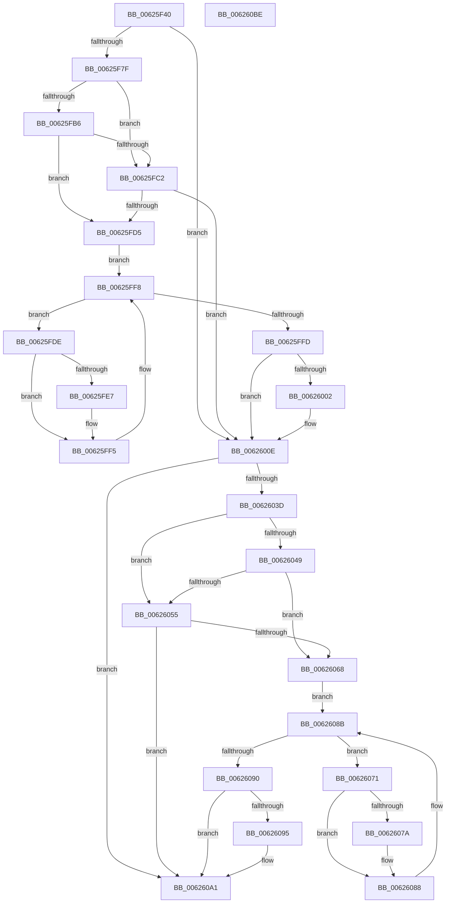

# DifIRP_MJ_QUERY_QUOTAWrapper

- RVA: `0x00625F40`–`0x006260BF` (길이 `383` bytes)
- VA: `0x0000000140625F40`
- 실행 섹션: `.text`
- PDB 이름 있음: `예`; PDB Function 태그: `아니요`
- unwind 정보 RVA: `0x00093E28`
- 디코드: `101`개 명령, `383/383` bytes 표시
- 미해석 바이트: `0` (있으면 어셈블리에 `.byte`로 보존)

> 이 문서는 커널 이미지의 기계어와 PDB 기호를 분석해 생성했습니다. 4번과 5번은 함수 원형과 자료형을 바이너리 사용 방식에서 추정한 C 해석이며 원본 소스 복구 결과는 아닙니다.

## 1. Dependencies

- 직접 호출 지점: **8**; 고유 호출 대상: **4**
- 직접 호출자로 확인된 함수: **0**
- RIP 상대 이미지 참조: **3**

### Outgoing calls
- `0x00625F6E` → [DifGetAPIThunkContextById](../49/DifGetAPIThunkContextById_function_00495A34.md) (function, `0x00495A34`)
- `0x00625FC9` → [ExAcquireRundownProtection](../21/ExAcquireRundownProtection_function_00216620.md) (function, `0x00216620`)
- `0x00625FF0` → [guard_dispatch_icall](../6B/guard_dispatch_icall_function_006BAAD0.md) (function, `0x006BAAD0`)
- `0x00626009` → [ExReleaseRundownProtection](../34/ExReleaseRundownProtection_function_00349E80.md) (function, `0x00349E80`)
- `0x0062602F` → [guard_dispatch_icall](../6B/guard_dispatch_icall_function_006BAAD0.md) (function, `0x006BAAD0`)
- `0x0062605C` → [ExAcquireRundownProtection](../21/ExAcquireRundownProtection_function_00216620.md) (function, `0x00216620`)
- `0x00626083` → [guard_dispatch_icall](../6B/guard_dispatch_icall_function_006BAAD0.md) (function, `0x006BAAD0`)
- `0x0062609C` → [ExReleaseRundownProtection](../34/ExReleaseRundownProtection_function_00349E80.md) (function, `0x00349E80`)

### Direct callers
- 이 함수 시작 RVA로 연결되는 직접 call은 확인되지 않았습니다. 간접 호출은 완전히 역산할 수 없습니다.

### Static image references
- `0x00625F89` → RVA `0x00F048B8` (`.data`; read)
- `0x00625FB6` → RVA `0x00F04980` (`.data`; read)
- `0x00625FC2` → RVA `0x00F03E80` (`.data`; read)

## 2. Other-region calls and transfers

- 다른 실행 섹션으로 향하는 call: **0**
- 별도 외부 분기/꼬리 이동을 확인하지 못했습니다.

## 3. Assembly (complete function range)

```asm
00625F40  48 8B C4                        mov rax, rsp
00625F43  48 89 58 08                     mov qword ptr [rax + 8], rbx
00625F47  48 89 68 10                     mov qword ptr [rax + 0x10], rbp
00625F4B  48 89 70 18                     mov qword ptr [rax + 0x18], rsi
00625F4F  57                              push rdi
00625F50  41 56                           push r14
00625F52  41 57                           push r15
00625F54  48 83 EC 40                     sub rsp, 0x40
00625F58  0F 57 C0                        xorps xmm0, xmm0
00625F5B  4C 8B F9                        mov r15, rcx
00625F5E  B9 19 00 00 10                  mov ecx, 0x10000019
00625F63  4C 8B F2                        mov r14, rdx
00625F66  0F 11 40 C8                     movups xmmword ptr [rax - 0x38], xmm0
00625F6A  0F 11 40 D8                     movups xmmword ptr [rax - 0x28], xmm0
00625F6E  E8 C1 FA E6 FF                  call 0x140495a34
00625F73  48 8B E8                        mov rbp, rax
00625F76  48 85 C0                        test rax, rax
00625F79  0F 84 8F 00 00 00               je 0x14062600e
00625F7F  49 8B 96 B8 00 00 00            mov rdx, qword ptr [r14 + 0xb8]
00625F86  40 32 F6                        xor sil, sil
00625F89  40 38 35 28 E9 8D 00            cmp byte ptr [rip + 0x8de928], sil
00625F90  49 8B 4F 08                     mov rcx, qword ptr [r15 + 8]
00625F94  44 0F B6 02                     movzx r8d, byte ptr [rdx]
00625F98  48 8B 51 30                     mov rdx, qword ptr [rcx + 0x30]
00625F9C  48 8B 4A 40                     mov rcx, qword ptr [rdx + 0x40]
00625FA0  4A 8B 54 C1 20                  mov rdx, qword ptr [rcx + r8*8 + 0x20]
00625FA5  48 89 54 24 20                  mov qword ptr [rsp + 0x20], rdx
00625FAA  4C 89 7C 24 30                  mov qword ptr [rsp + 0x30], r15
00625FAF  4C 89 74 24 28                  mov qword ptr [rsp + 0x28], r14
00625FB4  75 0C                           jne 0x140625fc2
00625FB6  F7 05 C0 E9 8D 00 00 08 00 00   test dword ptr [rip + 0x8de9c0], 0x800
00625FC0  74 13                           je 0x140625fd5
00625FC2  48 8D 0D B7 DE 8D 00            lea rcx, [rip + 0x8ddeb7]
00625FC9  E8 52 06 BF FF                  call 0x140216620
00625FCE  40 8A F0                        mov sil, al
00625FD1  84 C0                           test al, al
00625FD3  74 39                           je 0x14062600e
00625FD5  48 8D 7D 20                     lea rdi, [rbp + 0x20]
00625FD9  48 8B 1F                        mov rbx, qword ptr [rdi]
00625FDC  EB 1A                           jmp 0x140625ff8
00625FDE  48 8D 43 F0                     lea rax, [rbx - 0x10]
00625FE2  48 85 C0                        test rax, rax
00625FE5  74 0E                           je 0x140625ff5
00625FE7  48 8B 40 08                     mov rax, qword ptr [rax + 8]
00625FEB  48 8D 4C 24 20                  lea rcx, [rsp + 0x20]
00625FF0  E8 DB 4A 09 00                  call 0x1406baad0
00625FF5  48 8B 1B                        mov rbx, qword ptr [rbx]
00625FF8  48 3B DF                        cmp rbx, rdi
00625FFB  75 E1                           jne 0x140625fde
00625FFD  40 84 F6                        test sil, sil
00626000  74 0C                           je 0x14062600e
00626002  48 8D 0D 77 DE 8D 00            lea rcx, [rip + 0x8dde77]
00626009  E8 72 3E D2 FF                  call 0x140349e80
0062600E  49 8B 86 B8 00 00 00            mov rax, qword ptr [r14 + 0xb8]
00626015  0F B6 10                        movzx edx, byte ptr [rax]
00626018  49 8B 47 08                     mov rax, qword ptr [r15 + 8]
0062601C  48 8B 48 30                     mov rcx, qword ptr [rax + 0x30]
00626020  48 8B 41 40                     mov rax, qword ptr [rcx + 0x40]
00626024  49 8B CF                        mov rcx, r15
00626027  48 8B 44 D0 20                  mov rax, qword ptr [rax + rdx*8 + 0x20]
0062602C  49 8B D6                        mov rdx, r14
0062602F  E8 9C 4A 09 00                  call 0x1406baad0
00626034  89 44 24 38                     mov dword ptr [rsp + 0x38], eax
00626038  48 85 ED                        test rbp, rbp
0062603B  74 64                           je 0x1406260a1
0062603D  40 32 FF                        xor dil, dil
00626040  40 38 3D 71 E8 8D 00            cmp byte ptr [rip + 0x8de871], dil
00626047  75 0C                           jne 0x140626055
00626049  F7 05 2D E9 8D 00 00 08 00 00   test dword ptr [rip + 0x8de92d], 0x800
00626053  74 13                           je 0x140626068
00626055  48 8D 0D 24 DE 8D 00            lea rcx, [rip + 0x8dde24]
0062605C  E8 BF 05 BF FF                  call 0x140216620
00626061  40 8A F8                        mov dil, al
00626064  84 C0                           test al, al
00626066  74 39                           je 0x1406260a1
00626068  48 8D 75 30                     lea rsi, [rbp + 0x30]
0062606C  48 8B 1E                        mov rbx, qword ptr [rsi]
0062606F  EB 1A                           jmp 0x14062608b
00626071  48 8D 43 F0                     lea rax, [rbx - 0x10]
00626075  48 85 C0                        test rax, rax
00626078  74 0E                           je 0x140626088
0062607A  48 8B 40 08                     mov rax, qword ptr [rax + 8]
0062607E  48 8D 4C 24 20                  lea rcx, [rsp + 0x20]
00626083  E8 48 4A 09 00                  call 0x1406baad0
00626088  48 8B 1B                        mov rbx, qword ptr [rbx]
0062608B  48 3B DE                        cmp rbx, rsi
0062608E  75 E1                           jne 0x140626071
00626090  40 84 FF                        test dil, dil
00626093  74 0C                           je 0x1406260a1
00626095  48 8D 0D E4 DD 8D 00            lea rcx, [rip + 0x8ddde4]
0062609C  E8 DF 3D D2 FF                  call 0x140349e80
006260A1  8B 44 24 38                     mov eax, dword ptr [rsp + 0x38]
006260A5  48 8B 5C 24 60                  mov rbx, qword ptr [rsp + 0x60]
006260AA  48 8B 6C 24 68                  mov rbp, qword ptr [rsp + 0x68]
006260AF  48 8B 74 24 70                  mov rsi, qword ptr [rsp + 0x70]
006260B4  48 83 C4 40                     add rsp, 0x40
006260B8  41 5F                           pop r15
006260BA  41 5E                           pop r14
006260BC  5F                              pop rdi
006260BD  C3                              ret
006260BE  CC                              int3
```

## 4. C-style interpretation (structured pseudocode)

```c
__int64 __fastcall DifIRP_MJ_QUERY_QUOTAWrapper(__int64 a1, __int64 a2)
{
    __int64 result;
    __int64 v_rdi;
    __int64 v_rsi;
    __int64 v_rsp;
    unsigned int v_stack_m20;
    unsigned __int64 v_stack_m28;
    unsigned __int64 v_stack_m30;
    unsigned __int64 v_stack_m38;
    unsigned __int64 v_stack_p10;
    unsigned __int64 v_stack_p18;
    unsigned __int64 v_stack_p8;

    *(unsigned __int64 *)(v_rsp + 8) = v_rbx;
    *(unsigned __int64 *)(v_rsp + 16) = v_rbp;
    *(unsigned __int64 *)(v_rsp + 24) = v_rsi;
    v_rsp = (v_rsp) - (64);
    *(unsigned __int64 *)(v_rsp - 56) = v_xmm0;
    *(unsigned __int64 *)(v_rsp - 40) = v_xmm0;
    result = DifGetAPIThunkContextById((unsigned int)(0x10000019ULL), a2, a3, a4);
    if (result == 0) goto loc_0062600E;
    v_rsi = 0;
    v_stack_m38 = *(unsigned __int64 *)(*(unsigned __int64 *)(*(unsigned __int64 *)(*(unsigned __int64 *)(a1 + 8) + 48) + 64) + *(unsigned __int8 *)(*(unsigned __int64 *)(a2 + 184)) * 8 + 32);
    v_stack_m28 = a1;
    v_stack_m30 = a2;
    if ((*(unsigned __int8 *)(v_rip + 9300264)) != 0) goto loc_00625FC2;
    if (((*(unsigned int *)(v_rip + 9300416)) & (0x800ULL)) == 0) goto loc_00625FD5;
loc_00625FC2:
    result = ExAcquireRundownProtection(v_rip + 9297591, *(unsigned __int64 *)(*(unsigned __int64 *)(*(unsigned __int64 *)(*(unsigned __int64 *)(a1 + 8) + 48) + 64) + *(unsigned __int8 *)(*(unsigned __int64 *)(a2 + 184)) * 8 + 32), *(unsigned __int8 *)(*(unsigned __int64 *)(a2 + 184)), a4);
    if ((unsigned __int8)(result) == 0) goto loc_0062600E;
loc_00625FD5:
    goto loc_00625FF8;
loc_00625FDE:
    result = *(unsigned __int64 *)(result + 32) - 16;
    if (*(unsigned __int64 *)(result + 32) - 16 != 0) {
        result = *(unsigned __int64 *)(*(unsigned __int64 *)(result + 32) - 16 + 8);
        a1 = v_stack_m38;
        result = guard_dispatch_icall(a1, *(unsigned __int64 *)(*(unsigned __int64 *)(*(unsigned __int64 *)(*(unsigned __int64 *)(a1 + 8) + 48) + 64) + *(unsigned __int8 *)(*(unsigned __int64 *)(a2 + 184)) * 8 + 32), *(unsigned __int8 *)(*(unsigned __int64 *)(a2 + 184)), a4);
    }
loc_00625FF8:
    if ((*(unsigned __int64 *)(*(unsigned __int64 *)(result + 32))) != (result + 32)) goto loc_00625FDE;
    if ((unsigned __int8)((unsigned __int8)(result)) != 0) {
        a1 = v_rip + 9297527;
        result = ExReleaseRundownProtection(a1, *(unsigned __int64 *)(*(unsigned __int64 *)(*(unsigned __int64 *)(*(unsigned __int64 *)(a1 + 8) + 48) + 64) + *(unsigned __int8 *)(*(unsigned __int64 *)(a2 + 184)) * 8 + 32), *(unsigned __int8 *)(*(unsigned __int64 *)(a2 + 184)), a4);
    }
    result = guard_dispatch_icall(a1, a2, *(unsigned __int8 *)(*(unsigned __int64 *)(a2 + 184)), a4);
    v_stack_m20 = (unsigned int)(result);
    if (result == 0) goto loc_006260A1;
    v_rdi = 0;
    if ((*(unsigned __int8 *)(v_rip + 9300081)) != 0) goto loc_00626055;
    if (((*(unsigned int *)(v_rip + 9300269)) & (0x800ULL)) == 0) goto loc_00626068;
loc_00626055:
    result = ExAcquireRundownProtection(v_rip + 9297444, a2, *(unsigned __int8 *)(*(unsigned __int64 *)(a2 + 184)), a4);
    if ((unsigned __int8)(result) == 0) goto loc_006260A1;
loc_00626068:
    goto loc_0062608B;
loc_00626071:
    result = *(unsigned __int64 *)(result + 48) - 16;
    if (*(unsigned __int64 *)(result + 48) - 16 != 0) {
        result = *(unsigned __int64 *)(*(unsigned __int64 *)(result + 48) - 16 + 8);
        a1 = v_stack_m38;
        result = guard_dispatch_icall(a1, a2, *(unsigned __int8 *)(*(unsigned __int64 *)(a2 + 184)), a4);
    }
loc_0062608B:
    if ((*(unsigned __int64 *)(*(unsigned __int64 *)(result + 48))) != (result + 48)) goto loc_00626071;
    if ((unsigned __int8)((unsigned __int8)(result)) != 0) {
        a1 = v_rip + 9297380;
        result = ExReleaseRundownProtection(a1, a2, *(unsigned __int8 *)(*(unsigned __int64 *)(a2 + 184)), a4);
    }
    v_rsp = (v_rsp) + (64);
    return (unsigned int)(v_stack_m20);
}
```

## 5. (Beta) C Style

```c
int64_t DifIRP_MJ_QUERY_QUOTAWrapper(void *Arg1, void *Arg2)
{
    uint8_t *arg1 = (uint8_t *)Arg1;
    uint8_t *arg2 = (uint8_t *)Arg2;

    int64_t result;
    int64_t local_rdi;
    int64_t local_rsi;
    int64_t local_rsp;
    uint32_t v_stack_m20;
    uint64_t v_stack_m28;
    uint64_t v_stack_m30;
    uint64_t v_stack_m38;
    uint64_t v_stack_p10;
    uint64_t v_stack_p18;
    uint64_t v_stack_p8;

    *(uint64_t *)(local_rsp + 0x8) = local_rbx;
    *(uint64_t *)(local_rsp + 0x10) = local_rbp;
    *(uint64_t *)(local_rsp + 0x18) = local_rsi;
    local_rsp = (local_rsp) - (64);
    *(uint64_t *)(local_rsp - 0x38) = v_xmm0;
    *(uint64_t *)(local_rsp - 0x28) = v_xmm0;
    result = DifGetAPIThunkContextById((uint32_t)(0x10000019ULL), Arg2, a3, a4);
    if (result == 0) goto loc_0062600E;
    local_rsi = 0;
    v_stack_m38 = *(uint64_t *)(*(uint64_t *)(*(uint64_t *)(*(uint64_t *)(arg1 + 0x8) + 0x30) + 0x40) + *(uint8_t *)(*(uint64_t *)(arg2 + 0xB8)) * 8 + 0x20);
    v_stack_m28 = Arg1;
    v_stack_m30 = Arg2;
    if ((*(uint8_t *)(v_rip + 0x8DE928)) != 0) goto loc_00625FC2;
    if (((*(uint32_t *)(v_rip + 0x8DE9C0)) & (0x800ULL)) == 0) goto loc_00625FD5;
loc_00625FC2:
    result = ExAcquireRundownProtection(v_rip + 9297591, *(uint64_t *)(*(uint64_t *)(*(uint64_t *)(*(uint64_t *)(arg1 + 0x8) + 0x30) + 0x40) + *(uint8_t *)(*(uint64_t *)(arg2 + 0xB8)) * 8 + 0x20), *(uint8_t *)(*(uint64_t *)(arg2 + 0xB8)), a4);
    if ((uint8_t)(result) == 0) goto loc_0062600E;
loc_00625FD5:
    goto loc_00625FF8;
loc_00625FDE:
    result = *(uint64_t *)(result + 0x20) - 16;
    if (*(uint64_t *)(result + 0x20) - 16 != 0) {
        result = *(uint64_t *)(*(uint64_t *)(result + 0x20) - 0x10 + 0x8);
        Arg1 = v_stack_m38;
        result = guard_dispatch_icall(Arg1, *(uint64_t *)(*(uint64_t *)(*(uint64_t *)(*(uint64_t *)(arg1 + 0x8) + 0x30) + 0x40) + *(uint8_t *)(*(uint64_t *)(arg2 + 0xB8)) * 8 + 0x20), *(uint8_t *)(*(uint64_t *)(arg2 + 0xB8)), a4);
    }
loc_00625FF8:
    if ((*(uint64_t *)(*(uint64_t *)(result + 0x20))) != (result + 32)) goto loc_00625FDE;
    if ((uint8_t)((uint8_t)(result)) != 0) {
        Arg1 = v_rip + 9297527;
        result = ExReleaseRundownProtection(Arg1, *(uint64_t *)(*(uint64_t *)(*(uint64_t *)(*(uint64_t *)(arg1 + 0x8) + 0x30) + 0x40) + *(uint8_t *)(*(uint64_t *)(arg2 + 0xB8)) * 8 + 0x20), *(uint8_t *)(*(uint64_t *)(arg2 + 0xB8)), a4);
    }
    result = guard_dispatch_icall(Arg1, Arg2, *(uint8_t *)(*(uint64_t *)(arg2 + 0xB8)), a4);
    v_stack_m20 = (uint32_t)(result);
    if (result == 0) goto loc_006260A1;
    local_rdi = 0;
    if ((*(uint8_t *)(v_rip + 0x8DE871)) != 0) goto loc_00626055;
    if (((*(uint32_t *)(v_rip + 0x8DE92D)) & (0x800ULL)) == 0) goto loc_00626068;
loc_00626055:
    result = ExAcquireRundownProtection(v_rip + 9297444, Arg2, *(uint8_t *)(*(uint64_t *)(arg2 + 0xB8)), a4);
    if ((uint8_t)(result) == 0) goto loc_006260A1;
loc_00626068:
    goto loc_0062608B;
loc_00626071:
    result = *(uint64_t *)(result + 0x30) - 16;
    if (*(uint64_t *)(result + 0x30) - 16 != 0) {
        result = *(uint64_t *)(*(uint64_t *)(result + 0x30) - 0x10 + 0x8);
        Arg1 = v_stack_m38;
        result = guard_dispatch_icall(Arg1, Arg2, *(uint8_t *)(*(uint64_t *)(arg2 + 0xB8)), a4);
    }
loc_0062608B:
    if ((*(uint64_t *)(*(uint64_t *)(result + 0x30))) != (result + 48)) goto loc_00626071;
    if ((uint8_t)((uint8_t)(result)) != 0) {
        Arg1 = v_rip + 9297380;
        result = ExReleaseRundownProtection(Arg1, Arg2, *(uint8_t *)(*(uint64_t *)(arg2 + 0xB8)), a4);
    }
    local_rsp = (local_rsp) + (64);
    return (uint32_t)(v_stack_m20);
}
```

### 관측된 메모리 오프셋

구조체 형식이 확인되지 않은 접근은 인자 기준의 오프셋으로만 기록했습니다.

| 기준 인자 | 오프셋 표현 | 폭 (bit) | 접근 |
|---|---:|---:|---|
| `Arg1` | `+ 0x8` | `64` | `R` |
| `Arg2` | `+ 0xB8` | `64` | `R` |

## 6. Execution-region graph

[열기: 2D/3D 그래프와 함수 탐색 컨트롤 패널](../../../control-panel.html?section=text&rva=0x00625F40&view=graph)

- 2D 그래프는 위에서 아래로 흐르고, 3D 그래프는 빈 공간을 드래그해 회전합니다. Shift+드래그는 이동, 휠은 확대·축소, 함수 노드 선택은 대상 보고서 이동입니다.

### Static fallback


