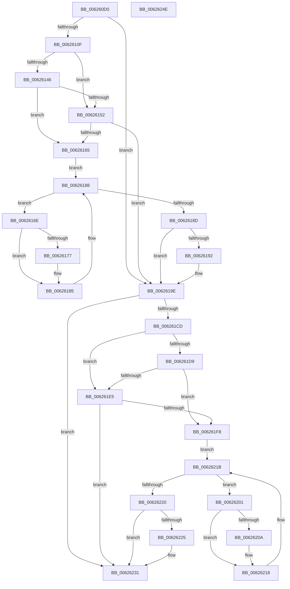

# DifIRP_MJ_QUERY_SECURITYWrapper

- RVA: `0x006260D0`–`0x0062624F` (길이 `383` bytes)
- VA: `0x00000001406260D0`
- 실행 섹션: `.text`
- PDB 이름 있음: `예`; PDB Function 태그: `아니요`
- unwind 정보 RVA: `0x00093E28`
- 디코드: `101`개 명령, `383/383` bytes 표시
- 미해석 바이트: `0` (있으면 어셈블리에 `.byte`로 보존)

> 이 문서는 커널 이미지의 기계어와 PDB 기호를 분석해 생성했습니다. 4번과 5번은 함수 원형과 자료형을 바이너리 사용 방식에서 추정한 C 해석이며 원본 소스 복구 결과는 아닙니다.

## 1. Dependencies

- 직접 호출 지점: **8**; 고유 호출 대상: **4**
- 직접 호출자로 확인된 함수: **0**
- RIP 상대 이미지 참조: **3**

### Outgoing calls
- `0x006260FE` → [DifGetAPIThunkContextById](../49/DifGetAPIThunkContextById_function_00495A34.md) (function, `0x00495A34`)
- `0x00626159` → [ExAcquireRundownProtection](../21/ExAcquireRundownProtection_function_00216620.md) (function, `0x00216620`)
- `0x00626180` → [guard_dispatch_icall](../6B/guard_dispatch_icall_function_006BAAD0.md) (function, `0x006BAAD0`)
- `0x00626199` → [ExReleaseRundownProtection](../34/ExReleaseRundownProtection_function_00349E80.md) (function, `0x00349E80`)
- `0x006261BF` → [guard_dispatch_icall](../6B/guard_dispatch_icall_function_006BAAD0.md) (function, `0x006BAAD0`)
- `0x006261EC` → [ExAcquireRundownProtection](../21/ExAcquireRundownProtection_function_00216620.md) (function, `0x00216620`)
- `0x00626213` → [guard_dispatch_icall](../6B/guard_dispatch_icall_function_006BAAD0.md) (function, `0x006BAAD0`)
- `0x0062622C` → [ExReleaseRundownProtection](../34/ExReleaseRundownProtection_function_00349E80.md) (function, `0x00349E80`)

### Direct callers
- 이 함수 시작 RVA로 연결되는 직접 call은 확인되지 않았습니다. 간접 호출은 완전히 역산할 수 없습니다.

### Static image references
- `0x00626119` → RVA `0x00F048B8` (`.data`; read)
- `0x00626146` → RVA `0x00F04980` (`.data`; read)
- `0x00626152` → RVA `0x00F03E80` (`.data`; read)

## 2. Other-region calls and transfers

- 다른 실행 섹션으로 향하는 call: **0**
- 별도 외부 분기/꼬리 이동을 확인하지 못했습니다.

## 3. Assembly (complete function range)

```asm
006260D0  48 8B C4                        mov rax, rsp
006260D3  48 89 58 08                     mov qword ptr [rax + 8], rbx
006260D7  48 89 68 10                     mov qword ptr [rax + 0x10], rbp
006260DB  48 89 70 18                     mov qword ptr [rax + 0x18], rsi
006260DF  57                              push rdi
006260E0  41 56                           push r14
006260E2  41 57                           push r15
006260E4  48 83 EC 40                     sub rsp, 0x40
006260E8  0F 57 C0                        xorps xmm0, xmm0
006260EB  4C 8B F9                        mov r15, rcx
006260EE  B9 14 00 00 10                  mov ecx, 0x10000014
006260F3  4C 8B F2                        mov r14, rdx
006260F6  0F 11 40 C8                     movups xmmword ptr [rax - 0x38], xmm0
006260FA  0F 11 40 D8                     movups xmmword ptr [rax - 0x28], xmm0
006260FE  E8 31 F9 E6 FF                  call 0x140495a34
00626103  48 8B E8                        mov rbp, rax
00626106  48 85 C0                        test rax, rax
00626109  0F 84 8F 00 00 00               je 0x14062619e
0062610F  49 8B 96 B8 00 00 00            mov rdx, qword ptr [r14 + 0xb8]
00626116  40 32 F6                        xor sil, sil
00626119  40 38 35 98 E7 8D 00            cmp byte ptr [rip + 0x8de798], sil
00626120  49 8B 4F 08                     mov rcx, qword ptr [r15 + 8]
00626124  44 0F B6 02                     movzx r8d, byte ptr [rdx]
00626128  48 8B 51 30                     mov rdx, qword ptr [rcx + 0x30]
0062612C  48 8B 4A 40                     mov rcx, qword ptr [rdx + 0x40]
00626130  4A 8B 54 C1 20                  mov rdx, qword ptr [rcx + r8*8 + 0x20]
00626135  48 89 54 24 20                  mov qword ptr [rsp + 0x20], rdx
0062613A  4C 89 7C 24 30                  mov qword ptr [rsp + 0x30], r15
0062613F  4C 89 74 24 28                  mov qword ptr [rsp + 0x28], r14
00626144  75 0C                           jne 0x140626152
00626146  F7 05 30 E8 8D 00 00 08 00 00   test dword ptr [rip + 0x8de830], 0x800
00626150  74 13                           je 0x140626165
00626152  48 8D 0D 27 DD 8D 00            lea rcx, [rip + 0x8ddd27]
00626159  E8 C2 04 BF FF                  call 0x140216620
0062615E  40 8A F0                        mov sil, al
00626161  84 C0                           test al, al
00626163  74 39                           je 0x14062619e
00626165  48 8D 7D 20                     lea rdi, [rbp + 0x20]
00626169  48 8B 1F                        mov rbx, qword ptr [rdi]
0062616C  EB 1A                           jmp 0x140626188
0062616E  48 8D 43 F0                     lea rax, [rbx - 0x10]
00626172  48 85 C0                        test rax, rax
00626175  74 0E                           je 0x140626185
00626177  48 8B 40 08                     mov rax, qword ptr [rax + 8]
0062617B  48 8D 4C 24 20                  lea rcx, [rsp + 0x20]
00626180  E8 4B 49 09 00                  call 0x1406baad0
00626185  48 8B 1B                        mov rbx, qword ptr [rbx]
00626188  48 3B DF                        cmp rbx, rdi
0062618B  75 E1                           jne 0x14062616e
0062618D  40 84 F6                        test sil, sil
00626190  74 0C                           je 0x14062619e
00626192  48 8D 0D E7 DC 8D 00            lea rcx, [rip + 0x8ddce7]
00626199  E8 E2 3C D2 FF                  call 0x140349e80
0062619E  49 8B 86 B8 00 00 00            mov rax, qword ptr [r14 + 0xb8]
006261A5  0F B6 10                        movzx edx, byte ptr [rax]
006261A8  49 8B 47 08                     mov rax, qword ptr [r15 + 8]
006261AC  48 8B 48 30                     mov rcx, qword ptr [rax + 0x30]
006261B0  48 8B 41 40                     mov rax, qword ptr [rcx + 0x40]
006261B4  49 8B CF                        mov rcx, r15
006261B7  48 8B 44 D0 20                  mov rax, qword ptr [rax + rdx*8 + 0x20]
006261BC  49 8B D6                        mov rdx, r14
006261BF  E8 0C 49 09 00                  call 0x1406baad0
006261C4  89 44 24 38                     mov dword ptr [rsp + 0x38], eax
006261C8  48 85 ED                        test rbp, rbp
006261CB  74 64                           je 0x140626231
006261CD  40 32 FF                        xor dil, dil
006261D0  40 38 3D E1 E6 8D 00            cmp byte ptr [rip + 0x8de6e1], dil
006261D7  75 0C                           jne 0x1406261e5
006261D9  F7 05 9D E7 8D 00 00 08 00 00   test dword ptr [rip + 0x8de79d], 0x800
006261E3  74 13                           je 0x1406261f8
006261E5  48 8D 0D 94 DC 8D 00            lea rcx, [rip + 0x8ddc94]
006261EC  E8 2F 04 BF FF                  call 0x140216620
006261F1  40 8A F8                        mov dil, al
006261F4  84 C0                           test al, al
006261F6  74 39                           je 0x140626231
006261F8  48 8D 75 30                     lea rsi, [rbp + 0x30]
006261FC  48 8B 1E                        mov rbx, qword ptr [rsi]
006261FF  EB 1A                           jmp 0x14062621b
00626201  48 8D 43 F0                     lea rax, [rbx - 0x10]
00626205  48 85 C0                        test rax, rax
00626208  74 0E                           je 0x140626218
0062620A  48 8B 40 08                     mov rax, qword ptr [rax + 8]
0062620E  48 8D 4C 24 20                  lea rcx, [rsp + 0x20]
00626213  E8 B8 48 09 00                  call 0x1406baad0
00626218  48 8B 1B                        mov rbx, qword ptr [rbx]
0062621B  48 3B DE                        cmp rbx, rsi
0062621E  75 E1                           jne 0x140626201
00626220  40 84 FF                        test dil, dil
00626223  74 0C                           je 0x140626231
00626225  48 8D 0D 54 DC 8D 00            lea rcx, [rip + 0x8ddc54]
0062622C  E8 4F 3C D2 FF                  call 0x140349e80
00626231  8B 44 24 38                     mov eax, dword ptr [rsp + 0x38]
00626235  48 8B 5C 24 60                  mov rbx, qword ptr [rsp + 0x60]
0062623A  48 8B 6C 24 68                  mov rbp, qword ptr [rsp + 0x68]
0062623F  48 8B 74 24 70                  mov rsi, qword ptr [rsp + 0x70]
00626244  48 83 C4 40                     add rsp, 0x40
00626248  41 5F                           pop r15
0062624A  41 5E                           pop r14
0062624C  5F                              pop rdi
0062624D  C3                              ret
0062624E  CC                              int3
```

## 4. C-style interpretation (structured pseudocode)

```c
__int64 __fastcall DifIRP_MJ_QUERY_SECURITYWrapper(__int64 a1, __int64 a2)
{
    __int64 result;
    __int64 v_rdi;
    __int64 v_rsi;
    __int64 v_rsp;
    unsigned int v_stack_m20;
    unsigned __int64 v_stack_m28;
    unsigned __int64 v_stack_m30;
    unsigned __int64 v_stack_m38;
    unsigned __int64 v_stack_p10;
    unsigned __int64 v_stack_p18;
    unsigned __int64 v_stack_p8;

    *(unsigned __int64 *)(v_rsp + 8) = v_rbx;
    *(unsigned __int64 *)(v_rsp + 16) = v_rbp;
    *(unsigned __int64 *)(v_rsp + 24) = v_rsi;
    v_rsp = (v_rsp) - (64);
    *(unsigned __int64 *)(v_rsp - 56) = v_xmm0;
    *(unsigned __int64 *)(v_rsp - 40) = v_xmm0;
    result = DifGetAPIThunkContextById((unsigned int)(0x10000014ULL), a2, a3, a4);
    if (result == 0) goto loc_0062619E;
    v_rsi = 0;
    v_stack_m38 = *(unsigned __int64 *)(*(unsigned __int64 *)(*(unsigned __int64 *)(*(unsigned __int64 *)(a1 + 8) + 48) + 64) + *(unsigned __int8 *)(*(unsigned __int64 *)(a2 + 184)) * 8 + 32);
    v_stack_m28 = a1;
    v_stack_m30 = a2;
    if ((*(unsigned __int8 *)(v_rip + 9299864)) != 0) goto loc_00626152;
    if (((*(unsigned int *)(v_rip + 9300016)) & (0x800ULL)) == 0) goto loc_00626165;
loc_00626152:
    result = ExAcquireRundownProtection(v_rip + 9297191, *(unsigned __int64 *)(*(unsigned __int64 *)(*(unsigned __int64 *)(*(unsigned __int64 *)(a1 + 8) + 48) + 64) + *(unsigned __int8 *)(*(unsigned __int64 *)(a2 + 184)) * 8 + 32), *(unsigned __int8 *)(*(unsigned __int64 *)(a2 + 184)), a4);
    if ((unsigned __int8)(result) == 0) goto loc_0062619E;
loc_00626165:
    goto loc_00626188;
loc_0062616E:
    result = *(unsigned __int64 *)(result + 32) - 16;
    if (*(unsigned __int64 *)(result + 32) - 16 != 0) {
        result = *(unsigned __int64 *)(*(unsigned __int64 *)(result + 32) - 16 + 8);
        a1 = v_stack_m38;
        result = guard_dispatch_icall(a1, *(unsigned __int64 *)(*(unsigned __int64 *)(*(unsigned __int64 *)(*(unsigned __int64 *)(a1 + 8) + 48) + 64) + *(unsigned __int8 *)(*(unsigned __int64 *)(a2 + 184)) * 8 + 32), *(unsigned __int8 *)(*(unsigned __int64 *)(a2 + 184)), a4);
    }
loc_00626188:
    if ((*(unsigned __int64 *)(*(unsigned __int64 *)(result + 32))) != (result + 32)) goto loc_0062616E;
    if ((unsigned __int8)((unsigned __int8)(result)) != 0) {
        a1 = v_rip + 9297127;
        result = ExReleaseRundownProtection(a1, *(unsigned __int64 *)(*(unsigned __int64 *)(*(unsigned __int64 *)(*(unsigned __int64 *)(a1 + 8) + 48) + 64) + *(unsigned __int8 *)(*(unsigned __int64 *)(a2 + 184)) * 8 + 32), *(unsigned __int8 *)(*(unsigned __int64 *)(a2 + 184)), a4);
    }
    result = guard_dispatch_icall(a1, a2, *(unsigned __int8 *)(*(unsigned __int64 *)(a2 + 184)), a4);
    v_stack_m20 = (unsigned int)(result);
    if (result == 0) goto loc_00626231;
    v_rdi = 0;
    if ((*(unsigned __int8 *)(v_rip + 9299681)) != 0) goto loc_006261E5;
    if (((*(unsigned int *)(v_rip + 9299869)) & (0x800ULL)) == 0) goto loc_006261F8;
loc_006261E5:
    result = ExAcquireRundownProtection(v_rip + 9297044, a2, *(unsigned __int8 *)(*(unsigned __int64 *)(a2 + 184)), a4);
    if ((unsigned __int8)(result) == 0) goto loc_00626231;
loc_006261F8:
    goto loc_0062621B;
loc_00626201:
    result = *(unsigned __int64 *)(result + 48) - 16;
    if (*(unsigned __int64 *)(result + 48) - 16 != 0) {
        result = *(unsigned __int64 *)(*(unsigned __int64 *)(result + 48) - 16 + 8);
        a1 = v_stack_m38;
        result = guard_dispatch_icall(a1, a2, *(unsigned __int8 *)(*(unsigned __int64 *)(a2 + 184)), a4);
    }
loc_0062621B:
    if ((*(unsigned __int64 *)(*(unsigned __int64 *)(result + 48))) != (result + 48)) goto loc_00626201;
    if ((unsigned __int8)((unsigned __int8)(result)) != 0) {
        a1 = v_rip + 9296980;
        result = ExReleaseRundownProtection(a1, a2, *(unsigned __int8 *)(*(unsigned __int64 *)(a2 + 184)), a4);
    }
    v_rsp = (v_rsp) + (64);
    return (unsigned int)(v_stack_m20);
}
```

## 5. (Beta) C Style

```c
int64_t DifIRP_MJ_QUERY_SECURITYWrapper(void *Arg1, void *Arg2)
{
    uint8_t *arg1 = (uint8_t *)Arg1;
    uint8_t *arg2 = (uint8_t *)Arg2;

    int64_t result;
    int64_t local_rdi;
    int64_t local_rsi;
    int64_t local_rsp;
    uint32_t v_stack_m20;
    uint64_t v_stack_m28;
    uint64_t v_stack_m30;
    uint64_t v_stack_m38;
    uint64_t v_stack_p10;
    uint64_t v_stack_p18;
    uint64_t v_stack_p8;

    *(uint64_t *)(local_rsp + 0x8) = local_rbx;
    *(uint64_t *)(local_rsp + 0x10) = local_rbp;
    *(uint64_t *)(local_rsp + 0x18) = local_rsi;
    local_rsp = (local_rsp) - (64);
    *(uint64_t *)(local_rsp - 0x38) = v_xmm0;
    *(uint64_t *)(local_rsp - 0x28) = v_xmm0;
    result = DifGetAPIThunkContextById((uint32_t)(0x10000014ULL), Arg2, a3, a4);
    if (result == 0) goto loc_0062619E;
    local_rsi = 0;
    v_stack_m38 = *(uint64_t *)(*(uint64_t *)(*(uint64_t *)(*(uint64_t *)(arg1 + 0x8) + 0x30) + 0x40) + *(uint8_t *)(*(uint64_t *)(arg2 + 0xB8)) * 8 + 0x20);
    v_stack_m28 = Arg1;
    v_stack_m30 = Arg2;
    if ((*(uint8_t *)(v_rip + 0x8DE798)) != 0) goto loc_00626152;
    if (((*(uint32_t *)(v_rip + 0x8DE830)) & (0x800ULL)) == 0) goto loc_00626165;
loc_00626152:
    result = ExAcquireRundownProtection(v_rip + 9297191, *(uint64_t *)(*(uint64_t *)(*(uint64_t *)(*(uint64_t *)(arg1 + 0x8) + 0x30) + 0x40) + *(uint8_t *)(*(uint64_t *)(arg2 + 0xB8)) * 8 + 0x20), *(uint8_t *)(*(uint64_t *)(arg2 + 0xB8)), a4);
    if ((uint8_t)(result) == 0) goto loc_0062619E;
loc_00626165:
    goto loc_00626188;
loc_0062616E:
    result = *(uint64_t *)(result + 0x20) - 16;
    if (*(uint64_t *)(result + 0x20) - 16 != 0) {
        result = *(uint64_t *)(*(uint64_t *)(result + 0x20) - 0x10 + 0x8);
        Arg1 = v_stack_m38;
        result = guard_dispatch_icall(Arg1, *(uint64_t *)(*(uint64_t *)(*(uint64_t *)(*(uint64_t *)(arg1 + 0x8) + 0x30) + 0x40) + *(uint8_t *)(*(uint64_t *)(arg2 + 0xB8)) * 8 + 0x20), *(uint8_t *)(*(uint64_t *)(arg2 + 0xB8)), a4);
    }
loc_00626188:
    if ((*(uint64_t *)(*(uint64_t *)(result + 0x20))) != (result + 32)) goto loc_0062616E;
    if ((uint8_t)((uint8_t)(result)) != 0) {
        Arg1 = v_rip + 9297127;
        result = ExReleaseRundownProtection(Arg1, *(uint64_t *)(*(uint64_t *)(*(uint64_t *)(*(uint64_t *)(arg1 + 0x8) + 0x30) + 0x40) + *(uint8_t *)(*(uint64_t *)(arg2 + 0xB8)) * 8 + 0x20), *(uint8_t *)(*(uint64_t *)(arg2 + 0xB8)), a4);
    }
    result = guard_dispatch_icall(Arg1, Arg2, *(uint8_t *)(*(uint64_t *)(arg2 + 0xB8)), a4);
    v_stack_m20 = (uint32_t)(result);
    if (result == 0) goto loc_00626231;
    local_rdi = 0;
    if ((*(uint8_t *)(v_rip + 0x8DE6E1)) != 0) goto loc_006261E5;
    if (((*(uint32_t *)(v_rip + 0x8DE79D)) & (0x800ULL)) == 0) goto loc_006261F8;
loc_006261E5:
    result = ExAcquireRundownProtection(v_rip + 9297044, Arg2, *(uint8_t *)(*(uint64_t *)(arg2 + 0xB8)), a4);
    if ((uint8_t)(result) == 0) goto loc_00626231;
loc_006261F8:
    goto loc_0062621B;
loc_00626201:
    result = *(uint64_t *)(result + 0x30) - 16;
    if (*(uint64_t *)(result + 0x30) - 16 != 0) {
        result = *(uint64_t *)(*(uint64_t *)(result + 0x30) - 0x10 + 0x8);
        Arg1 = v_stack_m38;
        result = guard_dispatch_icall(Arg1, Arg2, *(uint8_t *)(*(uint64_t *)(arg2 + 0xB8)), a4);
    }
loc_0062621B:
    if ((*(uint64_t *)(*(uint64_t *)(result + 0x30))) != (result + 48)) goto loc_00626201;
    if ((uint8_t)((uint8_t)(result)) != 0) {
        Arg1 = v_rip + 9296980;
        result = ExReleaseRundownProtection(Arg1, Arg2, *(uint8_t *)(*(uint64_t *)(arg2 + 0xB8)), a4);
    }
    local_rsp = (local_rsp) + (64);
    return (uint32_t)(v_stack_m20);
}
```

### 관측된 메모리 오프셋

구조체 형식이 확인되지 않은 접근은 인자 기준의 오프셋으로만 기록했습니다.

| 기준 인자 | 오프셋 표현 | 폭 (bit) | 접근 |
|---|---:|---:|---|
| `Arg1` | `+ 0x8` | `64` | `R` |
| `Arg2` | `+ 0xB8` | `64` | `R` |

## 6. Execution-region graph

[열기: 2D/3D 그래프와 함수 탐색 컨트롤 패널](../../../control-panel.html?section=text&rva=0x006260D0&view=graph)

- 2D 그래프는 위에서 아래로 흐르고, 3D 그래프는 빈 공간을 드래그해 회전합니다. Shift+드래그는 이동, 휠은 확대·축소, 함수 노드 선택은 대상 보고서 이동입니다.

### Static fallback


