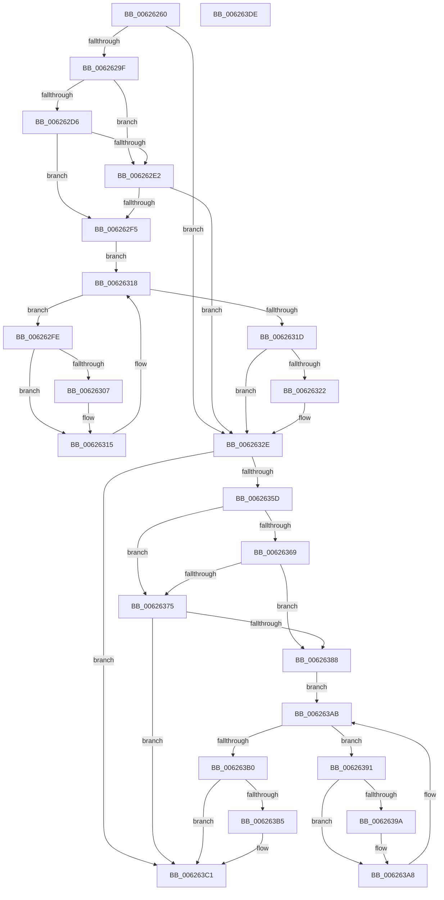

# DifIRP_MJ_QUERY_VOLUME_INFORMATIONWrapper

- RVA: `0x00626260`–`0x006263DF` (길이 `383` bytes)
- VA: `0x0000000140626260`
- 실행 섹션: `.text`
- PDB 이름 있음: `예`; PDB Function 태그: `아니요`
- unwind 정보 RVA: `0x00093E28`
- 디코드: `101`개 명령, `383/383` bytes 표시
- 미해석 바이트: `0` (있으면 어셈블리에 `.byte`로 보존)

> 이 문서는 커널 이미지의 기계어와 PDB 기호를 분석해 생성했습니다. 4번과 5번은 함수 원형과 자료형을 바이너리 사용 방식에서 추정한 C 해석이며 원본 소스 복구 결과는 아닙니다.

## 1. Dependencies

- 직접 호출 지점: **8**; 고유 호출 대상: **4**
- 직접 호출자로 확인된 함수: **0**
- RIP 상대 이미지 참조: **3**

### Outgoing calls
- `0x0062628E` → [DifGetAPIThunkContextById](../49/DifGetAPIThunkContextById_function_00495A34.md) (function, `0x00495A34`)
- `0x006262E9` → [ExAcquireRundownProtection](../21/ExAcquireRundownProtection_function_00216620.md) (function, `0x00216620`)
- `0x00626310` → [guard_dispatch_icall](../6B/guard_dispatch_icall_function_006BAAD0.md) (function, `0x006BAAD0`)
- `0x00626329` → [ExReleaseRundownProtection](../34/ExReleaseRundownProtection_function_00349E80.md) (function, `0x00349E80`)
- `0x0062634F` → [guard_dispatch_icall](../6B/guard_dispatch_icall_function_006BAAD0.md) (function, `0x006BAAD0`)
- `0x0062637C` → [ExAcquireRundownProtection](../21/ExAcquireRundownProtection_function_00216620.md) (function, `0x00216620`)
- `0x006263A3` → [guard_dispatch_icall](../6B/guard_dispatch_icall_function_006BAAD0.md) (function, `0x006BAAD0`)
- `0x006263BC` → [ExReleaseRundownProtection](../34/ExReleaseRundownProtection_function_00349E80.md) (function, `0x00349E80`)

### Direct callers
- 이 함수 시작 RVA로 연결되는 직접 call은 확인되지 않았습니다. 간접 호출은 완전히 역산할 수 없습니다.

### Static image references
- `0x006262A9` → RVA `0x00F048B8` (`.data`; read)
- `0x006262D6` → RVA `0x00F04980` (`.data`; read)
- `0x006262E2` → RVA `0x00F03E80` (`.data`; read)

## 2. Other-region calls and transfers

- 다른 실행 섹션으로 향하는 call: **0**
- 별도 외부 분기/꼬리 이동을 확인하지 못했습니다.

## 3. Assembly (complete function range)

```asm
00626260  48 8B C4                        mov rax, rsp
00626263  48 89 58 08                     mov qword ptr [rax + 8], rbx
00626267  48 89 68 10                     mov qword ptr [rax + 0x10], rbp
0062626B  48 89 70 18                     mov qword ptr [rax + 0x18], rsi
0062626F  57                              push rdi
00626270  41 56                           push r14
00626272  41 57                           push r15
00626274  48 83 EC 40                     sub rsp, 0x40
00626278  0F 57 C0                        xorps xmm0, xmm0
0062627B  4C 8B F9                        mov r15, rcx
0062627E  B9 0A 00 00 10                  mov ecx, 0x1000000a
00626283  4C 8B F2                        mov r14, rdx
00626286  0F 11 40 C8                     movups xmmword ptr [rax - 0x38], xmm0
0062628A  0F 11 40 D8                     movups xmmword ptr [rax - 0x28], xmm0
0062628E  E8 A1 F7 E6 FF                  call 0x140495a34
00626293  48 8B E8                        mov rbp, rax
00626296  48 85 C0                        test rax, rax
00626299  0F 84 8F 00 00 00               je 0x14062632e
0062629F  49 8B 96 B8 00 00 00            mov rdx, qword ptr [r14 + 0xb8]
006262A6  40 32 F6                        xor sil, sil
006262A9  40 38 35 08 E6 8D 00            cmp byte ptr [rip + 0x8de608], sil
006262B0  49 8B 4F 08                     mov rcx, qword ptr [r15 + 8]
006262B4  44 0F B6 02                     movzx r8d, byte ptr [rdx]
006262B8  48 8B 51 30                     mov rdx, qword ptr [rcx + 0x30]
006262BC  48 8B 4A 40                     mov rcx, qword ptr [rdx + 0x40]
006262C0  4A 8B 54 C1 20                  mov rdx, qword ptr [rcx + r8*8 + 0x20]
006262C5  48 89 54 24 20                  mov qword ptr [rsp + 0x20], rdx
006262CA  4C 89 7C 24 30                  mov qword ptr [rsp + 0x30], r15
006262CF  4C 89 74 24 28                  mov qword ptr [rsp + 0x28], r14
006262D4  75 0C                           jne 0x1406262e2
006262D6  F7 05 A0 E6 8D 00 00 08 00 00   test dword ptr [rip + 0x8de6a0], 0x800
006262E0  74 13                           je 0x1406262f5
006262E2  48 8D 0D 97 DB 8D 00            lea rcx, [rip + 0x8ddb97]
006262E9  E8 32 03 BF FF                  call 0x140216620
006262EE  40 8A F0                        mov sil, al
006262F1  84 C0                           test al, al
006262F3  74 39                           je 0x14062632e
006262F5  48 8D 7D 20                     lea rdi, [rbp + 0x20]
006262F9  48 8B 1F                        mov rbx, qword ptr [rdi]
006262FC  EB 1A                           jmp 0x140626318
006262FE  48 8D 43 F0                     lea rax, [rbx - 0x10]
00626302  48 85 C0                        test rax, rax
00626305  74 0E                           je 0x140626315
00626307  48 8B 40 08                     mov rax, qword ptr [rax + 8]
0062630B  48 8D 4C 24 20                  lea rcx, [rsp + 0x20]
00626310  E8 BB 47 09 00                  call 0x1406baad0
00626315  48 8B 1B                        mov rbx, qword ptr [rbx]
00626318  48 3B DF                        cmp rbx, rdi
0062631B  75 E1                           jne 0x1406262fe
0062631D  40 84 F6                        test sil, sil
00626320  74 0C                           je 0x14062632e
00626322  48 8D 0D 57 DB 8D 00            lea rcx, [rip + 0x8ddb57]
00626329  E8 52 3B D2 FF                  call 0x140349e80
0062632E  49 8B 86 B8 00 00 00            mov rax, qword ptr [r14 + 0xb8]
00626335  0F B6 10                        movzx edx, byte ptr [rax]
00626338  49 8B 47 08                     mov rax, qword ptr [r15 + 8]
0062633C  48 8B 48 30                     mov rcx, qword ptr [rax + 0x30]
00626340  48 8B 41 40                     mov rax, qword ptr [rcx + 0x40]
00626344  49 8B CF                        mov rcx, r15
00626347  48 8B 44 D0 20                  mov rax, qword ptr [rax + rdx*8 + 0x20]
0062634C  49 8B D6                        mov rdx, r14
0062634F  E8 7C 47 09 00                  call 0x1406baad0
00626354  89 44 24 38                     mov dword ptr [rsp + 0x38], eax
00626358  48 85 ED                        test rbp, rbp
0062635B  74 64                           je 0x1406263c1
0062635D  40 32 FF                        xor dil, dil
00626360  40 38 3D 51 E5 8D 00            cmp byte ptr [rip + 0x8de551], dil
00626367  75 0C                           jne 0x140626375
00626369  F7 05 0D E6 8D 00 00 08 00 00   test dword ptr [rip + 0x8de60d], 0x800
00626373  74 13                           je 0x140626388
00626375  48 8D 0D 04 DB 8D 00            lea rcx, [rip + 0x8ddb04]
0062637C  E8 9F 02 BF FF                  call 0x140216620
00626381  40 8A F8                        mov dil, al
00626384  84 C0                           test al, al
00626386  74 39                           je 0x1406263c1
00626388  48 8D 75 30                     lea rsi, [rbp + 0x30]
0062638C  48 8B 1E                        mov rbx, qword ptr [rsi]
0062638F  EB 1A                           jmp 0x1406263ab
00626391  48 8D 43 F0                     lea rax, [rbx - 0x10]
00626395  48 85 C0                        test rax, rax
00626398  74 0E                           je 0x1406263a8
0062639A  48 8B 40 08                     mov rax, qword ptr [rax + 8]
0062639E  48 8D 4C 24 20                  lea rcx, [rsp + 0x20]
006263A3  E8 28 47 09 00                  call 0x1406baad0
006263A8  48 8B 1B                        mov rbx, qword ptr [rbx]
006263AB  48 3B DE                        cmp rbx, rsi
006263AE  75 E1                           jne 0x140626391
006263B0  40 84 FF                        test dil, dil
006263B3  74 0C                           je 0x1406263c1
006263B5  48 8D 0D C4 DA 8D 00            lea rcx, [rip + 0x8ddac4]
006263BC  E8 BF 3A D2 FF                  call 0x140349e80
006263C1  8B 44 24 38                     mov eax, dword ptr [rsp + 0x38]
006263C5  48 8B 5C 24 60                  mov rbx, qword ptr [rsp + 0x60]
006263CA  48 8B 6C 24 68                  mov rbp, qword ptr [rsp + 0x68]
006263CF  48 8B 74 24 70                  mov rsi, qword ptr [rsp + 0x70]
006263D4  48 83 C4 40                     add rsp, 0x40
006263D8  41 5F                           pop r15
006263DA  41 5E                           pop r14
006263DC  5F                              pop rdi
006263DD  C3                              ret
006263DE  CC                              int3
```

## 4. C-style interpretation (structured pseudocode)

```c
__int64 __fastcall DifIRP_MJ_QUERY_VOLUME_INFORMATIONWrapper(__int64 a1, __int64 a2)
{
    __int64 result;
    __int64 v_rdi;
    __int64 v_rsi;
    __int64 v_rsp;
    unsigned int v_stack_m20;
    unsigned __int64 v_stack_m28;
    unsigned __int64 v_stack_m30;
    unsigned __int64 v_stack_m38;
    unsigned __int64 v_stack_p10;
    unsigned __int64 v_stack_p18;
    unsigned __int64 v_stack_p8;

    *(unsigned __int64 *)(v_rsp + 8) = v_rbx;
    *(unsigned __int64 *)(v_rsp + 16) = v_rbp;
    *(unsigned __int64 *)(v_rsp + 24) = v_rsi;
    v_rsp = (v_rsp) - (64);
    *(unsigned __int64 *)(v_rsp - 56) = v_xmm0;
    *(unsigned __int64 *)(v_rsp - 40) = v_xmm0;
    result = DifGetAPIThunkContextById((unsigned int)(0x1000000AULL), a2, a3, a4);
    if (result == 0) goto loc_0062632E;
    v_rsi = 0;
    v_stack_m38 = *(unsigned __int64 *)(*(unsigned __int64 *)(*(unsigned __int64 *)(*(unsigned __int64 *)(a1 + 8) + 48) + 64) + *(unsigned __int8 *)(*(unsigned __int64 *)(a2 + 184)) * 8 + 32);
    v_stack_m28 = a1;
    v_stack_m30 = a2;
    if ((*(unsigned __int8 *)(v_rip + 9299464)) != 0) goto loc_006262E2;
    if (((*(unsigned int *)(v_rip + 9299616)) & (0x800ULL)) == 0) goto loc_006262F5;
loc_006262E2:
    result = ExAcquireRundownProtection(v_rip + 9296791, *(unsigned __int64 *)(*(unsigned __int64 *)(*(unsigned __int64 *)(*(unsigned __int64 *)(a1 + 8) + 48) + 64) + *(unsigned __int8 *)(*(unsigned __int64 *)(a2 + 184)) * 8 + 32), *(unsigned __int8 *)(*(unsigned __int64 *)(a2 + 184)), a4);
    if ((unsigned __int8)(result) == 0) goto loc_0062632E;
loc_006262F5:
    goto loc_00626318;
loc_006262FE:
    result = *(unsigned __int64 *)(result + 32) - 16;
    if (*(unsigned __int64 *)(result + 32) - 16 != 0) {
        result = *(unsigned __int64 *)(*(unsigned __int64 *)(result + 32) - 16 + 8);
        a1 = v_stack_m38;
        result = guard_dispatch_icall(a1, *(unsigned __int64 *)(*(unsigned __int64 *)(*(unsigned __int64 *)(*(unsigned __int64 *)(a1 + 8) + 48) + 64) + *(unsigned __int8 *)(*(unsigned __int64 *)(a2 + 184)) * 8 + 32), *(unsigned __int8 *)(*(unsigned __int64 *)(a2 + 184)), a4);
    }
loc_00626318:
    if ((*(unsigned __int64 *)(*(unsigned __int64 *)(result + 32))) != (result + 32)) goto loc_006262FE;
    if ((unsigned __int8)((unsigned __int8)(result)) != 0) {
        a1 = v_rip + 9296727;
        result = ExReleaseRundownProtection(a1, *(unsigned __int64 *)(*(unsigned __int64 *)(*(unsigned __int64 *)(*(unsigned __int64 *)(a1 + 8) + 48) + 64) + *(unsigned __int8 *)(*(unsigned __int64 *)(a2 + 184)) * 8 + 32), *(unsigned __int8 *)(*(unsigned __int64 *)(a2 + 184)), a4);
    }
    result = guard_dispatch_icall(a1, a2, *(unsigned __int8 *)(*(unsigned __int64 *)(a2 + 184)), a4);
    v_stack_m20 = (unsigned int)(result);
    if (result == 0) goto loc_006263C1;
    v_rdi = 0;
    if ((*(unsigned __int8 *)(v_rip + 9299281)) != 0) goto loc_00626375;
    if (((*(unsigned int *)(v_rip + 9299469)) & (0x800ULL)) == 0) goto loc_00626388;
loc_00626375:
    result = ExAcquireRundownProtection(v_rip + 9296644, a2, *(unsigned __int8 *)(*(unsigned __int64 *)(a2 + 184)), a4);
    if ((unsigned __int8)(result) == 0) goto loc_006263C1;
loc_00626388:
    goto loc_006263AB;
loc_00626391:
    result = *(unsigned __int64 *)(result + 48) - 16;
    if (*(unsigned __int64 *)(result + 48) - 16 != 0) {
        result = *(unsigned __int64 *)(*(unsigned __int64 *)(result + 48) - 16 + 8);
        a1 = v_stack_m38;
        result = guard_dispatch_icall(a1, a2, *(unsigned __int8 *)(*(unsigned __int64 *)(a2 + 184)), a4);
    }
loc_006263AB:
    if ((*(unsigned __int64 *)(*(unsigned __int64 *)(result + 48))) != (result + 48)) goto loc_00626391;
    if ((unsigned __int8)((unsigned __int8)(result)) != 0) {
        a1 = v_rip + 9296580;
        result = ExReleaseRundownProtection(a1, a2, *(unsigned __int8 *)(*(unsigned __int64 *)(a2 + 184)), a4);
    }
    v_rsp = (v_rsp) + (64);
    return (unsigned int)(v_stack_m20);
}
```

## 5. (Beta) C Style

```c
int64_t DifIRP_MJ_QUERY_VOLUME_INFORMATIONWrapper(void *Arg1, void *Arg2)
{
    uint8_t *arg1 = (uint8_t *)Arg1;
    uint8_t *arg2 = (uint8_t *)Arg2;

    int64_t result;
    int64_t local_rdi;
    int64_t local_rsi;
    int64_t local_rsp;
    uint32_t v_stack_m20;
    uint64_t v_stack_m28;
    uint64_t v_stack_m30;
    uint64_t v_stack_m38;
    uint64_t v_stack_p10;
    uint64_t v_stack_p18;
    uint64_t v_stack_p8;

    *(uint64_t *)(local_rsp + 0x8) = local_rbx;
    *(uint64_t *)(local_rsp + 0x10) = local_rbp;
    *(uint64_t *)(local_rsp + 0x18) = local_rsi;
    local_rsp = (local_rsp) - (64);
    *(uint64_t *)(local_rsp - 0x38) = v_xmm0;
    *(uint64_t *)(local_rsp - 0x28) = v_xmm0;
    result = DifGetAPIThunkContextById((uint32_t)(0x1000000AULL), Arg2, a3, a4);
    if (result == 0) goto loc_0062632E;
    local_rsi = 0;
    v_stack_m38 = *(uint64_t *)(*(uint64_t *)(*(uint64_t *)(*(uint64_t *)(arg1 + 0x8) + 0x30) + 0x40) + *(uint8_t *)(*(uint64_t *)(arg2 + 0xB8)) * 8 + 0x20);
    v_stack_m28 = Arg1;
    v_stack_m30 = Arg2;
    if ((*(uint8_t *)(v_rip + 0x8DE608)) != 0) goto loc_006262E2;
    if (((*(uint32_t *)(v_rip + 0x8DE6A0)) & (0x800ULL)) == 0) goto loc_006262F5;
loc_006262E2:
    result = ExAcquireRundownProtection(v_rip + 9296791, *(uint64_t *)(*(uint64_t *)(*(uint64_t *)(*(uint64_t *)(arg1 + 0x8) + 0x30) + 0x40) + *(uint8_t *)(*(uint64_t *)(arg2 + 0xB8)) * 8 + 0x20), *(uint8_t *)(*(uint64_t *)(arg2 + 0xB8)), a4);
    if ((uint8_t)(result) == 0) goto loc_0062632E;
loc_006262F5:
    goto loc_00626318;
loc_006262FE:
    result = *(uint64_t *)(result + 0x20) - 16;
    if (*(uint64_t *)(result + 0x20) - 16 != 0) {
        result = *(uint64_t *)(*(uint64_t *)(result + 0x20) - 0x10 + 0x8);
        Arg1 = v_stack_m38;
        result = guard_dispatch_icall(Arg1, *(uint64_t *)(*(uint64_t *)(*(uint64_t *)(*(uint64_t *)(arg1 + 0x8) + 0x30) + 0x40) + *(uint8_t *)(*(uint64_t *)(arg2 + 0xB8)) * 8 + 0x20), *(uint8_t *)(*(uint64_t *)(arg2 + 0xB8)), a4);
    }
loc_00626318:
    if ((*(uint64_t *)(*(uint64_t *)(result + 0x20))) != (result + 32)) goto loc_006262FE;
    if ((uint8_t)((uint8_t)(result)) != 0) {
        Arg1 = v_rip + 9296727;
        result = ExReleaseRundownProtection(Arg1, *(uint64_t *)(*(uint64_t *)(*(uint64_t *)(*(uint64_t *)(arg1 + 0x8) + 0x30) + 0x40) + *(uint8_t *)(*(uint64_t *)(arg2 + 0xB8)) * 8 + 0x20), *(uint8_t *)(*(uint64_t *)(arg2 + 0xB8)), a4);
    }
    result = guard_dispatch_icall(Arg1, Arg2, *(uint8_t *)(*(uint64_t *)(arg2 + 0xB8)), a4);
    v_stack_m20 = (uint32_t)(result);
    if (result == 0) goto loc_006263C1;
    local_rdi = 0;
    if ((*(uint8_t *)(v_rip + 0x8DE551)) != 0) goto loc_00626375;
    if (((*(uint32_t *)(v_rip + 0x8DE60D)) & (0x800ULL)) == 0) goto loc_00626388;
loc_00626375:
    result = ExAcquireRundownProtection(v_rip + 9296644, Arg2, *(uint8_t *)(*(uint64_t *)(arg2 + 0xB8)), a4);
    if ((uint8_t)(result) == 0) goto loc_006263C1;
loc_00626388:
    goto loc_006263AB;
loc_00626391:
    result = *(uint64_t *)(result + 0x30) - 16;
    if (*(uint64_t *)(result + 0x30) - 16 != 0) {
        result = *(uint64_t *)(*(uint64_t *)(result + 0x30) - 0x10 + 0x8);
        Arg1 = v_stack_m38;
        result = guard_dispatch_icall(Arg1, Arg2, *(uint8_t *)(*(uint64_t *)(arg2 + 0xB8)), a4);
    }
loc_006263AB:
    if ((*(uint64_t *)(*(uint64_t *)(result + 0x30))) != (result + 48)) goto loc_00626391;
    if ((uint8_t)((uint8_t)(result)) != 0) {
        Arg1 = v_rip + 9296580;
        result = ExReleaseRundownProtection(Arg1, Arg2, *(uint8_t *)(*(uint64_t *)(arg2 + 0xB8)), a4);
    }
    local_rsp = (local_rsp) + (64);
    return (uint32_t)(v_stack_m20);
}
```

### 관측된 메모리 오프셋

구조체 형식이 확인되지 않은 접근은 인자 기준의 오프셋으로만 기록했습니다.

| 기준 인자 | 오프셋 표현 | 폭 (bit) | 접근 |
|---|---:|---:|---|
| `Arg1` | `+ 0x8` | `64` | `R` |
| `Arg2` | `+ 0xB8` | `64` | `R` |

## 6. Execution-region graph

[열기: 2D/3D 그래프와 함수 탐색 컨트롤 패널](../../../control-panel.html?section=text&rva=0x00626260&view=graph)

- 2D 그래프는 위에서 아래로 흐르고, 3D 그래프는 빈 공간을 드래그해 회전합니다. Shift+드래그는 이동, 휠은 확대·축소, 함수 노드 선택은 대상 보고서 이동입니다.

### Static fallback


