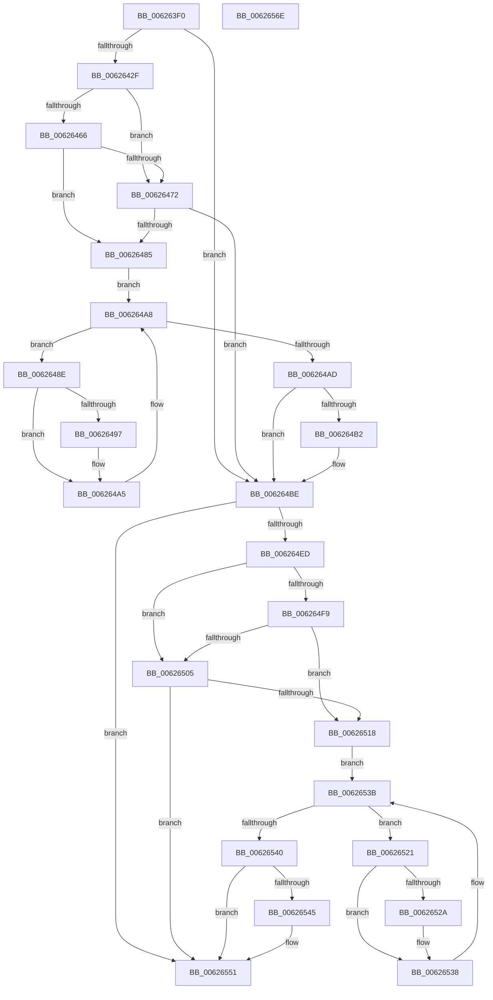

# DifIRP_MJ_READWrapper

- RVA: `0x006263F0`–`0x0062656F` (길이 `383` bytes)
- VA: `0x00000001406263F0`
- 실행 섹션: `.text`
- PDB 이름 있음: `예`; PDB Function 태그: `아니요`
- unwind 정보 RVA: `0x00093E28`
- 디코드: `101`개 명령, `383/383` bytes 표시
- 미해석 바이트: `0` (있으면 어셈블리에 `.byte`로 보존)

> 이 문서는 커널 이미지의 기계어와 PDB 기호를 분석해 생성했습니다. 4번과 5번은 함수 원형과 자료형을 바이너리 사용 방식에서 추정한 C 해석이며 원본 소스 복구 결과는 아닙니다.

## 1. Dependencies

- 직접 호출 지점: **8**; 고유 호출 대상: **4**
- 직접 호출자로 확인된 함수: **0**
- RIP 상대 이미지 참조: **3**

### Outgoing calls
- `0x0062641E` → [DifGetAPIThunkContextById](../49/DifGetAPIThunkContextById_function_00495A34.md) (function, `0x00495A34`)
- `0x00626479` → [ExAcquireRundownProtection](../21/ExAcquireRundownProtection_function_00216620.md) (function, `0x00216620`)
- `0x006264A0` → [guard_dispatch_icall](../6B/guard_dispatch_icall_function_006BAAD0.md) (function, `0x006BAAD0`)
- `0x006264B9` → [ExReleaseRundownProtection](../34/ExReleaseRundownProtection_function_00349E80.md) (function, `0x00349E80`)
- `0x006264DF` → [guard_dispatch_icall](../6B/guard_dispatch_icall_function_006BAAD0.md) (function, `0x006BAAD0`)
- `0x0062650C` → [ExAcquireRundownProtection](../21/ExAcquireRundownProtection_function_00216620.md) (function, `0x00216620`)
- `0x00626533` → [guard_dispatch_icall](../6B/guard_dispatch_icall_function_006BAAD0.md) (function, `0x006BAAD0`)
- `0x0062654C` → [ExReleaseRundownProtection](../34/ExReleaseRundownProtection_function_00349E80.md) (function, `0x00349E80`)

### Direct callers
- 이 함수 시작 RVA로 연결되는 직접 call은 확인되지 않았습니다. 간접 호출은 완전히 역산할 수 없습니다.

### Static image references
- `0x00626439` → RVA `0x00F048B8` (`.data`; read)
- `0x00626466` → RVA `0x00F04980` (`.data`; read)
- `0x00626472` → RVA `0x00F03E80` (`.data`; read)

## 2. Other-region calls and transfers

- 다른 실행 섹션으로 향하는 call: **0**
- 별도 외부 분기/꼬리 이동을 확인하지 못했습니다.

## 3. Assembly (complete function range)

```asm
006263F0  48 8B C4                        mov rax, rsp
006263F3  48 89 58 08                     mov qword ptr [rax + 8], rbx
006263F7  48 89 68 10                     mov qword ptr [rax + 0x10], rbp
006263FB  48 89 70 18                     mov qword ptr [rax + 0x18], rsi
006263FF  57                              push rdi
00626400  41 56                           push r14
00626402  41 57                           push r15
00626404  48 83 EC 40                     sub rsp, 0x40
00626408  0F 57 C0                        xorps xmm0, xmm0
0062640B  4C 8B F9                        mov r15, rcx
0062640E  B9 03 00 00 10                  mov ecx, 0x10000003
00626413  4C 8B F2                        mov r14, rdx
00626416  0F 11 40 C8                     movups xmmword ptr [rax - 0x38], xmm0
0062641A  0F 11 40 D8                     movups xmmword ptr [rax - 0x28], xmm0
0062641E  E8 11 F6 E6 FF                  call 0x140495a34
00626423  48 8B E8                        mov rbp, rax
00626426  48 85 C0                        test rax, rax
00626429  0F 84 8F 00 00 00               je 0x1406264be
0062642F  49 8B 96 B8 00 00 00            mov rdx, qword ptr [r14 + 0xb8]
00626436  40 32 F6                        xor sil, sil
00626439  40 38 35 78 E4 8D 00            cmp byte ptr [rip + 0x8de478], sil
00626440  49 8B 4F 08                     mov rcx, qword ptr [r15 + 8]
00626444  44 0F B6 02                     movzx r8d, byte ptr [rdx]
00626448  48 8B 51 30                     mov rdx, qword ptr [rcx + 0x30]
0062644C  48 8B 4A 40                     mov rcx, qword ptr [rdx + 0x40]
00626450  4A 8B 54 C1 20                  mov rdx, qword ptr [rcx + r8*8 + 0x20]
00626455  48 89 54 24 20                  mov qword ptr [rsp + 0x20], rdx
0062645A  4C 89 7C 24 30                  mov qword ptr [rsp + 0x30], r15
0062645F  4C 89 74 24 28                  mov qword ptr [rsp + 0x28], r14
00626464  75 0C                           jne 0x140626472
00626466  F7 05 10 E5 8D 00 00 08 00 00   test dword ptr [rip + 0x8de510], 0x800
00626470  74 13                           je 0x140626485
00626472  48 8D 0D 07 DA 8D 00            lea rcx, [rip + 0x8dda07]
00626479  E8 A2 01 BF FF                  call 0x140216620
0062647E  40 8A F0                        mov sil, al
00626481  84 C0                           test al, al
00626483  74 39                           je 0x1406264be
00626485  48 8D 7D 20                     lea rdi, [rbp + 0x20]
00626489  48 8B 1F                        mov rbx, qword ptr [rdi]
0062648C  EB 1A                           jmp 0x1406264a8
0062648E  48 8D 43 F0                     lea rax, [rbx - 0x10]
00626492  48 85 C0                        test rax, rax
00626495  74 0E                           je 0x1406264a5
00626497  48 8B 40 08                     mov rax, qword ptr [rax + 8]
0062649B  48 8D 4C 24 20                  lea rcx, [rsp + 0x20]
006264A0  E8 2B 46 09 00                  call 0x1406baad0
006264A5  48 8B 1B                        mov rbx, qword ptr [rbx]
006264A8  48 3B DF                        cmp rbx, rdi
006264AB  75 E1                           jne 0x14062648e
006264AD  40 84 F6                        test sil, sil
006264B0  74 0C                           je 0x1406264be
006264B2  48 8D 0D C7 D9 8D 00            lea rcx, [rip + 0x8dd9c7]
006264B9  E8 C2 39 D2 FF                  call 0x140349e80
006264BE  49 8B 86 B8 00 00 00            mov rax, qword ptr [r14 + 0xb8]
006264C5  0F B6 10                        movzx edx, byte ptr [rax]
006264C8  49 8B 47 08                     mov rax, qword ptr [r15 + 8]
006264CC  48 8B 48 30                     mov rcx, qword ptr [rax + 0x30]
006264D0  48 8B 41 40                     mov rax, qword ptr [rcx + 0x40]
006264D4  49 8B CF                        mov rcx, r15
006264D7  48 8B 44 D0 20                  mov rax, qword ptr [rax + rdx*8 + 0x20]
006264DC  49 8B D6                        mov rdx, r14
006264DF  E8 EC 45 09 00                  call 0x1406baad0
006264E4  89 44 24 38                     mov dword ptr [rsp + 0x38], eax
006264E8  48 85 ED                        test rbp, rbp
006264EB  74 64                           je 0x140626551
006264ED  40 32 FF                        xor dil, dil
006264F0  40 38 3D C1 E3 8D 00            cmp byte ptr [rip + 0x8de3c1], dil
006264F7  75 0C                           jne 0x140626505
006264F9  F7 05 7D E4 8D 00 00 08 00 00   test dword ptr [rip + 0x8de47d], 0x800
00626503  74 13                           je 0x140626518
00626505  48 8D 0D 74 D9 8D 00            lea rcx, [rip + 0x8dd974]
0062650C  E8 0F 01 BF FF                  call 0x140216620
00626511  40 8A F8                        mov dil, al
00626514  84 C0                           test al, al
00626516  74 39                           je 0x140626551
00626518  48 8D 75 30                     lea rsi, [rbp + 0x30]
0062651C  48 8B 1E                        mov rbx, qword ptr [rsi]
0062651F  EB 1A                           jmp 0x14062653b
00626521  48 8D 43 F0                     lea rax, [rbx - 0x10]
00626525  48 85 C0                        test rax, rax
00626528  74 0E                           je 0x140626538
0062652A  48 8B 40 08                     mov rax, qword ptr [rax + 8]
0062652E  48 8D 4C 24 20                  lea rcx, [rsp + 0x20]
00626533  E8 98 45 09 00                  call 0x1406baad0
00626538  48 8B 1B                        mov rbx, qword ptr [rbx]
0062653B  48 3B DE                        cmp rbx, rsi
0062653E  75 E1                           jne 0x140626521
00626540  40 84 FF                        test dil, dil
00626543  74 0C                           je 0x140626551
00626545  48 8D 0D 34 D9 8D 00            lea rcx, [rip + 0x8dd934]
0062654C  E8 2F 39 D2 FF                  call 0x140349e80
00626551  8B 44 24 38                     mov eax, dword ptr [rsp + 0x38]
00626555  48 8B 5C 24 60                  mov rbx, qword ptr [rsp + 0x60]
0062655A  48 8B 6C 24 68                  mov rbp, qword ptr [rsp + 0x68]
0062655F  48 8B 74 24 70                  mov rsi, qword ptr [rsp + 0x70]
00626564  48 83 C4 40                     add rsp, 0x40
00626568  41 5F                           pop r15
0062656A  41 5E                           pop r14
0062656C  5F                              pop rdi
0062656D  C3                              ret
0062656E  CC                              int3
```

## 4. C-style interpretation (structured pseudocode)

```c
__int64 __fastcall DifIRP_MJ_READWrapper(__int64 a1, __int64 a2)
{
    __int64 result;
    __int64 v_rdi;
    __int64 v_rsi;
    __int64 v_rsp;
    unsigned int v_stack_m20;
    unsigned __int64 v_stack_m28;
    unsigned __int64 v_stack_m30;
    unsigned __int64 v_stack_m38;
    unsigned __int64 v_stack_p10;
    unsigned __int64 v_stack_p18;
    unsigned __int64 v_stack_p8;

    *(unsigned __int64 *)(v_rsp + 8) = v_rbx;
    *(unsigned __int64 *)(v_rsp + 16) = v_rbp;
    *(unsigned __int64 *)(v_rsp + 24) = v_rsi;
    v_rsp = (v_rsp) - (64);
    *(unsigned __int64 *)(v_rsp - 56) = v_xmm0;
    *(unsigned __int64 *)(v_rsp - 40) = v_xmm0;
    result = DifGetAPIThunkContextById((unsigned int)(0x10000003ULL), a2, a3, a4);
    if (result == 0) goto loc_006264BE;
    v_rsi = 0;
    v_stack_m38 = *(unsigned __int64 *)(*(unsigned __int64 *)(*(unsigned __int64 *)(*(unsigned __int64 *)(a1 + 8) + 48) + 64) + *(unsigned __int8 *)(*(unsigned __int64 *)(a2 + 184)) * 8 + 32);
    v_stack_m28 = a1;
    v_stack_m30 = a2;
    if ((*(unsigned __int8 *)(v_rip + 9299064)) != 0) goto loc_00626472;
    if (((*(unsigned int *)(v_rip + 9299216)) & (0x800ULL)) == 0) goto loc_00626485;
loc_00626472:
    result = ExAcquireRundownProtection(v_rip + 9296391, *(unsigned __int64 *)(*(unsigned __int64 *)(*(unsigned __int64 *)(*(unsigned __int64 *)(a1 + 8) + 48) + 64) + *(unsigned __int8 *)(*(unsigned __int64 *)(a2 + 184)) * 8 + 32), *(unsigned __int8 *)(*(unsigned __int64 *)(a2 + 184)), a4);
    if ((unsigned __int8)(result) == 0) goto loc_006264BE;
loc_00626485:
    goto loc_006264A8;
loc_0062648E:
    result = *(unsigned __int64 *)(result + 32) - 16;
    if (*(unsigned __int64 *)(result + 32) - 16 != 0) {
        result = *(unsigned __int64 *)(*(unsigned __int64 *)(result + 32) - 16 + 8);
        a1 = v_stack_m38;
        result = guard_dispatch_icall(a1, *(unsigned __int64 *)(*(unsigned __int64 *)(*(unsigned __int64 *)(*(unsigned __int64 *)(a1 + 8) + 48) + 64) + *(unsigned __int8 *)(*(unsigned __int64 *)(a2 + 184)) * 8 + 32), *(unsigned __int8 *)(*(unsigned __int64 *)(a2 + 184)), a4);
    }
loc_006264A8:
    if ((*(unsigned __int64 *)(*(unsigned __int64 *)(result + 32))) != (result + 32)) goto loc_0062648E;
    if ((unsigned __int8)((unsigned __int8)(result)) != 0) {
        a1 = v_rip + 9296327;
        result = ExReleaseRundownProtection(a1, *(unsigned __int64 *)(*(unsigned __int64 *)(*(unsigned __int64 *)(*(unsigned __int64 *)(a1 + 8) + 48) + 64) + *(unsigned __int8 *)(*(unsigned __int64 *)(a2 + 184)) * 8 + 32), *(unsigned __int8 *)(*(unsigned __int64 *)(a2 + 184)), a4);
    }
    result = guard_dispatch_icall(a1, a2, *(unsigned __int8 *)(*(unsigned __int64 *)(a2 + 184)), a4);
    v_stack_m20 = (unsigned int)(result);
    if (result == 0) goto loc_00626551;
    v_rdi = 0;
    if ((*(unsigned __int8 *)(v_rip + 9298881)) != 0) goto loc_00626505;
    if (((*(unsigned int *)(v_rip + 9299069)) & (0x800ULL)) == 0) goto loc_00626518;
loc_00626505:
    result = ExAcquireRundownProtection(v_rip + 9296244, a2, *(unsigned __int8 *)(*(unsigned __int64 *)(a2 + 184)), a4);
    if ((unsigned __int8)(result) == 0) goto loc_00626551;
loc_00626518:
    goto loc_0062653B;
loc_00626521:
    result = *(unsigned __int64 *)(result + 48) - 16;
    if (*(unsigned __int64 *)(result + 48) - 16 != 0) {
        result = *(unsigned __int64 *)(*(unsigned __int64 *)(result + 48) - 16 + 8);
        a1 = v_stack_m38;
        result = guard_dispatch_icall(a1, a2, *(unsigned __int8 *)(*(unsigned __int64 *)(a2 + 184)), a4);
    }
loc_0062653B:
    if ((*(unsigned __int64 *)(*(unsigned __int64 *)(result + 48))) != (result + 48)) goto loc_00626521;
    if ((unsigned __int8)((unsigned __int8)(result)) != 0) {
        a1 = v_rip + 9296180;
        result = ExReleaseRundownProtection(a1, a2, *(unsigned __int8 *)(*(unsigned __int64 *)(a2 + 184)), a4);
    }
    v_rsp = (v_rsp) + (64);
    return (unsigned int)(v_stack_m20);
}
```

## 5. (Beta) C Style

```c
int64_t DifIRP_MJ_READWrapper(void *Arg1, void *Arg2)
{
    uint8_t *arg1 = (uint8_t *)Arg1;
    uint8_t *arg2 = (uint8_t *)Arg2;

    int64_t result;
    int64_t local_rdi;
    int64_t local_rsi;
    int64_t local_rsp;
    uint32_t v_stack_m20;
    uint64_t v_stack_m28;
    uint64_t v_stack_m30;
    uint64_t v_stack_m38;
    uint64_t v_stack_p10;
    uint64_t v_stack_p18;
    uint64_t v_stack_p8;

    *(uint64_t *)(local_rsp + 0x8) = local_rbx;
    *(uint64_t *)(local_rsp + 0x10) = local_rbp;
    *(uint64_t *)(local_rsp + 0x18) = local_rsi;
    local_rsp = (local_rsp) - (64);
    *(uint64_t *)(local_rsp - 0x38) = v_xmm0;
    *(uint64_t *)(local_rsp - 0x28) = v_xmm0;
    result = DifGetAPIThunkContextById((uint32_t)(0x10000003ULL), Arg2, a3, a4);
    if (result == 0) goto loc_006264BE;
    local_rsi = 0;
    v_stack_m38 = *(uint64_t *)(*(uint64_t *)(*(uint64_t *)(*(uint64_t *)(arg1 + 0x8) + 0x30) + 0x40) + *(uint8_t *)(*(uint64_t *)(arg2 + 0xB8)) * 8 + 0x20);
    v_stack_m28 = Arg1;
    v_stack_m30 = Arg2;
    if ((*(uint8_t *)(v_rip + 0x8DE478)) != 0) goto loc_00626472;
    if (((*(uint32_t *)(v_rip + 0x8DE510)) & (0x800ULL)) == 0) goto loc_00626485;
loc_00626472:
    result = ExAcquireRundownProtection(v_rip + 9296391, *(uint64_t *)(*(uint64_t *)(*(uint64_t *)(*(uint64_t *)(arg1 + 0x8) + 0x30) + 0x40) + *(uint8_t *)(*(uint64_t *)(arg2 + 0xB8)) * 8 + 0x20), *(uint8_t *)(*(uint64_t *)(arg2 + 0xB8)), a4);
    if ((uint8_t)(result) == 0) goto loc_006264BE;
loc_00626485:
    goto loc_006264A8;
loc_0062648E:
    result = *(uint64_t *)(result + 0x20) - 16;
    if (*(uint64_t *)(result + 0x20) - 16 != 0) {
        result = *(uint64_t *)(*(uint64_t *)(result + 0x20) - 0x10 + 0x8);
        Arg1 = v_stack_m38;
        result = guard_dispatch_icall(Arg1, *(uint64_t *)(*(uint64_t *)(*(uint64_t *)(*(uint64_t *)(arg1 + 0x8) + 0x30) + 0x40) + *(uint8_t *)(*(uint64_t *)(arg2 + 0xB8)) * 8 + 0x20), *(uint8_t *)(*(uint64_t *)(arg2 + 0xB8)), a4);
    }
loc_006264A8:
    if ((*(uint64_t *)(*(uint64_t *)(result + 0x20))) != (result + 32)) goto loc_0062648E;
    if ((uint8_t)((uint8_t)(result)) != 0) {
        Arg1 = v_rip + 9296327;
        result = ExReleaseRundownProtection(Arg1, *(uint64_t *)(*(uint64_t *)(*(uint64_t *)(*(uint64_t *)(arg1 + 0x8) + 0x30) + 0x40) + *(uint8_t *)(*(uint64_t *)(arg2 + 0xB8)) * 8 + 0x20), *(uint8_t *)(*(uint64_t *)(arg2 + 0xB8)), a4);
    }
    result = guard_dispatch_icall(Arg1, Arg2, *(uint8_t *)(*(uint64_t *)(arg2 + 0xB8)), a4);
    v_stack_m20 = (uint32_t)(result);
    if (result == 0) goto loc_00626551;
    local_rdi = 0;
    if ((*(uint8_t *)(v_rip + 0x8DE3C1)) != 0) goto loc_00626505;
    if (((*(uint32_t *)(v_rip + 0x8DE47D)) & (0x800ULL)) == 0) goto loc_00626518;
loc_00626505:
    result = ExAcquireRundownProtection(v_rip + 9296244, Arg2, *(uint8_t *)(*(uint64_t *)(arg2 + 0xB8)), a4);
    if ((uint8_t)(result) == 0) goto loc_00626551;
loc_00626518:
    goto loc_0062653B;
loc_00626521:
    result = *(uint64_t *)(result + 0x30) - 16;
    if (*(uint64_t *)(result + 0x30) - 16 != 0) {
        result = *(uint64_t *)(*(uint64_t *)(result + 0x30) - 0x10 + 0x8);
        Arg1 = v_stack_m38;
        result = guard_dispatch_icall(Arg1, Arg2, *(uint8_t *)(*(uint64_t *)(arg2 + 0xB8)), a4);
    }
loc_0062653B:
    if ((*(uint64_t *)(*(uint64_t *)(result + 0x30))) != (result + 48)) goto loc_00626521;
    if ((uint8_t)((uint8_t)(result)) != 0) {
        Arg1 = v_rip + 9296180;
        result = ExReleaseRundownProtection(Arg1, Arg2, *(uint8_t *)(*(uint64_t *)(arg2 + 0xB8)), a4);
    }
    local_rsp = (local_rsp) + (64);
    return (uint32_t)(v_stack_m20);
}
```

### 관측된 메모리 오프셋

구조체 형식이 확인되지 않은 접근은 인자 기준의 오프셋으로만 기록했습니다.

| 기준 인자 | 오프셋 표현 | 폭 (bit) | 접근 |
|---|---:|---:|---|
| `Arg1` | `+ 0x8` | `64` | `R` |
| `Arg2` | `+ 0xB8` | `64` | `R` |

## 6. Execution-region graph

[열기: 2D/3D 그래프와 함수 탐색 컨트롤 패널](../../../control-panel.html?section=text&rva=0x006263F0&view=graph)

- 2D 그래프는 위에서 아래로 흐르고, 3D 그래프는 빈 공간을 드래그해 회전합니다. Shift+드래그는 이동, 휠은 확대·축소, 함수 노드 선택은 대상 보고서 이동입니다.

### Static fallback


