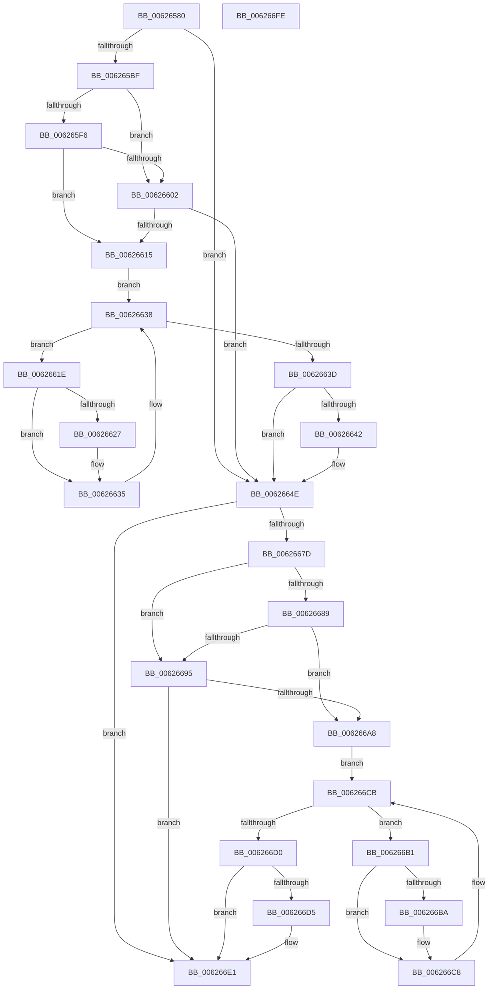

# DifIRP_MJ_SET_EAWrapper

- RVA: `0x00626580`–`0x006266FF` (길이 `383` bytes)
- VA: `0x0000000140626580`
- 실행 섹션: `.text`
- PDB 이름 있음: `예`; PDB Function 태그: `아니요`
- unwind 정보 RVA: `0x00093E28`
- 디코드: `101`개 명령, `383/383` bytes 표시
- 미해석 바이트: `0` (있으면 어셈블리에 `.byte`로 보존)

> 이 문서는 커널 이미지의 기계어와 PDB 기호를 분석해 생성했습니다. 4번과 5번은 함수 원형과 자료형을 바이너리 사용 방식에서 추정한 C 해석이며 원본 소스 복구 결과는 아닙니다.

## 1. Dependencies

- 직접 호출 지점: **8**; 고유 호출 대상: **4**
- 직접 호출자로 확인된 함수: **0**
- RIP 상대 이미지 참조: **3**

### Outgoing calls
- `0x006265AE` → [DifGetAPIThunkContextById](../49/DifGetAPIThunkContextById_function_00495A34.md) (function, `0x00495A34`)
- `0x00626609` → [ExAcquireRundownProtection](../21/ExAcquireRundownProtection_function_00216620.md) (function, `0x00216620`)
- `0x00626630` → [guard_dispatch_icall](../6B/guard_dispatch_icall_function_006BAAD0.md) (function, `0x006BAAD0`)
- `0x00626649` → [ExReleaseRundownProtection](../34/ExReleaseRundownProtection_function_00349E80.md) (function, `0x00349E80`)
- `0x0062666F` → [guard_dispatch_icall](../6B/guard_dispatch_icall_function_006BAAD0.md) (function, `0x006BAAD0`)
- `0x0062669C` → [ExAcquireRundownProtection](../21/ExAcquireRundownProtection_function_00216620.md) (function, `0x00216620`)
- `0x006266C3` → [guard_dispatch_icall](../6B/guard_dispatch_icall_function_006BAAD0.md) (function, `0x006BAAD0`)
- `0x006266DC` → [ExReleaseRundownProtection](../34/ExReleaseRundownProtection_function_00349E80.md) (function, `0x00349E80`)

### Direct callers
- 이 함수 시작 RVA로 연결되는 직접 call은 확인되지 않았습니다. 간접 호출은 완전히 역산할 수 없습니다.

### Static image references
- `0x006265C9` → RVA `0x00F048B8` (`.data`; read)
- `0x006265F6` → RVA `0x00F04980` (`.data`; read)
- `0x00626602` → RVA `0x00F03E80` (`.data`; read)

## 2. Other-region calls and transfers

- 다른 실행 섹션으로 향하는 call: **0**
- 별도 외부 분기/꼬리 이동을 확인하지 못했습니다.

## 3. Assembly (complete function range)

```asm
00626580  48 8B C4                        mov rax, rsp
00626583  48 89 58 08                     mov qword ptr [rax + 8], rbx
00626587  48 89 68 10                     mov qword ptr [rax + 0x10], rbp
0062658B  48 89 70 18                     mov qword ptr [rax + 0x18], rsi
0062658F  57                              push rdi
00626590  41 56                           push r14
00626592  41 57                           push r15
00626594  48 83 EC 40                     sub rsp, 0x40
00626598  0F 57 C0                        xorps xmm0, xmm0
0062659B  4C 8B F9                        mov r15, rcx
0062659E  B9 08 00 00 10                  mov ecx, 0x10000008
006265A3  4C 8B F2                        mov r14, rdx
006265A6  0F 11 40 C8                     movups xmmword ptr [rax - 0x38], xmm0
006265AA  0F 11 40 D8                     movups xmmword ptr [rax - 0x28], xmm0
006265AE  E8 81 F4 E6 FF                  call 0x140495a34
006265B3  48 8B E8                        mov rbp, rax
006265B6  48 85 C0                        test rax, rax
006265B9  0F 84 8F 00 00 00               je 0x14062664e
006265BF  49 8B 96 B8 00 00 00            mov rdx, qword ptr [r14 + 0xb8]
006265C6  40 32 F6                        xor sil, sil
006265C9  40 38 35 E8 E2 8D 00            cmp byte ptr [rip + 0x8de2e8], sil
006265D0  49 8B 4F 08                     mov rcx, qword ptr [r15 + 8]
006265D4  44 0F B6 02                     movzx r8d, byte ptr [rdx]
006265D8  48 8B 51 30                     mov rdx, qword ptr [rcx + 0x30]
006265DC  48 8B 4A 40                     mov rcx, qword ptr [rdx + 0x40]
006265E0  4A 8B 54 C1 20                  mov rdx, qword ptr [rcx + r8*8 + 0x20]
006265E5  48 89 54 24 20                  mov qword ptr [rsp + 0x20], rdx
006265EA  4C 89 7C 24 30                  mov qword ptr [rsp + 0x30], r15
006265EF  4C 89 74 24 28                  mov qword ptr [rsp + 0x28], r14
006265F4  75 0C                           jne 0x140626602
006265F6  F7 05 80 E3 8D 00 00 08 00 00   test dword ptr [rip + 0x8de380], 0x800
00626600  74 13                           je 0x140626615
00626602  48 8D 0D 77 D8 8D 00            lea rcx, [rip + 0x8dd877]
00626609  E8 12 00 BF FF                  call 0x140216620
0062660E  40 8A F0                        mov sil, al
00626611  84 C0                           test al, al
00626613  74 39                           je 0x14062664e
00626615  48 8D 7D 20                     lea rdi, [rbp + 0x20]
00626619  48 8B 1F                        mov rbx, qword ptr [rdi]
0062661C  EB 1A                           jmp 0x140626638
0062661E  48 8D 43 F0                     lea rax, [rbx - 0x10]
00626622  48 85 C0                        test rax, rax
00626625  74 0E                           je 0x140626635
00626627  48 8B 40 08                     mov rax, qword ptr [rax + 8]
0062662B  48 8D 4C 24 20                  lea rcx, [rsp + 0x20]
00626630  E8 9B 44 09 00                  call 0x1406baad0
00626635  48 8B 1B                        mov rbx, qword ptr [rbx]
00626638  48 3B DF                        cmp rbx, rdi
0062663B  75 E1                           jne 0x14062661e
0062663D  40 84 F6                        test sil, sil
00626640  74 0C                           je 0x14062664e
00626642  48 8D 0D 37 D8 8D 00            lea rcx, [rip + 0x8dd837]
00626649  E8 32 38 D2 FF                  call 0x140349e80
0062664E  49 8B 86 B8 00 00 00            mov rax, qword ptr [r14 + 0xb8]
00626655  0F B6 10                        movzx edx, byte ptr [rax]
00626658  49 8B 47 08                     mov rax, qword ptr [r15 + 8]
0062665C  48 8B 48 30                     mov rcx, qword ptr [rax + 0x30]
00626660  48 8B 41 40                     mov rax, qword ptr [rcx + 0x40]
00626664  49 8B CF                        mov rcx, r15
00626667  48 8B 44 D0 20                  mov rax, qword ptr [rax + rdx*8 + 0x20]
0062666C  49 8B D6                        mov rdx, r14
0062666F  E8 5C 44 09 00                  call 0x1406baad0
00626674  89 44 24 38                     mov dword ptr [rsp + 0x38], eax
00626678  48 85 ED                        test rbp, rbp
0062667B  74 64                           je 0x1406266e1
0062667D  40 32 FF                        xor dil, dil
00626680  40 38 3D 31 E2 8D 00            cmp byte ptr [rip + 0x8de231], dil
00626687  75 0C                           jne 0x140626695
00626689  F7 05 ED E2 8D 00 00 08 00 00   test dword ptr [rip + 0x8de2ed], 0x800
00626693  74 13                           je 0x1406266a8
00626695  48 8D 0D E4 D7 8D 00            lea rcx, [rip + 0x8dd7e4]
0062669C  E8 7F FF BE FF                  call 0x140216620
006266A1  40 8A F8                        mov dil, al
006266A4  84 C0                           test al, al
006266A6  74 39                           je 0x1406266e1
006266A8  48 8D 75 30                     lea rsi, [rbp + 0x30]
006266AC  48 8B 1E                        mov rbx, qword ptr [rsi]
006266AF  EB 1A                           jmp 0x1406266cb
006266B1  48 8D 43 F0                     lea rax, [rbx - 0x10]
006266B5  48 85 C0                        test rax, rax
006266B8  74 0E                           je 0x1406266c8
006266BA  48 8B 40 08                     mov rax, qword ptr [rax + 8]
006266BE  48 8D 4C 24 20                  lea rcx, [rsp + 0x20]
006266C3  E8 08 44 09 00                  call 0x1406baad0
006266C8  48 8B 1B                        mov rbx, qword ptr [rbx]
006266CB  48 3B DE                        cmp rbx, rsi
006266CE  75 E1                           jne 0x1406266b1
006266D0  40 84 FF                        test dil, dil
006266D3  74 0C                           je 0x1406266e1
006266D5  48 8D 0D A4 D7 8D 00            lea rcx, [rip + 0x8dd7a4]
006266DC  E8 9F 37 D2 FF                  call 0x140349e80
006266E1  8B 44 24 38                     mov eax, dword ptr [rsp + 0x38]
006266E5  48 8B 5C 24 60                  mov rbx, qword ptr [rsp + 0x60]
006266EA  48 8B 6C 24 68                  mov rbp, qword ptr [rsp + 0x68]
006266EF  48 8B 74 24 70                  mov rsi, qword ptr [rsp + 0x70]
006266F4  48 83 C4 40                     add rsp, 0x40
006266F8  41 5F                           pop r15
006266FA  41 5E                           pop r14
006266FC  5F                              pop rdi
006266FD  C3                              ret
006266FE  CC                              int3
```

## 4. C-style interpretation (structured pseudocode)

```c
__int64 __fastcall DifIRP_MJ_SET_EAWrapper(__int64 a1, __int64 a2)
{
    __int64 result;
    __int64 v_rdi;
    __int64 v_rsi;
    __int64 v_rsp;
    unsigned int v_stack_m20;
    unsigned __int64 v_stack_m28;
    unsigned __int64 v_stack_m30;
    unsigned __int64 v_stack_m38;
    unsigned __int64 v_stack_p10;
    unsigned __int64 v_stack_p18;
    unsigned __int64 v_stack_p8;

    *(unsigned __int64 *)(v_rsp + 8) = v_rbx;
    *(unsigned __int64 *)(v_rsp + 16) = v_rbp;
    *(unsigned __int64 *)(v_rsp + 24) = v_rsi;
    v_rsp = (v_rsp) - (64);
    *(unsigned __int64 *)(v_rsp - 56) = v_xmm0;
    *(unsigned __int64 *)(v_rsp - 40) = v_xmm0;
    result = DifGetAPIThunkContextById((unsigned int)(0x10000008ULL), a2, a3, a4);
    if (result == 0) goto loc_0062664E;
    v_rsi = 0;
    v_stack_m38 = *(unsigned __int64 *)(*(unsigned __int64 *)(*(unsigned __int64 *)(*(unsigned __int64 *)(a1 + 8) + 48) + 64) + *(unsigned __int8 *)(*(unsigned __int64 *)(a2 + 184)) * 8 + 32);
    v_stack_m28 = a1;
    v_stack_m30 = a2;
    if ((*(unsigned __int8 *)(v_rip + 9298664)) != 0) goto loc_00626602;
    if (((*(unsigned int *)(v_rip + 9298816)) & (0x800ULL)) == 0) goto loc_00626615;
loc_00626602:
    result = ExAcquireRundownProtection(v_rip + 9295991, *(unsigned __int64 *)(*(unsigned __int64 *)(*(unsigned __int64 *)(*(unsigned __int64 *)(a1 + 8) + 48) + 64) + *(unsigned __int8 *)(*(unsigned __int64 *)(a2 + 184)) * 8 + 32), *(unsigned __int8 *)(*(unsigned __int64 *)(a2 + 184)), a4);
    if ((unsigned __int8)(result) == 0) goto loc_0062664E;
loc_00626615:
    goto loc_00626638;
loc_0062661E:
    result = *(unsigned __int64 *)(result + 32) - 16;
    if (*(unsigned __int64 *)(result + 32) - 16 != 0) {
        result = *(unsigned __int64 *)(*(unsigned __int64 *)(result + 32) - 16 + 8);
        a1 = v_stack_m38;
        result = guard_dispatch_icall(a1, *(unsigned __int64 *)(*(unsigned __int64 *)(*(unsigned __int64 *)(*(unsigned __int64 *)(a1 + 8) + 48) + 64) + *(unsigned __int8 *)(*(unsigned __int64 *)(a2 + 184)) * 8 + 32), *(unsigned __int8 *)(*(unsigned __int64 *)(a2 + 184)), a4);
    }
loc_00626638:
    if ((*(unsigned __int64 *)(*(unsigned __int64 *)(result + 32))) != (result + 32)) goto loc_0062661E;
    if ((unsigned __int8)((unsigned __int8)(result)) != 0) {
        a1 = v_rip + 9295927;
        result = ExReleaseRundownProtection(a1, *(unsigned __int64 *)(*(unsigned __int64 *)(*(unsigned __int64 *)(*(unsigned __int64 *)(a1 + 8) + 48) + 64) + *(unsigned __int8 *)(*(unsigned __int64 *)(a2 + 184)) * 8 + 32), *(unsigned __int8 *)(*(unsigned __int64 *)(a2 + 184)), a4);
    }
    result = guard_dispatch_icall(a1, a2, *(unsigned __int8 *)(*(unsigned __int64 *)(a2 + 184)), a4);
    v_stack_m20 = (unsigned int)(result);
    if (result == 0) goto loc_006266E1;
    v_rdi = 0;
    if ((*(unsigned __int8 *)(v_rip + 9298481)) != 0) goto loc_00626695;
    if (((*(unsigned int *)(v_rip + 9298669)) & (0x800ULL)) == 0) goto loc_006266A8;
loc_00626695:
    result = ExAcquireRundownProtection(v_rip + 9295844, a2, *(unsigned __int8 *)(*(unsigned __int64 *)(a2 + 184)), a4);
    if ((unsigned __int8)(result) == 0) goto loc_006266E1;
loc_006266A8:
    goto loc_006266CB;
loc_006266B1:
    result = *(unsigned __int64 *)(result + 48) - 16;
    if (*(unsigned __int64 *)(result + 48) - 16 != 0) {
        result = *(unsigned __int64 *)(*(unsigned __int64 *)(result + 48) - 16 + 8);
        a1 = v_stack_m38;
        result = guard_dispatch_icall(a1, a2, *(unsigned __int8 *)(*(unsigned __int64 *)(a2 + 184)), a4);
    }
loc_006266CB:
    if ((*(unsigned __int64 *)(*(unsigned __int64 *)(result + 48))) != (result + 48)) goto loc_006266B1;
    if ((unsigned __int8)((unsigned __int8)(result)) != 0) {
        a1 = v_rip + 9295780;
        result = ExReleaseRundownProtection(a1, a2, *(unsigned __int8 *)(*(unsigned __int64 *)(a2 + 184)), a4);
    }
    v_rsp = (v_rsp) + (64);
    return (unsigned int)(v_stack_m20);
}
```

## 5. (Beta) C Style

```c
int64_t DifIRP_MJ_SET_EAWrapper(void *Arg1, void *Arg2)
{
    uint8_t *arg1 = (uint8_t *)Arg1;
    uint8_t *arg2 = (uint8_t *)Arg2;

    int64_t result;
    int64_t local_rdi;
    int64_t local_rsi;
    int64_t local_rsp;
    uint32_t v_stack_m20;
    uint64_t v_stack_m28;
    uint64_t v_stack_m30;
    uint64_t v_stack_m38;
    uint64_t v_stack_p10;
    uint64_t v_stack_p18;
    uint64_t v_stack_p8;

    *(uint64_t *)(local_rsp + 0x8) = local_rbx;
    *(uint64_t *)(local_rsp + 0x10) = local_rbp;
    *(uint64_t *)(local_rsp + 0x18) = local_rsi;
    local_rsp = (local_rsp) - (64);
    *(uint64_t *)(local_rsp - 0x38) = v_xmm0;
    *(uint64_t *)(local_rsp - 0x28) = v_xmm0;
    result = DifGetAPIThunkContextById((uint32_t)(0x10000008ULL), Arg2, a3, a4);
    if (result == 0) goto loc_0062664E;
    local_rsi = 0;
    v_stack_m38 = *(uint64_t *)(*(uint64_t *)(*(uint64_t *)(*(uint64_t *)(arg1 + 0x8) + 0x30) + 0x40) + *(uint8_t *)(*(uint64_t *)(arg2 + 0xB8)) * 8 + 0x20);
    v_stack_m28 = Arg1;
    v_stack_m30 = Arg2;
    if ((*(uint8_t *)(v_rip + 0x8DE2E8)) != 0) goto loc_00626602;
    if (((*(uint32_t *)(v_rip + 0x8DE380)) & (0x800ULL)) == 0) goto loc_00626615;
loc_00626602:
    result = ExAcquireRundownProtection(v_rip + 9295991, *(uint64_t *)(*(uint64_t *)(*(uint64_t *)(*(uint64_t *)(arg1 + 0x8) + 0x30) + 0x40) + *(uint8_t *)(*(uint64_t *)(arg2 + 0xB8)) * 8 + 0x20), *(uint8_t *)(*(uint64_t *)(arg2 + 0xB8)), a4);
    if ((uint8_t)(result) == 0) goto loc_0062664E;
loc_00626615:
    goto loc_00626638;
loc_0062661E:
    result = *(uint64_t *)(result + 0x20) - 16;
    if (*(uint64_t *)(result + 0x20) - 16 != 0) {
        result = *(uint64_t *)(*(uint64_t *)(result + 0x20) - 0x10 + 0x8);
        Arg1 = v_stack_m38;
        result = guard_dispatch_icall(Arg1, *(uint64_t *)(*(uint64_t *)(*(uint64_t *)(*(uint64_t *)(arg1 + 0x8) + 0x30) + 0x40) + *(uint8_t *)(*(uint64_t *)(arg2 + 0xB8)) * 8 + 0x20), *(uint8_t *)(*(uint64_t *)(arg2 + 0xB8)), a4);
    }
loc_00626638:
    if ((*(uint64_t *)(*(uint64_t *)(result + 0x20))) != (result + 32)) goto loc_0062661E;
    if ((uint8_t)((uint8_t)(result)) != 0) {
        Arg1 = v_rip + 9295927;
        result = ExReleaseRundownProtection(Arg1, *(uint64_t *)(*(uint64_t *)(*(uint64_t *)(*(uint64_t *)(arg1 + 0x8) + 0x30) + 0x40) + *(uint8_t *)(*(uint64_t *)(arg2 + 0xB8)) * 8 + 0x20), *(uint8_t *)(*(uint64_t *)(arg2 + 0xB8)), a4);
    }
    result = guard_dispatch_icall(Arg1, Arg2, *(uint8_t *)(*(uint64_t *)(arg2 + 0xB8)), a4);
    v_stack_m20 = (uint32_t)(result);
    if (result == 0) goto loc_006266E1;
    local_rdi = 0;
    if ((*(uint8_t *)(v_rip + 0x8DE231)) != 0) goto loc_00626695;
    if (((*(uint32_t *)(v_rip + 0x8DE2ED)) & (0x800ULL)) == 0) goto loc_006266A8;
loc_00626695:
    result = ExAcquireRundownProtection(v_rip + 9295844, Arg2, *(uint8_t *)(*(uint64_t *)(arg2 + 0xB8)), a4);
    if ((uint8_t)(result) == 0) goto loc_006266E1;
loc_006266A8:
    goto loc_006266CB;
loc_006266B1:
    result = *(uint64_t *)(result + 0x30) - 16;
    if (*(uint64_t *)(result + 0x30) - 16 != 0) {
        result = *(uint64_t *)(*(uint64_t *)(result + 0x30) - 0x10 + 0x8);
        Arg1 = v_stack_m38;
        result = guard_dispatch_icall(Arg1, Arg2, *(uint8_t *)(*(uint64_t *)(arg2 + 0xB8)), a4);
    }
loc_006266CB:
    if ((*(uint64_t *)(*(uint64_t *)(result + 0x30))) != (result + 48)) goto loc_006266B1;
    if ((uint8_t)((uint8_t)(result)) != 0) {
        Arg1 = v_rip + 9295780;
        result = ExReleaseRundownProtection(Arg1, Arg2, *(uint8_t *)(*(uint64_t *)(arg2 + 0xB8)), a4);
    }
    local_rsp = (local_rsp) + (64);
    return (uint32_t)(v_stack_m20);
}
```

### 관측된 메모리 오프셋

구조체 형식이 확인되지 않은 접근은 인자 기준의 오프셋으로만 기록했습니다.

| 기준 인자 | 오프셋 표현 | 폭 (bit) | 접근 |
|---|---:|---:|---|
| `Arg1` | `+ 0x8` | `64` | `R` |
| `Arg2` | `+ 0xB8` | `64` | `R` |

## 6. Execution-region graph

[열기: 2D/3D 그래프와 함수 탐색 컨트롤 패널](../../../control-panel.html?section=text&rva=0x00626580&view=graph)

- 2D 그래프는 위에서 아래로 흐르고, 3D 그래프는 빈 공간을 드래그해 회전합니다. Shift+드래그는 이동, 휠은 확대·축소, 함수 노드 선택은 대상 보고서 이동입니다.

### Static fallback


