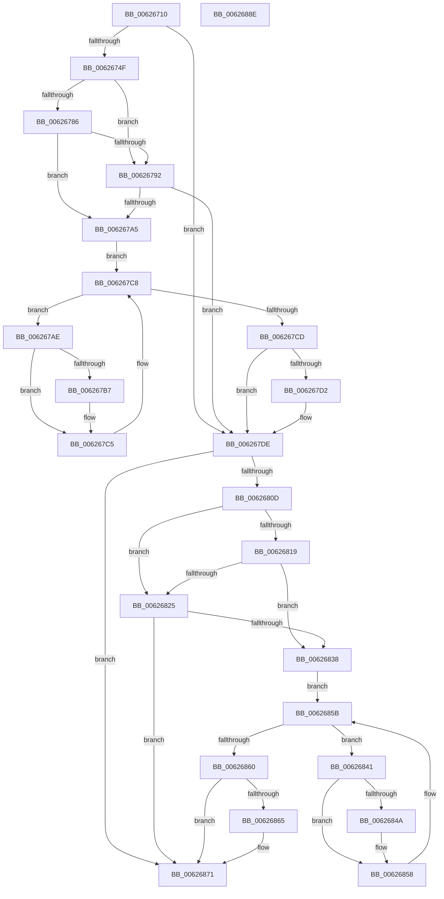

# DifIRP_MJ_SET_INFORMATIONWrapper

- RVA: `0x00626710`–`0x0062688F` (길이 `383` bytes)
- VA: `0x0000000140626710`
- 실행 섹션: `.text`
- PDB 이름 있음: `예`; PDB Function 태그: `아니요`
- unwind 정보 RVA: `0x00093E28`
- 디코드: `101`개 명령, `383/383` bytes 표시
- 미해석 바이트: `0` (있으면 어셈블리에 `.byte`로 보존)

> 이 문서는 커널 이미지의 기계어와 PDB 기호를 분석해 생성했습니다. 4번과 5번은 함수 원형과 자료형을 바이너리 사용 방식에서 추정한 C 해석이며 원본 소스 복구 결과는 아닙니다.

## 1. Dependencies

- 직접 호출 지점: **8**; 고유 호출 대상: **4**
- 직접 호출자로 확인된 함수: **0**
- RIP 상대 이미지 참조: **3**

### Outgoing calls
- `0x0062673E` → [DifGetAPIThunkContextById](../49/DifGetAPIThunkContextById_function_00495A34.md) (function, `0x00495A34`)
- `0x00626799` → [ExAcquireRundownProtection](../21/ExAcquireRundownProtection_function_00216620.md) (function, `0x00216620`)
- `0x006267C0` → [guard_dispatch_icall](../6B/guard_dispatch_icall_function_006BAAD0.md) (function, `0x006BAAD0`)
- `0x006267D9` → [ExReleaseRundownProtection](../34/ExReleaseRundownProtection_function_00349E80.md) (function, `0x00349E80`)
- `0x006267FF` → [guard_dispatch_icall](../6B/guard_dispatch_icall_function_006BAAD0.md) (function, `0x006BAAD0`)
- `0x0062682C` → [ExAcquireRundownProtection](../21/ExAcquireRundownProtection_function_00216620.md) (function, `0x00216620`)
- `0x00626853` → [guard_dispatch_icall](../6B/guard_dispatch_icall_function_006BAAD0.md) (function, `0x006BAAD0`)
- `0x0062686C` → [ExReleaseRundownProtection](../34/ExReleaseRundownProtection_function_00349E80.md) (function, `0x00349E80`)

### Direct callers
- 이 함수 시작 RVA로 연결되는 직접 call은 확인되지 않았습니다. 간접 호출은 완전히 역산할 수 없습니다.

### Static image references
- `0x00626759` → RVA `0x00F048B8` (`.data`; read)
- `0x00626786` → RVA `0x00F04980` (`.data`; read)
- `0x00626792` → RVA `0x00F03E80` (`.data`; read)

## 2. Other-region calls and transfers

- 다른 실행 섹션으로 향하는 call: **0**
- 별도 외부 분기/꼬리 이동을 확인하지 못했습니다.

## 3. Assembly (complete function range)

```asm
00626710  48 8B C4                        mov rax, rsp
00626713  48 89 58 08                     mov qword ptr [rax + 8], rbx
00626717  48 89 68 10                     mov qword ptr [rax + 0x10], rbp
0062671B  48 89 70 18                     mov qword ptr [rax + 0x18], rsi
0062671F  57                              push rdi
00626720  41 56                           push r14
00626722  41 57                           push r15
00626724  48 83 EC 40                     sub rsp, 0x40
00626728  0F 57 C0                        xorps xmm0, xmm0
0062672B  4C 8B F9                        mov r15, rcx
0062672E  B9 06 00 00 10                  mov ecx, 0x10000006
00626733  4C 8B F2                        mov r14, rdx
00626736  0F 11 40 C8                     movups xmmword ptr [rax - 0x38], xmm0
0062673A  0F 11 40 D8                     movups xmmword ptr [rax - 0x28], xmm0
0062673E  E8 F1 F2 E6 FF                  call 0x140495a34
00626743  48 8B E8                        mov rbp, rax
00626746  48 85 C0                        test rax, rax
00626749  0F 84 8F 00 00 00               je 0x1406267de
0062674F  49 8B 96 B8 00 00 00            mov rdx, qword ptr [r14 + 0xb8]
00626756  40 32 F6                        xor sil, sil
00626759  40 38 35 58 E1 8D 00            cmp byte ptr [rip + 0x8de158], sil
00626760  49 8B 4F 08                     mov rcx, qword ptr [r15 + 8]
00626764  44 0F B6 02                     movzx r8d, byte ptr [rdx]
00626768  48 8B 51 30                     mov rdx, qword ptr [rcx + 0x30]
0062676C  48 8B 4A 40                     mov rcx, qword ptr [rdx + 0x40]
00626770  4A 8B 54 C1 20                  mov rdx, qword ptr [rcx + r8*8 + 0x20]
00626775  48 89 54 24 20                  mov qword ptr [rsp + 0x20], rdx
0062677A  4C 89 7C 24 30                  mov qword ptr [rsp + 0x30], r15
0062677F  4C 89 74 24 28                  mov qword ptr [rsp + 0x28], r14
00626784  75 0C                           jne 0x140626792
00626786  F7 05 F0 E1 8D 00 00 08 00 00   test dword ptr [rip + 0x8de1f0], 0x800
00626790  74 13                           je 0x1406267a5
00626792  48 8D 0D E7 D6 8D 00            lea rcx, [rip + 0x8dd6e7]
00626799  E8 82 FE BE FF                  call 0x140216620
0062679E  40 8A F0                        mov sil, al
006267A1  84 C0                           test al, al
006267A3  74 39                           je 0x1406267de
006267A5  48 8D 7D 20                     lea rdi, [rbp + 0x20]
006267A9  48 8B 1F                        mov rbx, qword ptr [rdi]
006267AC  EB 1A                           jmp 0x1406267c8
006267AE  48 8D 43 F0                     lea rax, [rbx - 0x10]
006267B2  48 85 C0                        test rax, rax
006267B5  74 0E                           je 0x1406267c5
006267B7  48 8B 40 08                     mov rax, qword ptr [rax + 8]
006267BB  48 8D 4C 24 20                  lea rcx, [rsp + 0x20]
006267C0  E8 0B 43 09 00                  call 0x1406baad0
006267C5  48 8B 1B                        mov rbx, qword ptr [rbx]
006267C8  48 3B DF                        cmp rbx, rdi
006267CB  75 E1                           jne 0x1406267ae
006267CD  40 84 F6                        test sil, sil
006267D0  74 0C                           je 0x1406267de
006267D2  48 8D 0D A7 D6 8D 00            lea rcx, [rip + 0x8dd6a7]
006267D9  E8 A2 36 D2 FF                  call 0x140349e80
006267DE  49 8B 86 B8 00 00 00            mov rax, qword ptr [r14 + 0xb8]
006267E5  0F B6 10                        movzx edx, byte ptr [rax]
006267E8  49 8B 47 08                     mov rax, qword ptr [r15 + 8]
006267EC  48 8B 48 30                     mov rcx, qword ptr [rax + 0x30]
006267F0  48 8B 41 40                     mov rax, qword ptr [rcx + 0x40]
006267F4  49 8B CF                        mov rcx, r15
006267F7  48 8B 44 D0 20                  mov rax, qword ptr [rax + rdx*8 + 0x20]
006267FC  49 8B D6                        mov rdx, r14
006267FF  E8 CC 42 09 00                  call 0x1406baad0
00626804  89 44 24 38                     mov dword ptr [rsp + 0x38], eax
00626808  48 85 ED                        test rbp, rbp
0062680B  74 64                           je 0x140626871
0062680D  40 32 FF                        xor dil, dil
00626810  40 38 3D A1 E0 8D 00            cmp byte ptr [rip + 0x8de0a1], dil
00626817  75 0C                           jne 0x140626825
00626819  F7 05 5D E1 8D 00 00 08 00 00   test dword ptr [rip + 0x8de15d], 0x800
00626823  74 13                           je 0x140626838
00626825  48 8D 0D 54 D6 8D 00            lea rcx, [rip + 0x8dd654]
0062682C  E8 EF FD BE FF                  call 0x140216620
00626831  40 8A F8                        mov dil, al
00626834  84 C0                           test al, al
00626836  74 39                           je 0x140626871
00626838  48 8D 75 30                     lea rsi, [rbp + 0x30]
0062683C  48 8B 1E                        mov rbx, qword ptr [rsi]
0062683F  EB 1A                           jmp 0x14062685b
00626841  48 8D 43 F0                     lea rax, [rbx - 0x10]
00626845  48 85 C0                        test rax, rax
00626848  74 0E                           je 0x140626858
0062684A  48 8B 40 08                     mov rax, qword ptr [rax + 8]
0062684E  48 8D 4C 24 20                  lea rcx, [rsp + 0x20]
00626853  E8 78 42 09 00                  call 0x1406baad0
00626858  48 8B 1B                        mov rbx, qword ptr [rbx]
0062685B  48 3B DE                        cmp rbx, rsi
0062685E  75 E1                           jne 0x140626841
00626860  40 84 FF                        test dil, dil
00626863  74 0C                           je 0x140626871
00626865  48 8D 0D 14 D6 8D 00            lea rcx, [rip + 0x8dd614]
0062686C  E8 0F 36 D2 FF                  call 0x140349e80
00626871  8B 44 24 38                     mov eax, dword ptr [rsp + 0x38]
00626875  48 8B 5C 24 60                  mov rbx, qword ptr [rsp + 0x60]
0062687A  48 8B 6C 24 68                  mov rbp, qword ptr [rsp + 0x68]
0062687F  48 8B 74 24 70                  mov rsi, qword ptr [rsp + 0x70]
00626884  48 83 C4 40                     add rsp, 0x40
00626888  41 5F                           pop r15
0062688A  41 5E                           pop r14
0062688C  5F                              pop rdi
0062688D  C3                              ret
0062688E  CC                              int3
```

## 4. C-style interpretation (structured pseudocode)

```c
__int64 __fastcall DifIRP_MJ_SET_INFORMATIONWrapper(__int64 a1, __int64 a2)
{
    __int64 result;
    __int64 v_rdi;
    __int64 v_rsi;
    __int64 v_rsp;
    unsigned int v_stack_m20;
    unsigned __int64 v_stack_m28;
    unsigned __int64 v_stack_m30;
    unsigned __int64 v_stack_m38;
    unsigned __int64 v_stack_p10;
    unsigned __int64 v_stack_p18;
    unsigned __int64 v_stack_p8;

    *(unsigned __int64 *)(v_rsp + 8) = v_rbx;
    *(unsigned __int64 *)(v_rsp + 16) = v_rbp;
    *(unsigned __int64 *)(v_rsp + 24) = v_rsi;
    v_rsp = (v_rsp) - (64);
    *(unsigned __int64 *)(v_rsp - 56) = v_xmm0;
    *(unsigned __int64 *)(v_rsp - 40) = v_xmm0;
    result = DifGetAPIThunkContextById((unsigned int)(0x10000006ULL), a2, a3, a4);
    if (result == 0) goto loc_006267DE;
    v_rsi = 0;
    v_stack_m38 = *(unsigned __int64 *)(*(unsigned __int64 *)(*(unsigned __int64 *)(*(unsigned __int64 *)(a1 + 8) + 48) + 64) + *(unsigned __int8 *)(*(unsigned __int64 *)(a2 + 184)) * 8 + 32);
    v_stack_m28 = a1;
    v_stack_m30 = a2;
    if ((*(unsigned __int8 *)(v_rip + 9298264)) != 0) goto loc_00626792;
    if (((*(unsigned int *)(v_rip + 9298416)) & (0x800ULL)) == 0) goto loc_006267A5;
loc_00626792:
    result = ExAcquireRundownProtection(v_rip + 9295591, *(unsigned __int64 *)(*(unsigned __int64 *)(*(unsigned __int64 *)(*(unsigned __int64 *)(a1 + 8) + 48) + 64) + *(unsigned __int8 *)(*(unsigned __int64 *)(a2 + 184)) * 8 + 32), *(unsigned __int8 *)(*(unsigned __int64 *)(a2 + 184)), a4);
    if ((unsigned __int8)(result) == 0) goto loc_006267DE;
loc_006267A5:
    goto loc_006267C8;
loc_006267AE:
    result = *(unsigned __int64 *)(result + 32) - 16;
    if (*(unsigned __int64 *)(result + 32) - 16 != 0) {
        result = *(unsigned __int64 *)(*(unsigned __int64 *)(result + 32) - 16 + 8);
        a1 = v_stack_m38;
        result = guard_dispatch_icall(a1, *(unsigned __int64 *)(*(unsigned __int64 *)(*(unsigned __int64 *)(*(unsigned __int64 *)(a1 + 8) + 48) + 64) + *(unsigned __int8 *)(*(unsigned __int64 *)(a2 + 184)) * 8 + 32), *(unsigned __int8 *)(*(unsigned __int64 *)(a2 + 184)), a4);
    }
loc_006267C8:
    if ((*(unsigned __int64 *)(*(unsigned __int64 *)(result + 32))) != (result + 32)) goto loc_006267AE;
    if ((unsigned __int8)((unsigned __int8)(result)) != 0) {
        a1 = v_rip + 9295527;
        result = ExReleaseRundownProtection(a1, *(unsigned __int64 *)(*(unsigned __int64 *)(*(unsigned __int64 *)(*(unsigned __int64 *)(a1 + 8) + 48) + 64) + *(unsigned __int8 *)(*(unsigned __int64 *)(a2 + 184)) * 8 + 32), *(unsigned __int8 *)(*(unsigned __int64 *)(a2 + 184)), a4);
    }
    result = guard_dispatch_icall(a1, a2, *(unsigned __int8 *)(*(unsigned __int64 *)(a2 + 184)), a4);
    v_stack_m20 = (unsigned int)(result);
    if (result == 0) goto loc_00626871;
    v_rdi = 0;
    if ((*(unsigned __int8 *)(v_rip + 9298081)) != 0) goto loc_00626825;
    if (((*(unsigned int *)(v_rip + 9298269)) & (0x800ULL)) == 0) goto loc_00626838;
loc_00626825:
    result = ExAcquireRundownProtection(v_rip + 9295444, a2, *(unsigned __int8 *)(*(unsigned __int64 *)(a2 + 184)), a4);
    if ((unsigned __int8)(result) == 0) goto loc_00626871;
loc_00626838:
    goto loc_0062685B;
loc_00626841:
    result = *(unsigned __int64 *)(result + 48) - 16;
    if (*(unsigned __int64 *)(result + 48) - 16 != 0) {
        result = *(unsigned __int64 *)(*(unsigned __int64 *)(result + 48) - 16 + 8);
        a1 = v_stack_m38;
        result = guard_dispatch_icall(a1, a2, *(unsigned __int8 *)(*(unsigned __int64 *)(a2 + 184)), a4);
    }
loc_0062685B:
    if ((*(unsigned __int64 *)(*(unsigned __int64 *)(result + 48))) != (result + 48)) goto loc_00626841;
    if ((unsigned __int8)((unsigned __int8)(result)) != 0) {
        a1 = v_rip + 9295380;
        result = ExReleaseRundownProtection(a1, a2, *(unsigned __int8 *)(*(unsigned __int64 *)(a2 + 184)), a4);
    }
    v_rsp = (v_rsp) + (64);
    return (unsigned int)(v_stack_m20);
}
```

## 5. (Beta) C Style

```c
int64_t DifIRP_MJ_SET_INFORMATIONWrapper(void *Arg1, void *Arg2)
{
    uint8_t *arg1 = (uint8_t *)Arg1;
    uint8_t *arg2 = (uint8_t *)Arg2;

    int64_t result;
    int64_t local_rdi;
    int64_t local_rsi;
    int64_t local_rsp;
    uint32_t v_stack_m20;
    uint64_t v_stack_m28;
    uint64_t v_stack_m30;
    uint64_t v_stack_m38;
    uint64_t v_stack_p10;
    uint64_t v_stack_p18;
    uint64_t v_stack_p8;

    *(uint64_t *)(local_rsp + 0x8) = local_rbx;
    *(uint64_t *)(local_rsp + 0x10) = local_rbp;
    *(uint64_t *)(local_rsp + 0x18) = local_rsi;
    local_rsp = (local_rsp) - (64);
    *(uint64_t *)(local_rsp - 0x38) = v_xmm0;
    *(uint64_t *)(local_rsp - 0x28) = v_xmm0;
    result = DifGetAPIThunkContextById((uint32_t)(0x10000006ULL), Arg2, a3, a4);
    if (result == 0) goto loc_006267DE;
    local_rsi = 0;
    v_stack_m38 = *(uint64_t *)(*(uint64_t *)(*(uint64_t *)(*(uint64_t *)(arg1 + 0x8) + 0x30) + 0x40) + *(uint8_t *)(*(uint64_t *)(arg2 + 0xB8)) * 8 + 0x20);
    v_stack_m28 = Arg1;
    v_stack_m30 = Arg2;
    if ((*(uint8_t *)(v_rip + 0x8DE158)) != 0) goto loc_00626792;
    if (((*(uint32_t *)(v_rip + 0x8DE1F0)) & (0x800ULL)) == 0) goto loc_006267A5;
loc_00626792:
    result = ExAcquireRundownProtection(v_rip + 9295591, *(uint64_t *)(*(uint64_t *)(*(uint64_t *)(*(uint64_t *)(arg1 + 0x8) + 0x30) + 0x40) + *(uint8_t *)(*(uint64_t *)(arg2 + 0xB8)) * 8 + 0x20), *(uint8_t *)(*(uint64_t *)(arg2 + 0xB8)), a4);
    if ((uint8_t)(result) == 0) goto loc_006267DE;
loc_006267A5:
    goto loc_006267C8;
loc_006267AE:
    result = *(uint64_t *)(result + 0x20) - 16;
    if (*(uint64_t *)(result + 0x20) - 16 != 0) {
        result = *(uint64_t *)(*(uint64_t *)(result + 0x20) - 0x10 + 0x8);
        Arg1 = v_stack_m38;
        result = guard_dispatch_icall(Arg1, *(uint64_t *)(*(uint64_t *)(*(uint64_t *)(*(uint64_t *)(arg1 + 0x8) + 0x30) + 0x40) + *(uint8_t *)(*(uint64_t *)(arg2 + 0xB8)) * 8 + 0x20), *(uint8_t *)(*(uint64_t *)(arg2 + 0xB8)), a4);
    }
loc_006267C8:
    if ((*(uint64_t *)(*(uint64_t *)(result + 0x20))) != (result + 32)) goto loc_006267AE;
    if ((uint8_t)((uint8_t)(result)) != 0) {
        Arg1 = v_rip + 9295527;
        result = ExReleaseRundownProtection(Arg1, *(uint64_t *)(*(uint64_t *)(*(uint64_t *)(*(uint64_t *)(arg1 + 0x8) + 0x30) + 0x40) + *(uint8_t *)(*(uint64_t *)(arg2 + 0xB8)) * 8 + 0x20), *(uint8_t *)(*(uint64_t *)(arg2 + 0xB8)), a4);
    }
    result = guard_dispatch_icall(Arg1, Arg2, *(uint8_t *)(*(uint64_t *)(arg2 + 0xB8)), a4);
    v_stack_m20 = (uint32_t)(result);
    if (result == 0) goto loc_00626871;
    local_rdi = 0;
    if ((*(uint8_t *)(v_rip + 0x8DE0A1)) != 0) goto loc_00626825;
    if (((*(uint32_t *)(v_rip + 0x8DE15D)) & (0x800ULL)) == 0) goto loc_00626838;
loc_00626825:
    result = ExAcquireRundownProtection(v_rip + 9295444, Arg2, *(uint8_t *)(*(uint64_t *)(arg2 + 0xB8)), a4);
    if ((uint8_t)(result) == 0) goto loc_00626871;
loc_00626838:
    goto loc_0062685B;
loc_00626841:
    result = *(uint64_t *)(result + 0x30) - 16;
    if (*(uint64_t *)(result + 0x30) - 16 != 0) {
        result = *(uint64_t *)(*(uint64_t *)(result + 0x30) - 0x10 + 0x8);
        Arg1 = v_stack_m38;
        result = guard_dispatch_icall(Arg1, Arg2, *(uint8_t *)(*(uint64_t *)(arg2 + 0xB8)), a4);
    }
loc_0062685B:
    if ((*(uint64_t *)(*(uint64_t *)(result + 0x30))) != (result + 48)) goto loc_00626841;
    if ((uint8_t)((uint8_t)(result)) != 0) {
        Arg1 = v_rip + 9295380;
        result = ExReleaseRundownProtection(Arg1, Arg2, *(uint8_t *)(*(uint64_t *)(arg2 + 0xB8)), a4);
    }
    local_rsp = (local_rsp) + (64);
    return (uint32_t)(v_stack_m20);
}
```

### 관측된 메모리 오프셋

구조체 형식이 확인되지 않은 접근은 인자 기준의 오프셋으로만 기록했습니다.

| 기준 인자 | 오프셋 표현 | 폭 (bit) | 접근 |
|---|---:|---:|---|
| `Arg1` | `+ 0x8` | `64` | `R` |
| `Arg2` | `+ 0xB8` | `64` | `R` |

## 6. Execution-region graph

[열기: 2D/3D 그래프와 함수 탐색 컨트롤 패널](../../../control-panel.html?section=text&rva=0x00626710&view=graph)

- 2D 그래프는 위에서 아래로 흐르고, 3D 그래프는 빈 공간을 드래그해 회전합니다. Shift+드래그는 이동, 휠은 확대·축소, 함수 노드 선택은 대상 보고서 이동입니다.

### Static fallback


