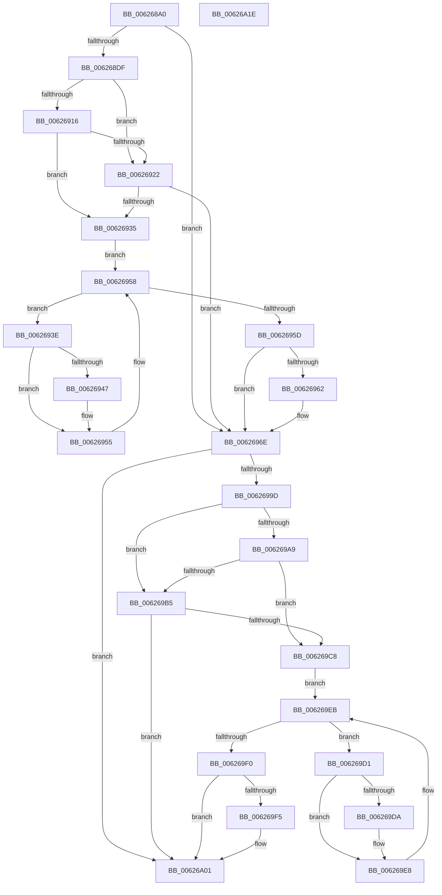

# DifIRP_MJ_SET_QUOTAWrapper

- RVA: `0x006268A0`–`0x00626A1F` (길이 `383` bytes)
- VA: `0x00000001406268A0`
- 실행 섹션: `.text`
- PDB 이름 있음: `예`; PDB Function 태그: `아니요`
- unwind 정보 RVA: `0x00093E28`
- 디코드: `101`개 명령, `383/383` bytes 표시
- 미해석 바이트: `0` (있으면 어셈블리에 `.byte`로 보존)

> 이 문서는 커널 이미지의 기계어와 PDB 기호를 분석해 생성했습니다. 4번과 5번은 함수 원형과 자료형을 바이너리 사용 방식에서 추정한 C 해석이며 원본 소스 복구 결과는 아닙니다.

## 1. Dependencies

- 직접 호출 지점: **8**; 고유 호출 대상: **4**
- 직접 호출자로 확인된 함수: **0**
- RIP 상대 이미지 참조: **3**

### Outgoing calls
- `0x006268CE` → [DifGetAPIThunkContextById](../49/DifGetAPIThunkContextById_function_00495A34.md) (function, `0x00495A34`)
- `0x00626929` → [ExAcquireRundownProtection](../21/ExAcquireRundownProtection_function_00216620.md) (function, `0x00216620`)
- `0x00626950` → [guard_dispatch_icall](../6B/guard_dispatch_icall_function_006BAAD0.md) (function, `0x006BAAD0`)
- `0x00626969` → [ExReleaseRundownProtection](../34/ExReleaseRundownProtection_function_00349E80.md) (function, `0x00349E80`)
- `0x0062698F` → [guard_dispatch_icall](../6B/guard_dispatch_icall_function_006BAAD0.md) (function, `0x006BAAD0`)
- `0x006269BC` → [ExAcquireRundownProtection](../21/ExAcquireRundownProtection_function_00216620.md) (function, `0x00216620`)
- `0x006269E3` → [guard_dispatch_icall](../6B/guard_dispatch_icall_function_006BAAD0.md) (function, `0x006BAAD0`)
- `0x006269FC` → [ExReleaseRundownProtection](../34/ExReleaseRundownProtection_function_00349E80.md) (function, `0x00349E80`)

### Direct callers
- 이 함수 시작 RVA로 연결되는 직접 call은 확인되지 않았습니다. 간접 호출은 완전히 역산할 수 없습니다.

### Static image references
- `0x006268E9` → RVA `0x00F048B8` (`.data`; read)
- `0x00626916` → RVA `0x00F04980` (`.data`; read)
- `0x00626922` → RVA `0x00F03E80` (`.data`; read)

## 2. Other-region calls and transfers

- 다른 실행 섹션으로 향하는 call: **0**
- 별도 외부 분기/꼬리 이동을 확인하지 못했습니다.

## 3. Assembly (complete function range)

```asm
006268A0  48 8B C4                        mov rax, rsp
006268A3  48 89 58 08                     mov qword ptr [rax + 8], rbx
006268A7  48 89 68 10                     mov qword ptr [rax + 0x10], rbp
006268AB  48 89 70 18                     mov qword ptr [rax + 0x18], rsi
006268AF  57                              push rdi
006268B0  41 56                           push r14
006268B2  41 57                           push r15
006268B4  48 83 EC 40                     sub rsp, 0x40
006268B8  0F 57 C0                        xorps xmm0, xmm0
006268BB  4C 8B F9                        mov r15, rcx
006268BE  B9 1A 00 00 10                  mov ecx, 0x1000001a
006268C3  4C 8B F2                        mov r14, rdx
006268C6  0F 11 40 C8                     movups xmmword ptr [rax - 0x38], xmm0
006268CA  0F 11 40 D8                     movups xmmword ptr [rax - 0x28], xmm0
006268CE  E8 61 F1 E6 FF                  call 0x140495a34
006268D3  48 8B E8                        mov rbp, rax
006268D6  48 85 C0                        test rax, rax
006268D9  0F 84 8F 00 00 00               je 0x14062696e
006268DF  49 8B 96 B8 00 00 00            mov rdx, qword ptr [r14 + 0xb8]
006268E6  40 32 F6                        xor sil, sil
006268E9  40 38 35 C8 DF 8D 00            cmp byte ptr [rip + 0x8ddfc8], sil
006268F0  49 8B 4F 08                     mov rcx, qword ptr [r15 + 8]
006268F4  44 0F B6 02                     movzx r8d, byte ptr [rdx]
006268F8  48 8B 51 30                     mov rdx, qword ptr [rcx + 0x30]
006268FC  48 8B 4A 40                     mov rcx, qword ptr [rdx + 0x40]
00626900  4A 8B 54 C1 20                  mov rdx, qword ptr [rcx + r8*8 + 0x20]
00626905  48 89 54 24 20                  mov qword ptr [rsp + 0x20], rdx
0062690A  4C 89 7C 24 30                  mov qword ptr [rsp + 0x30], r15
0062690F  4C 89 74 24 28                  mov qword ptr [rsp + 0x28], r14
00626914  75 0C                           jne 0x140626922
00626916  F7 05 60 E0 8D 00 00 08 00 00   test dword ptr [rip + 0x8de060], 0x800
00626920  74 13                           je 0x140626935
00626922  48 8D 0D 57 D5 8D 00            lea rcx, [rip + 0x8dd557]
00626929  E8 F2 FC BE FF                  call 0x140216620
0062692E  40 8A F0                        mov sil, al
00626931  84 C0                           test al, al
00626933  74 39                           je 0x14062696e
00626935  48 8D 7D 20                     lea rdi, [rbp + 0x20]
00626939  48 8B 1F                        mov rbx, qword ptr [rdi]
0062693C  EB 1A                           jmp 0x140626958
0062693E  48 8D 43 F0                     lea rax, [rbx - 0x10]
00626942  48 85 C0                        test rax, rax
00626945  74 0E                           je 0x140626955
00626947  48 8B 40 08                     mov rax, qword ptr [rax + 8]
0062694B  48 8D 4C 24 20                  lea rcx, [rsp + 0x20]
00626950  E8 7B 41 09 00                  call 0x1406baad0
00626955  48 8B 1B                        mov rbx, qword ptr [rbx]
00626958  48 3B DF                        cmp rbx, rdi
0062695B  75 E1                           jne 0x14062693e
0062695D  40 84 F6                        test sil, sil
00626960  74 0C                           je 0x14062696e
00626962  48 8D 0D 17 D5 8D 00            lea rcx, [rip + 0x8dd517]
00626969  E8 12 35 D2 FF                  call 0x140349e80
0062696E  49 8B 86 B8 00 00 00            mov rax, qword ptr [r14 + 0xb8]
00626975  0F B6 10                        movzx edx, byte ptr [rax]
00626978  49 8B 47 08                     mov rax, qword ptr [r15 + 8]
0062697C  48 8B 48 30                     mov rcx, qword ptr [rax + 0x30]
00626980  48 8B 41 40                     mov rax, qword ptr [rcx + 0x40]
00626984  49 8B CF                        mov rcx, r15
00626987  48 8B 44 D0 20                  mov rax, qword ptr [rax + rdx*8 + 0x20]
0062698C  49 8B D6                        mov rdx, r14
0062698F  E8 3C 41 09 00                  call 0x1406baad0
00626994  89 44 24 38                     mov dword ptr [rsp + 0x38], eax
00626998  48 85 ED                        test rbp, rbp
0062699B  74 64                           je 0x140626a01
0062699D  40 32 FF                        xor dil, dil
006269A0  40 38 3D 11 DF 8D 00            cmp byte ptr [rip + 0x8ddf11], dil
006269A7  75 0C                           jne 0x1406269b5
006269A9  F7 05 CD DF 8D 00 00 08 00 00   test dword ptr [rip + 0x8ddfcd], 0x800
006269B3  74 13                           je 0x1406269c8
006269B5  48 8D 0D C4 D4 8D 00            lea rcx, [rip + 0x8dd4c4]
006269BC  E8 5F FC BE FF                  call 0x140216620
006269C1  40 8A F8                        mov dil, al
006269C4  84 C0                           test al, al
006269C6  74 39                           je 0x140626a01
006269C8  48 8D 75 30                     lea rsi, [rbp + 0x30]
006269CC  48 8B 1E                        mov rbx, qword ptr [rsi]
006269CF  EB 1A                           jmp 0x1406269eb
006269D1  48 8D 43 F0                     lea rax, [rbx - 0x10]
006269D5  48 85 C0                        test rax, rax
006269D8  74 0E                           je 0x1406269e8
006269DA  48 8B 40 08                     mov rax, qword ptr [rax + 8]
006269DE  48 8D 4C 24 20                  lea rcx, [rsp + 0x20]
006269E3  E8 E8 40 09 00                  call 0x1406baad0
006269E8  48 8B 1B                        mov rbx, qword ptr [rbx]
006269EB  48 3B DE                        cmp rbx, rsi
006269EE  75 E1                           jne 0x1406269d1
006269F0  40 84 FF                        test dil, dil
006269F3  74 0C                           je 0x140626a01
006269F5  48 8D 0D 84 D4 8D 00            lea rcx, [rip + 0x8dd484]
006269FC  E8 7F 34 D2 FF                  call 0x140349e80
00626A01  8B 44 24 38                     mov eax, dword ptr [rsp + 0x38]
00626A05  48 8B 5C 24 60                  mov rbx, qword ptr [rsp + 0x60]
00626A0A  48 8B 6C 24 68                  mov rbp, qword ptr [rsp + 0x68]
00626A0F  48 8B 74 24 70                  mov rsi, qword ptr [rsp + 0x70]
00626A14  48 83 C4 40                     add rsp, 0x40
00626A18  41 5F                           pop r15
00626A1A  41 5E                           pop r14
00626A1C  5F                              pop rdi
00626A1D  C3                              ret
00626A1E  CC                              int3
```

## 4. C-style interpretation (structured pseudocode)

```c
__int64 __fastcall DifIRP_MJ_SET_QUOTAWrapper(__int64 a1, __int64 a2)
{
    __int64 result;
    __int64 v_rdi;
    __int64 v_rsi;
    __int64 v_rsp;
    unsigned int v_stack_m20;
    unsigned __int64 v_stack_m28;
    unsigned __int64 v_stack_m30;
    unsigned __int64 v_stack_m38;
    unsigned __int64 v_stack_p10;
    unsigned __int64 v_stack_p18;
    unsigned __int64 v_stack_p8;

    *(unsigned __int64 *)(v_rsp + 8) = v_rbx;
    *(unsigned __int64 *)(v_rsp + 16) = v_rbp;
    *(unsigned __int64 *)(v_rsp + 24) = v_rsi;
    v_rsp = (v_rsp) - (64);
    *(unsigned __int64 *)(v_rsp - 56) = v_xmm0;
    *(unsigned __int64 *)(v_rsp - 40) = v_xmm0;
    result = DifGetAPIThunkContextById((unsigned int)(0x1000001AULL), a2, a3, a4);
    if (result == 0) goto loc_0062696E;
    v_rsi = 0;
    v_stack_m38 = *(unsigned __int64 *)(*(unsigned __int64 *)(*(unsigned __int64 *)(*(unsigned __int64 *)(a1 + 8) + 48) + 64) + *(unsigned __int8 *)(*(unsigned __int64 *)(a2 + 184)) * 8 + 32);
    v_stack_m28 = a1;
    v_stack_m30 = a2;
    if ((*(unsigned __int8 *)(v_rip + 9297864)) != 0) goto loc_00626922;
    if (((*(unsigned int *)(v_rip + 9298016)) & (0x800ULL)) == 0) goto loc_00626935;
loc_00626922:
    result = ExAcquireRundownProtection(v_rip + 9295191, *(unsigned __int64 *)(*(unsigned __int64 *)(*(unsigned __int64 *)(*(unsigned __int64 *)(a1 + 8) + 48) + 64) + *(unsigned __int8 *)(*(unsigned __int64 *)(a2 + 184)) * 8 + 32), *(unsigned __int8 *)(*(unsigned __int64 *)(a2 + 184)), a4);
    if ((unsigned __int8)(result) == 0) goto loc_0062696E;
loc_00626935:
    goto loc_00626958;
loc_0062693E:
    result = *(unsigned __int64 *)(result + 32) - 16;
    if (*(unsigned __int64 *)(result + 32) - 16 != 0) {
        result = *(unsigned __int64 *)(*(unsigned __int64 *)(result + 32) - 16 + 8);
        a1 = v_stack_m38;
        result = guard_dispatch_icall(a1, *(unsigned __int64 *)(*(unsigned __int64 *)(*(unsigned __int64 *)(*(unsigned __int64 *)(a1 + 8) + 48) + 64) + *(unsigned __int8 *)(*(unsigned __int64 *)(a2 + 184)) * 8 + 32), *(unsigned __int8 *)(*(unsigned __int64 *)(a2 + 184)), a4);
    }
loc_00626958:
    if ((*(unsigned __int64 *)(*(unsigned __int64 *)(result + 32))) != (result + 32)) goto loc_0062693E;
    if ((unsigned __int8)((unsigned __int8)(result)) != 0) {
        a1 = v_rip + 9295127;
        result = ExReleaseRundownProtection(a1, *(unsigned __int64 *)(*(unsigned __int64 *)(*(unsigned __int64 *)(*(unsigned __int64 *)(a1 + 8) + 48) + 64) + *(unsigned __int8 *)(*(unsigned __int64 *)(a2 + 184)) * 8 + 32), *(unsigned __int8 *)(*(unsigned __int64 *)(a2 + 184)), a4);
    }
    result = guard_dispatch_icall(a1, a2, *(unsigned __int8 *)(*(unsigned __int64 *)(a2 + 184)), a4);
    v_stack_m20 = (unsigned int)(result);
    if (result == 0) goto loc_00626A01;
    v_rdi = 0;
    if ((*(unsigned __int8 *)(v_rip + 9297681)) != 0) goto loc_006269B5;
    if (((*(unsigned int *)(v_rip + 9297869)) & (0x800ULL)) == 0) goto loc_006269C8;
loc_006269B5:
    result = ExAcquireRundownProtection(v_rip + 9295044, a2, *(unsigned __int8 *)(*(unsigned __int64 *)(a2 + 184)), a4);
    if ((unsigned __int8)(result) == 0) goto loc_00626A01;
loc_006269C8:
    goto loc_006269EB;
loc_006269D1:
    result = *(unsigned __int64 *)(result + 48) - 16;
    if (*(unsigned __int64 *)(result + 48) - 16 != 0) {
        result = *(unsigned __int64 *)(*(unsigned __int64 *)(result + 48) - 16 + 8);
        a1 = v_stack_m38;
        result = guard_dispatch_icall(a1, a2, *(unsigned __int8 *)(*(unsigned __int64 *)(a2 + 184)), a4);
    }
loc_006269EB:
    if ((*(unsigned __int64 *)(*(unsigned __int64 *)(result + 48))) != (result + 48)) goto loc_006269D1;
    if ((unsigned __int8)((unsigned __int8)(result)) != 0) {
        a1 = v_rip + 9294980;
        result = ExReleaseRundownProtection(a1, a2, *(unsigned __int8 *)(*(unsigned __int64 *)(a2 + 184)), a4);
    }
    v_rsp = (v_rsp) + (64);
    return (unsigned int)(v_stack_m20);
}
```

## 5. (Beta) C Style

```c
int64_t DifIRP_MJ_SET_QUOTAWrapper(void *Arg1, void *Arg2)
{
    uint8_t *arg1 = (uint8_t *)Arg1;
    uint8_t *arg2 = (uint8_t *)Arg2;

    int64_t result;
    int64_t local_rdi;
    int64_t local_rsi;
    int64_t local_rsp;
    uint32_t v_stack_m20;
    uint64_t v_stack_m28;
    uint64_t v_stack_m30;
    uint64_t v_stack_m38;
    uint64_t v_stack_p10;
    uint64_t v_stack_p18;
    uint64_t v_stack_p8;

    *(uint64_t *)(local_rsp + 0x8) = local_rbx;
    *(uint64_t *)(local_rsp + 0x10) = local_rbp;
    *(uint64_t *)(local_rsp + 0x18) = local_rsi;
    local_rsp = (local_rsp) - (64);
    *(uint64_t *)(local_rsp - 0x38) = v_xmm0;
    *(uint64_t *)(local_rsp - 0x28) = v_xmm0;
    result = DifGetAPIThunkContextById((uint32_t)(0x1000001AULL), Arg2, a3, a4);
    if (result == 0) goto loc_0062696E;
    local_rsi = 0;
    v_stack_m38 = *(uint64_t *)(*(uint64_t *)(*(uint64_t *)(*(uint64_t *)(arg1 + 0x8) + 0x30) + 0x40) + *(uint8_t *)(*(uint64_t *)(arg2 + 0xB8)) * 8 + 0x20);
    v_stack_m28 = Arg1;
    v_stack_m30 = Arg2;
    if ((*(uint8_t *)(v_rip + 0x8DDFC8)) != 0) goto loc_00626922;
    if (((*(uint32_t *)(v_rip + 0x8DE060)) & (0x800ULL)) == 0) goto loc_00626935;
loc_00626922:
    result = ExAcquireRundownProtection(v_rip + 9295191, *(uint64_t *)(*(uint64_t *)(*(uint64_t *)(*(uint64_t *)(arg1 + 0x8) + 0x30) + 0x40) + *(uint8_t *)(*(uint64_t *)(arg2 + 0xB8)) * 8 + 0x20), *(uint8_t *)(*(uint64_t *)(arg2 + 0xB8)), a4);
    if ((uint8_t)(result) == 0) goto loc_0062696E;
loc_00626935:
    goto loc_00626958;
loc_0062693E:
    result = *(uint64_t *)(result + 0x20) - 16;
    if (*(uint64_t *)(result + 0x20) - 16 != 0) {
        result = *(uint64_t *)(*(uint64_t *)(result + 0x20) - 0x10 + 0x8);
        Arg1 = v_stack_m38;
        result = guard_dispatch_icall(Arg1, *(uint64_t *)(*(uint64_t *)(*(uint64_t *)(*(uint64_t *)(arg1 + 0x8) + 0x30) + 0x40) + *(uint8_t *)(*(uint64_t *)(arg2 + 0xB8)) * 8 + 0x20), *(uint8_t *)(*(uint64_t *)(arg2 + 0xB8)), a4);
    }
loc_00626958:
    if ((*(uint64_t *)(*(uint64_t *)(result + 0x20))) != (result + 32)) goto loc_0062693E;
    if ((uint8_t)((uint8_t)(result)) != 0) {
        Arg1 = v_rip + 9295127;
        result = ExReleaseRundownProtection(Arg1, *(uint64_t *)(*(uint64_t *)(*(uint64_t *)(*(uint64_t *)(arg1 + 0x8) + 0x30) + 0x40) + *(uint8_t *)(*(uint64_t *)(arg2 + 0xB8)) * 8 + 0x20), *(uint8_t *)(*(uint64_t *)(arg2 + 0xB8)), a4);
    }
    result = guard_dispatch_icall(Arg1, Arg2, *(uint8_t *)(*(uint64_t *)(arg2 + 0xB8)), a4);
    v_stack_m20 = (uint32_t)(result);
    if (result == 0) goto loc_00626A01;
    local_rdi = 0;
    if ((*(uint8_t *)(v_rip + 0x8DDF11)) != 0) goto loc_006269B5;
    if (((*(uint32_t *)(v_rip + 0x8DDFCD)) & (0x800ULL)) == 0) goto loc_006269C8;
loc_006269B5:
    result = ExAcquireRundownProtection(v_rip + 9295044, Arg2, *(uint8_t *)(*(uint64_t *)(arg2 + 0xB8)), a4);
    if ((uint8_t)(result) == 0) goto loc_00626A01;
loc_006269C8:
    goto loc_006269EB;
loc_006269D1:
    result = *(uint64_t *)(result + 0x30) - 16;
    if (*(uint64_t *)(result + 0x30) - 16 != 0) {
        result = *(uint64_t *)(*(uint64_t *)(result + 0x30) - 0x10 + 0x8);
        Arg1 = v_stack_m38;
        result = guard_dispatch_icall(Arg1, Arg2, *(uint8_t *)(*(uint64_t *)(arg2 + 0xB8)), a4);
    }
loc_006269EB:
    if ((*(uint64_t *)(*(uint64_t *)(result + 0x30))) != (result + 48)) goto loc_006269D1;
    if ((uint8_t)((uint8_t)(result)) != 0) {
        Arg1 = v_rip + 9294980;
        result = ExReleaseRundownProtection(Arg1, Arg2, *(uint8_t *)(*(uint64_t *)(arg2 + 0xB8)), a4);
    }
    local_rsp = (local_rsp) + (64);
    return (uint32_t)(v_stack_m20);
}
```

### 관측된 메모리 오프셋

구조체 형식이 확인되지 않은 접근은 인자 기준의 오프셋으로만 기록했습니다.

| 기준 인자 | 오프셋 표현 | 폭 (bit) | 접근 |
|---|---:|---:|---|
| `Arg1` | `+ 0x8` | `64` | `R` |
| `Arg2` | `+ 0xB8` | `64` | `R` |

## 6. Execution-region graph

[열기: 2D/3D 그래프와 함수 탐색 컨트롤 패널](../../../control-panel.html?section=text&rva=0x006268A0&view=graph)

- 2D 그래프는 위에서 아래로 흐르고, 3D 그래프는 빈 공간을 드래그해 회전합니다. Shift+드래그는 이동, 휠은 확대·축소, 함수 노드 선택은 대상 보고서 이동입니다.

### Static fallback


