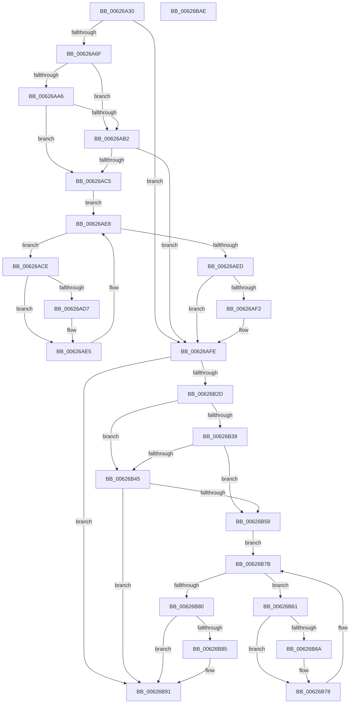

# DifIRP_MJ_SET_SECURITYWrapper

- RVA: `0x00626A30`–`0x00626BAF` (길이 `383` bytes)
- VA: `0x0000000140626A30`
- 실행 섹션: `.text`
- PDB 이름 있음: `예`; PDB Function 태그: `아니요`
- unwind 정보 RVA: `0x00093E28`
- 디코드: `101`개 명령, `383/383` bytes 표시
- 미해석 바이트: `0` (있으면 어셈블리에 `.byte`로 보존)

> 이 문서는 커널 이미지의 기계어와 PDB 기호를 분석해 생성했습니다. 4번과 5번은 함수 원형과 자료형을 바이너리 사용 방식에서 추정한 C 해석이며 원본 소스 복구 결과는 아닙니다.

## 1. Dependencies

- 직접 호출 지점: **8**; 고유 호출 대상: **4**
- 직접 호출자로 확인된 함수: **0**
- RIP 상대 이미지 참조: **3**

### Outgoing calls
- `0x00626A5E` → [DifGetAPIThunkContextById](../49/DifGetAPIThunkContextById_function_00495A34.md) (function, `0x00495A34`)
- `0x00626AB9` → [ExAcquireRundownProtection](../21/ExAcquireRundownProtection_function_00216620.md) (function, `0x00216620`)
- `0x00626AE0` → [guard_dispatch_icall](../6B/guard_dispatch_icall_function_006BAAD0.md) (function, `0x006BAAD0`)
- `0x00626AF9` → [ExReleaseRundownProtection](../34/ExReleaseRundownProtection_function_00349E80.md) (function, `0x00349E80`)
- `0x00626B1F` → [guard_dispatch_icall](../6B/guard_dispatch_icall_function_006BAAD0.md) (function, `0x006BAAD0`)
- `0x00626B4C` → [ExAcquireRundownProtection](../21/ExAcquireRundownProtection_function_00216620.md) (function, `0x00216620`)
- `0x00626B73` → [guard_dispatch_icall](../6B/guard_dispatch_icall_function_006BAAD0.md) (function, `0x006BAAD0`)
- `0x00626B8C` → [ExReleaseRundownProtection](../34/ExReleaseRundownProtection_function_00349E80.md) (function, `0x00349E80`)

### Direct callers
- 이 함수 시작 RVA로 연결되는 직접 call은 확인되지 않았습니다. 간접 호출은 완전히 역산할 수 없습니다.

### Static image references
- `0x00626A79` → RVA `0x00F048B8` (`.data`; read)
- `0x00626AA6` → RVA `0x00F04980` (`.data`; read)
- `0x00626AB2` → RVA `0x00F03E80` (`.data`; read)

## 2. Other-region calls and transfers

- 다른 실행 섹션으로 향하는 call: **0**
- 별도 외부 분기/꼬리 이동을 확인하지 못했습니다.

## 3. Assembly (complete function range)

```asm
00626A30  48 8B C4                        mov rax, rsp
00626A33  48 89 58 08                     mov qword ptr [rax + 8], rbx
00626A37  48 89 68 10                     mov qword ptr [rax + 0x10], rbp
00626A3B  48 89 70 18                     mov qword ptr [rax + 0x18], rsi
00626A3F  57                              push rdi
00626A40  41 56                           push r14
00626A42  41 57                           push r15
00626A44  48 83 EC 40                     sub rsp, 0x40
00626A48  0F 57 C0                        xorps xmm0, xmm0
00626A4B  4C 8B F9                        mov r15, rcx
00626A4E  B9 15 00 00 10                  mov ecx, 0x10000015
00626A53  4C 8B F2                        mov r14, rdx
00626A56  0F 11 40 C8                     movups xmmword ptr [rax - 0x38], xmm0
00626A5A  0F 11 40 D8                     movups xmmword ptr [rax - 0x28], xmm0
00626A5E  E8 D1 EF E6 FF                  call 0x140495a34
00626A63  48 8B E8                        mov rbp, rax
00626A66  48 85 C0                        test rax, rax
00626A69  0F 84 8F 00 00 00               je 0x140626afe
00626A6F  49 8B 96 B8 00 00 00            mov rdx, qword ptr [r14 + 0xb8]
00626A76  40 32 F6                        xor sil, sil
00626A79  40 38 35 38 DE 8D 00            cmp byte ptr [rip + 0x8dde38], sil
00626A80  49 8B 4F 08                     mov rcx, qword ptr [r15 + 8]
00626A84  44 0F B6 02                     movzx r8d, byte ptr [rdx]
00626A88  48 8B 51 30                     mov rdx, qword ptr [rcx + 0x30]
00626A8C  48 8B 4A 40                     mov rcx, qword ptr [rdx + 0x40]
00626A90  4A 8B 54 C1 20                  mov rdx, qword ptr [rcx + r8*8 + 0x20]
00626A95  48 89 54 24 20                  mov qword ptr [rsp + 0x20], rdx
00626A9A  4C 89 7C 24 30                  mov qword ptr [rsp + 0x30], r15
00626A9F  4C 89 74 24 28                  mov qword ptr [rsp + 0x28], r14
00626AA4  75 0C                           jne 0x140626ab2
00626AA6  F7 05 D0 DE 8D 00 00 08 00 00   test dword ptr [rip + 0x8dded0], 0x800
00626AB0  74 13                           je 0x140626ac5
00626AB2  48 8D 0D C7 D3 8D 00            lea rcx, [rip + 0x8dd3c7]
00626AB9  E8 62 FB BE FF                  call 0x140216620
00626ABE  40 8A F0                        mov sil, al
00626AC1  84 C0                           test al, al
00626AC3  74 39                           je 0x140626afe
00626AC5  48 8D 7D 20                     lea rdi, [rbp + 0x20]
00626AC9  48 8B 1F                        mov rbx, qword ptr [rdi]
00626ACC  EB 1A                           jmp 0x140626ae8
00626ACE  48 8D 43 F0                     lea rax, [rbx - 0x10]
00626AD2  48 85 C0                        test rax, rax
00626AD5  74 0E                           je 0x140626ae5
00626AD7  48 8B 40 08                     mov rax, qword ptr [rax + 8]
00626ADB  48 8D 4C 24 20                  lea rcx, [rsp + 0x20]
00626AE0  E8 EB 3F 09 00                  call 0x1406baad0
00626AE5  48 8B 1B                        mov rbx, qword ptr [rbx]
00626AE8  48 3B DF                        cmp rbx, rdi
00626AEB  75 E1                           jne 0x140626ace
00626AED  40 84 F6                        test sil, sil
00626AF0  74 0C                           je 0x140626afe
00626AF2  48 8D 0D 87 D3 8D 00            lea rcx, [rip + 0x8dd387]
00626AF9  E8 82 33 D2 FF                  call 0x140349e80
00626AFE  49 8B 86 B8 00 00 00            mov rax, qword ptr [r14 + 0xb8]
00626B05  0F B6 10                        movzx edx, byte ptr [rax]
00626B08  49 8B 47 08                     mov rax, qword ptr [r15 + 8]
00626B0C  48 8B 48 30                     mov rcx, qword ptr [rax + 0x30]
00626B10  48 8B 41 40                     mov rax, qword ptr [rcx + 0x40]
00626B14  49 8B CF                        mov rcx, r15
00626B17  48 8B 44 D0 20                  mov rax, qword ptr [rax + rdx*8 + 0x20]
00626B1C  49 8B D6                        mov rdx, r14
00626B1F  E8 AC 3F 09 00                  call 0x1406baad0
00626B24  89 44 24 38                     mov dword ptr [rsp + 0x38], eax
00626B28  48 85 ED                        test rbp, rbp
00626B2B  74 64                           je 0x140626b91
00626B2D  40 32 FF                        xor dil, dil
00626B30  40 38 3D 81 DD 8D 00            cmp byte ptr [rip + 0x8ddd81], dil
00626B37  75 0C                           jne 0x140626b45
00626B39  F7 05 3D DE 8D 00 00 08 00 00   test dword ptr [rip + 0x8dde3d], 0x800
00626B43  74 13                           je 0x140626b58
00626B45  48 8D 0D 34 D3 8D 00            lea rcx, [rip + 0x8dd334]
00626B4C  E8 CF FA BE FF                  call 0x140216620
00626B51  40 8A F8                        mov dil, al
00626B54  84 C0                           test al, al
00626B56  74 39                           je 0x140626b91
00626B58  48 8D 75 30                     lea rsi, [rbp + 0x30]
00626B5C  48 8B 1E                        mov rbx, qword ptr [rsi]
00626B5F  EB 1A                           jmp 0x140626b7b
00626B61  48 8D 43 F0                     lea rax, [rbx - 0x10]
00626B65  48 85 C0                        test rax, rax
00626B68  74 0E                           je 0x140626b78
00626B6A  48 8B 40 08                     mov rax, qword ptr [rax + 8]
00626B6E  48 8D 4C 24 20                  lea rcx, [rsp + 0x20]
00626B73  E8 58 3F 09 00                  call 0x1406baad0
00626B78  48 8B 1B                        mov rbx, qword ptr [rbx]
00626B7B  48 3B DE                        cmp rbx, rsi
00626B7E  75 E1                           jne 0x140626b61
00626B80  40 84 FF                        test dil, dil
00626B83  74 0C                           je 0x140626b91
00626B85  48 8D 0D F4 D2 8D 00            lea rcx, [rip + 0x8dd2f4]
00626B8C  E8 EF 32 D2 FF                  call 0x140349e80
00626B91  8B 44 24 38                     mov eax, dword ptr [rsp + 0x38]
00626B95  48 8B 5C 24 60                  mov rbx, qword ptr [rsp + 0x60]
00626B9A  48 8B 6C 24 68                  mov rbp, qword ptr [rsp + 0x68]
00626B9F  48 8B 74 24 70                  mov rsi, qword ptr [rsp + 0x70]
00626BA4  48 83 C4 40                     add rsp, 0x40
00626BA8  41 5F                           pop r15
00626BAA  41 5E                           pop r14
00626BAC  5F                              pop rdi
00626BAD  C3                              ret
00626BAE  CC                              int3
```

## 4. C-style interpretation (structured pseudocode)

```c
__int64 __fastcall DifIRP_MJ_SET_SECURITYWrapper(__int64 a1, __int64 a2)
{
    __int64 result;
    __int64 v_rdi;
    __int64 v_rsi;
    __int64 v_rsp;
    unsigned int v_stack_m20;
    unsigned __int64 v_stack_m28;
    unsigned __int64 v_stack_m30;
    unsigned __int64 v_stack_m38;
    unsigned __int64 v_stack_p10;
    unsigned __int64 v_stack_p18;
    unsigned __int64 v_stack_p8;

    *(unsigned __int64 *)(v_rsp + 8) = v_rbx;
    *(unsigned __int64 *)(v_rsp + 16) = v_rbp;
    *(unsigned __int64 *)(v_rsp + 24) = v_rsi;
    v_rsp = (v_rsp) - (64);
    *(unsigned __int64 *)(v_rsp - 56) = v_xmm0;
    *(unsigned __int64 *)(v_rsp - 40) = v_xmm0;
    result = DifGetAPIThunkContextById((unsigned int)(0x10000015ULL), a2, a3, a4);
    if (result == 0) goto loc_00626AFE;
    v_rsi = 0;
    v_stack_m38 = *(unsigned __int64 *)(*(unsigned __int64 *)(*(unsigned __int64 *)(*(unsigned __int64 *)(a1 + 8) + 48) + 64) + *(unsigned __int8 *)(*(unsigned __int64 *)(a2 + 184)) * 8 + 32);
    v_stack_m28 = a1;
    v_stack_m30 = a2;
    if ((*(unsigned __int8 *)(v_rip + 9297464)) != 0) goto loc_00626AB2;
    if (((*(unsigned int *)(v_rip + 9297616)) & (0x800ULL)) == 0) goto loc_00626AC5;
loc_00626AB2:
    result = ExAcquireRundownProtection(v_rip + 9294791, *(unsigned __int64 *)(*(unsigned __int64 *)(*(unsigned __int64 *)(*(unsigned __int64 *)(a1 + 8) + 48) + 64) + *(unsigned __int8 *)(*(unsigned __int64 *)(a2 + 184)) * 8 + 32), *(unsigned __int8 *)(*(unsigned __int64 *)(a2 + 184)), a4);
    if ((unsigned __int8)(result) == 0) goto loc_00626AFE;
loc_00626AC5:
    goto loc_00626AE8;
loc_00626ACE:
    result = *(unsigned __int64 *)(result + 32) - 16;
    if (*(unsigned __int64 *)(result + 32) - 16 != 0) {
        result = *(unsigned __int64 *)(*(unsigned __int64 *)(result + 32) - 16 + 8);
        a1 = v_stack_m38;
        result = guard_dispatch_icall(a1, *(unsigned __int64 *)(*(unsigned __int64 *)(*(unsigned __int64 *)(*(unsigned __int64 *)(a1 + 8) + 48) + 64) + *(unsigned __int8 *)(*(unsigned __int64 *)(a2 + 184)) * 8 + 32), *(unsigned __int8 *)(*(unsigned __int64 *)(a2 + 184)), a4);
    }
loc_00626AE8:
    if ((*(unsigned __int64 *)(*(unsigned __int64 *)(result + 32))) != (result + 32)) goto loc_00626ACE;
    if ((unsigned __int8)((unsigned __int8)(result)) != 0) {
        a1 = v_rip + 9294727;
        result = ExReleaseRundownProtection(a1, *(unsigned __int64 *)(*(unsigned __int64 *)(*(unsigned __int64 *)(*(unsigned __int64 *)(a1 + 8) + 48) + 64) + *(unsigned __int8 *)(*(unsigned __int64 *)(a2 + 184)) * 8 + 32), *(unsigned __int8 *)(*(unsigned __int64 *)(a2 + 184)), a4);
    }
    result = guard_dispatch_icall(a1, a2, *(unsigned __int8 *)(*(unsigned __int64 *)(a2 + 184)), a4);
    v_stack_m20 = (unsigned int)(result);
    if (result == 0) goto loc_00626B91;
    v_rdi = 0;
    if ((*(unsigned __int8 *)(v_rip + 9297281)) != 0) goto loc_00626B45;
    if (((*(unsigned int *)(v_rip + 9297469)) & (0x800ULL)) == 0) goto loc_00626B58;
loc_00626B45:
    result = ExAcquireRundownProtection(v_rip + 9294644, a2, *(unsigned __int8 *)(*(unsigned __int64 *)(a2 + 184)), a4);
    if ((unsigned __int8)(result) == 0) goto loc_00626B91;
loc_00626B58:
    goto loc_00626B7B;
loc_00626B61:
    result = *(unsigned __int64 *)(result + 48) - 16;
    if (*(unsigned __int64 *)(result + 48) - 16 != 0) {
        result = *(unsigned __int64 *)(*(unsigned __int64 *)(result + 48) - 16 + 8);
        a1 = v_stack_m38;
        result = guard_dispatch_icall(a1, a2, *(unsigned __int8 *)(*(unsigned __int64 *)(a2 + 184)), a4);
    }
loc_00626B7B:
    if ((*(unsigned __int64 *)(*(unsigned __int64 *)(result + 48))) != (result + 48)) goto loc_00626B61;
    if ((unsigned __int8)((unsigned __int8)(result)) != 0) {
        a1 = v_rip + 9294580;
        result = ExReleaseRundownProtection(a1, a2, *(unsigned __int8 *)(*(unsigned __int64 *)(a2 + 184)), a4);
    }
    v_rsp = (v_rsp) + (64);
    return (unsigned int)(v_stack_m20);
}
```

## 5. (Beta) C Style

```c
int64_t DifIRP_MJ_SET_SECURITYWrapper(void *Arg1, void *Arg2)
{
    uint8_t *arg1 = (uint8_t *)Arg1;
    uint8_t *arg2 = (uint8_t *)Arg2;

    int64_t result;
    int64_t local_rdi;
    int64_t local_rsi;
    int64_t local_rsp;
    uint32_t v_stack_m20;
    uint64_t v_stack_m28;
    uint64_t v_stack_m30;
    uint64_t v_stack_m38;
    uint64_t v_stack_p10;
    uint64_t v_stack_p18;
    uint64_t v_stack_p8;

    *(uint64_t *)(local_rsp + 0x8) = local_rbx;
    *(uint64_t *)(local_rsp + 0x10) = local_rbp;
    *(uint64_t *)(local_rsp + 0x18) = local_rsi;
    local_rsp = (local_rsp) - (64);
    *(uint64_t *)(local_rsp - 0x38) = v_xmm0;
    *(uint64_t *)(local_rsp - 0x28) = v_xmm0;
    result = DifGetAPIThunkContextById((uint32_t)(0x10000015ULL), Arg2, a3, a4);
    if (result == 0) goto loc_00626AFE;
    local_rsi = 0;
    v_stack_m38 = *(uint64_t *)(*(uint64_t *)(*(uint64_t *)(*(uint64_t *)(arg1 + 0x8) + 0x30) + 0x40) + *(uint8_t *)(*(uint64_t *)(arg2 + 0xB8)) * 8 + 0x20);
    v_stack_m28 = Arg1;
    v_stack_m30 = Arg2;
    if ((*(uint8_t *)(v_rip + 0x8DDE38)) != 0) goto loc_00626AB2;
    if (((*(uint32_t *)(v_rip + 0x8DDED0)) & (0x800ULL)) == 0) goto loc_00626AC5;
loc_00626AB2:
    result = ExAcquireRundownProtection(v_rip + 9294791, *(uint64_t *)(*(uint64_t *)(*(uint64_t *)(*(uint64_t *)(arg1 + 0x8) + 0x30) + 0x40) + *(uint8_t *)(*(uint64_t *)(arg2 + 0xB8)) * 8 + 0x20), *(uint8_t *)(*(uint64_t *)(arg2 + 0xB8)), a4);
    if ((uint8_t)(result) == 0) goto loc_00626AFE;
loc_00626AC5:
    goto loc_00626AE8;
loc_00626ACE:
    result = *(uint64_t *)(result + 0x20) - 16;
    if (*(uint64_t *)(result + 0x20) - 16 != 0) {
        result = *(uint64_t *)(*(uint64_t *)(result + 0x20) - 0x10 + 0x8);
        Arg1 = v_stack_m38;
        result = guard_dispatch_icall(Arg1, *(uint64_t *)(*(uint64_t *)(*(uint64_t *)(*(uint64_t *)(arg1 + 0x8) + 0x30) + 0x40) + *(uint8_t *)(*(uint64_t *)(arg2 + 0xB8)) * 8 + 0x20), *(uint8_t *)(*(uint64_t *)(arg2 + 0xB8)), a4);
    }
loc_00626AE8:
    if ((*(uint64_t *)(*(uint64_t *)(result + 0x20))) != (result + 32)) goto loc_00626ACE;
    if ((uint8_t)((uint8_t)(result)) != 0) {
        Arg1 = v_rip + 9294727;
        result = ExReleaseRundownProtection(Arg1, *(uint64_t *)(*(uint64_t *)(*(uint64_t *)(*(uint64_t *)(arg1 + 0x8) + 0x30) + 0x40) + *(uint8_t *)(*(uint64_t *)(arg2 + 0xB8)) * 8 + 0x20), *(uint8_t *)(*(uint64_t *)(arg2 + 0xB8)), a4);
    }
    result = guard_dispatch_icall(Arg1, Arg2, *(uint8_t *)(*(uint64_t *)(arg2 + 0xB8)), a4);
    v_stack_m20 = (uint32_t)(result);
    if (result == 0) goto loc_00626B91;
    local_rdi = 0;
    if ((*(uint8_t *)(v_rip + 0x8DDD81)) != 0) goto loc_00626B45;
    if (((*(uint32_t *)(v_rip + 0x8DDE3D)) & (0x800ULL)) == 0) goto loc_00626B58;
loc_00626B45:
    result = ExAcquireRundownProtection(v_rip + 9294644, Arg2, *(uint8_t *)(*(uint64_t *)(arg2 + 0xB8)), a4);
    if ((uint8_t)(result) == 0) goto loc_00626B91;
loc_00626B58:
    goto loc_00626B7B;
loc_00626B61:
    result = *(uint64_t *)(result + 0x30) - 16;
    if (*(uint64_t *)(result + 0x30) - 16 != 0) {
        result = *(uint64_t *)(*(uint64_t *)(result + 0x30) - 0x10 + 0x8);
        Arg1 = v_stack_m38;
        result = guard_dispatch_icall(Arg1, Arg2, *(uint8_t *)(*(uint64_t *)(arg2 + 0xB8)), a4);
    }
loc_00626B7B:
    if ((*(uint64_t *)(*(uint64_t *)(result + 0x30))) != (result + 48)) goto loc_00626B61;
    if ((uint8_t)((uint8_t)(result)) != 0) {
        Arg1 = v_rip + 9294580;
        result = ExReleaseRundownProtection(Arg1, Arg2, *(uint8_t *)(*(uint64_t *)(arg2 + 0xB8)), a4);
    }
    local_rsp = (local_rsp) + (64);
    return (uint32_t)(v_stack_m20);
}
```

### 관측된 메모리 오프셋

구조체 형식이 확인되지 않은 접근은 인자 기준의 오프셋으로만 기록했습니다.

| 기준 인자 | 오프셋 표현 | 폭 (bit) | 접근 |
|---|---:|---:|---|
| `Arg1` | `+ 0x8` | `64` | `R` |
| `Arg2` | `+ 0xB8` | `64` | `R` |

## 6. Execution-region graph

[열기: 2D/3D 그래프와 함수 탐색 컨트롤 패널](../../../control-panel.html?section=text&rva=0x00626A30&view=graph)

- 2D 그래프는 위에서 아래로 흐르고, 3D 그래프는 빈 공간을 드래그해 회전합니다. Shift+드래그는 이동, 휠은 확대·축소, 함수 노드 선택은 대상 보고서 이동입니다.

### Static fallback


