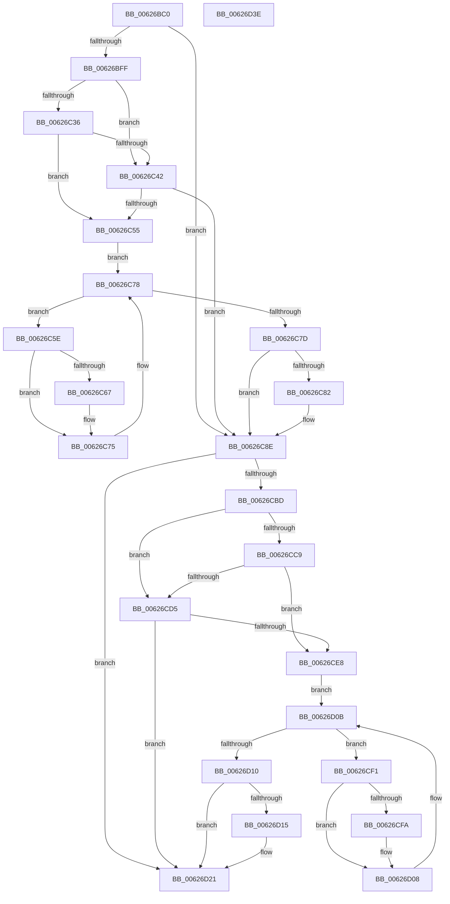

# DifIRP_MJ_SET_VOLUME_INFORMATIONWrapper

- RVA: `0x00626BC0`–`0x00626D3F` (길이 `383` bytes)
- VA: `0x0000000140626BC0`
- 실행 섹션: `.text`
- PDB 이름 있음: `예`; PDB Function 태그: `아니요`
- unwind 정보 RVA: `0x00093E28`
- 디코드: `101`개 명령, `383/383` bytes 표시
- 미해석 바이트: `0` (있으면 어셈블리에 `.byte`로 보존)

> 이 문서는 커널 이미지의 기계어와 PDB 기호를 분석해 생성했습니다. 4번과 5번은 함수 원형과 자료형을 바이너리 사용 방식에서 추정한 C 해석이며 원본 소스 복구 결과는 아닙니다.

## 1. Dependencies

- 직접 호출 지점: **8**; 고유 호출 대상: **4**
- 직접 호출자로 확인된 함수: **0**
- RIP 상대 이미지 참조: **3**

### Outgoing calls
- `0x00626BEE` → [DifGetAPIThunkContextById](../49/DifGetAPIThunkContextById_function_00495A34.md) (function, `0x00495A34`)
- `0x00626C49` → [ExAcquireRundownProtection](../21/ExAcquireRundownProtection_function_00216620.md) (function, `0x00216620`)
- `0x00626C70` → [guard_dispatch_icall](../6B/guard_dispatch_icall_function_006BAAD0.md) (function, `0x006BAAD0`)
- `0x00626C89` → [ExReleaseRundownProtection](../34/ExReleaseRundownProtection_function_00349E80.md) (function, `0x00349E80`)
- `0x00626CAF` → [guard_dispatch_icall](../6B/guard_dispatch_icall_function_006BAAD0.md) (function, `0x006BAAD0`)
- `0x00626CDC` → [ExAcquireRundownProtection](../21/ExAcquireRundownProtection_function_00216620.md) (function, `0x00216620`)
- `0x00626D03` → [guard_dispatch_icall](../6B/guard_dispatch_icall_function_006BAAD0.md) (function, `0x006BAAD0`)
- `0x00626D1C` → [ExReleaseRundownProtection](../34/ExReleaseRundownProtection_function_00349E80.md) (function, `0x00349E80`)

### Direct callers
- 이 함수 시작 RVA로 연결되는 직접 call은 확인되지 않았습니다. 간접 호출은 완전히 역산할 수 없습니다.

### Static image references
- `0x00626C09` → RVA `0x00F048B8` (`.data`; read)
- `0x00626C36` → RVA `0x00F04980` (`.data`; read)
- `0x00626C42` → RVA `0x00F03E80` (`.data`; read)

## 2. Other-region calls and transfers

- 다른 실행 섹션으로 향하는 call: **0**
- 별도 외부 분기/꼬리 이동을 확인하지 못했습니다.

## 3. Assembly (complete function range)

```asm
00626BC0  48 8B C4                        mov rax, rsp
00626BC3  48 89 58 08                     mov qword ptr [rax + 8], rbx
00626BC7  48 89 68 10                     mov qword ptr [rax + 0x10], rbp
00626BCB  48 89 70 18                     mov qword ptr [rax + 0x18], rsi
00626BCF  57                              push rdi
00626BD0  41 56                           push r14
00626BD2  41 57                           push r15
00626BD4  48 83 EC 40                     sub rsp, 0x40
00626BD8  0F 57 C0                        xorps xmm0, xmm0
00626BDB  4C 8B F9                        mov r15, rcx
00626BDE  B9 0B 00 00 10                  mov ecx, 0x1000000b
00626BE3  4C 8B F2                        mov r14, rdx
00626BE6  0F 11 40 C8                     movups xmmword ptr [rax - 0x38], xmm0
00626BEA  0F 11 40 D8                     movups xmmword ptr [rax - 0x28], xmm0
00626BEE  E8 41 EE E6 FF                  call 0x140495a34
00626BF3  48 8B E8                        mov rbp, rax
00626BF6  48 85 C0                        test rax, rax
00626BF9  0F 84 8F 00 00 00               je 0x140626c8e
00626BFF  49 8B 96 B8 00 00 00            mov rdx, qword ptr [r14 + 0xb8]
00626C06  40 32 F6                        xor sil, sil
00626C09  40 38 35 A8 DC 8D 00            cmp byte ptr [rip + 0x8ddca8], sil
00626C10  49 8B 4F 08                     mov rcx, qword ptr [r15 + 8]
00626C14  44 0F B6 02                     movzx r8d, byte ptr [rdx]
00626C18  48 8B 51 30                     mov rdx, qword ptr [rcx + 0x30]
00626C1C  48 8B 4A 40                     mov rcx, qword ptr [rdx + 0x40]
00626C20  4A 8B 54 C1 20                  mov rdx, qword ptr [rcx + r8*8 + 0x20]
00626C25  48 89 54 24 20                  mov qword ptr [rsp + 0x20], rdx
00626C2A  4C 89 7C 24 30                  mov qword ptr [rsp + 0x30], r15
00626C2F  4C 89 74 24 28                  mov qword ptr [rsp + 0x28], r14
00626C34  75 0C                           jne 0x140626c42
00626C36  F7 05 40 DD 8D 00 00 08 00 00   test dword ptr [rip + 0x8ddd40], 0x800
00626C40  74 13                           je 0x140626c55
00626C42  48 8D 0D 37 D2 8D 00            lea rcx, [rip + 0x8dd237]
00626C49  E8 D2 F9 BE FF                  call 0x140216620
00626C4E  40 8A F0                        mov sil, al
00626C51  84 C0                           test al, al
00626C53  74 39                           je 0x140626c8e
00626C55  48 8D 7D 20                     lea rdi, [rbp + 0x20]
00626C59  48 8B 1F                        mov rbx, qword ptr [rdi]
00626C5C  EB 1A                           jmp 0x140626c78
00626C5E  48 8D 43 F0                     lea rax, [rbx - 0x10]
00626C62  48 85 C0                        test rax, rax
00626C65  74 0E                           je 0x140626c75
00626C67  48 8B 40 08                     mov rax, qword ptr [rax + 8]
00626C6B  48 8D 4C 24 20                  lea rcx, [rsp + 0x20]
00626C70  E8 5B 3E 09 00                  call 0x1406baad0
00626C75  48 8B 1B                        mov rbx, qword ptr [rbx]
00626C78  48 3B DF                        cmp rbx, rdi
00626C7B  75 E1                           jne 0x140626c5e
00626C7D  40 84 F6                        test sil, sil
00626C80  74 0C                           je 0x140626c8e
00626C82  48 8D 0D F7 D1 8D 00            lea rcx, [rip + 0x8dd1f7]
00626C89  E8 F2 31 D2 FF                  call 0x140349e80
00626C8E  49 8B 86 B8 00 00 00            mov rax, qword ptr [r14 + 0xb8]
00626C95  0F B6 10                        movzx edx, byte ptr [rax]
00626C98  49 8B 47 08                     mov rax, qword ptr [r15 + 8]
00626C9C  48 8B 48 30                     mov rcx, qword ptr [rax + 0x30]
00626CA0  48 8B 41 40                     mov rax, qword ptr [rcx + 0x40]
00626CA4  49 8B CF                        mov rcx, r15
00626CA7  48 8B 44 D0 20                  mov rax, qword ptr [rax + rdx*8 + 0x20]
00626CAC  49 8B D6                        mov rdx, r14
00626CAF  E8 1C 3E 09 00                  call 0x1406baad0
00626CB4  89 44 24 38                     mov dword ptr [rsp + 0x38], eax
00626CB8  48 85 ED                        test rbp, rbp
00626CBB  74 64                           je 0x140626d21
00626CBD  40 32 FF                        xor dil, dil
00626CC0  40 38 3D F1 DB 8D 00            cmp byte ptr [rip + 0x8ddbf1], dil
00626CC7  75 0C                           jne 0x140626cd5
00626CC9  F7 05 AD DC 8D 00 00 08 00 00   test dword ptr [rip + 0x8ddcad], 0x800
00626CD3  74 13                           je 0x140626ce8
00626CD5  48 8D 0D A4 D1 8D 00            lea rcx, [rip + 0x8dd1a4]
00626CDC  E8 3F F9 BE FF                  call 0x140216620
00626CE1  40 8A F8                        mov dil, al
00626CE4  84 C0                           test al, al
00626CE6  74 39                           je 0x140626d21
00626CE8  48 8D 75 30                     lea rsi, [rbp + 0x30]
00626CEC  48 8B 1E                        mov rbx, qword ptr [rsi]
00626CEF  EB 1A                           jmp 0x140626d0b
00626CF1  48 8D 43 F0                     lea rax, [rbx - 0x10]
00626CF5  48 85 C0                        test rax, rax
00626CF8  74 0E                           je 0x140626d08
00626CFA  48 8B 40 08                     mov rax, qword ptr [rax + 8]
00626CFE  48 8D 4C 24 20                  lea rcx, [rsp + 0x20]
00626D03  E8 C8 3D 09 00                  call 0x1406baad0
00626D08  48 8B 1B                        mov rbx, qword ptr [rbx]
00626D0B  48 3B DE                        cmp rbx, rsi
00626D0E  75 E1                           jne 0x140626cf1
00626D10  40 84 FF                        test dil, dil
00626D13  74 0C                           je 0x140626d21
00626D15  48 8D 0D 64 D1 8D 00            lea rcx, [rip + 0x8dd164]
00626D1C  E8 5F 31 D2 FF                  call 0x140349e80
00626D21  8B 44 24 38                     mov eax, dword ptr [rsp + 0x38]
00626D25  48 8B 5C 24 60                  mov rbx, qword ptr [rsp + 0x60]
00626D2A  48 8B 6C 24 68                  mov rbp, qword ptr [rsp + 0x68]
00626D2F  48 8B 74 24 70                  mov rsi, qword ptr [rsp + 0x70]
00626D34  48 83 C4 40                     add rsp, 0x40
00626D38  41 5F                           pop r15
00626D3A  41 5E                           pop r14
00626D3C  5F                              pop rdi
00626D3D  C3                              ret
00626D3E  CC                              int3
```

## 4. C-style interpretation (structured pseudocode)

```c
__int64 __fastcall DifIRP_MJ_SET_VOLUME_INFORMATIONWrapper(__int64 a1, __int64 a2)
{
    __int64 result;
    __int64 v_rdi;
    __int64 v_rsi;
    __int64 v_rsp;
    unsigned int v_stack_m20;
    unsigned __int64 v_stack_m28;
    unsigned __int64 v_stack_m30;
    unsigned __int64 v_stack_m38;
    unsigned __int64 v_stack_p10;
    unsigned __int64 v_stack_p18;
    unsigned __int64 v_stack_p8;

    *(unsigned __int64 *)(v_rsp + 8) = v_rbx;
    *(unsigned __int64 *)(v_rsp + 16) = v_rbp;
    *(unsigned __int64 *)(v_rsp + 24) = v_rsi;
    v_rsp = (v_rsp) - (64);
    *(unsigned __int64 *)(v_rsp - 56) = v_xmm0;
    *(unsigned __int64 *)(v_rsp - 40) = v_xmm0;
    result = DifGetAPIThunkContextById((unsigned int)(0x1000000BULL), a2, a3, a4);
    if (result == 0) goto loc_00626C8E;
    v_rsi = 0;
    v_stack_m38 = *(unsigned __int64 *)(*(unsigned __int64 *)(*(unsigned __int64 *)(*(unsigned __int64 *)(a1 + 8) + 48) + 64) + *(unsigned __int8 *)(*(unsigned __int64 *)(a2 + 184)) * 8 + 32);
    v_stack_m28 = a1;
    v_stack_m30 = a2;
    if ((*(unsigned __int8 *)(v_rip + 9297064)) != 0) goto loc_00626C42;
    if (((*(unsigned int *)(v_rip + 9297216)) & (0x800ULL)) == 0) goto loc_00626C55;
loc_00626C42:
    result = ExAcquireRundownProtection(v_rip + 9294391, *(unsigned __int64 *)(*(unsigned __int64 *)(*(unsigned __int64 *)(*(unsigned __int64 *)(a1 + 8) + 48) + 64) + *(unsigned __int8 *)(*(unsigned __int64 *)(a2 + 184)) * 8 + 32), *(unsigned __int8 *)(*(unsigned __int64 *)(a2 + 184)), a4);
    if ((unsigned __int8)(result) == 0) goto loc_00626C8E;
loc_00626C55:
    goto loc_00626C78;
loc_00626C5E:
    result = *(unsigned __int64 *)(result + 32) - 16;
    if (*(unsigned __int64 *)(result + 32) - 16 != 0) {
        result = *(unsigned __int64 *)(*(unsigned __int64 *)(result + 32) - 16 + 8);
        a1 = v_stack_m38;
        result = guard_dispatch_icall(a1, *(unsigned __int64 *)(*(unsigned __int64 *)(*(unsigned __int64 *)(*(unsigned __int64 *)(a1 + 8) + 48) + 64) + *(unsigned __int8 *)(*(unsigned __int64 *)(a2 + 184)) * 8 + 32), *(unsigned __int8 *)(*(unsigned __int64 *)(a2 + 184)), a4);
    }
loc_00626C78:
    if ((*(unsigned __int64 *)(*(unsigned __int64 *)(result + 32))) != (result + 32)) goto loc_00626C5E;
    if ((unsigned __int8)((unsigned __int8)(result)) != 0) {
        a1 = v_rip + 9294327;
        result = ExReleaseRundownProtection(a1, *(unsigned __int64 *)(*(unsigned __int64 *)(*(unsigned __int64 *)(*(unsigned __int64 *)(a1 + 8) + 48) + 64) + *(unsigned __int8 *)(*(unsigned __int64 *)(a2 + 184)) * 8 + 32), *(unsigned __int8 *)(*(unsigned __int64 *)(a2 + 184)), a4);
    }
    result = guard_dispatch_icall(a1, a2, *(unsigned __int8 *)(*(unsigned __int64 *)(a2 + 184)), a4);
    v_stack_m20 = (unsigned int)(result);
    if (result == 0) goto loc_00626D21;
    v_rdi = 0;
    if ((*(unsigned __int8 *)(v_rip + 9296881)) != 0) goto loc_00626CD5;
    if (((*(unsigned int *)(v_rip + 9297069)) & (0x800ULL)) == 0) goto loc_00626CE8;
loc_00626CD5:
    result = ExAcquireRundownProtection(v_rip + 9294244, a2, *(unsigned __int8 *)(*(unsigned __int64 *)(a2 + 184)), a4);
    if ((unsigned __int8)(result) == 0) goto loc_00626D21;
loc_00626CE8:
    goto loc_00626D0B;
loc_00626CF1:
    result = *(unsigned __int64 *)(result + 48) - 16;
    if (*(unsigned __int64 *)(result + 48) - 16 != 0) {
        result = *(unsigned __int64 *)(*(unsigned __int64 *)(result + 48) - 16 + 8);
        a1 = v_stack_m38;
        result = guard_dispatch_icall(a1, a2, *(unsigned __int8 *)(*(unsigned __int64 *)(a2 + 184)), a4);
    }
loc_00626D0B:
    if ((*(unsigned __int64 *)(*(unsigned __int64 *)(result + 48))) != (result + 48)) goto loc_00626CF1;
    if ((unsigned __int8)((unsigned __int8)(result)) != 0) {
        a1 = v_rip + 9294180;
        result = ExReleaseRundownProtection(a1, a2, *(unsigned __int8 *)(*(unsigned __int64 *)(a2 + 184)), a4);
    }
    v_rsp = (v_rsp) + (64);
    return (unsigned int)(v_stack_m20);
}
```

## 5. (Beta) C Style

```c
int64_t DifIRP_MJ_SET_VOLUME_INFORMATIONWrapper(void *Arg1, void *Arg2)
{
    uint8_t *arg1 = (uint8_t *)Arg1;
    uint8_t *arg2 = (uint8_t *)Arg2;

    int64_t result;
    int64_t local_rdi;
    int64_t local_rsi;
    int64_t local_rsp;
    uint32_t v_stack_m20;
    uint64_t v_stack_m28;
    uint64_t v_stack_m30;
    uint64_t v_stack_m38;
    uint64_t v_stack_p10;
    uint64_t v_stack_p18;
    uint64_t v_stack_p8;

    *(uint64_t *)(local_rsp + 0x8) = local_rbx;
    *(uint64_t *)(local_rsp + 0x10) = local_rbp;
    *(uint64_t *)(local_rsp + 0x18) = local_rsi;
    local_rsp = (local_rsp) - (64);
    *(uint64_t *)(local_rsp - 0x38) = v_xmm0;
    *(uint64_t *)(local_rsp - 0x28) = v_xmm0;
    result = DifGetAPIThunkContextById((uint32_t)(0x1000000BULL), Arg2, a3, a4);
    if (result == 0) goto loc_00626C8E;
    local_rsi = 0;
    v_stack_m38 = *(uint64_t *)(*(uint64_t *)(*(uint64_t *)(*(uint64_t *)(arg1 + 0x8) + 0x30) + 0x40) + *(uint8_t *)(*(uint64_t *)(arg2 + 0xB8)) * 8 + 0x20);
    v_stack_m28 = Arg1;
    v_stack_m30 = Arg2;
    if ((*(uint8_t *)(v_rip + 0x8DDCA8)) != 0) goto loc_00626C42;
    if (((*(uint32_t *)(v_rip + 0x8DDD40)) & (0x800ULL)) == 0) goto loc_00626C55;
loc_00626C42:
    result = ExAcquireRundownProtection(v_rip + 9294391, *(uint64_t *)(*(uint64_t *)(*(uint64_t *)(*(uint64_t *)(arg1 + 0x8) + 0x30) + 0x40) + *(uint8_t *)(*(uint64_t *)(arg2 + 0xB8)) * 8 + 0x20), *(uint8_t *)(*(uint64_t *)(arg2 + 0xB8)), a4);
    if ((uint8_t)(result) == 0) goto loc_00626C8E;
loc_00626C55:
    goto loc_00626C78;
loc_00626C5E:
    result = *(uint64_t *)(result + 0x20) - 16;
    if (*(uint64_t *)(result + 0x20) - 16 != 0) {
        result = *(uint64_t *)(*(uint64_t *)(result + 0x20) - 0x10 + 0x8);
        Arg1 = v_stack_m38;
        result = guard_dispatch_icall(Arg1, *(uint64_t *)(*(uint64_t *)(*(uint64_t *)(*(uint64_t *)(arg1 + 0x8) + 0x30) + 0x40) + *(uint8_t *)(*(uint64_t *)(arg2 + 0xB8)) * 8 + 0x20), *(uint8_t *)(*(uint64_t *)(arg2 + 0xB8)), a4);
    }
loc_00626C78:
    if ((*(uint64_t *)(*(uint64_t *)(result + 0x20))) != (result + 32)) goto loc_00626C5E;
    if ((uint8_t)((uint8_t)(result)) != 0) {
        Arg1 = v_rip + 9294327;
        result = ExReleaseRundownProtection(Arg1, *(uint64_t *)(*(uint64_t *)(*(uint64_t *)(*(uint64_t *)(arg1 + 0x8) + 0x30) + 0x40) + *(uint8_t *)(*(uint64_t *)(arg2 + 0xB8)) * 8 + 0x20), *(uint8_t *)(*(uint64_t *)(arg2 + 0xB8)), a4);
    }
    result = guard_dispatch_icall(Arg1, Arg2, *(uint8_t *)(*(uint64_t *)(arg2 + 0xB8)), a4);
    v_stack_m20 = (uint32_t)(result);
    if (result == 0) goto loc_00626D21;
    local_rdi = 0;
    if ((*(uint8_t *)(v_rip + 0x8DDBF1)) != 0) goto loc_00626CD5;
    if (((*(uint32_t *)(v_rip + 0x8DDCAD)) & (0x800ULL)) == 0) goto loc_00626CE8;
loc_00626CD5:
    result = ExAcquireRundownProtection(v_rip + 9294244, Arg2, *(uint8_t *)(*(uint64_t *)(arg2 + 0xB8)), a4);
    if ((uint8_t)(result) == 0) goto loc_00626D21;
loc_00626CE8:
    goto loc_00626D0B;
loc_00626CF1:
    result = *(uint64_t *)(result + 0x30) - 16;
    if (*(uint64_t *)(result + 0x30) - 16 != 0) {
        result = *(uint64_t *)(*(uint64_t *)(result + 0x30) - 0x10 + 0x8);
        Arg1 = v_stack_m38;
        result = guard_dispatch_icall(Arg1, Arg2, *(uint8_t *)(*(uint64_t *)(arg2 + 0xB8)), a4);
    }
loc_00626D0B:
    if ((*(uint64_t *)(*(uint64_t *)(result + 0x30))) != (result + 48)) goto loc_00626CF1;
    if ((uint8_t)((uint8_t)(result)) != 0) {
        Arg1 = v_rip + 9294180;
        result = ExReleaseRundownProtection(Arg1, Arg2, *(uint8_t *)(*(uint64_t *)(arg2 + 0xB8)), a4);
    }
    local_rsp = (local_rsp) + (64);
    return (uint32_t)(v_stack_m20);
}
```

### 관측된 메모리 오프셋

구조체 형식이 확인되지 않은 접근은 인자 기준의 오프셋으로만 기록했습니다.

| 기준 인자 | 오프셋 표현 | 폭 (bit) | 접근 |
|---|---:|---:|---|
| `Arg1` | `+ 0x8` | `64` | `R` |
| `Arg2` | `+ 0xB8` | `64` | `R` |

## 6. Execution-region graph

[열기: 2D/3D 그래프와 함수 탐색 컨트롤 패널](../../../control-panel.html?section=text&rva=0x00626BC0&view=graph)

- 2D 그래프는 위에서 아래로 흐르고, 3D 그래프는 빈 공간을 드래그해 회전합니다. Shift+드래그는 이동, 휠은 확대·축소, 함수 노드 선택은 대상 보고서 이동입니다.

### Static fallback


