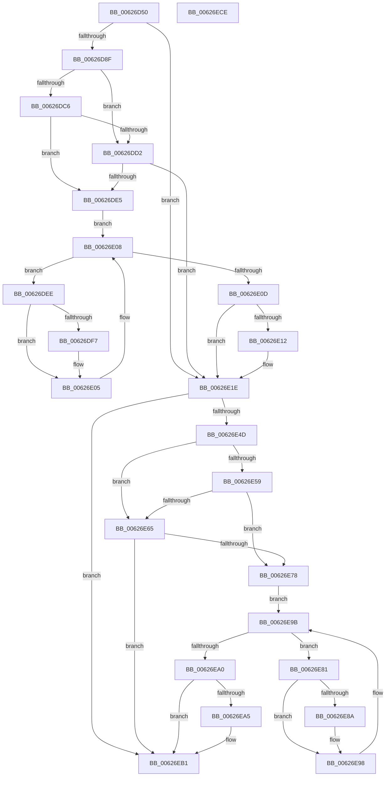

# DifIRP_MJ_SHUTDOWNWrapper

- RVA: `0x00626D50`–`0x00626ECF` (길이 `383` bytes)
- VA: `0x0000000140626D50`
- 실행 섹션: `.text`
- PDB 이름 있음: `예`; PDB Function 태그: `아니요`
- unwind 정보 RVA: `0x00093E28`
- 디코드: `101`개 명령, `383/383` bytes 표시
- 미해석 바이트: `0` (있으면 어셈블리에 `.byte`로 보존)

> 이 문서는 커널 이미지의 기계어와 PDB 기호를 분석해 생성했습니다. 4번과 5번은 함수 원형과 자료형을 바이너리 사용 방식에서 추정한 C 해석이며 원본 소스 복구 결과는 아닙니다.

## 1. Dependencies

- 직접 호출 지점: **8**; 고유 호출 대상: **4**
- 직접 호출자로 확인된 함수: **0**
- RIP 상대 이미지 참조: **3**

### Outgoing calls
- `0x00626D7E` → [DifGetAPIThunkContextById](../49/DifGetAPIThunkContextById_function_00495A34.md) (function, `0x00495A34`)
- `0x00626DD9` → [ExAcquireRundownProtection](../21/ExAcquireRundownProtection_function_00216620.md) (function, `0x00216620`)
- `0x00626E00` → [guard_dispatch_icall](../6B/guard_dispatch_icall_function_006BAAD0.md) (function, `0x006BAAD0`)
- `0x00626E19` → [ExReleaseRundownProtection](../34/ExReleaseRundownProtection_function_00349E80.md) (function, `0x00349E80`)
- `0x00626E3F` → [guard_dispatch_icall](../6B/guard_dispatch_icall_function_006BAAD0.md) (function, `0x006BAAD0`)
- `0x00626E6C` → [ExAcquireRundownProtection](../21/ExAcquireRundownProtection_function_00216620.md) (function, `0x00216620`)
- `0x00626E93` → [guard_dispatch_icall](../6B/guard_dispatch_icall_function_006BAAD0.md) (function, `0x006BAAD0`)
- `0x00626EAC` → [ExReleaseRundownProtection](../34/ExReleaseRundownProtection_function_00349E80.md) (function, `0x00349E80`)

### Direct callers
- 이 함수 시작 RVA로 연결되는 직접 call은 확인되지 않았습니다. 간접 호출은 완전히 역산할 수 없습니다.

### Static image references
- `0x00626D99` → RVA `0x00F048B8` (`.data`; read)
- `0x00626DC6` → RVA `0x00F04980` (`.data`; read)
- `0x00626DD2` → RVA `0x00F03E80` (`.data`; read)

## 2. Other-region calls and transfers

- 다른 실행 섹션으로 향하는 call: **0**
- 별도 외부 분기/꼬리 이동을 확인하지 못했습니다.

## 3. Assembly (complete function range)

```asm
00626D50  48 8B C4                        mov rax, rsp
00626D53  48 89 58 08                     mov qword ptr [rax + 8], rbx
00626D57  48 89 68 10                     mov qword ptr [rax + 0x10], rbp
00626D5B  48 89 70 18                     mov qword ptr [rax + 0x18], rsi
00626D5F  57                              push rdi
00626D60  41 56                           push r14
00626D62  41 57                           push r15
00626D64  48 83 EC 40                     sub rsp, 0x40
00626D68  0F 57 C0                        xorps xmm0, xmm0
00626D6B  4C 8B F9                        mov r15, rcx
00626D6E  B9 10 00 00 10                  mov ecx, 0x10000010
00626D73  4C 8B F2                        mov r14, rdx
00626D76  0F 11 40 C8                     movups xmmword ptr [rax - 0x38], xmm0
00626D7A  0F 11 40 D8                     movups xmmword ptr [rax - 0x28], xmm0
00626D7E  E8 B1 EC E6 FF                  call 0x140495a34
00626D83  48 8B E8                        mov rbp, rax
00626D86  48 85 C0                        test rax, rax
00626D89  0F 84 8F 00 00 00               je 0x140626e1e
00626D8F  49 8B 96 B8 00 00 00            mov rdx, qword ptr [r14 + 0xb8]
00626D96  40 32 F6                        xor sil, sil
00626D99  40 38 35 18 DB 8D 00            cmp byte ptr [rip + 0x8ddb18], sil
00626DA0  49 8B 4F 08                     mov rcx, qword ptr [r15 + 8]
00626DA4  44 0F B6 02                     movzx r8d, byte ptr [rdx]
00626DA8  48 8B 51 30                     mov rdx, qword ptr [rcx + 0x30]
00626DAC  48 8B 4A 40                     mov rcx, qword ptr [rdx + 0x40]
00626DB0  4A 8B 54 C1 20                  mov rdx, qword ptr [rcx + r8*8 + 0x20]
00626DB5  48 89 54 24 20                  mov qword ptr [rsp + 0x20], rdx
00626DBA  4C 89 7C 24 30                  mov qword ptr [rsp + 0x30], r15
00626DBF  4C 89 74 24 28                  mov qword ptr [rsp + 0x28], r14
00626DC4  75 0C                           jne 0x140626dd2
00626DC6  F7 05 B0 DB 8D 00 00 08 00 00   test dword ptr [rip + 0x8ddbb0], 0x800
00626DD0  74 13                           je 0x140626de5
00626DD2  48 8D 0D A7 D0 8D 00            lea rcx, [rip + 0x8dd0a7]
00626DD9  E8 42 F8 BE FF                  call 0x140216620
00626DDE  40 8A F0                        mov sil, al
00626DE1  84 C0                           test al, al
00626DE3  74 39                           je 0x140626e1e
00626DE5  48 8D 7D 20                     lea rdi, [rbp + 0x20]
00626DE9  48 8B 1F                        mov rbx, qword ptr [rdi]
00626DEC  EB 1A                           jmp 0x140626e08
00626DEE  48 8D 43 F0                     lea rax, [rbx - 0x10]
00626DF2  48 85 C0                        test rax, rax
00626DF5  74 0E                           je 0x140626e05
00626DF7  48 8B 40 08                     mov rax, qword ptr [rax + 8]
00626DFB  48 8D 4C 24 20                  lea rcx, [rsp + 0x20]
00626E00  E8 CB 3C 09 00                  call 0x1406baad0
00626E05  48 8B 1B                        mov rbx, qword ptr [rbx]
00626E08  48 3B DF                        cmp rbx, rdi
00626E0B  75 E1                           jne 0x140626dee
00626E0D  40 84 F6                        test sil, sil
00626E10  74 0C                           je 0x140626e1e
00626E12  48 8D 0D 67 D0 8D 00            lea rcx, [rip + 0x8dd067]
00626E19  E8 62 30 D2 FF                  call 0x140349e80
00626E1E  49 8B 86 B8 00 00 00            mov rax, qword ptr [r14 + 0xb8]
00626E25  0F B6 10                        movzx edx, byte ptr [rax]
00626E28  49 8B 47 08                     mov rax, qword ptr [r15 + 8]
00626E2C  48 8B 48 30                     mov rcx, qword ptr [rax + 0x30]
00626E30  48 8B 41 40                     mov rax, qword ptr [rcx + 0x40]
00626E34  49 8B CF                        mov rcx, r15
00626E37  48 8B 44 D0 20                  mov rax, qword ptr [rax + rdx*8 + 0x20]
00626E3C  49 8B D6                        mov rdx, r14
00626E3F  E8 8C 3C 09 00                  call 0x1406baad0
00626E44  89 44 24 38                     mov dword ptr [rsp + 0x38], eax
00626E48  48 85 ED                        test rbp, rbp
00626E4B  74 64                           je 0x140626eb1
00626E4D  40 32 FF                        xor dil, dil
00626E50  40 38 3D 61 DA 8D 00            cmp byte ptr [rip + 0x8dda61], dil
00626E57  75 0C                           jne 0x140626e65
00626E59  F7 05 1D DB 8D 00 00 08 00 00   test dword ptr [rip + 0x8ddb1d], 0x800
00626E63  74 13                           je 0x140626e78
00626E65  48 8D 0D 14 D0 8D 00            lea rcx, [rip + 0x8dd014]
00626E6C  E8 AF F7 BE FF                  call 0x140216620
00626E71  40 8A F8                        mov dil, al
00626E74  84 C0                           test al, al
00626E76  74 39                           je 0x140626eb1
00626E78  48 8D 75 30                     lea rsi, [rbp + 0x30]
00626E7C  48 8B 1E                        mov rbx, qword ptr [rsi]
00626E7F  EB 1A                           jmp 0x140626e9b
00626E81  48 8D 43 F0                     lea rax, [rbx - 0x10]
00626E85  48 85 C0                        test rax, rax
00626E88  74 0E                           je 0x140626e98
00626E8A  48 8B 40 08                     mov rax, qword ptr [rax + 8]
00626E8E  48 8D 4C 24 20                  lea rcx, [rsp + 0x20]
00626E93  E8 38 3C 09 00                  call 0x1406baad0
00626E98  48 8B 1B                        mov rbx, qword ptr [rbx]
00626E9B  48 3B DE                        cmp rbx, rsi
00626E9E  75 E1                           jne 0x140626e81
00626EA0  40 84 FF                        test dil, dil
00626EA3  74 0C                           je 0x140626eb1
00626EA5  48 8D 0D D4 CF 8D 00            lea rcx, [rip + 0x8dcfd4]
00626EAC  E8 CF 2F D2 FF                  call 0x140349e80
00626EB1  8B 44 24 38                     mov eax, dword ptr [rsp + 0x38]
00626EB5  48 8B 5C 24 60                  mov rbx, qword ptr [rsp + 0x60]
00626EBA  48 8B 6C 24 68                  mov rbp, qword ptr [rsp + 0x68]
00626EBF  48 8B 74 24 70                  mov rsi, qword ptr [rsp + 0x70]
00626EC4  48 83 C4 40                     add rsp, 0x40
00626EC8  41 5F                           pop r15
00626ECA  41 5E                           pop r14
00626ECC  5F                              pop rdi
00626ECD  C3                              ret
00626ECE  CC                              int3
```

## 4. C-style interpretation (structured pseudocode)

```c
__int64 __fastcall DifIRP_MJ_SHUTDOWNWrapper(__int64 a1, __int64 a2)
{
    __int64 result;
    __int64 v_rdi;
    __int64 v_rsi;
    __int64 v_rsp;
    unsigned int v_stack_m20;
    unsigned __int64 v_stack_m28;
    unsigned __int64 v_stack_m30;
    unsigned __int64 v_stack_m38;
    unsigned __int64 v_stack_p10;
    unsigned __int64 v_stack_p18;
    unsigned __int64 v_stack_p8;

    *(unsigned __int64 *)(v_rsp + 8) = v_rbx;
    *(unsigned __int64 *)(v_rsp + 16) = v_rbp;
    *(unsigned __int64 *)(v_rsp + 24) = v_rsi;
    v_rsp = (v_rsp) - (64);
    *(unsigned __int64 *)(v_rsp - 56) = v_xmm0;
    *(unsigned __int64 *)(v_rsp - 40) = v_xmm0;
    result = DifGetAPIThunkContextById((unsigned int)(0x10000010ULL), a2, a3, a4);
    if (result == 0) goto loc_00626E1E;
    v_rsi = 0;
    v_stack_m38 = *(unsigned __int64 *)(*(unsigned __int64 *)(*(unsigned __int64 *)(*(unsigned __int64 *)(a1 + 8) + 48) + 64) + *(unsigned __int8 *)(*(unsigned __int64 *)(a2 + 184)) * 8 + 32);
    v_stack_m28 = a1;
    v_stack_m30 = a2;
    if ((*(unsigned __int8 *)(v_rip + 9296664)) != 0) goto loc_00626DD2;
    if (((*(unsigned int *)(v_rip + 9296816)) & (0x800ULL)) == 0) goto loc_00626DE5;
loc_00626DD2:
    result = ExAcquireRundownProtection(v_rip + 9293991, *(unsigned __int64 *)(*(unsigned __int64 *)(*(unsigned __int64 *)(*(unsigned __int64 *)(a1 + 8) + 48) + 64) + *(unsigned __int8 *)(*(unsigned __int64 *)(a2 + 184)) * 8 + 32), *(unsigned __int8 *)(*(unsigned __int64 *)(a2 + 184)), a4);
    if ((unsigned __int8)(result) == 0) goto loc_00626E1E;
loc_00626DE5:
    goto loc_00626E08;
loc_00626DEE:
    result = *(unsigned __int64 *)(result + 32) - 16;
    if (*(unsigned __int64 *)(result + 32) - 16 != 0) {
        result = *(unsigned __int64 *)(*(unsigned __int64 *)(result + 32) - 16 + 8);
        a1 = v_stack_m38;
        result = guard_dispatch_icall(a1, *(unsigned __int64 *)(*(unsigned __int64 *)(*(unsigned __int64 *)(*(unsigned __int64 *)(a1 + 8) + 48) + 64) + *(unsigned __int8 *)(*(unsigned __int64 *)(a2 + 184)) * 8 + 32), *(unsigned __int8 *)(*(unsigned __int64 *)(a2 + 184)), a4);
    }
loc_00626E08:
    if ((*(unsigned __int64 *)(*(unsigned __int64 *)(result + 32))) != (result + 32)) goto loc_00626DEE;
    if ((unsigned __int8)((unsigned __int8)(result)) != 0) {
        a1 = v_rip + 9293927;
        result = ExReleaseRundownProtection(a1, *(unsigned __int64 *)(*(unsigned __int64 *)(*(unsigned __int64 *)(*(unsigned __int64 *)(a1 + 8) + 48) + 64) + *(unsigned __int8 *)(*(unsigned __int64 *)(a2 + 184)) * 8 + 32), *(unsigned __int8 *)(*(unsigned __int64 *)(a2 + 184)), a4);
    }
    result = guard_dispatch_icall(a1, a2, *(unsigned __int8 *)(*(unsigned __int64 *)(a2 + 184)), a4);
    v_stack_m20 = (unsigned int)(result);
    if (result == 0) goto loc_00626EB1;
    v_rdi = 0;
    if ((*(unsigned __int8 *)(v_rip + 9296481)) != 0) goto loc_00626E65;
    if (((*(unsigned int *)(v_rip + 9296669)) & (0x800ULL)) == 0) goto loc_00626E78;
loc_00626E65:
    result = ExAcquireRundownProtection(v_rip + 9293844, a2, *(unsigned __int8 *)(*(unsigned __int64 *)(a2 + 184)), a4);
    if ((unsigned __int8)(result) == 0) goto loc_00626EB1;
loc_00626E78:
    goto loc_00626E9B;
loc_00626E81:
    result = *(unsigned __int64 *)(result + 48) - 16;
    if (*(unsigned __int64 *)(result + 48) - 16 != 0) {
        result = *(unsigned __int64 *)(*(unsigned __int64 *)(result + 48) - 16 + 8);
        a1 = v_stack_m38;
        result = guard_dispatch_icall(a1, a2, *(unsigned __int8 *)(*(unsigned __int64 *)(a2 + 184)), a4);
    }
loc_00626E9B:
    if ((*(unsigned __int64 *)(*(unsigned __int64 *)(result + 48))) != (result + 48)) goto loc_00626E81;
    if ((unsigned __int8)((unsigned __int8)(result)) != 0) {
        a1 = v_rip + 9293780;
        result = ExReleaseRundownProtection(a1, a2, *(unsigned __int8 *)(*(unsigned __int64 *)(a2 + 184)), a4);
    }
    v_rsp = (v_rsp) + (64);
    return (unsigned int)(v_stack_m20);
}
```

## 5. (Beta) C Style

```c
int64_t DifIRP_MJ_SHUTDOWNWrapper(void *Arg1, void *Arg2)
{
    uint8_t *arg1 = (uint8_t *)Arg1;
    uint8_t *arg2 = (uint8_t *)Arg2;

    int64_t result;
    int64_t local_rdi;
    int64_t local_rsi;
    int64_t local_rsp;
    uint32_t v_stack_m20;
    uint64_t v_stack_m28;
    uint64_t v_stack_m30;
    uint64_t v_stack_m38;
    uint64_t v_stack_p10;
    uint64_t v_stack_p18;
    uint64_t v_stack_p8;

    *(uint64_t *)(local_rsp + 0x8) = local_rbx;
    *(uint64_t *)(local_rsp + 0x10) = local_rbp;
    *(uint64_t *)(local_rsp + 0x18) = local_rsi;
    local_rsp = (local_rsp) - (64);
    *(uint64_t *)(local_rsp - 0x38) = v_xmm0;
    *(uint64_t *)(local_rsp - 0x28) = v_xmm0;
    result = DifGetAPIThunkContextById((uint32_t)(0x10000010ULL), Arg2, a3, a4);
    if (result == 0) goto loc_00626E1E;
    local_rsi = 0;
    v_stack_m38 = *(uint64_t *)(*(uint64_t *)(*(uint64_t *)(*(uint64_t *)(arg1 + 0x8) + 0x30) + 0x40) + *(uint8_t *)(*(uint64_t *)(arg2 + 0xB8)) * 8 + 0x20);
    v_stack_m28 = Arg1;
    v_stack_m30 = Arg2;
    if ((*(uint8_t *)(v_rip + 0x8DDB18)) != 0) goto loc_00626DD2;
    if (((*(uint32_t *)(v_rip + 0x8DDBB0)) & (0x800ULL)) == 0) goto loc_00626DE5;
loc_00626DD2:
    result = ExAcquireRundownProtection(v_rip + 9293991, *(uint64_t *)(*(uint64_t *)(*(uint64_t *)(*(uint64_t *)(arg1 + 0x8) + 0x30) + 0x40) + *(uint8_t *)(*(uint64_t *)(arg2 + 0xB8)) * 8 + 0x20), *(uint8_t *)(*(uint64_t *)(arg2 + 0xB8)), a4);
    if ((uint8_t)(result) == 0) goto loc_00626E1E;
loc_00626DE5:
    goto loc_00626E08;
loc_00626DEE:
    result = *(uint64_t *)(result + 0x20) - 16;
    if (*(uint64_t *)(result + 0x20) - 16 != 0) {
        result = *(uint64_t *)(*(uint64_t *)(result + 0x20) - 0x10 + 0x8);
        Arg1 = v_stack_m38;
        result = guard_dispatch_icall(Arg1, *(uint64_t *)(*(uint64_t *)(*(uint64_t *)(*(uint64_t *)(arg1 + 0x8) + 0x30) + 0x40) + *(uint8_t *)(*(uint64_t *)(arg2 + 0xB8)) * 8 + 0x20), *(uint8_t *)(*(uint64_t *)(arg2 + 0xB8)), a4);
    }
loc_00626E08:
    if ((*(uint64_t *)(*(uint64_t *)(result + 0x20))) != (result + 32)) goto loc_00626DEE;
    if ((uint8_t)((uint8_t)(result)) != 0) {
        Arg1 = v_rip + 9293927;
        result = ExReleaseRundownProtection(Arg1, *(uint64_t *)(*(uint64_t *)(*(uint64_t *)(*(uint64_t *)(arg1 + 0x8) + 0x30) + 0x40) + *(uint8_t *)(*(uint64_t *)(arg2 + 0xB8)) * 8 + 0x20), *(uint8_t *)(*(uint64_t *)(arg2 + 0xB8)), a4);
    }
    result = guard_dispatch_icall(Arg1, Arg2, *(uint8_t *)(*(uint64_t *)(arg2 + 0xB8)), a4);
    v_stack_m20 = (uint32_t)(result);
    if (result == 0) goto loc_00626EB1;
    local_rdi = 0;
    if ((*(uint8_t *)(v_rip + 0x8DDA61)) != 0) goto loc_00626E65;
    if (((*(uint32_t *)(v_rip + 0x8DDB1D)) & (0x800ULL)) == 0) goto loc_00626E78;
loc_00626E65:
    result = ExAcquireRundownProtection(v_rip + 9293844, Arg2, *(uint8_t *)(*(uint64_t *)(arg2 + 0xB8)), a4);
    if ((uint8_t)(result) == 0) goto loc_00626EB1;
loc_00626E78:
    goto loc_00626E9B;
loc_00626E81:
    result = *(uint64_t *)(result + 0x30) - 16;
    if (*(uint64_t *)(result + 0x30) - 16 != 0) {
        result = *(uint64_t *)(*(uint64_t *)(result + 0x30) - 0x10 + 0x8);
        Arg1 = v_stack_m38;
        result = guard_dispatch_icall(Arg1, Arg2, *(uint8_t *)(*(uint64_t *)(arg2 + 0xB8)), a4);
    }
loc_00626E9B:
    if ((*(uint64_t *)(*(uint64_t *)(result + 0x30))) != (result + 48)) goto loc_00626E81;
    if ((uint8_t)((uint8_t)(result)) != 0) {
        Arg1 = v_rip + 9293780;
        result = ExReleaseRundownProtection(Arg1, Arg2, *(uint8_t *)(*(uint64_t *)(arg2 + 0xB8)), a4);
    }
    local_rsp = (local_rsp) + (64);
    return (uint32_t)(v_stack_m20);
}
```

### 관측된 메모리 오프셋

구조체 형식이 확인되지 않은 접근은 인자 기준의 오프셋으로만 기록했습니다.

| 기준 인자 | 오프셋 표현 | 폭 (bit) | 접근 |
|---|---:|---:|---|
| `Arg1` | `+ 0x8` | `64` | `R` |
| `Arg2` | `+ 0xB8` | `64` | `R` |

## 6. Execution-region graph

[열기: 2D/3D 그래프와 함수 탐색 컨트롤 패널](../../../control-panel.html?section=text&rva=0x00626D50&view=graph)

- 2D 그래프는 위에서 아래로 흐르고, 3D 그래프는 빈 공간을 드래그해 회전합니다. Shift+드래그는 이동, 휠은 확대·축소, 함수 노드 선택은 대상 보고서 이동입니다.

### Static fallback


