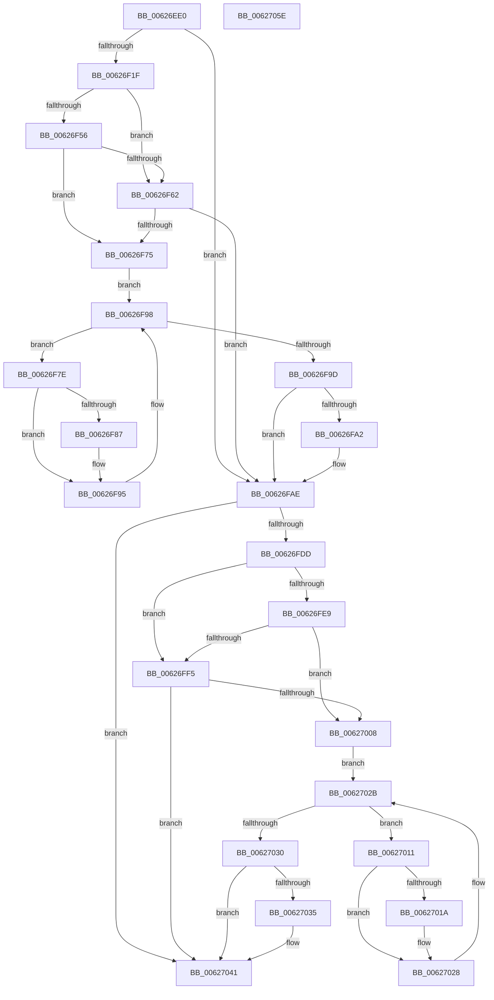

# DifIRP_MJ_SYSTEM_CONTROLWrapper

- RVA: `0x00626EE0`–`0x0062705F` (길이 `383` bytes)
- VA: `0x0000000140626EE0`
- 실행 섹션: `.text`
- PDB 이름 있음: `예`; PDB Function 태그: `아니요`
- unwind 정보 RVA: `0x00093E28`
- 디코드: `101`개 명령, `383/383` bytes 표시
- 미해석 바이트: `0` (있으면 어셈블리에 `.byte`로 보존)

> 이 문서는 커널 이미지의 기계어와 PDB 기호를 분석해 생성했습니다. 4번과 5번은 함수 원형과 자료형을 바이너리 사용 방식에서 추정한 C 해석이며 원본 소스 복구 결과는 아닙니다.

## 1. Dependencies

- 직접 호출 지점: **8**; 고유 호출 대상: **4**
- 직접 호출자로 확인된 함수: **0**
- RIP 상대 이미지 참조: **3**

### Outgoing calls
- `0x00626F0E` → [DifGetAPIThunkContextById](../49/DifGetAPIThunkContextById_function_00495A34.md) (function, `0x00495A34`)
- `0x00626F69` → [ExAcquireRundownProtection](../21/ExAcquireRundownProtection_function_00216620.md) (function, `0x00216620`)
- `0x00626F90` → [guard_dispatch_icall](../6B/guard_dispatch_icall_function_006BAAD0.md) (function, `0x006BAAD0`)
- `0x00626FA9` → [ExReleaseRundownProtection](../34/ExReleaseRundownProtection_function_00349E80.md) (function, `0x00349E80`)
- `0x00626FCF` → [guard_dispatch_icall](../6B/guard_dispatch_icall_function_006BAAD0.md) (function, `0x006BAAD0`)
- `0x00626FFC` → [ExAcquireRundownProtection](../21/ExAcquireRundownProtection_function_00216620.md) (function, `0x00216620`)
- `0x00627023` → [guard_dispatch_icall](../6B/guard_dispatch_icall_function_006BAAD0.md) (function, `0x006BAAD0`)
- `0x0062703C` → [ExReleaseRundownProtection](../34/ExReleaseRundownProtection_function_00349E80.md) (function, `0x00349E80`)

### Direct callers
- 이 함수 시작 RVA로 연결되는 직접 call은 확인되지 않았습니다. 간접 호출은 완전히 역산할 수 없습니다.

### Static image references
- `0x00626F29` → RVA `0x00F048B8` (`.data`; read)
- `0x00626F56` → RVA `0x00F04980` (`.data`; read)
- `0x00626F62` → RVA `0x00F03E80` (`.data`; read)

## 2. Other-region calls and transfers

- 다른 실행 섹션으로 향하는 call: **0**
- 별도 외부 분기/꼬리 이동을 확인하지 못했습니다.

## 3. Assembly (complete function range)

```asm
00626EE0  48 8B C4                        mov rax, rsp
00626EE3  48 89 58 08                     mov qword ptr [rax + 8], rbx
00626EE7  48 89 68 10                     mov qword ptr [rax + 0x10], rbp
00626EEB  48 89 70 18                     mov qword ptr [rax + 0x18], rsi
00626EEF  57                              push rdi
00626EF0  41 56                           push r14
00626EF2  41 57                           push r15
00626EF4  48 83 EC 40                     sub rsp, 0x40
00626EF8  0F 57 C0                        xorps xmm0, xmm0
00626EFB  4C 8B F9                        mov r15, rcx
00626EFE  B9 17 00 00 10                  mov ecx, 0x10000017
00626F03  4C 8B F2                        mov r14, rdx
00626F06  0F 11 40 C8                     movups xmmword ptr [rax - 0x38], xmm0
00626F0A  0F 11 40 D8                     movups xmmword ptr [rax - 0x28], xmm0
00626F0E  E8 21 EB E6 FF                  call 0x140495a34
00626F13  48 8B E8                        mov rbp, rax
00626F16  48 85 C0                        test rax, rax
00626F19  0F 84 8F 00 00 00               je 0x140626fae
00626F1F  49 8B 96 B8 00 00 00            mov rdx, qword ptr [r14 + 0xb8]
00626F26  40 32 F6                        xor sil, sil
00626F29  40 38 35 88 D9 8D 00            cmp byte ptr [rip + 0x8dd988], sil
00626F30  49 8B 4F 08                     mov rcx, qword ptr [r15 + 8]
00626F34  44 0F B6 02                     movzx r8d, byte ptr [rdx]
00626F38  48 8B 51 30                     mov rdx, qword ptr [rcx + 0x30]
00626F3C  48 8B 4A 40                     mov rcx, qword ptr [rdx + 0x40]
00626F40  4A 8B 54 C1 20                  mov rdx, qword ptr [rcx + r8*8 + 0x20]
00626F45  48 89 54 24 20                  mov qword ptr [rsp + 0x20], rdx
00626F4A  4C 89 7C 24 30                  mov qword ptr [rsp + 0x30], r15
00626F4F  4C 89 74 24 28                  mov qword ptr [rsp + 0x28], r14
00626F54  75 0C                           jne 0x140626f62
00626F56  F7 05 20 DA 8D 00 00 08 00 00   test dword ptr [rip + 0x8dda20], 0x800
00626F60  74 13                           je 0x140626f75
00626F62  48 8D 0D 17 CF 8D 00            lea rcx, [rip + 0x8dcf17]
00626F69  E8 B2 F6 BE FF                  call 0x140216620
00626F6E  40 8A F0                        mov sil, al
00626F71  84 C0                           test al, al
00626F73  74 39                           je 0x140626fae
00626F75  48 8D 7D 20                     lea rdi, [rbp + 0x20]
00626F79  48 8B 1F                        mov rbx, qword ptr [rdi]
00626F7C  EB 1A                           jmp 0x140626f98
00626F7E  48 8D 43 F0                     lea rax, [rbx - 0x10]
00626F82  48 85 C0                        test rax, rax
00626F85  74 0E                           je 0x140626f95
00626F87  48 8B 40 08                     mov rax, qword ptr [rax + 8]
00626F8B  48 8D 4C 24 20                  lea rcx, [rsp + 0x20]
00626F90  E8 3B 3B 09 00                  call 0x1406baad0
00626F95  48 8B 1B                        mov rbx, qword ptr [rbx]
00626F98  48 3B DF                        cmp rbx, rdi
00626F9B  75 E1                           jne 0x140626f7e
00626F9D  40 84 F6                        test sil, sil
00626FA0  74 0C                           je 0x140626fae
00626FA2  48 8D 0D D7 CE 8D 00            lea rcx, [rip + 0x8dced7]
00626FA9  E8 D2 2E D2 FF                  call 0x140349e80
00626FAE  49 8B 86 B8 00 00 00            mov rax, qword ptr [r14 + 0xb8]
00626FB5  0F B6 10                        movzx edx, byte ptr [rax]
00626FB8  49 8B 47 08                     mov rax, qword ptr [r15 + 8]
00626FBC  48 8B 48 30                     mov rcx, qword ptr [rax + 0x30]
00626FC0  48 8B 41 40                     mov rax, qword ptr [rcx + 0x40]
00626FC4  49 8B CF                        mov rcx, r15
00626FC7  48 8B 44 D0 20                  mov rax, qword ptr [rax + rdx*8 + 0x20]
00626FCC  49 8B D6                        mov rdx, r14
00626FCF  E8 FC 3A 09 00                  call 0x1406baad0
00626FD4  89 44 24 38                     mov dword ptr [rsp + 0x38], eax
00626FD8  48 85 ED                        test rbp, rbp
00626FDB  74 64                           je 0x140627041
00626FDD  40 32 FF                        xor dil, dil
00626FE0  40 38 3D D1 D8 8D 00            cmp byte ptr [rip + 0x8dd8d1], dil
00626FE7  75 0C                           jne 0x140626ff5
00626FE9  F7 05 8D D9 8D 00 00 08 00 00   test dword ptr [rip + 0x8dd98d], 0x800
00626FF3  74 13                           je 0x140627008
00626FF5  48 8D 0D 84 CE 8D 00            lea rcx, [rip + 0x8dce84]
00626FFC  E8 1F F6 BE FF                  call 0x140216620
00627001  40 8A F8                        mov dil, al
00627004  84 C0                           test al, al
00627006  74 39                           je 0x140627041
00627008  48 8D 75 30                     lea rsi, [rbp + 0x30]
0062700C  48 8B 1E                        mov rbx, qword ptr [rsi]
0062700F  EB 1A                           jmp 0x14062702b
00627011  48 8D 43 F0                     lea rax, [rbx - 0x10]
00627015  48 85 C0                        test rax, rax
00627018  74 0E                           je 0x140627028
0062701A  48 8B 40 08                     mov rax, qword ptr [rax + 8]
0062701E  48 8D 4C 24 20                  lea rcx, [rsp + 0x20]
00627023  E8 A8 3A 09 00                  call 0x1406baad0
00627028  48 8B 1B                        mov rbx, qword ptr [rbx]
0062702B  48 3B DE                        cmp rbx, rsi
0062702E  75 E1                           jne 0x140627011
00627030  40 84 FF                        test dil, dil
00627033  74 0C                           je 0x140627041
00627035  48 8D 0D 44 CE 8D 00            lea rcx, [rip + 0x8dce44]
0062703C  E8 3F 2E D2 FF                  call 0x140349e80
00627041  8B 44 24 38                     mov eax, dword ptr [rsp + 0x38]
00627045  48 8B 5C 24 60                  mov rbx, qword ptr [rsp + 0x60]
0062704A  48 8B 6C 24 68                  mov rbp, qword ptr [rsp + 0x68]
0062704F  48 8B 74 24 70                  mov rsi, qword ptr [rsp + 0x70]
00627054  48 83 C4 40                     add rsp, 0x40
00627058  41 5F                           pop r15
0062705A  41 5E                           pop r14
0062705C  5F                              pop rdi
0062705D  C3                              ret
0062705E  CC                              int3
```

## 4. C-style interpretation (structured pseudocode)

```c
__int64 __fastcall DifIRP_MJ_SYSTEM_CONTROLWrapper(__int64 a1, __int64 a2)
{
    __int64 result;
    __int64 v_rdi;
    __int64 v_rsi;
    __int64 v_rsp;
    unsigned int v_stack_m20;
    unsigned __int64 v_stack_m28;
    unsigned __int64 v_stack_m30;
    unsigned __int64 v_stack_m38;
    unsigned __int64 v_stack_p10;
    unsigned __int64 v_stack_p18;
    unsigned __int64 v_stack_p8;

    *(unsigned __int64 *)(v_rsp + 8) = v_rbx;
    *(unsigned __int64 *)(v_rsp + 16) = v_rbp;
    *(unsigned __int64 *)(v_rsp + 24) = v_rsi;
    v_rsp = (v_rsp) - (64);
    *(unsigned __int64 *)(v_rsp - 56) = v_xmm0;
    *(unsigned __int64 *)(v_rsp - 40) = v_xmm0;
    result = DifGetAPIThunkContextById((unsigned int)(0x10000017ULL), a2, a3, a4);
    if (result == 0) goto loc_00626FAE;
    v_rsi = 0;
    v_stack_m38 = *(unsigned __int64 *)(*(unsigned __int64 *)(*(unsigned __int64 *)(*(unsigned __int64 *)(a1 + 8) + 48) + 64) + *(unsigned __int8 *)(*(unsigned __int64 *)(a2 + 184)) * 8 + 32);
    v_stack_m28 = a1;
    v_stack_m30 = a2;
    if ((*(unsigned __int8 *)(v_rip + 9296264)) != 0) goto loc_00626F62;
    if (((*(unsigned int *)(v_rip + 9296416)) & (0x800ULL)) == 0) goto loc_00626F75;
loc_00626F62:
    result = ExAcquireRundownProtection(v_rip + 9293591, *(unsigned __int64 *)(*(unsigned __int64 *)(*(unsigned __int64 *)(*(unsigned __int64 *)(a1 + 8) + 48) + 64) + *(unsigned __int8 *)(*(unsigned __int64 *)(a2 + 184)) * 8 + 32), *(unsigned __int8 *)(*(unsigned __int64 *)(a2 + 184)), a4);
    if ((unsigned __int8)(result) == 0) goto loc_00626FAE;
loc_00626F75:
    goto loc_00626F98;
loc_00626F7E:
    result = *(unsigned __int64 *)(result + 32) - 16;
    if (*(unsigned __int64 *)(result + 32) - 16 != 0) {
        result = *(unsigned __int64 *)(*(unsigned __int64 *)(result + 32) - 16 + 8);
        a1 = v_stack_m38;
        result = guard_dispatch_icall(a1, *(unsigned __int64 *)(*(unsigned __int64 *)(*(unsigned __int64 *)(*(unsigned __int64 *)(a1 + 8) + 48) + 64) + *(unsigned __int8 *)(*(unsigned __int64 *)(a2 + 184)) * 8 + 32), *(unsigned __int8 *)(*(unsigned __int64 *)(a2 + 184)), a4);
    }
loc_00626F98:
    if ((*(unsigned __int64 *)(*(unsigned __int64 *)(result + 32))) != (result + 32)) goto loc_00626F7E;
    if ((unsigned __int8)((unsigned __int8)(result)) != 0) {
        a1 = v_rip + 9293527;
        result = ExReleaseRundownProtection(a1, *(unsigned __int64 *)(*(unsigned __int64 *)(*(unsigned __int64 *)(*(unsigned __int64 *)(a1 + 8) + 48) + 64) + *(unsigned __int8 *)(*(unsigned __int64 *)(a2 + 184)) * 8 + 32), *(unsigned __int8 *)(*(unsigned __int64 *)(a2 + 184)), a4);
    }
    result = guard_dispatch_icall(a1, a2, *(unsigned __int8 *)(*(unsigned __int64 *)(a2 + 184)), a4);
    v_stack_m20 = (unsigned int)(result);
    if (result == 0) goto loc_00627041;
    v_rdi = 0;
    if ((*(unsigned __int8 *)(v_rip + 9296081)) != 0) goto loc_00626FF5;
    if (((*(unsigned int *)(v_rip + 9296269)) & (0x800ULL)) == 0) goto loc_00627008;
loc_00626FF5:
    result = ExAcquireRundownProtection(v_rip + 9293444, a2, *(unsigned __int8 *)(*(unsigned __int64 *)(a2 + 184)), a4);
    if ((unsigned __int8)(result) == 0) goto loc_00627041;
loc_00627008:
    goto loc_0062702B;
loc_00627011:
    result = *(unsigned __int64 *)(result + 48) - 16;
    if (*(unsigned __int64 *)(result + 48) - 16 != 0) {
        result = *(unsigned __int64 *)(*(unsigned __int64 *)(result + 48) - 16 + 8);
        a1 = v_stack_m38;
        result = guard_dispatch_icall(a1, a2, *(unsigned __int8 *)(*(unsigned __int64 *)(a2 + 184)), a4);
    }
loc_0062702B:
    if ((*(unsigned __int64 *)(*(unsigned __int64 *)(result + 48))) != (result + 48)) goto loc_00627011;
    if ((unsigned __int8)((unsigned __int8)(result)) != 0) {
        a1 = v_rip + 9293380;
        result = ExReleaseRundownProtection(a1, a2, *(unsigned __int8 *)(*(unsigned __int64 *)(a2 + 184)), a4);
    }
    v_rsp = (v_rsp) + (64);
    return (unsigned int)(v_stack_m20);
}
```

## 5. (Beta) C Style

```c
int64_t DifIRP_MJ_SYSTEM_CONTROLWrapper(void *Arg1, void *Arg2)
{
    uint8_t *arg1 = (uint8_t *)Arg1;
    uint8_t *arg2 = (uint8_t *)Arg2;

    int64_t result;
    int64_t local_rdi;
    int64_t local_rsi;
    int64_t local_rsp;
    uint32_t v_stack_m20;
    uint64_t v_stack_m28;
    uint64_t v_stack_m30;
    uint64_t v_stack_m38;
    uint64_t v_stack_p10;
    uint64_t v_stack_p18;
    uint64_t v_stack_p8;

    *(uint64_t *)(local_rsp + 0x8) = local_rbx;
    *(uint64_t *)(local_rsp + 0x10) = local_rbp;
    *(uint64_t *)(local_rsp + 0x18) = local_rsi;
    local_rsp = (local_rsp) - (64);
    *(uint64_t *)(local_rsp - 0x38) = v_xmm0;
    *(uint64_t *)(local_rsp - 0x28) = v_xmm0;
    result = DifGetAPIThunkContextById((uint32_t)(0x10000017ULL), Arg2, a3, a4);
    if (result == 0) goto loc_00626FAE;
    local_rsi = 0;
    v_stack_m38 = *(uint64_t *)(*(uint64_t *)(*(uint64_t *)(*(uint64_t *)(arg1 + 0x8) + 0x30) + 0x40) + *(uint8_t *)(*(uint64_t *)(arg2 + 0xB8)) * 8 + 0x20);
    v_stack_m28 = Arg1;
    v_stack_m30 = Arg2;
    if ((*(uint8_t *)(v_rip + 0x8DD988)) != 0) goto loc_00626F62;
    if (((*(uint32_t *)(v_rip + 0x8DDA20)) & (0x800ULL)) == 0) goto loc_00626F75;
loc_00626F62:
    result = ExAcquireRundownProtection(v_rip + 9293591, *(uint64_t *)(*(uint64_t *)(*(uint64_t *)(*(uint64_t *)(arg1 + 0x8) + 0x30) + 0x40) + *(uint8_t *)(*(uint64_t *)(arg2 + 0xB8)) * 8 + 0x20), *(uint8_t *)(*(uint64_t *)(arg2 + 0xB8)), a4);
    if ((uint8_t)(result) == 0) goto loc_00626FAE;
loc_00626F75:
    goto loc_00626F98;
loc_00626F7E:
    result = *(uint64_t *)(result + 0x20) - 16;
    if (*(uint64_t *)(result + 0x20) - 16 != 0) {
        result = *(uint64_t *)(*(uint64_t *)(result + 0x20) - 0x10 + 0x8);
        Arg1 = v_stack_m38;
        result = guard_dispatch_icall(Arg1, *(uint64_t *)(*(uint64_t *)(*(uint64_t *)(*(uint64_t *)(arg1 + 0x8) + 0x30) + 0x40) + *(uint8_t *)(*(uint64_t *)(arg2 + 0xB8)) * 8 + 0x20), *(uint8_t *)(*(uint64_t *)(arg2 + 0xB8)), a4);
    }
loc_00626F98:
    if ((*(uint64_t *)(*(uint64_t *)(result + 0x20))) != (result + 32)) goto loc_00626F7E;
    if ((uint8_t)((uint8_t)(result)) != 0) {
        Arg1 = v_rip + 9293527;
        result = ExReleaseRundownProtection(Arg1, *(uint64_t *)(*(uint64_t *)(*(uint64_t *)(*(uint64_t *)(arg1 + 0x8) + 0x30) + 0x40) + *(uint8_t *)(*(uint64_t *)(arg2 + 0xB8)) * 8 + 0x20), *(uint8_t *)(*(uint64_t *)(arg2 + 0xB8)), a4);
    }
    result = guard_dispatch_icall(Arg1, Arg2, *(uint8_t *)(*(uint64_t *)(arg2 + 0xB8)), a4);
    v_stack_m20 = (uint32_t)(result);
    if (result == 0) goto loc_00627041;
    local_rdi = 0;
    if ((*(uint8_t *)(v_rip + 0x8DD8D1)) != 0) goto loc_00626FF5;
    if (((*(uint32_t *)(v_rip + 0x8DD98D)) & (0x800ULL)) == 0) goto loc_00627008;
loc_00626FF5:
    result = ExAcquireRundownProtection(v_rip + 9293444, Arg2, *(uint8_t *)(*(uint64_t *)(arg2 + 0xB8)), a4);
    if ((uint8_t)(result) == 0) goto loc_00627041;
loc_00627008:
    goto loc_0062702B;
loc_00627011:
    result = *(uint64_t *)(result + 0x30) - 16;
    if (*(uint64_t *)(result + 0x30) - 16 != 0) {
        result = *(uint64_t *)(*(uint64_t *)(result + 0x30) - 0x10 + 0x8);
        Arg1 = v_stack_m38;
        result = guard_dispatch_icall(Arg1, Arg2, *(uint8_t *)(*(uint64_t *)(arg2 + 0xB8)), a4);
    }
loc_0062702B:
    if ((*(uint64_t *)(*(uint64_t *)(result + 0x30))) != (result + 48)) goto loc_00627011;
    if ((uint8_t)((uint8_t)(result)) != 0) {
        Arg1 = v_rip + 9293380;
        result = ExReleaseRundownProtection(Arg1, Arg2, *(uint8_t *)(*(uint64_t *)(arg2 + 0xB8)), a4);
    }
    local_rsp = (local_rsp) + (64);
    return (uint32_t)(v_stack_m20);
}
```

### 관측된 메모리 오프셋

구조체 형식이 확인되지 않은 접근은 인자 기준의 오프셋으로만 기록했습니다.

| 기준 인자 | 오프셋 표현 | 폭 (bit) | 접근 |
|---|---:|---:|---|
| `Arg1` | `+ 0x8` | `64` | `R` |
| `Arg2` | `+ 0xB8` | `64` | `R` |

## 6. Execution-region graph

[열기: 2D/3D 그래프와 함수 탐색 컨트롤 패널](../../../control-panel.html?section=text&rva=0x00626EE0&view=graph)

- 2D 그래프는 위에서 아래로 흐르고, 3D 그래프는 빈 공간을 드래그해 회전합니다. Shift+드래그는 이동, 휠은 확대·축소, 함수 노드 선택은 대상 보고서 이동입니다.

### Static fallback


