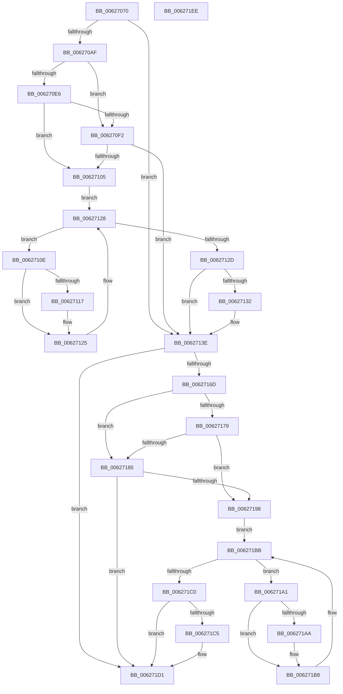

# DifIRP_MJ_WRITEWrapper

- RVA: `0x00627070`–`0x006271EF` (길이 `383` bytes)
- VA: `0x0000000140627070`
- 실행 섹션: `.text`
- PDB 이름 있음: `예`; PDB Function 태그: `아니요`
- unwind 정보 RVA: `0x00093E28`
- 디코드: `101`개 명령, `383/383` bytes 표시
- 미해석 바이트: `0` (있으면 어셈블리에 `.byte`로 보존)

> 이 문서는 커널 이미지의 기계어와 PDB 기호를 분석해 생성했습니다. 4번과 5번은 함수 원형과 자료형을 바이너리 사용 방식에서 추정한 C 해석이며 원본 소스 복구 결과는 아닙니다.

## 1. Dependencies

- 직접 호출 지점: **8**; 고유 호출 대상: **4**
- 직접 호출자로 확인된 함수: **0**
- RIP 상대 이미지 참조: **3**

### Outgoing calls
- `0x0062709E` → [DifGetAPIThunkContextById](../49/DifGetAPIThunkContextById_function_00495A34.md) (function, `0x00495A34`)
- `0x006270F9` → [ExAcquireRundownProtection](../21/ExAcquireRundownProtection_function_00216620.md) (function, `0x00216620`)
- `0x00627120` → [guard_dispatch_icall](../6B/guard_dispatch_icall_function_006BAAD0.md) (function, `0x006BAAD0`)
- `0x00627139` → [ExReleaseRundownProtection](../34/ExReleaseRundownProtection_function_00349E80.md) (function, `0x00349E80`)
- `0x0062715F` → [guard_dispatch_icall](../6B/guard_dispatch_icall_function_006BAAD0.md) (function, `0x006BAAD0`)
- `0x0062718C` → [ExAcquireRundownProtection](../21/ExAcquireRundownProtection_function_00216620.md) (function, `0x00216620`)
- `0x006271B3` → [guard_dispatch_icall](../6B/guard_dispatch_icall_function_006BAAD0.md) (function, `0x006BAAD0`)
- `0x006271CC` → [ExReleaseRundownProtection](../34/ExReleaseRundownProtection_function_00349E80.md) (function, `0x00349E80`)

### Direct callers
- 이 함수 시작 RVA로 연결되는 직접 call은 확인되지 않았습니다. 간접 호출은 완전히 역산할 수 없습니다.

### Static image references
- `0x006270B9` → RVA `0x00F048B8` (`.data`; read)
- `0x006270E6` → RVA `0x00F04980` (`.data`; read)
- `0x006270F2` → RVA `0x00F03E80` (`.data`; read)

## 2. Other-region calls and transfers

- 다른 실행 섹션으로 향하는 call: **0**
- 별도 외부 분기/꼬리 이동을 확인하지 못했습니다.

## 3. Assembly (complete function range)

```asm
00627070  48 8B C4                        mov rax, rsp
00627073  48 89 58 08                     mov qword ptr [rax + 8], rbx
00627077  48 89 68 10                     mov qword ptr [rax + 0x10], rbp
0062707B  48 89 70 18                     mov qword ptr [rax + 0x18], rsi
0062707F  57                              push rdi
00627080  41 56                           push r14
00627082  41 57                           push r15
00627084  48 83 EC 40                     sub rsp, 0x40
00627088  0F 57 C0                        xorps xmm0, xmm0
0062708B  4C 8B F9                        mov r15, rcx
0062708E  B9 04 00 00 10                  mov ecx, 0x10000004
00627093  4C 8B F2                        mov r14, rdx
00627096  0F 11 40 C8                     movups xmmword ptr [rax - 0x38], xmm0
0062709A  0F 11 40 D8                     movups xmmword ptr [rax - 0x28], xmm0
0062709E  E8 91 E9 E6 FF                  call 0x140495a34
006270A3  48 8B E8                        mov rbp, rax
006270A6  48 85 C0                        test rax, rax
006270A9  0F 84 8F 00 00 00               je 0x14062713e
006270AF  49 8B 96 B8 00 00 00            mov rdx, qword ptr [r14 + 0xb8]
006270B6  40 32 F6                        xor sil, sil
006270B9  40 38 35 F8 D7 8D 00            cmp byte ptr [rip + 0x8dd7f8], sil
006270C0  49 8B 4F 08                     mov rcx, qword ptr [r15 + 8]
006270C4  44 0F B6 02                     movzx r8d, byte ptr [rdx]
006270C8  48 8B 51 30                     mov rdx, qword ptr [rcx + 0x30]
006270CC  48 8B 4A 40                     mov rcx, qword ptr [rdx + 0x40]
006270D0  4A 8B 54 C1 20                  mov rdx, qword ptr [rcx + r8*8 + 0x20]
006270D5  48 89 54 24 20                  mov qword ptr [rsp + 0x20], rdx
006270DA  4C 89 7C 24 30                  mov qword ptr [rsp + 0x30], r15
006270DF  4C 89 74 24 28                  mov qword ptr [rsp + 0x28], r14
006270E4  75 0C                           jne 0x1406270f2
006270E6  F7 05 90 D8 8D 00 00 08 00 00   test dword ptr [rip + 0x8dd890], 0x800
006270F0  74 13                           je 0x140627105
006270F2  48 8D 0D 87 CD 8D 00            lea rcx, [rip + 0x8dcd87]
006270F9  E8 22 F5 BE FF                  call 0x140216620
006270FE  40 8A F0                        mov sil, al
00627101  84 C0                           test al, al
00627103  74 39                           je 0x14062713e
00627105  48 8D 7D 20                     lea rdi, [rbp + 0x20]
00627109  48 8B 1F                        mov rbx, qword ptr [rdi]
0062710C  EB 1A                           jmp 0x140627128
0062710E  48 8D 43 F0                     lea rax, [rbx - 0x10]
00627112  48 85 C0                        test rax, rax
00627115  74 0E                           je 0x140627125
00627117  48 8B 40 08                     mov rax, qword ptr [rax + 8]
0062711B  48 8D 4C 24 20                  lea rcx, [rsp + 0x20]
00627120  E8 AB 39 09 00                  call 0x1406baad0
00627125  48 8B 1B                        mov rbx, qword ptr [rbx]
00627128  48 3B DF                        cmp rbx, rdi
0062712B  75 E1                           jne 0x14062710e
0062712D  40 84 F6                        test sil, sil
00627130  74 0C                           je 0x14062713e
00627132  48 8D 0D 47 CD 8D 00            lea rcx, [rip + 0x8dcd47]
00627139  E8 42 2D D2 FF                  call 0x140349e80
0062713E  49 8B 86 B8 00 00 00            mov rax, qword ptr [r14 + 0xb8]
00627145  0F B6 10                        movzx edx, byte ptr [rax]
00627148  49 8B 47 08                     mov rax, qword ptr [r15 + 8]
0062714C  48 8B 48 30                     mov rcx, qword ptr [rax + 0x30]
00627150  48 8B 41 40                     mov rax, qword ptr [rcx + 0x40]
00627154  49 8B CF                        mov rcx, r15
00627157  48 8B 44 D0 20                  mov rax, qword ptr [rax + rdx*8 + 0x20]
0062715C  49 8B D6                        mov rdx, r14
0062715F  E8 6C 39 09 00                  call 0x1406baad0
00627164  89 44 24 38                     mov dword ptr [rsp + 0x38], eax
00627168  48 85 ED                        test rbp, rbp
0062716B  74 64                           je 0x1406271d1
0062716D  40 32 FF                        xor dil, dil
00627170  40 38 3D 41 D7 8D 00            cmp byte ptr [rip + 0x8dd741], dil
00627177  75 0C                           jne 0x140627185
00627179  F7 05 FD D7 8D 00 00 08 00 00   test dword ptr [rip + 0x8dd7fd], 0x800
00627183  74 13                           je 0x140627198
00627185  48 8D 0D F4 CC 8D 00            lea rcx, [rip + 0x8dccf4]
0062718C  E8 8F F4 BE FF                  call 0x140216620
00627191  40 8A F8                        mov dil, al
00627194  84 C0                           test al, al
00627196  74 39                           je 0x1406271d1
00627198  48 8D 75 30                     lea rsi, [rbp + 0x30]
0062719C  48 8B 1E                        mov rbx, qword ptr [rsi]
0062719F  EB 1A                           jmp 0x1406271bb
006271A1  48 8D 43 F0                     lea rax, [rbx - 0x10]
006271A5  48 85 C0                        test rax, rax
006271A8  74 0E                           je 0x1406271b8
006271AA  48 8B 40 08                     mov rax, qword ptr [rax + 8]
006271AE  48 8D 4C 24 20                  lea rcx, [rsp + 0x20]
006271B3  E8 18 39 09 00                  call 0x1406baad0
006271B8  48 8B 1B                        mov rbx, qword ptr [rbx]
006271BB  48 3B DE                        cmp rbx, rsi
006271BE  75 E1                           jne 0x1406271a1
006271C0  40 84 FF                        test dil, dil
006271C3  74 0C                           je 0x1406271d1
006271C5  48 8D 0D B4 CC 8D 00            lea rcx, [rip + 0x8dccb4]
006271CC  E8 AF 2C D2 FF                  call 0x140349e80
006271D1  8B 44 24 38                     mov eax, dword ptr [rsp + 0x38]
006271D5  48 8B 5C 24 60                  mov rbx, qword ptr [rsp + 0x60]
006271DA  48 8B 6C 24 68                  mov rbp, qword ptr [rsp + 0x68]
006271DF  48 8B 74 24 70                  mov rsi, qword ptr [rsp + 0x70]
006271E4  48 83 C4 40                     add rsp, 0x40
006271E8  41 5F                           pop r15
006271EA  41 5E                           pop r14
006271EC  5F                              pop rdi
006271ED  C3                              ret
006271EE  CC                              int3
```

## 4. C-style interpretation (structured pseudocode)

```c
__int64 __fastcall DifIRP_MJ_WRITEWrapper(__int64 a1, __int64 a2)
{
    __int64 result;
    __int64 v_rdi;
    __int64 v_rsi;
    __int64 v_rsp;
    unsigned int v_stack_m20;
    unsigned __int64 v_stack_m28;
    unsigned __int64 v_stack_m30;
    unsigned __int64 v_stack_m38;
    unsigned __int64 v_stack_p10;
    unsigned __int64 v_stack_p18;
    unsigned __int64 v_stack_p8;

    *(unsigned __int64 *)(v_rsp + 8) = v_rbx;
    *(unsigned __int64 *)(v_rsp + 16) = v_rbp;
    *(unsigned __int64 *)(v_rsp + 24) = v_rsi;
    v_rsp = (v_rsp) - (64);
    *(unsigned __int64 *)(v_rsp - 56) = v_xmm0;
    *(unsigned __int64 *)(v_rsp - 40) = v_xmm0;
    result = DifGetAPIThunkContextById((unsigned int)(0x10000004ULL), a2, a3, a4);
    if (result == 0) goto loc_0062713E;
    v_rsi = 0;
    v_stack_m38 = *(unsigned __int64 *)(*(unsigned __int64 *)(*(unsigned __int64 *)(*(unsigned __int64 *)(a1 + 8) + 48) + 64) + *(unsigned __int8 *)(*(unsigned __int64 *)(a2 + 184)) * 8 + 32);
    v_stack_m28 = a1;
    v_stack_m30 = a2;
    if ((*(unsigned __int8 *)(v_rip + 9295864)) != 0) goto loc_006270F2;
    if (((*(unsigned int *)(v_rip + 9296016)) & (0x800ULL)) == 0) goto loc_00627105;
loc_006270F2:
    result = ExAcquireRundownProtection(v_rip + 9293191, *(unsigned __int64 *)(*(unsigned __int64 *)(*(unsigned __int64 *)(*(unsigned __int64 *)(a1 + 8) + 48) + 64) + *(unsigned __int8 *)(*(unsigned __int64 *)(a2 + 184)) * 8 + 32), *(unsigned __int8 *)(*(unsigned __int64 *)(a2 + 184)), a4);
    if ((unsigned __int8)(result) == 0) goto loc_0062713E;
loc_00627105:
    goto loc_00627128;
loc_0062710E:
    result = *(unsigned __int64 *)(result + 32) - 16;
    if (*(unsigned __int64 *)(result + 32) - 16 != 0) {
        result = *(unsigned __int64 *)(*(unsigned __int64 *)(result + 32) - 16 + 8);
        a1 = v_stack_m38;
        result = guard_dispatch_icall(a1, *(unsigned __int64 *)(*(unsigned __int64 *)(*(unsigned __int64 *)(*(unsigned __int64 *)(a1 + 8) + 48) + 64) + *(unsigned __int8 *)(*(unsigned __int64 *)(a2 + 184)) * 8 + 32), *(unsigned __int8 *)(*(unsigned __int64 *)(a2 + 184)), a4);
    }
loc_00627128:
    if ((*(unsigned __int64 *)(*(unsigned __int64 *)(result + 32))) != (result + 32)) goto loc_0062710E;
    if ((unsigned __int8)((unsigned __int8)(result)) != 0) {
        a1 = v_rip + 9293127;
        result = ExReleaseRundownProtection(a1, *(unsigned __int64 *)(*(unsigned __int64 *)(*(unsigned __int64 *)(*(unsigned __int64 *)(a1 + 8) + 48) + 64) + *(unsigned __int8 *)(*(unsigned __int64 *)(a2 + 184)) * 8 + 32), *(unsigned __int8 *)(*(unsigned __int64 *)(a2 + 184)), a4);
    }
    result = guard_dispatch_icall(a1, a2, *(unsigned __int8 *)(*(unsigned __int64 *)(a2 + 184)), a4);
    v_stack_m20 = (unsigned int)(result);
    if (result == 0) goto loc_006271D1;
    v_rdi = 0;
    if ((*(unsigned __int8 *)(v_rip + 9295681)) != 0) goto loc_00627185;
    if (((*(unsigned int *)(v_rip + 9295869)) & (0x800ULL)) == 0) goto loc_00627198;
loc_00627185:
    result = ExAcquireRundownProtection(v_rip + 9293044, a2, *(unsigned __int8 *)(*(unsigned __int64 *)(a2 + 184)), a4);
    if ((unsigned __int8)(result) == 0) goto loc_006271D1;
loc_00627198:
    goto loc_006271BB;
loc_006271A1:
    result = *(unsigned __int64 *)(result + 48) - 16;
    if (*(unsigned __int64 *)(result + 48) - 16 != 0) {
        result = *(unsigned __int64 *)(*(unsigned __int64 *)(result + 48) - 16 + 8);
        a1 = v_stack_m38;
        result = guard_dispatch_icall(a1, a2, *(unsigned __int8 *)(*(unsigned __int64 *)(a2 + 184)), a4);
    }
loc_006271BB:
    if ((*(unsigned __int64 *)(*(unsigned __int64 *)(result + 48))) != (result + 48)) goto loc_006271A1;
    if ((unsigned __int8)((unsigned __int8)(result)) != 0) {
        a1 = v_rip + 9292980;
        result = ExReleaseRundownProtection(a1, a2, *(unsigned __int8 *)(*(unsigned __int64 *)(a2 + 184)), a4);
    }
    v_rsp = (v_rsp) + (64);
    return (unsigned int)(v_stack_m20);
}
```

## 5. (Beta) C Style

```c
int64_t DifIRP_MJ_WRITEWrapper(void *Arg1, void *Arg2)
{
    uint8_t *arg1 = (uint8_t *)Arg1;
    uint8_t *arg2 = (uint8_t *)Arg2;

    int64_t result;
    int64_t local_rdi;
    int64_t local_rsi;
    int64_t local_rsp;
    uint32_t v_stack_m20;
    uint64_t v_stack_m28;
    uint64_t v_stack_m30;
    uint64_t v_stack_m38;
    uint64_t v_stack_p10;
    uint64_t v_stack_p18;
    uint64_t v_stack_p8;

    *(uint64_t *)(local_rsp + 0x8) = local_rbx;
    *(uint64_t *)(local_rsp + 0x10) = local_rbp;
    *(uint64_t *)(local_rsp + 0x18) = local_rsi;
    local_rsp = (local_rsp) - (64);
    *(uint64_t *)(local_rsp - 0x38) = v_xmm0;
    *(uint64_t *)(local_rsp - 0x28) = v_xmm0;
    result = DifGetAPIThunkContextById((uint32_t)(0x10000004ULL), Arg2, a3, a4);
    if (result == 0) goto loc_0062713E;
    local_rsi = 0;
    v_stack_m38 = *(uint64_t *)(*(uint64_t *)(*(uint64_t *)(*(uint64_t *)(arg1 + 0x8) + 0x30) + 0x40) + *(uint8_t *)(*(uint64_t *)(arg2 + 0xB8)) * 8 + 0x20);
    v_stack_m28 = Arg1;
    v_stack_m30 = Arg2;
    if ((*(uint8_t *)(v_rip + 0x8DD7F8)) != 0) goto loc_006270F2;
    if (((*(uint32_t *)(v_rip + 0x8DD890)) & (0x800ULL)) == 0) goto loc_00627105;
loc_006270F2:
    result = ExAcquireRundownProtection(v_rip + 9293191, *(uint64_t *)(*(uint64_t *)(*(uint64_t *)(*(uint64_t *)(arg1 + 0x8) + 0x30) + 0x40) + *(uint8_t *)(*(uint64_t *)(arg2 + 0xB8)) * 8 + 0x20), *(uint8_t *)(*(uint64_t *)(arg2 + 0xB8)), a4);
    if ((uint8_t)(result) == 0) goto loc_0062713E;
loc_00627105:
    goto loc_00627128;
loc_0062710E:
    result = *(uint64_t *)(result + 0x20) - 16;
    if (*(uint64_t *)(result + 0x20) - 16 != 0) {
        result = *(uint64_t *)(*(uint64_t *)(result + 0x20) - 0x10 + 0x8);
        Arg1 = v_stack_m38;
        result = guard_dispatch_icall(Arg1, *(uint64_t *)(*(uint64_t *)(*(uint64_t *)(*(uint64_t *)(arg1 + 0x8) + 0x30) + 0x40) + *(uint8_t *)(*(uint64_t *)(arg2 + 0xB8)) * 8 + 0x20), *(uint8_t *)(*(uint64_t *)(arg2 + 0xB8)), a4);
    }
loc_00627128:
    if ((*(uint64_t *)(*(uint64_t *)(result + 0x20))) != (result + 32)) goto loc_0062710E;
    if ((uint8_t)((uint8_t)(result)) != 0) {
        Arg1 = v_rip + 9293127;
        result = ExReleaseRundownProtection(Arg1, *(uint64_t *)(*(uint64_t *)(*(uint64_t *)(*(uint64_t *)(arg1 + 0x8) + 0x30) + 0x40) + *(uint8_t *)(*(uint64_t *)(arg2 + 0xB8)) * 8 + 0x20), *(uint8_t *)(*(uint64_t *)(arg2 + 0xB8)), a4);
    }
    result = guard_dispatch_icall(Arg1, Arg2, *(uint8_t *)(*(uint64_t *)(arg2 + 0xB8)), a4);
    v_stack_m20 = (uint32_t)(result);
    if (result == 0) goto loc_006271D1;
    local_rdi = 0;
    if ((*(uint8_t *)(v_rip + 0x8DD741)) != 0) goto loc_00627185;
    if (((*(uint32_t *)(v_rip + 0x8DD7FD)) & (0x800ULL)) == 0) goto loc_00627198;
loc_00627185:
    result = ExAcquireRundownProtection(v_rip + 9293044, Arg2, *(uint8_t *)(*(uint64_t *)(arg2 + 0xB8)), a4);
    if ((uint8_t)(result) == 0) goto loc_006271D1;
loc_00627198:
    goto loc_006271BB;
loc_006271A1:
    result = *(uint64_t *)(result + 0x30) - 16;
    if (*(uint64_t *)(result + 0x30) - 16 != 0) {
        result = *(uint64_t *)(*(uint64_t *)(result + 0x30) - 0x10 + 0x8);
        Arg1 = v_stack_m38;
        result = guard_dispatch_icall(Arg1, Arg2, *(uint8_t *)(*(uint64_t *)(arg2 + 0xB8)), a4);
    }
loc_006271BB:
    if ((*(uint64_t *)(*(uint64_t *)(result + 0x30))) != (result + 48)) goto loc_006271A1;
    if ((uint8_t)((uint8_t)(result)) != 0) {
        Arg1 = v_rip + 9292980;
        result = ExReleaseRundownProtection(Arg1, Arg2, *(uint8_t *)(*(uint64_t *)(arg2 + 0xB8)), a4);
    }
    local_rsp = (local_rsp) + (64);
    return (uint32_t)(v_stack_m20);
}
```

### 관측된 메모리 오프셋

구조체 형식이 확인되지 않은 접근은 인자 기준의 오프셋으로만 기록했습니다.

| 기준 인자 | 오프셋 표현 | 폭 (bit) | 접근 |
|---|---:|---:|---|
| `Arg1` | `+ 0x8` | `64` | `R` |
| `Arg2` | `+ 0xB8` | `64` | `R` |

## 6. Execution-region graph

[열기: 2D/3D 그래프와 함수 탐색 컨트롤 패널](../../../control-panel.html?section=text&rva=0x00627070&view=graph)

- 2D 그래프는 위에서 아래로 흐르고, 3D 그래프는 빈 공간을 드래그해 회전합니다. Shift+드래그는 이동, 휠은 확대·축소, 함수 노드 선택은 대상 보고서 이동입니다.

### Static fallback


