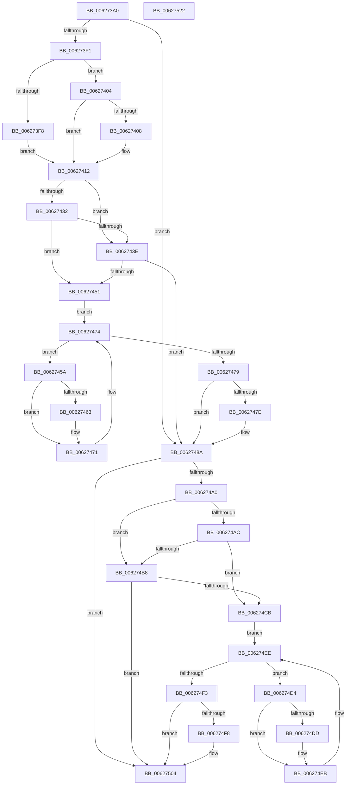

# DifIoAllocateControllerWrapper

- RVA: `0x006273A0`–`0x00627523` (길이 `387` bytes)
- VA: `0x00000001406273A0`
- 실행 섹션: `.text`
- PDB 이름 있음: `예`; PDB Function 태그: `아니요`
- unwind 정보 RVA: `0x000C3AF8`
- 디코드: `109`개 명령, `387/387` bytes 표시
- 미해석 바이트: `0` (있으면 어셈블리에 `.byte`로 보존)

> 이 문서는 커널 이미지의 기계어와 PDB 기호를 분석해 생성했습니다. 4번과 5번은 함수 원형과 자료형을 바이너리 사용 방식에서 추정한 C 해석이며 원본 소스 복구 결과는 아닙니다.

## 1. Dependencies

- 직접 호출 지점: **9**; 고유 호출 대상: **6**
- 직접 호출자로 확인된 함수: **0**
- RIP 상대 이미지 참조: **3**

### Outgoing calls
- `0x006273E0` → [DifGetAPIThunkContextById](../49/DifGetAPIThunkContextById_function_00495A34.md) (function, `0x00495A34`)
- `0x00627408` → [DifGetReturnAddressForWrappers](../4D/DifGetReturnAddressForWrappers_function_004D3C08.md) (function, `0x004D3C08`)
- `0x00627445` → [ExAcquireRundownProtection](../21/ExAcquireRundownProtection_function_00216620.md) (function, `0x00216620`)
- `0x0062746C` → [guard_dispatch_icall](../6B/guard_dispatch_icall_function_006BAAD0.md) (function, `0x006BAAD0`)
- `0x00627485` → [ExReleaseRundownProtection](../34/ExReleaseRundownProtection_function_00349E80.md) (function, `0x00349E80`)
- `0x00627496` → [IoAllocateController](../4C/IoAllocateController_function_004C9C50.md) (function, `0x004C9C50`)
- `0x006274BF` → [ExAcquireRundownProtection](../21/ExAcquireRundownProtection_function_00216620.md) (function, `0x00216620`)
- `0x006274E6` → [guard_dispatch_icall](../6B/guard_dispatch_icall_function_006BAAD0.md) (function, `0x006BAAD0`)
- `0x006274FF` → [ExReleaseRundownProtection](../34/ExReleaseRundownProtection_function_00349E80.md) (function, `0x00349E80`)

### Direct callers
- 이 함수 시작 RVA로 연결되는 직접 call은 확인되지 않았습니다. 간접 호출은 완전히 역산할 수 없습니다.

### Static image references
- `0x0062741A` → RVA `0x00F048B8` (`.data`; read)
- `0x00627432` → RVA `0x00F04980` (`.data`; read)
- `0x0062743E` → RVA `0x00F03E80` (`.data`; read)

## 2. Other-region calls and transfers

- 다른 실행 섹션으로 향하는 call: **0**
- 별도 외부 분기/꼬리 이동을 확인하지 못했습니다.

## 3. Assembly (complete function range)

```asm
006273A0  4C 8B DC                        mov r11, rsp
006273A3  49 89 5B 08                     mov qword ptr [r11 + 8], rbx
006273A7  49 89 6B 10                     mov qword ptr [r11 + 0x10], rbp
006273AB  49 89 73 18                     mov qword ptr [r11 + 0x18], rsi
006273AF  57                              push rdi
006273B0  41 54                           push r12
006273B2  41 55                           push r13
006273B4  41 56                           push r14
006273B6  41 57                           push r15
006273B8  48 83 EC 50                     sub rsp, 0x50
006273BC  0F 57 C0                        xorps xmm0, xmm0
006273BF  33 C0                           xor eax, eax
006273C1  0F 11 44 24 20                  movups xmmword ptr [rsp + 0x20], xmm0
006273C6  4C 8B E9                        mov r13, rcx
006273C9  B9 72 01 00 00                  mov ecx, 0x172
006273CE  0F 11 44 24 30                  movups xmmword ptr [rsp + 0x30], xmm0
006273D3  49 89 43 C8                     mov qword ptr [r11 - 0x38], rax
006273D7  4D 8B F1                        mov r14, r9
006273DA  4D 8B F8                        mov r15, r8
006273DD  4C 8B E2                        mov r12, rdx
006273E0  E8 4F E6 E6 FF                  call 0x140495a34
006273E5  48 8B F0                        mov rsi, rax
006273E8  48 85 C0                        test rax, rax
006273EB  0F 84 99 00 00 00               je 0x14062748a
006273F1  8B 40 0C                        mov eax, dword ptr [rax + 0xc]
006273F4  A8 18                           test al, 0x18
006273F6  74 0C                           je 0x140627404
006273F8  48 8B 4C 24 78                  mov rcx, qword ptr [rsp + 0x78]
006273FD  48 89 4C 24 20                  mov qword ptr [rsp + 0x20], rcx
00627402  EB 0E                           jmp 0x140627412
00627404  A8 04                           test al, 4
00627406  74 0A                           je 0x140627412
00627408  E8 FB C7 EA FF                  call 0x1404d3c08
0062740D  48 89 44 24 20                  mov qword ptr [rsp + 0x20], rax
00627412  40 32 ED                        xor bpl, bpl
00627415  4C 89 6C 24 40                  mov qword ptr [rsp + 0x40], r13
0062741A  40 38 2D 97 D4 8D 00            cmp byte ptr [rip + 0x8dd497], bpl
00627421  4C 89 64 24 38                  mov qword ptr [rsp + 0x38], r12
00627426  4C 89 7C 24 30                  mov qword ptr [rsp + 0x30], r15
0062742B  4C 89 74 24 28                  mov qword ptr [rsp + 0x28], r14
00627430  75 0C                           jne 0x14062743e
00627432  F7 05 44 D5 8D 00 00 08 00 00   test dword ptr [rip + 0x8dd544], 0x800
0062743C  74 13                           je 0x140627451
0062743E  48 8D 0D 3B CA 8D 00            lea rcx, [rip + 0x8dca3b]
00627445  E8 D6 F1 BE FF                  call 0x140216620
0062744A  40 8A E8                        mov bpl, al
0062744D  84 C0                           test al, al
0062744F  74 39                           je 0x14062748a
00627451  48 8D 7E 20                     lea rdi, [rsi + 0x20]
00627455  48 8B 1F                        mov rbx, qword ptr [rdi]
00627458  EB 1A                           jmp 0x140627474
0062745A  48 8D 43 F0                     lea rax, [rbx - 0x10]
0062745E  48 85 C0                        test rax, rax
00627461  74 0E                           je 0x140627471
00627463  48 8B 40 08                     mov rax, qword ptr [rax + 8]
00627467  48 8D 4C 24 20                  lea rcx, [rsp + 0x20]
0062746C  E8 5F 36 09 00                  call 0x1406baad0
00627471  48 8B 1B                        mov rbx, qword ptr [rbx]
00627474  48 3B DF                        cmp rbx, rdi
00627477  75 E1                           jne 0x14062745a
00627479  40 84 ED                        test bpl, bpl
0062747C  74 0C                           je 0x14062748a
0062747E  48 8D 0D FB C9 8D 00            lea rcx, [rip + 0x8dc9fb]
00627485  E8 F6 29 D2 FF                  call 0x140349e80
0062748A  4D 8B CE                        mov r9, r14
0062748D  4D 8B C7                        mov r8, r15
00627490  49 8B D4                        mov rdx, r12
00627493  49 8B CD                        mov rcx, r13
00627496  E8 B5 27 EA FF                  call 0x1404c9c50
0062749B  48 85 F6                        test rsi, rsi
0062749E  74 64                           je 0x140627504
006274A0  40 32 FF                        xor dil, dil
006274A3  40 38 3D 0E D4 8D 00            cmp byte ptr [rip + 0x8dd40e], dil
006274AA  75 0C                           jne 0x1406274b8
006274AC  F7 05 CA D4 8D 00 00 08 00 00   test dword ptr [rip + 0x8dd4ca], 0x800
006274B6  74 13                           je 0x1406274cb
006274B8  48 8D 0D C1 C9 8D 00            lea rcx, [rip + 0x8dc9c1]
006274BF  E8 5C F1 BE FF                  call 0x140216620
006274C4  40 8A F8                        mov dil, al
006274C7  84 C0                           test al, al
006274C9  74 39                           je 0x140627504
006274CB  48 83 C6 30                     add rsi, 0x30
006274CF  48 8B 1E                        mov rbx, qword ptr [rsi]
006274D2  EB 1A                           jmp 0x1406274ee
006274D4  48 8D 43 F0                     lea rax, [rbx - 0x10]
006274D8  48 85 C0                        test rax, rax
006274DB  74 0E                           je 0x1406274eb
006274DD  48 8B 40 08                     mov rax, qword ptr [rax + 8]
006274E1  48 8D 4C 24 20                  lea rcx, [rsp + 0x20]
006274E6  E8 E5 35 09 00                  call 0x1406baad0
006274EB  48 8B 1B                        mov rbx, qword ptr [rbx]
006274EE  48 3B DE                        cmp rbx, rsi
006274F1  75 E1                           jne 0x1406274d4
006274F3  40 84 FF                        test dil, dil
006274F6  74 0C                           je 0x140627504
006274F8  48 8D 0D 81 C9 8D 00            lea rcx, [rip + 0x8dc981]
006274FF  E8 7C 29 D2 FF                  call 0x140349e80
00627504  4C 8D 5C 24 50                  lea r11, [rsp + 0x50]
00627509  49 8B 5B 30                     mov rbx, qword ptr [r11 + 0x30]
0062750D  49 8B 6B 38                     mov rbp, qword ptr [r11 + 0x38]
00627511  49 8B 73 40                     mov rsi, qword ptr [r11 + 0x40]
00627515  49 8B E3                        mov rsp, r11
00627518  41 5F                           pop r15
0062751A  41 5E                           pop r14
0062751C  41 5D                           pop r13
0062751E  41 5C                           pop r12
00627520  5F                              pop rdi
00627521  C3                              ret
00627522  CC                              int3
```

## 4. C-style interpretation (structured pseudocode)

```c
__int64 __fastcall DifIoAllocateControllerWrapper(__int64 a1, __int64 a2, __int64 a3, __int64 a4)
{
    __int64 result;
    __int64 v_rbp;
    __int64 v_rdi;
    __int64 v_rsi;
    __int64 v_rsp;
    unsigned __int64 v_stack_m28;
    unsigned __int64 v_stack_m38;
    unsigned __int64 v_stack_m40;
    unsigned __int64 v_stack_m48;
    unsigned __int64 v_stack_m50;
    unsigned __int64 v_stack_m58;
    unsigned __int64 v_stack_p0;

    *(unsigned __int64 *)(v_rsp + 8) = v_rbx;
    *(unsigned __int64 *)(v_rsp + 16) = v_rbp;
    *(unsigned __int64 *)(v_rsp + 24) = v_rsi;
    v_rsp = (v_rsp) - (80);
    result = 0;
    v_stack_m58 = v_xmm0;
    v_stack_m48 = v_xmm0;
    *(unsigned __int64 *)(v_rsp - 56) = 0;
    result = DifGetAPIThunkContextById(370, a2, a3, a4);
    if (result == 0) goto loc_0062748A;
    if ((((unsigned __int8)((unsigned int)(*(unsigned int *)(result + 12)))) & (24)) == 0) goto loc_00627404;
    v_stack_m58 = v_stack_p0;
    goto loc_00627412;
loc_00627404:
    result = (unsigned int)(*(unsigned int *)(result + 12));
    if ((((unsigned __int8)((unsigned int)(*(unsigned int *)(result + 12)))) & (4)) != 0) {
        result = DifGetReturnAddressForWrappers(v_stack_p0, a2, a3, a4);
        v_stack_m58 = result;
    }
    v_rbp = 0;
    v_stack_m38 = a1;
    v_stack_m40 = a2;
    v_stack_m48 = a3;
    v_stack_m50 = a4;
    if ((*(unsigned __int8 *)(v_rip + 9294999)) != 0) goto loc_0062743E;
    if (((*(unsigned int *)(v_rip + 9295172)) & (0x800ULL)) == 0) goto loc_00627451;
loc_0062743E:
    result = ExAcquireRundownProtection(v_rip + 9292347, a2, a3, a4);
    if ((unsigned __int8)(result) == 0) goto loc_0062748A;
loc_00627451:
    goto loc_00627474;
loc_0062745A:
    result = *(unsigned __int64 *)(result + 32) - 16;
    if (*(unsigned __int64 *)(result + 32) - 16 != 0) {
        result = *(unsigned __int64 *)(*(unsigned __int64 *)(result + 32) - 16 + 8);
        a1 = v_stack_m58;
        result = guard_dispatch_icall(a1, a2, a3, a4);
    }
loc_00627474:
    if ((*(unsigned __int64 *)(*(unsigned __int64 *)(result + 32))) != (result + 32)) goto loc_0062745A;
    if ((unsigned __int8)((unsigned __int8)(result)) != 0) {
        a1 = v_rip + 9292283;
        result = ExReleaseRundownProtection(a1, a2, a3, a4);
    }
    result = IoAllocateController(a1, a2, a3, a4);
    if (result == 0) goto loc_00627504;
    v_rdi = 0;
    if ((*(unsigned __int8 *)(v_rip + 9294862)) != 0) goto loc_006274B8;
    if (((*(unsigned int *)(v_rip + 9295050)) & (0x800ULL)) == 0) goto loc_006274CB;
loc_006274B8:
    result = ExAcquireRundownProtection(v_rip + 9292225, a2, a3, a4);
    if ((unsigned __int8)(result) == 0) goto loc_00627504;
loc_006274CB:
    v_rsi = (result) + (48);
    goto loc_006274EE;
loc_006274D4:
    result = *(unsigned __int64 *)(v_rsi) - 16;
    if (*(unsigned __int64 *)(v_rsi) - 16 != 0) {
        result = *(unsigned __int64 *)(*(unsigned __int64 *)(v_rsi) - 16 + 8);
        a1 = v_stack_m58;
        result = guard_dispatch_icall(a1, a2, a3, a4);
    }
loc_006274EE:
    if ((*(unsigned __int64 *)(*(unsigned __int64 *)(v_rsi))) != v_rsi) goto loc_006274D4;
    if ((unsigned __int8)((unsigned __int8)(result)) != 0) {
        a1 = v_rip + 9292161;
        result = ExReleaseRundownProtection(a1, a2, a3, a4);
    }
    return result;
}
```

## 5. (Beta) C Style

```c
int64_t DifIoAllocateControllerWrapper(int64_t Arg1, int64_t Arg2, int64_t Arg3, int64_t Arg4)
{
    int64_t result;
    int64_t local_rbp;
    int64_t local_rdi;
    int64_t local_rsi;
    int64_t local_rsp;
    uint64_t v_stack_m28;
    uint64_t v_stack_m38;
    uint64_t v_stack_m40;
    uint64_t v_stack_m48;
    uint64_t v_stack_m50;
    uint64_t v_stack_m58;
    uint64_t v_stack_p0;

    *(uint64_t *)(local_rsp + 0x8) = local_rbx;
    *(uint64_t *)(local_rsp + 0x10) = local_rbp;
    *(uint64_t *)(local_rsp + 0x18) = local_rsi;
    local_rsp = (local_rsp) - (80);
    result = 0;
    v_stack_m58 = v_xmm0;
    v_stack_m48 = v_xmm0;
    *(uint64_t *)(local_rsp - 0x38) = 0;
    result = DifGetAPIThunkContextById(370, Arg2, Arg3, Arg4);
    if (result == 0) goto loc_0062748A;
    if ((((uint8_t)((uint32_t)(*(uint32_t *)(result + 0xC)))) & (24)) == 0) goto loc_00627404;
    v_stack_m58 = v_stack_p0;
    goto loc_00627412;
loc_00627404:
    result = (uint32_t)(*(uint32_t *)(result + 0xC));
    if ((((uint8_t)((uint32_t)(*(uint32_t *)(result + 0xC)))) & (4)) != 0) {
        result = DifGetReturnAddressForWrappers(v_stack_p0, Arg2, Arg3, Arg4);
        v_stack_m58 = result;
    }
    local_rbp = 0;
    v_stack_m38 = Arg1;
    v_stack_m40 = Arg2;
    v_stack_m48 = Arg3;
    v_stack_m50 = Arg4;
    if ((*(uint8_t *)(v_rip + 0x8DD497)) != 0) goto loc_0062743E;
    if (((*(uint32_t *)(v_rip + 0x8DD544)) & (0x800ULL)) == 0) goto loc_00627451;
loc_0062743E:
    result = ExAcquireRundownProtection(v_rip + 9292347, Arg2, Arg3, Arg4);
    if ((uint8_t)(result) == 0) goto loc_0062748A;
loc_00627451:
    goto loc_00627474;
loc_0062745A:
    result = *(uint64_t *)(result + 0x20) - 16;
    if (*(uint64_t *)(result + 0x20) - 16 != 0) {
        result = *(uint64_t *)(*(uint64_t *)(result + 0x20) - 0x10 + 0x8);
        Arg1 = v_stack_m58;
        result = guard_dispatch_icall(Arg1, Arg2, Arg3, Arg4);
    }
loc_00627474:
    if ((*(uint64_t *)(*(uint64_t *)(result + 0x20))) != (result + 32)) goto loc_0062745A;
    if ((uint8_t)((uint8_t)(result)) != 0) {
        Arg1 = v_rip + 9292283;
        result = ExReleaseRundownProtection(Arg1, Arg2, Arg3, Arg4);
    }
    result = IoAllocateController(Arg1, Arg2, Arg3, Arg4);
    if (result == 0) goto loc_00627504;
    local_rdi = 0;
    if ((*(uint8_t *)(v_rip + 0x8DD40E)) != 0) goto loc_006274B8;
    if (((*(uint32_t *)(v_rip + 0x8DD4CA)) & (0x800ULL)) == 0) goto loc_006274CB;
loc_006274B8:
    result = ExAcquireRundownProtection(v_rip + 9292225, Arg2, Arg3, Arg4);
    if ((uint8_t)(result) == 0) goto loc_00627504;
loc_006274CB:
    local_rsi = (result) + (48);
    goto loc_006274EE;
loc_006274D4:
    result = *(uint64_t *)(local_rsi) - 16;
    if (*(uint64_t *)(local_rsi) - 16 != 0) {
        result = *(uint64_t *)(*(uint64_t *)(local_rsi) - 0x10 + 0x8);
        Arg1 = v_stack_m58;
        result = guard_dispatch_icall(Arg1, Arg2, Arg3, Arg4);
    }
loc_006274EE:
    if ((*(uint64_t *)(*(uint64_t *)(local_rsi))) != local_rsi) goto loc_006274D4;
    if ((uint8_t)((uint8_t)(result)) != 0) {
        Arg1 = v_rip + 9292161;
        result = ExReleaseRundownProtection(Arg1, Arg2, Arg3, Arg4);
    }
    return result;
}
```

## 6. Execution-region graph

[열기: 2D/3D 그래프와 함수 탐색 컨트롤 패널](../../../control-panel.html?section=text&rva=0x006273A0&view=graph)

- 2D 그래프는 위에서 아래로 흐르고, 3D 그래프는 빈 공간을 드래그해 회전합니다. Shift+드래그는 이동, 휠은 확대·축소, 함수 노드 선택은 대상 보고서 이동입니다.

### Static fallback


