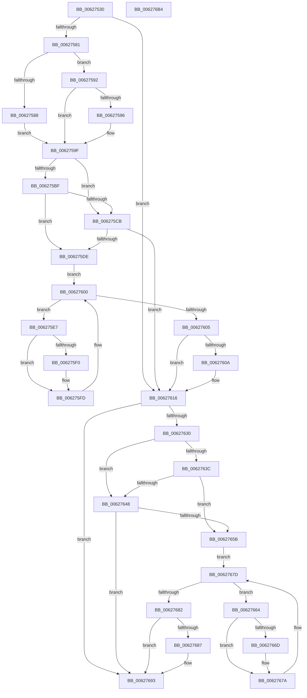

# DifIoAllocateDriverObjectExtensionWrapper

- RVA: `0x00627530`–`0x006276B5` (길이 `389` bytes)
- VA: `0x0000000140627530`
- 실행 섹션: `.text`
- PDB 이름 있음: `예`; PDB Function 태그: `아니요`
- unwind 정보 RVA: `0x000D2B7C`
- 디코드: `112`개 명령, `389/389` bytes 표시
- 미해석 바이트: `0` (있으면 어셈블리에 `.byte`로 보존)

> 이 문서는 커널 이미지의 기계어와 PDB 기호를 분석해 생성했습니다. 4번과 5번은 함수 원형과 자료형을 바이너리 사용 방식에서 추정한 C 해석이며 원본 소스 복구 결과는 아닙니다.

## 1. Dependencies

- 직접 호출 지점: **9**; 고유 호출 대상: **6**
- 직접 호출자로 확인된 함수: **0**
- RIP 상대 이미지 참조: **3**

### Outgoing calls
- `0x00627570` → [DifGetAPIThunkContextById](../49/DifGetAPIThunkContextById_function_00495A34.md) (function, `0x00495A34`)
- `0x00627596` → [DifGetReturnAddressForWrappers](../4D/DifGetReturnAddressForWrappers_function_004D3C08.md) (function, `0x004D3C08`)
- `0x006275D2` → [ExAcquireRundownProtection](../21/ExAcquireRundownProtection_function_00216620.md) (function, `0x00216620`)
- `0x006275F8` → [guard_dispatch_icall](../6B/guard_dispatch_icall_function_006BAAD0.md) (function, `0x006BAAD0`)
- `0x00627611` → [ExReleaseRundownProtection](../34/ExReleaseRundownProtection_function_00349E80.md) (function, `0x00349E80`)
- `0x00627623` → [IoAllocateDriverObjectExtension](../4B/IoAllocateDriverObjectExtension_function_004B8650.md) (function, `0x004B8650`)
- `0x0062764F` → [ExAcquireRundownProtection](../21/ExAcquireRundownProtection_function_00216620.md) (function, `0x00216620`)
- `0x00627675` → [guard_dispatch_icall](../6B/guard_dispatch_icall_function_006BAAD0.md) (function, `0x006BAAD0`)
- `0x0062768E` → [ExReleaseRundownProtection](../34/ExReleaseRundownProtection_function_00349E80.md) (function, `0x00349E80`)

### Direct callers
- 이 함수 시작 RVA로 연결되는 직접 call은 확인되지 않았습니다. 간접 호출은 완전히 역산할 수 없습니다.

### Static image references
- `0x006275A6` → RVA `0x00F048B8` (`.data`; read)
- `0x006275BF` → RVA `0x00F04980` (`.data`; read)
- `0x006275CB` → RVA `0x00F03E80` (`.data`; read)

## 2. Other-region calls and transfers

- 다른 실행 섹션으로 향하는 call: **0**
- 별도 외부 분기/꼬리 이동을 확인하지 못했습니다.

## 3. Assembly (complete function range)

```asm
00627530  48 8B C4                        mov rax, rsp
00627533  48 89 58 10                     mov qword ptr [rax + 0x10], rbx
00627537  48 89 70 18                     mov qword ptr [rax + 0x18], rsi
0062753B  48 89 78 20                     mov qword ptr [rax + 0x20], rdi
0062753F  48 89 48 08                     mov qword ptr [rax + 8], rcx
00627543  55                              push rbp
00627544  41 54                           push r12
00627546  41 55                           push r13
00627548  41 56                           push r14
0062754A  41 57                           push r15
0062754C  48 8B EC                        mov rbp, rsp
0062754F  48 83 EC 50                     sub rsp, 0x50
00627553  0F 57 C0                        xorps xmm0, xmm0
00627556  B9 71 01 00 00                  mov ecx, 0x171
0062755B  0F 11 45 D0                     movups xmmword ptr [rbp - 0x30], xmm0
0062755F  4D 8B F9                        mov r15, r9
00627562  45 8B E0                        mov r12d, r8d
00627565  0F 11 45 E0                     movups xmmword ptr [rbp - 0x20], xmm0
00627569  4C 8B EA                        mov r13, rdx
0062756C  0F 11 45 F0                     movups xmmword ptr [rbp - 0x10], xmm0
00627570  E8 BF E4 E6 FF                  call 0x140495a34
00627575  48 8B F0                        mov rsi, rax
00627578  48 85 C0                        test rax, rax
0062757B  0F 84 95 00 00 00               je 0x140627616
00627581  8B 40 0C                        mov eax, dword ptr [rax + 0xc]
00627584  A8 18                           test al, 0x18
00627586  74 0A                           je 0x140627592
00627588  48 8B 4D 28                     mov rcx, qword ptr [rbp + 0x28]
0062758C  48 89 4D D0                     mov qword ptr [rbp - 0x30], rcx
00627590  EB 0D                           jmp 0x14062759f
00627592  A8 04                           test al, 4
00627594  74 09                           je 0x14062759f
00627596  E8 6D C6 EA FF                  call 0x1404d3c08
0062759B  48 89 45 D0                     mov qword ptr [rbp - 0x30], rax
0062759F  48 8B 45 30                     mov rax, qword ptr [rbp + 0x30]
006275A3  45 32 F6                        xor r14b, r14b
006275A6  44 38 35 0B D3 8D 00            cmp byte ptr [rip + 0x8dd30b], r14b
006275AD  48 89 45 F0                     mov qword ptr [rbp - 0x10], rax
006275B1  4C 89 6D E8                     mov qword ptr [rbp - 0x18], r13
006275B5  44 89 65 E0                     mov dword ptr [rbp - 0x20], r12d
006275B9  4C 89 7D D8                     mov qword ptr [rbp - 0x28], r15
006275BD  75 0C                           jne 0x1406275cb
006275BF  F7 05 B7 D3 8D 00 00 08 00 00   test dword ptr [rip + 0x8dd3b7], 0x800
006275C9  74 13                           je 0x1406275de
006275CB  48 8D 0D AE C8 8D 00            lea rcx, [rip + 0x8dc8ae]
006275D2  E8 49 F0 BE FF                  call 0x140216620
006275D7  44 8A F0                        mov r14b, al
006275DA  84 C0                           test al, al
006275DC  74 38                           je 0x140627616
006275DE  48 8D 7E 20                     lea rdi, [rsi + 0x20]
006275E2  48 8B 1F                        mov rbx, qword ptr [rdi]
006275E5  EB 19                           jmp 0x140627600
006275E7  48 8D 43 F0                     lea rax, [rbx - 0x10]
006275EB  48 85 C0                        test rax, rax
006275EE  74 0D                           je 0x1406275fd
006275F0  48 8B 40 08                     mov rax, qword ptr [rax + 8]
006275F4  48 8D 4D D0                     lea rcx, [rbp - 0x30]
006275F8  E8 D3 34 09 00                  call 0x1406baad0
006275FD  48 8B 1B                        mov rbx, qword ptr [rbx]
00627600  48 3B DF                        cmp rbx, rdi
00627603  75 E2                           jne 0x1406275e7
00627605  45 84 F6                        test r14b, r14b
00627608  74 0C                           je 0x140627616
0062760A  48 8D 0D 6F C8 8D 00            lea rcx, [rip + 0x8dc86f]
00627611  E8 6A 28 D2 FF                  call 0x140349e80
00627616  48 8B 4D 30                     mov rcx, qword ptr [rbp + 0x30]
0062761A  4D 8B CF                        mov r9, r15
0062761D  45 8B C4                        mov r8d, r12d
00627620  49 8B D5                        mov rdx, r13
00627623  E8 28 10 E9 FF                  call 0x1404b8650
00627628  89 45 F8                        mov dword ptr [rbp - 8], eax
0062762B  48 85 F6                        test rsi, rsi
0062762E  74 63                           je 0x140627693
00627630  40 32 FF                        xor dil, dil
00627633  40 38 3D 7E D2 8D 00            cmp byte ptr [rip + 0x8dd27e], dil
0062763A  75 0C                           jne 0x140627648
0062763C  F7 05 3A D3 8D 00 00 08 00 00   test dword ptr [rip + 0x8dd33a], 0x800
00627646  74 13                           je 0x14062765b
00627648  48 8D 0D 31 C8 8D 00            lea rcx, [rip + 0x8dc831]
0062764F  E8 CC EF BE FF                  call 0x140216620
00627654  40 8A F8                        mov dil, al
00627657  84 C0                           test al, al
00627659  74 38                           je 0x140627693
0062765B  48 83 C6 30                     add rsi, 0x30
0062765F  48 8B 1E                        mov rbx, qword ptr [rsi]
00627662  EB 19                           jmp 0x14062767d
00627664  48 8D 43 F0                     lea rax, [rbx - 0x10]
00627668  48 85 C0                        test rax, rax
0062766B  74 0D                           je 0x14062767a
0062766D  48 8B 40 08                     mov rax, qword ptr [rax + 8]
00627671  48 8D 4D D0                     lea rcx, [rbp - 0x30]
00627675  E8 56 34 09 00                  call 0x1406baad0
0062767A  48 8B 1B                        mov rbx, qword ptr [rbx]
0062767D  48 3B DE                        cmp rbx, rsi
00627680  75 E2                           jne 0x140627664
00627682  40 84 FF                        test dil, dil
00627685  74 0C                           je 0x140627693
00627687  48 8D 0D F2 C7 8D 00            lea rcx, [rip + 0x8dc7f2]
0062768E  E8 ED 27 D2 FF                  call 0x140349e80
00627693  8B 45 F8                        mov eax, dword ptr [rbp - 8]
00627696  4C 8D 5C 24 50                  lea r11, [rsp + 0x50]
0062769B  49 8B 5B 38                     mov rbx, qword ptr [r11 + 0x38]
0062769F  49 8B 73 40                     mov rsi, qword ptr [r11 + 0x40]
006276A3  49 8B 7B 48                     mov rdi, qword ptr [r11 + 0x48]
006276A7  49 8B E3                        mov rsp, r11
006276AA  41 5F                           pop r15
006276AC  41 5E                           pop r14
006276AE  41 5D                           pop r13
006276B0  41 5C                           pop r12
006276B2  5D                              pop rbp
006276B3  C3                              ret
006276B4  CC                              int3
```

## 4. C-style interpretation (structured pseudocode)

```c
__int64 __fastcall DifIoAllocateDriverObjectExtensionWrapper(__int64 a1, __int64 a2, int a3, __int64 a4)
{
    __int64 result;
    __int64 v_r14;
    __int64 v_rdi;
    __int64 v_rsi;
    __int64 v_rsp;
    unsigned __int64 v_stack_m28;
    unsigned int v_stack_m30;
    unsigned __int64 v_stack_m38;
    unsigned __int64 v_stack_m40;
    unsigned __int64 v_stack_m48;
    unsigned __int64 v_stack_m50;
    unsigned __int64 v_stack_m58;
    unsigned __int64 v_stack_p0;
    unsigned __int64 v_stack_p8;

    *(unsigned __int64 *)(v_rsp + 16) = v_rbx;
    *(unsigned __int64 *)(v_rsp + 24) = v_rsi;
    *(unsigned __int64 *)(v_rsp + 32) = v_rdi;
    *(unsigned __int64 *)(v_rsp + 8) = a1;
    v_rsp = (v_rsp) - (80);
    v_stack_m58 = v_xmm0;
    v_stack_m48 = v_xmm0;
    v_stack_m38 = v_xmm0;
    result = DifGetAPIThunkContextById(369, a2, a3, a4);
    if (result == 0) goto loc_00627616;
    if ((((unsigned __int8)((unsigned int)(*(unsigned int *)(result + 12)))) & (24)) == 0) goto loc_00627592;
    v_stack_m58 = v_stack_p0;
    goto loc_0062759F;
loc_00627592:
    result = (unsigned int)(*(unsigned int *)(result + 12));
    if ((((unsigned __int8)((unsigned int)(*(unsigned int *)(result + 12)))) & (4)) != 0) {
        result = DifGetReturnAddressForWrappers(v_stack_p0, a2, a3, a4);
        v_stack_m58 = result;
    }
    v_r14 = 0;
    v_stack_m38 = v_stack_p8;
    v_stack_m40 = a2;
    v_stack_m48 = (unsigned int)((unsigned int)(a3));
    v_stack_m50 = a4;
    if ((*(unsigned __int8 *)(v_rip + 9294603)) != 0) goto loc_006275CB;
    if (((*(unsigned int *)(v_rip + 9294775)) & (0x800ULL)) == 0) goto loc_006275DE;
loc_006275CB:
    result = ExAcquireRundownProtection(v_rip + 9291950, a2, a3, a4);
    if ((unsigned __int8)(result) == 0) goto loc_00627616;
loc_006275DE:
    goto loc_00627600;
loc_006275E7:
    result = *(unsigned __int64 *)(result + 32) - 16;
    if (*(unsigned __int64 *)(result + 32) - 16 != 0) {
        result = *(unsigned __int64 *)(*(unsigned __int64 *)(result + 32) - 16 + 8);
        a1 = v_stack_m58;
        result = guard_dispatch_icall(a1, a2, a3, a4);
    }
loc_00627600:
    if ((*(unsigned __int64 *)(*(unsigned __int64 *)(result + 32))) != (result + 32)) goto loc_006275E7;
    if ((unsigned __int8)((unsigned __int8)(result)) != 0) {
        a1 = v_rip + 9291887;
        result = ExReleaseRundownProtection(a1, a2, a3, a4);
    }
    result = IoAllocateDriverObjectExtension(v_stack_p8, a2, (unsigned int)((unsigned int)((unsigned int)(a3))), a4);
    v_stack_m30 = (unsigned int)(result);
    if (result == 0) goto loc_00627693;
    v_rdi = 0;
    if ((*(unsigned __int8 *)(v_rip + 9294462)) != 0) goto loc_00627648;
    if (((*(unsigned int *)(v_rip + 9294650)) & (0x800ULL)) == 0) goto loc_0062765B;
loc_00627648:
    result = ExAcquireRundownProtection(v_rip + 9291825, a2, (unsigned int)((unsigned int)((unsigned int)(a3))), a4);
    if ((unsigned __int8)(result) == 0) goto loc_00627693;
loc_0062765B:
    v_rsi = (result) + (48);
    goto loc_0062767D;
loc_00627664:
    result = *(unsigned __int64 *)(v_rsi) - 16;
    if (*(unsigned __int64 *)(v_rsi) - 16 != 0) {
        result = *(unsigned __int64 *)(*(unsigned __int64 *)(v_rsi) - 16 + 8);
        a1 = v_stack_m58;
        result = guard_dispatch_icall(a1, a2, (unsigned int)((unsigned int)((unsigned int)(a3))), a4);
    }
loc_0062767D:
    if ((*(unsigned __int64 *)(*(unsigned __int64 *)(v_rsi))) != v_rsi) goto loc_00627664;
    if ((unsigned __int8)((unsigned __int8)(result)) != 0) {
        a1 = v_rip + 9291762;
        result = ExReleaseRundownProtection(a1, a2, (unsigned int)((unsigned int)((unsigned int)(a3))), a4);
    }
    return (unsigned int)(v_stack_m30);
}
```

## 5. (Beta) C Style

```c
int64_t DifIoAllocateDriverObjectExtensionWrapper(int64_t Arg1, int64_t Arg2, int32_t Arg3, int64_t Arg4)
{
    int64_t result;
    int64_t local_r14;
    int64_t local_rdi;
    int64_t local_rsi;
    int64_t local_rsp;
    uint64_t v_stack_m28;
    uint32_t v_stack_m30;
    uint64_t v_stack_m38;
    uint64_t v_stack_m40;
    uint64_t v_stack_m48;
    uint64_t v_stack_m50;
    uint64_t v_stack_m58;
    uint64_t v_stack_p0;
    uint64_t v_stack_p8;

    *(uint64_t *)(local_rsp + 0x10) = local_rbx;
    *(uint64_t *)(local_rsp + 0x18) = local_rsi;
    *(uint64_t *)(local_rsp + 0x20) = local_rdi;
    *(uint64_t *)(local_rsp + 0x8) = Arg1;
    local_rsp = (local_rsp) - (80);
    v_stack_m58 = v_xmm0;
    v_stack_m48 = v_xmm0;
    v_stack_m38 = v_xmm0;
    result = DifGetAPIThunkContextById(369, Arg2, Arg3, Arg4);
    if (result == 0) goto loc_00627616;
    if ((((uint8_t)((uint32_t)(*(uint32_t *)(result + 0xC)))) & (24)) == 0) goto loc_00627592;
    v_stack_m58 = v_stack_p0;
    goto loc_0062759F;
loc_00627592:
    result = (uint32_t)(*(uint32_t *)(result + 0xC));
    if ((((uint8_t)((uint32_t)(*(uint32_t *)(result + 0xC)))) & (4)) != 0) {
        result = DifGetReturnAddressForWrappers(v_stack_p0, Arg2, Arg3, Arg4);
        v_stack_m58 = result;
    }
    local_r14 = 0;
    v_stack_m38 = v_stack_p8;
    v_stack_m40 = Arg2;
    v_stack_m48 = (uint32_t)((uint32_t)(Arg3));
    v_stack_m50 = Arg4;
    if ((*(uint8_t *)(v_rip + 0x8DD30B)) != 0) goto loc_006275CB;
    if (((*(uint32_t *)(v_rip + 0x8DD3B7)) & (0x800ULL)) == 0) goto loc_006275DE;
loc_006275CB:
    result = ExAcquireRundownProtection(v_rip + 9291950, Arg2, Arg3, Arg4);
    if ((uint8_t)(result) == 0) goto loc_00627616;
loc_006275DE:
    goto loc_00627600;
loc_006275E7:
    result = *(uint64_t *)(result + 0x20) - 16;
    if (*(uint64_t *)(result + 0x20) - 16 != 0) {
        result = *(uint64_t *)(*(uint64_t *)(result + 0x20) - 0x10 + 0x8);
        Arg1 = v_stack_m58;
        result = guard_dispatch_icall(Arg1, Arg2, Arg3, Arg4);
    }
loc_00627600:
    if ((*(uint64_t *)(*(uint64_t *)(result + 0x20))) != (result + 32)) goto loc_006275E7;
    if ((uint8_t)((uint8_t)(result)) != 0) {
        Arg1 = v_rip + 9291887;
        result = ExReleaseRundownProtection(Arg1, Arg2, Arg3, Arg4);
    }
    result = IoAllocateDriverObjectExtension(v_stack_p8, Arg2, (uint32_t)((uint32_t)((uint32_t)(Arg3))), Arg4);
    v_stack_m30 = (uint32_t)(result);
    if (result == 0) goto loc_00627693;
    local_rdi = 0;
    if ((*(uint8_t *)(v_rip + 0x8DD27E)) != 0) goto loc_00627648;
    if (((*(uint32_t *)(v_rip + 0x8DD33A)) & (0x800ULL)) == 0) goto loc_0062765B;
loc_00627648:
    result = ExAcquireRundownProtection(v_rip + 9291825, Arg2, (uint32_t)((uint32_t)((uint32_t)(Arg3))), Arg4);
    if ((uint8_t)(result) == 0) goto loc_00627693;
loc_0062765B:
    local_rsi = (result) + (48);
    goto loc_0062767D;
loc_00627664:
    result = *(uint64_t *)(local_rsi) - 16;
    if (*(uint64_t *)(local_rsi) - 16 != 0) {
        result = *(uint64_t *)(*(uint64_t *)(local_rsi) - 0x10 + 0x8);
        Arg1 = v_stack_m58;
        result = guard_dispatch_icall(Arg1, Arg2, (uint32_t)((uint32_t)((uint32_t)(Arg3))), Arg4);
    }
loc_0062767D:
    if ((*(uint64_t *)(*(uint64_t *)(local_rsi))) != local_rsi) goto loc_00627664;
    if ((uint8_t)((uint8_t)(result)) != 0) {
        Arg1 = v_rip + 9291762;
        result = ExReleaseRundownProtection(Arg1, Arg2, (uint32_t)((uint32_t)((uint32_t)(Arg3))), Arg4);
    }
    return (uint32_t)(v_stack_m30);
}
```

## 6. Execution-region graph

[열기: 2D/3D 그래프와 함수 탐색 컨트롤 패널](../../../control-panel.html?section=text&rva=0x00627530&view=graph)

- 2D 그래프는 위에서 아래로 흐르고, 3D 그래프는 빈 공간을 드래그해 회전합니다. Shift+드래그는 이동, 휠은 확대·축소, 함수 노드 선택은 대상 보고서 이동입니다.

### Static fallback


