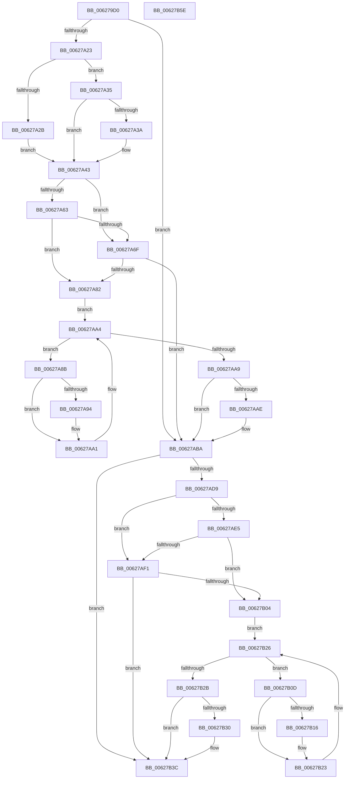

# DifIoAllocateIrpWrapper

- RVA: `0x006279D0`–`0x00627B5F` (길이 `399` bytes)
- VA: `0x00000001406279D0`
- 실행 섹션: `.text`
- PDB 이름 있음: `예`; PDB Function 태그: `아니요`
- unwind 정보 RVA: `0x000D2BBC`
- 디코드: `114`개 명령, `399/399` bytes 표시
- 미해석 바이트: `0` (있으면 어셈블리에 `.byte`로 보존)

> 이 문서는 커널 이미지의 기계어와 PDB 기호를 분석해 생성했습니다. 4번과 5번은 함수 원형과 자료형을 바이너리 사용 방식에서 추정한 C 해석이며 원본 소스 복구 결과는 아닙니다.

## 1. Dependencies

- 직접 호출 지점: **9**; 고유 호출 대상: **5**
- 직접 호출자로 확인된 함수: **0**
- RIP 상대 이미지 참조: **3**

### Outgoing calls
- `0x00627A12` → [DifGetAPIThunkContextById](../49/DifGetAPIThunkContextById_function_00495A34.md) (function, `0x00495A34`)
- `0x00627A3A` → [DifGetReturnAddressForWrappers](../4D/DifGetReturnAddressForWrappers_function_004D3C08.md) (function, `0x004D3C08`)
- `0x00627A76` → [ExAcquireRundownProtection](../21/ExAcquireRundownProtection_function_00216620.md) (function, `0x00216620`)
- `0x00627A9C` → [guard_dispatch_icall](../6B/guard_dispatch_icall_function_006BAAD0.md) (function, `0x006BAAD0`)
- `0x00627AB5` → [ExReleaseRundownProtection](../34/ExReleaseRundownProtection_function_00349E80.md) (function, `0x00349E80`)
- `0x00627ACB` → [guard_dispatch_icall](../6B/guard_dispatch_icall_function_006BAAD0.md) (function, `0x006BAAD0`)
- `0x00627AF8` → [ExAcquireRundownProtection](../21/ExAcquireRundownProtection_function_00216620.md) (function, `0x00216620`)
- `0x00627B1E` → [guard_dispatch_icall](../6B/guard_dispatch_icall_function_006BAAD0.md) (function, `0x006BAAD0`)
- `0x00627B37` → [ExReleaseRundownProtection](../34/ExReleaseRundownProtection_function_00349E80.md) (function, `0x00349E80`)

### Direct callers
- 이 함수 시작 RVA로 연결되는 직접 call은 확인되지 않았습니다. 간접 호출은 완전히 역산할 수 없습니다.

### Static image references
- `0x00627A4A` → RVA `0x00F048B8` (`.data`; read)
- `0x00627A63` → RVA `0x00F04980` (`.data`; read)
- `0x00627A6F` → RVA `0x00F03E80` (`.data`; read)

## 2. Other-region calls and transfers

- 다른 실행 섹션으로 향하는 call: **0**
- 별도 외부 분기/꼬리 이동을 확인하지 못했습니다.

## 3. Assembly (complete function range)

```asm
006279D0  48 8B C4                        mov rax, rsp
006279D3  48 89 58 10                     mov qword ptr [rax + 0x10], rbx
006279D7  48 89 70 18                     mov qword ptr [rax + 0x18], rsi
006279DB  48 89 78 20                     mov qword ptr [rax + 0x20], rdi
006279DF  48 89 48 08                     mov qword ptr [rax + 8], rcx
006279E3  55                              push rbp
006279E4  41 54                           push r12
006279E6  41 55                           push r13
006279E8  41 56                           push r14
006279EA  41 57                           push r15
006279EC  48 8B EC                        mov rbp, rsp
006279EF  48 83 EC 60                     sub rsp, 0x60
006279F3  0F 57 C0                        xorps xmm0, xmm0
006279F6  33 C0                           xor eax, eax
006279F8  B9 6E 01 00 00                  mov ecx, 0x16e
006279FD  48 89 45 F0                     mov qword ptr [rbp - 0x10], rax
00627A01  0F 11 45 D0                     movups xmmword ptr [rbp - 0x30], xmm0
00627A05  4D 8B F9                        mov r15, r9
00627A08  45 8A E0                        mov r12b, r8b
00627A0B  0F 11 45 E0                     movups xmmword ptr [rbp - 0x20], xmm0
00627A0F  44 8A EA                        mov r13b, dl
00627A12  E8 1D E0 E6 FF                  call 0x140495a34
00627A17  4C 8B F0                        mov r14, rax
00627A1A  48 85 C0                        test rax, rax
00627A1D  0F 84 97 00 00 00               je 0x140627aba
00627A23  8B 48 0C                        mov ecx, dword ptr [rax + 0xc]
00627A26  F6 C1 18                        test cl, 0x18
00627A29  74 0A                           je 0x140627a35
00627A2B  48 8B 4D 28                     mov rcx, qword ptr [rbp + 0x28]
00627A2F  48 89 4D D0                     mov qword ptr [rbp - 0x30], rcx
00627A33  EB 0E                           jmp 0x140627a43
00627A35  F6 C1 04                        test cl, 4
00627A38  74 09                           je 0x140627a43
00627A3A  E8 C9 C1 EA FF                  call 0x1404d3c08
00627A3F  48 89 45 D0                     mov qword ptr [rbp - 0x30], rax
00627A43  48 8B 45 30                     mov rax, qword ptr [rbp + 0x30]
00627A47  40 32 F6                        xor sil, sil
00627A4A  40 38 35 67 CE 8D 00            cmp byte ptr [rip + 0x8dce67], sil
00627A51  48 89 45 E8                     mov qword ptr [rbp - 0x18], rax
00627A55  44 88 6D E1                     mov byte ptr [rbp - 0x1f], r13b
00627A59  44 88 65 E0                     mov byte ptr [rbp - 0x20], r12b
00627A5D  4C 89 7D D8                     mov qword ptr [rbp - 0x28], r15
00627A61  75 0C                           jne 0x140627a6f
00627A63  F7 05 13 CF 8D 00 00 08 00 00   test dword ptr [rip + 0x8dcf13], 0x800
00627A6D  74 13                           je 0x140627a82
00627A6F  48 8D 0D 0A C4 8D 00            lea rcx, [rip + 0x8dc40a]
00627A76  E8 A5 EB BE FF                  call 0x140216620
00627A7B  40 8A F0                        mov sil, al
00627A7E  84 C0                           test al, al
00627A80  74 38                           je 0x140627aba
00627A82  49 8D 7E 20                     lea rdi, [r14 + 0x20]
00627A86  48 8B 1F                        mov rbx, qword ptr [rdi]
00627A89  EB 19                           jmp 0x140627aa4
00627A8B  48 8D 43 F0                     lea rax, [rbx - 0x10]
00627A8F  48 85 C0                        test rax, rax
00627A92  74 0D                           je 0x140627aa1
00627A94  48 8B 40 08                     mov rax, qword ptr [rax + 8]
00627A98  48 8D 4D D0                     lea rcx, [rbp - 0x30]
00627A9C  E8 2F 30 09 00                  call 0x1406baad0
00627AA1  48 8B 1B                        mov rbx, qword ptr [rbx]
00627AA4  48 3B DF                        cmp rbx, rdi
00627AA7  75 E2                           jne 0x140627a8b
00627AA9  40 84 F6                        test sil, sil
00627AAC  74 0C                           je 0x140627aba
00627AAE  48 8D 0D CB C3 8D 00            lea rcx, [rip + 0x8dc3cb]
00627AB5  E8 C6 23 D2 FF                  call 0x140349e80
00627ABA  48 8B 4D 30                     mov rcx, qword ptr [rbp + 0x30]
00627ABE  4D 8B CF                        mov r9, r15
00627AC1  48 8B 45 50                     mov rax, qword ptr [rbp + 0x50]
00627AC5  45 8A C4                        mov r8b, r12b
00627AC8  41 8A D5                        mov dl, r13b
00627ACB  E8 00 30 09 00                  call 0x1406baad0
00627AD0  48 89 45 F0                     mov qword ptr [rbp - 0x10], rax
00627AD4  4D 85 F6                        test r14, r14
00627AD7  74 63                           je 0x140627b3c
00627AD9  40 32 FF                        xor dil, dil
00627ADC  40 38 3D D5 CD 8D 00            cmp byte ptr [rip + 0x8dcdd5], dil
00627AE3  75 0C                           jne 0x140627af1
00627AE5  F7 05 91 CE 8D 00 00 08 00 00   test dword ptr [rip + 0x8dce91], 0x800
00627AEF  74 13                           je 0x140627b04
00627AF1  48 8D 0D 88 C3 8D 00            lea rcx, [rip + 0x8dc388]
00627AF8  E8 23 EB BE FF                  call 0x140216620
00627AFD  40 8A F8                        mov dil, al
00627B00  84 C0                           test al, al
00627B02  74 38                           je 0x140627b3c
00627B04  49 8D 76 30                     lea rsi, [r14 + 0x30]
00627B08  48 8B 1E                        mov rbx, qword ptr [rsi]
00627B0B  EB 19                           jmp 0x140627b26
00627B0D  48 8D 43 F0                     lea rax, [rbx - 0x10]
00627B11  48 85 C0                        test rax, rax
00627B14  74 0D                           je 0x140627b23
00627B16  48 8B 40 08                     mov rax, qword ptr [rax + 8]
00627B1A  48 8D 4D D0                     lea rcx, [rbp - 0x30]
00627B1E  E8 AD 2F 09 00                  call 0x1406baad0
00627B23  48 8B 1B                        mov rbx, qword ptr [rbx]
00627B26  48 3B DE                        cmp rbx, rsi
00627B29  75 E2                           jne 0x140627b0d
00627B2B  40 84 FF                        test dil, dil
00627B2E  74 0C                           je 0x140627b3c
00627B30  48 8D 0D 49 C3 8D 00            lea rcx, [rip + 0x8dc349]
00627B37  E8 44 23 D2 FF                  call 0x140349e80
00627B3C  48 8B 45 F0                     mov rax, qword ptr [rbp - 0x10]
00627B40  4C 8D 5C 24 60                  lea r11, [rsp + 0x60]
00627B45  49 8B 5B 38                     mov rbx, qword ptr [r11 + 0x38]
00627B49  49 8B 73 40                     mov rsi, qword ptr [r11 + 0x40]
00627B4D  49 8B 7B 48                     mov rdi, qword ptr [r11 + 0x48]
00627B51  49 8B E3                        mov rsp, r11
00627B54  41 5F                           pop r15
00627B56  41 5E                           pop r14
00627B58  41 5D                           pop r13
00627B5A  41 5C                           pop r12
00627B5C  5D                              pop rbp
00627B5D  C3                              ret
00627B5E  CC                              int3
```

## 4. C-style interpretation (structured pseudocode)

```c
__int64 __fastcall DifIoAllocateIrpWrapper(__int64 a1, unsigned __int8 a2, unsigned __int8 a3, __int64 a4, __int64 a5)
{
    __int64 result;
    __int64 v_rdi;
    __int64 v_rsi;
    __int64 v_rsp;
    unsigned __int64 v_stack_m28;
    unsigned __int64 v_stack_m38;
    unsigned __int64 v_stack_m40;
    unsigned __int8 v_stack_m47;
    unsigned __int64 v_stack_m48;
    unsigned __int64 v_stack_m50;
    unsigned __int64 v_stack_m58;
    unsigned __int64 v_stack_p0;
    unsigned __int64 v_stack_p8;

    *(unsigned __int64 *)(v_rsp + 16) = v_rbx;
    *(unsigned __int64 *)(v_rsp + 24) = v_rsi;
    *(unsigned __int64 *)(v_rsp + 32) = v_rdi;
    *(unsigned __int64 *)(v_rsp + 8) = a1;
    v_rsp = (v_rsp) - (96);
    result = 0;
    v_stack_m38 = 0;
    v_stack_m58 = v_xmm0;
    v_stack_m48 = v_xmm0;
    result = DifGetAPIThunkContextById(366, a2, a3, a4);
    if (result == 0) goto loc_00627ABA;
    if ((((unsigned __int8)((unsigned int)(*(unsigned int *)(result + 12)))) & (24)) == 0) goto loc_00627A35;
    v_stack_m58 = v_stack_p0;
    goto loc_00627A43;
loc_00627A35:
    if ((((unsigned __int8)(v_stack_p0)) & (4)) != 0) {
        result = DifGetReturnAddressForWrappers(v_stack_p0, a2, a3, a4);
        v_stack_m58 = result;
    }
    v_rsi = 0;
    v_stack_m40 = v_stack_p8;
    v_stack_m47 = a2;
    v_stack_m48 = a3;
    v_stack_m50 = a4;
    if ((*(unsigned __int8 *)(v_rip + 9293415)) != 0) goto loc_00627A6F;
    if (((*(unsigned int *)(v_rip + 9293587)) & (0x800ULL)) == 0) goto loc_00627A82;
loc_00627A6F:
    result = ExAcquireRundownProtection(v_rip + 9290762, a2, a3, a4);
    if ((unsigned __int8)(result) == 0) goto loc_00627ABA;
loc_00627A82:
    goto loc_00627AA4;
loc_00627A8B:
    result = *(unsigned __int64 *)(result + 32) - 16;
    if (*(unsigned __int64 *)(result + 32) - 16 != 0) {
        result = *(unsigned __int64 *)(*(unsigned __int64 *)(result + 32) - 16 + 8);
        a1 = v_stack_m58;
        result = guard_dispatch_icall(a1, a2, a3, a4);
    }
loc_00627AA4:
    if ((*(unsigned __int64 *)(*(unsigned __int64 *)(result + 32))) != (result + 32)) goto loc_00627A8B;
    if ((unsigned __int8)((unsigned __int8)(result)) != 0) {
        a1 = v_rip + 9290699;
        result = ExReleaseRundownProtection(a1, a2, a3, a4);
    }
    result = guard_dispatch_icall(v_stack_p8, a2, a3, a4);
    v_stack_m38 = result;
    if (result == 0) goto loc_00627B3C;
    v_rdi = 0;
    if ((*(unsigned __int8 *)(v_rip + 9293269)) != 0) goto loc_00627AF1;
    if (((*(unsigned int *)(v_rip + 9293457)) & (0x800ULL)) == 0) goto loc_00627B04;
loc_00627AF1:
    result = ExAcquireRundownProtection(v_rip + 9290632, a2, a3, a4);
    if ((unsigned __int8)(result) == 0) goto loc_00627B3C;
loc_00627B04:
    goto loc_00627B26;
loc_00627B0D:
    result = *(unsigned __int64 *)(result + 48) - 16;
    if (*(unsigned __int64 *)(result + 48) - 16 != 0) {
        result = *(unsigned __int64 *)(*(unsigned __int64 *)(result + 48) - 16 + 8);
        a1 = v_stack_m58;
        result = guard_dispatch_icall(a1, a2, a3, a4);
    }
loc_00627B26:
    if ((*(unsigned __int64 *)(*(unsigned __int64 *)(result + 48))) != (result + 48)) goto loc_00627B0D;
    if ((unsigned __int8)((unsigned __int8)(result)) != 0) {
        a1 = v_rip + 9290569;
        result = ExReleaseRundownProtection(a1, a2, a3, a4);
    }
    return v_stack_m38;
}
```

## 5. (Beta) C Style

```c
int64_t DifIoAllocateIrpWrapper(int64_t Arg1, uint8_t Arg2, uint8_t Arg3, int64_t Arg4, int64_t Arg5)
{
    int64_t result;
    int64_t local_rdi;
    int64_t local_rsi;
    int64_t local_rsp;
    uint64_t v_stack_m28;
    uint64_t v_stack_m38;
    uint64_t v_stack_m40;
    uint8_t v_stack_m47;
    uint64_t v_stack_m48;
    uint64_t v_stack_m50;
    uint64_t v_stack_m58;
    uint64_t v_stack_p0;
    uint64_t v_stack_p8;

    *(uint64_t *)(local_rsp + 0x10) = local_rbx;
    *(uint64_t *)(local_rsp + 0x18) = local_rsi;
    *(uint64_t *)(local_rsp + 0x20) = local_rdi;
    *(uint64_t *)(local_rsp + 0x8) = Arg1;
    local_rsp = (local_rsp) - (96);
    result = 0;
    v_stack_m38 = 0;
    v_stack_m58 = v_xmm0;
    v_stack_m48 = v_xmm0;
    result = DifGetAPIThunkContextById(366, Arg2, Arg3, Arg4);
    if (result == 0) goto loc_00627ABA;
    if ((((uint8_t)((uint32_t)(*(uint32_t *)(result + 0xC)))) & (24)) == 0) goto loc_00627A35;
    v_stack_m58 = v_stack_p0;
    goto loc_00627A43;
loc_00627A35:
    if ((((uint8_t)(v_stack_p0)) & (4)) != 0) {
        result = DifGetReturnAddressForWrappers(v_stack_p0, Arg2, Arg3, Arg4);
        v_stack_m58 = result;
    }
    local_rsi = 0;
    v_stack_m40 = v_stack_p8;
    v_stack_m47 = Arg2;
    v_stack_m48 = Arg3;
    v_stack_m50 = Arg4;
    if ((*(uint8_t *)(v_rip + 0x8DCE67)) != 0) goto loc_00627A6F;
    if (((*(uint32_t *)(v_rip + 0x8DCF13)) & (0x800ULL)) == 0) goto loc_00627A82;
loc_00627A6F:
    result = ExAcquireRundownProtection(v_rip + 9290762, Arg2, Arg3, Arg4);
    if ((uint8_t)(result) == 0) goto loc_00627ABA;
loc_00627A82:
    goto loc_00627AA4;
loc_00627A8B:
    result = *(uint64_t *)(result + 0x20) - 16;
    if (*(uint64_t *)(result + 0x20) - 16 != 0) {
        result = *(uint64_t *)(*(uint64_t *)(result + 0x20) - 0x10 + 0x8);
        Arg1 = v_stack_m58;
        result = guard_dispatch_icall(Arg1, Arg2, Arg3, Arg4);
    }
loc_00627AA4:
    if ((*(uint64_t *)(*(uint64_t *)(result + 0x20))) != (result + 32)) goto loc_00627A8B;
    if ((uint8_t)((uint8_t)(result)) != 0) {
        Arg1 = v_rip + 9290699;
        result = ExReleaseRundownProtection(Arg1, Arg2, Arg3, Arg4);
    }
    result = guard_dispatch_icall(v_stack_p8, Arg2, Arg3, Arg4);
    v_stack_m38 = result;
    if (result == 0) goto loc_00627B3C;
    local_rdi = 0;
    if ((*(uint8_t *)(v_rip + 0x8DCDD5)) != 0) goto loc_00627AF1;
    if (((*(uint32_t *)(v_rip + 0x8DCE91)) & (0x800ULL)) == 0) goto loc_00627B04;
loc_00627AF1:
    result = ExAcquireRundownProtection(v_rip + 9290632, Arg2, Arg3, Arg4);
    if ((uint8_t)(result) == 0) goto loc_00627B3C;
loc_00627B04:
    goto loc_00627B26;
loc_00627B0D:
    result = *(uint64_t *)(result + 0x30) - 16;
    if (*(uint64_t *)(result + 0x30) - 16 != 0) {
        result = *(uint64_t *)(*(uint64_t *)(result + 0x30) - 0x10 + 0x8);
        Arg1 = v_stack_m58;
        result = guard_dispatch_icall(Arg1, Arg2, Arg3, Arg4);
    }
loc_00627B26:
    if ((*(uint64_t *)(*(uint64_t *)(result + 0x30))) != (result + 48)) goto loc_00627B0D;
    if ((uint8_t)((uint8_t)(result)) != 0) {
        Arg1 = v_rip + 9290569;
        result = ExReleaseRundownProtection(Arg1, Arg2, Arg3, Arg4);
    }
    return v_stack_m38;
}
```

## 6. Execution-region graph

[열기: 2D/3D 그래프와 함수 탐색 컨트롤 패널](../../../control-panel.html?section=text&rva=0x006279D0&view=graph)

- 2D 그래프는 위에서 아래로 흐르고, 3D 그래프는 빈 공간을 드래그해 회전합니다. Shift+드래그는 이동, 휠은 확대·축소, 함수 노드 선택은 대상 보고서 이동입니다.

### Static fallback


