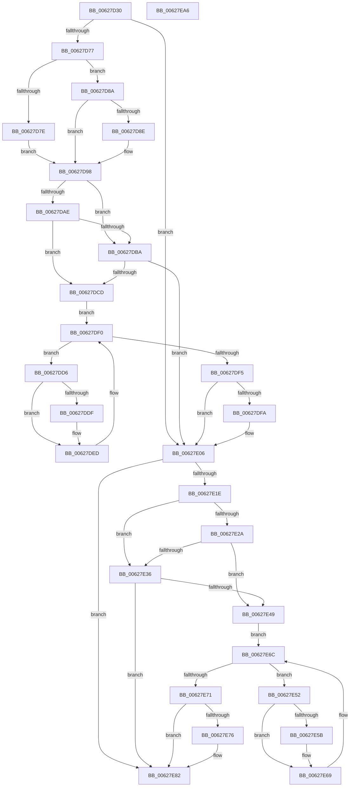

# DifIoAllocateWorkItemWrapper

- RVA: `0x00627D30`–`0x00627EA7` (길이 `375` bytes)
- VA: `0x0000000140627D30`
- 실행 섹션: `.text`
- PDB 이름 있음: `예`; PDB Function 태그: `아니요`
- unwind 정보 RVA: `0x0008A668`
- 디코드: `102`개 명령, `375/375` bytes 표시
- 미해석 바이트: `0` (있으면 어셈블리에 `.byte`로 보존)

> 이 문서는 커널 이미지의 기계어와 PDB 기호를 분석해 생성했습니다. 4번과 5번은 함수 원형과 자료형을 바이너리 사용 방식에서 추정한 C 해석이며 원본 소스 복구 결과는 아닙니다.

## 1. Dependencies

- 직접 호출 지점: **9**; 고유 호출 대상: **5**
- 직접 호출자로 확인된 함수: **0**
- RIP 상대 이미지 참조: **3**

### Outgoing calls
- `0x00627D66` → [DifGetAPIThunkContextById](../49/DifGetAPIThunkContextById_function_00495A34.md) (function, `0x00495A34`)
- `0x00627D8E` → [DifGetReturnAddressForWrappers](../4D/DifGetReturnAddressForWrappers_function_004D3C08.md) (function, `0x004D3C08`)
- `0x00627DC1` → [ExAcquireRundownProtection](../21/ExAcquireRundownProtection_function_00216620.md) (function, `0x00216620`)
- `0x00627DE8` → [guard_dispatch_icall](../6B/guard_dispatch_icall_function_006BAAD0.md) (function, `0x006BAAD0`)
- `0x00627E01` → [ExReleaseRundownProtection](../34/ExReleaseRundownProtection_function_00349E80.md) (function, `0x00349E80`)
- `0x00627E0F` → [guard_dispatch_icall](../6B/guard_dispatch_icall_function_006BAAD0.md) (function, `0x006BAAD0`)
- `0x00627E3D` → [ExAcquireRundownProtection](../21/ExAcquireRundownProtection_function_00216620.md) (function, `0x00216620`)
- `0x00627E64` → [guard_dispatch_icall](../6B/guard_dispatch_icall_function_006BAAD0.md) (function, `0x006BAAD0`)
- `0x00627E7D` → [ExReleaseRundownProtection](../34/ExReleaseRundownProtection_function_00349E80.md) (function, `0x00349E80`)

### Direct callers
- 이 함수 시작 RVA로 연결되는 직접 call은 확인되지 않았습니다. 간접 호출은 완전히 역산할 수 없습니다.

### Static image references
- `0x00627DA0` → RVA `0x00F048B8` (`.data`; read)
- `0x00627DAE` → RVA `0x00F04980` (`.data`; read)
- `0x00627DBA` → RVA `0x00F03E80` (`.data`; read)

## 2. Other-region calls and transfers

- 다른 실행 섹션으로 향하는 call: **0**
- 별도 외부 분기/꼬리 이동을 확인하지 못했습니다.

## 3. Assembly (complete function range)

```asm
00627D30  48 8B C4                        mov rax, rsp
00627D33  48 89 58 08                     mov qword ptr [rax + 8], rbx
00627D37  48 89 68 10                     mov qword ptr [rax + 0x10], rbp
00627D3B  48 89 70 18                     mov qword ptr [rax + 0x18], rsi
00627D3F  48 89 78 20                     mov qword ptr [rax + 0x20], rdi
00627D43  41 54                           push r12
00627D45  41 56                           push r14
00627D47  41 57                           push r15
00627D49  48 83 EC 40                     sub rsp, 0x40
00627D4D  0F 57 C0                        xorps xmm0, xmm0
00627D50  4C 8B F9                        mov r15, rcx
00627D53  B9 6C 01 00 00                  mov ecx, 0x16c
00627D58  4D 8B E0                        mov r12, r8
00627D5B  0F 11 40 C8                     movups xmmword ptr [rax - 0x38], xmm0
00627D5F  4C 8B F2                        mov r14, rdx
00627D62  0F 11 40 D8                     movups xmmword ptr [rax - 0x28], xmm0
00627D66  E8 C9 DC E6 FF                  call 0x140495a34
00627D6B  48 8B F0                        mov rsi, rax
00627D6E  48 85 C0                        test rax, rax
00627D71  0F 84 8F 00 00 00               je 0x140627e06
00627D77  8B 40 0C                        mov eax, dword ptr [rax + 0xc]
00627D7A  A8 18                           test al, 0x18
00627D7C  74 0C                           je 0x140627d8a
00627D7E  48 8B 4C 24 58                  mov rcx, qword ptr [rsp + 0x58]
00627D83  48 89 4C 24 20                  mov qword ptr [rsp + 0x20], rcx
00627D88  EB 0E                           jmp 0x140627d98
00627D8A  A8 04                           test al, 4
00627D8C  74 0A                           je 0x140627d98
00627D8E  E8 75 BE EA FF                  call 0x1404d3c08
00627D93  48 89 44 24 20                  mov qword ptr [rsp + 0x20], rax
00627D98  40 32 ED                        xor bpl, bpl
00627D9B  4C 89 7C 24 30                  mov qword ptr [rsp + 0x30], r15
00627DA0  40 38 2D 11 CB 8D 00            cmp byte ptr [rip + 0x8dcb11], bpl
00627DA7  4C 89 74 24 28                  mov qword ptr [rsp + 0x28], r14
00627DAC  75 0C                           jne 0x140627dba
00627DAE  F7 05 C8 CB 8D 00 00 08 00 00   test dword ptr [rip + 0x8dcbc8], 0x800
00627DB8  74 13                           je 0x140627dcd
00627DBA  48 8D 0D BF C0 8D 00            lea rcx, [rip + 0x8dc0bf]
00627DC1  E8 5A E8 BE FF                  call 0x140216620
00627DC6  40 8A E8                        mov bpl, al
00627DC9  84 C0                           test al, al
00627DCB  74 39                           je 0x140627e06
00627DCD  48 8D 7E 20                     lea rdi, [rsi + 0x20]
00627DD1  48 8B 1F                        mov rbx, qword ptr [rdi]
00627DD4  EB 1A                           jmp 0x140627df0
00627DD6  48 8D 43 F0                     lea rax, [rbx - 0x10]
00627DDA  48 85 C0                        test rax, rax
00627DDD  74 0E                           je 0x140627ded
00627DDF  48 8B 40 08                     mov rax, qword ptr [rax + 8]
00627DE3  48 8D 4C 24 20                  lea rcx, [rsp + 0x20]
00627DE8  E8 E3 2C 09 00                  call 0x1406baad0
00627DED  48 8B 1B                        mov rbx, qword ptr [rbx]
00627DF0  48 3B DF                        cmp rbx, rdi
00627DF3  75 E1                           jne 0x140627dd6
00627DF5  40 84 ED                        test bpl, bpl
00627DF8  74 0C                           je 0x140627e06
00627DFA  48 8D 0D 7F C0 8D 00            lea rcx, [rip + 0x8dc07f]
00627E01  E8 7A 20 D2 FF                  call 0x140349e80
00627E06  49 8B D6                        mov rdx, r14
00627E09  49 8B CF                        mov rcx, r15
00627E0C  49 8B C4                        mov rax, r12
00627E0F  E8 BC 2C 09 00                  call 0x1406baad0
00627E14  48 89 44 24 38                  mov qword ptr [rsp + 0x38], rax
00627E19  48 85 F6                        test rsi, rsi
00627E1C  74 64                           je 0x140627e82
00627E1E  40 32 FF                        xor dil, dil
00627E21  40 38 3D 90 CA 8D 00            cmp byte ptr [rip + 0x8dca90], dil
00627E28  75 0C                           jne 0x140627e36
00627E2A  F7 05 4C CB 8D 00 00 08 00 00   test dword ptr [rip + 0x8dcb4c], 0x800
00627E34  74 13                           je 0x140627e49
00627E36  48 8D 0D 43 C0 8D 00            lea rcx, [rip + 0x8dc043]
00627E3D  E8 DE E7 BE FF                  call 0x140216620
00627E42  40 8A F8                        mov dil, al
00627E45  84 C0                           test al, al
00627E47  74 39                           je 0x140627e82
00627E49  48 83 C6 30                     add rsi, 0x30
00627E4D  48 8B 1E                        mov rbx, qword ptr [rsi]
00627E50  EB 1A                           jmp 0x140627e6c
00627E52  48 8D 43 F0                     lea rax, [rbx - 0x10]
00627E56  48 85 C0                        test rax, rax
00627E59  74 0E                           je 0x140627e69
00627E5B  48 8B 40 08                     mov rax, qword ptr [rax + 8]
00627E5F  48 8D 4C 24 20                  lea rcx, [rsp + 0x20]
00627E64  E8 67 2C 09 00                  call 0x1406baad0
00627E69  48 8B 1B                        mov rbx, qword ptr [rbx]
00627E6C  48 3B DE                        cmp rbx, rsi
00627E6F  75 E1                           jne 0x140627e52
00627E71  40 84 FF                        test dil, dil
00627E74  74 0C                           je 0x140627e82
00627E76  48 8D 0D 03 C0 8D 00            lea rcx, [rip + 0x8dc003]
00627E7D  E8 FE 1F D2 FF                  call 0x140349e80
00627E82  48 8B 44 24 38                  mov rax, qword ptr [rsp + 0x38]
00627E87  48 8B 5C 24 60                  mov rbx, qword ptr [rsp + 0x60]
00627E8C  48 8B 6C 24 68                  mov rbp, qword ptr [rsp + 0x68]
00627E91  48 8B 74 24 70                  mov rsi, qword ptr [rsp + 0x70]
00627E96  48 8B 7C 24 78                  mov rdi, qword ptr [rsp + 0x78]
00627E9B  48 83 C4 40                     add rsp, 0x40
00627E9F  41 5F                           pop r15
00627EA1  41 5E                           pop r14
00627EA3  41 5C                           pop r12
00627EA5  C3                              ret
00627EA6  CC                              int3
```

## 4. C-style interpretation (structured pseudocode)

```c
__int64 __fastcall DifIoAllocateWorkItemWrapper(__int64 a1, __int64 a2, __int64 a3)
{
    __int64 result;
    __int64 v_rbp;
    __int64 v_rdi;
    __int64 v_rsi;
    __int64 v_rsp;
    unsigned __int64 v_stack_m20;
    unsigned __int64 v_stack_m28;
    unsigned __int64 v_stack_m30;
    unsigned __int64 v_stack_m38;
    unsigned __int64 v_stack_p0;
    unsigned __int64 v_stack_p10;
    unsigned __int64 v_stack_p18;
    unsigned __int64 v_stack_p20;
    unsigned __int64 v_stack_p8;

    *(unsigned __int64 *)(v_rsp + 8) = v_rbx;
    *(unsigned __int64 *)(v_rsp + 16) = v_rbp;
    *(unsigned __int64 *)(v_rsp + 24) = v_rsi;
    *(unsigned __int64 *)(v_rsp + 32) = v_rdi;
    v_rsp = (v_rsp) - (64);
    *(unsigned __int64 *)(v_rsp - 56) = v_xmm0;
    *(unsigned __int64 *)(v_rsp - 40) = v_xmm0;
    result = DifGetAPIThunkContextById(364, a2, a3, a4);
    if (result == 0) goto loc_00627E06;
    if ((((unsigned __int8)((unsigned int)(*(unsigned int *)(result + 12)))) & (24)) == 0) goto loc_00627D8A;
    v_stack_m38 = v_stack_p0;
    goto loc_00627D98;
loc_00627D8A:
    result = (unsigned int)(*(unsigned int *)(result + 12));
    if ((((unsigned __int8)((unsigned int)(*(unsigned int *)(result + 12)))) & (4)) != 0) {
        result = DifGetReturnAddressForWrappers(v_stack_p0, a2, a3, a4);
        v_stack_m38 = result;
    }
    v_rbp = 0;
    v_stack_m28 = a1;
    v_stack_m30 = a2;
    if ((*(unsigned __int8 *)(v_rip + 9292561)) != 0) goto loc_00627DBA;
    if (((*(unsigned int *)(v_rip + 9292744)) & (0x800ULL)) == 0) goto loc_00627DCD;
loc_00627DBA:
    result = ExAcquireRundownProtection(v_rip + 9289919, a2, a3, a4);
    if ((unsigned __int8)(result) == 0) goto loc_00627E06;
loc_00627DCD:
    goto loc_00627DF0;
loc_00627DD6:
    result = *(unsigned __int64 *)(result + 32) - 16;
    if (*(unsigned __int64 *)(result + 32) - 16 != 0) {
        result = *(unsigned __int64 *)(*(unsigned __int64 *)(result + 32) - 16 + 8);
        a1 = v_stack_m38;
        result = guard_dispatch_icall(a1, a2, a3, a4);
    }
loc_00627DF0:
    if ((*(unsigned __int64 *)(*(unsigned __int64 *)(result + 32))) != (result + 32)) goto loc_00627DD6;
    if ((unsigned __int8)((unsigned __int8)(result)) != 0) {
        a1 = v_rip + 9289855;
        result = ExReleaseRundownProtection(a1, a2, a3, a4);
    }
    result = guard_dispatch_icall(a1, a2, a3, a4);
    v_stack_m20 = result;
    if (result == 0) goto loc_00627E82;
    v_rdi = 0;
    if ((*(unsigned __int8 *)(v_rip + 9292432)) != 0) goto loc_00627E36;
    if (((*(unsigned int *)(v_rip + 9292620)) & (0x800ULL)) == 0) goto loc_00627E49;
loc_00627E36:
    result = ExAcquireRundownProtection(v_rip + 9289795, a2, a3, a4);
    if ((unsigned __int8)(result) == 0) goto loc_00627E82;
loc_00627E49:
    v_rsi = (result) + (48);
    goto loc_00627E6C;
loc_00627E52:
    result = *(unsigned __int64 *)(v_rsi) - 16;
    if (*(unsigned __int64 *)(v_rsi) - 16 != 0) {
        result = *(unsigned __int64 *)(*(unsigned __int64 *)(v_rsi) - 16 + 8);
        a1 = v_stack_m38;
        result = guard_dispatch_icall(a1, a2, a3, a4);
    }
loc_00627E6C:
    if ((*(unsigned __int64 *)(*(unsigned __int64 *)(v_rsi))) != v_rsi) goto loc_00627E52;
    if ((unsigned __int8)((unsigned __int8)(result)) != 0) {
        a1 = v_rip + 9289731;
        result = ExReleaseRundownProtection(a1, a2, a3, a4);
    }
    v_rsp = (v_rsp) + (64);
    return v_stack_m20;
}
```

## 5. (Beta) C Style

```c
int64_t DifIoAllocateWorkItemWrapper(int64_t Arg1, int64_t Arg2, int64_t Arg3)
{
    int64_t result;
    int64_t local_rbp;
    int64_t local_rdi;
    int64_t local_rsi;
    int64_t local_rsp;
    uint64_t v_stack_m20;
    uint64_t v_stack_m28;
    uint64_t v_stack_m30;
    uint64_t v_stack_m38;
    uint64_t v_stack_p0;
    uint64_t v_stack_p10;
    uint64_t v_stack_p18;
    uint64_t v_stack_p20;
    uint64_t v_stack_p8;

    *(uint64_t *)(local_rsp + 0x8) = local_rbx;
    *(uint64_t *)(local_rsp + 0x10) = local_rbp;
    *(uint64_t *)(local_rsp + 0x18) = local_rsi;
    *(uint64_t *)(local_rsp + 0x20) = local_rdi;
    local_rsp = (local_rsp) - (64);
    *(uint64_t *)(local_rsp - 0x38) = v_xmm0;
    *(uint64_t *)(local_rsp - 0x28) = v_xmm0;
    result = DifGetAPIThunkContextById(364, Arg2, Arg3, a4);
    if (result == 0) goto loc_00627E06;
    if ((((uint8_t)((uint32_t)(*(uint32_t *)(result + 0xC)))) & (24)) == 0) goto loc_00627D8A;
    v_stack_m38 = v_stack_p0;
    goto loc_00627D98;
loc_00627D8A:
    result = (uint32_t)(*(uint32_t *)(result + 0xC));
    if ((((uint8_t)((uint32_t)(*(uint32_t *)(result + 0xC)))) & (4)) != 0) {
        result = DifGetReturnAddressForWrappers(v_stack_p0, Arg2, Arg3, a4);
        v_stack_m38 = result;
    }
    local_rbp = 0;
    v_stack_m28 = Arg1;
    v_stack_m30 = Arg2;
    if ((*(uint8_t *)(v_rip + 0x8DCB11)) != 0) goto loc_00627DBA;
    if (((*(uint32_t *)(v_rip + 0x8DCBC8)) & (0x800ULL)) == 0) goto loc_00627DCD;
loc_00627DBA:
    result = ExAcquireRundownProtection(v_rip + 9289919, Arg2, Arg3, a4);
    if ((uint8_t)(result) == 0) goto loc_00627E06;
loc_00627DCD:
    goto loc_00627DF0;
loc_00627DD6:
    result = *(uint64_t *)(result + 0x20) - 16;
    if (*(uint64_t *)(result + 0x20) - 16 != 0) {
        result = *(uint64_t *)(*(uint64_t *)(result + 0x20) - 0x10 + 0x8);
        Arg1 = v_stack_m38;
        result = guard_dispatch_icall(Arg1, Arg2, Arg3, a4);
    }
loc_00627DF0:
    if ((*(uint64_t *)(*(uint64_t *)(result + 0x20))) != (result + 32)) goto loc_00627DD6;
    if ((uint8_t)((uint8_t)(result)) != 0) {
        Arg1 = v_rip + 9289855;
        result = ExReleaseRundownProtection(Arg1, Arg2, Arg3, a4);
    }
    result = guard_dispatch_icall(Arg1, Arg2, Arg3, a4);
    v_stack_m20 = result;
    if (result == 0) goto loc_00627E82;
    local_rdi = 0;
    if ((*(uint8_t *)(v_rip + 0x8DCA90)) != 0) goto loc_00627E36;
    if (((*(uint32_t *)(v_rip + 0x8DCB4C)) & (0x800ULL)) == 0) goto loc_00627E49;
loc_00627E36:
    result = ExAcquireRundownProtection(v_rip + 9289795, Arg2, Arg3, a4);
    if ((uint8_t)(result) == 0) goto loc_00627E82;
loc_00627E49:
    local_rsi = (result) + (48);
    goto loc_00627E6C;
loc_00627E52:
    result = *(uint64_t *)(local_rsi) - 16;
    if (*(uint64_t *)(local_rsi) - 16 != 0) {
        result = *(uint64_t *)(*(uint64_t *)(local_rsi) - 0x10 + 0x8);
        Arg1 = v_stack_m38;
        result = guard_dispatch_icall(Arg1, Arg2, Arg3, a4);
    }
loc_00627E6C:
    if ((*(uint64_t *)(*(uint64_t *)(local_rsi))) != local_rsi) goto loc_00627E52;
    if ((uint8_t)((uint8_t)(result)) != 0) {
        Arg1 = v_rip + 9289731;
        result = ExReleaseRundownProtection(Arg1, Arg2, Arg3, a4);
    }
    local_rsp = (local_rsp) + (64);
    return v_stack_m20;
}
```

## 6. Execution-region graph

[열기: 2D/3D 그래프와 함수 탐색 컨트롤 패널](../../../control-panel.html?section=text&rva=0x00627D30&view=graph)

- 2D 그래프는 위에서 아래로 흐르고, 3D 그래프는 빈 공간을 드래그해 회전합니다. Shift+드래그는 이동, 휠은 확대·축소, 함수 노드 선택은 대상 보고서 이동입니다.

### Static fallback


