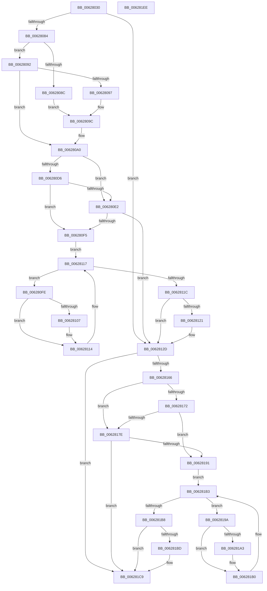

# DifIoBuildAsynchronousFsdRequestWrapper

- RVA: `0x00628030`–`0x006281EF` (길이 `447` bytes)
- VA: `0x0000000140628030`
- 실행 섹션: `.text`
- PDB 이름 있음: `예`; PDB Function 태그: `아니요`
- unwind 정보 RVA: `0x000D2D00`
- 디코드: `124`개 명령, `447/447` bytes 표시
- 미해석 바이트: `0` (있으면 어셈블리에 `.byte`로 보존)

> 이 문서는 커널 이미지의 기계어와 PDB 기호를 분석해 생성했습니다. 4번과 5번은 함수 원형과 자료형을 바이너리 사용 방식에서 추정한 C 해석이며 원본 소스 복구 결과는 아닙니다.

## 1. Dependencies

- 직접 호출 지점: **10**; 고유 호출 대상: **6**
- 직접 호출자로 확인된 함수: **0**
- RIP 상대 이미지 참조: **3**

### Outgoing calls
- `0x00628069` → [memset](../6C/memset_function_006C6C40.md) (function, `0x006C6C40`)
- `0x00628073` → [DifGetAPIThunkContextById](../49/DifGetAPIThunkContextById_function_00495A34.md) (function, `0x00495A34`)
- `0x00628097` → [DifGetReturnAddressForWrappers](../4D/DifGetReturnAddressForWrappers_function_004D3C08.md) (function, `0x004D3C08`)
- `0x006280E9` → [ExAcquireRundownProtection](../21/ExAcquireRundownProtection_function_00216620.md) (function, `0x00216620`)
- `0x0062810F` → [guard_dispatch_icall](../6B/guard_dispatch_icall_function_006BAAD0.md) (function, `0x006BAAD0`)
- `0x00628128` → [ExReleaseRundownProtection](../34/ExReleaseRundownProtection_function_00349E80.md) (function, `0x00349E80`)
- `0x00628158` → [guard_dispatch_icall](../6B/guard_dispatch_icall_function_006BAAD0.md) (function, `0x006BAAD0`)
- `0x00628185` → [ExAcquireRundownProtection](../21/ExAcquireRundownProtection_function_00216620.md) (function, `0x00216620`)
- `0x006281AB` → [guard_dispatch_icall](../6B/guard_dispatch_icall_function_006BAAD0.md) (function, `0x006BAAD0`)
- `0x006281C4` → [ExReleaseRundownProtection](../34/ExReleaseRundownProtection_function_00349E80.md) (function, `0x00349E80`)

### Direct callers
- 이 함수 시작 RVA로 연결되는 직접 call은 확인되지 않았습니다. 간접 호출은 완전히 역산할 수 없습니다.

### Static image references
- `0x006280A6` → RVA `0x00F048B8` (`.data`; read)
- `0x006280D6` → RVA `0x00F04980` (`.data`; read)
- `0x006280E2` → RVA `0x00F03E80` (`.data`; read)

## 2. Other-region calls and transfers

- 다른 실행 섹션으로 향하는 call: **0**
- 별도 외부 분기/꼬리 이동을 확인하지 못했습니다.

## 3. Assembly (complete function range)

```asm
00628030  48 8B C4                        mov rax, rsp
00628033  48 89 58 10                     mov qword ptr [rax + 0x10], rbx
00628037  48 89 70 18                     mov qword ptr [rax + 0x18], rsi
0062803B  48 89 78 20                     mov qword ptr [rax + 0x20], rdi
0062803F  89 48 08                        mov dword ptr [rax + 8], ecx
00628042  55                              push rbp
00628043  41 54                           push r12
00628045  41 55                           push r13
00628047  41 56                           push r14
00628049  41 57                           push r15
0062804B  48 8D 68 C1                     lea rbp, [rax - 0x3f]
0062804F  48 81 EC 90 00 00 00            sub rsp, 0x90
00628056  4C 8B EA                        mov r13, rdx
00628059  48 8D 4D C7                     lea rcx, [rbp - 0x39]
0062805D  33 D2                           xor edx, edx
0062805F  4D 8B E0                        mov r12, r8
00628062  45 8B F9                        mov r15d, r9d
00628065  44 8D 42 48                     lea r8d, [rdx + 0x48]
00628069  E8 D2 EB 09 00                  call 0x1406c6c40
0062806E  B9 6A 01 00 00                  mov ecx, 0x16a
00628073  E8 BC D9 E6 FF                  call 0x140495a34
00628078  4C 8B F0                        mov r14, rax
0062807B  48 85 C0                        test rax, rax
0062807E  0F 84 A9 00 00 00               je 0x14062812d
00628084  8B 48 0C                        mov ecx, dword ptr [rax + 0xc]
00628087  F6 C1 18                        test cl, 0x18
0062808A  74 06                           je 0x140628092
0062808C  48 8B 45 3F                     mov rax, qword ptr [rbp + 0x3f]
00628090  EB 0A                           jmp 0x14062809c
00628092  F6 C1 04                        test cl, 4
00628095  74 09                           je 0x1406280a0
00628097  E8 6C BB EA FF                  call 0x1404d3c08
0062809C  48 89 45 C7                     mov qword ptr [rbp - 0x39], rax
006280A0  8B 45 47                        mov eax, dword ptr [rbp + 0x47]
006280A3  40 32 F6                        xor sil, sil
006280A6  40 38 35 0B C8 8D 00            cmp byte ptr [rip + 0x8dc80b], sil
006280AD  89 45 FF                        mov dword ptr [rbp - 1], eax
006280B0  48 8B 45 67                     mov rax, qword ptr [rbp + 0x67]
006280B4  48 89 45 DF                     mov qword ptr [rbp - 0x21], rax
006280B8  48 8B 45 6F                     mov rax, qword ptr [rbp + 0x6f]
006280BC  48 89 45 D7                     mov qword ptr [rbp - 0x29], rax
006280C0  48 8B 45 77                     mov rax, qword ptr [rbp + 0x77]
006280C4  48 89 45 CF                     mov qword ptr [rbp - 0x31], rax
006280C8  4C 89 6D F7                     mov qword ptr [rbp - 9], r13
006280CC  4C 89 65 EF                     mov qword ptr [rbp - 0x11], r12
006280D0  44 89 7D E7                     mov dword ptr [rbp - 0x19], r15d
006280D4  75 0C                           jne 0x1406280e2
006280D6  F7 05 A0 C8 8D 00 00 08 00 00   test dword ptr [rip + 0x8dc8a0], 0x800
006280E0  74 13                           je 0x1406280f5
006280E2  48 8D 0D 97 BD 8D 00            lea rcx, [rip + 0x8dbd97]
006280E9  E8 32 E5 BE FF                  call 0x140216620
006280EE  40 8A F0                        mov sil, al
006280F1  84 C0                           test al, al
006280F3  74 38                           je 0x14062812d
006280F5  49 8D 7E 20                     lea rdi, [r14 + 0x20]
006280F9  48 8B 1F                        mov rbx, qword ptr [rdi]
006280FC  EB 19                           jmp 0x140628117
006280FE  48 8D 43 F0                     lea rax, [rbx - 0x10]
00628102  48 85 C0                        test rax, rax
00628105  74 0D                           je 0x140628114
00628107  48 8B 40 08                     mov rax, qword ptr [rax + 8]
0062810B  48 8D 4D C7                     lea rcx, [rbp - 0x39]
0062810F  E8 BC 29 09 00                  call 0x1406baad0
00628114  48 8B 1B                        mov rbx, qword ptr [rbx]
00628117  48 3B DF                        cmp rbx, rdi
0062811A  75 E2                           jne 0x1406280fe
0062811C  40 84 F6                        test sil, sil
0062811F  74 0C                           je 0x14062812d
00628121  48 8D 0D 58 BD 8D 00            lea rcx, [rip + 0x8dbd58]
00628128  E8 53 1D D2 FF                  call 0x140349e80
0062812D  48 8B 45 77                     mov rax, qword ptr [rbp + 0x77]
00628131  45 8B CF                        mov r9d, r15d
00628134  8B 4D 47                        mov ecx, dword ptr [rbp + 0x47]
00628137  4D 8B C4                        mov r8, r12
0062813A  48 89 44 24 30                  mov qword ptr [rsp + 0x30], rax
0062813F  49 8B D5                        mov rdx, r13
00628142  48 8B 45 6F                     mov rax, qword ptr [rbp + 0x6f]
00628146  48 89 44 24 28                  mov qword ptr [rsp + 0x28], rax
0062814B  48 8B 45 67                     mov rax, qword ptr [rbp + 0x67]
0062814F  48 89 44 24 20                  mov qword ptr [rsp + 0x20], rax
00628154  48 8B 45 7F                     mov rax, qword ptr [rbp + 0x7f]
00628158  E8 73 29 09 00                  call 0x1406baad0
0062815D  48 89 45 07                     mov qword ptr [rbp + 7], rax
00628161  4D 85 F6                        test r14, r14
00628164  74 63                           je 0x1406281c9
00628166  40 32 FF                        xor dil, dil
00628169  40 38 3D 48 C7 8D 00            cmp byte ptr [rip + 0x8dc748], dil
00628170  75 0C                           jne 0x14062817e
00628172  F7 05 04 C8 8D 00 00 08 00 00   test dword ptr [rip + 0x8dc804], 0x800
0062817C  74 13                           je 0x140628191
0062817E  48 8D 0D FB BC 8D 00            lea rcx, [rip + 0x8dbcfb]
00628185  E8 96 E4 BE FF                  call 0x140216620
0062818A  40 8A F8                        mov dil, al
0062818D  84 C0                           test al, al
0062818F  74 38                           je 0x1406281c9
00628191  49 8D 76 30                     lea rsi, [r14 + 0x30]
00628195  48 8B 1E                        mov rbx, qword ptr [rsi]
00628198  EB 19                           jmp 0x1406281b3
0062819A  48 8D 43 F0                     lea rax, [rbx - 0x10]
0062819E  48 85 C0                        test rax, rax
006281A1  74 0D                           je 0x1406281b0
006281A3  48 8B 40 08                     mov rax, qword ptr [rax + 8]
006281A7  48 8D 4D C7                     lea rcx, [rbp - 0x39]
006281AB  E8 20 29 09 00                  call 0x1406baad0
006281B0  48 8B 1B                        mov rbx, qword ptr [rbx]
006281B3  48 3B DE                        cmp rbx, rsi
006281B6  75 E2                           jne 0x14062819a
006281B8  40 84 FF                        test dil, dil
006281BB  74 0C                           je 0x1406281c9
006281BD  48 8D 0D BC BC 8D 00            lea rcx, [rip + 0x8dbcbc]
006281C4  E8 B7 1C D2 FF                  call 0x140349e80
006281C9  48 8B 45 07                     mov rax, qword ptr [rbp + 7]
006281CD  4C 8D 9C 24 90 00 00 00         lea r11, [rsp + 0x90]
006281D5  49 8B 5B 38                     mov rbx, qword ptr [r11 + 0x38]
006281D9  49 8B 73 40                     mov rsi, qword ptr [r11 + 0x40]
006281DD  49 8B 7B 48                     mov rdi, qword ptr [r11 + 0x48]
006281E1  49 8B E3                        mov rsp, r11
006281E4  41 5F                           pop r15
006281E6  41 5E                           pop r14
006281E8  41 5D                           pop r13
006281EA  41 5C                           pop r12
006281EC  5D                              pop rbp
006281ED  C3                              ret
006281EE  CC                              int3
```

## 4. C-style interpretation (structured pseudocode)

```c
__int64 __fastcall DifIoBuildAsynchronousFsdRequestWrapper(int a1, __int64 a2, __int64 a3, int a4)
{
    __int64 result;
    __int64 v_rdi;
    __int64 v_rsi;
    __int64 v_rsp;
    unsigned __int64 v_stack_m28;
    unsigned __int64 v_stack_m88;
    unsigned __int64 v_stack_m90;
    unsigned __int64 v_stack_m98;

    *(unsigned __int64 *)(v_rsp + 16) = v_rbx;
    *(unsigned __int64 *)(v_rsp + 24) = v_rsi;
    *(unsigned __int64 *)(v_rsp + 32) = v_rdi;
    *(unsigned int *)(v_rsp + 8) = a1;
    v_rsp = (v_rsp) - (144);
    a2 = 0;
    result = memset(v_rsp - 63 - 57, a2, a2 + 72, a4);
    result = DifGetAPIThunkContextById(362, a2, a2 + 72, a4);
    if (result == 0) goto loc_0062812D;
    if ((((unsigned __int8)((unsigned int)(*(unsigned int *)(result + 12)))) & (24)) == 0) goto loc_00628092;
    goto loc_0062809C;
loc_00628092:
    if ((((unsigned __int8)((unsigned int)(*(unsigned int *)(result + 12)))) & (4)) == 0) goto loc_006280A0;
    result = DifGetReturnAddressForWrappers((unsigned int)(*(unsigned int *)(result + 12)), a2, a2 + 72, a4);
loc_0062809C:
    *(unsigned __int64 *)(v_rsp - 63 - 57) = result;
loc_006280A0:
    v_rsi = 0;
    *(unsigned int *)(v_rsp - 63 - 1) = (unsigned int)((unsigned int)(*(unsigned int *)(v_rsp - 63 + 71)));
    *(unsigned __int64 *)(v_rsp - 63 - 33) = *(unsigned __int64 *)(v_rsp - 63 + 103);
    *(unsigned __int64 *)(v_rsp - 63 - 41) = *(unsigned __int64 *)(v_rsp - 63 + 111);
    *(unsigned __int64 *)(v_rsp - 63 - 49) = *(unsigned __int64 *)(v_rsp - 63 + 119);
    *(unsigned __int64 *)(v_rsp - 63 - 9) = 0;
    *(unsigned __int64 *)(v_rsp - 63 - 17) = a3;
    *(unsigned int *)(v_rsp - 63 - 25) = (unsigned int)((unsigned int)(a4));
    if ((*(unsigned __int8 *)(v_rip + 9291787)) != 0) goto loc_006280E2;
    if (((*(unsigned int *)(v_rip + 9291936)) & (0x800ULL)) == 0) goto loc_006280F5;
loc_006280E2:
    result = ExAcquireRundownProtection(v_rip + 9289111, a2, a2 + 72, a4);
    if ((unsigned __int8)(result) == 0) goto loc_0062812D;
loc_006280F5:
    goto loc_00628117;
loc_006280FE:
    result = *(unsigned __int64 *)(result + 32) - 16;
    if (*(unsigned __int64 *)(result + 32) - 16 != 0) {
        result = *(unsigned __int64 *)(*(unsigned __int64 *)(result + 32) - 16 + 8);
        a1 = v_rsp - 63 - 57;
        result = guard_dispatch_icall(a1, a2, a2 + 72, a4);
    }
loc_00628117:
    if ((*(unsigned __int64 *)(*(unsigned __int64 *)(result + 32))) != (result + 32)) goto loc_006280FE;
    if ((unsigned __int8)((unsigned __int8)(result)) != 0) {
        a1 = v_rip + 9289048;
        result = ExReleaseRundownProtection(a1, a2, a2 + 72, a4);
    }
    v_stack_m88 = *(unsigned __int64 *)(v_rsp - 63 + 119);
    v_stack_m90 = *(unsigned __int64 *)(v_rsp - 63 + 111);
    v_stack_m98 = *(unsigned __int64 *)(v_rsp - 63 + 103);
    result = guard_dispatch_icall((unsigned int)(*(unsigned int *)(v_rsp - 63 + 71)), 0, a3, (unsigned int)((unsigned int)((unsigned int)(a4))));
    *(unsigned __int64 *)(v_rsp - 63 + 7) = result;
    if (result == 0) goto loc_006281C9;
    v_rdi = 0;
    if ((*(unsigned __int8 *)(v_rip + 9291592)) != 0) goto loc_0062817E;
    if (((*(unsigned int *)(v_rip + 9291780)) & (0x800ULL)) == 0) goto loc_00628191;
loc_0062817E:
    result = ExAcquireRundownProtection(v_rip + 9288955, 0, a3, (unsigned int)((unsigned int)((unsigned int)(a4))));
    if ((unsigned __int8)(result) == 0) goto loc_006281C9;
loc_00628191:
    goto loc_006281B3;
loc_0062819A:
    result = *(unsigned __int64 *)(result + 48) - 16;
    if (*(unsigned __int64 *)(result + 48) - 16 != 0) {
        result = *(unsigned __int64 *)(*(unsigned __int64 *)(result + 48) - 16 + 8);
        a1 = v_rsp - 63 - 57;
        result = guard_dispatch_icall(a1, 0, a3, (unsigned int)((unsigned int)((unsigned int)(a4))));
    }
loc_006281B3:
    if ((*(unsigned __int64 *)(*(unsigned __int64 *)(result + 48))) != (result + 48)) goto loc_0062819A;
    if ((unsigned __int8)((unsigned __int8)(result)) != 0) {
        a1 = v_rip + 9288892;
        result = ExReleaseRundownProtection(a1, 0, a3, (unsigned int)((unsigned int)((unsigned int)(a4))));
    }
    return *(unsigned __int64 *)(v_rsp - 63 + 7);
}
```

## 5. (Beta) C Style

```c
int64_t DifIoBuildAsynchronousFsdRequestWrapper(int32_t Arg1, int64_t Arg2, int64_t Arg3, int32_t Arg4)
{
    int64_t result;
    int64_t local_rdi;
    int64_t local_rsi;
    int64_t local_rsp;
    uint64_t v_stack_m28;
    uint64_t v_stack_m88;
    uint64_t v_stack_m90;
    uint64_t v_stack_m98;

    *(uint64_t *)(local_rsp + 0x10) = local_rbx;
    *(uint64_t *)(local_rsp + 0x18) = local_rsi;
    *(uint64_t *)(local_rsp + 0x20) = local_rdi;
    *(uint32_t *)(local_rsp + 0x8) = Arg1;
    local_rsp = (local_rsp) - (144);
    Arg2 = 0;
    result = memset(local_rsp - 63 - 57, Arg2, Arg2 + 72, Arg4);
    result = DifGetAPIThunkContextById(362, Arg2, Arg2 + 72, Arg4);
    if (result == 0) goto loc_0062812D;
    if ((((uint8_t)((uint32_t)(*(uint32_t *)(result + 0xC)))) & (24)) == 0) goto loc_00628092;
    goto loc_0062809C;
loc_00628092:
    if ((((uint8_t)((uint32_t)(*(uint32_t *)(result + 0xC)))) & (4)) == 0) goto loc_006280A0;
    result = DifGetReturnAddressForWrappers((uint32_t)(*(uint32_t *)(result + 0xC)), Arg2, Arg2 + 72, Arg4);
loc_0062809C:
    *(uint64_t *)(local_rsp - 0x3F - 0x39) = result;
loc_006280A0:
    local_rsi = 0;
    *(uint32_t *)(local_rsp - 0x3F - 0x1) = (uint32_t)((uint32_t)(*(uint32_t *)(local_rsp - 0x3F + 0x47)));
    *(uint64_t *)(local_rsp - 0x3F - 0x21) = *(uint64_t *)(local_rsp - 0x3F + 0x67);
    *(uint64_t *)(local_rsp - 0x3F - 0x29) = *(uint64_t *)(local_rsp - 0x3F + 0x6F);
    *(uint64_t *)(local_rsp - 0x3F - 0x31) = *(uint64_t *)(local_rsp - 0x3F + 0x77);
    *(uint64_t *)(local_rsp - 0x3F - 0x9) = 0;
    *(uint64_t *)(local_rsp - 0x3F - 0x11) = Arg3;
    *(uint32_t *)(local_rsp - 0x3F - 0x19) = (uint32_t)((uint32_t)(Arg4));
    if ((*(uint8_t *)(v_rip + 0x8DC80B)) != 0) goto loc_006280E2;
    if (((*(uint32_t *)(v_rip + 0x8DC8A0)) & (0x800ULL)) == 0) goto loc_006280F5;
loc_006280E2:
    result = ExAcquireRundownProtection(v_rip + 9289111, Arg2, Arg2 + 72, Arg4);
    if ((uint8_t)(result) == 0) goto loc_0062812D;
loc_006280F5:
    goto loc_00628117;
loc_006280FE:
    result = *(uint64_t *)(result + 0x20) - 16;
    if (*(uint64_t *)(result + 0x20) - 16 != 0) {
        result = *(uint64_t *)(*(uint64_t *)(result + 0x20) - 0x10 + 0x8);
        Arg1 = local_rsp - 63 - 57;
        result = guard_dispatch_icall(Arg1, Arg2, Arg2 + 72, Arg4);
    }
loc_00628117:
    if ((*(uint64_t *)(*(uint64_t *)(result + 0x20))) != (result + 32)) goto loc_006280FE;
    if ((uint8_t)((uint8_t)(result)) != 0) {
        Arg1 = v_rip + 9289048;
        result = ExReleaseRundownProtection(Arg1, Arg2, Arg2 + 72, Arg4);
    }
    v_stack_m88 = *(uint64_t *)(local_rsp - 0x3F + 0x77);
    v_stack_m90 = *(uint64_t *)(local_rsp - 0x3F + 0x6F);
    v_stack_m98 = *(uint64_t *)(local_rsp - 0x3F + 0x67);
    result = guard_dispatch_icall((uint32_t)(*(uint32_t *)(local_rsp - 0x3F + 0x47)), 0, Arg3, (uint32_t)((uint32_t)((uint32_t)(Arg4))));
    *(uint64_t *)(local_rsp - 0x3F + 0x7) = result;
    if (result == 0) goto loc_006281C9;
    local_rdi = 0;
    if ((*(uint8_t *)(v_rip + 0x8DC748)) != 0) goto loc_0062817E;
    if (((*(uint32_t *)(v_rip + 0x8DC804)) & (0x800ULL)) == 0) goto loc_00628191;
loc_0062817E:
    result = ExAcquireRundownProtection(v_rip + 9288955, 0, Arg3, (uint32_t)((uint32_t)((uint32_t)(Arg4))));
    if ((uint8_t)(result) == 0) goto loc_006281C9;
loc_00628191:
    goto loc_006281B3;
loc_0062819A:
    result = *(uint64_t *)(result + 0x30) - 16;
    if (*(uint64_t *)(result + 0x30) - 16 != 0) {
        result = *(uint64_t *)(*(uint64_t *)(result + 0x30) - 0x10 + 0x8);
        Arg1 = local_rsp - 63 - 57;
        result = guard_dispatch_icall(Arg1, 0, Arg3, (uint32_t)((uint32_t)((uint32_t)(Arg4))));
    }
loc_006281B3:
    if ((*(uint64_t *)(*(uint64_t *)(result + 0x30))) != (result + 48)) goto loc_0062819A;
    if ((uint8_t)((uint8_t)(result)) != 0) {
        Arg1 = v_rip + 9288892;
        result = ExReleaseRundownProtection(Arg1, 0, Arg3, (uint32_t)((uint32_t)((uint32_t)(Arg4))));
    }
    return *(uint64_t *)(local_rsp - 0x3F + 0x7);
}
```

## 6. Execution-region graph

[열기: 2D/3D 그래프와 함수 탐색 컨트롤 패널](../../../control-panel.html?section=text&rva=0x00628030&view=graph)

- 2D 그래프는 위에서 아래로 흐르고, 3D 그래프는 빈 공간을 드래그해 회전합니다. Shift+드래그는 이동, 휠은 확대·축소, 함수 노드 선택은 대상 보고서 이동입니다.

### Static fallback


