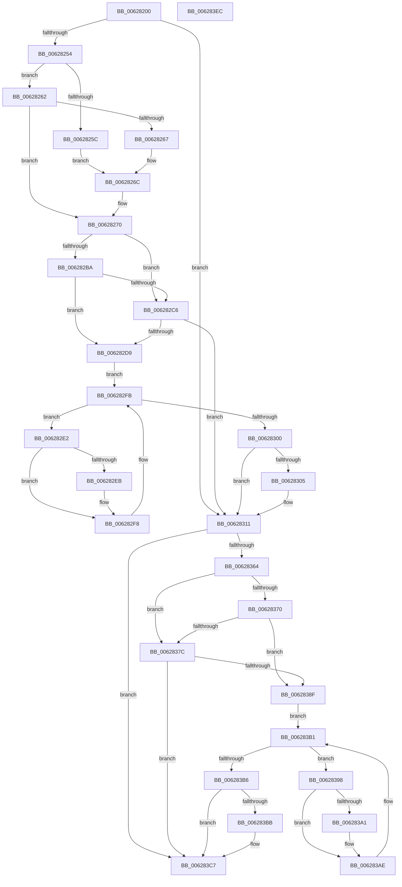

# DifIoBuildDeviceIoControlRequestWrapper

- RVA: `0x00628200`–`0x006283ED` (길이 `493` bytes)
- VA: `0x0000000140628200`
- 실행 섹션: `.text`
- PDB 이름 있음: `예`; PDB Function 태그: `아니요`
- unwind 정보 RVA: `0x000D2DAC`
- 디코드: `136`개 명령, `493/493` bytes 표시
- 미해석 바이트: `0` (있으면 어셈블리에 `.byte`로 보존)

> 이 문서는 커널 이미지의 기계어와 PDB 기호를 분석해 생성했습니다. 4번과 5번은 함수 원형과 자료형을 바이너리 사용 방식에서 추정한 C 해석이며 원본 소스 복구 결과는 아닙니다.

## 1. Dependencies

- 직접 호출 지점: **10**; 고유 호출 대상: **6**
- 직접 호출자로 확인된 함수: **0**
- RIP 상대 이미지 참조: **3**

### Outgoing calls
- `0x00628239` → [memset](../6C/memset_function_006C6C40.md) (function, `0x006C6C40`)
- `0x00628243` → [DifGetAPIThunkContextById](../49/DifGetAPIThunkContextById_function_00495A34.md) (function, `0x00495A34`)
- `0x00628267` → [DifGetReturnAddressForWrappers](../4D/DifGetReturnAddressForWrappers_function_004D3C08.md) (function, `0x004D3C08`)
- `0x006282CD` → [ExAcquireRundownProtection](../21/ExAcquireRundownProtection_function_00216620.md) (function, `0x00216620`)
- `0x006282F3` → [guard_dispatch_icall](../6B/guard_dispatch_icall_function_006BAAD0.md) (function, `0x006BAAD0`)
- `0x0062830C` → [ExReleaseRundownProtection](../34/ExReleaseRundownProtection_function_00349E80.md) (function, `0x00349E80`)
- `0x00628356` → [guard_dispatch_icall](../6B/guard_dispatch_icall_function_006BAAD0.md) (function, `0x006BAAD0`)
- `0x00628383` → [ExAcquireRundownProtection](../21/ExAcquireRundownProtection_function_00216620.md) (function, `0x00216620`)
- `0x006283A9` → [guard_dispatch_icall](../6B/guard_dispatch_icall_function_006BAAD0.md) (function, `0x006BAAD0`)
- `0x006283C2` → [ExReleaseRundownProtection](../34/ExReleaseRundownProtection_function_00349E80.md) (function, `0x00349E80`)

### Direct callers
- 이 함수 시작 RVA로 연결되는 직접 call은 확인되지 않았습니다. 간접 호출은 완전히 역산할 수 없습니다.

### Static image references
- `0x00628276` → RVA `0x00F048B8` (`.data`; read)
- `0x006282BA` → RVA `0x00F04980` (`.data`; read)
- `0x006282C6` → RVA `0x00F03E80` (`.data`; read)

## 2. Other-region calls and transfers

- 다른 실행 섹션으로 향하는 call: **0**
- 별도 외부 분기/꼬리 이동을 확인하지 못했습니다.

## 3. Assembly (complete function range)

```asm
00628200  48 8B C4                        mov rax, rsp
00628203  48 89 58 10                     mov qword ptr [rax + 0x10], rbx
00628207  48 89 70 18                     mov qword ptr [rax + 0x18], rsi
0062820B  48 89 78 20                     mov qword ptr [rax + 0x20], rdi
0062820F  89 48 08                        mov dword ptr [rax + 8], ecx
00628212  55                              push rbp
00628213  41 54                           push r12
00628215  41 55                           push r13
00628217  41 56                           push r14
00628219  41 57                           push r15
0062821B  48 8D 68 D1                     lea rbp, [rax - 0x2f]
0062821F  48 81 EC C0 00 00 00            sub rsp, 0xc0
00628226  4C 8B EA                        mov r13, rdx
00628229  48 8D 4D A7                     lea rcx, [rbp - 0x59]
0062822D  33 D2                           xor edx, edx
0062822F  4D 8B E0                        mov r12, r8
00628232  45 8B F9                        mov r15d, r9d
00628235  44 8D 42 58                     lea r8d, [rdx + 0x58]
00628239  E8 02 EA 09 00                  call 0x1406c6c40
0062823E  B9 69 01 00 00                  mov ecx, 0x169
00628243  E8 EC D7 E6 FF                  call 0x140495a34
00628248  4C 8B F0                        mov r14, rax
0062824B  48 85 C0                        test rax, rax
0062824E  0F 84 BD 00 00 00               je 0x140628311
00628254  8B 48 0C                        mov ecx, dword ptr [rax + 0xc]
00628257  F6 C1 18                        test cl, 0x18
0062825A  74 06                           je 0x140628262
0062825C  48 8B 45 2F                     mov rax, qword ptr [rbp + 0x2f]
00628260  EB 0A                           jmp 0x14062826c
00628262  F6 C1 04                        test cl, 4
00628265  74 09                           je 0x140628270
00628267  E8 9C B9 EA FF                  call 0x1404d3c08
0062826C  48 89 45 A7                     mov qword ptr [rbp - 0x59], rax
00628270  8B 45 37                        mov eax, dword ptr [rbp + 0x37]
00628273  40 32 F6                        xor sil, sil
00628276  40 38 35 3B C6 8D 00            cmp byte ptr [rip + 0x8dc63b], sil
0062827D  89 45 EF                        mov dword ptr [rbp - 0x11], eax
00628280  48 8B 45 57                     mov rax, qword ptr [rbp + 0x57]
00628284  48 89 45 CF                     mov qword ptr [rbp - 0x31], rax
00628288  8B 45 5F                        mov eax, dword ptr [rbp + 0x5f]
0062828B  89 45 CB                        mov dword ptr [rbp - 0x35], eax
0062828E  8A 45 67                        mov al, byte ptr [rbp + 0x67]
00628291  88 45 C7                        mov byte ptr [rbp - 0x39], al
00628294  48 8B 45 6F                     mov rax, qword ptr [rbp + 0x6f]
00628298  48 89 45 BF                     mov qword ptr [rbp - 0x41], rax
0062829C  48 8B 45 77                     mov rax, qword ptr [rbp + 0x77]
006282A0  48 89 45 B7                     mov qword ptr [rbp - 0x49], rax
006282A4  48 8B 45 7F                     mov rax, qword ptr [rbp + 0x7f]
006282A8  48 89 45 AF                     mov qword ptr [rbp - 0x51], rax
006282AC  4C 89 6D E7                     mov qword ptr [rbp - 0x19], r13
006282B0  4C 89 65 DF                     mov qword ptr [rbp - 0x21], r12
006282B4  44 89 7D D7                     mov dword ptr [rbp - 0x29], r15d
006282B8  75 0C                           jne 0x1406282c6
006282BA  F7 05 BC C6 8D 00 00 08 00 00   test dword ptr [rip + 0x8dc6bc], 0x800
006282C4  74 13                           je 0x1406282d9
006282C6  48 8D 0D B3 BB 8D 00            lea rcx, [rip + 0x8dbbb3]
006282CD  E8 4E E3 BE FF                  call 0x140216620
006282D2  40 8A F0                        mov sil, al
006282D5  84 C0                           test al, al
006282D7  74 38                           je 0x140628311
006282D9  49 8D 7E 20                     lea rdi, [r14 + 0x20]
006282DD  48 8B 1F                        mov rbx, qword ptr [rdi]
006282E0  EB 19                           jmp 0x1406282fb
006282E2  48 8D 43 F0                     lea rax, [rbx - 0x10]
006282E6  48 85 C0                        test rax, rax
006282E9  74 0D                           je 0x1406282f8
006282EB  48 8B 40 08                     mov rax, qword ptr [rax + 8]
006282EF  48 8D 4D A7                     lea rcx, [rbp - 0x59]
006282F3  E8 D8 27 09 00                  call 0x1406baad0
006282F8  48 8B 1B                        mov rbx, qword ptr [rbx]
006282FB  48 3B DF                        cmp rbx, rdi
006282FE  75 E2                           jne 0x1406282e2
00628300  40 84 F6                        test sil, sil
00628303  74 0C                           je 0x140628311
00628305  48 8D 0D 74 BB 8D 00            lea rcx, [rip + 0x8dbb74]
0062830C  E8 6F 1B D2 FF                  call 0x140349e80
00628311  48 8B 45 7F                     mov rax, qword ptr [rbp + 0x7f]
00628315  45 8B CF                        mov r9d, r15d
00628318  8B 4D 37                        mov ecx, dword ptr [rbp + 0x37]
0062831B  4D 8B C4                        mov r8, r12
0062831E  48 89 44 24 48                  mov qword ptr [rsp + 0x48], rax
00628323  49 8B D5                        mov rdx, r13
00628326  48 8B 45 77                     mov rax, qword ptr [rbp + 0x77]
0062832A  48 89 44 24 40                  mov qword ptr [rsp + 0x40], rax
0062832F  48 8B 45 6F                     mov rax, qword ptr [rbp + 0x6f]
00628333  48 89 44 24 38                  mov qword ptr [rsp + 0x38], rax
00628338  8A 45 67                        mov al, byte ptr [rbp + 0x67]
0062833B  88 44 24 30                     mov byte ptr [rsp + 0x30], al
0062833F  8B 45 5F                        mov eax, dword ptr [rbp + 0x5f]
00628342  89 44 24 28                     mov dword ptr [rsp + 0x28], eax
00628346  48 8B 45 57                     mov rax, qword ptr [rbp + 0x57]
0062834A  48 89 44 24 20                  mov qword ptr [rsp + 0x20], rax
0062834F  48 8B 85 87 00 00 00            mov rax, qword ptr [rbp + 0x87]
00628356  E8 75 27 09 00                  call 0x1406baad0
0062835B  48 89 45 F7                     mov qword ptr [rbp - 9], rax
0062835F  4D 85 F6                        test r14, r14
00628362  74 63                           je 0x1406283c7
00628364  40 32 FF                        xor dil, dil
00628367  40 38 3D 4A C5 8D 00            cmp byte ptr [rip + 0x8dc54a], dil
0062836E  75 0C                           jne 0x14062837c
00628370  F7 05 06 C6 8D 00 00 08 00 00   test dword ptr [rip + 0x8dc606], 0x800
0062837A  74 13                           je 0x14062838f
0062837C  48 8D 0D FD BA 8D 00            lea rcx, [rip + 0x8dbafd]
00628383  E8 98 E2 BE FF                  call 0x140216620
00628388  40 8A F8                        mov dil, al
0062838B  84 C0                           test al, al
0062838D  74 38                           je 0x1406283c7
0062838F  49 8D 76 30                     lea rsi, [r14 + 0x30]
00628393  48 8B 1E                        mov rbx, qword ptr [rsi]
00628396  EB 19                           jmp 0x1406283b1
00628398  48 8D 43 F0                     lea rax, [rbx - 0x10]
0062839C  48 85 C0                        test rax, rax
0062839F  74 0D                           je 0x1406283ae
006283A1  48 8B 40 08                     mov rax, qword ptr [rax + 8]
006283A5  48 8D 4D A7                     lea rcx, [rbp - 0x59]
006283A9  E8 22 27 09 00                  call 0x1406baad0
006283AE  48 8B 1B                        mov rbx, qword ptr [rbx]
006283B1  48 3B DE                        cmp rbx, rsi
006283B4  75 E2                           jne 0x140628398
006283B6  40 84 FF                        test dil, dil
006283B9  74 0C                           je 0x1406283c7
006283BB  48 8D 0D BE BA 8D 00            lea rcx, [rip + 0x8dbabe]
006283C2  E8 B9 1A D2 FF                  call 0x140349e80
006283C7  48 8B 45 F7                     mov rax, qword ptr [rbp - 9]
006283CB  4C 8D 9C 24 C0 00 00 00         lea r11, [rsp + 0xc0]
006283D3  49 8B 5B 38                     mov rbx, qword ptr [r11 + 0x38]
006283D7  49 8B 73 40                     mov rsi, qword ptr [r11 + 0x40]
006283DB  49 8B 7B 48                     mov rdi, qword ptr [r11 + 0x48]
006283DF  49 8B E3                        mov rsp, r11
006283E2  41 5F                           pop r15
006283E4  41 5E                           pop r14
006283E6  41 5D                           pop r13
006283E8  41 5C                           pop r12
006283EA  5D                              pop rbp
006283EB  C3                              ret
006283EC  CC                              int3
```

## 4. C-style interpretation (structured pseudocode)

```c
__int64 __fastcall DifIoBuildDeviceIoControlRequestWrapper(int a1, __int64 a2, __int64 a3, int a4)
{
    __int64 result;
    __int64 v_rdi;
    __int64 v_rsi;
    __int64 v_rsp;
    unsigned __int64 v_stack_m28;
    unsigned __int64 v_stack_mA0;
    unsigned __int64 v_stack_mA8;
    unsigned __int64 v_stack_mB0;
    unsigned __int8 v_stack_mB8;
    unsigned int v_stack_mC0;
    unsigned __int64 v_stack_mC8;

    *(unsigned __int64 *)(v_rsp + 16) = v_rbx;
    *(unsigned __int64 *)(v_rsp + 24) = v_rsi;
    *(unsigned __int64 *)(v_rsp + 32) = v_rdi;
    *(unsigned int *)(v_rsp + 8) = a1;
    v_rsp = (v_rsp) - (192);
    a2 = 0;
    result = memset(v_rsp - 47 - 89, a2, a2 + 88, a4);
    result = DifGetAPIThunkContextById(361, a2, a2 + 88, a4);
    if (result == 0) goto loc_00628311;
    if ((((unsigned __int8)((unsigned int)(*(unsigned int *)(result + 12)))) & (24)) == 0) goto loc_00628262;
    goto loc_0062826C;
loc_00628262:
    if ((((unsigned __int8)((unsigned int)(*(unsigned int *)(result + 12)))) & (4)) == 0) goto loc_00628270;
    result = DifGetReturnAddressForWrappers((unsigned int)(*(unsigned int *)(result + 12)), a2, a2 + 88, a4);
loc_0062826C:
    *(unsigned __int64 *)(v_rsp - 47 - 89) = result;
loc_00628270:
    v_rsi = 0;
    *(unsigned int *)(v_rsp - 47 - 17) = (unsigned int)((unsigned int)(*(unsigned int *)(v_rsp - 47 + 55)));
    *(unsigned __int64 *)(v_rsp - 47 - 49) = *(unsigned __int64 *)(v_rsp - 47 + 87);
    *(unsigned int *)(v_rsp - 47 - 53) = (unsigned int)((unsigned int)(*(unsigned int *)(v_rsp - 47 + 95)));
    *(unsigned __int8 *)(v_rsp - 47 - 57) = (unsigned __int8)(*(unsigned __int8 *)(v_rsp - 47 + 103));
    *(unsigned __int64 *)(v_rsp - 47 - 65) = *(unsigned __int64 *)(v_rsp - 47 + 111);
    *(unsigned __int64 *)(v_rsp - 47 - 73) = *(unsigned __int64 *)(v_rsp - 47 + 119);
    *(unsigned __int64 *)(v_rsp - 47 - 81) = *(unsigned __int64 *)(v_rsp - 47 + 127);
    *(unsigned __int64 *)(v_rsp - 47 - 25) = 0;
    *(unsigned __int64 *)(v_rsp - 47 - 33) = a3;
    *(unsigned int *)(v_rsp - 47 - 41) = (unsigned int)((unsigned int)(a4));
    if ((*(unsigned __int8 *)(v_rip + 9291323)) != 0) goto loc_006282C6;
    if (((*(unsigned int *)(v_rip + 9291452)) & (0x800ULL)) == 0) goto loc_006282D9;
loc_006282C6:
    result = ExAcquireRundownProtection(v_rip + 9288627, a2, a2 + 88, a4);
    if ((unsigned __int8)(result) == 0) goto loc_00628311;
loc_006282D9:
    goto loc_006282FB;
loc_006282E2:
    result = *(unsigned __int64 *)(result + 32) - 16;
    if (*(unsigned __int64 *)(result + 32) - 16 != 0) {
        result = *(unsigned __int64 *)(*(unsigned __int64 *)(result + 32) - 16 + 8);
        a1 = v_rsp - 47 - 89;
        result = guard_dispatch_icall(a1, a2, a2 + 88, a4);
    }
loc_006282FB:
    if ((*(unsigned __int64 *)(*(unsigned __int64 *)(result + 32))) != (result + 32)) goto loc_006282E2;
    if ((unsigned __int8)((unsigned __int8)(result)) != 0) {
        a1 = v_rip + 9288564;
        result = ExReleaseRundownProtection(a1, a2, a2 + 88, a4);
    }
    v_stack_mA0 = *(unsigned __int64 *)(v_rsp - 47 + 127);
    v_stack_mA8 = *(unsigned __int64 *)(v_rsp - 47 + 119);
    v_stack_mB0 = *(unsigned __int64 *)(v_rsp - 47 + 111);
    v_stack_mB8 = (unsigned __int8)(*(unsigned __int8 *)(v_rsp - 47 + 103));
    v_stack_mC0 = (unsigned int)((unsigned int)(*(unsigned int *)(v_rsp - 47 + 95)));
    v_stack_mC8 = *(unsigned __int64 *)(v_rsp - 47 + 87);
    result = guard_dispatch_icall((unsigned int)(*(unsigned int *)(v_rsp - 47 + 55)), 0, a3, (unsigned int)((unsigned int)((unsigned int)(a4))));
    *(unsigned __int64 *)(v_rsp - 47 - 9) = result;
    if (result == 0) goto loc_006283C7;
    v_rdi = 0;
    if ((*(unsigned __int8 *)(v_rip + 9291082)) != 0) goto loc_0062837C;
    if (((*(unsigned int *)(v_rip + 9291270)) & (0x800ULL)) == 0) goto loc_0062838F;
loc_0062837C:
    result = ExAcquireRundownProtection(v_rip + 9288445, 0, a3, (unsigned int)((unsigned int)((unsigned int)(a4))));
    if ((unsigned __int8)(result) == 0) goto loc_006283C7;
loc_0062838F:
    goto loc_006283B1;
loc_00628398:
    result = *(unsigned __int64 *)(result + 48) - 16;
    if (*(unsigned __int64 *)(result + 48) - 16 != 0) {
        result = *(unsigned __int64 *)(*(unsigned __int64 *)(result + 48) - 16 + 8);
        a1 = v_rsp - 47 - 89;
        result = guard_dispatch_icall(a1, 0, a3, (unsigned int)((unsigned int)((unsigned int)(a4))));
    }
loc_006283B1:
    if ((*(unsigned __int64 *)(*(unsigned __int64 *)(result + 48))) != (result + 48)) goto loc_00628398;
    if ((unsigned __int8)((unsigned __int8)(result)) != 0) {
        a1 = v_rip + 9288382;
        result = ExReleaseRundownProtection(a1, 0, a3, (unsigned int)((unsigned int)((unsigned int)(a4))));
    }
    return *(unsigned __int64 *)(v_rsp - 47 - 9);
}
```

## 5. (Beta) C Style

```c
int64_t DifIoBuildDeviceIoControlRequestWrapper(int32_t Arg1, int64_t Arg2, int64_t Arg3, int32_t Arg4)
{
    int64_t result;
    int64_t local_rdi;
    int64_t local_rsi;
    int64_t local_rsp;
    uint64_t v_stack_m28;
    uint64_t v_stack_mA0;
    uint64_t v_stack_mA8;
    uint64_t v_stack_mB0;
    uint8_t v_stack_mB8;
    uint32_t v_stack_mC0;
    uint64_t v_stack_mC8;

    *(uint64_t *)(local_rsp + 0x10) = local_rbx;
    *(uint64_t *)(local_rsp + 0x18) = local_rsi;
    *(uint64_t *)(local_rsp + 0x20) = local_rdi;
    *(uint32_t *)(local_rsp + 0x8) = Arg1;
    local_rsp = (local_rsp) - (192);
    Arg2 = 0;
    result = memset(local_rsp - 47 - 89, Arg2, Arg2 + 88, Arg4);
    result = DifGetAPIThunkContextById(361, Arg2, Arg2 + 88, Arg4);
    if (result == 0) goto loc_00628311;
    if ((((uint8_t)((uint32_t)(*(uint32_t *)(result + 0xC)))) & (24)) == 0) goto loc_00628262;
    goto loc_0062826C;
loc_00628262:
    if ((((uint8_t)((uint32_t)(*(uint32_t *)(result + 0xC)))) & (4)) == 0) goto loc_00628270;
    result = DifGetReturnAddressForWrappers((uint32_t)(*(uint32_t *)(result + 0xC)), Arg2, Arg2 + 88, Arg4);
loc_0062826C:
    *(uint64_t *)(local_rsp - 0x2F - 0x59) = result;
loc_00628270:
    local_rsi = 0;
    *(uint32_t *)(local_rsp - 0x2F - 0x11) = (uint32_t)((uint32_t)(*(uint32_t *)(local_rsp - 0x2F + 0x37)));
    *(uint64_t *)(local_rsp - 0x2F - 0x31) = *(uint64_t *)(local_rsp - 0x2F + 0x57);
    *(uint32_t *)(local_rsp - 0x2F - 0x35) = (uint32_t)((uint32_t)(*(uint32_t *)(local_rsp - 0x2F + 0x5F)));
    *(uint8_t *)(local_rsp - 0x2F - 0x39) = (uint8_t)(*(uint8_t *)(local_rsp - 0x2F + 0x67));
    *(uint64_t *)(local_rsp - 0x2F - 0x41) = *(uint64_t *)(local_rsp - 0x2F + 0x6F);
    *(uint64_t *)(local_rsp - 0x2F - 0x49) = *(uint64_t *)(local_rsp - 0x2F + 0x77);
    *(uint64_t *)(local_rsp - 0x2F - 0x51) = *(uint64_t *)(local_rsp - 0x2F + 0x7F);
    *(uint64_t *)(local_rsp - 0x2F - 0x19) = 0;
    *(uint64_t *)(local_rsp - 0x2F - 0x21) = Arg3;
    *(uint32_t *)(local_rsp - 0x2F - 0x29) = (uint32_t)((uint32_t)(Arg4));
    if ((*(uint8_t *)(v_rip + 0x8DC63B)) != 0) goto loc_006282C6;
    if (((*(uint32_t *)(v_rip + 0x8DC6BC)) & (0x800ULL)) == 0) goto loc_006282D9;
loc_006282C6:
    result = ExAcquireRundownProtection(v_rip + 9288627, Arg2, Arg2 + 88, Arg4);
    if ((uint8_t)(result) == 0) goto loc_00628311;
loc_006282D9:
    goto loc_006282FB;
loc_006282E2:
    result = *(uint64_t *)(result + 0x20) - 16;
    if (*(uint64_t *)(result + 0x20) - 16 != 0) {
        result = *(uint64_t *)(*(uint64_t *)(result + 0x20) - 0x10 + 0x8);
        Arg1 = local_rsp - 47 - 89;
        result = guard_dispatch_icall(Arg1, Arg2, Arg2 + 88, Arg4);
    }
loc_006282FB:
    if ((*(uint64_t *)(*(uint64_t *)(result + 0x20))) != (result + 32)) goto loc_006282E2;
    if ((uint8_t)((uint8_t)(result)) != 0) {
        Arg1 = v_rip + 9288564;
        result = ExReleaseRundownProtection(Arg1, Arg2, Arg2 + 88, Arg4);
    }
    v_stack_mA0 = *(uint64_t *)(local_rsp - 0x2F + 0x7F);
    v_stack_mA8 = *(uint64_t *)(local_rsp - 0x2F + 0x77);
    v_stack_mB0 = *(uint64_t *)(local_rsp - 0x2F + 0x6F);
    v_stack_mB8 = (uint8_t)(*(uint8_t *)(local_rsp - 0x2F + 0x67));
    v_stack_mC0 = (uint32_t)((uint32_t)(*(uint32_t *)(local_rsp - 0x2F + 0x5F)));
    v_stack_mC8 = *(uint64_t *)(local_rsp - 0x2F + 0x57);
    result = guard_dispatch_icall((uint32_t)(*(uint32_t *)(local_rsp - 0x2F + 0x37)), 0, Arg3, (uint32_t)((uint32_t)((uint32_t)(Arg4))));
    *(uint64_t *)(local_rsp - 0x2F - 0x9) = result;
    if (result == 0) goto loc_006283C7;
    local_rdi = 0;
    if ((*(uint8_t *)(v_rip + 0x8DC54A)) != 0) goto loc_0062837C;
    if (((*(uint32_t *)(v_rip + 0x8DC606)) & (0x800ULL)) == 0) goto loc_0062838F;
loc_0062837C:
    result = ExAcquireRundownProtection(v_rip + 9288445, 0, Arg3, (uint32_t)((uint32_t)((uint32_t)(Arg4))));
    if ((uint8_t)(result) == 0) goto loc_006283C7;
loc_0062838F:
    goto loc_006283B1;
loc_00628398:
    result = *(uint64_t *)(result + 0x30) - 16;
    if (*(uint64_t *)(result + 0x30) - 16 != 0) {
        result = *(uint64_t *)(*(uint64_t *)(result + 0x30) - 0x10 + 0x8);
        Arg1 = local_rsp - 47 - 89;
        result = guard_dispatch_icall(Arg1, 0, Arg3, (uint32_t)((uint32_t)((uint32_t)(Arg4))));
    }
loc_006283B1:
    if ((*(uint64_t *)(*(uint64_t *)(result + 0x30))) != (result + 48)) goto loc_00628398;
    if ((uint8_t)((uint8_t)(result)) != 0) {
        Arg1 = v_rip + 9288382;
        result = ExReleaseRundownProtection(Arg1, 0, Arg3, (uint32_t)((uint32_t)((uint32_t)(Arg4))));
    }
    return *(uint64_t *)(local_rsp - 0x2F - 0x9);
}
```

## 6. Execution-region graph

[열기: 2D/3D 그래프와 함수 탐색 컨트롤 패널](../../../control-panel.html?section=text&rva=0x00628200&view=graph)

- 2D 그래프는 위에서 아래로 흐르고, 3D 그래프는 빈 공간을 드래그해 회전합니다. Shift+드래그는 이동, 휠은 확대·축소, 함수 노드 선택은 대상 보고서 이동입니다.

### Static fallback


