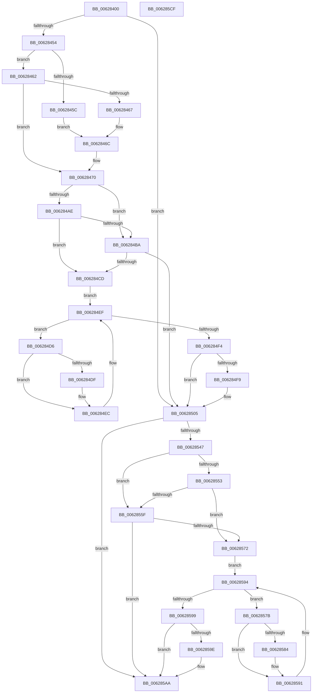

# DifIoBuildSynchronousFsdRequestWrapper

- RVA: `0x00628400`–`0x006285D0` (길이 `464` bytes)
- VA: `0x0000000140628400`
- 실행 섹션: `.text`
- PDB 이름 있음: `예`; PDB Function 태그: `아니요`
- unwind 정보 RVA: `0x000D2CDC`
- 디코드: `128`개 명령, `464/464` bytes 표시
- 미해석 바이트: `0` (있으면 어셈블리에 `.byte`로 보존)

> 이 문서는 커널 이미지의 기계어와 PDB 기호를 분석해 생성했습니다. 4번과 5번은 함수 원형과 자료형을 바이너리 사용 방식에서 추정한 C 해석이며 원본 소스 복구 결과는 아닙니다.

## 1. Dependencies

- 직접 호출 지점: **10**; 고유 호출 대상: **6**
- 직접 호출자로 확인된 함수: **0**
- RIP 상대 이미지 참조: **3**

### Outgoing calls
- `0x00628439` → [memset](../6C/memset_function_006C6C40.md) (function, `0x006C6C40`)
- `0x00628443` → [DifGetAPIThunkContextById](../49/DifGetAPIThunkContextById_function_00495A34.md) (function, `0x00495A34`)
- `0x00628467` → [DifGetReturnAddressForWrappers](../4D/DifGetReturnAddressForWrappers_function_004D3C08.md) (function, `0x004D3C08`)
- `0x006284C1` → [ExAcquireRundownProtection](../21/ExAcquireRundownProtection_function_00216620.md) (function, `0x00216620`)
- `0x006284E7` → [guard_dispatch_icall](../6B/guard_dispatch_icall_function_006BAAD0.md) (function, `0x006BAAD0`)
- `0x00628500` → [ExReleaseRundownProtection](../34/ExReleaseRundownProtection_function_00349E80.md) (function, `0x00349E80`)
- `0x00628539` → [guard_dispatch_icall](../6B/guard_dispatch_icall_function_006BAAD0.md) (function, `0x006BAAD0`)
- `0x00628566` → [ExAcquireRundownProtection](../21/ExAcquireRundownProtection_function_00216620.md) (function, `0x00216620`)
- `0x0062858C` → [guard_dispatch_icall](../6B/guard_dispatch_icall_function_006BAAD0.md) (function, `0x006BAAD0`)
- `0x006285A5` → [ExReleaseRundownProtection](../34/ExReleaseRundownProtection_function_00349E80.md) (function, `0x00349E80`)

### Direct callers
- 이 함수 시작 RVA로 연결되는 직접 call은 확인되지 않았습니다. 간접 호출은 완전히 역산할 수 없습니다.

### Static image references
- `0x00628476` → RVA `0x00F048B8` (`.data`; read)
- `0x006284AE` → RVA `0x00F04980` (`.data`; read)
- `0x006284BA` → RVA `0x00F03E80` (`.data`; read)

## 2. Other-region calls and transfers

- 다른 실행 섹션으로 향하는 call: **0**
- 별도 외부 분기/꼬리 이동을 확인하지 못했습니다.

## 3. Assembly (complete function range)

```asm
00628400  48 8B C4                        mov rax, rsp
00628403  48 89 58 10                     mov qword ptr [rax + 0x10], rbx
00628407  48 89 70 18                     mov qword ptr [rax + 0x18], rsi
0062840B  48 89 78 20                     mov qword ptr [rax + 0x20], rdi
0062840F  89 48 08                        mov dword ptr [rax + 8], ecx
00628412  55                              push rbp
00628413  41 54                           push r12
00628415  41 55                           push r13
00628417  41 56                           push r14
00628419  41 57                           push r15
0062841B  48 8D 68 C9                     lea rbp, [rax - 0x37]
0062841F  48 81 EC A0 00 00 00            sub rsp, 0xa0
00628426  4C 8B EA                        mov r13, rdx
00628429  48 8D 4D BF                     lea rcx, [rbp - 0x41]
0062842D  33 D2                           xor edx, edx
0062842F  4D 8B E0                        mov r12, r8
00628432  45 8B F9                        mov r15d, r9d
00628435  44 8D 42 50                     lea r8d, [rdx + 0x50]
00628439  E8 02 E8 09 00                  call 0x1406c6c40
0062843E  B9 68 01 00 00                  mov ecx, 0x168
00628443  E8 EC D5 E6 FF                  call 0x140495a34
00628448  4C 8B F0                        mov r14, rax
0062844B  48 85 C0                        test rax, rax
0062844E  0F 84 B1 00 00 00               je 0x140628505
00628454  8B 48 0C                        mov ecx, dword ptr [rax + 0xc]
00628457  F6 C1 18                        test cl, 0x18
0062845A  74 06                           je 0x140628462
0062845C  48 8B 45 37                     mov rax, qword ptr [rbp + 0x37]
00628460  EB 0A                           jmp 0x14062846c
00628462  F6 C1 04                        test cl, 4
00628465  74 09                           je 0x140628470
00628467  E8 9C B7 EA FF                  call 0x1404d3c08
0062846C  48 89 45 BF                     mov qword ptr [rbp - 0x41], rax
00628470  8B 45 3F                        mov eax, dword ptr [rbp + 0x3f]
00628473  40 32 F6                        xor sil, sil
00628476  40 38 35 3B C4 8D 00            cmp byte ptr [rip + 0x8dc43b], sil
0062847D  89 45 FF                        mov dword ptr [rbp - 1], eax
00628480  48 8B 45 5F                     mov rax, qword ptr [rbp + 0x5f]
00628484  48 89 45 DF                     mov qword ptr [rbp - 0x21], rax
00628488  48 8B 45 67                     mov rax, qword ptr [rbp + 0x67]
0062848C  48 89 45 D7                     mov qword ptr [rbp - 0x29], rax
00628490  48 8B 45 6F                     mov rax, qword ptr [rbp + 0x6f]
00628494  48 89 45 CF                     mov qword ptr [rbp - 0x31], rax
00628498  48 8B 45 77                     mov rax, qword ptr [rbp + 0x77]
0062849C  48 89 45 C7                     mov qword ptr [rbp - 0x39], rax
006284A0  4C 89 6D F7                     mov qword ptr [rbp - 9], r13
006284A4  4C 89 65 EF                     mov qword ptr [rbp - 0x11], r12
006284A8  44 89 7D E7                     mov dword ptr [rbp - 0x19], r15d
006284AC  75 0C                           jne 0x1406284ba
006284AE  F7 05 C8 C4 8D 00 00 08 00 00   test dword ptr [rip + 0x8dc4c8], 0x800
006284B8  74 13                           je 0x1406284cd
006284BA  48 8D 0D BF B9 8D 00            lea rcx, [rip + 0x8db9bf]
006284C1  E8 5A E1 BE FF                  call 0x140216620
006284C6  40 8A F0                        mov sil, al
006284C9  84 C0                           test al, al
006284CB  74 38                           je 0x140628505
006284CD  49 8D 7E 20                     lea rdi, [r14 + 0x20]
006284D1  48 8B 1F                        mov rbx, qword ptr [rdi]
006284D4  EB 19                           jmp 0x1406284ef
006284D6  48 8D 43 F0                     lea rax, [rbx - 0x10]
006284DA  48 85 C0                        test rax, rax
006284DD  74 0D                           je 0x1406284ec
006284DF  48 8B 40 08                     mov rax, qword ptr [rax + 8]
006284E3  48 8D 4D BF                     lea rcx, [rbp - 0x41]
006284E7  E8 E4 25 09 00                  call 0x1406baad0
006284EC  48 8B 1B                        mov rbx, qword ptr [rbx]
006284EF  48 3B DF                        cmp rbx, rdi
006284F2  75 E2                           jne 0x1406284d6
006284F4  40 84 F6                        test sil, sil
006284F7  74 0C                           je 0x140628505
006284F9  48 8D 0D 80 B9 8D 00            lea rcx, [rip + 0x8db980]
00628500  E8 7B 19 D2 FF                  call 0x140349e80
00628505  48 8B 45 77                     mov rax, qword ptr [rbp + 0x77]
00628509  45 8B CF                        mov r9d, r15d
0062850C  8B 4D 3F                        mov ecx, dword ptr [rbp + 0x3f]
0062850F  4D 8B C4                        mov r8, r12
00628512  48 89 44 24 38                  mov qword ptr [rsp + 0x38], rax
00628517  49 8B D5                        mov rdx, r13
0062851A  48 8B 45 6F                     mov rax, qword ptr [rbp + 0x6f]
0062851E  48 89 44 24 30                  mov qword ptr [rsp + 0x30], rax
00628523  48 8B 45 67                     mov rax, qword ptr [rbp + 0x67]
00628527  48 89 44 24 28                  mov qword ptr [rsp + 0x28], rax
0062852C  48 8B 45 5F                     mov rax, qword ptr [rbp + 0x5f]
00628530  48 89 44 24 20                  mov qword ptr [rsp + 0x20], rax
00628535  48 8B 45 7F                     mov rax, qword ptr [rbp + 0x7f]
00628539  E8 92 25 09 00                  call 0x1406baad0
0062853E  48 89 45 07                     mov qword ptr [rbp + 7], rax
00628542  4D 85 F6                        test r14, r14
00628545  74 63                           je 0x1406285aa
00628547  40 32 FF                        xor dil, dil
0062854A  40 38 3D 67 C3 8D 00            cmp byte ptr [rip + 0x8dc367], dil
00628551  75 0C                           jne 0x14062855f
00628553  F7 05 23 C4 8D 00 00 08 00 00   test dword ptr [rip + 0x8dc423], 0x800
0062855D  74 13                           je 0x140628572
0062855F  48 8D 0D 1A B9 8D 00            lea rcx, [rip + 0x8db91a]
00628566  E8 B5 E0 BE FF                  call 0x140216620
0062856B  40 8A F8                        mov dil, al
0062856E  84 C0                           test al, al
00628570  74 38                           je 0x1406285aa
00628572  49 8D 76 30                     lea rsi, [r14 + 0x30]
00628576  48 8B 1E                        mov rbx, qword ptr [rsi]
00628579  EB 19                           jmp 0x140628594
0062857B  48 8D 43 F0                     lea rax, [rbx - 0x10]
0062857F  48 85 C0                        test rax, rax
00628582  74 0D                           je 0x140628591
00628584  48 8B 40 08                     mov rax, qword ptr [rax + 8]
00628588  48 8D 4D BF                     lea rcx, [rbp - 0x41]
0062858C  E8 3F 25 09 00                  call 0x1406baad0
00628591  48 8B 1B                        mov rbx, qword ptr [rbx]
00628594  48 3B DE                        cmp rbx, rsi
00628597  75 E2                           jne 0x14062857b
00628599  40 84 FF                        test dil, dil
0062859C  74 0C                           je 0x1406285aa
0062859E  48 8D 0D DB B8 8D 00            lea rcx, [rip + 0x8db8db]
006285A5  E8 D6 18 D2 FF                  call 0x140349e80
006285AA  48 8B 45 07                     mov rax, qword ptr [rbp + 7]
006285AE  4C 8D 9C 24 A0 00 00 00         lea r11, [rsp + 0xa0]
006285B6  49 8B 5B 38                     mov rbx, qword ptr [r11 + 0x38]
006285BA  49 8B 73 40                     mov rsi, qword ptr [r11 + 0x40]
006285BE  49 8B 7B 48                     mov rdi, qword ptr [r11 + 0x48]
006285C2  49 8B E3                        mov rsp, r11
006285C5  41 5F                           pop r15
006285C7  41 5E                           pop r14
006285C9  41 5D                           pop r13
006285CB  41 5C                           pop r12
006285CD  5D                              pop rbp
006285CE  C3                              ret
006285CF  CC                              int3
```

## 4. C-style interpretation (structured pseudocode)

```c
__int64 __fastcall DifIoBuildSynchronousFsdRequestWrapper(int a1, __int64 a2, __int64 a3, int a4)
{
    __int64 result;
    __int64 v_rdi;
    __int64 v_rsi;
    __int64 v_rsp;
    unsigned __int64 v_stack_m28;
    unsigned __int64 v_stack_m90;
    unsigned __int64 v_stack_m98;
    unsigned __int64 v_stack_mA0;
    unsigned __int64 v_stack_mA8;

    *(unsigned __int64 *)(v_rsp + 16) = v_rbx;
    *(unsigned __int64 *)(v_rsp + 24) = v_rsi;
    *(unsigned __int64 *)(v_rsp + 32) = v_rdi;
    *(unsigned int *)(v_rsp + 8) = a1;
    v_rsp = (v_rsp) - (160);
    a2 = 0;
    result = memset(v_rsp - 55 - 65, a2, a2 + 80, a4);
    result = DifGetAPIThunkContextById(360, a2, a2 + 80, a4);
    if (result == 0) goto loc_00628505;
    if ((((unsigned __int8)((unsigned int)(*(unsigned int *)(result + 12)))) & (24)) == 0) goto loc_00628462;
    goto loc_0062846C;
loc_00628462:
    if ((((unsigned __int8)((unsigned int)(*(unsigned int *)(result + 12)))) & (4)) == 0) goto loc_00628470;
    result = DifGetReturnAddressForWrappers((unsigned int)(*(unsigned int *)(result + 12)), a2, a2 + 80, a4);
loc_0062846C:
    *(unsigned __int64 *)(v_rsp - 55 - 65) = result;
loc_00628470:
    v_rsi = 0;
    *(unsigned int *)(v_rsp - 55 - 1) = (unsigned int)((unsigned int)(*(unsigned int *)(v_rsp - 55 + 63)));
    *(unsigned __int64 *)(v_rsp - 55 - 33) = *(unsigned __int64 *)(v_rsp - 55 + 95);
    *(unsigned __int64 *)(v_rsp - 55 - 41) = *(unsigned __int64 *)(v_rsp - 55 + 103);
    *(unsigned __int64 *)(v_rsp - 55 - 49) = *(unsigned __int64 *)(v_rsp - 55 + 111);
    *(unsigned __int64 *)(v_rsp - 55 - 57) = *(unsigned __int64 *)(v_rsp - 55 + 119);
    *(unsigned __int64 *)(v_rsp - 55 - 9) = 0;
    *(unsigned __int64 *)(v_rsp - 55 - 17) = a3;
    *(unsigned int *)(v_rsp - 55 - 25) = (unsigned int)((unsigned int)(a4));
    if ((*(unsigned __int8 *)(v_rip + 9290811)) != 0) goto loc_006284BA;
    if (((*(unsigned int *)(v_rip + 9290952)) & (0x800ULL)) == 0) goto loc_006284CD;
loc_006284BA:
    result = ExAcquireRundownProtection(v_rip + 9288127, a2, a2 + 80, a4);
    if ((unsigned __int8)(result) == 0) goto loc_00628505;
loc_006284CD:
    goto loc_006284EF;
loc_006284D6:
    result = *(unsigned __int64 *)(result + 32) - 16;
    if (*(unsigned __int64 *)(result + 32) - 16 != 0) {
        result = *(unsigned __int64 *)(*(unsigned __int64 *)(result + 32) - 16 + 8);
        a1 = v_rsp - 55 - 65;
        result = guard_dispatch_icall(a1, a2, a2 + 80, a4);
    }
loc_006284EF:
    if ((*(unsigned __int64 *)(*(unsigned __int64 *)(result + 32))) != (result + 32)) goto loc_006284D6;
    if ((unsigned __int8)((unsigned __int8)(result)) != 0) {
        a1 = v_rip + 9288064;
        result = ExReleaseRundownProtection(a1, a2, a2 + 80, a4);
    }
    v_stack_m90 = *(unsigned __int64 *)(v_rsp - 55 + 119);
    v_stack_m98 = *(unsigned __int64 *)(v_rsp - 55 + 111);
    v_stack_mA0 = *(unsigned __int64 *)(v_rsp - 55 + 103);
    v_stack_mA8 = *(unsigned __int64 *)(v_rsp - 55 + 95);
    result = guard_dispatch_icall((unsigned int)(*(unsigned int *)(v_rsp - 55 + 63)), 0, a3, (unsigned int)((unsigned int)((unsigned int)(a4))));
    *(unsigned __int64 *)(v_rsp - 55 + 7) = result;
    if (result == 0) goto loc_006285AA;
    v_rdi = 0;
    if ((*(unsigned __int8 *)(v_rip + 9290599)) != 0) goto loc_0062855F;
    if (((*(unsigned int *)(v_rip + 9290787)) & (0x800ULL)) == 0) goto loc_00628572;
loc_0062855F:
    result = ExAcquireRundownProtection(v_rip + 9287962, 0, a3, (unsigned int)((unsigned int)((unsigned int)(a4))));
    if ((unsigned __int8)(result) == 0) goto loc_006285AA;
loc_00628572:
    goto loc_00628594;
loc_0062857B:
    result = *(unsigned __int64 *)(result + 48) - 16;
    if (*(unsigned __int64 *)(result + 48) - 16 != 0) {
        result = *(unsigned __int64 *)(*(unsigned __int64 *)(result + 48) - 16 + 8);
        a1 = v_rsp - 55 - 65;
        result = guard_dispatch_icall(a1, 0, a3, (unsigned int)((unsigned int)((unsigned int)(a4))));
    }
loc_00628594:
    if ((*(unsigned __int64 *)(*(unsigned __int64 *)(result + 48))) != (result + 48)) goto loc_0062857B;
    if ((unsigned __int8)((unsigned __int8)(result)) != 0) {
        a1 = v_rip + 9287899;
        result = ExReleaseRundownProtection(a1, 0, a3, (unsigned int)((unsigned int)((unsigned int)(a4))));
    }
    return *(unsigned __int64 *)(v_rsp - 55 + 7);
}
```

## 5. (Beta) C Style

```c
int64_t DifIoBuildSynchronousFsdRequestWrapper(int32_t Arg1, int64_t Arg2, int64_t Arg3, int32_t Arg4)
{
    int64_t result;
    int64_t local_rdi;
    int64_t local_rsi;
    int64_t local_rsp;
    uint64_t v_stack_m28;
    uint64_t v_stack_m90;
    uint64_t v_stack_m98;
    uint64_t v_stack_mA0;
    uint64_t v_stack_mA8;

    *(uint64_t *)(local_rsp + 0x10) = local_rbx;
    *(uint64_t *)(local_rsp + 0x18) = local_rsi;
    *(uint64_t *)(local_rsp + 0x20) = local_rdi;
    *(uint32_t *)(local_rsp + 0x8) = Arg1;
    local_rsp = (local_rsp) - (160);
    Arg2 = 0;
    result = memset(local_rsp - 55 - 65, Arg2, Arg2 + 80, Arg4);
    result = DifGetAPIThunkContextById(360, Arg2, Arg2 + 80, Arg4);
    if (result == 0) goto loc_00628505;
    if ((((uint8_t)((uint32_t)(*(uint32_t *)(result + 0xC)))) & (24)) == 0) goto loc_00628462;
    goto loc_0062846C;
loc_00628462:
    if ((((uint8_t)((uint32_t)(*(uint32_t *)(result + 0xC)))) & (4)) == 0) goto loc_00628470;
    result = DifGetReturnAddressForWrappers((uint32_t)(*(uint32_t *)(result + 0xC)), Arg2, Arg2 + 80, Arg4);
loc_0062846C:
    *(uint64_t *)(local_rsp - 0x37 - 0x41) = result;
loc_00628470:
    local_rsi = 0;
    *(uint32_t *)(local_rsp - 0x37 - 0x1) = (uint32_t)((uint32_t)(*(uint32_t *)(local_rsp - 0x37 + 0x3F)));
    *(uint64_t *)(local_rsp - 0x37 - 0x21) = *(uint64_t *)(local_rsp - 0x37 + 0x5F);
    *(uint64_t *)(local_rsp - 0x37 - 0x29) = *(uint64_t *)(local_rsp - 0x37 + 0x67);
    *(uint64_t *)(local_rsp - 0x37 - 0x31) = *(uint64_t *)(local_rsp - 0x37 + 0x6F);
    *(uint64_t *)(local_rsp - 0x37 - 0x39) = *(uint64_t *)(local_rsp - 0x37 + 0x77);
    *(uint64_t *)(local_rsp - 0x37 - 0x9) = 0;
    *(uint64_t *)(local_rsp - 0x37 - 0x11) = Arg3;
    *(uint32_t *)(local_rsp - 0x37 - 0x19) = (uint32_t)((uint32_t)(Arg4));
    if ((*(uint8_t *)(v_rip + 0x8DC43B)) != 0) goto loc_006284BA;
    if (((*(uint32_t *)(v_rip + 0x8DC4C8)) & (0x800ULL)) == 0) goto loc_006284CD;
loc_006284BA:
    result = ExAcquireRundownProtection(v_rip + 9288127, Arg2, Arg2 + 80, Arg4);
    if ((uint8_t)(result) == 0) goto loc_00628505;
loc_006284CD:
    goto loc_006284EF;
loc_006284D6:
    result = *(uint64_t *)(result + 0x20) - 16;
    if (*(uint64_t *)(result + 0x20) - 16 != 0) {
        result = *(uint64_t *)(*(uint64_t *)(result + 0x20) - 0x10 + 0x8);
        Arg1 = local_rsp - 55 - 65;
        result = guard_dispatch_icall(Arg1, Arg2, Arg2 + 80, Arg4);
    }
loc_006284EF:
    if ((*(uint64_t *)(*(uint64_t *)(result + 0x20))) != (result + 32)) goto loc_006284D6;
    if ((uint8_t)((uint8_t)(result)) != 0) {
        Arg1 = v_rip + 9288064;
        result = ExReleaseRundownProtection(Arg1, Arg2, Arg2 + 80, Arg4);
    }
    v_stack_m90 = *(uint64_t *)(local_rsp - 0x37 + 0x77);
    v_stack_m98 = *(uint64_t *)(local_rsp - 0x37 + 0x6F);
    v_stack_mA0 = *(uint64_t *)(local_rsp - 0x37 + 0x67);
    v_stack_mA8 = *(uint64_t *)(local_rsp - 0x37 + 0x5F);
    result = guard_dispatch_icall((uint32_t)(*(uint32_t *)(local_rsp - 0x37 + 0x3F)), 0, Arg3, (uint32_t)((uint32_t)((uint32_t)(Arg4))));
    *(uint64_t *)(local_rsp - 0x37 + 0x7) = result;
    if (result == 0) goto loc_006285AA;
    local_rdi = 0;
    if ((*(uint8_t *)(v_rip + 0x8DC367)) != 0) goto loc_0062855F;
    if (((*(uint32_t *)(v_rip + 0x8DC423)) & (0x800ULL)) == 0) goto loc_00628572;
loc_0062855F:
    result = ExAcquireRundownProtection(v_rip + 9287962, 0, Arg3, (uint32_t)((uint32_t)((uint32_t)(Arg4))));
    if ((uint8_t)(result) == 0) goto loc_006285AA;
loc_00628572:
    goto loc_00628594;
loc_0062857B:
    result = *(uint64_t *)(result + 0x30) - 16;
    if (*(uint64_t *)(result + 0x30) - 16 != 0) {
        result = *(uint64_t *)(*(uint64_t *)(result + 0x30) - 0x10 + 0x8);
        Arg1 = local_rsp - 55 - 65;
        result = guard_dispatch_icall(Arg1, 0, Arg3, (uint32_t)((uint32_t)((uint32_t)(Arg4))));
    }
loc_00628594:
    if ((*(uint64_t *)(*(uint64_t *)(result + 0x30))) != (result + 48)) goto loc_0062857B;
    if ((uint8_t)((uint8_t)(result)) != 0) {
        Arg1 = v_rip + 9287899;
        result = ExReleaseRundownProtection(Arg1, 0, Arg3, (uint32_t)((uint32_t)((uint32_t)(Arg4))));
    }
    return *(uint64_t *)(local_rsp - 0x37 + 0x7);
}
```

## 6. Execution-region graph

[열기: 2D/3D 그래프와 함수 탐색 컨트롤 패널](../../../control-panel.html?section=text&rva=0x00628400&view=graph)

- 2D 그래프는 위에서 아래로 흐르고, 3D 그래프는 빈 공간을 드래그해 회전합니다. Shift+드래그는 이동, 휠은 확대·축소, 함수 노드 선택은 대상 보고서 이동입니다.

### Static fallback


