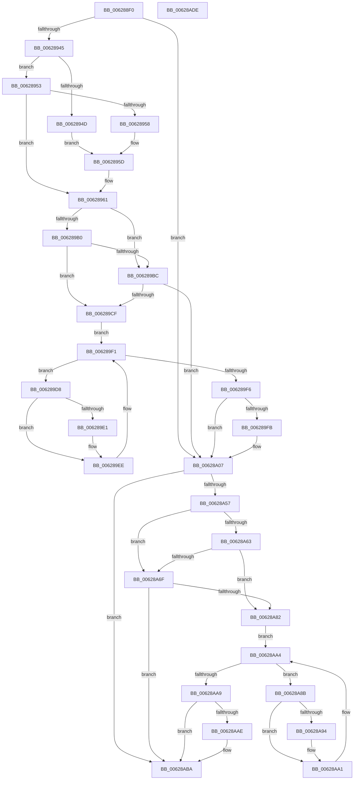

# DifIoConnectInterruptWrapper

- RVA: `0x006288F0`–`0x00628ADF` (길이 `495` bytes)
- VA: `0x00000001406288F0`
- 실행 섹션: `.text`
- PDB 이름 있음: `예`; PDB Function 태그: `아니요`
- unwind 정보 RVA: `0x000D2BDC`
- 디코드: `139`개 명령, `495/495` bytes 표시
- 미해석 바이트: `0` (있으면 어셈블리에 `.byte`로 보존)

> 이 문서는 커널 이미지의 기계어와 PDB 기호를 분석해 생성했습니다. 4번과 5번은 함수 원형과 자료형을 바이너리 사용 방식에서 추정한 C 해석이며 원본 소스 복구 결과는 아닙니다.

## 1. Dependencies

- 직접 호출 지점: **10**; 고유 호출 대상: **7**
- 직접 호출자로 확인된 함수: **0**
- RIP 상대 이미지 참조: **3**

### Outgoing calls
- `0x0062892A` → [memset](../6C/memset_function_006C6C40.md) (function, `0x006C6C40`)
- `0x00628934` → [DifGetAPIThunkContextById](../49/DifGetAPIThunkContextById_function_00495A34.md) (function, `0x00495A34`)
- `0x00628958` → [DifGetReturnAddressForWrappers](../4D/DifGetReturnAddressForWrappers_function_004D3C08.md) (function, `0x004D3C08`)
- `0x006289C3` → [ExAcquireRundownProtection](../21/ExAcquireRundownProtection_function_00216620.md) (function, `0x00216620`)
- `0x006289E9` → [guard_dispatch_icall](../6B/guard_dispatch_icall_function_006BAAD0.md) (function, `0x006BAAD0`)
- `0x00628A02` → [ExReleaseRundownProtection](../34/ExReleaseRundownProtection_function_00349E80.md) (function, `0x00349E80`)
- `0x00628A4A` → [IoConnectInterrupt](../../page/72/IoConnectInterrupt_function_00727050.md) (function, `0x00727050`)
- `0x00628A76` → [ExAcquireRundownProtection](../21/ExAcquireRundownProtection_function_00216620.md) (function, `0x00216620`)
- `0x00628A9C` → [guard_dispatch_icall](../6B/guard_dispatch_icall_function_006BAAD0.md) (function, `0x006BAAD0`)
- `0x00628AB5` → [ExReleaseRundownProtection](../34/ExReleaseRundownProtection_function_00349E80.md) (function, `0x00349E80`)

### Direct callers
- 이 함수 시작 RVA로 연결되는 직접 call은 확인되지 않았습니다. 간접 호출은 완전히 역산할 수 없습니다.

### Static image references
- `0x00628968` → RVA `0x00F048B8` (`.data`; read)
- `0x006289B0` → RVA `0x00F04980` (`.data`; read)
- `0x006289BC` → RVA `0x00F03E80` (`.data`; read)

## 2. Other-region calls and transfers

- 다른 실행 섹션으로 향하는 call: **1**
  - `0x00628A4A` → [IoConnectInterrupt](../../page/72/IoConnectInterrupt_function_00727050.md) (`.text` → `PAGE`)
- 별도 외부 분기/꼬리 이동을 확인하지 못했습니다.

## 3. Assembly (complete function range)

```asm
006288F0  48 8B C4                        mov rax, rsp
006288F3  48 89 58 10                     mov qword ptr [rax + 0x10], rbx
006288F7  48 89 70 18                     mov qword ptr [rax + 0x18], rsi
006288FB  48 89 78 20                     mov qword ptr [rax + 0x20], rdi
006288FF  48 89 48 08                     mov qword ptr [rax + 8], rcx
00628903  55                              push rbp
00628904  41 54                           push r12
00628906  41 55                           push r13
00628908  41 56                           push r14
0062890A  41 57                           push r15
0062890C  48 8D 68 D1                     lea rbp, [rax - 0x2f]
00628910  48 81 EC B0 00 00 00            sub rsp, 0xb0
00628917  4C 8B EA                        mov r13, rdx
0062891A  48 8D 4D B7                     lea rcx, [rbp - 0x49]
0062891E  33 D2                           xor edx, edx
00628920  4D 8B E0                        mov r12, r8
00628923  4D 8B F9                        mov r15, r9
00628926  44 8D 42 50                     lea r8d, [rdx + 0x50]
0062892A  E8 11 E3 09 00                  call 0x1406c6c40
0062892F  B9 66 01 00 00                  mov ecx, 0x166
00628934  E8 FB D0 E6 FF                  call 0x140495a34
00628939  48 8B F0                        mov rsi, rax
0062893C  48 85 C0                        test rax, rax
0062893F  0F 84 C2 00 00 00               je 0x140628a07
00628945  8B 48 0C                        mov ecx, dword ptr [rax + 0xc]
00628948  F6 C1 18                        test cl, 0x18
0062894B  74 06                           je 0x140628953
0062894D  48 8B 45 2F                     mov rax, qword ptr [rbp + 0x2f]
00628951  EB 0A                           jmp 0x14062895d
00628953  F6 C1 04                        test cl, 4
00628956  74 09                           je 0x140628961
00628958  E8 AB B2 EA FF                  call 0x1404d3c08
0062895D  48 89 45 B7                     mov qword ptr [rbp - 0x49], rax
00628961  48 8B 45 37                     mov rax, qword ptr [rbp + 0x37]
00628965  45 32 F6                        xor r14b, r14b
00628968  44 38 35 49 BF 8D 00            cmp byte ptr [rip + 0x8dbf49], r14b
0062896F  48 89 45 F7                     mov qword ptr [rbp - 9], rax
00628973  8B 45 57                        mov eax, dword ptr [rbp + 0x57]
00628976  89 45 DB                        mov dword ptr [rbp - 0x25], eax
00628979  8A 45 5F                        mov al, byte ptr [rbp + 0x5f]
0062897C  88 45 D8                        mov byte ptr [rbp - 0x28], al
0062897F  8A 45 67                        mov al, byte ptr [rbp + 0x67]
00628982  88 45 D7                        mov byte ptr [rbp - 0x29], al
00628985  8B 45 6F                        mov eax, dword ptr [rbp + 0x6f]
00628988  89 45 D3                        mov dword ptr [rbp - 0x2d], eax
0062898B  8A 45 77                        mov al, byte ptr [rbp + 0x77]
0062898E  88 45 CF                        mov byte ptr [rbp - 0x31], al
00628991  48 8B 45 7F                     mov rax, qword ptr [rbp + 0x7f]
00628995  48 89 45 C7                     mov qword ptr [rbp - 0x39], rax
00628999  8A 85 87 00 00 00               mov al, byte ptr [rbp + 0x87]
0062899F  88 45 BF                        mov byte ptr [rbp - 0x41], al
006289A2  4C 89 6D EF                     mov qword ptr [rbp - 0x11], r13
006289A6  4C 89 65 E7                     mov qword ptr [rbp - 0x19], r12
006289AA  4C 89 7D DF                     mov qword ptr [rbp - 0x21], r15
006289AE  75 0C                           jne 0x1406289bc
006289B0  F7 05 C6 BF 8D 00 00 08 00 00   test dword ptr [rip + 0x8dbfc6], 0x800
006289BA  74 13                           je 0x1406289cf
006289BC  48 8D 0D BD B4 8D 00            lea rcx, [rip + 0x8db4bd]
006289C3  E8 58 DC BE FF                  call 0x140216620
006289C8  44 8A F0                        mov r14b, al
006289CB  84 C0                           test al, al
006289CD  74 38                           je 0x140628a07
006289CF  48 8D 7E 20                     lea rdi, [rsi + 0x20]
006289D3  48 8B 1F                        mov rbx, qword ptr [rdi]
006289D6  EB 19                           jmp 0x1406289f1
006289D8  48 8D 43 F0                     lea rax, [rbx - 0x10]
006289DC  48 85 C0                        test rax, rax
006289DF  74 0D                           je 0x1406289ee
006289E1  48 8B 40 08                     mov rax, qword ptr [rax + 8]
006289E5  48 8D 4D B7                     lea rcx, [rbp - 0x49]
006289E9  E8 E2 20 09 00                  call 0x1406baad0
006289EE  48 8B 1B                        mov rbx, qword ptr [rbx]
006289F1  48 3B DF                        cmp rbx, rdi
006289F4  75 E2                           jne 0x1406289d8
006289F6  45 84 F6                        test r14b, r14b
006289F9  74 0C                           je 0x140628a07
006289FB  48 8D 0D 7E B4 8D 00            lea rcx, [rip + 0x8db47e]
00628A02  E8 79 14 D2 FF                  call 0x140349e80
00628A07  8A 85 87 00 00 00               mov al, byte ptr [rbp + 0x87]
00628A0D  4D 8B CF                        mov r9, r15
00628A10  48 8B 4D 37                     mov rcx, qword ptr [rbp + 0x37]
00628A14  4D 8B C4                        mov r8, r12
00628A17  88 44 24 50                     mov byte ptr [rsp + 0x50], al
00628A1B  49 8B D5                        mov rdx, r13
00628A1E  48 8B 45 7F                     mov rax, qword ptr [rbp + 0x7f]
00628A22  48 89 44 24 48                  mov qword ptr [rsp + 0x48], rax
00628A27  8A 45 77                        mov al, byte ptr [rbp + 0x77]
00628A2A  88 44 24 40                     mov byte ptr [rsp + 0x40], al
00628A2E  8B 45 6F                        mov eax, dword ptr [rbp + 0x6f]
00628A31  89 44 24 38                     mov dword ptr [rsp + 0x38], eax
00628A35  8A 45 67                        mov al, byte ptr [rbp + 0x67]
00628A38  88 44 24 30                     mov byte ptr [rsp + 0x30], al
00628A3C  8A 45 5F                        mov al, byte ptr [rbp + 0x5f]
00628A3F  88 44 24 28                     mov byte ptr [rsp + 0x28], al
00628A43  8B 45 57                        mov eax, dword ptr [rbp + 0x57]
00628A46  89 44 24 20                     mov dword ptr [rsp + 0x20], eax
00628A4A  E8 01 E6 0F 00                  call 0x140727050
00628A4F  89 45 FF                        mov dword ptr [rbp - 1], eax
00628A52  48 85 F6                        test rsi, rsi
00628A55  74 63                           je 0x140628aba
00628A57  40 32 FF                        xor dil, dil
00628A5A  40 38 3D 57 BE 8D 00            cmp byte ptr [rip + 0x8dbe57], dil
00628A61  75 0C                           jne 0x140628a6f
00628A63  F7 05 13 BF 8D 00 00 08 00 00   test dword ptr [rip + 0x8dbf13], 0x800
00628A6D  74 13                           je 0x140628a82
00628A6F  48 8D 0D 0A B4 8D 00            lea rcx, [rip + 0x8db40a]
00628A76  E8 A5 DB BE FF                  call 0x140216620
00628A7B  40 8A F8                        mov dil, al
00628A7E  84 C0                           test al, al
00628A80  74 38                           je 0x140628aba
00628A82  48 83 C6 30                     add rsi, 0x30
00628A86  48 8B 1E                        mov rbx, qword ptr [rsi]
00628A89  EB 19                           jmp 0x140628aa4
00628A8B  48 8D 43 F0                     lea rax, [rbx - 0x10]
00628A8F  48 85 C0                        test rax, rax
00628A92  74 0D                           je 0x140628aa1
00628A94  48 8B 40 08                     mov rax, qword ptr [rax + 8]
00628A98  48 8D 4D B7                     lea rcx, [rbp - 0x49]
00628A9C  E8 2F 20 09 00                  call 0x1406baad0
00628AA1  48 8B 1B                        mov rbx, qword ptr [rbx]
00628AA4  48 3B DE                        cmp rbx, rsi
00628AA7  75 E2                           jne 0x140628a8b
00628AA9  40 84 FF                        test dil, dil
00628AAC  74 0C                           je 0x140628aba
00628AAE  48 8D 0D CB B3 8D 00            lea rcx, [rip + 0x8db3cb]
00628AB5  E8 C6 13 D2 FF                  call 0x140349e80
00628ABA  8B 45 FF                        mov eax, dword ptr [rbp - 1]
00628ABD  4C 8D 9C 24 B0 00 00 00         lea r11, [rsp + 0xb0]
00628AC5  49 8B 5B 38                     mov rbx, qword ptr [r11 + 0x38]
00628AC9  49 8B 73 40                     mov rsi, qword ptr [r11 + 0x40]
00628ACD  49 8B 7B 48                     mov rdi, qword ptr [r11 + 0x48]
00628AD1  49 8B E3                        mov rsp, r11
00628AD4  41 5F                           pop r15
00628AD6  41 5E                           pop r14
00628AD8  41 5D                           pop r13
00628ADA  41 5C                           pop r12
00628ADC  5D                              pop rbp
00628ADD  C3                              ret
00628ADE  CC                              int3
```

## 4. C-style interpretation (structured pseudocode)

```c
__int64 __fastcall DifIoConnectInterruptWrapper(__int64 a1, __int64 a2, __int64 a3, __int64 a4)
{
    __int64 result;
    __int64 v_r14;
    __int64 v_rdi;
    __int64 v_rsi;
    __int64 v_rsp;
    unsigned __int64 v_stack_m28;
    unsigned __int8 v_stack_m88;
    unsigned __int64 v_stack_m90;
    unsigned __int8 v_stack_m98;
    unsigned int v_stack_mA0;
    unsigned __int8 v_stack_mA8;
    unsigned __int8 v_stack_mB0;
    unsigned int v_stack_mB8;

    *(unsigned __int64 *)(v_rsp + 16) = v_rbx;
    *(unsigned __int64 *)(v_rsp + 24) = v_rsi;
    *(unsigned __int64 *)(v_rsp + 32) = v_rdi;
    *(unsigned __int64 *)(v_rsp + 8) = a1;
    v_rsp = (v_rsp) - (176);
    a2 = 0;
    result = memset(v_rsp - 47 - 73, a2, a2 + 80, a4);
    result = DifGetAPIThunkContextById(358, a2, a2 + 80, a4);
    if (result == 0) goto loc_00628A07;
    if ((((unsigned __int8)((unsigned int)(*(unsigned int *)(result + 12)))) & (24)) == 0) goto loc_00628953;
    goto loc_0062895D;
loc_00628953:
    if ((((unsigned __int8)((unsigned int)(*(unsigned int *)(result + 12)))) & (4)) == 0) goto loc_00628961;
    result = DifGetReturnAddressForWrappers((unsigned int)(*(unsigned int *)(result + 12)), a2, a2 + 80, a4);
loc_0062895D:
    *(unsigned __int64 *)(v_rsp - 47 - 73) = result;
loc_00628961:
    v_r14 = 0;
    *(unsigned __int64 *)(v_rsp - 47 - 9) = *(unsigned __int64 *)(v_rsp - 47 + 55);
    *(unsigned int *)(v_rsp - 47 - 37) = (unsigned int)((unsigned int)(*(unsigned int *)(v_rsp - 47 + 87)));
    *(unsigned __int8 *)(v_rsp - 47 - 40) = (unsigned __int8)(*(unsigned __int8 *)(v_rsp - 47 + 95));
    *(unsigned __int8 *)(v_rsp - 47 - 41) = (unsigned __int8)(*(unsigned __int8 *)(v_rsp - 47 + 103));
    *(unsigned int *)(v_rsp - 47 - 45) = (unsigned int)((unsigned int)(*(unsigned int *)(v_rsp - 47 + 111)));
    *(unsigned __int8 *)(v_rsp - 47 - 49) = (unsigned __int8)(*(unsigned __int8 *)(v_rsp - 47 + 119));
    *(unsigned __int64 *)(v_rsp - 47 - 57) = *(unsigned __int64 *)(v_rsp - 47 + 127);
    *(unsigned __int8 *)(v_rsp - 47 - 65) = (unsigned __int8)(*(unsigned __int8 *)(v_rsp - 47 + 135));
    *(unsigned __int64 *)(v_rsp - 47 - 17) = 0;
    *(unsigned __int64 *)(v_rsp - 47 - 25) = a3;
    *(unsigned __int64 *)(v_rsp - 47 - 33) = a4;
    if ((*(unsigned __int8 *)(v_rip + 9289545)) != 0) goto loc_006289BC;
    if (((*(unsigned int *)(v_rip + 9289670)) & (0x800ULL)) == 0) goto loc_006289CF;
loc_006289BC:
    result = ExAcquireRundownProtection(v_rip + 9286845, a2, a2 + 80, a4);
    if ((unsigned __int8)(result) == 0) goto loc_00628A07;
loc_006289CF:
    goto loc_006289F1;
loc_006289D8:
    result = *(unsigned __int64 *)(result + 32) - 16;
    if (*(unsigned __int64 *)(result + 32) - 16 != 0) {
        result = *(unsigned __int64 *)(*(unsigned __int64 *)(result + 32) - 16 + 8);
        a1 = v_rsp - 47 - 73;
        result = guard_dispatch_icall(a1, a2, a2 + 80, a4);
    }
loc_006289F1:
    if ((*(unsigned __int64 *)(*(unsigned __int64 *)(result + 32))) != (result + 32)) goto loc_006289D8;
    if ((unsigned __int8)((unsigned __int8)(result)) != 0) {
        a1 = v_rip + 9286782;
        result = ExReleaseRundownProtection(a1, a2, a2 + 80, a4);
    }
    v_stack_m88 = (unsigned __int8)(*(unsigned __int8 *)(v_rsp - 47 + 135));
    v_stack_m90 = *(unsigned __int64 *)(v_rsp - 47 + 127);
    v_stack_m98 = (unsigned __int8)(*(unsigned __int8 *)(v_rsp - 47 + 119));
    v_stack_mA0 = (unsigned int)((unsigned int)(*(unsigned int *)(v_rsp - 47 + 111)));
    v_stack_mA8 = (unsigned __int8)(*(unsigned __int8 *)(v_rsp - 47 + 103));
    v_stack_mB0 = (unsigned __int8)(*(unsigned __int8 *)(v_rsp - 47 + 95));
    v_stack_mB8 = (unsigned int)((unsigned int)(*(unsigned int *)(v_rsp - 47 + 87)));
    result = IoConnectInterrupt(*(unsigned __int64 *)(v_rsp - 47 + 55), 0, a3, a4);
    *(unsigned int *)(v_rsp - 47 - 1) = (unsigned int)(result);
    if (result == 0) goto loc_00628ABA;
    v_rdi = 0;
    if ((*(unsigned __int8 *)(v_rip + 9289303)) != 0) goto loc_00628A6F;
    if (((*(unsigned int *)(v_rip + 9289491)) & (0x800ULL)) == 0) goto loc_00628A82;
loc_00628A6F:
    result = ExAcquireRundownProtection(v_rip + 9286666, 0, a3, a4);
    if ((unsigned __int8)(result) == 0) goto loc_00628ABA;
loc_00628A82:
    v_rsi = (result) + (48);
    goto loc_00628AA4;
loc_00628A8B:
    result = *(unsigned __int64 *)(v_rsi) - 16;
    if (*(unsigned __int64 *)(v_rsi) - 16 != 0) {
        result = *(unsigned __int64 *)(*(unsigned __int64 *)(v_rsi) - 16 + 8);
        a1 = v_rsp - 47 - 73;
        result = guard_dispatch_icall(a1, 0, a3, a4);
    }
loc_00628AA4:
    if ((*(unsigned __int64 *)(*(unsigned __int64 *)(v_rsi))) != v_rsi) goto loc_00628A8B;
    if ((unsigned __int8)((unsigned __int8)(result)) != 0) {
        a1 = v_rip + 9286603;
        result = ExReleaseRundownProtection(a1, 0, a3, a4);
    }
    return (unsigned int)(*(unsigned int *)(v_rsp - 47 - 1));
}
```

## 5. (Beta) C Style

```c
int64_t DifIoConnectInterruptWrapper(int64_t Arg1, int64_t Arg2, int64_t Arg3, int64_t Arg4)
{
    int64_t result;
    int64_t local_r14;
    int64_t local_rdi;
    int64_t local_rsi;
    int64_t local_rsp;
    uint64_t v_stack_m28;
    uint8_t v_stack_m88;
    uint64_t v_stack_m90;
    uint8_t v_stack_m98;
    uint32_t v_stack_mA0;
    uint8_t v_stack_mA8;
    uint8_t v_stack_mB0;
    uint32_t v_stack_mB8;

    *(uint64_t *)(local_rsp + 0x10) = local_rbx;
    *(uint64_t *)(local_rsp + 0x18) = local_rsi;
    *(uint64_t *)(local_rsp + 0x20) = local_rdi;
    *(uint64_t *)(local_rsp + 0x8) = Arg1;
    local_rsp = (local_rsp) - (176);
    Arg2 = 0;
    result = memset(local_rsp - 47 - 73, Arg2, Arg2 + 80, Arg4);
    result = DifGetAPIThunkContextById(358, Arg2, Arg2 + 80, Arg4);
    if (result == 0) goto loc_00628A07;
    if ((((uint8_t)((uint32_t)(*(uint32_t *)(result + 0xC)))) & (24)) == 0) goto loc_00628953;
    goto loc_0062895D;
loc_00628953:
    if ((((uint8_t)((uint32_t)(*(uint32_t *)(result + 0xC)))) & (4)) == 0) goto loc_00628961;
    result = DifGetReturnAddressForWrappers((uint32_t)(*(uint32_t *)(result + 0xC)), Arg2, Arg2 + 80, Arg4);
loc_0062895D:
    *(uint64_t *)(local_rsp - 0x2F - 0x49) = result;
loc_00628961:
    local_r14 = 0;
    *(uint64_t *)(local_rsp - 0x2F - 0x9) = *(uint64_t *)(local_rsp - 0x2F + 0x37);
    *(uint32_t *)(local_rsp - 0x2F - 0x25) = (uint32_t)((uint32_t)(*(uint32_t *)(local_rsp - 0x2F + 0x57)));
    *(uint8_t *)(local_rsp - 0x2F - 0x28) = (uint8_t)(*(uint8_t *)(local_rsp - 0x2F + 0x5F));
    *(uint8_t *)(local_rsp - 0x2F - 0x29) = (uint8_t)(*(uint8_t *)(local_rsp - 0x2F + 0x67));
    *(uint32_t *)(local_rsp - 0x2F - 0x2D) = (uint32_t)((uint32_t)(*(uint32_t *)(local_rsp - 0x2F + 0x6F)));
    *(uint8_t *)(local_rsp - 0x2F - 0x31) = (uint8_t)(*(uint8_t *)(local_rsp - 0x2F + 0x77));
    *(uint64_t *)(local_rsp - 0x2F - 0x39) = *(uint64_t *)(local_rsp - 0x2F + 0x7F);
    *(uint8_t *)(local_rsp - 0x2F - 0x41) = (uint8_t)(*(uint8_t *)(local_rsp - 0x2F + 0x87));
    *(uint64_t *)(local_rsp - 0x2F - 0x11) = 0;
    *(uint64_t *)(local_rsp - 0x2F - 0x19) = Arg3;
    *(uint64_t *)(local_rsp - 0x2F - 0x21) = Arg4;
    if ((*(uint8_t *)(v_rip + 0x8DBF49)) != 0) goto loc_006289BC;
    if (((*(uint32_t *)(v_rip + 0x8DBFC6)) & (0x800ULL)) == 0) goto loc_006289CF;
loc_006289BC:
    result = ExAcquireRundownProtection(v_rip + 9286845, Arg2, Arg2 + 80, Arg4);
    if ((uint8_t)(result) == 0) goto loc_00628A07;
loc_006289CF:
    goto loc_006289F1;
loc_006289D8:
    result = *(uint64_t *)(result + 0x20) - 16;
    if (*(uint64_t *)(result + 0x20) - 16 != 0) {
        result = *(uint64_t *)(*(uint64_t *)(result + 0x20) - 0x10 + 0x8);
        Arg1 = local_rsp - 47 - 73;
        result = guard_dispatch_icall(Arg1, Arg2, Arg2 + 80, Arg4);
    }
loc_006289F1:
    if ((*(uint64_t *)(*(uint64_t *)(result + 0x20))) != (result + 32)) goto loc_006289D8;
    if ((uint8_t)((uint8_t)(result)) != 0) {
        Arg1 = v_rip + 9286782;
        result = ExReleaseRundownProtection(Arg1, Arg2, Arg2 + 80, Arg4);
    }
    v_stack_m88 = (uint8_t)(*(uint8_t *)(local_rsp - 0x2F + 0x87));
    v_stack_m90 = *(uint64_t *)(local_rsp - 0x2F + 0x7F);
    v_stack_m98 = (uint8_t)(*(uint8_t *)(local_rsp - 0x2F + 0x77));
    v_stack_mA0 = (uint32_t)((uint32_t)(*(uint32_t *)(local_rsp - 0x2F + 0x6F)));
    v_stack_mA8 = (uint8_t)(*(uint8_t *)(local_rsp - 0x2F + 0x67));
    v_stack_mB0 = (uint8_t)(*(uint8_t *)(local_rsp - 0x2F + 0x5F));
    v_stack_mB8 = (uint32_t)((uint32_t)(*(uint32_t *)(local_rsp - 0x2F + 0x57)));
    result = IoConnectInterrupt(*(uint64_t *)(local_rsp - 0x2F + 0x37), 0, Arg3, Arg4);
    *(uint32_t *)(local_rsp - 0x2F - 0x1) = (uint32_t)(result);
    if (result == 0) goto loc_00628ABA;
    local_rdi = 0;
    if ((*(uint8_t *)(v_rip + 0x8DBE57)) != 0) goto loc_00628A6F;
    if (((*(uint32_t *)(v_rip + 0x8DBF13)) & (0x800ULL)) == 0) goto loc_00628A82;
loc_00628A6F:
    result = ExAcquireRundownProtection(v_rip + 9286666, 0, Arg3, Arg4);
    if ((uint8_t)(result) == 0) goto loc_00628ABA;
loc_00628A82:
    local_rsi = (result) + (48);
    goto loc_00628AA4;
loc_00628A8B:
    result = *(uint64_t *)(local_rsi) - 16;
    if (*(uint64_t *)(local_rsi) - 16 != 0) {
        result = *(uint64_t *)(*(uint64_t *)(local_rsi) - 0x10 + 0x8);
        Arg1 = local_rsp - 47 - 73;
        result = guard_dispatch_icall(Arg1, 0, Arg3, Arg4);
    }
loc_00628AA4:
    if ((*(uint64_t *)(*(uint64_t *)(local_rsi))) != local_rsi) goto loc_00628A8B;
    if ((uint8_t)((uint8_t)(result)) != 0) {
        Arg1 = v_rip + 9286603;
        result = ExReleaseRundownProtection(Arg1, 0, Arg3, Arg4);
    }
    return (uint32_t)(*(uint32_t *)(local_rsp - 0x2F - 0x1));
}
```

## 6. Execution-region graph

[열기: 2D/3D 그래프와 함수 탐색 컨트롤 패널](../../../control-panel.html?section=text&rva=0x006288F0&view=graph)

- 2D 그래프는 위에서 아래로 흐르고, 3D 그래프는 빈 공간을 드래그해 회전합니다. Shift+드래그는 이동, 휠은 확대·축소, 함수 노드 선택은 대상 보고서 이동입니다.

### Static fallback


