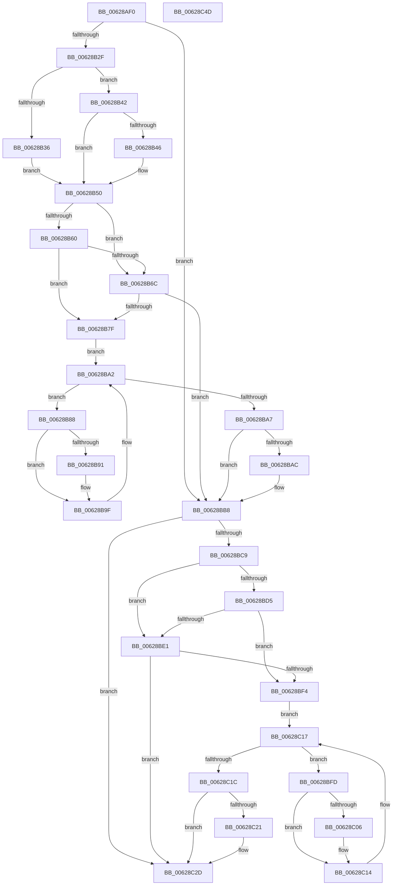

# DifIoCreateControllerWrapper

- RVA: `0x00628AF0`–`0x00628C4E` (길이 `350` bytes)
- VA: `0x0000000140628AF0`
- 실행 섹션: `.text`
- PDB 이름 있음: `예`; PDB Function 태그: `아니요`
- unwind 정보 RVA: `0x00060130`
- 디코드: `94`개 명령, `350/350` bytes 표시
- 미해석 바이트: `0` (있으면 어셈블리에 `.byte`로 보존)

> 이 문서는 커널 이미지의 기계어와 PDB 기호를 분석해 생성했습니다. 4번과 5번은 함수 원형과 자료형을 바이너리 사용 방식에서 추정한 C 해석이며 원본 소스 복구 결과는 아닙니다.

## 1. Dependencies

- 직접 호출 지점: **9**; 고유 호출 대상: **6**
- 직접 호출자로 확인된 함수: **0**
- RIP 상대 이미지 참조: **3**

### Outgoing calls
- `0x00628B1E` → [DifGetAPIThunkContextById](../49/DifGetAPIThunkContextById_function_00495A34.md) (function, `0x00495A34`)
- `0x00628B46` → [DifGetReturnAddressForWrappers](../4D/DifGetReturnAddressForWrappers_function_004D3C08.md) (function, `0x004D3C08`)
- `0x00628B73` → [ExAcquireRundownProtection](../21/ExAcquireRundownProtection_function_00216620.md) (function, `0x00216620`)
- `0x00628B9A` → [guard_dispatch_icall](../6B/guard_dispatch_icall_function_006BAAD0.md) (function, `0x006BAAD0`)
- `0x00628BB3` → [ExReleaseRundownProtection](../34/ExReleaseRundownProtection_function_00349E80.md) (function, `0x00349E80`)
- `0x00628BBA` → [IoCreateController](../../page/71/IoCreateController_function_0071D190.md) (function, `0x0071D190`)
- `0x00628BE8` → [ExAcquireRundownProtection](../21/ExAcquireRundownProtection_function_00216620.md) (function, `0x00216620`)
- `0x00628C0F` → [guard_dispatch_icall](../6B/guard_dispatch_icall_function_006BAAD0.md) (function, `0x006BAAD0`)
- `0x00628C28` → [ExReleaseRundownProtection](../34/ExReleaseRundownProtection_function_00349E80.md) (function, `0x00349E80`)

### Direct callers
- 이 함수 시작 RVA로 연결되는 직접 call은 확인되지 않았습니다. 간접 호출은 완전히 역산할 수 없습니다.

### Static image references
- `0x00628B57` → RVA `0x00F048B8` (`.data`; read)
- `0x00628B60` → RVA `0x00F04980` (`.data`; read)
- `0x00628B6C` → RVA `0x00F03E80` (`.data`; read)

## 2. Other-region calls and transfers

- 다른 실행 섹션으로 향하는 call: **1**
  - `0x00628BBA` → [IoCreateController](../../page/71/IoCreateController_function_0071D190.md) (`.text` → `PAGE`)
- 별도 외부 분기/꼬리 이동을 확인하지 못했습니다.

## 3. Assembly (complete function range)

```asm
00628AF0  4C 8B DC                        mov r11, rsp
00628AF3  49 89 5B 08                     mov qword ptr [r11 + 8], rbx
00628AF7  49 89 6B 10                     mov qword ptr [r11 + 0x10], rbp
00628AFB  49 89 73 18                     mov qword ptr [r11 + 0x18], rsi
00628AFF  49 89 7B 20                     mov qword ptr [r11 + 0x20], rdi
00628B03  41 56                           push r14
00628B05  48 83 EC 40                     sub rsp, 0x40
00628B09  33 C0                           xor eax, eax
00628B0B  0F 57 C0                        xorps xmm0, xmm0
00628B0E  0F 11 44 24 20                  movups xmmword ptr [rsp + 0x20], xmm0
00628B13  8B E9                           mov ebp, ecx
00628B15  49 89 43 E8                     mov qword ptr [r11 - 0x18], rax
00628B19  B9 64 01 00 00                  mov ecx, 0x164
00628B1E  E8 11 CF E6 FF                  call 0x140495a34
00628B23  48 8B F0                        mov rsi, rax
00628B26  48 85 C0                        test rax, rax
00628B29  0F 84 89 00 00 00               je 0x140628bb8
00628B2F  8B 40 0C                        mov eax, dword ptr [rax + 0xc]
00628B32  A8 18                           test al, 0x18
00628B34  74 0C                           je 0x140628b42
00628B36  48 8B 4C 24 48                  mov rcx, qword ptr [rsp + 0x48]
00628B3B  48 89 4C 24 20                  mov qword ptr [rsp + 0x20], rcx
00628B40  EB 0E                           jmp 0x140628b50
00628B42  A8 04                           test al, 4
00628B44  74 0A                           je 0x140628b50
00628B46  E8 BD B0 EA FF                  call 0x1404d3c08
00628B4B  48 89 44 24 20                  mov qword ptr [rsp + 0x20], rax
00628B50  40 32 FF                        xor dil, dil
00628B53  89 6C 24 28                     mov dword ptr [rsp + 0x28], ebp
00628B57  40 38 3D 5A BD 8D 00            cmp byte ptr [rip + 0x8dbd5a], dil
00628B5E  75 0C                           jne 0x140628b6c
00628B60  F7 05 16 BE 8D 00 00 08 00 00   test dword ptr [rip + 0x8dbe16], 0x800
00628B6A  74 13                           je 0x140628b7f
00628B6C  48 8D 0D 0D B3 8D 00            lea rcx, [rip + 0x8db30d]
00628B73  E8 A8 DA BE FF                  call 0x140216620
00628B78  40 8A F8                        mov dil, al
00628B7B  84 C0                           test al, al
00628B7D  74 39                           je 0x140628bb8
00628B7F  4C 8D 76 20                     lea r14, [rsi + 0x20]
00628B83  49 8B 1E                        mov rbx, qword ptr [r14]
00628B86  EB 1A                           jmp 0x140628ba2
00628B88  48 8D 43 F0                     lea rax, [rbx - 0x10]
00628B8C  48 85 C0                        test rax, rax
00628B8F  74 0E                           je 0x140628b9f
00628B91  48 8B 40 08                     mov rax, qword ptr [rax + 8]
00628B95  48 8D 4C 24 20                  lea rcx, [rsp + 0x20]
00628B9A  E8 31 1F 09 00                  call 0x1406baad0
00628B9F  48 8B 1B                        mov rbx, qword ptr [rbx]
00628BA2  49 3B DE                        cmp rbx, r14
00628BA5  75 E1                           jne 0x140628b88
00628BA7  40 84 FF                        test dil, dil
00628BAA  74 0C                           je 0x140628bb8
00628BAC  48 8D 0D CD B2 8D 00            lea rcx, [rip + 0x8db2cd]
00628BB3  E8 C8 12 D2 FF                  call 0x140349e80
00628BB8  8B CD                           mov ecx, ebp
00628BBA  E8 D1 45 0F 00                  call 0x14071d190
00628BBF  48 89 44 24 30                  mov qword ptr [rsp + 0x30], rax
00628BC4  48 85 F6                        test rsi, rsi
00628BC7  74 64                           je 0x140628c2d
00628BC9  40 32 FF                        xor dil, dil
00628BCC  40 38 3D E5 BC 8D 00            cmp byte ptr [rip + 0x8dbce5], dil
00628BD3  75 0C                           jne 0x140628be1
00628BD5  F7 05 A1 BD 8D 00 00 08 00 00   test dword ptr [rip + 0x8dbda1], 0x800
00628BDF  74 13                           je 0x140628bf4
00628BE1  48 8D 0D 98 B2 8D 00            lea rcx, [rip + 0x8db298]
00628BE8  E8 33 DA BE FF                  call 0x140216620
00628BED  40 8A F8                        mov dil, al
00628BF0  84 C0                           test al, al
00628BF2  74 39                           je 0x140628c2d
00628BF4  48 83 C6 30                     add rsi, 0x30
00628BF8  48 8B 1E                        mov rbx, qword ptr [rsi]
00628BFB  EB 1A                           jmp 0x140628c17
00628BFD  48 8D 43 F0                     lea rax, [rbx - 0x10]
00628C01  48 85 C0                        test rax, rax
00628C04  74 0E                           je 0x140628c14
00628C06  48 8B 40 08                     mov rax, qword ptr [rax + 8]
00628C0A  48 8D 4C 24 20                  lea rcx, [rsp + 0x20]
00628C0F  E8 BC 1E 09 00                  call 0x1406baad0
00628C14  48 8B 1B                        mov rbx, qword ptr [rbx]
00628C17  48 3B DE                        cmp rbx, rsi
00628C1A  75 E1                           jne 0x140628bfd
00628C1C  40 84 FF                        test dil, dil
00628C1F  74 0C                           je 0x140628c2d
00628C21  48 8D 0D 58 B2 8D 00            lea rcx, [rip + 0x8db258]
00628C28  E8 53 12 D2 FF                  call 0x140349e80
00628C2D  48 8B 44 24 30                  mov rax, qword ptr [rsp + 0x30]
00628C32  48 8B 5C 24 50                  mov rbx, qword ptr [rsp + 0x50]
00628C37  48 8B 6C 24 58                  mov rbp, qword ptr [rsp + 0x58]
00628C3C  48 8B 74 24 60                  mov rsi, qword ptr [rsp + 0x60]
00628C41  48 8B 7C 24 68                  mov rdi, qword ptr [rsp + 0x68]
00628C46  48 83 C4 40                     add rsp, 0x40
00628C4A  41 5E                           pop r14
00628C4C  C3                              ret
00628C4D  CC                              int3
```

## 4. C-style interpretation (structured pseudocode)

```c
__int64 __fastcall DifIoCreateControllerWrapper(int a1)
{
    __int64 result;
    __int64 v_rdi;
    __int64 v_rsi;
    __int64 v_rsp;
    unsigned __int64 v_stack_m18;
    unsigned int v_stack_m20;
    unsigned __int64 v_stack_m28;
    unsigned __int64 v_stack_p0;
    unsigned __int64 v_stack_p10;
    unsigned __int64 v_stack_p18;
    unsigned __int64 v_stack_p20;
    unsigned __int64 v_stack_p8;

    *(unsigned __int64 *)(v_rsp + 8) = v_rbx;
    *(unsigned __int64 *)(v_rsp + 16) = v_rbp;
    *(unsigned __int64 *)(v_rsp + 24) = v_rsi;
    *(unsigned __int64 *)(v_rsp + 32) = v_rdi;
    v_rsp = (v_rsp) - (64);
    result = 0;
    v_stack_m28 = v_xmm0;
    *(unsigned __int64 *)(v_rsp - 24) = 0;
    result = DifGetAPIThunkContextById(356, a2, a3, a4);
    if (result == 0) goto loc_00628BB8;
    if ((((unsigned __int8)((unsigned int)(*(unsigned int *)(result + 12)))) & (24)) == 0) goto loc_00628B42;
    v_stack_m28 = v_stack_p0;
    goto loc_00628B50;
loc_00628B42:
    result = (unsigned int)(*(unsigned int *)(result + 12));
    if ((((unsigned __int8)((unsigned int)(*(unsigned int *)(result + 12)))) & (4)) != 0) {
        result = DifGetReturnAddressForWrappers(v_stack_p0, a2, a3, a4);
        v_stack_m28 = result;
    }
    v_rdi = 0;
    v_stack_m20 = (unsigned int)((unsigned int)(a1));
    if ((*(unsigned __int8 *)(v_rip + 9289050)) != 0) goto loc_00628B6C;
    if (((*(unsigned int *)(v_rip + 9289238)) & (0x800ULL)) == 0) goto loc_00628B7F;
loc_00628B6C:
    result = ExAcquireRundownProtection(v_rip + 9286413, a2, a3, a4);
    if ((unsigned __int8)(result) == 0) goto loc_00628BB8;
loc_00628B7F:
    goto loc_00628BA2;
loc_00628B88:
    result = *(unsigned __int64 *)(result + 32) - 16;
    if (*(unsigned __int64 *)(result + 32) - 16 != 0) {
        result = *(unsigned __int64 *)(*(unsigned __int64 *)(result + 32) - 16 + 8);
        a1 = v_stack_m28;
        result = guard_dispatch_icall(a1, a2, a3, a4);
    }
loc_00628BA2:
    if ((*(unsigned __int64 *)(*(unsigned __int64 *)(result + 32))) != (result + 32)) goto loc_00628B88;
    if ((unsigned __int8)((unsigned __int8)(result)) != 0) {
        a1 = v_rip + 9286349;
        result = ExReleaseRundownProtection(a1, a2, a3, a4);
    }
    result = IoCreateController((unsigned int)((unsigned int)((unsigned int)(a1))), a2, a3, a4);
    v_stack_m18 = result;
    if (result == 0) goto loc_00628C2D;
    v_rdi = 0;
    if ((*(unsigned __int8 *)(v_rip + 9288933)) != 0) goto loc_00628BE1;
    if (((*(unsigned int *)(v_rip + 9289121)) & (0x800ULL)) == 0) goto loc_00628BF4;
loc_00628BE1:
    result = ExAcquireRundownProtection(v_rip + 9286296, a2, a3, a4);
    if ((unsigned __int8)(result) == 0) goto loc_00628C2D;
loc_00628BF4:
    v_rsi = (result) + (48);
    goto loc_00628C17;
loc_00628BFD:
    result = *(unsigned __int64 *)(v_rsi) - 16;
    if (*(unsigned __int64 *)(v_rsi) - 16 != 0) {
        result = *(unsigned __int64 *)(*(unsigned __int64 *)(v_rsi) - 16 + 8);
        a1 = v_stack_m28;
        result = guard_dispatch_icall(a1, a2, a3, a4);
    }
loc_00628C17:
    if ((*(unsigned __int64 *)(*(unsigned __int64 *)(v_rsi))) != v_rsi) goto loc_00628BFD;
    if ((unsigned __int8)((unsigned __int8)(result)) != 0) {
        a1 = v_rip + 9286232;
        result = ExReleaseRundownProtection(a1, a2, a3, a4);
    }
    v_rsp = (v_rsp) + (64);
    return v_stack_m18;
}
```

## 5. (Beta) C Style

```c
int64_t DifIoCreateControllerWrapper(int32_t Arg1)
{
    int64_t result;
    int64_t local_rdi;
    int64_t local_rsi;
    int64_t local_rsp;
    uint64_t v_stack_m18;
    uint32_t v_stack_m20;
    uint64_t v_stack_m28;
    uint64_t v_stack_p0;
    uint64_t v_stack_p10;
    uint64_t v_stack_p18;
    uint64_t v_stack_p20;
    uint64_t v_stack_p8;

    *(uint64_t *)(local_rsp + 0x8) = local_rbx;
    *(uint64_t *)(local_rsp + 0x10) = local_rbp;
    *(uint64_t *)(local_rsp + 0x18) = local_rsi;
    *(uint64_t *)(local_rsp + 0x20) = local_rdi;
    local_rsp = (local_rsp) - (64);
    result = 0;
    v_stack_m28 = v_xmm0;
    *(uint64_t *)(local_rsp - 0x18) = 0;
    result = DifGetAPIThunkContextById(356, a2, a3, a4);
    if (result == 0) goto loc_00628BB8;
    if ((((uint8_t)((uint32_t)(*(uint32_t *)(result + 0xC)))) & (24)) == 0) goto loc_00628B42;
    v_stack_m28 = v_stack_p0;
    goto loc_00628B50;
loc_00628B42:
    result = (uint32_t)(*(uint32_t *)(result + 0xC));
    if ((((uint8_t)((uint32_t)(*(uint32_t *)(result + 0xC)))) & (4)) != 0) {
        result = DifGetReturnAddressForWrappers(v_stack_p0, a2, a3, a4);
        v_stack_m28 = result;
    }
    local_rdi = 0;
    v_stack_m20 = (uint32_t)((uint32_t)(Arg1));
    if ((*(uint8_t *)(v_rip + 0x8DBD5A)) != 0) goto loc_00628B6C;
    if (((*(uint32_t *)(v_rip + 0x8DBE16)) & (0x800ULL)) == 0) goto loc_00628B7F;
loc_00628B6C:
    result = ExAcquireRundownProtection(v_rip + 9286413, a2, a3, a4);
    if ((uint8_t)(result) == 0) goto loc_00628BB8;
loc_00628B7F:
    goto loc_00628BA2;
loc_00628B88:
    result = *(uint64_t *)(result + 0x20) - 16;
    if (*(uint64_t *)(result + 0x20) - 16 != 0) {
        result = *(uint64_t *)(*(uint64_t *)(result + 0x20) - 0x10 + 0x8);
        Arg1 = v_stack_m28;
        result = guard_dispatch_icall(Arg1, a2, a3, a4);
    }
loc_00628BA2:
    if ((*(uint64_t *)(*(uint64_t *)(result + 0x20))) != (result + 32)) goto loc_00628B88;
    if ((uint8_t)((uint8_t)(result)) != 0) {
        Arg1 = v_rip + 9286349;
        result = ExReleaseRundownProtection(Arg1, a2, a3, a4);
    }
    result = IoCreateController((uint32_t)((uint32_t)((uint32_t)(Arg1))), a2, a3, a4);
    v_stack_m18 = result;
    if (result == 0) goto loc_00628C2D;
    local_rdi = 0;
    if ((*(uint8_t *)(v_rip + 0x8DBCE5)) != 0) goto loc_00628BE1;
    if (((*(uint32_t *)(v_rip + 0x8DBDA1)) & (0x800ULL)) == 0) goto loc_00628BF4;
loc_00628BE1:
    result = ExAcquireRundownProtection(v_rip + 9286296, a2, a3, a4);
    if ((uint8_t)(result) == 0) goto loc_00628C2D;
loc_00628BF4:
    local_rsi = (result) + (48);
    goto loc_00628C17;
loc_00628BFD:
    result = *(uint64_t *)(local_rsi) - 16;
    if (*(uint64_t *)(local_rsi) - 16 != 0) {
        result = *(uint64_t *)(*(uint64_t *)(local_rsi) - 0x10 + 0x8);
        Arg1 = v_stack_m28;
        result = guard_dispatch_icall(Arg1, a2, a3, a4);
    }
loc_00628C17:
    if ((*(uint64_t *)(*(uint64_t *)(local_rsi))) != local_rsi) goto loc_00628BFD;
    if ((uint8_t)((uint8_t)(result)) != 0) {
        Arg1 = v_rip + 9286232;
        result = ExReleaseRundownProtection(Arg1, a2, a3, a4);
    }
    local_rsp = (local_rsp) + (64);
    return v_stack_m18;
}
```

## 6. Execution-region graph

[열기: 2D/3D 그래프와 함수 탐색 컨트롤 패널](../../../control-panel.html?section=text&rva=0x00628AF0&view=graph)

- 2D 그래프는 위에서 아래로 흐르고, 3D 그래프는 빈 공간을 드래그해 회전합니다. Shift+드래그는 이동, 휠은 확대·축소, 함수 노드 선택은 대상 보고서 이동입니다.

### Static fallback


