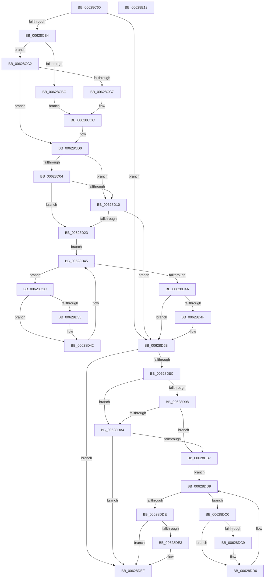

# DifIoCreateDeviceWrapper

- RVA: `0x00628C60`–`0x00628E14` (길이 `436` bytes)
- VA: `0x0000000140628C60`
- 실행 섹션: `.text`
- PDB 이름 있음: `예`; PDB Function 태그: `아니요`
- unwind 정보 RVA: `0x000BC530`
- 디코드: `123`개 명령, `436/436` bytes 표시
- 미해석 바이트: `0` (있으면 어셈블리에 `.byte`로 보존)

> 이 문서는 커널 이미지의 기계어와 PDB 기호를 분석해 생성했습니다. 4번과 5번은 함수 원형과 자료형을 바이너리 사용 방식에서 추정한 C 해석이며 원본 소스 복구 결과는 아닙니다.

## 1. Dependencies

- 직접 호출 지점: **10**; 고유 호출 대상: **7**
- 직접 호출자로 확인된 함수: **0**
- RIP 상대 이미지 참조: **3**

### Outgoing calls
- `0x00628C99` → [memset](../6C/memset_function_006C6C40.md) (function, `0x006C6C40`)
- `0x00628CA3` → [DifGetAPIThunkContextById](../49/DifGetAPIThunkContextById_function_00495A34.md) (function, `0x00495A34`)
- `0x00628CC7` → [DifGetReturnAddressForWrappers](../4D/DifGetReturnAddressForWrappers_function_004D3C08.md) (function, `0x004D3C08`)
- `0x00628D17` → [ExAcquireRundownProtection](../21/ExAcquireRundownProtection_function_00216620.md) (function, `0x00216620`)
- `0x00628D3D` → [guard_dispatch_icall](../6B/guard_dispatch_icall_function_006BAAD0.md) (function, `0x006BAAD0`)
- `0x00628D56` → [ExReleaseRundownProtection](../34/ExReleaseRundownProtection_function_00349E80.md) (function, `0x00349E80`)
- `0x00628D7F` → [IoCreateDevice](../../page/9A/IoCreateDevice_function_009A4B00.md) (function, `0x009A4B00`)
- `0x00628DAB` → [ExAcquireRundownProtection](../21/ExAcquireRundownProtection_function_00216620.md) (function, `0x00216620`)
- `0x00628DD1` → [guard_dispatch_icall](../6B/guard_dispatch_icall_function_006BAAD0.md) (function, `0x006BAAD0`)
- `0x00628DEA` → [ExReleaseRundownProtection](../34/ExReleaseRundownProtection_function_00349E80.md) (function, `0x00349E80`)

### Direct callers
- 이 함수 시작 RVA로 연결되는 직접 call은 확인되지 않았습니다. 간접 호출은 완전히 역산할 수 없습니다.

### Static image references
- `0x00628CD7` → RVA `0x00F048B8` (`.data`; read)
- `0x00628D04` → RVA `0x00F04980` (`.data`; read)
- `0x00628D10` → RVA `0x00F03E80` (`.data`; read)

## 2. Other-region calls and transfers

- 다른 실행 섹션으로 향하는 call: **1**
  - `0x00628D7F` → [IoCreateDevice](../../page/9A/IoCreateDevice_function_009A4B00.md) (`.text` → `PAGE`)
- 별도 외부 분기/꼬리 이동을 확인하지 못했습니다.

## 3. Assembly (complete function range)

```asm
00628C60  48 8B C4                        mov rax, rsp
00628C63  48 89 58 10                     mov qword ptr [rax + 0x10], rbx
00628C67  48 89 70 18                     mov qword ptr [rax + 0x18], rsi
00628C6B  48 89 78 20                     mov qword ptr [rax + 0x20], rdi
00628C6F  48 89 48 08                     mov qword ptr [rax + 8], rcx
00628C73  55                              push rbp
00628C74  41 54                           push r12
00628C76  41 55                           push r13
00628C78  41 56                           push r14
00628C7A  41 57                           push r15
00628C7C  48 8B EC                        mov rbp, rsp
00628C7F  48 81 EC 80 00 00 00            sub rsp, 0x80
00628C86  44 8B EA                        mov r13d, edx
00628C89  48 8D 4D C0                     lea rcx, [rbp - 0x40]
00628C8D  33 D2                           xor edx, edx
00628C8F  4D 8B E0                        mov r12, r8
00628C92  45 8B F9                        mov r15d, r9d
00628C95  44 8D 42 40                     lea r8d, [rdx + 0x40]
00628C99  E8 A2 DF 09 00                  call 0x1406c6c40
00628C9E  B9 63 01 00 00                  mov ecx, 0x163
00628CA3  E8 8C CD E6 FF                  call 0x140495a34
00628CA8  4C 8B F0                        mov r14, rax
00628CAB  48 85 C0                        test rax, rax
00628CAE  0F 84 A7 00 00 00               je 0x140628d5b
00628CB4  8B 48 0C                        mov ecx, dword ptr [rax + 0xc]
00628CB7  F6 C1 18                        test cl, 0x18
00628CBA  74 06                           je 0x140628cc2
00628CBC  48 8B 45 28                     mov rax, qword ptr [rbp + 0x28]
00628CC0  EB 0A                           jmp 0x140628ccc
00628CC2  F6 C1 04                        test cl, 4
00628CC5  74 09                           je 0x140628cd0
00628CC7  E8 3C AF EA FF                  call 0x1404d3c08
00628CCC  48 89 45 C0                     mov qword ptr [rbp - 0x40], rax
00628CD0  48 8B 45 30                     mov rax, qword ptr [rbp + 0x30]
00628CD4  40 32 F6                        xor sil, sil
00628CD7  40 38 35 DA BB 8D 00            cmp byte ptr [rip + 0x8dbbda], sil
00628CDE  48 89 45 F0                     mov qword ptr [rbp - 0x10], rax
00628CE2  8B 45 50                        mov eax, dword ptr [rbp + 0x50]
00628CE5  89 45 D4                        mov dword ptr [rbp - 0x2c], eax
00628CE8  8A 45 58                        mov al, byte ptr [rbp + 0x58]
00628CEB  88 45 D0                        mov byte ptr [rbp - 0x30], al
00628CEE  48 8B 45 60                     mov rax, qword ptr [rbp + 0x60]
00628CF2  48 89 45 C8                     mov qword ptr [rbp - 0x38], rax
00628CF6  44 89 6D E8                     mov dword ptr [rbp - 0x18], r13d
00628CFA  4C 89 65 E0                     mov qword ptr [rbp - 0x20], r12
00628CFE  44 89 7D D8                     mov dword ptr [rbp - 0x28], r15d
00628D02  75 0C                           jne 0x140628d10
00628D04  F7 05 72 BC 8D 00 00 08 00 00   test dword ptr [rip + 0x8dbc72], 0x800
00628D0E  74 13                           je 0x140628d23
00628D10  48 8D 0D 69 B1 8D 00            lea rcx, [rip + 0x8db169]
00628D17  E8 04 D9 BE FF                  call 0x140216620
00628D1C  40 8A F0                        mov sil, al
00628D1F  84 C0                           test al, al
00628D21  74 38                           je 0x140628d5b
00628D23  49 8D 7E 20                     lea rdi, [r14 + 0x20]
00628D27  48 8B 1F                        mov rbx, qword ptr [rdi]
00628D2A  EB 19                           jmp 0x140628d45
00628D2C  48 8D 43 F0                     lea rax, [rbx - 0x10]
00628D30  48 85 C0                        test rax, rax
00628D33  74 0D                           je 0x140628d42
00628D35  48 8B 40 08                     mov rax, qword ptr [rax + 8]
00628D39  48 8D 4D C0                     lea rcx, [rbp - 0x40]
00628D3D  E8 8E 1D 09 00                  call 0x1406baad0
00628D42  48 8B 1B                        mov rbx, qword ptr [rbx]
00628D45  48 3B DF                        cmp rbx, rdi
00628D48  75 E2                           jne 0x140628d2c
00628D4A  40 84 F6                        test sil, sil
00628D4D  74 0C                           je 0x140628d5b
00628D4F  48 8D 0D 2A B1 8D 00            lea rcx, [rip + 0x8db12a]
00628D56  E8 25 11 D2 FF                  call 0x140349e80
00628D5B  48 8B 45 60                     mov rax, qword ptr [rbp + 0x60]
00628D5F  45 8B CF                        mov r9d, r15d
00628D62  48 8B 4D 30                     mov rcx, qword ptr [rbp + 0x30]
00628D66  4D 8B C4                        mov r8, r12
00628D69  48 89 44 24 30                  mov qword ptr [rsp + 0x30], rax
00628D6E  41 8B D5                        mov edx, r13d
00628D71  8A 45 58                        mov al, byte ptr [rbp + 0x58]
00628D74  88 44 24 28                     mov byte ptr [rsp + 0x28], al
00628D78  8B 45 50                        mov eax, dword ptr [rbp + 0x50]
00628D7B  89 44 24 20                     mov dword ptr [rsp + 0x20], eax
00628D7F  E8 7C BD 37 00                  call 0x1409a4b00
00628D84  89 45 F8                        mov dword ptr [rbp - 8], eax
00628D87  4D 85 F6                        test r14, r14
00628D8A  74 63                           je 0x140628def
00628D8C  40 32 FF                        xor dil, dil
00628D8F  40 38 3D 22 BB 8D 00            cmp byte ptr [rip + 0x8dbb22], dil
00628D96  75 0C                           jne 0x140628da4
00628D98  F7 05 DE BB 8D 00 00 08 00 00   test dword ptr [rip + 0x8dbbde], 0x800
00628DA2  74 13                           je 0x140628db7
00628DA4  48 8D 0D D5 B0 8D 00            lea rcx, [rip + 0x8db0d5]
00628DAB  E8 70 D8 BE FF                  call 0x140216620
00628DB0  40 8A F8                        mov dil, al
00628DB3  84 C0                           test al, al
00628DB5  74 38                           je 0x140628def
00628DB7  49 8D 76 30                     lea rsi, [r14 + 0x30]
00628DBB  48 8B 1E                        mov rbx, qword ptr [rsi]
00628DBE  EB 19                           jmp 0x140628dd9
00628DC0  48 8D 43 F0                     lea rax, [rbx - 0x10]
00628DC4  48 85 C0                        test rax, rax
00628DC7  74 0D                           je 0x140628dd6
00628DC9  48 8B 40 08                     mov rax, qword ptr [rax + 8]
00628DCD  48 8D 4D C0                     lea rcx, [rbp - 0x40]
00628DD1  E8 FA 1C 09 00                  call 0x1406baad0
00628DD6  48 8B 1B                        mov rbx, qword ptr [rbx]
00628DD9  48 3B DE                        cmp rbx, rsi
00628DDC  75 E2                           jne 0x140628dc0
00628DDE  40 84 FF                        test dil, dil
00628DE1  74 0C                           je 0x140628def
00628DE3  48 8D 0D 96 B0 8D 00            lea rcx, [rip + 0x8db096]
00628DEA  E8 91 10 D2 FF                  call 0x140349e80
00628DEF  8B 45 F8                        mov eax, dword ptr [rbp - 8]
00628DF2  4C 8D 9C 24 80 00 00 00         lea r11, [rsp + 0x80]
00628DFA  49 8B 5B 38                     mov rbx, qword ptr [r11 + 0x38]
00628DFE  49 8B 73 40                     mov rsi, qword ptr [r11 + 0x40]
00628E02  49 8B 7B 48                     mov rdi, qword ptr [r11 + 0x48]
00628E06  49 8B E3                        mov rsp, r11
00628E09  41 5F                           pop r15
00628E0B  41 5E                           pop r14
00628E0D  41 5D                           pop r13
00628E0F  41 5C                           pop r12
00628E11  5D                              pop rbp
00628E12  C3                              ret
00628E13  CC                              int3
```

## 4. C-style interpretation (structured pseudocode)

```c
__int64 __fastcall DifIoCreateDeviceWrapper(__int64 a1, int a2, __int64 a3, int a4, unsigned int a5, unsigned __int8 a6, __int64 a7)
{
    __int64 result;
    __int64 v_rdi;
    __int64 v_rsi;
    __int64 v_rsp;
    unsigned __int64 v_stack_m28;
    unsigned int v_stack_m30;
    unsigned __int64 v_stack_m38;
    unsigned int v_stack_m40;
    unsigned __int64 v_stack_m48;
    unsigned int v_stack_m50;
    unsigned int v_stack_m54;
    unsigned __int8 v_stack_m58;
    unsigned __int64 v_stack_m60;
    unsigned __int64 v_stack_m68;
    unsigned __int64 v_stack_m78;
    unsigned __int8 v_stack_m80;
    unsigned int v_stack_m88;
    unsigned __int64 v_stack_p0;
    unsigned __int64 v_stack_p8;

    *(unsigned __int64 *)(v_rsp + 16) = v_rbx;
    *(unsigned __int64 *)(v_rsp + 24) = v_rsi;
    *(unsigned __int64 *)(v_rsp + 32) = v_rdi;
    *(unsigned __int64 *)(v_rsp + 8) = a1;
    v_rsp = (v_rsp) - (128);
    a2 = 0;
    result = memset(v_stack_m68, a2, a2 + 64, a4);
    result = DifGetAPIThunkContextById(355, a2, a2 + 64, a4);
    if (result == 0) goto loc_00628D5B;
    if ((((unsigned __int8)((unsigned int)(*(unsigned int *)(result + 12)))) & (24)) == 0) goto loc_00628CC2;
    goto loc_00628CCC;
loc_00628CC2:
    if ((((unsigned __int8)((unsigned int)(*(unsigned int *)(result + 12)))) & (4)) == 0) goto loc_00628CD0;
    result = DifGetReturnAddressForWrappers((unsigned int)(*(unsigned int *)(result + 12)), a2, a2 + 64, a4);
loc_00628CCC:
    v_stack_m68 = result;
loc_00628CD0:
    v_rsi = 0;
    v_stack_m38 = v_stack_p8;
    v_stack_m54 = (unsigned int)((unsigned int)(a5));
    v_stack_m58 = a6;
    v_stack_m60 = a7;
    v_stack_m40 = (unsigned int)((unsigned int)(a2));
    v_stack_m48 = a3;
    v_stack_m50 = (unsigned int)((unsigned int)(a4));
    if ((*(unsigned __int8 *)(v_rip + 9288666)) != 0) goto loc_00628D10;
    if (((*(unsigned int *)(v_rip + 9288818)) & (0x800ULL)) == 0) goto loc_00628D23;
loc_00628D10:
    result = ExAcquireRundownProtection(v_rip + 9285993, a2, a2 + 64, a4);
    if ((unsigned __int8)(result) == 0) goto loc_00628D5B;
loc_00628D23:
    goto loc_00628D45;
loc_00628D2C:
    result = *(unsigned __int64 *)(result + 32) - 16;
    if (*(unsigned __int64 *)(result + 32) - 16 != 0) {
        result = *(unsigned __int64 *)(*(unsigned __int64 *)(result + 32) - 16 + 8);
        a1 = v_stack_m68;
        result = guard_dispatch_icall(a1, a2, a2 + 64, a4);
    }
loc_00628D45:
    if ((*(unsigned __int64 *)(*(unsigned __int64 *)(result + 32))) != (result + 32)) goto loc_00628D2C;
    if ((unsigned __int8)((unsigned __int8)(result)) != 0) {
        a1 = v_rip + 9285930;
        result = ExReleaseRundownProtection(a1, a2, a2 + 64, a4);
    }
    v_stack_m78 = a7;
    v_stack_m80 = a6;
    v_stack_m88 = (unsigned int)((unsigned int)(a5));
    result = IoCreateDevice(v_stack_p8, (unsigned int)((unsigned int)((unsigned int)(a2))), a3, (unsigned int)((unsigned int)((unsigned int)(a4))));
    v_stack_m30 = (unsigned int)(result);
    if (result == 0) goto loc_00628DEF;
    v_rdi = 0;
    if ((*(unsigned __int8 *)(v_rip + 9288482)) != 0) goto loc_00628DA4;
    if (((*(unsigned int *)(v_rip + 9288670)) & (0x800ULL)) == 0) goto loc_00628DB7;
loc_00628DA4:
    result = ExAcquireRundownProtection(v_rip + 9285845, (unsigned int)((unsigned int)((unsigned int)(a2))), a3, (unsigned int)((unsigned int)((unsigned int)(a4))));
    if ((unsigned __int8)(result) == 0) goto loc_00628DEF;
loc_00628DB7:
    goto loc_00628DD9;
loc_00628DC0:
    result = *(unsigned __int64 *)(result + 48) - 16;
    if (*(unsigned __int64 *)(result + 48) - 16 != 0) {
        result = *(unsigned __int64 *)(*(unsigned __int64 *)(result + 48) - 16 + 8);
        a1 = v_stack_m68;
        result = guard_dispatch_icall(a1, (unsigned int)((unsigned int)((unsigned int)(a2))), a3, (unsigned int)((unsigned int)((unsigned int)(a4))));
    }
loc_00628DD9:
    if ((*(unsigned __int64 *)(*(unsigned __int64 *)(result + 48))) != (result + 48)) goto loc_00628DC0;
    if ((unsigned __int8)((unsigned __int8)(result)) != 0) {
        a1 = v_rip + 9285782;
        result = ExReleaseRundownProtection(a1, (unsigned int)((unsigned int)((unsigned int)(a2))), a3, (unsigned int)((unsigned int)((unsigned int)(a4))));
    }
    return (unsigned int)(v_stack_m30);
}
```

## 5. (Beta) C Style

```c
int64_t DifIoCreateDeviceWrapper(int64_t Arg1, int32_t Arg2, int64_t Arg3, int32_t Arg4, uint32_t Arg5, uint8_t Arg6, int64_t Arg7)
{
    int64_t result;
    int64_t local_rdi;
    int64_t local_rsi;
    int64_t local_rsp;
    uint64_t v_stack_m28;
    uint32_t v_stack_m30;
    uint64_t v_stack_m38;
    uint32_t v_stack_m40;
    uint64_t v_stack_m48;
    uint32_t v_stack_m50;
    uint32_t v_stack_m54;
    uint8_t v_stack_m58;
    uint64_t v_stack_m60;
    uint64_t v_stack_m68;
    uint64_t v_stack_m78;
    uint8_t v_stack_m80;
    uint32_t v_stack_m88;
    uint64_t v_stack_p0;
    uint64_t v_stack_p8;

    *(uint64_t *)(local_rsp + 0x10) = local_rbx;
    *(uint64_t *)(local_rsp + 0x18) = local_rsi;
    *(uint64_t *)(local_rsp + 0x20) = local_rdi;
    *(uint64_t *)(local_rsp + 0x8) = Arg1;
    local_rsp = (local_rsp) - (128);
    Arg2 = 0;
    result = memset(v_stack_m68, Arg2, Arg2 + 64, Arg4);
    result = DifGetAPIThunkContextById(355, Arg2, Arg2 + 64, Arg4);
    if (result == 0) goto loc_00628D5B;
    if ((((uint8_t)((uint32_t)(*(uint32_t *)(result + 0xC)))) & (24)) == 0) goto loc_00628CC2;
    goto loc_00628CCC;
loc_00628CC2:
    if ((((uint8_t)((uint32_t)(*(uint32_t *)(result + 0xC)))) & (4)) == 0) goto loc_00628CD0;
    result = DifGetReturnAddressForWrappers((uint32_t)(*(uint32_t *)(result + 0xC)), Arg2, Arg2 + 64, Arg4);
loc_00628CCC:
    v_stack_m68 = result;
loc_00628CD0:
    local_rsi = 0;
    v_stack_m38 = v_stack_p8;
    v_stack_m54 = (uint32_t)((uint32_t)(Arg5));
    v_stack_m58 = Arg6;
    v_stack_m60 = Arg7;
    v_stack_m40 = (uint32_t)((uint32_t)(Arg2));
    v_stack_m48 = Arg3;
    v_stack_m50 = (uint32_t)((uint32_t)(Arg4));
    if ((*(uint8_t *)(v_rip + 0x8DBBDA)) != 0) goto loc_00628D10;
    if (((*(uint32_t *)(v_rip + 0x8DBC72)) & (0x800ULL)) == 0) goto loc_00628D23;
loc_00628D10:
    result = ExAcquireRundownProtection(v_rip + 9285993, Arg2, Arg2 + 64, Arg4);
    if ((uint8_t)(result) == 0) goto loc_00628D5B;
loc_00628D23:
    goto loc_00628D45;
loc_00628D2C:
    result = *(uint64_t *)(result + 0x20) - 16;
    if (*(uint64_t *)(result + 0x20) - 16 != 0) {
        result = *(uint64_t *)(*(uint64_t *)(result + 0x20) - 0x10 + 0x8);
        Arg1 = v_stack_m68;
        result = guard_dispatch_icall(Arg1, Arg2, Arg2 + 64, Arg4);
    }
loc_00628D45:
    if ((*(uint64_t *)(*(uint64_t *)(result + 0x20))) != (result + 32)) goto loc_00628D2C;
    if ((uint8_t)((uint8_t)(result)) != 0) {
        Arg1 = v_rip + 9285930;
        result = ExReleaseRundownProtection(Arg1, Arg2, Arg2 + 64, Arg4);
    }
    v_stack_m78 = Arg7;
    v_stack_m80 = Arg6;
    v_stack_m88 = (uint32_t)((uint32_t)(Arg5));
    result = IoCreateDevice(v_stack_p8, (uint32_t)((uint32_t)((uint32_t)(Arg2))), Arg3, (uint32_t)((uint32_t)((uint32_t)(Arg4))));
    v_stack_m30 = (uint32_t)(result);
    if (result == 0) goto loc_00628DEF;
    local_rdi = 0;
    if ((*(uint8_t *)(v_rip + 0x8DBB22)) != 0) goto loc_00628DA4;
    if (((*(uint32_t *)(v_rip + 0x8DBBDE)) & (0x800ULL)) == 0) goto loc_00628DB7;
loc_00628DA4:
    result = ExAcquireRundownProtection(v_rip + 9285845, (uint32_t)((uint32_t)((uint32_t)(Arg2))), Arg3, (uint32_t)((uint32_t)((uint32_t)(Arg4))));
    if ((uint8_t)(result) == 0) goto loc_00628DEF;
loc_00628DB7:
    goto loc_00628DD9;
loc_00628DC0:
    result = *(uint64_t *)(result + 0x30) - 16;
    if (*(uint64_t *)(result + 0x30) - 16 != 0) {
        result = *(uint64_t *)(*(uint64_t *)(result + 0x30) - 0x10 + 0x8);
        Arg1 = v_stack_m68;
        result = guard_dispatch_icall(Arg1, (uint32_t)((uint32_t)((uint32_t)(Arg2))), Arg3, (uint32_t)((uint32_t)((uint32_t)(Arg4))));
    }
loc_00628DD9:
    if ((*(uint64_t *)(*(uint64_t *)(result + 0x30))) != (result + 48)) goto loc_00628DC0;
    if ((uint8_t)((uint8_t)(result)) != 0) {
        Arg1 = v_rip + 9285782;
        result = ExReleaseRundownProtection(Arg1, (uint32_t)((uint32_t)((uint32_t)(Arg2))), Arg3, (uint32_t)((uint32_t)((uint32_t)(Arg4))));
    }
    return (uint32_t)(v_stack_m30);
}
```

## 6. Execution-region graph

[열기: 2D/3D 그래프와 함수 탐색 컨트롤 패널](../../../control-panel.html?section=text&rva=0x00628C60&view=graph)

- 2D 그래프는 위에서 아래로 흐르고, 3D 그래프는 빈 공간을 드래그해 회전합니다. Shift+드래그는 이동, 휠은 확대·축소, 함수 노드 선택은 대상 보고서 이동입니다.

### Static fallback


