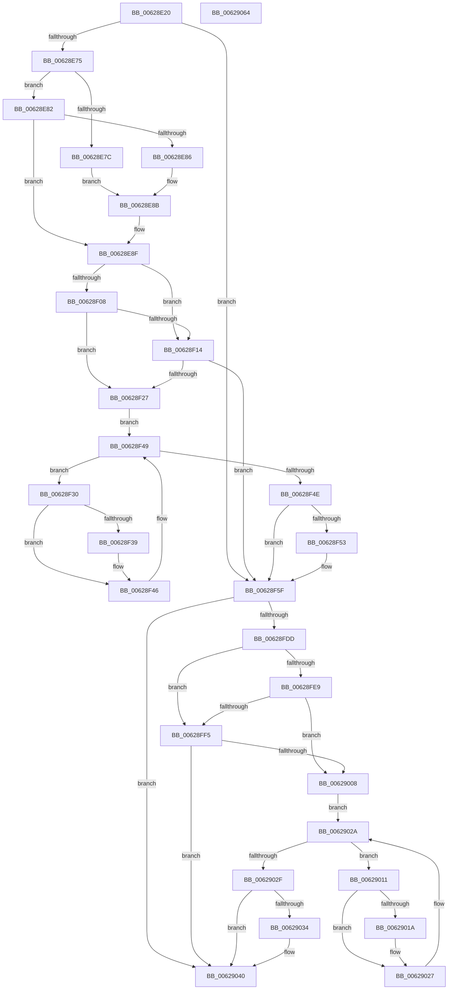

# DifIoCreateFileExWrapper

- RVA: `0x00628E20`–`0x00629065` (길이 `581` bytes)
- VA: `0x0000000140628E20`
- 실행 섹션: `.text`
- PDB 이름 있음: `예`; PDB Function 태그: `아니요`
- unwind 정보 RVA: `0x000C93FC`
- 디코드: `155`개 명령, `581/581` bytes 표시
- 미해석 바이트: `0` (있으면 어셈블리에 `.byte`로 보존)

> 이 문서는 커널 이미지의 기계어와 PDB 기호를 분석해 생성했습니다. 4번과 5번은 함수 원형과 자료형을 바이너리 사용 방식에서 추정한 C 해석이며 원본 소스 복구 결과는 아닙니다.

## 1. Dependencies

- 직접 호출 지점: **10**; 고유 호출 대상: **7**
- 직접 호출자로 확인된 함수: **0**
- RIP 상대 이미지 참조: **3**

### Outgoing calls
- `0x00628E5A` → [memset](../6C/memset_function_006C6C40.md) (function, `0x006C6C40`)
- `0x00628E64` → [DifGetAPIThunkContextById](../49/DifGetAPIThunkContextById_function_00495A34.md) (function, `0x00495A34`)
- `0x00628E86` → [DifGetReturnAddressForWrappers](../4D/DifGetReturnAddressForWrappers_function_004D3C08.md) (function, `0x004D3C08`)
- `0x00628F1B` → [ExAcquireRundownProtection](../21/ExAcquireRundownProtection_function_00216620.md) (function, `0x00216620`)
- `0x00628F41` → [guard_dispatch_icall](../6B/guard_dispatch_icall_function_006BAAD0.md) (function, `0x006BAAD0`)
- `0x00628F5A` → [ExReleaseRundownProtection](../34/ExReleaseRundownProtection_function_00349E80.md) (function, `0x00349E80`)
- `0x00628FD0` → [IoCreateFileEx](../../page/8A/IoCreateFileEx_function_008AB000.md) (function, `0x008AB000`)
- `0x00628FFC` → [ExAcquireRundownProtection](../21/ExAcquireRundownProtection_function_00216620.md) (function, `0x00216620`)
- `0x00629022` → [guard_dispatch_icall](../6B/guard_dispatch_icall_function_006BAAD0.md) (function, `0x006BAAD0`)
- `0x0062903B` → [ExReleaseRundownProtection](../34/ExReleaseRundownProtection_function_00349E80.md) (function, `0x00349E80`)

### Direct callers
- 이 함수 시작 RVA로 연결되는 직접 call은 확인되지 않았습니다. 간접 호출은 완전히 역산할 수 없습니다.

### Static image references
- `0x00628E96` → RVA `0x00F048B8` (`.data`; read)
- `0x00628F08` → RVA `0x00F04980` (`.data`; read)
- `0x00628F14` → RVA `0x00F03E80` (`.data`; read)

## 2. Other-region calls and transfers

- 다른 실행 섹션으로 향하는 call: **1**
  - `0x00628FD0` → [IoCreateFileEx](../../page/8A/IoCreateFileEx_function_008AB000.md) (`.text` → `PAGE`)
- 별도 외부 분기/꼬리 이동을 확인하지 못했습니다.

## 3. Assembly (complete function range)

```asm
00628E20  48 8B C4                        mov rax, rsp
00628E23  48 89 58 10                     mov qword ptr [rax + 0x10], rbx
00628E27  48 89 70 18                     mov qword ptr [rax + 0x18], rsi
00628E2B  48 89 78 20                     mov qword ptr [rax + 0x20], rdi
00628E2F  48 89 48 08                     mov qword ptr [rax + 8], rcx
00628E33  55                              push rbp
00628E34  41 54                           push r12
00628E36  41 55                           push r13
00628E38  41 56                           push r14
00628E3A  41 57                           push r15
00628E3C  48 8D 68 D1                     lea rbp, [rax - 0x2f]
00628E40  48 81 EC F0 00 00 00            sub rsp, 0xf0
00628E47  44 8B EA                        mov r13d, edx
00628E4A  48 8D 4D 97                     lea rcx, [rbp - 0x69]
00628E4E  33 D2                           xor edx, edx
00628E50  4D 8B E0                        mov r12, r8
00628E53  4D 8B F9                        mov r15, r9
00628E56  44 8D 42 70                     lea r8d, [rdx + 0x70]
00628E5A  E8 E1 DD 09 00                  call 0x1406c6c40
00628E5F  B9 61 01 00 00                  mov ecx, 0x161
00628E64  E8 CB CB E6 FF                  call 0x140495a34
00628E69  48 8B F0                        mov rsi, rax
00628E6C  48 85 C0                        test rax, rax
00628E6F  0F 84 EA 00 00 00               je 0x140628f5f
00628E75  8B 40 0C                        mov eax, dword ptr [rax + 0xc]
00628E78  A8 18                           test al, 0x18
00628E7A  74 06                           je 0x140628e82
00628E7C  48 8B 45 2F                     mov rax, qword ptr [rbp + 0x2f]
00628E80  EB 09                           jmp 0x140628e8b
00628E82  A8 04                           test al, 4
00628E84  74 09                           je 0x140628e8f
00628E86  E8 7D AD EA FF                  call 0x1404d3c08
00628E8B  48 89 45 97                     mov qword ptr [rbp - 0x69], rax
00628E8F  48 8B 45 37                     mov rax, qword ptr [rbp + 0x37]
00628E93  45 32 F6                        xor r14b, r14b
00628E96  44 38 35 1B BA 8D 00            cmp byte ptr [rip + 0x8dba1b], r14b
00628E9D  48 89 45 F7                     mov qword ptr [rbp - 9], rax
00628EA1  48 8B 45 57                     mov rax, qword ptr [rbp + 0x57]
00628EA5  48 89 45 D7                     mov qword ptr [rbp - 0x29], rax
00628EA9  8B 45 5F                        mov eax, dword ptr [rbp + 0x5f]
00628EAC  89 45 D3                        mov dword ptr [rbp - 0x2d], eax
00628EAF  8B 45 67                        mov eax, dword ptr [rbp + 0x67]
00628EB2  89 45 CF                        mov dword ptr [rbp - 0x31], eax
00628EB5  8B 45 6F                        mov eax, dword ptr [rbp + 0x6f]
00628EB8  89 45 CB                        mov dword ptr [rbp - 0x35], eax
00628EBB  8B 45 77                        mov eax, dword ptr [rbp + 0x77]
00628EBE  89 45 C7                        mov dword ptr [rbp - 0x39], eax
00628EC1  48 8B 45 7F                     mov rax, qword ptr [rbp + 0x7f]
00628EC5  48 89 45 BF                     mov qword ptr [rbp - 0x41], rax
00628EC9  8B 85 87 00 00 00               mov eax, dword ptr [rbp + 0x87]
00628ECF  89 45 BB                        mov dword ptr [rbp - 0x45], eax
00628ED2  8B 85 8F 00 00 00               mov eax, dword ptr [rbp + 0x8f]
00628ED8  89 45 B7                        mov dword ptr [rbp - 0x49], eax
00628EDB  48 8B 85 97 00 00 00            mov rax, qword ptr [rbp + 0x97]
00628EE2  48 89 45 AF                     mov qword ptr [rbp - 0x51], rax
00628EE6  8B 85 9F 00 00 00               mov eax, dword ptr [rbp + 0x9f]
00628EEC  89 45 A7                        mov dword ptr [rbp - 0x59], eax
00628EEF  48 8B 85 A7 00 00 00            mov rax, qword ptr [rbp + 0xa7]
00628EF6  48 89 45 9F                     mov qword ptr [rbp - 0x61], rax
00628EFA  44 89 6D EF                     mov dword ptr [rbp - 0x11], r13d
00628EFE  4C 89 65 E7                     mov qword ptr [rbp - 0x19], r12
00628F02  4C 89 7D DF                     mov qword ptr [rbp - 0x21], r15
00628F06  75 0C                           jne 0x140628f14
00628F08  F7 05 6E BA 8D 00 00 08 00 00   test dword ptr [rip + 0x8dba6e], 0x800
00628F12  74 13                           je 0x140628f27
00628F14  48 8D 0D 65 AF 8D 00            lea rcx, [rip + 0x8daf65]
00628F1B  E8 00 D7 BE FF                  call 0x140216620
00628F20  44 8A F0                        mov r14b, al
00628F23  84 C0                           test al, al
00628F25  74 38                           je 0x140628f5f
00628F27  48 8D 7E 20                     lea rdi, [rsi + 0x20]
00628F2B  48 8B 1F                        mov rbx, qword ptr [rdi]
00628F2E  EB 19                           jmp 0x140628f49
00628F30  48 8D 43 F0                     lea rax, [rbx - 0x10]
00628F34  48 85 C0                        test rax, rax
00628F37  74 0D                           je 0x140628f46
00628F39  48 8B 40 08                     mov rax, qword ptr [rax + 8]
00628F3D  48 8D 4D 97                     lea rcx, [rbp - 0x69]
00628F41  E8 8A 1B 09 00                  call 0x1406baad0
00628F46  48 8B 1B                        mov rbx, qword ptr [rbx]
00628F49  48 3B DF                        cmp rbx, rdi
00628F4C  75 E2                           jne 0x140628f30
00628F4E  45 84 F6                        test r14b, r14b
00628F51  74 0C                           je 0x140628f5f
00628F53  48 8D 0D 26 AF 8D 00            lea rcx, [rip + 0x8daf26]
00628F5A  E8 21 0F D2 FF                  call 0x140349e80
00628F5F  48 8B 85 A7 00 00 00            mov rax, qword ptr [rbp + 0xa7]
00628F66  4D 8B CF                        mov r9, r15
00628F69  48 8B 4D 37                     mov rcx, qword ptr [rbp + 0x37]
00628F6D  4D 8B C4                        mov r8, r12
00628F70  48 89 44 24 70                  mov qword ptr [rsp + 0x70], rax
00628F75  41 8B D5                        mov edx, r13d
00628F78  8B 85 9F 00 00 00               mov eax, dword ptr [rbp + 0x9f]
00628F7E  89 44 24 68                     mov dword ptr [rsp + 0x68], eax
00628F82  48 8B 85 97 00 00 00            mov rax, qword ptr [rbp + 0x97]
00628F89  48 89 44 24 60                  mov qword ptr [rsp + 0x60], rax
00628F8E  8B 85 8F 00 00 00               mov eax, dword ptr [rbp + 0x8f]
00628F94  89 44 24 58                     mov dword ptr [rsp + 0x58], eax
00628F98  8B 85 87 00 00 00               mov eax, dword ptr [rbp + 0x87]
00628F9E  89 44 24 50                     mov dword ptr [rsp + 0x50], eax
00628FA2  48 8B 45 7F                     mov rax, qword ptr [rbp + 0x7f]
00628FA6  48 89 44 24 48                  mov qword ptr [rsp + 0x48], rax
00628FAB  8B 45 77                        mov eax, dword ptr [rbp + 0x77]
00628FAE  89 44 24 40                     mov dword ptr [rsp + 0x40], eax
00628FB2  8B 45 6F                        mov eax, dword ptr [rbp + 0x6f]
00628FB5  89 44 24 38                     mov dword ptr [rsp + 0x38], eax
00628FB9  8B 45 67                        mov eax, dword ptr [rbp + 0x67]
00628FBC  89 44 24 30                     mov dword ptr [rsp + 0x30], eax
00628FC0  8B 45 5F                        mov eax, dword ptr [rbp + 0x5f]
00628FC3  89 44 24 28                     mov dword ptr [rsp + 0x28], eax
00628FC7  48 8B 45 57                     mov rax, qword ptr [rbp + 0x57]
00628FCB  48 89 44 24 20                  mov qword ptr [rsp + 0x20], rax
00628FD0  E8 2B 20 28 00                  call 0x1408ab000
00628FD5  89 45 FF                        mov dword ptr [rbp - 1], eax
00628FD8  48 85 F6                        test rsi, rsi
00628FDB  74 63                           je 0x140629040
00628FDD  40 32 FF                        xor dil, dil
00628FE0  40 38 3D D1 B8 8D 00            cmp byte ptr [rip + 0x8db8d1], dil
00628FE7  75 0C                           jne 0x140628ff5
00628FE9  F7 05 8D B9 8D 00 00 08 00 00   test dword ptr [rip + 0x8db98d], 0x800
00628FF3  74 13                           je 0x140629008
00628FF5  48 8D 0D 84 AE 8D 00            lea rcx, [rip + 0x8dae84]
00628FFC  E8 1F D6 BE FF                  call 0x140216620
00629001  40 8A F8                        mov dil, al
00629004  84 C0                           test al, al
00629006  74 38                           je 0x140629040
00629008  48 83 C6 30                     add rsi, 0x30
0062900C  48 8B 1E                        mov rbx, qword ptr [rsi]
0062900F  EB 19                           jmp 0x14062902a
00629011  48 8D 43 F0                     lea rax, [rbx - 0x10]
00629015  48 85 C0                        test rax, rax
00629018  74 0D                           je 0x140629027
0062901A  48 8B 40 08                     mov rax, qword ptr [rax + 8]
0062901E  48 8D 4D 97                     lea rcx, [rbp - 0x69]
00629022  E8 A9 1A 09 00                  call 0x1406baad0
00629027  48 8B 1B                        mov rbx, qword ptr [rbx]
0062902A  48 3B DE                        cmp rbx, rsi
0062902D  75 E2                           jne 0x140629011
0062902F  40 84 FF                        test dil, dil
00629032  74 0C                           je 0x140629040
00629034  48 8D 0D 45 AE 8D 00            lea rcx, [rip + 0x8dae45]
0062903B  E8 40 0E D2 FF                  call 0x140349e80
00629040  8B 45 FF                        mov eax, dword ptr [rbp - 1]
00629043  4C 8D 9C 24 F0 00 00 00         lea r11, [rsp + 0xf0]
0062904B  49 8B 5B 38                     mov rbx, qword ptr [r11 + 0x38]
0062904F  49 8B 73 40                     mov rsi, qword ptr [r11 + 0x40]
00629053  49 8B 7B 48                     mov rdi, qword ptr [r11 + 0x48]
00629057  49 8B E3                        mov rsp, r11
0062905A  41 5F                           pop r15
0062905C  41 5E                           pop r14
0062905E  41 5D                           pop r13
00629060  41 5C                           pop r12
00629062  5D                              pop rbp
00629063  C3                              ret
00629064  CC                              int3
```

## 4. C-style interpretation (structured pseudocode)

```c
__int64 __fastcall DifIoCreateFileExWrapper(__int64 a1, int a2, __int64 a3, __int64 a4)
{
    __int64 result;
    __int64 v_r14;
    __int64 v_rdi;
    __int64 v_rsi;
    __int64 v_rsp;
    unsigned __int64 v_stack_m28;
    unsigned __int64 v_stack_mA8;
    unsigned int v_stack_mB0;
    unsigned __int64 v_stack_mB8;
    unsigned int v_stack_mC0;
    unsigned int v_stack_mC8;
    unsigned __int64 v_stack_mD0;
    unsigned int v_stack_mD8;
    unsigned int v_stack_mE0;
    unsigned int v_stack_mE8;
    unsigned int v_stack_mF0;
    unsigned __int64 v_stack_mF8;

    *(unsigned __int64 *)(v_rsp + 16) = v_rbx;
    *(unsigned __int64 *)(v_rsp + 24) = v_rsi;
    *(unsigned __int64 *)(v_rsp + 32) = v_rdi;
    *(unsigned __int64 *)(v_rsp + 8) = a1;
    v_rsp = (v_rsp) - (240);
    a2 = 0;
    result = memset(v_rsp - 47 - 105, a2, a2 + 112, a4);
    result = DifGetAPIThunkContextById(353, a2, a2 + 112, a4);
    if (result == 0) goto loc_00628F5F;
    if ((((unsigned __int8)((unsigned int)(*(unsigned int *)(result + 12)))) & (24)) == 0) goto loc_00628E82;
    goto loc_00628E8B;
loc_00628E82:
    if ((((unsigned __int8)(*(unsigned __int64 *)(v_rsp - 47 + 47))) & (4)) == 0) goto loc_00628E8F;
    result = DifGetReturnAddressForWrappers(353, a2, a2 + 112, a4);
loc_00628E8B:
    *(unsigned __int64 *)(v_rsp - 47 - 105) = result;
loc_00628E8F:
    v_r14 = 0;
    *(unsigned __int64 *)(v_rsp - 47 - 9) = *(unsigned __int64 *)(v_rsp - 47 + 55);
    *(unsigned __int64 *)(v_rsp - 47 - 41) = *(unsigned __int64 *)(v_rsp - 47 + 87);
    *(unsigned int *)(v_rsp - 47 - 45) = (unsigned int)((unsigned int)(*(unsigned int *)(v_rsp - 47 + 95)));
    *(unsigned int *)(v_rsp - 47 - 49) = (unsigned int)((unsigned int)(*(unsigned int *)(v_rsp - 47 + 103)));
    *(unsigned int *)(v_rsp - 47 - 53) = (unsigned int)((unsigned int)(*(unsigned int *)(v_rsp - 47 + 111)));
    *(unsigned int *)(v_rsp - 47 - 57) = (unsigned int)((unsigned int)(*(unsigned int *)(v_rsp - 47 + 119)));
    *(unsigned __int64 *)(v_rsp - 47 - 65) = *(unsigned __int64 *)(v_rsp - 47 + 127);
    *(unsigned int *)(v_rsp - 47 - 69) = (unsigned int)((unsigned int)(*(unsigned int *)(v_rsp - 47 + 135)));
    *(unsigned int *)(v_rsp - 47 - 73) = (unsigned int)((unsigned int)(*(unsigned int *)(v_rsp - 47 + 143)));
    *(unsigned __int64 *)(v_rsp - 47 - 81) = *(unsigned __int64 *)(v_rsp - 47 + 151);
    *(unsigned int *)(v_rsp - 47 - 89) = (unsigned int)((unsigned int)(*(unsigned int *)(v_rsp - 47 + 159)));
    *(unsigned __int64 *)(v_rsp - 47 - 97) = *(unsigned __int64 *)(v_rsp - 47 + 167);
    *(unsigned int *)(v_rsp - 47 - 17) = (unsigned int)((unsigned int)(a2));
    *(unsigned __int64 *)(v_rsp - 47 - 25) = a3;
    *(unsigned __int64 *)(v_rsp - 47 - 33) = a4;
    if ((*(unsigned __int8 *)(v_rip + 9288219)) != 0) goto loc_00628F14;
    if (((*(unsigned int *)(v_rip + 9288302)) & (0x800ULL)) == 0) goto loc_00628F27;
loc_00628F14:
    result = ExAcquireRundownProtection(v_rip + 9285477, a2, a2 + 112, a4);
    if ((unsigned __int8)(result) == 0) goto loc_00628F5F;
loc_00628F27:
    goto loc_00628F49;
loc_00628F30:
    result = *(unsigned __int64 *)(result + 32) - 16;
    if (*(unsigned __int64 *)(result + 32) - 16 != 0) {
        result = *(unsigned __int64 *)(*(unsigned __int64 *)(result + 32) - 16 + 8);
        a1 = v_rsp - 47 - 105;
        result = guard_dispatch_icall(a1, a2, a2 + 112, a4);
    }
loc_00628F49:
    if ((*(unsigned __int64 *)(*(unsigned __int64 *)(result + 32))) != (result + 32)) goto loc_00628F30;
    if ((unsigned __int8)((unsigned __int8)(result)) != 0) {
        a1 = v_rip + 9285414;
        result = ExReleaseRundownProtection(a1, a2, a2 + 112, a4);
    }
    v_stack_mA8 = *(unsigned __int64 *)(v_rsp - 47 + 167);
    v_stack_mB0 = (unsigned int)((unsigned int)(*(unsigned int *)(v_rsp - 47 + 159)));
    v_stack_mB8 = *(unsigned __int64 *)(v_rsp - 47 + 151);
    v_stack_mC0 = (unsigned int)((unsigned int)(*(unsigned int *)(v_rsp - 47 + 143)));
    v_stack_mC8 = (unsigned int)((unsigned int)(*(unsigned int *)(v_rsp - 47 + 135)));
    v_stack_mD0 = *(unsigned __int64 *)(v_rsp - 47 + 127);
    v_stack_mD8 = (unsigned int)((unsigned int)(*(unsigned int *)(v_rsp - 47 + 119)));
    v_stack_mE0 = (unsigned int)((unsigned int)(*(unsigned int *)(v_rsp - 47 + 111)));
    v_stack_mE8 = (unsigned int)((unsigned int)(*(unsigned int *)(v_rsp - 47 + 103)));
    v_stack_mF0 = (unsigned int)((unsigned int)(*(unsigned int *)(v_rsp - 47 + 95)));
    v_stack_mF8 = *(unsigned __int64 *)(v_rsp - 47 + 87);
    result = IoCreateFileEx(*(unsigned __int64 *)(v_rsp - 47 + 55), (unsigned int)((unsigned int)((unsigned int)(a2))), a3, a4);
    *(unsigned int *)(v_rsp - 47 - 1) = (unsigned int)(result);
    if (result == 0) goto loc_00629040;
    v_rdi = 0;
    if ((*(unsigned __int8 *)(v_rip + 9287889)) != 0) goto loc_00628FF5;
    if (((*(unsigned int *)(v_rip + 9288077)) & (0x800ULL)) == 0) goto loc_00629008;
loc_00628FF5:
    result = ExAcquireRundownProtection(v_rip + 9285252, (unsigned int)((unsigned int)((unsigned int)(a2))), a3, a4);
    if ((unsigned __int8)(result) == 0) goto loc_00629040;
loc_00629008:
    v_rsi = (result) + (48);
    goto loc_0062902A;
loc_00629011:
    result = *(unsigned __int64 *)(v_rsi) - 16;
    if (*(unsigned __int64 *)(v_rsi) - 16 != 0) {
        result = *(unsigned __int64 *)(*(unsigned __int64 *)(v_rsi) - 16 + 8);
        a1 = v_rsp - 47 - 105;
        result = guard_dispatch_icall(a1, (unsigned int)((unsigned int)((unsigned int)(a2))), a3, a4);
    }
loc_0062902A:
    if ((*(unsigned __int64 *)(*(unsigned __int64 *)(v_rsi))) != v_rsi) goto loc_00629011;
    if ((unsigned __int8)((unsigned __int8)(result)) != 0) {
        a1 = v_rip + 9285189;
        result = ExReleaseRundownProtection(a1, (unsigned int)((unsigned int)((unsigned int)(a2))), a3, a4);
    }
    return (unsigned int)(*(unsigned int *)(v_rsp - 47 - 1));
}
```

## 5. (Beta) C Style

```c
int64_t DifIoCreateFileExWrapper(int64_t Arg1, int32_t Arg2, int64_t Arg3, int64_t Arg4)
{
    int64_t result;
    int64_t local_r14;
    int64_t local_rdi;
    int64_t local_rsi;
    int64_t local_rsp;
    uint64_t v_stack_m28;
    uint64_t v_stack_mA8;
    uint32_t v_stack_mB0;
    uint64_t v_stack_mB8;
    uint32_t v_stack_mC0;
    uint32_t v_stack_mC8;
    uint64_t v_stack_mD0;
    uint32_t v_stack_mD8;
    uint32_t v_stack_mE0;
    uint32_t v_stack_mE8;
    uint32_t v_stack_mF0;
    uint64_t v_stack_mF8;

    *(uint64_t *)(local_rsp + 0x10) = local_rbx;
    *(uint64_t *)(local_rsp + 0x18) = local_rsi;
    *(uint64_t *)(local_rsp + 0x20) = local_rdi;
    *(uint64_t *)(local_rsp + 0x8) = Arg1;
    local_rsp = (local_rsp) - (240);
    Arg2 = 0;
    result = memset(local_rsp - 47 - 105, Arg2, Arg2 + 112, Arg4);
    result = DifGetAPIThunkContextById(353, Arg2, Arg2 + 112, Arg4);
    if (result == 0) goto loc_00628F5F;
    if ((((uint8_t)((uint32_t)(*(uint32_t *)(result + 0xC)))) & (24)) == 0) goto loc_00628E82;
    goto loc_00628E8B;
loc_00628E82:
    if ((((uint8_t)(*(uint64_t *)(local_rsp - 0x2F + 0x2F))) & (4)) == 0) goto loc_00628E8F;
    result = DifGetReturnAddressForWrappers(353, Arg2, Arg2 + 112, Arg4);
loc_00628E8B:
    *(uint64_t *)(local_rsp - 0x2F - 0x69) = result;
loc_00628E8F:
    local_r14 = 0;
    *(uint64_t *)(local_rsp - 0x2F - 0x9) = *(uint64_t *)(local_rsp - 0x2F + 0x37);
    *(uint64_t *)(local_rsp - 0x2F - 0x29) = *(uint64_t *)(local_rsp - 0x2F + 0x57);
    *(uint32_t *)(local_rsp - 0x2F - 0x2D) = (uint32_t)((uint32_t)(*(uint32_t *)(local_rsp - 0x2F + 0x5F)));
    *(uint32_t *)(local_rsp - 0x2F - 0x31) = (uint32_t)((uint32_t)(*(uint32_t *)(local_rsp - 0x2F + 0x67)));
    *(uint32_t *)(local_rsp - 0x2F - 0x35) = (uint32_t)((uint32_t)(*(uint32_t *)(local_rsp - 0x2F + 0x6F)));
    *(uint32_t *)(local_rsp - 0x2F - 0x39) = (uint32_t)((uint32_t)(*(uint32_t *)(local_rsp - 0x2F + 0x77)));
    *(uint64_t *)(local_rsp - 0x2F - 0x41) = *(uint64_t *)(local_rsp - 0x2F + 0x7F);
    *(uint32_t *)(local_rsp - 0x2F - 0x45) = (uint32_t)((uint32_t)(*(uint32_t *)(local_rsp - 0x2F + 0x87)));
    *(uint32_t *)(local_rsp - 0x2F - 0x49) = (uint32_t)((uint32_t)(*(uint32_t *)(local_rsp - 0x2F + 0x8F)));
    *(uint64_t *)(local_rsp - 0x2F - 0x51) = *(uint64_t *)(local_rsp - 0x2F + 0x97);
    *(uint32_t *)(local_rsp - 0x2F - 0x59) = (uint32_t)((uint32_t)(*(uint32_t *)(local_rsp - 0x2F + 0x9F)));
    *(uint64_t *)(local_rsp - 0x2F - 0x61) = *(uint64_t *)(local_rsp - 0x2F + 0xA7);
    *(uint32_t *)(local_rsp - 0x2F - 0x11) = (uint32_t)((uint32_t)(Arg2));
    *(uint64_t *)(local_rsp - 0x2F - 0x19) = Arg3;
    *(uint64_t *)(local_rsp - 0x2F - 0x21) = Arg4;
    if ((*(uint8_t *)(v_rip + 0x8DBA1B)) != 0) goto loc_00628F14;
    if (((*(uint32_t *)(v_rip + 0x8DBA6E)) & (0x800ULL)) == 0) goto loc_00628F27;
loc_00628F14:
    result = ExAcquireRundownProtection(v_rip + 9285477, Arg2, Arg2 + 112, Arg4);
    if ((uint8_t)(result) == 0) goto loc_00628F5F;
loc_00628F27:
    goto loc_00628F49;
loc_00628F30:
    result = *(uint64_t *)(result + 0x20) - 16;
    if (*(uint64_t *)(result + 0x20) - 16 != 0) {
        result = *(uint64_t *)(*(uint64_t *)(result + 0x20) - 0x10 + 0x8);
        Arg1 = local_rsp - 47 - 105;
        result = guard_dispatch_icall(Arg1, Arg2, Arg2 + 112, Arg4);
    }
loc_00628F49:
    if ((*(uint64_t *)(*(uint64_t *)(result + 0x20))) != (result + 32)) goto loc_00628F30;
    if ((uint8_t)((uint8_t)(result)) != 0) {
        Arg1 = v_rip + 9285414;
        result = ExReleaseRundownProtection(Arg1, Arg2, Arg2 + 112, Arg4);
    }
    v_stack_mA8 = *(uint64_t *)(local_rsp - 0x2F + 0xA7);
    v_stack_mB0 = (uint32_t)((uint32_t)(*(uint32_t *)(local_rsp - 0x2F + 0x9F)));
    v_stack_mB8 = *(uint64_t *)(local_rsp - 0x2F + 0x97);
    v_stack_mC0 = (uint32_t)((uint32_t)(*(uint32_t *)(local_rsp - 0x2F + 0x8F)));
    v_stack_mC8 = (uint32_t)((uint32_t)(*(uint32_t *)(local_rsp - 0x2F + 0x87)));
    v_stack_mD0 = *(uint64_t *)(local_rsp - 0x2F + 0x7F);
    v_stack_mD8 = (uint32_t)((uint32_t)(*(uint32_t *)(local_rsp - 0x2F + 0x77)));
    v_stack_mE0 = (uint32_t)((uint32_t)(*(uint32_t *)(local_rsp - 0x2F + 0x6F)));
    v_stack_mE8 = (uint32_t)((uint32_t)(*(uint32_t *)(local_rsp - 0x2F + 0x67)));
    v_stack_mF0 = (uint32_t)((uint32_t)(*(uint32_t *)(local_rsp - 0x2F + 0x5F)));
    v_stack_mF8 = *(uint64_t *)(local_rsp - 0x2F + 0x57);
    result = IoCreateFileEx(*(uint64_t *)(local_rsp - 0x2F + 0x37), (uint32_t)((uint32_t)((uint32_t)(Arg2))), Arg3, Arg4);
    *(uint32_t *)(local_rsp - 0x2F - 0x1) = (uint32_t)(result);
    if (result == 0) goto loc_00629040;
    local_rdi = 0;
    if ((*(uint8_t *)(v_rip + 0x8DB8D1)) != 0) goto loc_00628FF5;
    if (((*(uint32_t *)(v_rip + 0x8DB98D)) & (0x800ULL)) == 0) goto loc_00629008;
loc_00628FF5:
    result = ExAcquireRundownProtection(v_rip + 9285252, (uint32_t)((uint32_t)((uint32_t)(Arg2))), Arg3, Arg4);
    if ((uint8_t)(result) == 0) goto loc_00629040;
loc_00629008:
    local_rsi = (result) + (48);
    goto loc_0062902A;
loc_00629011:
    result = *(uint64_t *)(local_rsi) - 16;
    if (*(uint64_t *)(local_rsi) - 16 != 0) {
        result = *(uint64_t *)(*(uint64_t *)(local_rsi) - 0x10 + 0x8);
        Arg1 = local_rsp - 47 - 105;
        result = guard_dispatch_icall(Arg1, (uint32_t)((uint32_t)((uint32_t)(Arg2))), Arg3, Arg4);
    }
loc_0062902A:
    if ((*(uint64_t *)(*(uint64_t *)(local_rsi))) != local_rsi) goto loc_00629011;
    if ((uint8_t)((uint8_t)(result)) != 0) {
        Arg1 = v_rip + 9285189;
        result = ExReleaseRundownProtection(Arg1, (uint32_t)((uint32_t)((uint32_t)(Arg2))), Arg3, Arg4);
    }
    return (uint32_t)(*(uint32_t *)(local_rsp - 0x2F - 0x1));
}
```

## 6. Execution-region graph

[열기: 2D/3D 그래프와 함수 탐색 컨트롤 패널](../../../control-panel.html?section=text&rva=0x00628E20&view=graph)

- 2D 그래프는 위에서 아래로 흐르고, 3D 그래프는 빈 공간을 드래그해 회전합니다. Shift+드래그는 이동, 휠은 확대·축소, 함수 노드 선택은 대상 보고서 이동입니다.

### Static fallback


