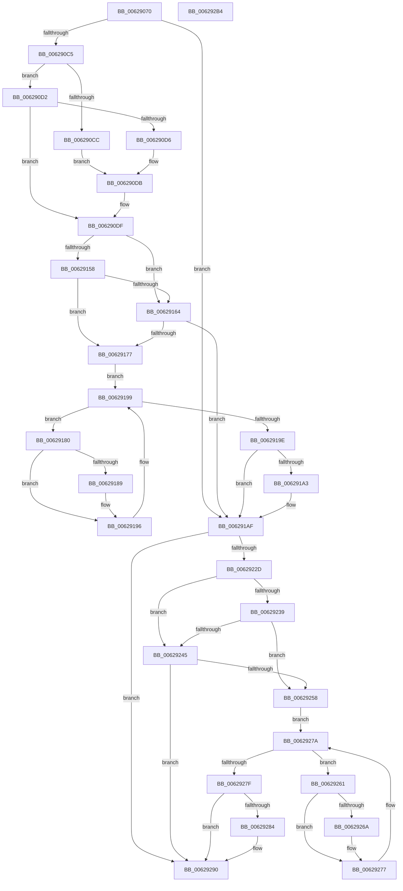

# DifIoCreateFileSpecifyDeviceObjectHintWrapper

- RVA: `0x00629070`–`0x006292B5` (길이 `581` bytes)
- VA: `0x0000000140629070`
- 실행 섹션: `.text`
- PDB 이름 있음: `예`; PDB Function 태그: `아니요`
- unwind 정보 RVA: `0x000C93FC`
- 디코드: `155`개 명령, `581/581` bytes 표시
- 미해석 바이트: `0` (있으면 어셈블리에 `.byte`로 보존)

> 이 문서는 커널 이미지의 기계어와 PDB 기호를 분석해 생성했습니다. 4번과 5번은 함수 원형과 자료형을 바이너리 사용 방식에서 추정한 C 해석이며 원본 소스 복구 결과는 아닙니다.

## 1. Dependencies

- 직접 호출 지점: **10**; 고유 호출 대상: **7**
- 직접 호출자로 확인된 함수: **0**
- RIP 상대 이미지 참조: **3**

### Outgoing calls
- `0x006290AA` → [memset](../6C/memset_function_006C6C40.md) (function, `0x006C6C40`)
- `0x006290B4` → [DifGetAPIThunkContextById](../49/DifGetAPIThunkContextById_function_00495A34.md) (function, `0x00495A34`)
- `0x006290D6` → [DifGetReturnAddressForWrappers](../4D/DifGetReturnAddressForWrappers_function_004D3C08.md) (function, `0x004D3C08`)
- `0x0062916B` → [ExAcquireRundownProtection](../21/ExAcquireRundownProtection_function_00216620.md) (function, `0x00216620`)
- `0x00629191` → [guard_dispatch_icall](../6B/guard_dispatch_icall_function_006BAAD0.md) (function, `0x006BAAD0`)
- `0x006291AA` → [ExReleaseRundownProtection](../34/ExReleaseRundownProtection_function_00349E80.md) (function, `0x00349E80`)
- `0x00629220` → [IoCreateFileSpecifyDeviceObjectHint](../../page/A6/IoCreateFileSpecifyDeviceObjectHint_function_00A6D4B0.md) (function, `0x00A6D4B0`)
- `0x0062924C` → [ExAcquireRundownProtection](../21/ExAcquireRundownProtection_function_00216620.md) (function, `0x00216620`)
- `0x00629272` → [guard_dispatch_icall](../6B/guard_dispatch_icall_function_006BAAD0.md) (function, `0x006BAAD0`)
- `0x0062928B` → [ExReleaseRundownProtection](../34/ExReleaseRundownProtection_function_00349E80.md) (function, `0x00349E80`)

### Direct callers
- 이 함수 시작 RVA로 연결되는 직접 call은 확인되지 않았습니다. 간접 호출은 완전히 역산할 수 없습니다.

### Static image references
- `0x006290E6` → RVA `0x00F048B8` (`.data`; read)
- `0x00629158` → RVA `0x00F04980` (`.data`; read)
- `0x00629164` → RVA `0x00F03E80` (`.data`; read)

## 2. Other-region calls and transfers

- 다른 실행 섹션으로 향하는 call: **1**
  - `0x00629220` → [IoCreateFileSpecifyDeviceObjectHint](../../page/A6/IoCreateFileSpecifyDeviceObjectHint_function_00A6D4B0.md) (`.text` → `PAGE`)
- 별도 외부 분기/꼬리 이동을 확인하지 못했습니다.

## 3. Assembly (complete function range)

```asm
00629070  48 8B C4                        mov rax, rsp
00629073  48 89 58 10                     mov qword ptr [rax + 0x10], rbx
00629077  48 89 70 18                     mov qword ptr [rax + 0x18], rsi
0062907B  48 89 78 20                     mov qword ptr [rax + 0x20], rdi
0062907F  48 89 48 08                     mov qword ptr [rax + 8], rcx
00629083  55                              push rbp
00629084  41 54                           push r12
00629086  41 55                           push r13
00629088  41 56                           push r14
0062908A  41 57                           push r15
0062908C  48 8D 68 D1                     lea rbp, [rax - 0x2f]
00629090  48 81 EC F0 00 00 00            sub rsp, 0xf0
00629097  44 8B EA                        mov r13d, edx
0062909A  48 8D 4D 97                     lea rcx, [rbp - 0x69]
0062909E  33 D2                           xor edx, edx
006290A0  4D 8B E0                        mov r12, r8
006290A3  4D 8B F9                        mov r15, r9
006290A6  44 8D 42 70                     lea r8d, [rdx + 0x70]
006290AA  E8 91 DB 09 00                  call 0x1406c6c40
006290AF  B9 60 01 00 00                  mov ecx, 0x160
006290B4  E8 7B C9 E6 FF                  call 0x140495a34
006290B9  48 8B F0                        mov rsi, rax
006290BC  48 85 C0                        test rax, rax
006290BF  0F 84 EA 00 00 00               je 0x1406291af
006290C5  8B 40 0C                        mov eax, dword ptr [rax + 0xc]
006290C8  A8 18                           test al, 0x18
006290CA  74 06                           je 0x1406290d2
006290CC  48 8B 45 2F                     mov rax, qword ptr [rbp + 0x2f]
006290D0  EB 09                           jmp 0x1406290db
006290D2  A8 04                           test al, 4
006290D4  74 09                           je 0x1406290df
006290D6  E8 2D AB EA FF                  call 0x1404d3c08
006290DB  48 89 45 97                     mov qword ptr [rbp - 0x69], rax
006290DF  48 8B 45 37                     mov rax, qword ptr [rbp + 0x37]
006290E3  45 32 F6                        xor r14b, r14b
006290E6  44 38 35 CB B7 8D 00            cmp byte ptr [rip + 0x8db7cb], r14b
006290ED  48 89 45 F7                     mov qword ptr [rbp - 9], rax
006290F1  48 8B 45 57                     mov rax, qword ptr [rbp + 0x57]
006290F5  48 89 45 D7                     mov qword ptr [rbp - 0x29], rax
006290F9  8B 45 5F                        mov eax, dword ptr [rbp + 0x5f]
006290FC  89 45 D3                        mov dword ptr [rbp - 0x2d], eax
006290FF  8B 45 67                        mov eax, dword ptr [rbp + 0x67]
00629102  89 45 CF                        mov dword ptr [rbp - 0x31], eax
00629105  8B 45 6F                        mov eax, dword ptr [rbp + 0x6f]
00629108  89 45 CB                        mov dword ptr [rbp - 0x35], eax
0062910B  8B 45 77                        mov eax, dword ptr [rbp + 0x77]
0062910E  89 45 C7                        mov dword ptr [rbp - 0x39], eax
00629111  48 8B 45 7F                     mov rax, qword ptr [rbp + 0x7f]
00629115  48 89 45 BF                     mov qword ptr [rbp - 0x41], rax
00629119  8B 85 87 00 00 00               mov eax, dword ptr [rbp + 0x87]
0062911F  89 45 BB                        mov dword ptr [rbp - 0x45], eax
00629122  8B 85 8F 00 00 00               mov eax, dword ptr [rbp + 0x8f]
00629128  89 45 B7                        mov dword ptr [rbp - 0x49], eax
0062912B  48 8B 85 97 00 00 00            mov rax, qword ptr [rbp + 0x97]
00629132  48 89 45 AF                     mov qword ptr [rbp - 0x51], rax
00629136  8B 85 9F 00 00 00               mov eax, dword ptr [rbp + 0x9f]
0062913C  89 45 A7                        mov dword ptr [rbp - 0x59], eax
0062913F  48 8B 85 A7 00 00 00            mov rax, qword ptr [rbp + 0xa7]
00629146  48 89 45 9F                     mov qword ptr [rbp - 0x61], rax
0062914A  44 89 6D EF                     mov dword ptr [rbp - 0x11], r13d
0062914E  4C 89 65 E7                     mov qword ptr [rbp - 0x19], r12
00629152  4C 89 7D DF                     mov qword ptr [rbp - 0x21], r15
00629156  75 0C                           jne 0x140629164
00629158  F7 05 1E B8 8D 00 00 08 00 00   test dword ptr [rip + 0x8db81e], 0x800
00629162  74 13                           je 0x140629177
00629164  48 8D 0D 15 AD 8D 00            lea rcx, [rip + 0x8dad15]
0062916B  E8 B0 D4 BE FF                  call 0x140216620
00629170  44 8A F0                        mov r14b, al
00629173  84 C0                           test al, al
00629175  74 38                           je 0x1406291af
00629177  48 8D 7E 20                     lea rdi, [rsi + 0x20]
0062917B  48 8B 1F                        mov rbx, qword ptr [rdi]
0062917E  EB 19                           jmp 0x140629199
00629180  48 8D 43 F0                     lea rax, [rbx - 0x10]
00629184  48 85 C0                        test rax, rax
00629187  74 0D                           je 0x140629196
00629189  48 8B 40 08                     mov rax, qword ptr [rax + 8]
0062918D  48 8D 4D 97                     lea rcx, [rbp - 0x69]
00629191  E8 3A 19 09 00                  call 0x1406baad0
00629196  48 8B 1B                        mov rbx, qword ptr [rbx]
00629199  48 3B DF                        cmp rbx, rdi
0062919C  75 E2                           jne 0x140629180
0062919E  45 84 F6                        test r14b, r14b
006291A1  74 0C                           je 0x1406291af
006291A3  48 8D 0D D6 AC 8D 00            lea rcx, [rip + 0x8dacd6]
006291AA  E8 D1 0C D2 FF                  call 0x140349e80
006291AF  48 8B 85 A7 00 00 00            mov rax, qword ptr [rbp + 0xa7]
006291B6  4D 8B CF                        mov r9, r15
006291B9  48 8B 4D 37                     mov rcx, qword ptr [rbp + 0x37]
006291BD  4D 8B C4                        mov r8, r12
006291C0  48 89 44 24 70                  mov qword ptr [rsp + 0x70], rax
006291C5  41 8B D5                        mov edx, r13d
006291C8  8B 85 9F 00 00 00               mov eax, dword ptr [rbp + 0x9f]
006291CE  89 44 24 68                     mov dword ptr [rsp + 0x68], eax
006291D2  48 8B 85 97 00 00 00            mov rax, qword ptr [rbp + 0x97]
006291D9  48 89 44 24 60                  mov qword ptr [rsp + 0x60], rax
006291DE  8B 85 8F 00 00 00               mov eax, dword ptr [rbp + 0x8f]
006291E4  89 44 24 58                     mov dword ptr [rsp + 0x58], eax
006291E8  8B 85 87 00 00 00               mov eax, dword ptr [rbp + 0x87]
006291EE  89 44 24 50                     mov dword ptr [rsp + 0x50], eax
006291F2  48 8B 45 7F                     mov rax, qword ptr [rbp + 0x7f]
006291F6  48 89 44 24 48                  mov qword ptr [rsp + 0x48], rax
006291FB  8B 45 77                        mov eax, dword ptr [rbp + 0x77]
006291FE  89 44 24 40                     mov dword ptr [rsp + 0x40], eax
00629202  8B 45 6F                        mov eax, dword ptr [rbp + 0x6f]
00629205  89 44 24 38                     mov dword ptr [rsp + 0x38], eax
00629209  8B 45 67                        mov eax, dword ptr [rbp + 0x67]
0062920C  89 44 24 30                     mov dword ptr [rsp + 0x30], eax
00629210  8B 45 5F                        mov eax, dword ptr [rbp + 0x5f]
00629213  89 44 24 28                     mov dword ptr [rsp + 0x28], eax
00629217  48 8B 45 57                     mov rax, qword ptr [rbp + 0x57]
0062921B  48 89 44 24 20                  mov qword ptr [rsp + 0x20], rax
00629220  E8 8B 42 44 00                  call 0x140a6d4b0
00629225  89 45 FF                        mov dword ptr [rbp - 1], eax
00629228  48 85 F6                        test rsi, rsi
0062922B  74 63                           je 0x140629290
0062922D  40 32 FF                        xor dil, dil
00629230  40 38 3D 81 B6 8D 00            cmp byte ptr [rip + 0x8db681], dil
00629237  75 0C                           jne 0x140629245
00629239  F7 05 3D B7 8D 00 00 08 00 00   test dword ptr [rip + 0x8db73d], 0x800
00629243  74 13                           je 0x140629258
00629245  48 8D 0D 34 AC 8D 00            lea rcx, [rip + 0x8dac34]
0062924C  E8 CF D3 BE FF                  call 0x140216620
00629251  40 8A F8                        mov dil, al
00629254  84 C0                           test al, al
00629256  74 38                           je 0x140629290
00629258  48 83 C6 30                     add rsi, 0x30
0062925C  48 8B 1E                        mov rbx, qword ptr [rsi]
0062925F  EB 19                           jmp 0x14062927a
00629261  48 8D 43 F0                     lea rax, [rbx - 0x10]
00629265  48 85 C0                        test rax, rax
00629268  74 0D                           je 0x140629277
0062926A  48 8B 40 08                     mov rax, qword ptr [rax + 8]
0062926E  48 8D 4D 97                     lea rcx, [rbp - 0x69]
00629272  E8 59 18 09 00                  call 0x1406baad0
00629277  48 8B 1B                        mov rbx, qword ptr [rbx]
0062927A  48 3B DE                        cmp rbx, rsi
0062927D  75 E2                           jne 0x140629261
0062927F  40 84 FF                        test dil, dil
00629282  74 0C                           je 0x140629290
00629284  48 8D 0D F5 AB 8D 00            lea rcx, [rip + 0x8dabf5]
0062928B  E8 F0 0B D2 FF                  call 0x140349e80
00629290  8B 45 FF                        mov eax, dword ptr [rbp - 1]
00629293  4C 8D 9C 24 F0 00 00 00         lea r11, [rsp + 0xf0]
0062929B  49 8B 5B 38                     mov rbx, qword ptr [r11 + 0x38]
0062929F  49 8B 73 40                     mov rsi, qword ptr [r11 + 0x40]
006292A3  49 8B 7B 48                     mov rdi, qword ptr [r11 + 0x48]
006292A7  49 8B E3                        mov rsp, r11
006292AA  41 5F                           pop r15
006292AC  41 5E                           pop r14
006292AE  41 5D                           pop r13
006292B0  41 5C                           pop r12
006292B2  5D                              pop rbp
006292B3  C3                              ret
006292B4  CC                              int3
```

## 4. C-style interpretation (structured pseudocode)

```c
__int64 __fastcall DifIoCreateFileSpecifyDeviceObjectHintWrapper(__int64 a1, int a2, __int64 a3, __int64 a4)
{
    __int64 result;
    __int64 v_r14;
    __int64 v_rdi;
    __int64 v_rsi;
    __int64 v_rsp;
    unsigned __int64 v_stack_m28;
    unsigned __int64 v_stack_mA8;
    unsigned int v_stack_mB0;
    unsigned __int64 v_stack_mB8;
    unsigned int v_stack_mC0;
    unsigned int v_stack_mC8;
    unsigned __int64 v_stack_mD0;
    unsigned int v_stack_mD8;
    unsigned int v_stack_mE0;
    unsigned int v_stack_mE8;
    unsigned int v_stack_mF0;
    unsigned __int64 v_stack_mF8;

    *(unsigned __int64 *)(v_rsp + 16) = v_rbx;
    *(unsigned __int64 *)(v_rsp + 24) = v_rsi;
    *(unsigned __int64 *)(v_rsp + 32) = v_rdi;
    *(unsigned __int64 *)(v_rsp + 8) = a1;
    v_rsp = (v_rsp) - (240);
    a2 = 0;
    result = memset(v_rsp - 47 - 105, a2, a2 + 112, a4);
    result = DifGetAPIThunkContextById(352, a2, a2 + 112, a4);
    if (result == 0) goto loc_006291AF;
    if ((((unsigned __int8)((unsigned int)(*(unsigned int *)(result + 12)))) & (24)) == 0) goto loc_006290D2;
    goto loc_006290DB;
loc_006290D2:
    if ((((unsigned __int8)(*(unsigned __int64 *)(v_rsp - 47 + 47))) & (4)) == 0) goto loc_006290DF;
    result = DifGetReturnAddressForWrappers(352, a2, a2 + 112, a4);
loc_006290DB:
    *(unsigned __int64 *)(v_rsp - 47 - 105) = result;
loc_006290DF:
    v_r14 = 0;
    *(unsigned __int64 *)(v_rsp - 47 - 9) = *(unsigned __int64 *)(v_rsp - 47 + 55);
    *(unsigned __int64 *)(v_rsp - 47 - 41) = *(unsigned __int64 *)(v_rsp - 47 + 87);
    *(unsigned int *)(v_rsp - 47 - 45) = (unsigned int)((unsigned int)(*(unsigned int *)(v_rsp - 47 + 95)));
    *(unsigned int *)(v_rsp - 47 - 49) = (unsigned int)((unsigned int)(*(unsigned int *)(v_rsp - 47 + 103)));
    *(unsigned int *)(v_rsp - 47 - 53) = (unsigned int)((unsigned int)(*(unsigned int *)(v_rsp - 47 + 111)));
    *(unsigned int *)(v_rsp - 47 - 57) = (unsigned int)((unsigned int)(*(unsigned int *)(v_rsp - 47 + 119)));
    *(unsigned __int64 *)(v_rsp - 47 - 65) = *(unsigned __int64 *)(v_rsp - 47 + 127);
    *(unsigned int *)(v_rsp - 47 - 69) = (unsigned int)((unsigned int)(*(unsigned int *)(v_rsp - 47 + 135)));
    *(unsigned int *)(v_rsp - 47 - 73) = (unsigned int)((unsigned int)(*(unsigned int *)(v_rsp - 47 + 143)));
    *(unsigned __int64 *)(v_rsp - 47 - 81) = *(unsigned __int64 *)(v_rsp - 47 + 151);
    *(unsigned int *)(v_rsp - 47 - 89) = (unsigned int)((unsigned int)(*(unsigned int *)(v_rsp - 47 + 159)));
    *(unsigned __int64 *)(v_rsp - 47 - 97) = *(unsigned __int64 *)(v_rsp - 47 + 167);
    *(unsigned int *)(v_rsp - 47 - 17) = (unsigned int)((unsigned int)(a2));
    *(unsigned __int64 *)(v_rsp - 47 - 25) = a3;
    *(unsigned __int64 *)(v_rsp - 47 - 33) = a4;
    if ((*(unsigned __int8 *)(v_rip + 9287627)) != 0) goto loc_00629164;
    if (((*(unsigned int *)(v_rip + 9287710)) & (0x800ULL)) == 0) goto loc_00629177;
loc_00629164:
    result = ExAcquireRundownProtection(v_rip + 9284885, a2, a2 + 112, a4);
    if ((unsigned __int8)(result) == 0) goto loc_006291AF;
loc_00629177:
    goto loc_00629199;
loc_00629180:
    result = *(unsigned __int64 *)(result + 32) - 16;
    if (*(unsigned __int64 *)(result + 32) - 16 != 0) {
        result = *(unsigned __int64 *)(*(unsigned __int64 *)(result + 32) - 16 + 8);
        a1 = v_rsp - 47 - 105;
        result = guard_dispatch_icall(a1, a2, a2 + 112, a4);
    }
loc_00629199:
    if ((*(unsigned __int64 *)(*(unsigned __int64 *)(result + 32))) != (result + 32)) goto loc_00629180;
    if ((unsigned __int8)((unsigned __int8)(result)) != 0) {
        a1 = v_rip + 9284822;
        result = ExReleaseRundownProtection(a1, a2, a2 + 112, a4);
    }
    v_stack_mA8 = *(unsigned __int64 *)(v_rsp - 47 + 167);
    v_stack_mB0 = (unsigned int)((unsigned int)(*(unsigned int *)(v_rsp - 47 + 159)));
    v_stack_mB8 = *(unsigned __int64 *)(v_rsp - 47 + 151);
    v_stack_mC0 = (unsigned int)((unsigned int)(*(unsigned int *)(v_rsp - 47 + 143)));
    v_stack_mC8 = (unsigned int)((unsigned int)(*(unsigned int *)(v_rsp - 47 + 135)));
    v_stack_mD0 = *(unsigned __int64 *)(v_rsp - 47 + 127);
    v_stack_mD8 = (unsigned int)((unsigned int)(*(unsigned int *)(v_rsp - 47 + 119)));
    v_stack_mE0 = (unsigned int)((unsigned int)(*(unsigned int *)(v_rsp - 47 + 111)));
    v_stack_mE8 = (unsigned int)((unsigned int)(*(unsigned int *)(v_rsp - 47 + 103)));
    v_stack_mF0 = (unsigned int)((unsigned int)(*(unsigned int *)(v_rsp - 47 + 95)));
    v_stack_mF8 = *(unsigned __int64 *)(v_rsp - 47 + 87);
    result = IoCreateFileSpecifyDeviceObjectHint(*(unsigned __int64 *)(v_rsp - 47 + 55), (unsigned int)((unsigned int)((unsigned int)(a2))), a3, a4);
    *(unsigned int *)(v_rsp - 47 - 1) = (unsigned int)(result);
    if (result == 0) goto loc_00629290;
    v_rdi = 0;
    if ((*(unsigned __int8 *)(v_rip + 9287297)) != 0) goto loc_00629245;
    if (((*(unsigned int *)(v_rip + 9287485)) & (0x800ULL)) == 0) goto loc_00629258;
loc_00629245:
    result = ExAcquireRundownProtection(v_rip + 9284660, (unsigned int)((unsigned int)((unsigned int)(a2))), a3, a4);
    if ((unsigned __int8)(result) == 0) goto loc_00629290;
loc_00629258:
    v_rsi = (result) + (48);
    goto loc_0062927A;
loc_00629261:
    result = *(unsigned __int64 *)(v_rsi) - 16;
    if (*(unsigned __int64 *)(v_rsi) - 16 != 0) {
        result = *(unsigned __int64 *)(*(unsigned __int64 *)(v_rsi) - 16 + 8);
        a1 = v_rsp - 47 - 105;
        result = guard_dispatch_icall(a1, (unsigned int)((unsigned int)((unsigned int)(a2))), a3, a4);
    }
loc_0062927A:
    if ((*(unsigned __int64 *)(*(unsigned __int64 *)(v_rsi))) != v_rsi) goto loc_00629261;
    if ((unsigned __int8)((unsigned __int8)(result)) != 0) {
        a1 = v_rip + 9284597;
        result = ExReleaseRundownProtection(a1, (unsigned int)((unsigned int)((unsigned int)(a2))), a3, a4);
    }
    return (unsigned int)(*(unsigned int *)(v_rsp - 47 - 1));
}
```

## 5. (Beta) C Style

```c
int64_t DifIoCreateFileSpecifyDeviceObjectHintWrapper(int64_t Arg1, int32_t Arg2, int64_t Arg3, int64_t Arg4)
{
    int64_t result;
    int64_t local_r14;
    int64_t local_rdi;
    int64_t local_rsi;
    int64_t local_rsp;
    uint64_t v_stack_m28;
    uint64_t v_stack_mA8;
    uint32_t v_stack_mB0;
    uint64_t v_stack_mB8;
    uint32_t v_stack_mC0;
    uint32_t v_stack_mC8;
    uint64_t v_stack_mD0;
    uint32_t v_stack_mD8;
    uint32_t v_stack_mE0;
    uint32_t v_stack_mE8;
    uint32_t v_stack_mF0;
    uint64_t v_stack_mF8;

    *(uint64_t *)(local_rsp + 0x10) = local_rbx;
    *(uint64_t *)(local_rsp + 0x18) = local_rsi;
    *(uint64_t *)(local_rsp + 0x20) = local_rdi;
    *(uint64_t *)(local_rsp + 0x8) = Arg1;
    local_rsp = (local_rsp) - (240);
    Arg2 = 0;
    result = memset(local_rsp - 47 - 105, Arg2, Arg2 + 112, Arg4);
    result = DifGetAPIThunkContextById(352, Arg2, Arg2 + 112, Arg4);
    if (result == 0) goto loc_006291AF;
    if ((((uint8_t)((uint32_t)(*(uint32_t *)(result + 0xC)))) & (24)) == 0) goto loc_006290D2;
    goto loc_006290DB;
loc_006290D2:
    if ((((uint8_t)(*(uint64_t *)(local_rsp - 0x2F + 0x2F))) & (4)) == 0) goto loc_006290DF;
    result = DifGetReturnAddressForWrappers(352, Arg2, Arg2 + 112, Arg4);
loc_006290DB:
    *(uint64_t *)(local_rsp - 0x2F - 0x69) = result;
loc_006290DF:
    local_r14 = 0;
    *(uint64_t *)(local_rsp - 0x2F - 0x9) = *(uint64_t *)(local_rsp - 0x2F + 0x37);
    *(uint64_t *)(local_rsp - 0x2F - 0x29) = *(uint64_t *)(local_rsp - 0x2F + 0x57);
    *(uint32_t *)(local_rsp - 0x2F - 0x2D) = (uint32_t)((uint32_t)(*(uint32_t *)(local_rsp - 0x2F + 0x5F)));
    *(uint32_t *)(local_rsp - 0x2F - 0x31) = (uint32_t)((uint32_t)(*(uint32_t *)(local_rsp - 0x2F + 0x67)));
    *(uint32_t *)(local_rsp - 0x2F - 0x35) = (uint32_t)((uint32_t)(*(uint32_t *)(local_rsp - 0x2F + 0x6F)));
    *(uint32_t *)(local_rsp - 0x2F - 0x39) = (uint32_t)((uint32_t)(*(uint32_t *)(local_rsp - 0x2F + 0x77)));
    *(uint64_t *)(local_rsp - 0x2F - 0x41) = *(uint64_t *)(local_rsp - 0x2F + 0x7F);
    *(uint32_t *)(local_rsp - 0x2F - 0x45) = (uint32_t)((uint32_t)(*(uint32_t *)(local_rsp - 0x2F + 0x87)));
    *(uint32_t *)(local_rsp - 0x2F - 0x49) = (uint32_t)((uint32_t)(*(uint32_t *)(local_rsp - 0x2F + 0x8F)));
    *(uint64_t *)(local_rsp - 0x2F - 0x51) = *(uint64_t *)(local_rsp - 0x2F + 0x97);
    *(uint32_t *)(local_rsp - 0x2F - 0x59) = (uint32_t)((uint32_t)(*(uint32_t *)(local_rsp - 0x2F + 0x9F)));
    *(uint64_t *)(local_rsp - 0x2F - 0x61) = *(uint64_t *)(local_rsp - 0x2F + 0xA7);
    *(uint32_t *)(local_rsp - 0x2F - 0x11) = (uint32_t)((uint32_t)(Arg2));
    *(uint64_t *)(local_rsp - 0x2F - 0x19) = Arg3;
    *(uint64_t *)(local_rsp - 0x2F - 0x21) = Arg4;
    if ((*(uint8_t *)(v_rip + 0x8DB7CB)) != 0) goto loc_00629164;
    if (((*(uint32_t *)(v_rip + 0x8DB81E)) & (0x800ULL)) == 0) goto loc_00629177;
loc_00629164:
    result = ExAcquireRundownProtection(v_rip + 9284885, Arg2, Arg2 + 112, Arg4);
    if ((uint8_t)(result) == 0) goto loc_006291AF;
loc_00629177:
    goto loc_00629199;
loc_00629180:
    result = *(uint64_t *)(result + 0x20) - 16;
    if (*(uint64_t *)(result + 0x20) - 16 != 0) {
        result = *(uint64_t *)(*(uint64_t *)(result + 0x20) - 0x10 + 0x8);
        Arg1 = local_rsp - 47 - 105;
        result = guard_dispatch_icall(Arg1, Arg2, Arg2 + 112, Arg4);
    }
loc_00629199:
    if ((*(uint64_t *)(*(uint64_t *)(result + 0x20))) != (result + 32)) goto loc_00629180;
    if ((uint8_t)((uint8_t)(result)) != 0) {
        Arg1 = v_rip + 9284822;
        result = ExReleaseRundownProtection(Arg1, Arg2, Arg2 + 112, Arg4);
    }
    v_stack_mA8 = *(uint64_t *)(local_rsp - 0x2F + 0xA7);
    v_stack_mB0 = (uint32_t)((uint32_t)(*(uint32_t *)(local_rsp - 0x2F + 0x9F)));
    v_stack_mB8 = *(uint64_t *)(local_rsp - 0x2F + 0x97);
    v_stack_mC0 = (uint32_t)((uint32_t)(*(uint32_t *)(local_rsp - 0x2F + 0x8F)));
    v_stack_mC8 = (uint32_t)((uint32_t)(*(uint32_t *)(local_rsp - 0x2F + 0x87)));
    v_stack_mD0 = *(uint64_t *)(local_rsp - 0x2F + 0x7F);
    v_stack_mD8 = (uint32_t)((uint32_t)(*(uint32_t *)(local_rsp - 0x2F + 0x77)));
    v_stack_mE0 = (uint32_t)((uint32_t)(*(uint32_t *)(local_rsp - 0x2F + 0x6F)));
    v_stack_mE8 = (uint32_t)((uint32_t)(*(uint32_t *)(local_rsp - 0x2F + 0x67)));
    v_stack_mF0 = (uint32_t)((uint32_t)(*(uint32_t *)(local_rsp - 0x2F + 0x5F)));
    v_stack_mF8 = *(uint64_t *)(local_rsp - 0x2F + 0x57);
    result = IoCreateFileSpecifyDeviceObjectHint(*(uint64_t *)(local_rsp - 0x2F + 0x37), (uint32_t)((uint32_t)((uint32_t)(Arg2))), Arg3, Arg4);
    *(uint32_t *)(local_rsp - 0x2F - 0x1) = (uint32_t)(result);
    if (result == 0) goto loc_00629290;
    local_rdi = 0;
    if ((*(uint8_t *)(v_rip + 0x8DB681)) != 0) goto loc_00629245;
    if (((*(uint32_t *)(v_rip + 0x8DB73D)) & (0x800ULL)) == 0) goto loc_00629258;
loc_00629245:
    result = ExAcquireRundownProtection(v_rip + 9284660, (uint32_t)((uint32_t)((uint32_t)(Arg2))), Arg3, Arg4);
    if ((uint8_t)(result) == 0) goto loc_00629290;
loc_00629258:
    local_rsi = (result) + (48);
    goto loc_0062927A;
loc_00629261:
    result = *(uint64_t *)(local_rsi) - 16;
    if (*(uint64_t *)(local_rsi) - 16 != 0) {
        result = *(uint64_t *)(*(uint64_t *)(local_rsi) - 0x10 + 0x8);
        Arg1 = local_rsp - 47 - 105;
        result = guard_dispatch_icall(Arg1, (uint32_t)((uint32_t)((uint32_t)(Arg2))), Arg3, Arg4);
    }
loc_0062927A:
    if ((*(uint64_t *)(*(uint64_t *)(local_rsi))) != local_rsi) goto loc_00629261;
    if ((uint8_t)((uint8_t)(result)) != 0) {
        Arg1 = v_rip + 9284597;
        result = ExReleaseRundownProtection(Arg1, (uint32_t)((uint32_t)((uint32_t)(Arg2))), Arg3, Arg4);
    }
    return (uint32_t)(*(uint32_t *)(local_rsp - 0x2F - 0x1));
}
```

## 6. Execution-region graph

[열기: 2D/3D 그래프와 함수 탐색 컨트롤 패널](../../../control-panel.html?section=text&rva=0x00629070&view=graph)

- 2D 그래프는 위에서 아래로 흐르고, 3D 그래프는 빈 공간을 드래그해 회전합니다. Shift+드래그는 이동, 휠은 확대·축소, 함수 노드 선택은 대상 보고서 이동입니다.

### Static fallback


