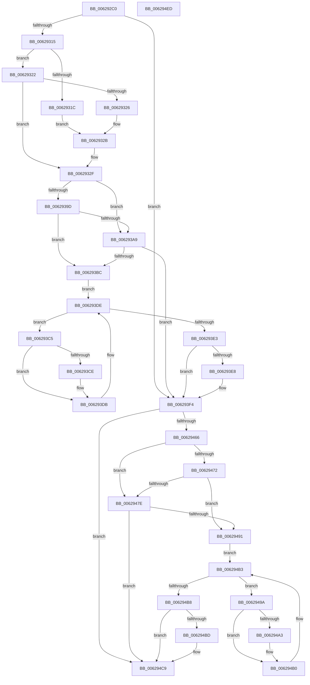

# DifIoCreateFileWrapper

- RVA: `0x006292C0`–`0x006294EE` (길이 `558` bytes)
- VA: `0x00000001406292C0`
- 실행 섹션: `.text`
- PDB 이름 있음: `예`; PDB Function 태그: `아니요`
- unwind 정보 RVA: `0x000D2D68`
- 디코드: `151`개 명령, `558/558` bytes 표시
- 미해석 바이트: `0` (있으면 어셈블리에 `.byte`로 보존)

> 이 문서는 커널 이미지의 기계어와 PDB 기호를 분석해 생성했습니다. 4번과 5번은 함수 원형과 자료형을 바이너리 사용 방식에서 추정한 C 해석이며 원본 소스 복구 결과는 아닙니다.

## 1. Dependencies

- 직접 호출 지점: **10**; 고유 호출 대상: **7**
- 직접 호출자로 확인된 함수: **0**
- RIP 상대 이미지 참조: **3**

### Outgoing calls
- `0x006292FA` → [memset](../6C/memset_function_006C6C40.md) (function, `0x006C6C40`)
- `0x00629304` → [DifGetAPIThunkContextById](../49/DifGetAPIThunkContextById_function_00495A34.md) (function, `0x00495A34`)
- `0x00629326` → [DifGetReturnAddressForWrappers](../4D/DifGetReturnAddressForWrappers_function_004D3C08.md) (function, `0x004D3C08`)
- `0x006293B0` → [ExAcquireRundownProtection](../21/ExAcquireRundownProtection_function_00216620.md) (function, `0x00216620`)
- `0x006293D6` → [guard_dispatch_icall](../6B/guard_dispatch_icall_function_006BAAD0.md) (function, `0x006BAAD0`)
- `0x006293EF` → [ExReleaseRundownProtection](../34/ExReleaseRundownProtection_function_00349E80.md) (function, `0x00349E80`)
- `0x00629459` → [IoCreateFile](../../page/8A/IoCreateFile_function_008AAF60.md) (function, `0x008AAF60`)
- `0x00629485` → [ExAcquireRundownProtection](../21/ExAcquireRundownProtection_function_00216620.md) (function, `0x00216620`)
- `0x006294AB` → [guard_dispatch_icall](../6B/guard_dispatch_icall_function_006BAAD0.md) (function, `0x006BAAD0`)
- `0x006294C4` → [ExReleaseRundownProtection](../34/ExReleaseRundownProtection_function_00349E80.md) (function, `0x00349E80`)

### Direct callers
- 이 함수 시작 RVA로 연결되는 직접 call은 확인되지 않았습니다. 간접 호출은 완전히 역산할 수 없습니다.

### Static image references
- `0x00629336` → RVA `0x00F048B8` (`.data`; read)
- `0x0062939D` → RVA `0x00F04980` (`.data`; read)
- `0x006293A9` → RVA `0x00F03E80` (`.data`; read)

## 2. Other-region calls and transfers

- 다른 실행 섹션으로 향하는 call: **1**
  - `0x00629459` → [IoCreateFile](../../page/8A/IoCreateFile_function_008AAF60.md) (`.text` → `PAGE`)
- 별도 외부 분기/꼬리 이동을 확인하지 못했습니다.

## 3. Assembly (complete function range)

```asm
006292C0  48 8B C4                        mov rax, rsp
006292C3  48 89 58 10                     mov qword ptr [rax + 0x10], rbx
006292C7  48 89 70 18                     mov qword ptr [rax + 0x18], rsi
006292CB  48 89 78 20                     mov qword ptr [rax + 0x20], rdi
006292CF  48 89 48 08                     mov qword ptr [rax + 8], rcx
006292D3  55                              push rbp
006292D4  41 54                           push r12
006292D6  41 55                           push r13
006292D8  41 56                           push r14
006292DA  41 57                           push r15
006292DC  48 8D 68 D1                     lea rbp, [rax - 0x2f]
006292E0  48 81 EC E0 00 00 00            sub rsp, 0xe0
006292E7  44 8B EA                        mov r13d, edx
006292EA  48 8D 4D 97                     lea rcx, [rbp - 0x69]
006292EE  33 D2                           xor edx, edx
006292F0  4D 8B E0                        mov r12, r8
006292F3  4D 8B F9                        mov r15, r9
006292F6  44 8D 42 68                     lea r8d, [rdx + 0x68]
006292FA  E8 41 D9 09 00                  call 0x1406c6c40
006292FF  B9 62 01 00 00                  mov ecx, 0x162
00629304  E8 2B C7 E6 FF                  call 0x140495a34
00629309  48 8B F0                        mov rsi, rax
0062930C  48 85 C0                        test rax, rax
0062930F  0F 84 DF 00 00 00               je 0x1406293f4
00629315  8B 40 0C                        mov eax, dword ptr [rax + 0xc]
00629318  A8 18                           test al, 0x18
0062931A  74 06                           je 0x140629322
0062931C  48 8B 45 2F                     mov rax, qword ptr [rbp + 0x2f]
00629320  EB 09                           jmp 0x14062932b
00629322  A8 04                           test al, 4
00629324  74 09                           je 0x14062932f
00629326  E8 DD A8 EA FF                  call 0x1404d3c08
0062932B  48 89 45 97                     mov qword ptr [rbp - 0x69], rax
0062932F  48 8B 45 37                     mov rax, qword ptr [rbp + 0x37]
00629333  45 32 F6                        xor r14b, r14b
00629336  44 38 35 7B B5 8D 00            cmp byte ptr [rip + 0x8db57b], r14b
0062933D  48 89 45 EF                     mov qword ptr [rbp - 0x11], rax
00629341  48 8B 45 57                     mov rax, qword ptr [rbp + 0x57]
00629345  48 89 45 CF                     mov qword ptr [rbp - 0x31], rax
00629349  8B 45 5F                        mov eax, dword ptr [rbp + 0x5f]
0062934C  89 45 CB                        mov dword ptr [rbp - 0x35], eax
0062934F  8B 45 67                        mov eax, dword ptr [rbp + 0x67]
00629352  89 45 C7                        mov dword ptr [rbp - 0x39], eax
00629355  8B 45 6F                        mov eax, dword ptr [rbp + 0x6f]
00629358  89 45 C3                        mov dword ptr [rbp - 0x3d], eax
0062935B  8B 45 77                        mov eax, dword ptr [rbp + 0x77]
0062935E  89 45 BF                        mov dword ptr [rbp - 0x41], eax
00629361  48 8B 45 7F                     mov rax, qword ptr [rbp + 0x7f]
00629365  48 89 45 B7                     mov qword ptr [rbp - 0x49], rax
00629369  8B 85 87 00 00 00               mov eax, dword ptr [rbp + 0x87]
0062936F  89 45 B3                        mov dword ptr [rbp - 0x4d], eax
00629372  8B 85 8F 00 00 00               mov eax, dword ptr [rbp + 0x8f]
00629378  89 45 AF                        mov dword ptr [rbp - 0x51], eax
0062937B  48 8B 85 97 00 00 00            mov rax, qword ptr [rbp + 0x97]
00629382  48 89 45 A7                     mov qword ptr [rbp - 0x59], rax
00629386  8B 85 9F 00 00 00               mov eax, dword ptr [rbp + 0x9f]
0062938C  89 45 9F                        mov dword ptr [rbp - 0x61], eax
0062938F  44 89 6D E7                     mov dword ptr [rbp - 0x19], r13d
00629393  4C 89 65 DF                     mov qword ptr [rbp - 0x21], r12
00629397  4C 89 7D D7                     mov qword ptr [rbp - 0x29], r15
0062939B  75 0C                           jne 0x1406293a9
0062939D  F7 05 D9 B5 8D 00 00 08 00 00   test dword ptr [rip + 0x8db5d9], 0x800
006293A7  74 13                           je 0x1406293bc
006293A9  48 8D 0D D0 AA 8D 00            lea rcx, [rip + 0x8daad0]
006293B0  E8 6B D2 BE FF                  call 0x140216620
006293B5  44 8A F0                        mov r14b, al
006293B8  84 C0                           test al, al
006293BA  74 38                           je 0x1406293f4
006293BC  48 8D 7E 20                     lea rdi, [rsi + 0x20]
006293C0  48 8B 1F                        mov rbx, qword ptr [rdi]
006293C3  EB 19                           jmp 0x1406293de
006293C5  48 8D 43 F0                     lea rax, [rbx - 0x10]
006293C9  48 85 C0                        test rax, rax
006293CC  74 0D                           je 0x1406293db
006293CE  48 8B 40 08                     mov rax, qword ptr [rax + 8]
006293D2  48 8D 4D 97                     lea rcx, [rbp - 0x69]
006293D6  E8 F5 16 09 00                  call 0x1406baad0
006293DB  48 8B 1B                        mov rbx, qword ptr [rbx]
006293DE  48 3B DF                        cmp rbx, rdi
006293E1  75 E2                           jne 0x1406293c5
006293E3  45 84 F6                        test r14b, r14b
006293E6  74 0C                           je 0x1406293f4
006293E8  48 8D 0D 91 AA 8D 00            lea rcx, [rip + 0x8daa91]
006293EF  E8 8C 0A D2 FF                  call 0x140349e80
006293F4  8B 85 9F 00 00 00               mov eax, dword ptr [rbp + 0x9f]
006293FA  4D 8B CF                        mov r9, r15
006293FD  48 8B 4D 37                     mov rcx, qword ptr [rbp + 0x37]
00629401  4D 8B C4                        mov r8, r12
00629404  89 44 24 68                     mov dword ptr [rsp + 0x68], eax
00629408  41 8B D5                        mov edx, r13d
0062940B  48 8B 85 97 00 00 00            mov rax, qword ptr [rbp + 0x97]
00629412  48 89 44 24 60                  mov qword ptr [rsp + 0x60], rax
00629417  8B 85 8F 00 00 00               mov eax, dword ptr [rbp + 0x8f]
0062941D  89 44 24 58                     mov dword ptr [rsp + 0x58], eax
00629421  8B 85 87 00 00 00               mov eax, dword ptr [rbp + 0x87]
00629427  89 44 24 50                     mov dword ptr [rsp + 0x50], eax
0062942B  48 8B 45 7F                     mov rax, qword ptr [rbp + 0x7f]
0062942F  48 89 44 24 48                  mov qword ptr [rsp + 0x48], rax
00629434  8B 45 77                        mov eax, dword ptr [rbp + 0x77]
00629437  89 44 24 40                     mov dword ptr [rsp + 0x40], eax
0062943B  8B 45 6F                        mov eax, dword ptr [rbp + 0x6f]
0062943E  89 44 24 38                     mov dword ptr [rsp + 0x38], eax
00629442  8B 45 67                        mov eax, dword ptr [rbp + 0x67]
00629445  89 44 24 30                     mov dword ptr [rsp + 0x30], eax
00629449  8B 45 5F                        mov eax, dword ptr [rbp + 0x5f]
0062944C  89 44 24 28                     mov dword ptr [rsp + 0x28], eax
00629450  48 8B 45 57                     mov rax, qword ptr [rbp + 0x57]
00629454  48 89 44 24 20                  mov qword ptr [rsp + 0x20], rax
00629459  E8 02 1B 28 00                  call 0x1408aaf60
0062945E  89 45 F7                        mov dword ptr [rbp - 9], eax
00629461  48 85 F6                        test rsi, rsi
00629464  74 63                           je 0x1406294c9
00629466  40 32 FF                        xor dil, dil
00629469  40 38 3D 48 B4 8D 00            cmp byte ptr [rip + 0x8db448], dil
00629470  75 0C                           jne 0x14062947e
00629472  F7 05 04 B5 8D 00 00 08 00 00   test dword ptr [rip + 0x8db504], 0x800
0062947C  74 13                           je 0x140629491
0062947E  48 8D 0D FB A9 8D 00            lea rcx, [rip + 0x8da9fb]
00629485  E8 96 D1 BE FF                  call 0x140216620
0062948A  40 8A F8                        mov dil, al
0062948D  84 C0                           test al, al
0062948F  74 38                           je 0x1406294c9
00629491  48 83 C6 30                     add rsi, 0x30
00629495  48 8B 1E                        mov rbx, qword ptr [rsi]
00629498  EB 19                           jmp 0x1406294b3
0062949A  48 8D 43 F0                     lea rax, [rbx - 0x10]
0062949E  48 85 C0                        test rax, rax
006294A1  74 0D                           je 0x1406294b0
006294A3  48 8B 40 08                     mov rax, qword ptr [rax + 8]
006294A7  48 8D 4D 97                     lea rcx, [rbp - 0x69]
006294AB  E8 20 16 09 00                  call 0x1406baad0
006294B0  48 8B 1B                        mov rbx, qword ptr [rbx]
006294B3  48 3B DE                        cmp rbx, rsi
006294B6  75 E2                           jne 0x14062949a
006294B8  40 84 FF                        test dil, dil
006294BB  74 0C                           je 0x1406294c9
006294BD  48 8D 0D BC A9 8D 00            lea rcx, [rip + 0x8da9bc]
006294C4  E8 B7 09 D2 FF                  call 0x140349e80
006294C9  8B 45 F7                        mov eax, dword ptr [rbp - 9]
006294CC  4C 8D 9C 24 E0 00 00 00         lea r11, [rsp + 0xe0]
006294D4  49 8B 5B 38                     mov rbx, qword ptr [r11 + 0x38]
006294D8  49 8B 73 40                     mov rsi, qword ptr [r11 + 0x40]
006294DC  49 8B 7B 48                     mov rdi, qword ptr [r11 + 0x48]
006294E0  49 8B E3                        mov rsp, r11
006294E3  41 5F                           pop r15
006294E5  41 5E                           pop r14
006294E7  41 5D                           pop r13
006294E9  41 5C                           pop r12
006294EB  5D                              pop rbp
006294EC  C3                              ret
006294ED  CC                              int3
```

## 4. C-style interpretation (structured pseudocode)

```c
__int64 __fastcall DifIoCreateFileWrapper(__int64 a1, int a2, __int64 a3, __int64 a4)
{
    __int64 result;
    __int64 v_r14;
    __int64 v_rdi;
    __int64 v_rsi;
    __int64 v_rsp;
    unsigned __int64 v_stack_m28;
    unsigned int v_stack_mA0;
    unsigned __int64 v_stack_mA8;
    unsigned int v_stack_mB0;
    unsigned int v_stack_mB8;
    unsigned __int64 v_stack_mC0;
    unsigned int v_stack_mC8;
    unsigned int v_stack_mD0;
    unsigned int v_stack_mD8;
    unsigned int v_stack_mE0;
    unsigned __int64 v_stack_mE8;

    *(unsigned __int64 *)(v_rsp + 16) = v_rbx;
    *(unsigned __int64 *)(v_rsp + 24) = v_rsi;
    *(unsigned __int64 *)(v_rsp + 32) = v_rdi;
    *(unsigned __int64 *)(v_rsp + 8) = a1;
    v_rsp = (v_rsp) - (224);
    a2 = 0;
    result = memset(v_rsp - 47 - 105, a2, a2 + 104, a4);
    result = DifGetAPIThunkContextById(354, a2, a2 + 104, a4);
    if (result == 0) goto loc_006293F4;
    if ((((unsigned __int8)((unsigned int)(*(unsigned int *)(result + 12)))) & (24)) == 0) goto loc_00629322;
    goto loc_0062932B;
loc_00629322:
    if ((((unsigned __int8)(*(unsigned __int64 *)(v_rsp - 47 + 47))) & (4)) == 0) goto loc_0062932F;
    result = DifGetReturnAddressForWrappers(354, a2, a2 + 104, a4);
loc_0062932B:
    *(unsigned __int64 *)(v_rsp - 47 - 105) = result;
loc_0062932F:
    v_r14 = 0;
    *(unsigned __int64 *)(v_rsp - 47 - 17) = *(unsigned __int64 *)(v_rsp - 47 + 55);
    *(unsigned __int64 *)(v_rsp - 47 - 49) = *(unsigned __int64 *)(v_rsp - 47 + 87);
    *(unsigned int *)(v_rsp - 47 - 53) = (unsigned int)((unsigned int)(*(unsigned int *)(v_rsp - 47 + 95)));
    *(unsigned int *)(v_rsp - 47 - 57) = (unsigned int)((unsigned int)(*(unsigned int *)(v_rsp - 47 + 103)));
    *(unsigned int *)(v_rsp - 47 - 61) = (unsigned int)((unsigned int)(*(unsigned int *)(v_rsp - 47 + 111)));
    *(unsigned int *)(v_rsp - 47 - 65) = (unsigned int)((unsigned int)(*(unsigned int *)(v_rsp - 47 + 119)));
    *(unsigned __int64 *)(v_rsp - 47 - 73) = *(unsigned __int64 *)(v_rsp - 47 + 127);
    *(unsigned int *)(v_rsp - 47 - 77) = (unsigned int)((unsigned int)(*(unsigned int *)(v_rsp - 47 + 135)));
    *(unsigned int *)(v_rsp - 47 - 81) = (unsigned int)((unsigned int)(*(unsigned int *)(v_rsp - 47 + 143)));
    *(unsigned __int64 *)(v_rsp - 47 - 89) = *(unsigned __int64 *)(v_rsp - 47 + 151);
    *(unsigned int *)(v_rsp - 47 - 97) = (unsigned int)((unsigned int)(*(unsigned int *)(v_rsp - 47 + 159)));
    *(unsigned int *)(v_rsp - 47 - 25) = (unsigned int)((unsigned int)(a2));
    *(unsigned __int64 *)(v_rsp - 47 - 33) = a3;
    *(unsigned __int64 *)(v_rsp - 47 - 41) = a4;
    if ((*(unsigned __int8 *)(v_rip + 9287035)) != 0) goto loc_006293A9;
    if (((*(unsigned int *)(v_rip + 9287129)) & (0x800ULL)) == 0) goto loc_006293BC;
loc_006293A9:
    result = ExAcquireRundownProtection(v_rip + 9284304, a2, a2 + 104, a4);
    if ((unsigned __int8)(result) == 0) goto loc_006293F4;
loc_006293BC:
    goto loc_006293DE;
loc_006293C5:
    result = *(unsigned __int64 *)(result + 32) - 16;
    if (*(unsigned __int64 *)(result + 32) - 16 != 0) {
        result = *(unsigned __int64 *)(*(unsigned __int64 *)(result + 32) - 16 + 8);
        a1 = v_rsp - 47 - 105;
        result = guard_dispatch_icall(a1, a2, a2 + 104, a4);
    }
loc_006293DE:
    if ((*(unsigned __int64 *)(*(unsigned __int64 *)(result + 32))) != (result + 32)) goto loc_006293C5;
    if ((unsigned __int8)((unsigned __int8)(result)) != 0) {
        a1 = v_rip + 9284241;
        result = ExReleaseRundownProtection(a1, a2, a2 + 104, a4);
    }
    v_stack_mA0 = (unsigned int)((unsigned int)(*(unsigned int *)(v_rsp - 47 + 159)));
    v_stack_mA8 = *(unsigned __int64 *)(v_rsp - 47 + 151);
    v_stack_mB0 = (unsigned int)((unsigned int)(*(unsigned int *)(v_rsp - 47 + 143)));
    v_stack_mB8 = (unsigned int)((unsigned int)(*(unsigned int *)(v_rsp - 47 + 135)));
    v_stack_mC0 = *(unsigned __int64 *)(v_rsp - 47 + 127);
    v_stack_mC8 = (unsigned int)((unsigned int)(*(unsigned int *)(v_rsp - 47 + 119)));
    v_stack_mD0 = (unsigned int)((unsigned int)(*(unsigned int *)(v_rsp - 47 + 111)));
    v_stack_mD8 = (unsigned int)((unsigned int)(*(unsigned int *)(v_rsp - 47 + 103)));
    v_stack_mE0 = (unsigned int)((unsigned int)(*(unsigned int *)(v_rsp - 47 + 95)));
    v_stack_mE8 = *(unsigned __int64 *)(v_rsp - 47 + 87);
    result = IoCreateFile(*(unsigned __int64 *)(v_rsp - 47 + 55), (unsigned int)((unsigned int)((unsigned int)(a2))), a3, a4);
    *(unsigned int *)(v_rsp - 47 - 9) = (unsigned int)(result);
    if (result == 0) goto loc_006294C9;
    v_rdi = 0;
    if ((*(unsigned __int8 *)(v_rip + 9286728)) != 0) goto loc_0062947E;
    if (((*(unsigned int *)(v_rip + 9286916)) & (0x800ULL)) == 0) goto loc_00629491;
loc_0062947E:
    result = ExAcquireRundownProtection(v_rip + 9284091, (unsigned int)((unsigned int)((unsigned int)(a2))), a3, a4);
    if ((unsigned __int8)(result) == 0) goto loc_006294C9;
loc_00629491:
    v_rsi = (result) + (48);
    goto loc_006294B3;
loc_0062949A:
    result = *(unsigned __int64 *)(v_rsi) - 16;
    if (*(unsigned __int64 *)(v_rsi) - 16 != 0) {
        result = *(unsigned __int64 *)(*(unsigned __int64 *)(v_rsi) - 16 + 8);
        a1 = v_rsp - 47 - 105;
        result = guard_dispatch_icall(a1, (unsigned int)((unsigned int)((unsigned int)(a2))), a3, a4);
    }
loc_006294B3:
    if ((*(unsigned __int64 *)(*(unsigned __int64 *)(v_rsi))) != v_rsi) goto loc_0062949A;
    if ((unsigned __int8)((unsigned __int8)(result)) != 0) {
        a1 = v_rip + 9284028;
        result = ExReleaseRundownProtection(a1, (unsigned int)((unsigned int)((unsigned int)(a2))), a3, a4);
    }
    return (unsigned int)(*(unsigned int *)(v_rsp - 47 - 9));
}
```

## 5. (Beta) C Style

```c
int64_t DifIoCreateFileWrapper(int64_t Arg1, int32_t Arg2, int64_t Arg3, int64_t Arg4)
{
    int64_t result;
    int64_t local_r14;
    int64_t local_rdi;
    int64_t local_rsi;
    int64_t local_rsp;
    uint64_t v_stack_m28;
    uint32_t v_stack_mA0;
    uint64_t v_stack_mA8;
    uint32_t v_stack_mB0;
    uint32_t v_stack_mB8;
    uint64_t v_stack_mC0;
    uint32_t v_stack_mC8;
    uint32_t v_stack_mD0;
    uint32_t v_stack_mD8;
    uint32_t v_stack_mE0;
    uint64_t v_stack_mE8;

    *(uint64_t *)(local_rsp + 0x10) = local_rbx;
    *(uint64_t *)(local_rsp + 0x18) = local_rsi;
    *(uint64_t *)(local_rsp + 0x20) = local_rdi;
    *(uint64_t *)(local_rsp + 0x8) = Arg1;
    local_rsp = (local_rsp) - (224);
    Arg2 = 0;
    result = memset(local_rsp - 47 - 105, Arg2, Arg2 + 104, Arg4);
    result = DifGetAPIThunkContextById(354, Arg2, Arg2 + 104, Arg4);
    if (result == 0) goto loc_006293F4;
    if ((((uint8_t)((uint32_t)(*(uint32_t *)(result + 0xC)))) & (24)) == 0) goto loc_00629322;
    goto loc_0062932B;
loc_00629322:
    if ((((uint8_t)(*(uint64_t *)(local_rsp - 0x2F + 0x2F))) & (4)) == 0) goto loc_0062932F;
    result = DifGetReturnAddressForWrappers(354, Arg2, Arg2 + 104, Arg4);
loc_0062932B:
    *(uint64_t *)(local_rsp - 0x2F - 0x69) = result;
loc_0062932F:
    local_r14 = 0;
    *(uint64_t *)(local_rsp - 0x2F - 0x11) = *(uint64_t *)(local_rsp - 0x2F + 0x37);
    *(uint64_t *)(local_rsp - 0x2F - 0x31) = *(uint64_t *)(local_rsp - 0x2F + 0x57);
    *(uint32_t *)(local_rsp - 0x2F - 0x35) = (uint32_t)((uint32_t)(*(uint32_t *)(local_rsp - 0x2F + 0x5F)));
    *(uint32_t *)(local_rsp - 0x2F - 0x39) = (uint32_t)((uint32_t)(*(uint32_t *)(local_rsp - 0x2F + 0x67)));
    *(uint32_t *)(local_rsp - 0x2F - 0x3D) = (uint32_t)((uint32_t)(*(uint32_t *)(local_rsp - 0x2F + 0x6F)));
    *(uint32_t *)(local_rsp - 0x2F - 0x41) = (uint32_t)((uint32_t)(*(uint32_t *)(local_rsp - 0x2F + 0x77)));
    *(uint64_t *)(local_rsp - 0x2F - 0x49) = *(uint64_t *)(local_rsp - 0x2F + 0x7F);
    *(uint32_t *)(local_rsp - 0x2F - 0x4D) = (uint32_t)((uint32_t)(*(uint32_t *)(local_rsp - 0x2F + 0x87)));
    *(uint32_t *)(local_rsp - 0x2F - 0x51) = (uint32_t)((uint32_t)(*(uint32_t *)(local_rsp - 0x2F + 0x8F)));
    *(uint64_t *)(local_rsp - 0x2F - 0x59) = *(uint64_t *)(local_rsp - 0x2F + 0x97);
    *(uint32_t *)(local_rsp - 0x2F - 0x61) = (uint32_t)((uint32_t)(*(uint32_t *)(local_rsp - 0x2F + 0x9F)));
    *(uint32_t *)(local_rsp - 0x2F - 0x19) = (uint32_t)((uint32_t)(Arg2));
    *(uint64_t *)(local_rsp - 0x2F - 0x21) = Arg3;
    *(uint64_t *)(local_rsp - 0x2F - 0x29) = Arg4;
    if ((*(uint8_t *)(v_rip + 0x8DB57B)) != 0) goto loc_006293A9;
    if (((*(uint32_t *)(v_rip + 0x8DB5D9)) & (0x800ULL)) == 0) goto loc_006293BC;
loc_006293A9:
    result = ExAcquireRundownProtection(v_rip + 9284304, Arg2, Arg2 + 104, Arg4);
    if ((uint8_t)(result) == 0) goto loc_006293F4;
loc_006293BC:
    goto loc_006293DE;
loc_006293C5:
    result = *(uint64_t *)(result + 0x20) - 16;
    if (*(uint64_t *)(result + 0x20) - 16 != 0) {
        result = *(uint64_t *)(*(uint64_t *)(result + 0x20) - 0x10 + 0x8);
        Arg1 = local_rsp - 47 - 105;
        result = guard_dispatch_icall(Arg1, Arg2, Arg2 + 104, Arg4);
    }
loc_006293DE:
    if ((*(uint64_t *)(*(uint64_t *)(result + 0x20))) != (result + 32)) goto loc_006293C5;
    if ((uint8_t)((uint8_t)(result)) != 0) {
        Arg1 = v_rip + 9284241;
        result = ExReleaseRundownProtection(Arg1, Arg2, Arg2 + 104, Arg4);
    }
    v_stack_mA0 = (uint32_t)((uint32_t)(*(uint32_t *)(local_rsp - 0x2F + 0x9F)));
    v_stack_mA8 = *(uint64_t *)(local_rsp - 0x2F + 0x97);
    v_stack_mB0 = (uint32_t)((uint32_t)(*(uint32_t *)(local_rsp - 0x2F + 0x8F)));
    v_stack_mB8 = (uint32_t)((uint32_t)(*(uint32_t *)(local_rsp - 0x2F + 0x87)));
    v_stack_mC0 = *(uint64_t *)(local_rsp - 0x2F + 0x7F);
    v_stack_mC8 = (uint32_t)((uint32_t)(*(uint32_t *)(local_rsp - 0x2F + 0x77)));
    v_stack_mD0 = (uint32_t)((uint32_t)(*(uint32_t *)(local_rsp - 0x2F + 0x6F)));
    v_stack_mD8 = (uint32_t)((uint32_t)(*(uint32_t *)(local_rsp - 0x2F + 0x67)));
    v_stack_mE0 = (uint32_t)((uint32_t)(*(uint32_t *)(local_rsp - 0x2F + 0x5F)));
    v_stack_mE8 = *(uint64_t *)(local_rsp - 0x2F + 0x57);
    result = IoCreateFile(*(uint64_t *)(local_rsp - 0x2F + 0x37), (uint32_t)((uint32_t)((uint32_t)(Arg2))), Arg3, Arg4);
    *(uint32_t *)(local_rsp - 0x2F - 0x9) = (uint32_t)(result);
    if (result == 0) goto loc_006294C9;
    local_rdi = 0;
    if ((*(uint8_t *)(v_rip + 0x8DB448)) != 0) goto loc_0062947E;
    if (((*(uint32_t *)(v_rip + 0x8DB504)) & (0x800ULL)) == 0) goto loc_00629491;
loc_0062947E:
    result = ExAcquireRundownProtection(v_rip + 9284091, (uint32_t)((uint32_t)((uint32_t)(Arg2))), Arg3, Arg4);
    if ((uint8_t)(result) == 0) goto loc_006294C9;
loc_00629491:
    local_rsi = (result) + (48);
    goto loc_006294B3;
loc_0062949A:
    result = *(uint64_t *)(local_rsi) - 16;
    if (*(uint64_t *)(local_rsi) - 16 != 0) {
        result = *(uint64_t *)(*(uint64_t *)(local_rsi) - 0x10 + 0x8);
        Arg1 = local_rsp - 47 - 105;
        result = guard_dispatch_icall(Arg1, (uint32_t)((uint32_t)((uint32_t)(Arg2))), Arg3, Arg4);
    }
loc_006294B3:
    if ((*(uint64_t *)(*(uint64_t *)(local_rsi))) != local_rsi) goto loc_0062949A;
    if ((uint8_t)((uint8_t)(result)) != 0) {
        Arg1 = v_rip + 9284028;
        result = ExReleaseRundownProtection(Arg1, (uint32_t)((uint32_t)((uint32_t)(Arg2))), Arg3, Arg4);
    }
    return (uint32_t)(*(uint32_t *)(local_rsp - 0x2F - 0x9));
}
```

## 6. Execution-region graph

[열기: 2D/3D 그래프와 함수 탐색 컨트롤 패널](../../../control-panel.html?section=text&rva=0x006292C0&view=graph)

- 2D 그래프는 위에서 아래로 흐르고, 3D 그래프는 빈 공간을 드래그해 회전합니다. Shift+드래그는 이동, 휠은 확대·축소, 함수 노드 선택은 대상 보고서 이동입니다.

### Static fallback


