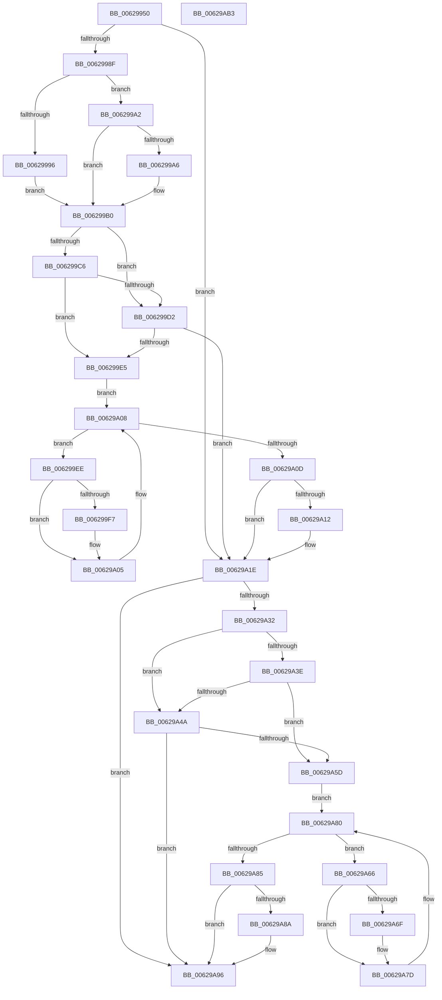

# DifIoCreateUnprotectedSymbolicLinkWrapper

- RVA: `0x00629950`–`0x00629AB4` (길이 `356` bytes)
- VA: `0x0000000140629950`
- 실행 섹션: `.text`
- PDB 이름 있음: `예`; PDB Function 태그: `아니요`
- unwind 정보 RVA: `0x00093E28`
- 디코드: `98`개 명령, `356/356` bytes 표시
- 미해석 바이트: `0` (있으면 어셈블리에 `.byte`로 보존)

> 이 문서는 커널 이미지의 기계어와 PDB 기호를 분석해 생성했습니다. 4번과 5번은 함수 원형과 자료형을 바이너리 사용 방식에서 추정한 C 해석이며 원본 소스 복구 결과는 아닙니다.

## 1. Dependencies

- 직접 호출 지점: **9**; 고유 호출 대상: **6**
- 직접 호출자로 확인된 함수: **0**
- RIP 상대 이미지 참조: **3**

### Outgoing calls
- `0x0062997E` → [DifGetAPIThunkContextById](../49/DifGetAPIThunkContextById_function_00495A34.md) (function, `0x00495A34`)
- `0x006299A6` → [DifGetReturnAddressForWrappers](../4D/DifGetReturnAddressForWrappers_function_004D3C08.md) (function, `0x004D3C08`)
- `0x006299D9` → [ExAcquireRundownProtection](../21/ExAcquireRundownProtection_function_00216620.md) (function, `0x00216620`)
- `0x00629A00` → [guard_dispatch_icall](../6B/guard_dispatch_icall_function_006BAAD0.md) (function, `0x006BAAD0`)
- `0x00629A19` → [ExReleaseRundownProtection](../34/ExReleaseRundownProtection_function_00349E80.md) (function, `0x00349E80`)
- `0x00629A24` → [IoCreateUnprotectedSymbolicLink](../../page/71/IoCreateUnprotectedSymbolicLink_function_0071D380.md) (function, `0x0071D380`)
- `0x00629A51` → [ExAcquireRundownProtection](../21/ExAcquireRundownProtection_function_00216620.md) (function, `0x00216620`)
- `0x00629A78` → [guard_dispatch_icall](../6B/guard_dispatch_icall_function_006BAAD0.md) (function, `0x006BAAD0`)
- `0x00629A91` → [ExReleaseRundownProtection](../34/ExReleaseRundownProtection_function_00349E80.md) (function, `0x00349E80`)

### Direct callers
- 이 함수 시작 RVA로 연결되는 직접 call은 확인되지 않았습니다. 간접 호출은 완전히 역산할 수 없습니다.

### Static image references
- `0x006299B8` → RVA `0x00F048B8` (`.data`; read)
- `0x006299C6` → RVA `0x00F04980` (`.data`; read)
- `0x006299D2` → RVA `0x00F03E80` (`.data`; read)

## 2. Other-region calls and transfers

- 다른 실행 섹션으로 향하는 call: **1**
  - `0x00629A24` → [IoCreateUnprotectedSymbolicLink](../../page/71/IoCreateUnprotectedSymbolicLink_function_0071D380.md) (`.text` → `PAGE`)
- 별도 외부 분기/꼬리 이동을 확인하지 못했습니다.

## 3. Assembly (complete function range)

```asm
00629950  48 8B C4                        mov rax, rsp
00629953  48 89 58 08                     mov qword ptr [rax + 8], rbx
00629957  48 89 68 10                     mov qword ptr [rax + 0x10], rbp
0062995B  48 89 70 18                     mov qword ptr [rax + 0x18], rsi
0062995F  57                              push rdi
00629960  41 56                           push r14
00629962  41 57                           push r15
00629964  48 83 EC 40                     sub rsp, 0x40
00629968  0F 57 C0                        xorps xmm0, xmm0
0062996B  4C 8B F9                        mov r15, rcx
0062996E  B9 5C 01 00 00                  mov ecx, 0x15c
00629973  4C 8B F2                        mov r14, rdx
00629976  0F 11 40 C8                     movups xmmword ptr [rax - 0x38], xmm0
0062997A  0F 11 40 D8                     movups xmmword ptr [rax - 0x28], xmm0
0062997E  E8 B1 C0 E6 FF                  call 0x140495a34
00629983  48 8B F0                        mov rsi, rax
00629986  48 85 C0                        test rax, rax
00629989  0F 84 8F 00 00 00               je 0x140629a1e
0062998F  8B 40 0C                        mov eax, dword ptr [rax + 0xc]
00629992  A8 18                           test al, 0x18
00629994  74 0C                           je 0x1406299a2
00629996  48 8B 4C 24 58                  mov rcx, qword ptr [rsp + 0x58]
0062999B  48 89 4C 24 20                  mov qword ptr [rsp + 0x20], rcx
006299A0  EB 0E                           jmp 0x1406299b0
006299A2  A8 04                           test al, 4
006299A4  74 0A                           je 0x1406299b0
006299A6  E8 5D A2 EA FF                  call 0x1404d3c08
006299AB  48 89 44 24 20                  mov qword ptr [rsp + 0x20], rax
006299B0  40 32 ED                        xor bpl, bpl
006299B3  4C 89 7C 24 30                  mov qword ptr [rsp + 0x30], r15
006299B8  40 38 2D F9 AE 8D 00            cmp byte ptr [rip + 0x8daef9], bpl
006299BF  4C 89 74 24 28                  mov qword ptr [rsp + 0x28], r14
006299C4  75 0C                           jne 0x1406299d2
006299C6  F7 05 B0 AF 8D 00 00 08 00 00   test dword ptr [rip + 0x8dafb0], 0x800
006299D0  74 13                           je 0x1406299e5
006299D2  48 8D 0D A7 A4 8D 00            lea rcx, [rip + 0x8da4a7]
006299D9  E8 42 CC BE FF                  call 0x140216620
006299DE  40 8A E8                        mov bpl, al
006299E1  84 C0                           test al, al
006299E3  74 39                           je 0x140629a1e
006299E5  48 8D 7E 20                     lea rdi, [rsi + 0x20]
006299E9  48 8B 1F                        mov rbx, qword ptr [rdi]
006299EC  EB 1A                           jmp 0x140629a08
006299EE  48 8D 43 F0                     lea rax, [rbx - 0x10]
006299F2  48 85 C0                        test rax, rax
006299F5  74 0E                           je 0x140629a05
006299F7  48 8B 40 08                     mov rax, qword ptr [rax + 8]
006299FB  48 8D 4C 24 20                  lea rcx, [rsp + 0x20]
00629A00  E8 CB 10 09 00                  call 0x1406baad0
00629A05  48 8B 1B                        mov rbx, qword ptr [rbx]
00629A08  48 3B DF                        cmp rbx, rdi
00629A0B  75 E1                           jne 0x1406299ee
00629A0D  40 84 ED                        test bpl, bpl
00629A10  74 0C                           je 0x140629a1e
00629A12  48 8D 0D 67 A4 8D 00            lea rcx, [rip + 0x8da467]
00629A19  E8 62 04 D2 FF                  call 0x140349e80
00629A1E  49 8B D6                        mov rdx, r14
00629A21  49 8B CF                        mov rcx, r15
00629A24  E8 57 39 0F 00                  call 0x14071d380
00629A29  89 44 24 38                     mov dword ptr [rsp + 0x38], eax
00629A2D  48 85 F6                        test rsi, rsi
00629A30  74 64                           je 0x140629a96
00629A32  40 32 FF                        xor dil, dil
00629A35  40 38 3D 7C AE 8D 00            cmp byte ptr [rip + 0x8dae7c], dil
00629A3C  75 0C                           jne 0x140629a4a
00629A3E  F7 05 38 AF 8D 00 00 08 00 00   test dword ptr [rip + 0x8daf38], 0x800
00629A48  74 13                           je 0x140629a5d
00629A4A  48 8D 0D 2F A4 8D 00            lea rcx, [rip + 0x8da42f]
00629A51  E8 CA CB BE FF                  call 0x140216620
00629A56  40 8A F8                        mov dil, al
00629A59  84 C0                           test al, al
00629A5B  74 39                           je 0x140629a96
00629A5D  48 83 C6 30                     add rsi, 0x30
00629A61  48 8B 1E                        mov rbx, qword ptr [rsi]
00629A64  EB 1A                           jmp 0x140629a80
00629A66  48 8D 43 F0                     lea rax, [rbx - 0x10]
00629A6A  48 85 C0                        test rax, rax
00629A6D  74 0E                           je 0x140629a7d
00629A6F  48 8B 40 08                     mov rax, qword ptr [rax + 8]
00629A73  48 8D 4C 24 20                  lea rcx, [rsp + 0x20]
00629A78  E8 53 10 09 00                  call 0x1406baad0
00629A7D  48 8B 1B                        mov rbx, qword ptr [rbx]
00629A80  48 3B DE                        cmp rbx, rsi
00629A83  75 E1                           jne 0x140629a66
00629A85  40 84 FF                        test dil, dil
00629A88  74 0C                           je 0x140629a96
00629A8A  48 8D 0D EF A3 8D 00            lea rcx, [rip + 0x8da3ef]
00629A91  E8 EA 03 D2 FF                  call 0x140349e80
00629A96  8B 44 24 38                     mov eax, dword ptr [rsp + 0x38]
00629A9A  48 8B 5C 24 60                  mov rbx, qword ptr [rsp + 0x60]
00629A9F  48 8B 6C 24 68                  mov rbp, qword ptr [rsp + 0x68]
00629AA4  48 8B 74 24 70                  mov rsi, qword ptr [rsp + 0x70]
00629AA9  48 83 C4 40                     add rsp, 0x40
00629AAD  41 5F                           pop r15
00629AAF  41 5E                           pop r14
00629AB1  5F                              pop rdi
00629AB2  C3                              ret
00629AB3  CC                              int3
```

## 4. C-style interpretation (structured pseudocode)

```c
__int64 __fastcall DifIoCreateUnprotectedSymbolicLinkWrapper(__int64 a1, __int64 a2)
{
    __int64 result;
    __int64 v_rbp;
    __int64 v_rdi;
    __int64 v_rsi;
    __int64 v_rsp;
    unsigned int v_stack_m20;
    unsigned __int64 v_stack_m28;
    unsigned __int64 v_stack_m30;
    unsigned __int64 v_stack_m38;
    unsigned __int64 v_stack_p0;
    unsigned __int64 v_stack_p10;
    unsigned __int64 v_stack_p18;
    unsigned __int64 v_stack_p8;

    *(unsigned __int64 *)(v_rsp + 8) = v_rbx;
    *(unsigned __int64 *)(v_rsp + 16) = v_rbp;
    *(unsigned __int64 *)(v_rsp + 24) = v_rsi;
    v_rsp = (v_rsp) - (64);
    *(unsigned __int64 *)(v_rsp - 56) = v_xmm0;
    *(unsigned __int64 *)(v_rsp - 40) = v_xmm0;
    result = DifGetAPIThunkContextById(348, a2, a3, a4);
    if (result == 0) goto loc_00629A1E;
    if ((((unsigned __int8)((unsigned int)(*(unsigned int *)(result + 12)))) & (24)) == 0) goto loc_006299A2;
    v_stack_m38 = v_stack_p0;
    goto loc_006299B0;
loc_006299A2:
    result = (unsigned int)(*(unsigned int *)(result + 12));
    if ((((unsigned __int8)((unsigned int)(*(unsigned int *)(result + 12)))) & (4)) != 0) {
        result = DifGetReturnAddressForWrappers(v_stack_p0, a2, a3, a4);
        v_stack_m38 = result;
    }
    v_rbp = 0;
    v_stack_m28 = a1;
    v_stack_m30 = a2;
    if ((*(unsigned __int8 *)(v_rip + 9285369)) != 0) goto loc_006299D2;
    if (((*(unsigned int *)(v_rip + 9285552)) & (0x800ULL)) == 0) goto loc_006299E5;
loc_006299D2:
    result = ExAcquireRundownProtection(v_rip + 9282727, a2, a3, a4);
    if ((unsigned __int8)(result) == 0) goto loc_00629A1E;
loc_006299E5:
    goto loc_00629A08;
loc_006299EE:
    result = *(unsigned __int64 *)(result + 32) - 16;
    if (*(unsigned __int64 *)(result + 32) - 16 != 0) {
        result = *(unsigned __int64 *)(*(unsigned __int64 *)(result + 32) - 16 + 8);
        a1 = v_stack_m38;
        result = guard_dispatch_icall(a1, a2, a3, a4);
    }
loc_00629A08:
    if ((*(unsigned __int64 *)(*(unsigned __int64 *)(result + 32))) != (result + 32)) goto loc_006299EE;
    if ((unsigned __int8)((unsigned __int8)(result)) != 0) {
        a1 = v_rip + 9282663;
        result = ExReleaseRundownProtection(a1, a2, a3, a4);
    }
    result = IoCreateUnprotectedSymbolicLink(a1, a2, a3, a4);
    v_stack_m20 = (unsigned int)(result);
    if (result == 0) goto loc_00629A96;
    v_rdi = 0;
    if ((*(unsigned __int8 *)(v_rip + 9285244)) != 0) goto loc_00629A4A;
    if (((*(unsigned int *)(v_rip + 9285432)) & (0x800ULL)) == 0) goto loc_00629A5D;
loc_00629A4A:
    result = ExAcquireRundownProtection(v_rip + 9282607, a2, a3, a4);
    if ((unsigned __int8)(result) == 0) goto loc_00629A96;
loc_00629A5D:
    v_rsi = (result) + (48);
    goto loc_00629A80;
loc_00629A66:
    result = *(unsigned __int64 *)(v_rsi) - 16;
    if (*(unsigned __int64 *)(v_rsi) - 16 != 0) {
        result = *(unsigned __int64 *)(*(unsigned __int64 *)(v_rsi) - 16 + 8);
        a1 = v_stack_m38;
        result = guard_dispatch_icall(a1, a2, a3, a4);
    }
loc_00629A80:
    if ((*(unsigned __int64 *)(*(unsigned __int64 *)(v_rsi))) != v_rsi) goto loc_00629A66;
    if ((unsigned __int8)((unsigned __int8)(result)) != 0) {
        a1 = v_rip + 9282543;
        result = ExReleaseRundownProtection(a1, a2, a3, a4);
    }
    v_rsp = (v_rsp) + (64);
    return (unsigned int)(v_stack_m20);
}
```

## 5. (Beta) C Style

```c
int64_t DifIoCreateUnprotectedSymbolicLinkWrapper(int64_t Arg1, int64_t Arg2)
{
    int64_t result;
    int64_t local_rbp;
    int64_t local_rdi;
    int64_t local_rsi;
    int64_t local_rsp;
    uint32_t v_stack_m20;
    uint64_t v_stack_m28;
    uint64_t v_stack_m30;
    uint64_t v_stack_m38;
    uint64_t v_stack_p0;
    uint64_t v_stack_p10;
    uint64_t v_stack_p18;
    uint64_t v_stack_p8;

    *(uint64_t *)(local_rsp + 0x8) = local_rbx;
    *(uint64_t *)(local_rsp + 0x10) = local_rbp;
    *(uint64_t *)(local_rsp + 0x18) = local_rsi;
    local_rsp = (local_rsp) - (64);
    *(uint64_t *)(local_rsp - 0x38) = v_xmm0;
    *(uint64_t *)(local_rsp - 0x28) = v_xmm0;
    result = DifGetAPIThunkContextById(348, Arg2, a3, a4);
    if (result == 0) goto loc_00629A1E;
    if ((((uint8_t)((uint32_t)(*(uint32_t *)(result + 0xC)))) & (24)) == 0) goto loc_006299A2;
    v_stack_m38 = v_stack_p0;
    goto loc_006299B0;
loc_006299A2:
    result = (uint32_t)(*(uint32_t *)(result + 0xC));
    if ((((uint8_t)((uint32_t)(*(uint32_t *)(result + 0xC)))) & (4)) != 0) {
        result = DifGetReturnAddressForWrappers(v_stack_p0, Arg2, a3, a4);
        v_stack_m38 = result;
    }
    local_rbp = 0;
    v_stack_m28 = Arg1;
    v_stack_m30 = Arg2;
    if ((*(uint8_t *)(v_rip + 0x8DAEF9)) != 0) goto loc_006299D2;
    if (((*(uint32_t *)(v_rip + 0x8DAFB0)) & (0x800ULL)) == 0) goto loc_006299E5;
loc_006299D2:
    result = ExAcquireRundownProtection(v_rip + 9282727, Arg2, a3, a4);
    if ((uint8_t)(result) == 0) goto loc_00629A1E;
loc_006299E5:
    goto loc_00629A08;
loc_006299EE:
    result = *(uint64_t *)(result + 0x20) - 16;
    if (*(uint64_t *)(result + 0x20) - 16 != 0) {
        result = *(uint64_t *)(*(uint64_t *)(result + 0x20) - 0x10 + 0x8);
        Arg1 = v_stack_m38;
        result = guard_dispatch_icall(Arg1, Arg2, a3, a4);
    }
loc_00629A08:
    if ((*(uint64_t *)(*(uint64_t *)(result + 0x20))) != (result + 32)) goto loc_006299EE;
    if ((uint8_t)((uint8_t)(result)) != 0) {
        Arg1 = v_rip + 9282663;
        result = ExReleaseRundownProtection(Arg1, Arg2, a3, a4);
    }
    result = IoCreateUnprotectedSymbolicLink(Arg1, Arg2, a3, a4);
    v_stack_m20 = (uint32_t)(result);
    if (result == 0) goto loc_00629A96;
    local_rdi = 0;
    if ((*(uint8_t *)(v_rip + 0x8DAE7C)) != 0) goto loc_00629A4A;
    if (((*(uint32_t *)(v_rip + 0x8DAF38)) & (0x800ULL)) == 0) goto loc_00629A5D;
loc_00629A4A:
    result = ExAcquireRundownProtection(v_rip + 9282607, Arg2, a3, a4);
    if ((uint8_t)(result) == 0) goto loc_00629A96;
loc_00629A5D:
    local_rsi = (result) + (48);
    goto loc_00629A80;
loc_00629A66:
    result = *(uint64_t *)(local_rsi) - 16;
    if (*(uint64_t *)(local_rsi) - 16 != 0) {
        result = *(uint64_t *)(*(uint64_t *)(local_rsi) - 0x10 + 0x8);
        Arg1 = v_stack_m38;
        result = guard_dispatch_icall(Arg1, Arg2, a3, a4);
    }
loc_00629A80:
    if ((*(uint64_t *)(*(uint64_t *)(local_rsi))) != local_rsi) goto loc_00629A66;
    if ((uint8_t)((uint8_t)(result)) != 0) {
        Arg1 = v_rip + 9282543;
        result = ExReleaseRundownProtection(Arg1, Arg2, a3, a4);
    }
    local_rsp = (local_rsp) + (64);
    return (uint32_t)(v_stack_m20);
}
```

## 6. Execution-region graph

[열기: 2D/3D 그래프와 함수 탐색 컨트롤 패널](../../../control-panel.html?section=text&rva=0x00629950&view=graph)

- 2D 그래프는 위에서 아래로 흐르고, 3D 그래프는 빈 공간을 드래그해 회전합니다. Shift+드래그는 이동, 휠은 확대·축소, 함수 노드 선택은 대상 보고서 이동입니다.

### Static fallback


