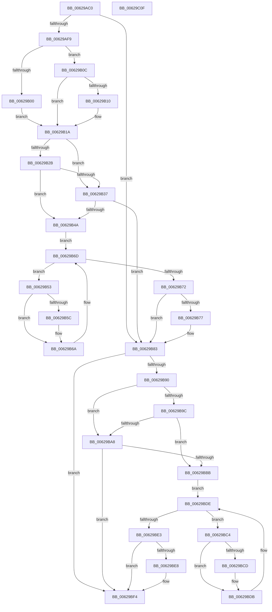

# DifIoDeleteControllerWrapper

- RVA: `0x00629AC0`–`0x00629C10` (길이 `336` bytes)
- VA: `0x0000000140629AC0`
- 실행 섹션: `.text`
- PDB 이름 있음: `예`; PDB Function 태그: `아니요`
- unwind 정보 RVA: `0x0005D7BC`
- 디코드: `90`개 명령, `336/336` bytes 표시
- 미해석 바이트: `0` (있으면 어셈블리에 `.byte`로 보존)

> 이 문서는 커널 이미지의 기계어와 PDB 기호를 분석해 생성했습니다. 4번과 5번은 함수 원형과 자료형을 바이너리 사용 방식에서 추정한 C 해석이며 원본 소스 복구 결과는 아닙니다.

## 1. Dependencies

- 직접 호출 지점: **9**; 고유 호출 대상: **6**
- 직접 호출자로 확인된 함수: **0**
- RIP 상대 이미지 참조: **3**

### Outgoing calls
- `0x00629AE8` → [DifGetAPIThunkContextById](../49/DifGetAPIThunkContextById_function_00495A34.md) (function, `0x00495A34`)
- `0x00629B10` → [DifGetReturnAddressForWrappers](../4D/DifGetReturnAddressForWrappers_function_004D3C08.md) (function, `0x004D3C08`)
- `0x00629B3E` → [ExAcquireRundownProtection](../21/ExAcquireRundownProtection_function_00216620.md) (function, `0x00216620`)
- `0x00629B65` → [guard_dispatch_icall](../6B/guard_dispatch_icall_function_006BAAD0.md) (function, `0x006BAAD0`)
- `0x00629B7E` → [ExReleaseRundownProtection](../34/ExReleaseRundownProtection_function_00349E80.md) (function, `0x00349E80`)
- `0x00629B86` → [IoDeleteController](../../page/9B/IoDeleteController_function_009BC910.md) (function, `0x009BC910`)
- `0x00629BAF` → [ExAcquireRundownProtection](../21/ExAcquireRundownProtection_function_00216620.md) (function, `0x00216620`)
- `0x00629BD6` → [guard_dispatch_icall](../6B/guard_dispatch_icall_function_006BAAD0.md) (function, `0x006BAAD0`)
- `0x00629BEF` → [ExReleaseRundownProtection](../34/ExReleaseRundownProtection_function_00349E80.md) (function, `0x00349E80`)

### Direct callers
- 이 함수 시작 RVA로 연결되는 직접 call은 확인되지 않았습니다. 간접 호출은 완전히 역산할 수 없습니다.

### Static image references
- `0x00629B22` → RVA `0x00F048B8` (`.data`; read)
- `0x00629B2B` → RVA `0x00F04980` (`.data`; read)
- `0x00629B37` → RVA `0x00F03E80` (`.data`; read)

## 2. Other-region calls and transfers

- 다른 실행 섹션으로 향하는 call: **1**
  - `0x00629B86` → [IoDeleteController](../../page/9B/IoDeleteController_function_009BC910.md) (`.text` → `PAGE`)
- 별도 외부 분기/꼬리 이동을 확인하지 못했습니다.

## 3. Assembly (complete function range)

```asm
00629AC0  48 8B C4                        mov rax, rsp
00629AC3  48 89 58 08                     mov qword ptr [rax + 8], rbx
00629AC7  48 89 68 10                     mov qword ptr [rax + 0x10], rbp
00629ACB  48 89 70 18                     mov qword ptr [rax + 0x18], rsi
00629ACF  48 89 78 20                     mov qword ptr [rax + 0x20], rdi
00629AD3  41 56                           push r14
00629AD5  48 83 EC 30                     sub rsp, 0x30
00629AD9  48 8B E9                        mov rbp, rcx
00629ADC  0F 57 C0                        xorps xmm0, xmm0
00629ADF  B9 5B 01 00 00                  mov ecx, 0x15b
00629AE4  0F 11 40 E8                     movups xmmword ptr [rax - 0x18], xmm0
00629AE8  E8 47 BF E6 FF                  call 0x140495a34
00629AED  48 8B F8                        mov rdi, rax
00629AF0  48 85 C0                        test rax, rax
00629AF3  0F 84 8A 00 00 00               je 0x140629b83
00629AF9  8B 40 0C                        mov eax, dword ptr [rax + 0xc]
00629AFC  A8 18                           test al, 0x18
00629AFE  74 0C                           je 0x140629b0c
00629B00  48 8B 4C 24 38                  mov rcx, qword ptr [rsp + 0x38]
00629B05  48 89 4C 24 20                  mov qword ptr [rsp + 0x20], rcx
00629B0A  EB 0E                           jmp 0x140629b1a
00629B0C  A8 04                           test al, 4
00629B0E  74 0A                           je 0x140629b1a
00629B10  E8 F3 A0 EA FF                  call 0x1404d3c08
00629B15  48 89 44 24 20                  mov qword ptr [rsp + 0x20], rax
00629B1A  40 32 F6                        xor sil, sil
00629B1D  48 89 6C 24 28                  mov qword ptr [rsp + 0x28], rbp
00629B22  40 38 35 8F AD 8D 00            cmp byte ptr [rip + 0x8dad8f], sil
00629B29  75 0C                           jne 0x140629b37
00629B2B  F7 05 4B AE 8D 00 00 08 00 00   test dword ptr [rip + 0x8dae4b], 0x800
00629B35  74 13                           je 0x140629b4a
00629B37  48 8D 0D 42 A3 8D 00            lea rcx, [rip + 0x8da342]
00629B3E  E8 DD CA BE FF                  call 0x140216620
00629B43  40 8A F0                        mov sil, al
00629B46  84 C0                           test al, al
00629B48  74 39                           je 0x140629b83
00629B4A  4C 8D 77 20                     lea r14, [rdi + 0x20]
00629B4E  49 8B 1E                        mov rbx, qword ptr [r14]
00629B51  EB 1A                           jmp 0x140629b6d
00629B53  48 8D 43 F0                     lea rax, [rbx - 0x10]
00629B57  48 85 C0                        test rax, rax
00629B5A  74 0E                           je 0x140629b6a
00629B5C  48 8B 40 08                     mov rax, qword ptr [rax + 8]
00629B60  48 8D 4C 24 20                  lea rcx, [rsp + 0x20]
00629B65  E8 66 0F 09 00                  call 0x1406baad0
00629B6A  48 8B 1B                        mov rbx, qword ptr [rbx]
00629B6D  49 3B DE                        cmp rbx, r14
00629B70  75 E1                           jne 0x140629b53
00629B72  40 84 F6                        test sil, sil
00629B75  74 0C                           je 0x140629b83
00629B77  48 8D 0D 02 A3 8D 00            lea rcx, [rip + 0x8da302]
00629B7E  E8 FD 02 D2 FF                  call 0x140349e80
00629B83  48 8B CD                        mov rcx, rbp
00629B86  E8 85 2D 39 00                  call 0x1409bc910
00629B8B  48 85 FF                        test rdi, rdi
00629B8E  74 64                           je 0x140629bf4
00629B90  40 32 F6                        xor sil, sil
00629B93  40 38 35 1E AD 8D 00            cmp byte ptr [rip + 0x8dad1e], sil
00629B9A  75 0C                           jne 0x140629ba8
00629B9C  F7 05 DA AD 8D 00 00 08 00 00   test dword ptr [rip + 0x8dadda], 0x800
00629BA6  74 13                           je 0x140629bbb
00629BA8  48 8D 0D D1 A2 8D 00            lea rcx, [rip + 0x8da2d1]
00629BAF  E8 6C CA BE FF                  call 0x140216620
00629BB4  40 8A F0                        mov sil, al
00629BB7  84 C0                           test al, al
00629BB9  74 39                           je 0x140629bf4
00629BBB  48 83 C7 30                     add rdi, 0x30
00629BBF  48 8B 1F                        mov rbx, qword ptr [rdi]
00629BC2  EB 1A                           jmp 0x140629bde
00629BC4  48 8D 43 F0                     lea rax, [rbx - 0x10]
00629BC8  48 85 C0                        test rax, rax
00629BCB  74 0E                           je 0x140629bdb
00629BCD  48 8B 40 08                     mov rax, qword ptr [rax + 8]
00629BD1  48 8D 4C 24 20                  lea rcx, [rsp + 0x20]
00629BD6  E8 F5 0E 09 00                  call 0x1406baad0
00629BDB  48 8B 1B                        mov rbx, qword ptr [rbx]
00629BDE  48 3B DF                        cmp rbx, rdi
00629BE1  75 E1                           jne 0x140629bc4
00629BE3  40 84 F6                        test sil, sil
00629BE6  74 0C                           je 0x140629bf4
00629BE8  48 8D 0D 91 A2 8D 00            lea rcx, [rip + 0x8da291]
00629BEF  E8 8C 02 D2 FF                  call 0x140349e80
00629BF4  48 8B 5C 24 40                  mov rbx, qword ptr [rsp + 0x40]
00629BF9  48 8B 6C 24 48                  mov rbp, qword ptr [rsp + 0x48]
00629BFE  48 8B 74 24 50                  mov rsi, qword ptr [rsp + 0x50]
00629C03  48 8B 7C 24 58                  mov rdi, qword ptr [rsp + 0x58]
00629C08  48 83 C4 30                     add rsp, 0x30
00629C0C  41 5E                           pop r14
00629C0E  C3                              ret
00629C0F  CC                              int3
```

## 4. C-style interpretation (structured pseudocode)

```c
__int64 __fastcall DifIoDeleteControllerWrapper(__int64 a1)
{
    __int64 result;
    __int64 v_rdi;
    __int64 v_rsi;
    __int64 v_rsp;
    unsigned __int64 v_stack_m10;
    unsigned __int64 v_stack_m18;
    unsigned __int64 v_stack_p0;
    unsigned __int64 v_stack_p10;
    unsigned __int64 v_stack_p18;
    unsigned __int64 v_stack_p20;
    unsigned __int64 v_stack_p8;

    *(unsigned __int64 *)(v_rsp + 8) = v_rbx;
    *(unsigned __int64 *)(v_rsp + 16) = v_rbp;
    *(unsigned __int64 *)(v_rsp + 24) = v_rsi;
    *(unsigned __int64 *)(v_rsp + 32) = v_rdi;
    v_rsp = (v_rsp) - (48);
    *(unsigned __int64 *)(v_rsp - 24) = v_xmm0;
    result = DifGetAPIThunkContextById(347, a2, a3, a4);
    if (result == 0) goto loc_00629B83;
    if ((((unsigned __int8)((unsigned int)(*(unsigned int *)(result + 12)))) & (24)) == 0) goto loc_00629B0C;
    v_stack_m18 = v_stack_p0;
    goto loc_00629B1A;
loc_00629B0C:
    result = (unsigned int)(*(unsigned int *)(result + 12));
    if ((((unsigned __int8)((unsigned int)(*(unsigned int *)(result + 12)))) & (4)) != 0) {
        result = DifGetReturnAddressForWrappers(v_stack_p0, a2, a3, a4);
        v_stack_m18 = result;
    }
    v_rsi = 0;
    v_stack_m10 = a1;
    if ((*(unsigned __int8 *)(v_rip + 9285007)) != 0) goto loc_00629B37;
    if (((*(unsigned int *)(v_rip + 9285195)) & (0x800ULL)) == 0) goto loc_00629B4A;
loc_00629B37:
    result = ExAcquireRundownProtection(v_rip + 9282370, a2, a3, a4);
    if ((unsigned __int8)(result) == 0) goto loc_00629B83;
loc_00629B4A:
    goto loc_00629B6D;
loc_00629B53:
    result = *(unsigned __int64 *)(result + 32) - 16;
    if (*(unsigned __int64 *)(result + 32) - 16 != 0) {
        result = *(unsigned __int64 *)(*(unsigned __int64 *)(result + 32) - 16 + 8);
        a1 = v_stack_m18;
        result = guard_dispatch_icall(a1, a2, a3, a4);
    }
loc_00629B6D:
    if ((*(unsigned __int64 *)(*(unsigned __int64 *)(result + 32))) != (result + 32)) goto loc_00629B53;
    if ((unsigned __int8)((unsigned __int8)(result)) != 0) {
        a1 = v_rip + 9282306;
        result = ExReleaseRundownProtection(a1, a2, a3, a4);
    }
    result = IoDeleteController(a1, a2, a3, a4);
    if (result == 0) goto loc_00629BF4;
    v_rsi = 0;
    if ((*(unsigned __int8 *)(v_rip + 9284894)) != 0) goto loc_00629BA8;
    if (((*(unsigned int *)(v_rip + 9285082)) & (0x800ULL)) == 0) goto loc_00629BBB;
loc_00629BA8:
    result = ExAcquireRundownProtection(v_rip + 9282257, a2, a3, a4);
    if ((unsigned __int8)(result) == 0) goto loc_00629BF4;
loc_00629BBB:
    v_rdi = (result) + (48);
    goto loc_00629BDE;
loc_00629BC4:
    result = *(unsigned __int64 *)(v_rdi) - 16;
    if (*(unsigned __int64 *)(v_rdi) - 16 != 0) {
        result = *(unsigned __int64 *)(*(unsigned __int64 *)(v_rdi) - 16 + 8);
        a1 = v_stack_m18;
        result = guard_dispatch_icall(a1, a2, a3, a4);
    }
loc_00629BDE:
    if ((*(unsigned __int64 *)(*(unsigned __int64 *)(v_rdi))) != v_rdi) goto loc_00629BC4;
    if ((unsigned __int8)((unsigned __int8)(result)) != 0) {
        a1 = v_rip + 9282193;
        result = ExReleaseRundownProtection(a1, a2, a3, a4);
    }
    v_rsp = (v_rsp) + (48);
    return result;
}
```

## 5. (Beta) C Style

```c
int64_t DifIoDeleteControllerWrapper(int64_t Arg1)
{
    int64_t result;
    int64_t local_rdi;
    int64_t local_rsi;
    int64_t local_rsp;
    uint64_t v_stack_m10;
    uint64_t v_stack_m18;
    uint64_t v_stack_p0;
    uint64_t v_stack_p10;
    uint64_t v_stack_p18;
    uint64_t v_stack_p20;
    uint64_t v_stack_p8;

    *(uint64_t *)(local_rsp + 0x8) = local_rbx;
    *(uint64_t *)(local_rsp + 0x10) = local_rbp;
    *(uint64_t *)(local_rsp + 0x18) = local_rsi;
    *(uint64_t *)(local_rsp + 0x20) = local_rdi;
    local_rsp = (local_rsp) - (48);
    *(uint64_t *)(local_rsp - 0x18) = v_xmm0;
    result = DifGetAPIThunkContextById(347, a2, a3, a4);
    if (result == 0) goto loc_00629B83;
    if ((((uint8_t)((uint32_t)(*(uint32_t *)(result + 0xC)))) & (24)) == 0) goto loc_00629B0C;
    v_stack_m18 = v_stack_p0;
    goto loc_00629B1A;
loc_00629B0C:
    result = (uint32_t)(*(uint32_t *)(result + 0xC));
    if ((((uint8_t)((uint32_t)(*(uint32_t *)(result + 0xC)))) & (4)) != 0) {
        result = DifGetReturnAddressForWrappers(v_stack_p0, a2, a3, a4);
        v_stack_m18 = result;
    }
    local_rsi = 0;
    v_stack_m10 = Arg1;
    if ((*(uint8_t *)(v_rip + 0x8DAD8F)) != 0) goto loc_00629B37;
    if (((*(uint32_t *)(v_rip + 0x8DAE4B)) & (0x800ULL)) == 0) goto loc_00629B4A;
loc_00629B37:
    result = ExAcquireRundownProtection(v_rip + 9282370, a2, a3, a4);
    if ((uint8_t)(result) == 0) goto loc_00629B83;
loc_00629B4A:
    goto loc_00629B6D;
loc_00629B53:
    result = *(uint64_t *)(result + 0x20) - 16;
    if (*(uint64_t *)(result + 0x20) - 16 != 0) {
        result = *(uint64_t *)(*(uint64_t *)(result + 0x20) - 0x10 + 0x8);
        Arg1 = v_stack_m18;
        result = guard_dispatch_icall(Arg1, a2, a3, a4);
    }
loc_00629B6D:
    if ((*(uint64_t *)(*(uint64_t *)(result + 0x20))) != (result + 32)) goto loc_00629B53;
    if ((uint8_t)((uint8_t)(result)) != 0) {
        Arg1 = v_rip + 9282306;
        result = ExReleaseRundownProtection(Arg1, a2, a3, a4);
    }
    result = IoDeleteController(Arg1, a2, a3, a4);
    if (result == 0) goto loc_00629BF4;
    local_rsi = 0;
    if ((*(uint8_t *)(v_rip + 0x8DAD1E)) != 0) goto loc_00629BA8;
    if (((*(uint32_t *)(v_rip + 0x8DADDA)) & (0x800ULL)) == 0) goto loc_00629BBB;
loc_00629BA8:
    result = ExAcquireRundownProtection(v_rip + 9282257, a2, a3, a4);
    if ((uint8_t)(result) == 0) goto loc_00629BF4;
loc_00629BBB:
    local_rdi = (result) + (48);
    goto loc_00629BDE;
loc_00629BC4:
    result = *(uint64_t *)(local_rdi) - 16;
    if (*(uint64_t *)(local_rdi) - 16 != 0) {
        result = *(uint64_t *)(*(uint64_t *)(local_rdi) - 0x10 + 0x8);
        Arg1 = v_stack_m18;
        result = guard_dispatch_icall(Arg1, a2, a3, a4);
    }
loc_00629BDE:
    if ((*(uint64_t *)(*(uint64_t *)(local_rdi))) != local_rdi) goto loc_00629BC4;
    if ((uint8_t)((uint8_t)(result)) != 0) {
        Arg1 = v_rip + 9282193;
        result = ExReleaseRundownProtection(Arg1, a2, a3, a4);
    }
    local_rsp = (local_rsp) + (48);
    return result;
}
```

## 6. Execution-region graph

[열기: 2D/3D 그래프와 함수 탐색 컨트롤 패널](../../../control-panel.html?section=text&rva=0x00629AC0&view=graph)

- 2D 그래프는 위에서 아래로 흐르고, 3D 그래프는 빈 공간을 드래그해 회전합니다. Shift+드래그는 이동, 휠은 확대·축소, 함수 노드 선택은 대상 보고서 이동입니다.

### Static fallback


