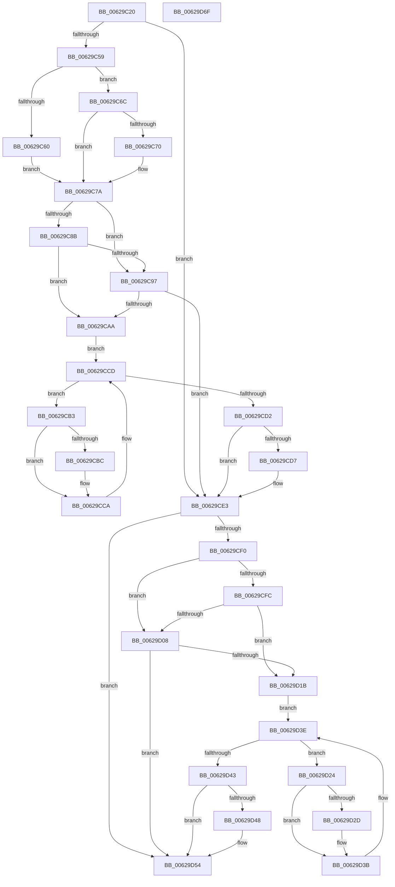

# DifIoDeleteDeviceWrapper

- RVA: `0x00629C20`–`0x00629D70` (길이 `336` bytes)
- VA: `0x0000000140629C20`
- 실행 섹션: `.text`
- PDB 이름 있음: `예`; PDB Function 태그: `아니요`
- unwind 정보 RVA: `0x0005D7BC`
- 디코드: `90`개 명령, `336/336` bytes 표시
- 미해석 바이트: `0` (있으면 어셈블리에 `.byte`로 보존)

> 이 문서는 커널 이미지의 기계어와 PDB 기호를 분석해 생성했습니다. 4번과 5번은 함수 원형과 자료형을 바이너리 사용 방식에서 추정한 C 해석이며 원본 소스 복구 결과는 아닙니다.

## 1. Dependencies

- 직접 호출 지점: **9**; 고유 호출 대상: **6**
- 직접 호출자로 확인된 함수: **0**
- RIP 상대 이미지 참조: **3**

### Outgoing calls
- `0x00629C48` → [DifGetAPIThunkContextById](../49/DifGetAPIThunkContextById_function_00495A34.md) (function, `0x00495A34`)
- `0x00629C70` → [DifGetReturnAddressForWrappers](../4D/DifGetReturnAddressForWrappers_function_004D3C08.md) (function, `0x004D3C08`)
- `0x00629C9E` → [ExAcquireRundownProtection](../21/ExAcquireRundownProtection_function_00216620.md) (function, `0x00216620`)
- `0x00629CC5` → [guard_dispatch_icall](../6B/guard_dispatch_icall_function_006BAAD0.md) (function, `0x006BAAD0`)
- `0x00629CDE` → [ExReleaseRundownProtection](../34/ExReleaseRundownProtection_function_00349E80.md) (function, `0x00349E80`)
- `0x00629CE6` → [IoDeleteDevice](../26/IoDeleteDevice_function_0026FE90.md) (function, `0x0026FE90`)
- `0x00629D0F` → [ExAcquireRundownProtection](../21/ExAcquireRundownProtection_function_00216620.md) (function, `0x00216620`)
- `0x00629D36` → [guard_dispatch_icall](../6B/guard_dispatch_icall_function_006BAAD0.md) (function, `0x006BAAD0`)
- `0x00629D4F` → [ExReleaseRundownProtection](../34/ExReleaseRundownProtection_function_00349E80.md) (function, `0x00349E80`)

### Direct callers
- 이 함수 시작 RVA로 연결되는 직접 call은 확인되지 않았습니다. 간접 호출은 완전히 역산할 수 없습니다.

### Static image references
- `0x00629C82` → RVA `0x00F048B8` (`.data`; read)
- `0x00629C8B` → RVA `0x00F04980` (`.data`; read)
- `0x00629C97` → RVA `0x00F03E80` (`.data`; read)

## 2. Other-region calls and transfers

- 다른 실행 섹션으로 향하는 call: **0**
- 별도 외부 분기/꼬리 이동을 확인하지 못했습니다.

## 3. Assembly (complete function range)

```asm
00629C20  48 8B C4                        mov rax, rsp
00629C23  48 89 58 08                     mov qword ptr [rax + 8], rbx
00629C27  48 89 68 10                     mov qword ptr [rax + 0x10], rbp
00629C2B  48 89 70 18                     mov qword ptr [rax + 0x18], rsi
00629C2F  48 89 78 20                     mov qword ptr [rax + 0x20], rdi
00629C33  41 56                           push r14
00629C35  48 83 EC 30                     sub rsp, 0x30
00629C39  48 8B E9                        mov rbp, rcx
00629C3C  0F 57 C0                        xorps xmm0, xmm0
00629C3F  B9 5A 01 00 00                  mov ecx, 0x15a
00629C44  0F 11 40 E8                     movups xmmword ptr [rax - 0x18], xmm0
00629C48  E8 E7 BD E6 FF                  call 0x140495a34
00629C4D  48 8B F8                        mov rdi, rax
00629C50  48 85 C0                        test rax, rax
00629C53  0F 84 8A 00 00 00               je 0x140629ce3
00629C59  8B 40 0C                        mov eax, dword ptr [rax + 0xc]
00629C5C  A8 18                           test al, 0x18
00629C5E  74 0C                           je 0x140629c6c
00629C60  48 8B 4C 24 38                  mov rcx, qword ptr [rsp + 0x38]
00629C65  48 89 4C 24 20                  mov qword ptr [rsp + 0x20], rcx
00629C6A  EB 0E                           jmp 0x140629c7a
00629C6C  A8 04                           test al, 4
00629C6E  74 0A                           je 0x140629c7a
00629C70  E8 93 9F EA FF                  call 0x1404d3c08
00629C75  48 89 44 24 20                  mov qword ptr [rsp + 0x20], rax
00629C7A  40 32 F6                        xor sil, sil
00629C7D  48 89 6C 24 28                  mov qword ptr [rsp + 0x28], rbp
00629C82  40 38 35 2F AC 8D 00            cmp byte ptr [rip + 0x8dac2f], sil
00629C89  75 0C                           jne 0x140629c97
00629C8B  F7 05 EB AC 8D 00 00 08 00 00   test dword ptr [rip + 0x8daceb], 0x800
00629C95  74 13                           je 0x140629caa
00629C97  48 8D 0D E2 A1 8D 00            lea rcx, [rip + 0x8da1e2]
00629C9E  E8 7D C9 BE FF                  call 0x140216620
00629CA3  40 8A F0                        mov sil, al
00629CA6  84 C0                           test al, al
00629CA8  74 39                           je 0x140629ce3
00629CAA  4C 8D 77 20                     lea r14, [rdi + 0x20]
00629CAE  49 8B 1E                        mov rbx, qword ptr [r14]
00629CB1  EB 1A                           jmp 0x140629ccd
00629CB3  48 8D 43 F0                     lea rax, [rbx - 0x10]
00629CB7  48 85 C0                        test rax, rax
00629CBA  74 0E                           je 0x140629cca
00629CBC  48 8B 40 08                     mov rax, qword ptr [rax + 8]
00629CC0  48 8D 4C 24 20                  lea rcx, [rsp + 0x20]
00629CC5  E8 06 0E 09 00                  call 0x1406baad0
00629CCA  48 8B 1B                        mov rbx, qword ptr [rbx]
00629CCD  49 3B DE                        cmp rbx, r14
00629CD0  75 E1                           jne 0x140629cb3
00629CD2  40 84 F6                        test sil, sil
00629CD5  74 0C                           je 0x140629ce3
00629CD7  48 8D 0D A2 A1 8D 00            lea rcx, [rip + 0x8da1a2]
00629CDE  E8 9D 01 D2 FF                  call 0x140349e80
00629CE3  48 8B CD                        mov rcx, rbp
00629CE6  E8 A5 61 C4 FF                  call 0x14026fe90
00629CEB  48 85 FF                        test rdi, rdi
00629CEE  74 64                           je 0x140629d54
00629CF0  40 32 F6                        xor sil, sil
00629CF3  40 38 35 BE AB 8D 00            cmp byte ptr [rip + 0x8dabbe], sil
00629CFA  75 0C                           jne 0x140629d08
00629CFC  F7 05 7A AC 8D 00 00 08 00 00   test dword ptr [rip + 0x8dac7a], 0x800
00629D06  74 13                           je 0x140629d1b
00629D08  48 8D 0D 71 A1 8D 00            lea rcx, [rip + 0x8da171]
00629D0F  E8 0C C9 BE FF                  call 0x140216620
00629D14  40 8A F0                        mov sil, al
00629D17  84 C0                           test al, al
00629D19  74 39                           je 0x140629d54
00629D1B  48 83 C7 30                     add rdi, 0x30
00629D1F  48 8B 1F                        mov rbx, qword ptr [rdi]
00629D22  EB 1A                           jmp 0x140629d3e
00629D24  48 8D 43 F0                     lea rax, [rbx - 0x10]
00629D28  48 85 C0                        test rax, rax
00629D2B  74 0E                           je 0x140629d3b
00629D2D  48 8B 40 08                     mov rax, qword ptr [rax + 8]
00629D31  48 8D 4C 24 20                  lea rcx, [rsp + 0x20]
00629D36  E8 95 0D 09 00                  call 0x1406baad0
00629D3B  48 8B 1B                        mov rbx, qword ptr [rbx]
00629D3E  48 3B DF                        cmp rbx, rdi
00629D41  75 E1                           jne 0x140629d24
00629D43  40 84 F6                        test sil, sil
00629D46  74 0C                           je 0x140629d54
00629D48  48 8D 0D 31 A1 8D 00            lea rcx, [rip + 0x8da131]
00629D4F  E8 2C 01 D2 FF                  call 0x140349e80
00629D54  48 8B 5C 24 40                  mov rbx, qword ptr [rsp + 0x40]
00629D59  48 8B 6C 24 48                  mov rbp, qword ptr [rsp + 0x48]
00629D5E  48 8B 74 24 50                  mov rsi, qword ptr [rsp + 0x50]
00629D63  48 8B 7C 24 58                  mov rdi, qword ptr [rsp + 0x58]
00629D68  48 83 C4 30                     add rsp, 0x30
00629D6C  41 5E                           pop r14
00629D6E  C3                              ret
00629D6F  CC                              int3
```

## 4. C-style interpretation (structured pseudocode)

```c
__int64 __fastcall DifIoDeleteDeviceWrapper(__int64 a1)
{
    __int64 result;
    __int64 v_rdi;
    __int64 v_rsi;
    __int64 v_rsp;
    unsigned __int64 v_stack_m10;
    unsigned __int64 v_stack_m18;
    unsigned __int64 v_stack_p0;
    unsigned __int64 v_stack_p10;
    unsigned __int64 v_stack_p18;
    unsigned __int64 v_stack_p20;
    unsigned __int64 v_stack_p8;

    *(unsigned __int64 *)(v_rsp + 8) = v_rbx;
    *(unsigned __int64 *)(v_rsp + 16) = v_rbp;
    *(unsigned __int64 *)(v_rsp + 24) = v_rsi;
    *(unsigned __int64 *)(v_rsp + 32) = v_rdi;
    v_rsp = (v_rsp) - (48);
    *(unsigned __int64 *)(v_rsp - 24) = v_xmm0;
    result = DifGetAPIThunkContextById(346, a2, a3, a4);
    if (result == 0) goto loc_00629CE3;
    if ((((unsigned __int8)((unsigned int)(*(unsigned int *)(result + 12)))) & (24)) == 0) goto loc_00629C6C;
    v_stack_m18 = v_stack_p0;
    goto loc_00629C7A;
loc_00629C6C:
    result = (unsigned int)(*(unsigned int *)(result + 12));
    if ((((unsigned __int8)((unsigned int)(*(unsigned int *)(result + 12)))) & (4)) != 0) {
        result = DifGetReturnAddressForWrappers(v_stack_p0, a2, a3, a4);
        v_stack_m18 = result;
    }
    v_rsi = 0;
    v_stack_m10 = a1;
    if ((*(unsigned __int8 *)(v_rip + 9284655)) != 0) goto loc_00629C97;
    if (((*(unsigned int *)(v_rip + 9284843)) & (0x800ULL)) == 0) goto loc_00629CAA;
loc_00629C97:
    result = ExAcquireRundownProtection(v_rip + 9282018, a2, a3, a4);
    if ((unsigned __int8)(result) == 0) goto loc_00629CE3;
loc_00629CAA:
    goto loc_00629CCD;
loc_00629CB3:
    result = *(unsigned __int64 *)(result + 32) - 16;
    if (*(unsigned __int64 *)(result + 32) - 16 != 0) {
        result = *(unsigned __int64 *)(*(unsigned __int64 *)(result + 32) - 16 + 8);
        a1 = v_stack_m18;
        result = guard_dispatch_icall(a1, a2, a3, a4);
    }
loc_00629CCD:
    if ((*(unsigned __int64 *)(*(unsigned __int64 *)(result + 32))) != (result + 32)) goto loc_00629CB3;
    if ((unsigned __int8)((unsigned __int8)(result)) != 0) {
        a1 = v_rip + 9281954;
        result = ExReleaseRundownProtection(a1, a2, a3, a4);
    }
    result = IoDeleteDevice(a1, a2, a3, a4);
    if (result == 0) goto loc_00629D54;
    v_rsi = 0;
    if ((*(unsigned __int8 *)(v_rip + 9284542)) != 0) goto loc_00629D08;
    if (((*(unsigned int *)(v_rip + 9284730)) & (0x800ULL)) == 0) goto loc_00629D1B;
loc_00629D08:
    result = ExAcquireRundownProtection(v_rip + 9281905, a2, a3, a4);
    if ((unsigned __int8)(result) == 0) goto loc_00629D54;
loc_00629D1B:
    v_rdi = (result) + (48);
    goto loc_00629D3E;
loc_00629D24:
    result = *(unsigned __int64 *)(v_rdi) - 16;
    if (*(unsigned __int64 *)(v_rdi) - 16 != 0) {
        result = *(unsigned __int64 *)(*(unsigned __int64 *)(v_rdi) - 16 + 8);
        a1 = v_stack_m18;
        result = guard_dispatch_icall(a1, a2, a3, a4);
    }
loc_00629D3E:
    if ((*(unsigned __int64 *)(*(unsigned __int64 *)(v_rdi))) != v_rdi) goto loc_00629D24;
    if ((unsigned __int8)((unsigned __int8)(result)) != 0) {
        a1 = v_rip + 9281841;
        result = ExReleaseRundownProtection(a1, a2, a3, a4);
    }
    v_rsp = (v_rsp) + (48);
    return result;
}
```

## 5. (Beta) C Style

```c
int64_t DifIoDeleteDeviceWrapper(int64_t Arg1)
{
    int64_t result;
    int64_t local_rdi;
    int64_t local_rsi;
    int64_t local_rsp;
    uint64_t v_stack_m10;
    uint64_t v_stack_m18;
    uint64_t v_stack_p0;
    uint64_t v_stack_p10;
    uint64_t v_stack_p18;
    uint64_t v_stack_p20;
    uint64_t v_stack_p8;

    *(uint64_t *)(local_rsp + 0x8) = local_rbx;
    *(uint64_t *)(local_rsp + 0x10) = local_rbp;
    *(uint64_t *)(local_rsp + 0x18) = local_rsi;
    *(uint64_t *)(local_rsp + 0x20) = local_rdi;
    local_rsp = (local_rsp) - (48);
    *(uint64_t *)(local_rsp - 0x18) = v_xmm0;
    result = DifGetAPIThunkContextById(346, a2, a3, a4);
    if (result == 0) goto loc_00629CE3;
    if ((((uint8_t)((uint32_t)(*(uint32_t *)(result + 0xC)))) & (24)) == 0) goto loc_00629C6C;
    v_stack_m18 = v_stack_p0;
    goto loc_00629C7A;
loc_00629C6C:
    result = (uint32_t)(*(uint32_t *)(result + 0xC));
    if ((((uint8_t)((uint32_t)(*(uint32_t *)(result + 0xC)))) & (4)) != 0) {
        result = DifGetReturnAddressForWrappers(v_stack_p0, a2, a3, a4);
        v_stack_m18 = result;
    }
    local_rsi = 0;
    v_stack_m10 = Arg1;
    if ((*(uint8_t *)(v_rip + 0x8DAC2F)) != 0) goto loc_00629C97;
    if (((*(uint32_t *)(v_rip + 0x8DACEB)) & (0x800ULL)) == 0) goto loc_00629CAA;
loc_00629C97:
    result = ExAcquireRundownProtection(v_rip + 9282018, a2, a3, a4);
    if ((uint8_t)(result) == 0) goto loc_00629CE3;
loc_00629CAA:
    goto loc_00629CCD;
loc_00629CB3:
    result = *(uint64_t *)(result + 0x20) - 16;
    if (*(uint64_t *)(result + 0x20) - 16 != 0) {
        result = *(uint64_t *)(*(uint64_t *)(result + 0x20) - 0x10 + 0x8);
        Arg1 = v_stack_m18;
        result = guard_dispatch_icall(Arg1, a2, a3, a4);
    }
loc_00629CCD:
    if ((*(uint64_t *)(*(uint64_t *)(result + 0x20))) != (result + 32)) goto loc_00629CB3;
    if ((uint8_t)((uint8_t)(result)) != 0) {
        Arg1 = v_rip + 9281954;
        result = ExReleaseRundownProtection(Arg1, a2, a3, a4);
    }
    result = IoDeleteDevice(Arg1, a2, a3, a4);
    if (result == 0) goto loc_00629D54;
    local_rsi = 0;
    if ((*(uint8_t *)(v_rip + 0x8DABBE)) != 0) goto loc_00629D08;
    if (((*(uint32_t *)(v_rip + 0x8DAC7A)) & (0x800ULL)) == 0) goto loc_00629D1B;
loc_00629D08:
    result = ExAcquireRundownProtection(v_rip + 9281905, a2, a3, a4);
    if ((uint8_t)(result) == 0) goto loc_00629D54;
loc_00629D1B:
    local_rdi = (result) + (48);
    goto loc_00629D3E;
loc_00629D24:
    result = *(uint64_t *)(local_rdi) - 16;
    if (*(uint64_t *)(local_rdi) - 16 != 0) {
        result = *(uint64_t *)(*(uint64_t *)(local_rdi) - 0x10 + 0x8);
        Arg1 = v_stack_m18;
        result = guard_dispatch_icall(Arg1, a2, a3, a4);
    }
loc_00629D3E:
    if ((*(uint64_t *)(*(uint64_t *)(local_rdi))) != local_rdi) goto loc_00629D24;
    if ((uint8_t)((uint8_t)(result)) != 0) {
        Arg1 = v_rip + 9281841;
        result = ExReleaseRundownProtection(Arg1, a2, a3, a4);
    }
    local_rsp = (local_rsp) + (48);
    return result;
}
```

## 6. Execution-region graph

[열기: 2D/3D 그래프와 함수 탐색 컨트롤 패널](../../../control-panel.html?section=text&rva=0x00629C20&view=graph)

- 2D 그래프는 위에서 아래로 흐르고, 3D 그래프는 빈 공간을 드래그해 회전합니다. Shift+드래그는 이동, 휠은 확대·축소, 함수 노드 선택은 대상 보고서 이동입니다.

### Static fallback


