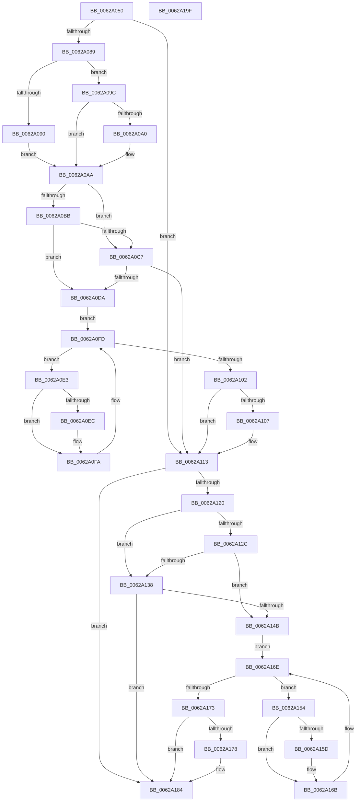

# DifIoDisconnectInterruptExWrapper

- RVA: `0x0062A050`–`0x0062A1A0` (길이 `336` bytes)
- VA: `0x000000014062A050`
- 실행 섹션: `.text`
- PDB 이름 있음: `예`; PDB Function 태그: `아니요`
- unwind 정보 RVA: `0x0005D7BC`
- 디코드: `90`개 명령, `336/336` bytes 표시
- 미해석 바이트: `0` (있으면 어셈블리에 `.byte`로 보존)

> 이 문서는 커널 이미지의 기계어와 PDB 기호를 분석해 생성했습니다. 4번과 5번은 함수 원형과 자료형을 바이너리 사용 방식에서 추정한 C 해석이며 원본 소스 복구 결과는 아닙니다.

## 1. Dependencies

- 직접 호출 지점: **9**; 고유 호출 대상: **6**
- 직접 호출자로 확인된 함수: **0**
- RIP 상대 이미지 참조: **3**

### Outgoing calls
- `0x0062A078` → [DifGetAPIThunkContextById](../49/DifGetAPIThunkContextById_function_00495A34.md) (function, `0x00495A34`)
- `0x0062A0A0` → [DifGetReturnAddressForWrappers](../4D/DifGetReturnAddressForWrappers_function_004D3C08.md) (function, `0x004D3C08`)
- `0x0062A0CE` → [ExAcquireRundownProtection](../21/ExAcquireRundownProtection_function_00216620.md) (function, `0x00216620`)
- `0x0062A0F5` → [guard_dispatch_icall](../6B/guard_dispatch_icall_function_006BAAD0.md) (function, `0x006BAAD0`)
- `0x0062A10E` → [ExReleaseRundownProtection](../34/ExReleaseRundownProtection_function_00349E80.md) (function, `0x00349E80`)
- `0x0062A116` → [IoDisconnectInterruptEx](../../page/90/IoDisconnectInterruptEx_function_00900140.md) (function, `0x00900140`)
- `0x0062A13F` → [ExAcquireRundownProtection](../21/ExAcquireRundownProtection_function_00216620.md) (function, `0x00216620`)
- `0x0062A166` → [guard_dispatch_icall](../6B/guard_dispatch_icall_function_006BAAD0.md) (function, `0x006BAAD0`)
- `0x0062A17F` → [ExReleaseRundownProtection](../34/ExReleaseRundownProtection_function_00349E80.md) (function, `0x00349E80`)

### Direct callers
- 이 함수 시작 RVA로 연결되는 직접 call은 확인되지 않았습니다. 간접 호출은 완전히 역산할 수 없습니다.

### Static image references
- `0x0062A0B2` → RVA `0x00F048B8` (`.data`; read)
- `0x0062A0BB` → RVA `0x00F04980` (`.data`; read)
- `0x0062A0C7` → RVA `0x00F03E80` (`.data`; read)

## 2. Other-region calls and transfers

- 다른 실행 섹션으로 향하는 call: **1**
  - `0x0062A116` → [IoDisconnectInterruptEx](../../page/90/IoDisconnectInterruptEx_function_00900140.md) (`.text` → `PAGE`)
- 별도 외부 분기/꼬리 이동을 확인하지 못했습니다.

## 3. Assembly (complete function range)

```asm
0062A050  48 8B C4                        mov rax, rsp
0062A053  48 89 58 08                     mov qword ptr [rax + 8], rbx
0062A057  48 89 68 10                     mov qword ptr [rax + 0x10], rbp
0062A05B  48 89 70 18                     mov qword ptr [rax + 0x18], rsi
0062A05F  48 89 78 20                     mov qword ptr [rax + 0x20], rdi
0062A063  41 56                           push r14
0062A065  48 83 EC 30                     sub rsp, 0x30
0062A069  48 8B E9                        mov rbp, rcx
0062A06C  0F 57 C0                        xorps xmm0, xmm0
0062A06F  B9 56 01 00 00                  mov ecx, 0x156
0062A074  0F 11 40 E8                     movups xmmword ptr [rax - 0x18], xmm0
0062A078  E8 B7 B9 E6 FF                  call 0x140495a34
0062A07D  48 8B F8                        mov rdi, rax
0062A080  48 85 C0                        test rax, rax
0062A083  0F 84 8A 00 00 00               je 0x14062a113
0062A089  8B 40 0C                        mov eax, dword ptr [rax + 0xc]
0062A08C  A8 18                           test al, 0x18
0062A08E  74 0C                           je 0x14062a09c
0062A090  48 8B 4C 24 38                  mov rcx, qword ptr [rsp + 0x38]
0062A095  48 89 4C 24 20                  mov qword ptr [rsp + 0x20], rcx
0062A09A  EB 0E                           jmp 0x14062a0aa
0062A09C  A8 04                           test al, 4
0062A09E  74 0A                           je 0x14062a0aa
0062A0A0  E8 63 9B EA FF                  call 0x1404d3c08
0062A0A5  48 89 44 24 20                  mov qword ptr [rsp + 0x20], rax
0062A0AA  40 32 F6                        xor sil, sil
0062A0AD  48 89 6C 24 28                  mov qword ptr [rsp + 0x28], rbp
0062A0B2  40 38 35 FF A7 8D 00            cmp byte ptr [rip + 0x8da7ff], sil
0062A0B9  75 0C                           jne 0x14062a0c7
0062A0BB  F7 05 BB A8 8D 00 00 08 00 00   test dword ptr [rip + 0x8da8bb], 0x800
0062A0C5  74 13                           je 0x14062a0da
0062A0C7  48 8D 0D B2 9D 8D 00            lea rcx, [rip + 0x8d9db2]
0062A0CE  E8 4D C5 BE FF                  call 0x140216620
0062A0D3  40 8A F0                        mov sil, al
0062A0D6  84 C0                           test al, al
0062A0D8  74 39                           je 0x14062a113
0062A0DA  4C 8D 77 20                     lea r14, [rdi + 0x20]
0062A0DE  49 8B 1E                        mov rbx, qword ptr [r14]
0062A0E1  EB 1A                           jmp 0x14062a0fd
0062A0E3  48 8D 43 F0                     lea rax, [rbx - 0x10]
0062A0E7  48 85 C0                        test rax, rax
0062A0EA  74 0E                           je 0x14062a0fa
0062A0EC  48 8B 40 08                     mov rax, qword ptr [rax + 8]
0062A0F0  48 8D 4C 24 20                  lea rcx, [rsp + 0x20]
0062A0F5  E8 D6 09 09 00                  call 0x1406baad0
0062A0FA  48 8B 1B                        mov rbx, qword ptr [rbx]
0062A0FD  49 3B DE                        cmp rbx, r14
0062A100  75 E1                           jne 0x14062a0e3
0062A102  40 84 F6                        test sil, sil
0062A105  74 0C                           je 0x14062a113
0062A107  48 8D 0D 72 9D 8D 00            lea rcx, [rip + 0x8d9d72]
0062A10E  E8 6D FD D1 FF                  call 0x140349e80
0062A113  48 8B CD                        mov rcx, rbp
0062A116  E8 25 60 2D 00                  call 0x140900140
0062A11B  48 85 FF                        test rdi, rdi
0062A11E  74 64                           je 0x14062a184
0062A120  40 32 F6                        xor sil, sil
0062A123  40 38 35 8E A7 8D 00            cmp byte ptr [rip + 0x8da78e], sil
0062A12A  75 0C                           jne 0x14062a138
0062A12C  F7 05 4A A8 8D 00 00 08 00 00   test dword ptr [rip + 0x8da84a], 0x800
0062A136  74 13                           je 0x14062a14b
0062A138  48 8D 0D 41 9D 8D 00            lea rcx, [rip + 0x8d9d41]
0062A13F  E8 DC C4 BE FF                  call 0x140216620
0062A144  40 8A F0                        mov sil, al
0062A147  84 C0                           test al, al
0062A149  74 39                           je 0x14062a184
0062A14B  48 83 C7 30                     add rdi, 0x30
0062A14F  48 8B 1F                        mov rbx, qword ptr [rdi]
0062A152  EB 1A                           jmp 0x14062a16e
0062A154  48 8D 43 F0                     lea rax, [rbx - 0x10]
0062A158  48 85 C0                        test rax, rax
0062A15B  74 0E                           je 0x14062a16b
0062A15D  48 8B 40 08                     mov rax, qword ptr [rax + 8]
0062A161  48 8D 4C 24 20                  lea rcx, [rsp + 0x20]
0062A166  E8 65 09 09 00                  call 0x1406baad0
0062A16B  48 8B 1B                        mov rbx, qword ptr [rbx]
0062A16E  48 3B DF                        cmp rbx, rdi
0062A171  75 E1                           jne 0x14062a154
0062A173  40 84 F6                        test sil, sil
0062A176  74 0C                           je 0x14062a184
0062A178  48 8D 0D 01 9D 8D 00            lea rcx, [rip + 0x8d9d01]
0062A17F  E8 FC FC D1 FF                  call 0x140349e80
0062A184  48 8B 5C 24 40                  mov rbx, qword ptr [rsp + 0x40]
0062A189  48 8B 6C 24 48                  mov rbp, qword ptr [rsp + 0x48]
0062A18E  48 8B 74 24 50                  mov rsi, qword ptr [rsp + 0x50]
0062A193  48 8B 7C 24 58                  mov rdi, qword ptr [rsp + 0x58]
0062A198  48 83 C4 30                     add rsp, 0x30
0062A19C  41 5E                           pop r14
0062A19E  C3                              ret
0062A19F  CC                              int3
```

## 4. C-style interpretation (structured pseudocode)

```c
__int64 __fastcall DifIoDisconnectInterruptExWrapper(__int64 a1)
{
    __int64 result;
    __int64 v_rdi;
    __int64 v_rsi;
    __int64 v_rsp;
    unsigned __int64 v_stack_m10;
    unsigned __int64 v_stack_m18;
    unsigned __int64 v_stack_p0;
    unsigned __int64 v_stack_p10;
    unsigned __int64 v_stack_p18;
    unsigned __int64 v_stack_p20;
    unsigned __int64 v_stack_p8;

    *(unsigned __int64 *)(v_rsp + 8) = v_rbx;
    *(unsigned __int64 *)(v_rsp + 16) = v_rbp;
    *(unsigned __int64 *)(v_rsp + 24) = v_rsi;
    *(unsigned __int64 *)(v_rsp + 32) = v_rdi;
    v_rsp = (v_rsp) - (48);
    *(unsigned __int64 *)(v_rsp - 24) = v_xmm0;
    result = DifGetAPIThunkContextById(342, a2, a3, a4);
    if (result == 0) goto loc_0062A113;
    if ((((unsigned __int8)((unsigned int)(*(unsigned int *)(result + 12)))) & (24)) == 0) goto loc_0062A09C;
    v_stack_m18 = v_stack_p0;
    goto loc_0062A0AA;
loc_0062A09C:
    result = (unsigned int)(*(unsigned int *)(result + 12));
    if ((((unsigned __int8)((unsigned int)(*(unsigned int *)(result + 12)))) & (4)) != 0) {
        result = DifGetReturnAddressForWrappers(v_stack_p0, a2, a3, a4);
        v_stack_m18 = result;
    }
    v_rsi = 0;
    v_stack_m10 = a1;
    if ((*(unsigned __int8 *)(v_rip + 9283583)) != 0) goto loc_0062A0C7;
    if (((*(unsigned int *)(v_rip + 9283771)) & (0x800ULL)) == 0) goto loc_0062A0DA;
loc_0062A0C7:
    result = ExAcquireRundownProtection(v_rip + 9280946, a2, a3, a4);
    if ((unsigned __int8)(result) == 0) goto loc_0062A113;
loc_0062A0DA:
    goto loc_0062A0FD;
loc_0062A0E3:
    result = *(unsigned __int64 *)(result + 32) - 16;
    if (*(unsigned __int64 *)(result + 32) - 16 != 0) {
        result = *(unsigned __int64 *)(*(unsigned __int64 *)(result + 32) - 16 + 8);
        a1 = v_stack_m18;
        result = guard_dispatch_icall(a1, a2, a3, a4);
    }
loc_0062A0FD:
    if ((*(unsigned __int64 *)(*(unsigned __int64 *)(result + 32))) != (result + 32)) goto loc_0062A0E3;
    if ((unsigned __int8)((unsigned __int8)(result)) != 0) {
        a1 = v_rip + 9280882;
        result = ExReleaseRundownProtection(a1, a2, a3, a4);
    }
    result = IoDisconnectInterruptEx(a1, a2, a3, a4);
    if (result == 0) goto loc_0062A184;
    v_rsi = 0;
    if ((*(unsigned __int8 *)(v_rip + 9283470)) != 0) goto loc_0062A138;
    if (((*(unsigned int *)(v_rip + 9283658)) & (0x800ULL)) == 0) goto loc_0062A14B;
loc_0062A138:
    result = ExAcquireRundownProtection(v_rip + 9280833, a2, a3, a4);
    if ((unsigned __int8)(result) == 0) goto loc_0062A184;
loc_0062A14B:
    v_rdi = (result) + (48);
    goto loc_0062A16E;
loc_0062A154:
    result = *(unsigned __int64 *)(v_rdi) - 16;
    if (*(unsigned __int64 *)(v_rdi) - 16 != 0) {
        result = *(unsigned __int64 *)(*(unsigned __int64 *)(v_rdi) - 16 + 8);
        a1 = v_stack_m18;
        result = guard_dispatch_icall(a1, a2, a3, a4);
    }
loc_0062A16E:
    if ((*(unsigned __int64 *)(*(unsigned __int64 *)(v_rdi))) != v_rdi) goto loc_0062A154;
    if ((unsigned __int8)((unsigned __int8)(result)) != 0) {
        a1 = v_rip + 9280769;
        result = ExReleaseRundownProtection(a1, a2, a3, a4);
    }
    v_rsp = (v_rsp) + (48);
    return result;
}
```

## 5. (Beta) C Style

```c
int64_t DifIoDisconnectInterruptExWrapper(int64_t Arg1)
{
    int64_t result;
    int64_t local_rdi;
    int64_t local_rsi;
    int64_t local_rsp;
    uint64_t v_stack_m10;
    uint64_t v_stack_m18;
    uint64_t v_stack_p0;
    uint64_t v_stack_p10;
    uint64_t v_stack_p18;
    uint64_t v_stack_p20;
    uint64_t v_stack_p8;

    *(uint64_t *)(local_rsp + 0x8) = local_rbx;
    *(uint64_t *)(local_rsp + 0x10) = local_rbp;
    *(uint64_t *)(local_rsp + 0x18) = local_rsi;
    *(uint64_t *)(local_rsp + 0x20) = local_rdi;
    local_rsp = (local_rsp) - (48);
    *(uint64_t *)(local_rsp - 0x18) = v_xmm0;
    result = DifGetAPIThunkContextById(342, a2, a3, a4);
    if (result == 0) goto loc_0062A113;
    if ((((uint8_t)((uint32_t)(*(uint32_t *)(result + 0xC)))) & (24)) == 0) goto loc_0062A09C;
    v_stack_m18 = v_stack_p0;
    goto loc_0062A0AA;
loc_0062A09C:
    result = (uint32_t)(*(uint32_t *)(result + 0xC));
    if ((((uint8_t)((uint32_t)(*(uint32_t *)(result + 0xC)))) & (4)) != 0) {
        result = DifGetReturnAddressForWrappers(v_stack_p0, a2, a3, a4);
        v_stack_m18 = result;
    }
    local_rsi = 0;
    v_stack_m10 = Arg1;
    if ((*(uint8_t *)(v_rip + 0x8DA7FF)) != 0) goto loc_0062A0C7;
    if (((*(uint32_t *)(v_rip + 0x8DA8BB)) & (0x800ULL)) == 0) goto loc_0062A0DA;
loc_0062A0C7:
    result = ExAcquireRundownProtection(v_rip + 9280946, a2, a3, a4);
    if ((uint8_t)(result) == 0) goto loc_0062A113;
loc_0062A0DA:
    goto loc_0062A0FD;
loc_0062A0E3:
    result = *(uint64_t *)(result + 0x20) - 16;
    if (*(uint64_t *)(result + 0x20) - 16 != 0) {
        result = *(uint64_t *)(*(uint64_t *)(result + 0x20) - 0x10 + 0x8);
        Arg1 = v_stack_m18;
        result = guard_dispatch_icall(Arg1, a2, a3, a4);
    }
loc_0062A0FD:
    if ((*(uint64_t *)(*(uint64_t *)(result + 0x20))) != (result + 32)) goto loc_0062A0E3;
    if ((uint8_t)((uint8_t)(result)) != 0) {
        Arg1 = v_rip + 9280882;
        result = ExReleaseRundownProtection(Arg1, a2, a3, a4);
    }
    result = IoDisconnectInterruptEx(Arg1, a2, a3, a4);
    if (result == 0) goto loc_0062A184;
    local_rsi = 0;
    if ((*(uint8_t *)(v_rip + 0x8DA78E)) != 0) goto loc_0062A138;
    if (((*(uint32_t *)(v_rip + 0x8DA84A)) & (0x800ULL)) == 0) goto loc_0062A14B;
loc_0062A138:
    result = ExAcquireRundownProtection(v_rip + 9280833, a2, a3, a4);
    if ((uint8_t)(result) == 0) goto loc_0062A184;
loc_0062A14B:
    local_rdi = (result) + (48);
    goto loc_0062A16E;
loc_0062A154:
    result = *(uint64_t *)(local_rdi) - 16;
    if (*(uint64_t *)(local_rdi) - 16 != 0) {
        result = *(uint64_t *)(*(uint64_t *)(local_rdi) - 0x10 + 0x8);
        Arg1 = v_stack_m18;
        result = guard_dispatch_icall(Arg1, a2, a3, a4);
    }
loc_0062A16E:
    if ((*(uint64_t *)(*(uint64_t *)(local_rdi))) != local_rdi) goto loc_0062A154;
    if ((uint8_t)((uint8_t)(result)) != 0) {
        Arg1 = v_rip + 9280769;
        result = ExReleaseRundownProtection(Arg1, a2, a3, a4);
    }
    local_rsp = (local_rsp) + (48);
    return result;
}
```

## 6. Execution-region graph

[열기: 2D/3D 그래프와 함수 탐색 컨트롤 패널](../../../control-panel.html?section=text&rva=0x0062A050&view=graph)

- 2D 그래프는 위에서 아래로 흐르고, 3D 그래프는 빈 공간을 드래그해 회전합니다. Shift+드래그는 이동, 휠은 확대·축소, 함수 노드 선택은 대상 보고서 이동입니다.

### Static fallback


