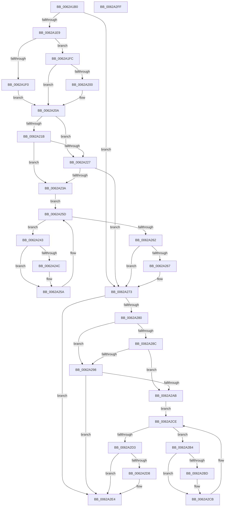

# DifIoDisconnectInterruptWrapper

- RVA: `0x0062A1B0`–`0x0062A300` (길이 `336` bytes)
- VA: `0x000000014062A1B0`
- 실행 섹션: `.text`
- PDB 이름 있음: `예`; PDB Function 태그: `아니요`
- unwind 정보 RVA: `0x0005D7BC`
- 디코드: `90`개 명령, `336/336` bytes 표시
- 미해석 바이트: `0` (있으면 어셈블리에 `.byte`로 보존)

> 이 문서는 커널 이미지의 기계어와 PDB 기호를 분석해 생성했습니다. 4번과 5번은 함수 원형과 자료형을 바이너리 사용 방식에서 추정한 C 해석이며 원본 소스 복구 결과는 아닙니다.

## 1. Dependencies

- 직접 호출 지점: **9**; 고유 호출 대상: **6**
- 직접 호출자로 확인된 함수: **0**
- RIP 상대 이미지 참조: **3**

### Outgoing calls
- `0x0062A1D8` → [DifGetAPIThunkContextById](../49/DifGetAPIThunkContextById_function_00495A34.md) (function, `0x00495A34`)
- `0x0062A200` → [DifGetReturnAddressForWrappers](../4D/DifGetReturnAddressForWrappers_function_004D3C08.md) (function, `0x004D3C08`)
- `0x0062A22E` → [ExAcquireRundownProtection](../21/ExAcquireRundownProtection_function_00216620.md) (function, `0x00216620`)
- `0x0062A255` → [guard_dispatch_icall](../6B/guard_dispatch_icall_function_006BAAD0.md) (function, `0x006BAAD0`)
- `0x0062A26E` → [ExReleaseRundownProtection](../34/ExReleaseRundownProtection_function_00349E80.md) (function, `0x00349E80`)
- `0x0062A276` → [IoDisconnectInterrupt](../../page/90/IoDisconnectInterrupt_function_00900890.md) (function, `0x00900890`)
- `0x0062A29F` → [ExAcquireRundownProtection](../21/ExAcquireRundownProtection_function_00216620.md) (function, `0x00216620`)
- `0x0062A2C6` → [guard_dispatch_icall](../6B/guard_dispatch_icall_function_006BAAD0.md) (function, `0x006BAAD0`)
- `0x0062A2DF` → [ExReleaseRundownProtection](../34/ExReleaseRundownProtection_function_00349E80.md) (function, `0x00349E80`)

### Direct callers
- 이 함수 시작 RVA로 연결되는 직접 call은 확인되지 않았습니다. 간접 호출은 완전히 역산할 수 없습니다.

### Static image references
- `0x0062A212` → RVA `0x00F048B8` (`.data`; read)
- `0x0062A21B` → RVA `0x00F04980` (`.data`; read)
- `0x0062A227` → RVA `0x00F03E80` (`.data`; read)

## 2. Other-region calls and transfers

- 다른 실행 섹션으로 향하는 call: **1**
  - `0x0062A276` → [IoDisconnectInterrupt](../../page/90/IoDisconnectInterrupt_function_00900890.md) (`.text` → `PAGE`)
- 별도 외부 분기/꼬리 이동을 확인하지 못했습니다.

## 3. Assembly (complete function range)

```asm
0062A1B0  48 8B C4                        mov rax, rsp
0062A1B3  48 89 58 08                     mov qword ptr [rax + 8], rbx
0062A1B7  48 89 68 10                     mov qword ptr [rax + 0x10], rbp
0062A1BB  48 89 70 18                     mov qword ptr [rax + 0x18], rsi
0062A1BF  48 89 78 20                     mov qword ptr [rax + 0x20], rdi
0062A1C3  41 56                           push r14
0062A1C5  48 83 EC 30                     sub rsp, 0x30
0062A1C9  48 8B E9                        mov rbp, rcx
0062A1CC  0F 57 C0                        xorps xmm0, xmm0
0062A1CF  B9 57 01 00 00                  mov ecx, 0x157
0062A1D4  0F 11 40 E8                     movups xmmword ptr [rax - 0x18], xmm0
0062A1D8  E8 57 B8 E6 FF                  call 0x140495a34
0062A1DD  48 8B F8                        mov rdi, rax
0062A1E0  48 85 C0                        test rax, rax
0062A1E3  0F 84 8A 00 00 00               je 0x14062a273
0062A1E9  8B 40 0C                        mov eax, dword ptr [rax + 0xc]
0062A1EC  A8 18                           test al, 0x18
0062A1EE  74 0C                           je 0x14062a1fc
0062A1F0  48 8B 4C 24 38                  mov rcx, qword ptr [rsp + 0x38]
0062A1F5  48 89 4C 24 20                  mov qword ptr [rsp + 0x20], rcx
0062A1FA  EB 0E                           jmp 0x14062a20a
0062A1FC  A8 04                           test al, 4
0062A1FE  74 0A                           je 0x14062a20a
0062A200  E8 03 9A EA FF                  call 0x1404d3c08
0062A205  48 89 44 24 20                  mov qword ptr [rsp + 0x20], rax
0062A20A  40 32 F6                        xor sil, sil
0062A20D  48 89 6C 24 28                  mov qword ptr [rsp + 0x28], rbp
0062A212  40 38 35 9F A6 8D 00            cmp byte ptr [rip + 0x8da69f], sil
0062A219  75 0C                           jne 0x14062a227
0062A21B  F7 05 5B A7 8D 00 00 08 00 00   test dword ptr [rip + 0x8da75b], 0x800
0062A225  74 13                           je 0x14062a23a
0062A227  48 8D 0D 52 9C 8D 00            lea rcx, [rip + 0x8d9c52]
0062A22E  E8 ED C3 BE FF                  call 0x140216620
0062A233  40 8A F0                        mov sil, al
0062A236  84 C0                           test al, al
0062A238  74 39                           je 0x14062a273
0062A23A  4C 8D 77 20                     lea r14, [rdi + 0x20]
0062A23E  49 8B 1E                        mov rbx, qword ptr [r14]
0062A241  EB 1A                           jmp 0x14062a25d
0062A243  48 8D 43 F0                     lea rax, [rbx - 0x10]
0062A247  48 85 C0                        test rax, rax
0062A24A  74 0E                           je 0x14062a25a
0062A24C  48 8B 40 08                     mov rax, qword ptr [rax + 8]
0062A250  48 8D 4C 24 20                  lea rcx, [rsp + 0x20]
0062A255  E8 76 08 09 00                  call 0x1406baad0
0062A25A  48 8B 1B                        mov rbx, qword ptr [rbx]
0062A25D  49 3B DE                        cmp rbx, r14
0062A260  75 E1                           jne 0x14062a243
0062A262  40 84 F6                        test sil, sil
0062A265  74 0C                           je 0x14062a273
0062A267  48 8D 0D 12 9C 8D 00            lea rcx, [rip + 0x8d9c12]
0062A26E  E8 0D FC D1 FF                  call 0x140349e80
0062A273  48 8B CD                        mov rcx, rbp
0062A276  E8 15 66 2D 00                  call 0x140900890
0062A27B  48 85 FF                        test rdi, rdi
0062A27E  74 64                           je 0x14062a2e4
0062A280  40 32 F6                        xor sil, sil
0062A283  40 38 35 2E A6 8D 00            cmp byte ptr [rip + 0x8da62e], sil
0062A28A  75 0C                           jne 0x14062a298
0062A28C  F7 05 EA A6 8D 00 00 08 00 00   test dword ptr [rip + 0x8da6ea], 0x800
0062A296  74 13                           je 0x14062a2ab
0062A298  48 8D 0D E1 9B 8D 00            lea rcx, [rip + 0x8d9be1]
0062A29F  E8 7C C3 BE FF                  call 0x140216620
0062A2A4  40 8A F0                        mov sil, al
0062A2A7  84 C0                           test al, al
0062A2A9  74 39                           je 0x14062a2e4
0062A2AB  48 83 C7 30                     add rdi, 0x30
0062A2AF  48 8B 1F                        mov rbx, qword ptr [rdi]
0062A2B2  EB 1A                           jmp 0x14062a2ce
0062A2B4  48 8D 43 F0                     lea rax, [rbx - 0x10]
0062A2B8  48 85 C0                        test rax, rax
0062A2BB  74 0E                           je 0x14062a2cb
0062A2BD  48 8B 40 08                     mov rax, qword ptr [rax + 8]
0062A2C1  48 8D 4C 24 20                  lea rcx, [rsp + 0x20]
0062A2C6  E8 05 08 09 00                  call 0x1406baad0
0062A2CB  48 8B 1B                        mov rbx, qword ptr [rbx]
0062A2CE  48 3B DF                        cmp rbx, rdi
0062A2D1  75 E1                           jne 0x14062a2b4
0062A2D3  40 84 F6                        test sil, sil
0062A2D6  74 0C                           je 0x14062a2e4
0062A2D8  48 8D 0D A1 9B 8D 00            lea rcx, [rip + 0x8d9ba1]
0062A2DF  E8 9C FB D1 FF                  call 0x140349e80
0062A2E4  48 8B 5C 24 40                  mov rbx, qword ptr [rsp + 0x40]
0062A2E9  48 8B 6C 24 48                  mov rbp, qword ptr [rsp + 0x48]
0062A2EE  48 8B 74 24 50                  mov rsi, qword ptr [rsp + 0x50]
0062A2F3  48 8B 7C 24 58                  mov rdi, qword ptr [rsp + 0x58]
0062A2F8  48 83 C4 30                     add rsp, 0x30
0062A2FC  41 5E                           pop r14
0062A2FE  C3                              ret
0062A2FF  CC                              int3
```

## 4. C-style interpretation (structured pseudocode)

```c
__int64 __fastcall DifIoDisconnectInterruptWrapper(__int64 a1)
{
    __int64 result;
    __int64 v_rdi;
    __int64 v_rsi;
    __int64 v_rsp;
    unsigned __int64 v_stack_m10;
    unsigned __int64 v_stack_m18;
    unsigned __int64 v_stack_p0;
    unsigned __int64 v_stack_p10;
    unsigned __int64 v_stack_p18;
    unsigned __int64 v_stack_p20;
    unsigned __int64 v_stack_p8;

    *(unsigned __int64 *)(v_rsp + 8) = v_rbx;
    *(unsigned __int64 *)(v_rsp + 16) = v_rbp;
    *(unsigned __int64 *)(v_rsp + 24) = v_rsi;
    *(unsigned __int64 *)(v_rsp + 32) = v_rdi;
    v_rsp = (v_rsp) - (48);
    *(unsigned __int64 *)(v_rsp - 24) = v_xmm0;
    result = DifGetAPIThunkContextById(343, a2, a3, a4);
    if (result == 0) goto loc_0062A273;
    if ((((unsigned __int8)((unsigned int)(*(unsigned int *)(result + 12)))) & (24)) == 0) goto loc_0062A1FC;
    v_stack_m18 = v_stack_p0;
    goto loc_0062A20A;
loc_0062A1FC:
    result = (unsigned int)(*(unsigned int *)(result + 12));
    if ((((unsigned __int8)((unsigned int)(*(unsigned int *)(result + 12)))) & (4)) != 0) {
        result = DifGetReturnAddressForWrappers(v_stack_p0, a2, a3, a4);
        v_stack_m18 = result;
    }
    v_rsi = 0;
    v_stack_m10 = a1;
    if ((*(unsigned __int8 *)(v_rip + 9283231)) != 0) goto loc_0062A227;
    if (((*(unsigned int *)(v_rip + 9283419)) & (0x800ULL)) == 0) goto loc_0062A23A;
loc_0062A227:
    result = ExAcquireRundownProtection(v_rip + 9280594, a2, a3, a4);
    if ((unsigned __int8)(result) == 0) goto loc_0062A273;
loc_0062A23A:
    goto loc_0062A25D;
loc_0062A243:
    result = *(unsigned __int64 *)(result + 32) - 16;
    if (*(unsigned __int64 *)(result + 32) - 16 != 0) {
        result = *(unsigned __int64 *)(*(unsigned __int64 *)(result + 32) - 16 + 8);
        a1 = v_stack_m18;
        result = guard_dispatch_icall(a1, a2, a3, a4);
    }
loc_0062A25D:
    if ((*(unsigned __int64 *)(*(unsigned __int64 *)(result + 32))) != (result + 32)) goto loc_0062A243;
    if ((unsigned __int8)((unsigned __int8)(result)) != 0) {
        a1 = v_rip + 9280530;
        result = ExReleaseRundownProtection(a1, a2, a3, a4);
    }
    result = IoDisconnectInterrupt(a1, a2, a3, a4);
    if (result == 0) goto loc_0062A2E4;
    v_rsi = 0;
    if ((*(unsigned __int8 *)(v_rip + 9283118)) != 0) goto loc_0062A298;
    if (((*(unsigned int *)(v_rip + 9283306)) & (0x800ULL)) == 0) goto loc_0062A2AB;
loc_0062A298:
    result = ExAcquireRundownProtection(v_rip + 9280481, a2, a3, a4);
    if ((unsigned __int8)(result) == 0) goto loc_0062A2E4;
loc_0062A2AB:
    v_rdi = (result) + (48);
    goto loc_0062A2CE;
loc_0062A2B4:
    result = *(unsigned __int64 *)(v_rdi) - 16;
    if (*(unsigned __int64 *)(v_rdi) - 16 != 0) {
        result = *(unsigned __int64 *)(*(unsigned __int64 *)(v_rdi) - 16 + 8);
        a1 = v_stack_m18;
        result = guard_dispatch_icall(a1, a2, a3, a4);
    }
loc_0062A2CE:
    if ((*(unsigned __int64 *)(*(unsigned __int64 *)(v_rdi))) != v_rdi) goto loc_0062A2B4;
    if ((unsigned __int8)((unsigned __int8)(result)) != 0) {
        a1 = v_rip + 9280417;
        result = ExReleaseRundownProtection(a1, a2, a3, a4);
    }
    v_rsp = (v_rsp) + (48);
    return result;
}
```

## 5. (Beta) C Style

```c
int64_t DifIoDisconnectInterruptWrapper(int64_t Arg1)
{
    int64_t result;
    int64_t local_rdi;
    int64_t local_rsi;
    int64_t local_rsp;
    uint64_t v_stack_m10;
    uint64_t v_stack_m18;
    uint64_t v_stack_p0;
    uint64_t v_stack_p10;
    uint64_t v_stack_p18;
    uint64_t v_stack_p20;
    uint64_t v_stack_p8;

    *(uint64_t *)(local_rsp + 0x8) = local_rbx;
    *(uint64_t *)(local_rsp + 0x10) = local_rbp;
    *(uint64_t *)(local_rsp + 0x18) = local_rsi;
    *(uint64_t *)(local_rsp + 0x20) = local_rdi;
    local_rsp = (local_rsp) - (48);
    *(uint64_t *)(local_rsp - 0x18) = v_xmm0;
    result = DifGetAPIThunkContextById(343, a2, a3, a4);
    if (result == 0) goto loc_0062A273;
    if ((((uint8_t)((uint32_t)(*(uint32_t *)(result + 0xC)))) & (24)) == 0) goto loc_0062A1FC;
    v_stack_m18 = v_stack_p0;
    goto loc_0062A20A;
loc_0062A1FC:
    result = (uint32_t)(*(uint32_t *)(result + 0xC));
    if ((((uint8_t)((uint32_t)(*(uint32_t *)(result + 0xC)))) & (4)) != 0) {
        result = DifGetReturnAddressForWrappers(v_stack_p0, a2, a3, a4);
        v_stack_m18 = result;
    }
    local_rsi = 0;
    v_stack_m10 = Arg1;
    if ((*(uint8_t *)(v_rip + 0x8DA69F)) != 0) goto loc_0062A227;
    if (((*(uint32_t *)(v_rip + 0x8DA75B)) & (0x800ULL)) == 0) goto loc_0062A23A;
loc_0062A227:
    result = ExAcquireRundownProtection(v_rip + 9280594, a2, a3, a4);
    if ((uint8_t)(result) == 0) goto loc_0062A273;
loc_0062A23A:
    goto loc_0062A25D;
loc_0062A243:
    result = *(uint64_t *)(result + 0x20) - 16;
    if (*(uint64_t *)(result + 0x20) - 16 != 0) {
        result = *(uint64_t *)(*(uint64_t *)(result + 0x20) - 0x10 + 0x8);
        Arg1 = v_stack_m18;
        result = guard_dispatch_icall(Arg1, a2, a3, a4);
    }
loc_0062A25D:
    if ((*(uint64_t *)(*(uint64_t *)(result + 0x20))) != (result + 32)) goto loc_0062A243;
    if ((uint8_t)((uint8_t)(result)) != 0) {
        Arg1 = v_rip + 9280530;
        result = ExReleaseRundownProtection(Arg1, a2, a3, a4);
    }
    result = IoDisconnectInterrupt(Arg1, a2, a3, a4);
    if (result == 0) goto loc_0062A2E4;
    local_rsi = 0;
    if ((*(uint8_t *)(v_rip + 0x8DA62E)) != 0) goto loc_0062A298;
    if (((*(uint32_t *)(v_rip + 0x8DA6EA)) & (0x800ULL)) == 0) goto loc_0062A2AB;
loc_0062A298:
    result = ExAcquireRundownProtection(v_rip + 9280481, a2, a3, a4);
    if ((uint8_t)(result) == 0) goto loc_0062A2E4;
loc_0062A2AB:
    local_rdi = (result) + (48);
    goto loc_0062A2CE;
loc_0062A2B4:
    result = *(uint64_t *)(local_rdi) - 16;
    if (*(uint64_t *)(local_rdi) - 16 != 0) {
        result = *(uint64_t *)(*(uint64_t *)(local_rdi) - 0x10 + 0x8);
        Arg1 = v_stack_m18;
        result = guard_dispatch_icall(Arg1, a2, a3, a4);
    }
loc_0062A2CE:
    if ((*(uint64_t *)(*(uint64_t *)(local_rdi))) != local_rdi) goto loc_0062A2B4;
    if ((uint8_t)((uint8_t)(result)) != 0) {
        Arg1 = v_rip + 9280417;
        result = ExReleaseRundownProtection(Arg1, a2, a3, a4);
    }
    local_rsp = (local_rsp) + (48);
    return result;
}
```

## 6. Execution-region graph

[열기: 2D/3D 그래프와 함수 탐색 컨트롤 패널](../../../control-panel.html?section=text&rva=0x0062A1B0&view=graph)

- 2D 그래프는 위에서 아래로 흐르고, 3D 그래프는 빈 공간을 드래그해 회전합니다. Shift+드래그는 이동, 휠은 확대·축소, 함수 노드 선택은 대상 보고서 이동입니다.

### Static fallback


