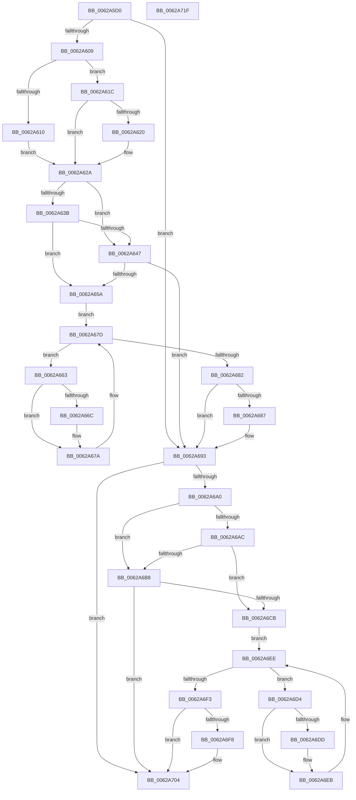

# DifIoFreeMdlWrapper

- RVA: `0x0062A5D0`–`0x0062A720` (길이 `336` bytes)
- VA: `0x000000014062A5D0`
- 실행 섹션: `.text`
- PDB 이름 있음: `예`; PDB Function 태그: `아니요`
- unwind 정보 RVA: `0x0005D7BC`
- 디코드: `90`개 명령, `336/336` bytes 표시
- 미해석 바이트: `0` (있으면 어셈블리에 `.byte`로 보존)

> 이 문서는 커널 이미지의 기계어와 PDB 기호를 분석해 생성했습니다. 4번과 5번은 함수 원형과 자료형을 바이너리 사용 방식에서 추정한 C 해석이며 원본 소스 복구 결과는 아닙니다.

## 1. Dependencies

- 직접 호출 지점: **9**; 고유 호출 대상: **6**
- 직접 호출자로 확인된 함수: **0**
- RIP 상대 이미지 참조: **3**

### Outgoing calls
- `0x0062A5F8` → [DifGetAPIThunkContextById](../49/DifGetAPIThunkContextById_function_00495A34.md) (function, `0x00495A34`)
- `0x0062A620` → [DifGetReturnAddressForWrappers](../4D/DifGetReturnAddressForWrappers_function_004D3C08.md) (function, `0x004D3C08`)
- `0x0062A64E` → [ExAcquireRundownProtection](../21/ExAcquireRundownProtection_function_00216620.md) (function, `0x00216620`)
- `0x0062A675` → [guard_dispatch_icall](../6B/guard_dispatch_icall_function_006BAAD0.md) (function, `0x006BAAD0`)
- `0x0062A68E` → [ExReleaseRundownProtection](../34/ExReleaseRundownProtection_function_00349E80.md) (function, `0x00349E80`)
- `0x0062A696` → [IoFreeMdl](../29/IoFreeMdl_function_0029EA80.md) (function, `0x0029EA80`)
- `0x0062A6BF` → [ExAcquireRundownProtection](../21/ExAcquireRundownProtection_function_00216620.md) (function, `0x00216620`)
- `0x0062A6E6` → [guard_dispatch_icall](../6B/guard_dispatch_icall_function_006BAAD0.md) (function, `0x006BAAD0`)
- `0x0062A6FF` → [ExReleaseRundownProtection](../34/ExReleaseRundownProtection_function_00349E80.md) (function, `0x00349E80`)

### Direct callers
- 이 함수 시작 RVA로 연결되는 직접 call은 확인되지 않았습니다. 간접 호출은 완전히 역산할 수 없습니다.

### Static image references
- `0x0062A632` → RVA `0x00F048B8` (`.data`; read)
- `0x0062A63B` → RVA `0x00F04980` (`.data`; read)
- `0x0062A647` → RVA `0x00F03E80` (`.data`; read)

## 2. Other-region calls and transfers

- 다른 실행 섹션으로 향하는 call: **0**
- 별도 외부 분기/꼬리 이동을 확인하지 못했습니다.

## 3. Assembly (complete function range)

```asm
0062A5D0  48 8B C4                        mov rax, rsp
0062A5D3  48 89 58 08                     mov qword ptr [rax + 8], rbx
0062A5D7  48 89 68 10                     mov qword ptr [rax + 0x10], rbp
0062A5DB  48 89 70 18                     mov qword ptr [rax + 0x18], rsi
0062A5DF  48 89 78 20                     mov qword ptr [rax + 0x20], rdi
0062A5E3  41 56                           push r14
0062A5E5  48 83 EC 30                     sub rsp, 0x30
0062A5E9  48 8B E9                        mov rbp, rcx
0062A5EC  0F 57 C0                        xorps xmm0, xmm0
0062A5EF  B9 53 01 00 00                  mov ecx, 0x153
0062A5F4  0F 11 40 E8                     movups xmmword ptr [rax - 0x18], xmm0
0062A5F8  E8 37 B4 E6 FF                  call 0x140495a34
0062A5FD  48 8B F8                        mov rdi, rax
0062A600  48 85 C0                        test rax, rax
0062A603  0F 84 8A 00 00 00               je 0x14062a693
0062A609  8B 40 0C                        mov eax, dword ptr [rax + 0xc]
0062A60C  A8 18                           test al, 0x18
0062A60E  74 0C                           je 0x14062a61c
0062A610  48 8B 4C 24 38                  mov rcx, qword ptr [rsp + 0x38]
0062A615  48 89 4C 24 20                  mov qword ptr [rsp + 0x20], rcx
0062A61A  EB 0E                           jmp 0x14062a62a
0062A61C  A8 04                           test al, 4
0062A61E  74 0A                           je 0x14062a62a
0062A620  E8 E3 95 EA FF                  call 0x1404d3c08
0062A625  48 89 44 24 20                  mov qword ptr [rsp + 0x20], rax
0062A62A  40 32 F6                        xor sil, sil
0062A62D  48 89 6C 24 28                  mov qword ptr [rsp + 0x28], rbp
0062A632  40 38 35 7F A2 8D 00            cmp byte ptr [rip + 0x8da27f], sil
0062A639  75 0C                           jne 0x14062a647
0062A63B  F7 05 3B A3 8D 00 00 08 00 00   test dword ptr [rip + 0x8da33b], 0x800
0062A645  74 13                           je 0x14062a65a
0062A647  48 8D 0D 32 98 8D 00            lea rcx, [rip + 0x8d9832]
0062A64E  E8 CD BF BE FF                  call 0x140216620
0062A653  40 8A F0                        mov sil, al
0062A656  84 C0                           test al, al
0062A658  74 39                           je 0x14062a693
0062A65A  4C 8D 77 20                     lea r14, [rdi + 0x20]
0062A65E  49 8B 1E                        mov rbx, qword ptr [r14]
0062A661  EB 1A                           jmp 0x14062a67d
0062A663  48 8D 43 F0                     lea rax, [rbx - 0x10]
0062A667  48 85 C0                        test rax, rax
0062A66A  74 0E                           je 0x14062a67a
0062A66C  48 8B 40 08                     mov rax, qword ptr [rax + 8]
0062A670  48 8D 4C 24 20                  lea rcx, [rsp + 0x20]
0062A675  E8 56 04 09 00                  call 0x1406baad0
0062A67A  48 8B 1B                        mov rbx, qword ptr [rbx]
0062A67D  49 3B DE                        cmp rbx, r14
0062A680  75 E1                           jne 0x14062a663
0062A682  40 84 F6                        test sil, sil
0062A685  74 0C                           je 0x14062a693
0062A687  48 8D 0D F2 97 8D 00            lea rcx, [rip + 0x8d97f2]
0062A68E  E8 ED F7 D1 FF                  call 0x140349e80
0062A693  48 8B CD                        mov rcx, rbp
0062A696  E8 E5 43 C7 FF                  call 0x14029ea80
0062A69B  48 85 FF                        test rdi, rdi
0062A69E  74 64                           je 0x14062a704
0062A6A0  40 32 F6                        xor sil, sil
0062A6A3  40 38 35 0E A2 8D 00            cmp byte ptr [rip + 0x8da20e], sil
0062A6AA  75 0C                           jne 0x14062a6b8
0062A6AC  F7 05 CA A2 8D 00 00 08 00 00   test dword ptr [rip + 0x8da2ca], 0x800
0062A6B6  74 13                           je 0x14062a6cb
0062A6B8  48 8D 0D C1 97 8D 00            lea rcx, [rip + 0x8d97c1]
0062A6BF  E8 5C BF BE FF                  call 0x140216620
0062A6C4  40 8A F0                        mov sil, al
0062A6C7  84 C0                           test al, al
0062A6C9  74 39                           je 0x14062a704
0062A6CB  48 83 C7 30                     add rdi, 0x30
0062A6CF  48 8B 1F                        mov rbx, qword ptr [rdi]
0062A6D2  EB 1A                           jmp 0x14062a6ee
0062A6D4  48 8D 43 F0                     lea rax, [rbx - 0x10]
0062A6D8  48 85 C0                        test rax, rax
0062A6DB  74 0E                           je 0x14062a6eb
0062A6DD  48 8B 40 08                     mov rax, qword ptr [rax + 8]
0062A6E1  48 8D 4C 24 20                  lea rcx, [rsp + 0x20]
0062A6E6  E8 E5 03 09 00                  call 0x1406baad0
0062A6EB  48 8B 1B                        mov rbx, qword ptr [rbx]
0062A6EE  48 3B DF                        cmp rbx, rdi
0062A6F1  75 E1                           jne 0x14062a6d4
0062A6F3  40 84 F6                        test sil, sil
0062A6F6  74 0C                           je 0x14062a704
0062A6F8  48 8D 0D 81 97 8D 00            lea rcx, [rip + 0x8d9781]
0062A6FF  E8 7C F7 D1 FF                  call 0x140349e80
0062A704  48 8B 5C 24 40                  mov rbx, qword ptr [rsp + 0x40]
0062A709  48 8B 6C 24 48                  mov rbp, qword ptr [rsp + 0x48]
0062A70E  48 8B 74 24 50                  mov rsi, qword ptr [rsp + 0x50]
0062A713  48 8B 7C 24 58                  mov rdi, qword ptr [rsp + 0x58]
0062A718  48 83 C4 30                     add rsp, 0x30
0062A71C  41 5E                           pop r14
0062A71E  C3                              ret
0062A71F  CC                              int3
```

## 4. C-style interpretation (structured pseudocode)

```c
__int64 __fastcall DifIoFreeMdlWrapper(__int64 a1)
{
    __int64 result;
    __int64 v_rdi;
    __int64 v_rsi;
    __int64 v_rsp;
    unsigned __int64 v_stack_m10;
    unsigned __int64 v_stack_m18;
    unsigned __int64 v_stack_p0;
    unsigned __int64 v_stack_p10;
    unsigned __int64 v_stack_p18;
    unsigned __int64 v_stack_p20;
    unsigned __int64 v_stack_p8;

    *(unsigned __int64 *)(v_rsp + 8) = v_rbx;
    *(unsigned __int64 *)(v_rsp + 16) = v_rbp;
    *(unsigned __int64 *)(v_rsp + 24) = v_rsi;
    *(unsigned __int64 *)(v_rsp + 32) = v_rdi;
    v_rsp = (v_rsp) - (48);
    *(unsigned __int64 *)(v_rsp - 24) = v_xmm0;
    result = DifGetAPIThunkContextById(339, a2, a3, a4);
    if (result == 0) goto loc_0062A693;
    if ((((unsigned __int8)((unsigned int)(*(unsigned int *)(result + 12)))) & (24)) == 0) goto loc_0062A61C;
    v_stack_m18 = v_stack_p0;
    goto loc_0062A62A;
loc_0062A61C:
    result = (unsigned int)(*(unsigned int *)(result + 12));
    if ((((unsigned __int8)((unsigned int)(*(unsigned int *)(result + 12)))) & (4)) != 0) {
        result = DifGetReturnAddressForWrappers(v_stack_p0, a2, a3, a4);
        v_stack_m18 = result;
    }
    v_rsi = 0;
    v_stack_m10 = a1;
    if ((*(unsigned __int8 *)(v_rip + 9282175)) != 0) goto loc_0062A647;
    if (((*(unsigned int *)(v_rip + 9282363)) & (0x800ULL)) == 0) goto loc_0062A65A;
loc_0062A647:
    result = ExAcquireRundownProtection(v_rip + 9279538, a2, a3, a4);
    if ((unsigned __int8)(result) == 0) goto loc_0062A693;
loc_0062A65A:
    goto loc_0062A67D;
loc_0062A663:
    result = *(unsigned __int64 *)(result + 32) - 16;
    if (*(unsigned __int64 *)(result + 32) - 16 != 0) {
        result = *(unsigned __int64 *)(*(unsigned __int64 *)(result + 32) - 16 + 8);
        a1 = v_stack_m18;
        result = guard_dispatch_icall(a1, a2, a3, a4);
    }
loc_0062A67D:
    if ((*(unsigned __int64 *)(*(unsigned __int64 *)(result + 32))) != (result + 32)) goto loc_0062A663;
    if ((unsigned __int8)((unsigned __int8)(result)) != 0) {
        a1 = v_rip + 9279474;
        result = ExReleaseRundownProtection(a1, a2, a3, a4);
    }
    result = IoFreeMdl(a1, a2, a3, a4);
    if (result == 0) goto loc_0062A704;
    v_rsi = 0;
    if ((*(unsigned __int8 *)(v_rip + 9282062)) != 0) goto loc_0062A6B8;
    if (((*(unsigned int *)(v_rip + 9282250)) & (0x800ULL)) == 0) goto loc_0062A6CB;
loc_0062A6B8:
    result = ExAcquireRundownProtection(v_rip + 9279425, a2, a3, a4);
    if ((unsigned __int8)(result) == 0) goto loc_0062A704;
loc_0062A6CB:
    v_rdi = (result) + (48);
    goto loc_0062A6EE;
loc_0062A6D4:
    result = *(unsigned __int64 *)(v_rdi) - 16;
    if (*(unsigned __int64 *)(v_rdi) - 16 != 0) {
        result = *(unsigned __int64 *)(*(unsigned __int64 *)(v_rdi) - 16 + 8);
        a1 = v_stack_m18;
        result = guard_dispatch_icall(a1, a2, a3, a4);
    }
loc_0062A6EE:
    if ((*(unsigned __int64 *)(*(unsigned __int64 *)(v_rdi))) != v_rdi) goto loc_0062A6D4;
    if ((unsigned __int8)((unsigned __int8)(result)) != 0) {
        a1 = v_rip + 9279361;
        result = ExReleaseRundownProtection(a1, a2, a3, a4);
    }
    v_rsp = (v_rsp) + (48);
    return result;
}
```

## 5. (Beta) C Style

```c
int64_t DifIoFreeMdlWrapper(int64_t Arg1)
{
    int64_t result;
    int64_t local_rdi;
    int64_t local_rsi;
    int64_t local_rsp;
    uint64_t v_stack_m10;
    uint64_t v_stack_m18;
    uint64_t v_stack_p0;
    uint64_t v_stack_p10;
    uint64_t v_stack_p18;
    uint64_t v_stack_p20;
    uint64_t v_stack_p8;

    *(uint64_t *)(local_rsp + 0x8) = local_rbx;
    *(uint64_t *)(local_rsp + 0x10) = local_rbp;
    *(uint64_t *)(local_rsp + 0x18) = local_rsi;
    *(uint64_t *)(local_rsp + 0x20) = local_rdi;
    local_rsp = (local_rsp) - (48);
    *(uint64_t *)(local_rsp - 0x18) = v_xmm0;
    result = DifGetAPIThunkContextById(339, a2, a3, a4);
    if (result == 0) goto loc_0062A693;
    if ((((uint8_t)((uint32_t)(*(uint32_t *)(result + 0xC)))) & (24)) == 0) goto loc_0062A61C;
    v_stack_m18 = v_stack_p0;
    goto loc_0062A62A;
loc_0062A61C:
    result = (uint32_t)(*(uint32_t *)(result + 0xC));
    if ((((uint8_t)((uint32_t)(*(uint32_t *)(result + 0xC)))) & (4)) != 0) {
        result = DifGetReturnAddressForWrappers(v_stack_p0, a2, a3, a4);
        v_stack_m18 = result;
    }
    local_rsi = 0;
    v_stack_m10 = Arg1;
    if ((*(uint8_t *)(v_rip + 0x8DA27F)) != 0) goto loc_0062A647;
    if (((*(uint32_t *)(v_rip + 0x8DA33B)) & (0x800ULL)) == 0) goto loc_0062A65A;
loc_0062A647:
    result = ExAcquireRundownProtection(v_rip + 9279538, a2, a3, a4);
    if ((uint8_t)(result) == 0) goto loc_0062A693;
loc_0062A65A:
    goto loc_0062A67D;
loc_0062A663:
    result = *(uint64_t *)(result + 0x20) - 16;
    if (*(uint64_t *)(result + 0x20) - 16 != 0) {
        result = *(uint64_t *)(*(uint64_t *)(result + 0x20) - 0x10 + 0x8);
        Arg1 = v_stack_m18;
        result = guard_dispatch_icall(Arg1, a2, a3, a4);
    }
loc_0062A67D:
    if ((*(uint64_t *)(*(uint64_t *)(result + 0x20))) != (result + 32)) goto loc_0062A663;
    if ((uint8_t)((uint8_t)(result)) != 0) {
        Arg1 = v_rip + 9279474;
        result = ExReleaseRundownProtection(Arg1, a2, a3, a4);
    }
    result = IoFreeMdl(Arg1, a2, a3, a4);
    if (result == 0) goto loc_0062A704;
    local_rsi = 0;
    if ((*(uint8_t *)(v_rip + 0x8DA20E)) != 0) goto loc_0062A6B8;
    if (((*(uint32_t *)(v_rip + 0x8DA2CA)) & (0x800ULL)) == 0) goto loc_0062A6CB;
loc_0062A6B8:
    result = ExAcquireRundownProtection(v_rip + 9279425, a2, a3, a4);
    if ((uint8_t)(result) == 0) goto loc_0062A704;
loc_0062A6CB:
    local_rdi = (result) + (48);
    goto loc_0062A6EE;
loc_0062A6D4:
    result = *(uint64_t *)(local_rdi) - 16;
    if (*(uint64_t *)(local_rdi) - 16 != 0) {
        result = *(uint64_t *)(*(uint64_t *)(local_rdi) - 0x10 + 0x8);
        Arg1 = v_stack_m18;
        result = guard_dispatch_icall(Arg1, a2, a3, a4);
    }
loc_0062A6EE:
    if ((*(uint64_t *)(*(uint64_t *)(local_rdi))) != local_rdi) goto loc_0062A6D4;
    if ((uint8_t)((uint8_t)(result)) != 0) {
        Arg1 = v_rip + 9279361;
        result = ExReleaseRundownProtection(Arg1, a2, a3, a4);
    }
    local_rsp = (local_rsp) + (48);
    return result;
}
```

## 6. Execution-region graph

[열기: 2D/3D 그래프와 함수 탐색 컨트롤 패널](../../../control-panel.html?section=text&rva=0x0062A5D0&view=graph)

- 2D 그래프는 위에서 아래로 흐르고, 3D 그래프는 빈 공간을 드래그해 회전합니다. Shift+드래그는 이동, 휠은 확대·축소, 함수 노드 선택은 대상 보고서 이동입니다.

### Static fallback


