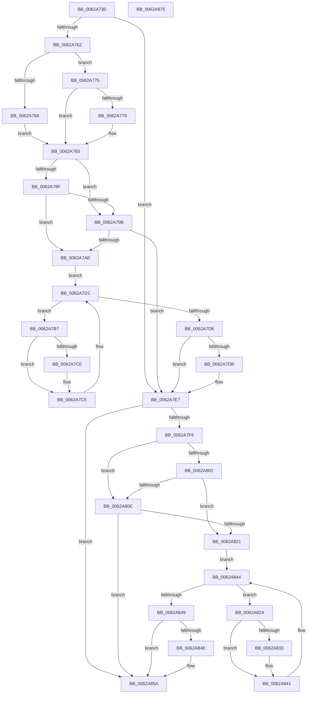

# DifIoGetConfigurationInformationWrapper

- RVA: `0x0062A730`–`0x0062A876` (길이 `326` bytes)
- VA: `0x000000014062A730`
- 실행 섹션: `.text`
- PDB 이름 있음: `예`; PDB Function 태그: `아니요`
- unwind 정보 RVA: `0x0009B270`
- 디코드: `87`개 명령, `326/326` bytes 표시
- 미해석 바이트: `0` (있으면 어셈블리에 `.byte`로 보존)

> 이 문서는 커널 이미지의 기계어와 PDB 기호를 분석해 생성했습니다. 4번과 5번은 함수 원형과 자료형을 바이너리 사용 방식에서 추정한 C 해석이며 원본 소스 복구 결과는 아닙니다.

## 1. Dependencies

- 직접 호출 지점: **9**; 고유 호출 대상: **6**
- 직접 호출자로 확인된 함수: **0**
- RIP 상대 이미지 참조: **3**

### Outgoing calls
- `0x0062A751` → [DifGetAPIThunkContextById](../49/DifGetAPIThunkContextById_function_00495A34.md) (function, `0x00495A34`)
- `0x0062A779` → [DifGetReturnAddressForWrappers](../4D/DifGetReturnAddressForWrappers_function_004D3C08.md) (function, `0x004D3C08`)
- `0x0062A7A2` → [ExAcquireRundownProtection](../21/ExAcquireRundownProtection_function_00216620.md) (function, `0x00216620`)
- `0x0062A7C9` → [guard_dispatch_icall](../6B/guard_dispatch_icall_function_006BAAD0.md) (function, `0x006BAAD0`)
- `0x0062A7E2` → [ExReleaseRundownProtection](../34/ExReleaseRundownProtection_function_00349E80.md) (function, `0x00349E80`)
- `0x0062A7E7` → [IoGetConfigurationInformation](../../page/71/IoGetConfigurationInformation_function_0071D5A0.md) (function, `0x0071D5A0`)
- `0x0062A815` → [ExAcquireRundownProtection](../21/ExAcquireRundownProtection_function_00216620.md) (function, `0x00216620`)
- `0x0062A83C` → [guard_dispatch_icall](../6B/guard_dispatch_icall_function_006BAAD0.md) (function, `0x006BAAD0`)
- `0x0062A855` → [ExReleaseRundownProtection](../34/ExReleaseRundownProtection_function_00349E80.md) (function, `0x00349E80`)

### Direct callers
- 이 함수 시작 RVA로 연결되는 직접 call은 확인되지 않았습니다. 간접 호출은 완전히 역산할 수 없습니다.

### Static image references
- `0x0062A786` → RVA `0x00F048B8` (`.data`; read)
- `0x0062A78F` → RVA `0x00F04980` (`.data`; read)
- `0x0062A79B` → RVA `0x00F03E80` (`.data`; read)

## 2. Other-region calls and transfers

- 다른 실행 섹션으로 향하는 call: **1**
  - `0x0062A7E7` → [IoGetConfigurationInformation](../../page/71/IoGetConfigurationInformation_function_0071D5A0.md) (`.text` → `PAGE`)
- 별도 외부 분기/꼬리 이동을 확인하지 못했습니다.

## 3. Assembly (complete function range)

```asm
0062A730  48 8B C4                        mov rax, rsp
0062A733  48 89 58 08                     mov qword ptr [rax + 8], rbx
0062A737  48 89 70 10                     mov qword ptr [rax + 0x10], rsi
0062A73B  48 89 78 18                     mov qword ptr [rax + 0x18], rdi
0062A73F  41 56                           push r14
0062A741  48 83 EC 30                     sub rsp, 0x30
0062A745  0F 57 C0                        xorps xmm0, xmm0
0062A748  B9 52 01 00 00                  mov ecx, 0x152
0062A74D  0F 11 40 E8                     movups xmmword ptr [rax - 0x18], xmm0
0062A751  E8 DE B2 E6 FF                  call 0x140495a34
0062A756  48 8B F8                        mov rdi, rax
0062A759  48 85 C0                        test rax, rax
0062A75C  0F 84 85 00 00 00               je 0x14062a7e7
0062A762  8B 40 0C                        mov eax, dword ptr [rax + 0xc]
0062A765  A8 18                           test al, 0x18
0062A767  74 0C                           je 0x14062a775
0062A769  48 8B 4C 24 38                  mov rcx, qword ptr [rsp + 0x38]
0062A76E  48 89 4C 24 20                  mov qword ptr [rsp + 0x20], rcx
0062A773  EB 0E                           jmp 0x14062a783
0062A775  A8 04                           test al, 4
0062A777  74 0A                           je 0x14062a783
0062A779  E8 8A 94 EA FF                  call 0x1404d3c08
0062A77E  48 89 44 24 20                  mov qword ptr [rsp + 0x20], rax
0062A783  40 32 F6                        xor sil, sil
0062A786  40 38 35 2B A1 8D 00            cmp byte ptr [rip + 0x8da12b], sil
0062A78D  75 0C                           jne 0x14062a79b
0062A78F  F7 05 E7 A1 8D 00 00 08 00 00   test dword ptr [rip + 0x8da1e7], 0x800
0062A799  74 13                           je 0x14062a7ae
0062A79B  48 8D 0D DE 96 8D 00            lea rcx, [rip + 0x8d96de]
0062A7A2  E8 79 BE BE FF                  call 0x140216620
0062A7A7  40 8A F0                        mov sil, al
0062A7AA  84 C0                           test al, al
0062A7AC  74 39                           je 0x14062a7e7
0062A7AE  4C 8D 77 20                     lea r14, [rdi + 0x20]
0062A7B2  49 8B 1E                        mov rbx, qword ptr [r14]
0062A7B5  EB 1A                           jmp 0x14062a7d1
0062A7B7  48 8D 43 F0                     lea rax, [rbx - 0x10]
0062A7BB  48 85 C0                        test rax, rax
0062A7BE  74 0E                           je 0x14062a7ce
0062A7C0  48 8B 40 08                     mov rax, qword ptr [rax + 8]
0062A7C4  48 8D 4C 24 20                  lea rcx, [rsp + 0x20]
0062A7C9  E8 02 03 09 00                  call 0x1406baad0
0062A7CE  48 8B 1B                        mov rbx, qword ptr [rbx]
0062A7D1  49 3B DE                        cmp rbx, r14
0062A7D4  75 E1                           jne 0x14062a7b7
0062A7D6  40 84 F6                        test sil, sil
0062A7D9  74 0C                           je 0x14062a7e7
0062A7DB  48 8D 0D 9E 96 8D 00            lea rcx, [rip + 0x8d969e]
0062A7E2  E8 99 F6 D1 FF                  call 0x140349e80
0062A7E7  E8 B4 2D 0F 00                  call 0x14071d5a0
0062A7EC  48 89 44 24 28                  mov qword ptr [rsp + 0x28], rax
0062A7F1  48 85 FF                        test rdi, rdi
0062A7F4  74 64                           je 0x14062a85a
0062A7F6  40 32 F6                        xor sil, sil
0062A7F9  40 38 35 B8 A0 8D 00            cmp byte ptr [rip + 0x8da0b8], sil
0062A800  75 0C                           jne 0x14062a80e
0062A802  F7 05 74 A1 8D 00 00 08 00 00   test dword ptr [rip + 0x8da174], 0x800
0062A80C  74 13                           je 0x14062a821
0062A80E  48 8D 0D 6B 96 8D 00            lea rcx, [rip + 0x8d966b]
0062A815  E8 06 BE BE FF                  call 0x140216620
0062A81A  40 8A F0                        mov sil, al
0062A81D  84 C0                           test al, al
0062A81F  74 39                           je 0x14062a85a
0062A821  48 83 C7 30                     add rdi, 0x30
0062A825  48 8B 1F                        mov rbx, qword ptr [rdi]
0062A828  EB 1A                           jmp 0x14062a844
0062A82A  48 8D 43 F0                     lea rax, [rbx - 0x10]
0062A82E  48 85 C0                        test rax, rax
0062A831  74 0E                           je 0x14062a841
0062A833  48 8B 40 08                     mov rax, qword ptr [rax + 8]
0062A837  48 8D 4C 24 20                  lea rcx, [rsp + 0x20]
0062A83C  E8 8F 02 09 00                  call 0x1406baad0
0062A841  48 8B 1B                        mov rbx, qword ptr [rbx]
0062A844  48 3B DF                        cmp rbx, rdi
0062A847  75 E1                           jne 0x14062a82a
0062A849  40 84 F6                        test sil, sil
0062A84C  74 0C                           je 0x14062a85a
0062A84E  48 8D 0D 2B 96 8D 00            lea rcx, [rip + 0x8d962b]
0062A855  E8 26 F6 D1 FF                  call 0x140349e80
0062A85A  48 8B 44 24 28                  mov rax, qword ptr [rsp + 0x28]
0062A85F  48 8B 5C 24 40                  mov rbx, qword ptr [rsp + 0x40]
0062A864  48 8B 74 24 48                  mov rsi, qword ptr [rsp + 0x48]
0062A869  48 8B 7C 24 50                  mov rdi, qword ptr [rsp + 0x50]
0062A86E  48 83 C4 30                     add rsp, 0x30
0062A872  41 5E                           pop r14
0062A874  C3                              ret
0062A875  CC                              int3
```

## 4. C-style interpretation (structured pseudocode)

```c
__int64 __fastcall DifIoGetConfigurationInformationWrapper(void)
{
    __int64 result;
    __int64 v_rdi;
    __int64 v_rsi;
    __int64 v_rsp;
    unsigned __int64 v_stack_m10;
    unsigned __int64 v_stack_m18;
    unsigned __int64 v_stack_p0;
    unsigned __int64 v_stack_p10;
    unsigned __int64 v_stack_p18;
    unsigned __int64 v_stack_p8;

    *(unsigned __int64 *)(v_rsp + 8) = v_rbx;
    *(unsigned __int64 *)(v_rsp + 16) = v_rsi;
    *(unsigned __int64 *)(v_rsp + 24) = v_rdi;
    v_rsp = (v_rsp) - (48);
    *(unsigned __int64 *)(v_rsp - 24) = v_xmm0;
    result = DifGetAPIThunkContextById(338, a2, a3, a4);
    if (result == 0) goto loc_0062A7E7;
    if ((((unsigned __int8)((unsigned int)(*(unsigned int *)(result + 12)))) & (24)) == 0) goto loc_0062A775;
    v_stack_m18 = v_stack_p0;
    goto loc_0062A783;
loc_0062A775:
    result = (unsigned int)(*(unsigned int *)(result + 12));
    if ((((unsigned __int8)((unsigned int)(*(unsigned int *)(result + 12)))) & (4)) != 0) {
        result = DifGetReturnAddressForWrappers(v_stack_p0, a2, a3, a4);
        v_stack_m18 = result;
    }
    v_rsi = 0;
    if ((*(unsigned __int8 *)(v_rip + 9281835)) != 0) goto loc_0062A79B;
    if (((*(unsigned int *)(v_rip + 9282023)) & (0x800ULL)) == 0) goto loc_0062A7AE;
loc_0062A79B:
    result = ExAcquireRundownProtection(v_rip + 9279198, a2, a3, a4);
    if ((unsigned __int8)(result) == 0) goto loc_0062A7E7;
loc_0062A7AE:
    goto loc_0062A7D1;
loc_0062A7B7:
    result = *(unsigned __int64 *)(result + 32) - 16;
    if (*(unsigned __int64 *)(result + 32) - 16 != 0) {
        result = *(unsigned __int64 *)(*(unsigned __int64 *)(result + 32) - 16 + 8);
        a1 = v_stack_m18;
        result = guard_dispatch_icall(a1, a2, a3, a4);
    }
loc_0062A7D1:
    if ((*(unsigned __int64 *)(*(unsigned __int64 *)(result + 32))) != (result + 32)) goto loc_0062A7B7;
    if ((unsigned __int8)((unsigned __int8)(result)) != 0) {
        a1 = v_rip + 9279134;
        result = ExReleaseRundownProtection(a1, a2, a3, a4);
    }
    result = IoGetConfigurationInformation(a1, a2, a3, a4);
    v_stack_m10 = result;
    if (result == 0) goto loc_0062A85A;
    v_rsi = 0;
    if ((*(unsigned __int8 *)(v_rip + 9281720)) != 0) goto loc_0062A80E;
    if (((*(unsigned int *)(v_rip + 9281908)) & (0x800ULL)) == 0) goto loc_0062A821;
loc_0062A80E:
    result = ExAcquireRundownProtection(v_rip + 9279083, a2, a3, a4);
    if ((unsigned __int8)(result) == 0) goto loc_0062A85A;
loc_0062A821:
    v_rdi = (result) + (48);
    goto loc_0062A844;
loc_0062A82A:
    result = *(unsigned __int64 *)(v_rdi) - 16;
    if (*(unsigned __int64 *)(v_rdi) - 16 != 0) {
        result = *(unsigned __int64 *)(*(unsigned __int64 *)(v_rdi) - 16 + 8);
        a1 = v_stack_m18;
        result = guard_dispatch_icall(a1, a2, a3, a4);
    }
loc_0062A844:
    if ((*(unsigned __int64 *)(*(unsigned __int64 *)(v_rdi))) != v_rdi) goto loc_0062A82A;
    if ((unsigned __int8)((unsigned __int8)(result)) != 0) {
        a1 = v_rip + 9279019;
        result = ExReleaseRundownProtection(a1, a2, a3, a4);
    }
    v_rsp = (v_rsp) + (48);
    return v_stack_m10;
}
```

## 5. (Beta) C Style

```c
void DifIoGetConfigurationInformationWrapper(void)
{
    int64_t result;
    int64_t local_rdi;
    int64_t local_rsi;
    int64_t local_rsp;
    uint64_t v_stack_m10;
    uint64_t v_stack_m18;
    uint64_t v_stack_p0;
    uint64_t v_stack_p10;
    uint64_t v_stack_p18;
    uint64_t v_stack_p8;

    *(uint64_t *)(local_rsp + 0x8) = local_rbx;
    *(uint64_t *)(local_rsp + 0x10) = local_rsi;
    *(uint64_t *)(local_rsp + 0x18) = local_rdi;
    local_rsp = (local_rsp) - (48);
    *(uint64_t *)(local_rsp - 0x18) = v_xmm0;
    result = DifGetAPIThunkContextById(338, a2, a3, a4);
    if (result == 0) goto loc_0062A7E7;
    if ((((uint8_t)((uint32_t)(*(uint32_t *)(result + 0xC)))) & (24)) == 0) goto loc_0062A775;
    v_stack_m18 = v_stack_p0;
    goto loc_0062A783;
loc_0062A775:
    result = (uint32_t)(*(uint32_t *)(result + 0xC));
    if ((((uint8_t)((uint32_t)(*(uint32_t *)(result + 0xC)))) & (4)) != 0) {
        result = DifGetReturnAddressForWrappers(v_stack_p0, a2, a3, a4);
        v_stack_m18 = result;
    }
    local_rsi = 0;
    if ((*(uint8_t *)(v_rip + 0x8DA12B)) != 0) goto loc_0062A79B;
    if (((*(uint32_t *)(v_rip + 0x8DA1E7)) & (0x800ULL)) == 0) goto loc_0062A7AE;
loc_0062A79B:
    result = ExAcquireRundownProtection(v_rip + 9279198, a2, a3, a4);
    if ((uint8_t)(result) == 0) goto loc_0062A7E7;
loc_0062A7AE:
    goto loc_0062A7D1;
loc_0062A7B7:
    result = *(uint64_t *)(result + 0x20) - 16;
    if (*(uint64_t *)(result + 0x20) - 16 != 0) {
        result = *(uint64_t *)(*(uint64_t *)(result + 0x20) - 0x10 + 0x8);
        a1 = v_stack_m18;
        result = guard_dispatch_icall(a1, a2, a3, a4);
    }
loc_0062A7D1:
    if ((*(uint64_t *)(*(uint64_t *)(result + 0x20))) != (result + 32)) goto loc_0062A7B7;
    if ((uint8_t)((uint8_t)(result)) != 0) {
        a1 = v_rip + 9279134;
        result = ExReleaseRundownProtection(a1, a2, a3, a4);
    }
    result = IoGetConfigurationInformation(a1, a2, a3, a4);
    v_stack_m10 = result;
    if (result == 0) goto loc_0062A85A;
    local_rsi = 0;
    if ((*(uint8_t *)(v_rip + 0x8DA0B8)) != 0) goto loc_0062A80E;
    if (((*(uint32_t *)(v_rip + 0x8DA174)) & (0x800ULL)) == 0) goto loc_0062A821;
loc_0062A80E:
    result = ExAcquireRundownProtection(v_rip + 9279083, a2, a3, a4);
    if ((uint8_t)(result) == 0) goto loc_0062A85A;
loc_0062A821:
    local_rdi = (result) + (48);
    goto loc_0062A844;
loc_0062A82A:
    result = *(uint64_t *)(local_rdi) - 16;
    if (*(uint64_t *)(local_rdi) - 16 != 0) {
        result = *(uint64_t *)(*(uint64_t *)(local_rdi) - 0x10 + 0x8);
        a1 = v_stack_m18;
        result = guard_dispatch_icall(a1, a2, a3, a4);
    }
loc_0062A844:
    if ((*(uint64_t *)(*(uint64_t *)(local_rdi))) != local_rdi) goto loc_0062A82A;
    if ((uint8_t)((uint8_t)(result)) != 0) {
        a1 = v_rip + 9279019;
        result = ExReleaseRundownProtection(a1, a2, a3, a4);
    }
    local_rsp = (local_rsp) + (48);
    return v_stack_m10;
}
```

## 6. Execution-region graph

[열기: 2D/3D 그래프와 함수 탐색 컨트롤 패널](../../../control-panel.html?section=text&rva=0x0062A730&view=graph)

- 2D 그래프는 위에서 아래로 흐르고, 3D 그래프는 빈 공간을 드래그해 회전합니다. Shift+드래그는 이동, 휠은 확대·축소, 함수 노드 선택은 대상 보고서 이동입니다.

### Static fallback


