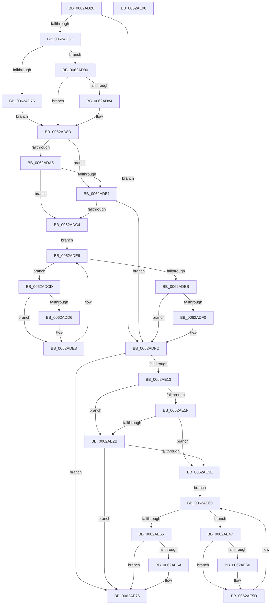

# DifIoGetDmaAdapterWrapper

- RVA: `0x0062AD20`–`0x0062AE99` (길이 `377` bytes)
- VA: `0x000000014062AD20`
- 실행 섹션: `.text`
- PDB 이름 있음: `예`; PDB Function 태그: `아니요`
- unwind 정보 RVA: `0x000A9A64`
- 디코드: `108`개 명령, `377/377` bytes 표시
- 미해석 바이트: `0` (있으면 어셈블리에 `.byte`로 보존)

> 이 문서는 커널 이미지의 기계어와 PDB 기호를 분석해 생성했습니다. 4번과 5번은 함수 원형과 자료형을 바이너리 사용 방식에서 추정한 C 해석이며 원본 소스 복구 결과는 아닙니다.

## 1. Dependencies

- 직접 호출 지점: **9**; 고유 호출 대상: **6**
- 직접 호출자로 확인된 함수: **0**
- RIP 상대 이미지 참조: **3**

### Outgoing calls
- `0x0062AD5E` → [DifGetAPIThunkContextById](../49/DifGetAPIThunkContextById_function_00495A34.md) (function, `0x00495A34`)
- `0x0062AD84` → [DifGetReturnAddressForWrappers](../4D/DifGetReturnAddressForWrappers_function_004D3C08.md) (function, `0x004D3C08`)
- `0x0062ADB8` → [ExAcquireRundownProtection](../21/ExAcquireRundownProtection_function_00216620.md) (function, `0x00216620`)
- `0x0062ADDE` → [guard_dispatch_icall](../6B/guard_dispatch_icall_function_006BAAD0.md) (function, `0x006BAAD0`)
- `0x0062ADF7` → [ExReleaseRundownProtection](../34/ExReleaseRundownProtection_function_00349E80.md) (function, `0x00349E80`)
- `0x0062AE05` → [IoGetDmaAdapter](../../page/72/IoGetDmaAdapter_function_00729450.md) (function, `0x00729450`)
- `0x0062AE32` → [ExAcquireRundownProtection](../21/ExAcquireRundownProtection_function_00216620.md) (function, `0x00216620`)
- `0x0062AE58` → [guard_dispatch_icall](../6B/guard_dispatch_icall_function_006BAAD0.md) (function, `0x006BAAD0`)
- `0x0062AE71` → [ExReleaseRundownProtection](../34/ExReleaseRundownProtection_function_00349E80.md) (function, `0x00349E80`)

### Direct callers
- 이 함수 시작 RVA로 연결되는 직접 call은 확인되지 않았습니다. 간접 호출은 완전히 역산할 수 없습니다.

### Static image references
- `0x0062AD94` → RVA `0x00F048B8` (`.data`; read)
- `0x0062ADA5` → RVA `0x00F04980` (`.data`; read)
- `0x0062ADB1` → RVA `0x00F03E80` (`.data`; read)

## 2. Other-region calls and transfers

- 다른 실행 섹션으로 향하는 call: **1**
  - `0x0062AE05` → [IoGetDmaAdapter](../../page/72/IoGetDmaAdapter_function_00729450.md) (`.text` → `PAGE`)
- 별도 외부 분기/꼬리 이동을 확인하지 못했습니다.

## 3. Assembly (complete function range)

```asm
0062AD20  48 89 5C 24 08                  mov qword ptr [rsp + 8], rbx
0062AD25  48 89 74 24 10                  mov qword ptr [rsp + 0x10], rsi
0062AD2A  48 89 7C 24 18                  mov qword ptr [rsp + 0x18], rdi
0062AD2F  55                              push rbp
0062AD30  41 54                           push r12
0062AD32  41 55                           push r13
0062AD34  41 56                           push r14
0062AD36  41 57                           push r15
0062AD38  48 8B EC                        mov rbp, rsp
0062AD3B  48 83 EC 50                     sub rsp, 0x50
0062AD3F  0F 57 C0                        xorps xmm0, xmm0
0062AD42  33 C0                           xor eax, eax
0062AD44  4C 8B E9                        mov r13, rcx
0062AD47  48 89 45 F0                     mov qword ptr [rbp - 0x10], rax
0062AD4B  B9 4E 01 00 00                  mov ecx, 0x14e
0062AD50  4D 8B F8                        mov r15, r8
0062AD53  0F 11 45 D0                     movups xmmword ptr [rbp - 0x30], xmm0
0062AD57  4C 8B E2                        mov r12, rdx
0062AD5A  0F 11 45 E0                     movups xmmword ptr [rbp - 0x20], xmm0
0062AD5E  E8 D1 AC E6 FF                  call 0x140495a34
0062AD63  48 8B F0                        mov rsi, rax
0062AD66  48 85 C0                        test rax, rax
0062AD69  0F 84 8D 00 00 00               je 0x14062adfc
0062AD6F  8B 40 0C                        mov eax, dword ptr [rax + 0xc]
0062AD72  A8 18                           test al, 0x18
0062AD74  74 0A                           je 0x14062ad80
0062AD76  48 8B 4D 28                     mov rcx, qword ptr [rbp + 0x28]
0062AD7A  48 89 4D D0                     mov qword ptr [rbp - 0x30], rcx
0062AD7E  EB 0D                           jmp 0x14062ad8d
0062AD80  A8 04                           test al, 4
0062AD82  74 09                           je 0x14062ad8d
0062AD84  E8 7F 8E EA FF                  call 0x1404d3c08
0062AD89  48 89 45 D0                     mov qword ptr [rbp - 0x30], rax
0062AD8D  45 32 F6                        xor r14b, r14b
0062AD90  4C 89 6D E8                     mov qword ptr [rbp - 0x18], r13
0062AD94  44 38 35 1D 9B 8D 00            cmp byte ptr [rip + 0x8d9b1d], r14b
0062AD9B  4C 89 65 E0                     mov qword ptr [rbp - 0x20], r12
0062AD9F  4C 89 7D D8                     mov qword ptr [rbp - 0x28], r15
0062ADA3  75 0C                           jne 0x14062adb1
0062ADA5  F7 05 D1 9B 8D 00 00 08 00 00   test dword ptr [rip + 0x8d9bd1], 0x800
0062ADAF  74 13                           je 0x14062adc4
0062ADB1  48 8D 0D C8 90 8D 00            lea rcx, [rip + 0x8d90c8]
0062ADB8  E8 63 B8 BE FF                  call 0x140216620
0062ADBD  44 8A F0                        mov r14b, al
0062ADC0  84 C0                           test al, al
0062ADC2  74 38                           je 0x14062adfc
0062ADC4  48 8D 7E 20                     lea rdi, [rsi + 0x20]
0062ADC8  48 8B 1F                        mov rbx, qword ptr [rdi]
0062ADCB  EB 19                           jmp 0x14062ade6
0062ADCD  48 8D 43 F0                     lea rax, [rbx - 0x10]
0062ADD1  48 85 C0                        test rax, rax
0062ADD4  74 0D                           je 0x14062ade3
0062ADD6  48 8B 40 08                     mov rax, qword ptr [rax + 8]
0062ADDA  48 8D 4D D0                     lea rcx, [rbp - 0x30]
0062ADDE  E8 ED FC 08 00                  call 0x1406baad0
0062ADE3  48 8B 1B                        mov rbx, qword ptr [rbx]
0062ADE6  48 3B DF                        cmp rbx, rdi
0062ADE9  75 E2                           jne 0x14062adcd
0062ADEB  45 84 F6                        test r14b, r14b
0062ADEE  74 0C                           je 0x14062adfc
0062ADF0  48 8D 0D 89 90 8D 00            lea rcx, [rip + 0x8d9089]
0062ADF7  E8 84 F0 D1 FF                  call 0x140349e80
0062ADFC  4D 8B C7                        mov r8, r15
0062ADFF  49 8B D4                        mov rdx, r12
0062AE02  49 8B CD                        mov rcx, r13
0062AE05  E8 46 E6 0F 00                  call 0x140729450
0062AE0A  48 89 45 F0                     mov qword ptr [rbp - 0x10], rax
0062AE0E  48 85 F6                        test rsi, rsi
0062AE11  74 63                           je 0x14062ae76
0062AE13  40 32 FF                        xor dil, dil
0062AE16  40 38 3D 9B 9A 8D 00            cmp byte ptr [rip + 0x8d9a9b], dil
0062AE1D  75 0C                           jne 0x14062ae2b
0062AE1F  F7 05 57 9B 8D 00 00 08 00 00   test dword ptr [rip + 0x8d9b57], 0x800
0062AE29  74 13                           je 0x14062ae3e
0062AE2B  48 8D 0D 4E 90 8D 00            lea rcx, [rip + 0x8d904e]
0062AE32  E8 E9 B7 BE FF                  call 0x140216620
0062AE37  40 8A F8                        mov dil, al
0062AE3A  84 C0                           test al, al
0062AE3C  74 38                           je 0x14062ae76
0062AE3E  48 83 C6 30                     add rsi, 0x30
0062AE42  48 8B 1E                        mov rbx, qword ptr [rsi]
0062AE45  EB 19                           jmp 0x14062ae60
0062AE47  48 8D 43 F0                     lea rax, [rbx - 0x10]
0062AE4B  48 85 C0                        test rax, rax
0062AE4E  74 0D                           je 0x14062ae5d
0062AE50  48 8B 40 08                     mov rax, qword ptr [rax + 8]
0062AE54  48 8D 4D D0                     lea rcx, [rbp - 0x30]
0062AE58  E8 73 FC 08 00                  call 0x1406baad0
0062AE5D  48 8B 1B                        mov rbx, qword ptr [rbx]
0062AE60  48 3B DE                        cmp rbx, rsi
0062AE63  75 E2                           jne 0x14062ae47
0062AE65  40 84 FF                        test dil, dil
0062AE68  74 0C                           je 0x14062ae76
0062AE6A  48 8D 0D 0F 90 8D 00            lea rcx, [rip + 0x8d900f]
0062AE71  E8 0A F0 D1 FF                  call 0x140349e80
0062AE76  48 8B 45 F0                     mov rax, qword ptr [rbp - 0x10]
0062AE7A  4C 8D 5C 24 50                  lea r11, [rsp + 0x50]
0062AE7F  49 8B 5B 30                     mov rbx, qword ptr [r11 + 0x30]
0062AE83  49 8B 73 38                     mov rsi, qword ptr [r11 + 0x38]
0062AE87  49 8B 7B 40                     mov rdi, qword ptr [r11 + 0x40]
0062AE8B  49 8B E3                        mov rsp, r11
0062AE8E  41 5F                           pop r15
0062AE90  41 5E                           pop r14
0062AE92  41 5D                           pop r13
0062AE94  41 5C                           pop r12
0062AE96  5D                              pop rbp
0062AE97  C3                              ret
0062AE98  CC                              int3
```

## 4. C-style interpretation (structured pseudocode)

```c
__int64 __fastcall DifIoGetDmaAdapterWrapper(__int64 a1, __int64 a2, __int64 a3)
{
    __int64 result;
    __int64 v_r14;
    __int64 v_rdi;
    __int64 v_rsi;
    __int64 v_rsp;
    unsigned __int64 v_stack_m28;
    unsigned __int64 v_stack_m38;
    unsigned __int64 v_stack_m40;
    unsigned __int64 v_stack_m48;
    unsigned __int64 v_stack_m50;
    unsigned __int64 v_stack_m58;
    unsigned __int64 v_stack_p0;
    unsigned __int64 v_stack_p10;
    unsigned __int64 v_stack_p18;
    unsigned __int64 v_stack_p8;

    v_stack_p8 = v_rbx;
    v_stack_p10 = v_rsi;
    v_stack_p18 = v_rdi;
    v_rsp = (v_rsp) - (80);
    result = 0;
    v_stack_m38 = 0;
    v_stack_m58 = v_xmm0;
    v_stack_m48 = v_xmm0;
    result = DifGetAPIThunkContextById(334, a2, a3, a4);
    if (result == 0) goto loc_0062ADFC;
    if ((((unsigned __int8)((unsigned int)(*(unsigned int *)(result + 12)))) & (24)) == 0) goto loc_0062AD80;
    v_stack_m58 = v_stack_p0;
    goto loc_0062AD8D;
loc_0062AD80:
    result = (unsigned int)(*(unsigned int *)(result + 12));
    if ((((unsigned __int8)((unsigned int)(*(unsigned int *)(result + 12)))) & (4)) != 0) {
        result = DifGetReturnAddressForWrappers(v_stack_p0, a2, a3, a4);
        v_stack_m58 = result;
    }
    v_r14 = 0;
    v_stack_m40 = a1;
    v_stack_m48 = a2;
    v_stack_m50 = a3;
    if ((*(unsigned __int8 *)(v_rip + 9280285)) != 0) goto loc_0062ADB1;
    if (((*(unsigned int *)(v_rip + 9280465)) & (0x800ULL)) == 0) goto loc_0062ADC4;
loc_0062ADB1:
    result = ExAcquireRundownProtection(v_rip + 9277640, a2, a3, a4);
    if ((unsigned __int8)(result) == 0) goto loc_0062ADFC;
loc_0062ADC4:
    goto loc_0062ADE6;
loc_0062ADCD:
    result = *(unsigned __int64 *)(result + 32) - 16;
    if (*(unsigned __int64 *)(result + 32) - 16 != 0) {
        result = *(unsigned __int64 *)(*(unsigned __int64 *)(result + 32) - 16 + 8);
        a1 = v_stack_m58;
        result = guard_dispatch_icall(a1, a2, a3, a4);
    }
loc_0062ADE6:
    if ((*(unsigned __int64 *)(*(unsigned __int64 *)(result + 32))) != (result + 32)) goto loc_0062ADCD;
    if ((unsigned __int8)((unsigned __int8)(result)) != 0) {
        a1 = v_rip + 9277577;
        result = ExReleaseRundownProtection(a1, a2, a3, a4);
    }
    result = IoGetDmaAdapter(a1, a2, a3, a4);
    v_stack_m38 = result;
    if (result == 0) goto loc_0062AE76;
    v_rdi = 0;
    if ((*(unsigned __int8 *)(v_rip + 9280155)) != 0) goto loc_0062AE2B;
    if (((*(unsigned int *)(v_rip + 9280343)) & (0x800ULL)) == 0) goto loc_0062AE3E;
loc_0062AE2B:
    result = ExAcquireRundownProtection(v_rip + 9277518, a2, a3, a4);
    if ((unsigned __int8)(result) == 0) goto loc_0062AE76;
loc_0062AE3E:
    v_rsi = (result) + (48);
    goto loc_0062AE60;
loc_0062AE47:
    result = *(unsigned __int64 *)(v_rsi) - 16;
    if (*(unsigned __int64 *)(v_rsi) - 16 != 0) {
        result = *(unsigned __int64 *)(*(unsigned __int64 *)(v_rsi) - 16 + 8);
        a1 = v_stack_m58;
        result = guard_dispatch_icall(a1, a2, a3, a4);
    }
loc_0062AE60:
    if ((*(unsigned __int64 *)(*(unsigned __int64 *)(v_rsi))) != v_rsi) goto loc_0062AE47;
    if ((unsigned __int8)((unsigned __int8)(result)) != 0) {
        a1 = v_rip + 9277455;
        result = ExReleaseRundownProtection(a1, a2, a3, a4);
    }
    return v_stack_m38;
}
```

## 5. (Beta) C Style

```c
int64_t DifIoGetDmaAdapterWrapper(int64_t Arg1, int64_t Arg2, int64_t Arg3)
{
    int64_t result;
    int64_t local_r14;
    int64_t local_rdi;
    int64_t local_rsi;
    int64_t local_rsp;
    uint64_t v_stack_m28;
    uint64_t v_stack_m38;
    uint64_t v_stack_m40;
    uint64_t v_stack_m48;
    uint64_t v_stack_m50;
    uint64_t v_stack_m58;
    uint64_t v_stack_p0;
    uint64_t v_stack_p10;
    uint64_t v_stack_p18;
    uint64_t v_stack_p8;

    v_stack_p8 = local_rbx;
    v_stack_p10 = local_rsi;
    v_stack_p18 = local_rdi;
    local_rsp = (local_rsp) - (80);
    result = 0;
    v_stack_m38 = 0;
    v_stack_m58 = v_xmm0;
    v_stack_m48 = v_xmm0;
    result = DifGetAPIThunkContextById(334, Arg2, Arg3, a4);
    if (result == 0) goto loc_0062ADFC;
    if ((((uint8_t)((uint32_t)(*(uint32_t *)(result + 0xC)))) & (24)) == 0) goto loc_0062AD80;
    v_stack_m58 = v_stack_p0;
    goto loc_0062AD8D;
loc_0062AD80:
    result = (uint32_t)(*(uint32_t *)(result + 0xC));
    if ((((uint8_t)((uint32_t)(*(uint32_t *)(result + 0xC)))) & (4)) != 0) {
        result = DifGetReturnAddressForWrappers(v_stack_p0, Arg2, Arg3, a4);
        v_stack_m58 = result;
    }
    local_r14 = 0;
    v_stack_m40 = Arg1;
    v_stack_m48 = Arg2;
    v_stack_m50 = Arg3;
    if ((*(uint8_t *)(v_rip + 0x8D9B1D)) != 0) goto loc_0062ADB1;
    if (((*(uint32_t *)(v_rip + 0x8D9BD1)) & (0x800ULL)) == 0) goto loc_0062ADC4;
loc_0062ADB1:
    result = ExAcquireRundownProtection(v_rip + 9277640, Arg2, Arg3, a4);
    if ((uint8_t)(result) == 0) goto loc_0062ADFC;
loc_0062ADC4:
    goto loc_0062ADE6;
loc_0062ADCD:
    result = *(uint64_t *)(result + 0x20) - 16;
    if (*(uint64_t *)(result + 0x20) - 16 != 0) {
        result = *(uint64_t *)(*(uint64_t *)(result + 0x20) - 0x10 + 0x8);
        Arg1 = v_stack_m58;
        result = guard_dispatch_icall(Arg1, Arg2, Arg3, a4);
    }
loc_0062ADE6:
    if ((*(uint64_t *)(*(uint64_t *)(result + 0x20))) != (result + 32)) goto loc_0062ADCD;
    if ((uint8_t)((uint8_t)(result)) != 0) {
        Arg1 = v_rip + 9277577;
        result = ExReleaseRundownProtection(Arg1, Arg2, Arg3, a4);
    }
    result = IoGetDmaAdapter(Arg1, Arg2, Arg3, a4);
    v_stack_m38 = result;
    if (result == 0) goto loc_0062AE76;
    local_rdi = 0;
    if ((*(uint8_t *)(v_rip + 0x8D9A9B)) != 0) goto loc_0062AE2B;
    if (((*(uint32_t *)(v_rip + 0x8D9B57)) & (0x800ULL)) == 0) goto loc_0062AE3E;
loc_0062AE2B:
    result = ExAcquireRundownProtection(v_rip + 9277518, Arg2, Arg3, a4);
    if ((uint8_t)(result) == 0) goto loc_0062AE76;
loc_0062AE3E:
    local_rsi = (result) + (48);
    goto loc_0062AE60;
loc_0062AE47:
    result = *(uint64_t *)(local_rsi) - 16;
    if (*(uint64_t *)(local_rsi) - 16 != 0) {
        result = *(uint64_t *)(*(uint64_t *)(local_rsi) - 0x10 + 0x8);
        Arg1 = v_stack_m58;
        result = guard_dispatch_icall(Arg1, Arg2, Arg3, a4);
    }
loc_0062AE60:
    if ((*(uint64_t *)(*(uint64_t *)(local_rsi))) != local_rsi) goto loc_0062AE47;
    if ((uint8_t)((uint8_t)(result)) != 0) {
        Arg1 = v_rip + 9277455;
        result = ExReleaseRundownProtection(Arg1, Arg2, Arg3, a4);
    }
    return v_stack_m38;
}
```

## 6. Execution-region graph

[열기: 2D/3D 그래프와 함수 탐색 컨트롤 패널](../../../control-panel.html?section=text&rva=0x0062AD20&view=graph)

- 2D 그래프는 위에서 아래로 흐르고, 3D 그래프는 빈 공간을 드래그해 회전합니다. Shift+드래그는 이동, 휠은 확대·축소, 함수 노드 선택은 대상 보고서 이동입니다.

### Static fallback


