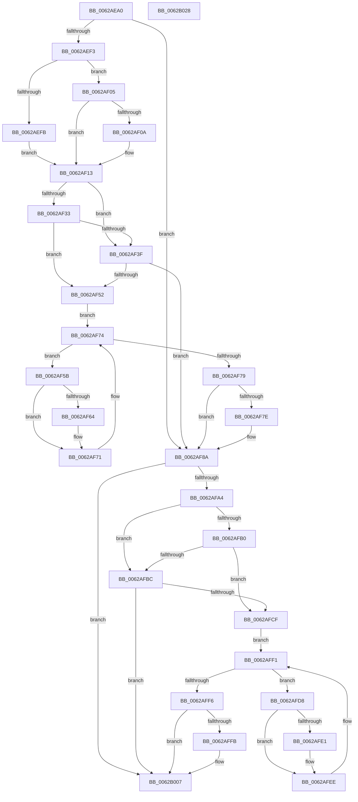

# DifIoGetDriverDirectoryWrapper

- RVA: `0x0062AEA0`–`0x0062B029` (길이 `393` bytes)
- VA: `0x000000014062AEA0`
- 실행 섹션: `.text`
- PDB 이름 있음: `예`; PDB Function 태그: `아니요`
- unwind 정보 RVA: `0x000D2B7C`
- 디코드: `113`개 명령, `393/393` bytes 표시
- 미해석 바이트: `0` (있으면 어셈블리에 `.byte`로 보존)

> 이 문서는 커널 이미지의 기계어와 PDB 기호를 분석해 생성했습니다. 4번과 5번은 함수 원형과 자료형을 바이너리 사용 방식에서 추정한 C 해석이며 원본 소스 복구 결과는 아닙니다.

## 1. Dependencies

- 직접 호출 지점: **9**; 고유 호출 대상: **6**
- 직접 호출자로 확인된 함수: **0**
- RIP 상대 이미지 참조: **3**

### Outgoing calls
- `0x0062AEE2` → [DifGetAPIThunkContextById](../49/DifGetAPIThunkContextById_function_00495A34.md) (function, `0x00495A34`)
- `0x0062AF0A` → [DifGetReturnAddressForWrappers](../4D/DifGetReturnAddressForWrappers_function_004D3C08.md) (function, `0x004D3C08`)
- `0x0062AF46` → [ExAcquireRundownProtection](../21/ExAcquireRundownProtection_function_00216620.md) (function, `0x00216620`)
- `0x0062AF6C` → [guard_dispatch_icall](../6B/guard_dispatch_icall_function_006BAAD0.md) (function, `0x006BAAD0`)
- `0x0062AF85` → [ExReleaseRundownProtection](../34/ExReleaseRundownProtection_function_00349E80.md) (function, `0x00349E80`)
- `0x0062AF97` → [IoGetDriverDirectory](../../page/A6/IoGetDriverDirectory_function_00A6F180.md) (function, `0x00A6F180`)
- `0x0062AFC3` → [ExAcquireRundownProtection](../21/ExAcquireRundownProtection_function_00216620.md) (function, `0x00216620`)
- `0x0062AFE9` → [guard_dispatch_icall](../6B/guard_dispatch_icall_function_006BAAD0.md) (function, `0x006BAAD0`)
- `0x0062B002` → [ExReleaseRundownProtection](../34/ExReleaseRundownProtection_function_00349E80.md) (function, `0x00349E80`)

### Direct callers
- 이 함수 시작 RVA로 연결되는 직접 call은 확인되지 않았습니다. 간접 호출은 완전히 역산할 수 없습니다.

### Static image references
- `0x0062AF1A` → RVA `0x00F048B8` (`.data`; read)
- `0x0062AF33` → RVA `0x00F04980` (`.data`; read)
- `0x0062AF3F` → RVA `0x00F03E80` (`.data`; read)

## 2. Other-region calls and transfers

- 다른 실행 섹션으로 향하는 call: **1**
  - `0x0062AF97` → [IoGetDriverDirectory](../../page/A6/IoGetDriverDirectory_function_00A6F180.md) (`.text` → `PAGE`)
- 별도 외부 분기/꼬리 이동을 확인하지 못했습니다.

## 3. Assembly (complete function range)

```asm
0062AEA0  48 8B C4                        mov rax, rsp
0062AEA3  48 89 58 10                     mov qword ptr [rax + 0x10], rbx
0062AEA7  48 89 70 18                     mov qword ptr [rax + 0x18], rsi
0062AEAB  48 89 78 20                     mov qword ptr [rax + 0x20], rdi
0062AEAF  48 89 48 08                     mov qword ptr [rax + 8], rcx
0062AEB3  55                              push rbp
0062AEB4  41 54                           push r12
0062AEB6  41 55                           push r13
0062AEB8  41 56                           push r14
0062AEBA  41 57                           push r15
0062AEBC  48 8B EC                        mov rbp, rsp
0062AEBF  48 83 EC 50                     sub rsp, 0x50
0062AEC3  0F 57 C0                        xorps xmm0, xmm0
0062AEC6  33 C0                           xor eax, eax
0062AEC8  B9 4D 01 00 00                  mov ecx, 0x14d
0062AECD  48 89 45 F0                     mov qword ptr [rbp - 0x10], rax
0062AED1  0F 11 45 D0                     movups xmmword ptr [rbp - 0x30], xmm0
0062AED5  4D 8B F9                        mov r15, r9
0062AED8  45 8B E0                        mov r12d, r8d
0062AEDB  0F 11 45 E0                     movups xmmword ptr [rbp - 0x20], xmm0
0062AEDF  44 8B EA                        mov r13d, edx
0062AEE2  E8 4D AB E6 FF                  call 0x140495a34
0062AEE7  4C 8B F0                        mov r14, rax
0062AEEA  48 85 C0                        test rax, rax
0062AEED  0F 84 97 00 00 00               je 0x14062af8a
0062AEF3  8B 48 0C                        mov ecx, dword ptr [rax + 0xc]
0062AEF6  F6 C1 18                        test cl, 0x18
0062AEF9  74 0A                           je 0x14062af05
0062AEFB  48 8B 4D 28                     mov rcx, qword ptr [rbp + 0x28]
0062AEFF  48 89 4D D0                     mov qword ptr [rbp - 0x30], rcx
0062AF03  EB 0E                           jmp 0x14062af13
0062AF05  F6 C1 04                        test cl, 4
0062AF08  74 09                           je 0x14062af13
0062AF0A  E8 F9 8C EA FF                  call 0x1404d3c08
0062AF0F  48 89 45 D0                     mov qword ptr [rbp - 0x30], rax
0062AF13  48 8B 45 30                     mov rax, qword ptr [rbp + 0x30]
0062AF17  40 32 F6                        xor sil, sil
0062AF1A  40 38 35 97 99 8D 00            cmp byte ptr [rip + 0x8d9997], sil
0062AF21  48 89 45 E8                     mov qword ptr [rbp - 0x18], rax
0062AF25  44 89 6D E4                     mov dword ptr [rbp - 0x1c], r13d
0062AF29  44 89 65 E0                     mov dword ptr [rbp - 0x20], r12d
0062AF2D  4C 89 7D D8                     mov qword ptr [rbp - 0x28], r15
0062AF31  75 0C                           jne 0x14062af3f
0062AF33  F7 05 43 9A 8D 00 00 08 00 00   test dword ptr [rip + 0x8d9a43], 0x800
0062AF3D  74 13                           je 0x14062af52
0062AF3F  48 8D 0D 3A 8F 8D 00            lea rcx, [rip + 0x8d8f3a]
0062AF46  E8 D5 B6 BE FF                  call 0x140216620
0062AF4B  40 8A F0                        mov sil, al
0062AF4E  84 C0                           test al, al
0062AF50  74 38                           je 0x14062af8a
0062AF52  49 8D 7E 20                     lea rdi, [r14 + 0x20]
0062AF56  48 8B 1F                        mov rbx, qword ptr [rdi]
0062AF59  EB 19                           jmp 0x14062af74
0062AF5B  48 8D 43 F0                     lea rax, [rbx - 0x10]
0062AF5F  48 85 C0                        test rax, rax
0062AF62  74 0D                           je 0x14062af71
0062AF64  48 8B 40 08                     mov rax, qword ptr [rax + 8]
0062AF68  48 8D 4D D0                     lea rcx, [rbp - 0x30]
0062AF6C  E8 5F FB 08 00                  call 0x1406baad0
0062AF71  48 8B 1B                        mov rbx, qword ptr [rbx]
0062AF74  48 3B DF                        cmp rbx, rdi
0062AF77  75 E2                           jne 0x14062af5b
0062AF79  40 84 F6                        test sil, sil
0062AF7C  74 0C                           je 0x14062af8a
0062AF7E  48 8D 0D FB 8E 8D 00            lea rcx, [rip + 0x8d8efb]
0062AF85  E8 F6 EE D1 FF                  call 0x140349e80
0062AF8A  48 8B 4D 30                     mov rcx, qword ptr [rbp + 0x30]
0062AF8E  4D 8B CF                        mov r9, r15
0062AF91  45 8B C4                        mov r8d, r12d
0062AF94  41 8B D5                        mov edx, r13d
0062AF97  E8 E4 41 44 00                  call 0x140a6f180
0062AF9C  89 45 F0                        mov dword ptr [rbp - 0x10], eax
0062AF9F  4D 85 F6                        test r14, r14
0062AFA2  74 63                           je 0x14062b007
0062AFA4  40 32 FF                        xor dil, dil
0062AFA7  40 38 3D 0A 99 8D 00            cmp byte ptr [rip + 0x8d990a], dil
0062AFAE  75 0C                           jne 0x14062afbc
0062AFB0  F7 05 C6 99 8D 00 00 08 00 00   test dword ptr [rip + 0x8d99c6], 0x800
0062AFBA  74 13                           je 0x14062afcf
0062AFBC  48 8D 0D BD 8E 8D 00            lea rcx, [rip + 0x8d8ebd]
0062AFC3  E8 58 B6 BE FF                  call 0x140216620
0062AFC8  40 8A F8                        mov dil, al
0062AFCB  84 C0                           test al, al
0062AFCD  74 38                           je 0x14062b007
0062AFCF  49 8D 76 30                     lea rsi, [r14 + 0x30]
0062AFD3  48 8B 1E                        mov rbx, qword ptr [rsi]
0062AFD6  EB 19                           jmp 0x14062aff1
0062AFD8  48 8D 43 F0                     lea rax, [rbx - 0x10]
0062AFDC  48 85 C0                        test rax, rax
0062AFDF  74 0D                           je 0x14062afee
0062AFE1  48 8B 40 08                     mov rax, qword ptr [rax + 8]
0062AFE5  48 8D 4D D0                     lea rcx, [rbp - 0x30]
0062AFE9  E8 E2 FA 08 00                  call 0x1406baad0
0062AFEE  48 8B 1B                        mov rbx, qword ptr [rbx]
0062AFF1  48 3B DE                        cmp rbx, rsi
0062AFF4  75 E2                           jne 0x14062afd8
0062AFF6  40 84 FF                        test dil, dil
0062AFF9  74 0C                           je 0x14062b007
0062AFFB  48 8D 0D 7E 8E 8D 00            lea rcx, [rip + 0x8d8e7e]
0062B002  E8 79 EE D1 FF                  call 0x140349e80
0062B007  8B 45 F0                        mov eax, dword ptr [rbp - 0x10]
0062B00A  4C 8D 5C 24 50                  lea r11, [rsp + 0x50]
0062B00F  49 8B 5B 38                     mov rbx, qword ptr [r11 + 0x38]
0062B013  49 8B 73 40                     mov rsi, qword ptr [r11 + 0x40]
0062B017  49 8B 7B 48                     mov rdi, qword ptr [r11 + 0x48]
0062B01B  49 8B E3                        mov rsp, r11
0062B01E  41 5F                           pop r15
0062B020  41 5E                           pop r14
0062B022  41 5D                           pop r13
0062B024  41 5C                           pop r12
0062B026  5D                              pop rbp
0062B027  C3                              ret
0062B028  CC                              int3
```

## 4. C-style interpretation (structured pseudocode)

```c
__int64 __fastcall DifIoGetDriverDirectoryWrapper(__int64 a1, int a2, int a3, __int64 a4)
{
    __int64 result;
    __int64 v_rdi;
    __int64 v_rsi;
    __int64 v_rsp;
    unsigned __int64 v_stack_m28;
    unsigned __int64 v_stack_m38;
    unsigned __int64 v_stack_m40;
    unsigned int v_stack_m44;
    unsigned __int64 v_stack_m48;
    unsigned __int64 v_stack_m50;
    unsigned __int64 v_stack_m58;
    unsigned __int64 v_stack_p0;
    unsigned __int64 v_stack_p8;

    *(unsigned __int64 *)(v_rsp + 16) = v_rbx;
    *(unsigned __int64 *)(v_rsp + 24) = v_rsi;
    *(unsigned __int64 *)(v_rsp + 32) = v_rdi;
    *(unsigned __int64 *)(v_rsp + 8) = a1;
    v_rsp = (v_rsp) - (80);
    result = 0;
    v_stack_m38 = 0;
    v_stack_m58 = v_xmm0;
    v_stack_m48 = v_xmm0;
    result = DifGetAPIThunkContextById(333, a2, a3, a4);
    if (result == 0) goto loc_0062AF8A;
    if ((((unsigned __int8)((unsigned int)(*(unsigned int *)(result + 12)))) & (24)) == 0) goto loc_0062AF05;
    v_stack_m58 = v_stack_p0;
    goto loc_0062AF13;
loc_0062AF05:
    if ((((unsigned __int8)(v_stack_p0)) & (4)) != 0) {
        result = DifGetReturnAddressForWrappers(v_stack_p0, a2, a3, a4);
        v_stack_m58 = result;
    }
    v_rsi = 0;
    v_stack_m40 = v_stack_p8;
    v_stack_m44 = (unsigned int)((unsigned int)(a2));
    v_stack_m48 = (unsigned int)((unsigned int)(a3));
    v_stack_m50 = a4;
    if ((*(unsigned __int8 *)(v_rip + 9279895)) != 0) goto loc_0062AF3F;
    if (((*(unsigned int *)(v_rip + 9280067)) & (0x800ULL)) == 0) goto loc_0062AF52;
loc_0062AF3F:
    result = ExAcquireRundownProtection(v_rip + 9277242, a2, a3, a4);
    if ((unsigned __int8)(result) == 0) goto loc_0062AF8A;
loc_0062AF52:
    goto loc_0062AF74;
loc_0062AF5B:
    result = *(unsigned __int64 *)(result + 32) - 16;
    if (*(unsigned __int64 *)(result + 32) - 16 != 0) {
        result = *(unsigned __int64 *)(*(unsigned __int64 *)(result + 32) - 16 + 8);
        a1 = v_stack_m58;
        result = guard_dispatch_icall(a1, a2, a3, a4);
    }
loc_0062AF74:
    if ((*(unsigned __int64 *)(*(unsigned __int64 *)(result + 32))) != (result + 32)) goto loc_0062AF5B;
    if ((unsigned __int8)((unsigned __int8)(result)) != 0) {
        a1 = v_rip + 9277179;
        result = ExReleaseRundownProtection(a1, a2, a3, a4);
    }
    result = IoGetDriverDirectory(v_stack_p8, (unsigned int)((unsigned int)((unsigned int)(a2))), (unsigned int)((unsigned int)((unsigned int)(a3))), a4);
    v_stack_m38 = (unsigned int)(result);
    if (result == 0) goto loc_0062B007;
    v_rdi = 0;
    if ((*(unsigned __int8 *)(v_rip + 9279754)) != 0) goto loc_0062AFBC;
    if (((*(unsigned int *)(v_rip + 9279942)) & (0x800ULL)) == 0) goto loc_0062AFCF;
loc_0062AFBC:
    result = ExAcquireRundownProtection(v_rip + 9277117, (unsigned int)((unsigned int)((unsigned int)(a2))), (unsigned int)((unsigned int)((unsigned int)(a3))), a4);
    if ((unsigned __int8)(result) == 0) goto loc_0062B007;
loc_0062AFCF:
    goto loc_0062AFF1;
loc_0062AFD8:
    result = *(unsigned __int64 *)(result + 48) - 16;
    if (*(unsigned __int64 *)(result + 48) - 16 != 0) {
        result = *(unsigned __int64 *)(*(unsigned __int64 *)(result + 48) - 16 + 8);
        a1 = v_stack_m58;
        result = guard_dispatch_icall(a1, (unsigned int)((unsigned int)((unsigned int)(a2))), (unsigned int)((unsigned int)((unsigned int)(a3))), a4);
    }
loc_0062AFF1:
    if ((*(unsigned __int64 *)(*(unsigned __int64 *)(result + 48))) != (result + 48)) goto loc_0062AFD8;
    if ((unsigned __int8)((unsigned __int8)(result)) != 0) {
        a1 = v_rip + 9277054;
        result = ExReleaseRundownProtection(a1, (unsigned int)((unsigned int)((unsigned int)(a2))), (unsigned int)((unsigned int)((unsigned int)(a3))), a4);
    }
    return (unsigned int)(v_stack_m38);
}
```

## 5. (Beta) C Style

```c
int64_t DifIoGetDriverDirectoryWrapper(int64_t Arg1, int32_t Arg2, int32_t Arg3, int64_t Arg4)
{
    int64_t result;
    int64_t local_rdi;
    int64_t local_rsi;
    int64_t local_rsp;
    uint64_t v_stack_m28;
    uint64_t v_stack_m38;
    uint64_t v_stack_m40;
    uint32_t v_stack_m44;
    uint64_t v_stack_m48;
    uint64_t v_stack_m50;
    uint64_t v_stack_m58;
    uint64_t v_stack_p0;
    uint64_t v_stack_p8;

    *(uint64_t *)(local_rsp + 0x10) = local_rbx;
    *(uint64_t *)(local_rsp + 0x18) = local_rsi;
    *(uint64_t *)(local_rsp + 0x20) = local_rdi;
    *(uint64_t *)(local_rsp + 0x8) = Arg1;
    local_rsp = (local_rsp) - (80);
    result = 0;
    v_stack_m38 = 0;
    v_stack_m58 = v_xmm0;
    v_stack_m48 = v_xmm0;
    result = DifGetAPIThunkContextById(333, Arg2, Arg3, Arg4);
    if (result == 0) goto loc_0062AF8A;
    if ((((uint8_t)((uint32_t)(*(uint32_t *)(result + 0xC)))) & (24)) == 0) goto loc_0062AF05;
    v_stack_m58 = v_stack_p0;
    goto loc_0062AF13;
loc_0062AF05:
    if ((((uint8_t)(v_stack_p0)) & (4)) != 0) {
        result = DifGetReturnAddressForWrappers(v_stack_p0, Arg2, Arg3, Arg4);
        v_stack_m58 = result;
    }
    local_rsi = 0;
    v_stack_m40 = v_stack_p8;
    v_stack_m44 = (uint32_t)((uint32_t)(Arg2));
    v_stack_m48 = (uint32_t)((uint32_t)(Arg3));
    v_stack_m50 = Arg4;
    if ((*(uint8_t *)(v_rip + 0x8D9997)) != 0) goto loc_0062AF3F;
    if (((*(uint32_t *)(v_rip + 0x8D9A43)) & (0x800ULL)) == 0) goto loc_0062AF52;
loc_0062AF3F:
    result = ExAcquireRundownProtection(v_rip + 9277242, Arg2, Arg3, Arg4);
    if ((uint8_t)(result) == 0) goto loc_0062AF8A;
loc_0062AF52:
    goto loc_0062AF74;
loc_0062AF5B:
    result = *(uint64_t *)(result + 0x20) - 16;
    if (*(uint64_t *)(result + 0x20) - 16 != 0) {
        result = *(uint64_t *)(*(uint64_t *)(result + 0x20) - 0x10 + 0x8);
        Arg1 = v_stack_m58;
        result = guard_dispatch_icall(Arg1, Arg2, Arg3, Arg4);
    }
loc_0062AF74:
    if ((*(uint64_t *)(*(uint64_t *)(result + 0x20))) != (result + 32)) goto loc_0062AF5B;
    if ((uint8_t)((uint8_t)(result)) != 0) {
        Arg1 = v_rip + 9277179;
        result = ExReleaseRundownProtection(Arg1, Arg2, Arg3, Arg4);
    }
    result = IoGetDriverDirectory(v_stack_p8, (uint32_t)((uint32_t)((uint32_t)(Arg2))), (uint32_t)((uint32_t)((uint32_t)(Arg3))), Arg4);
    v_stack_m38 = (uint32_t)(result);
    if (result == 0) goto loc_0062B007;
    local_rdi = 0;
    if ((*(uint8_t *)(v_rip + 0x8D990A)) != 0) goto loc_0062AFBC;
    if (((*(uint32_t *)(v_rip + 0x8D99C6)) & (0x800ULL)) == 0) goto loc_0062AFCF;
loc_0062AFBC:
    result = ExAcquireRundownProtection(v_rip + 9277117, (uint32_t)((uint32_t)((uint32_t)(Arg2))), (uint32_t)((uint32_t)((uint32_t)(Arg3))), Arg4);
    if ((uint8_t)(result) == 0) goto loc_0062B007;
loc_0062AFCF:
    goto loc_0062AFF1;
loc_0062AFD8:
    result = *(uint64_t *)(result + 0x30) - 16;
    if (*(uint64_t *)(result + 0x30) - 16 != 0) {
        result = *(uint64_t *)(*(uint64_t *)(result + 0x30) - 0x10 + 0x8);
        Arg1 = v_stack_m58;
        result = guard_dispatch_icall(Arg1, (uint32_t)((uint32_t)((uint32_t)(Arg2))), (uint32_t)((uint32_t)((uint32_t)(Arg3))), Arg4);
    }
loc_0062AFF1:
    if ((*(uint64_t *)(*(uint64_t *)(result + 0x30))) != (result + 48)) goto loc_0062AFD8;
    if ((uint8_t)((uint8_t)(result)) != 0) {
        Arg1 = v_rip + 9277054;
        result = ExReleaseRundownProtection(Arg1, (uint32_t)((uint32_t)((uint32_t)(Arg2))), (uint32_t)((uint32_t)((uint32_t)(Arg3))), Arg4);
    }
    return (uint32_t)(v_stack_m38);
}
```

## 6. Execution-region graph

[열기: 2D/3D 그래프와 함수 탐색 컨트롤 패널](../../../control-panel.html?section=text&rva=0x0062AEA0&view=graph)

- 2D 그래프는 위에서 아래로 흐르고, 3D 그래프는 빈 공간을 드래그해 회전합니다. Shift+드래그는 이동, 휠은 확대·축소, 함수 노드 선택은 대상 보고서 이동입니다.

### Static fallback


