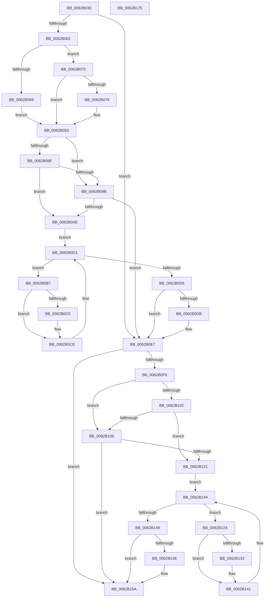

# DifIoGetFileObjectGenericMappingWrapper

- RVA: `0x0062B030`–`0x0062B176` (길이 `326` bytes)
- VA: `0x000000014062B030`
- 실행 섹션: `.text`
- PDB 이름 있음: `예`; PDB Function 태그: `아니요`
- unwind 정보 RVA: `0x0009B270`
- 디코드: `87`개 명령, `326/326` bytes 표시
- 미해석 바이트: `0` (있으면 어셈블리에 `.byte`로 보존)

> 이 문서는 커널 이미지의 기계어와 PDB 기호를 분석해 생성했습니다. 4번과 5번은 함수 원형과 자료형을 바이너리 사용 방식에서 추정한 C 해석이며 원본 소스 복구 결과는 아닙니다.

## 1. Dependencies

- 직접 호출 지점: **9**; 고유 호출 대상: **6**
- 직접 호출자로 확인된 함수: **0**
- RIP 상대 이미지 참조: **3**

### Outgoing calls
- `0x0062B051` → [DifGetAPIThunkContextById](../49/DifGetAPIThunkContextById_function_00495A34.md) (function, `0x00495A34`)
- `0x0062B079` → [DifGetReturnAddressForWrappers](../4D/DifGetReturnAddressForWrappers_function_004D3C08.md) (function, `0x004D3C08`)
- `0x0062B0A2` → [ExAcquireRundownProtection](../21/ExAcquireRundownProtection_function_00216620.md) (function, `0x00216620`)
- `0x0062B0C9` → [guard_dispatch_icall](../6B/guard_dispatch_icall_function_006BAAD0.md) (function, `0x006BAAD0`)
- `0x0062B0E2` → [ExReleaseRundownProtection](../34/ExReleaseRundownProtection_function_00349E80.md) (function, `0x00349E80`)
- `0x0062B0E7` → [IoGetFileObjectGenericMapping](../../page/A1/IoGetFileObjectGenericMapping_function_00A11E80.md) (function, `0x00A11E80`)
- `0x0062B115` → [ExAcquireRundownProtection](../21/ExAcquireRundownProtection_function_00216620.md) (function, `0x00216620`)
- `0x0062B13C` → [guard_dispatch_icall](../6B/guard_dispatch_icall_function_006BAAD0.md) (function, `0x006BAAD0`)
- `0x0062B155` → [ExReleaseRundownProtection](../34/ExReleaseRundownProtection_function_00349E80.md) (function, `0x00349E80`)

### Direct callers
- 이 함수 시작 RVA로 연결되는 직접 call은 확인되지 않았습니다. 간접 호출은 완전히 역산할 수 없습니다.

### Static image references
- `0x0062B086` → RVA `0x00F048B8` (`.data`; read)
- `0x0062B08F` → RVA `0x00F04980` (`.data`; read)
- `0x0062B09B` → RVA `0x00F03E80` (`.data`; read)

## 2. Other-region calls and transfers

- 다른 실행 섹션으로 향하는 call: **1**
  - `0x0062B0E7` → [IoGetFileObjectGenericMapping](../../page/A1/IoGetFileObjectGenericMapping_function_00A11E80.md) (`.text` → `PAGE`)
- 별도 외부 분기/꼬리 이동을 확인하지 못했습니다.

## 3. Assembly (complete function range)

```asm
0062B030  48 8B C4                        mov rax, rsp
0062B033  48 89 58 08                     mov qword ptr [rax + 8], rbx
0062B037  48 89 70 10                     mov qword ptr [rax + 0x10], rsi
0062B03B  48 89 78 18                     mov qword ptr [rax + 0x18], rdi
0062B03F  41 56                           push r14
0062B041  48 83 EC 30                     sub rsp, 0x30
0062B045  0F 57 C0                        xorps xmm0, xmm0
0062B048  B9 4C 01 00 00                  mov ecx, 0x14c
0062B04D  0F 11 40 E8                     movups xmmword ptr [rax - 0x18], xmm0
0062B051  E8 DE A9 E6 FF                  call 0x140495a34
0062B056  48 8B F8                        mov rdi, rax
0062B059  48 85 C0                        test rax, rax
0062B05C  0F 84 85 00 00 00               je 0x14062b0e7
0062B062  8B 40 0C                        mov eax, dword ptr [rax + 0xc]
0062B065  A8 18                           test al, 0x18
0062B067  74 0C                           je 0x14062b075
0062B069  48 8B 4C 24 38                  mov rcx, qword ptr [rsp + 0x38]
0062B06E  48 89 4C 24 20                  mov qword ptr [rsp + 0x20], rcx
0062B073  EB 0E                           jmp 0x14062b083
0062B075  A8 04                           test al, 4
0062B077  74 0A                           je 0x14062b083
0062B079  E8 8A 8B EA FF                  call 0x1404d3c08
0062B07E  48 89 44 24 20                  mov qword ptr [rsp + 0x20], rax
0062B083  40 32 F6                        xor sil, sil
0062B086  40 38 35 2B 98 8D 00            cmp byte ptr [rip + 0x8d982b], sil
0062B08D  75 0C                           jne 0x14062b09b
0062B08F  F7 05 E7 98 8D 00 00 08 00 00   test dword ptr [rip + 0x8d98e7], 0x800
0062B099  74 13                           je 0x14062b0ae
0062B09B  48 8D 0D DE 8D 8D 00            lea rcx, [rip + 0x8d8dde]
0062B0A2  E8 79 B5 BE FF                  call 0x140216620
0062B0A7  40 8A F0                        mov sil, al
0062B0AA  84 C0                           test al, al
0062B0AC  74 39                           je 0x14062b0e7
0062B0AE  4C 8D 77 20                     lea r14, [rdi + 0x20]
0062B0B2  49 8B 1E                        mov rbx, qword ptr [r14]
0062B0B5  EB 1A                           jmp 0x14062b0d1
0062B0B7  48 8D 43 F0                     lea rax, [rbx - 0x10]
0062B0BB  48 85 C0                        test rax, rax
0062B0BE  74 0E                           je 0x14062b0ce
0062B0C0  48 8B 40 08                     mov rax, qword ptr [rax + 8]
0062B0C4  48 8D 4C 24 20                  lea rcx, [rsp + 0x20]
0062B0C9  E8 02 FA 08 00                  call 0x1406baad0
0062B0CE  48 8B 1B                        mov rbx, qword ptr [rbx]
0062B0D1  49 3B DE                        cmp rbx, r14
0062B0D4  75 E1                           jne 0x14062b0b7
0062B0D6  40 84 F6                        test sil, sil
0062B0D9  74 0C                           je 0x14062b0e7
0062B0DB  48 8D 0D 9E 8D 8D 00            lea rcx, [rip + 0x8d8d9e]
0062B0E2  E8 99 ED D1 FF                  call 0x140349e80
0062B0E7  E8 94 6D 3E 00                  call 0x140a11e80
0062B0EC  48 89 44 24 28                  mov qword ptr [rsp + 0x28], rax
0062B0F1  48 85 FF                        test rdi, rdi
0062B0F4  74 64                           je 0x14062b15a
0062B0F6  40 32 F6                        xor sil, sil
0062B0F9  40 38 35 B8 97 8D 00            cmp byte ptr [rip + 0x8d97b8], sil
0062B100  75 0C                           jne 0x14062b10e
0062B102  F7 05 74 98 8D 00 00 08 00 00   test dword ptr [rip + 0x8d9874], 0x800
0062B10C  74 13                           je 0x14062b121
0062B10E  48 8D 0D 6B 8D 8D 00            lea rcx, [rip + 0x8d8d6b]
0062B115  E8 06 B5 BE FF                  call 0x140216620
0062B11A  40 8A F0                        mov sil, al
0062B11D  84 C0                           test al, al
0062B11F  74 39                           je 0x14062b15a
0062B121  48 83 C7 30                     add rdi, 0x30
0062B125  48 8B 1F                        mov rbx, qword ptr [rdi]
0062B128  EB 1A                           jmp 0x14062b144
0062B12A  48 8D 43 F0                     lea rax, [rbx - 0x10]
0062B12E  48 85 C0                        test rax, rax
0062B131  74 0E                           je 0x14062b141
0062B133  48 8B 40 08                     mov rax, qword ptr [rax + 8]
0062B137  48 8D 4C 24 20                  lea rcx, [rsp + 0x20]
0062B13C  E8 8F F9 08 00                  call 0x1406baad0
0062B141  48 8B 1B                        mov rbx, qword ptr [rbx]
0062B144  48 3B DF                        cmp rbx, rdi
0062B147  75 E1                           jne 0x14062b12a
0062B149  40 84 F6                        test sil, sil
0062B14C  74 0C                           je 0x14062b15a
0062B14E  48 8D 0D 2B 8D 8D 00            lea rcx, [rip + 0x8d8d2b]
0062B155  E8 26 ED D1 FF                  call 0x140349e80
0062B15A  48 8B 44 24 28                  mov rax, qword ptr [rsp + 0x28]
0062B15F  48 8B 5C 24 40                  mov rbx, qword ptr [rsp + 0x40]
0062B164  48 8B 74 24 48                  mov rsi, qword ptr [rsp + 0x48]
0062B169  48 8B 7C 24 50                  mov rdi, qword ptr [rsp + 0x50]
0062B16E  48 83 C4 30                     add rsp, 0x30
0062B172  41 5E                           pop r14
0062B174  C3                              ret
0062B175  CC                              int3
```

## 4. C-style interpretation (structured pseudocode)

```c
__int64 __fastcall DifIoGetFileObjectGenericMappingWrapper(void)
{
    __int64 result;
    __int64 v_rdi;
    __int64 v_rsi;
    __int64 v_rsp;
    unsigned __int64 v_stack_m10;
    unsigned __int64 v_stack_m18;
    unsigned __int64 v_stack_p0;
    unsigned __int64 v_stack_p10;
    unsigned __int64 v_stack_p18;
    unsigned __int64 v_stack_p8;

    *(unsigned __int64 *)(v_rsp + 8) = v_rbx;
    *(unsigned __int64 *)(v_rsp + 16) = v_rsi;
    *(unsigned __int64 *)(v_rsp + 24) = v_rdi;
    v_rsp = (v_rsp) - (48);
    *(unsigned __int64 *)(v_rsp - 24) = v_xmm0;
    result = DifGetAPIThunkContextById(332, a2, a3, a4);
    if (result == 0) goto loc_0062B0E7;
    if ((((unsigned __int8)((unsigned int)(*(unsigned int *)(result + 12)))) & (24)) == 0) goto loc_0062B075;
    v_stack_m18 = v_stack_p0;
    goto loc_0062B083;
loc_0062B075:
    result = (unsigned int)(*(unsigned int *)(result + 12));
    if ((((unsigned __int8)((unsigned int)(*(unsigned int *)(result + 12)))) & (4)) != 0) {
        result = DifGetReturnAddressForWrappers(v_stack_p0, a2, a3, a4);
        v_stack_m18 = result;
    }
    v_rsi = 0;
    if ((*(unsigned __int8 *)(v_rip + 9279531)) != 0) goto loc_0062B09B;
    if (((*(unsigned int *)(v_rip + 9279719)) & (0x800ULL)) == 0) goto loc_0062B0AE;
loc_0062B09B:
    result = ExAcquireRundownProtection(v_rip + 9276894, a2, a3, a4);
    if ((unsigned __int8)(result) == 0) goto loc_0062B0E7;
loc_0062B0AE:
    goto loc_0062B0D1;
loc_0062B0B7:
    result = *(unsigned __int64 *)(result + 32) - 16;
    if (*(unsigned __int64 *)(result + 32) - 16 != 0) {
        result = *(unsigned __int64 *)(*(unsigned __int64 *)(result + 32) - 16 + 8);
        a1 = v_stack_m18;
        result = guard_dispatch_icall(a1, a2, a3, a4);
    }
loc_0062B0D1:
    if ((*(unsigned __int64 *)(*(unsigned __int64 *)(result + 32))) != (result + 32)) goto loc_0062B0B7;
    if ((unsigned __int8)((unsigned __int8)(result)) != 0) {
        a1 = v_rip + 9276830;
        result = ExReleaseRundownProtection(a1, a2, a3, a4);
    }
    result = IoGetFileObjectGenericMapping(a1, a2, a3, a4);
    v_stack_m10 = result;
    if (result == 0) goto loc_0062B15A;
    v_rsi = 0;
    if ((*(unsigned __int8 *)(v_rip + 9279416)) != 0) goto loc_0062B10E;
    if (((*(unsigned int *)(v_rip + 9279604)) & (0x800ULL)) == 0) goto loc_0062B121;
loc_0062B10E:
    result = ExAcquireRundownProtection(v_rip + 9276779, a2, a3, a4);
    if ((unsigned __int8)(result) == 0) goto loc_0062B15A;
loc_0062B121:
    v_rdi = (result) + (48);
    goto loc_0062B144;
loc_0062B12A:
    result = *(unsigned __int64 *)(v_rdi) - 16;
    if (*(unsigned __int64 *)(v_rdi) - 16 != 0) {
        result = *(unsigned __int64 *)(*(unsigned __int64 *)(v_rdi) - 16 + 8);
        a1 = v_stack_m18;
        result = guard_dispatch_icall(a1, a2, a3, a4);
    }
loc_0062B144:
    if ((*(unsigned __int64 *)(*(unsigned __int64 *)(v_rdi))) != v_rdi) goto loc_0062B12A;
    if ((unsigned __int8)((unsigned __int8)(result)) != 0) {
        a1 = v_rip + 9276715;
        result = ExReleaseRundownProtection(a1, a2, a3, a4);
    }
    v_rsp = (v_rsp) + (48);
    return v_stack_m10;
}
```

## 5. (Beta) C Style

```c
void DifIoGetFileObjectGenericMappingWrapper(void)
{
    int64_t result;
    int64_t local_rdi;
    int64_t local_rsi;
    int64_t local_rsp;
    uint64_t v_stack_m10;
    uint64_t v_stack_m18;
    uint64_t v_stack_p0;
    uint64_t v_stack_p10;
    uint64_t v_stack_p18;
    uint64_t v_stack_p8;

    *(uint64_t *)(local_rsp + 0x8) = local_rbx;
    *(uint64_t *)(local_rsp + 0x10) = local_rsi;
    *(uint64_t *)(local_rsp + 0x18) = local_rdi;
    local_rsp = (local_rsp) - (48);
    *(uint64_t *)(local_rsp - 0x18) = v_xmm0;
    result = DifGetAPIThunkContextById(332, a2, a3, a4);
    if (result == 0) goto loc_0062B0E7;
    if ((((uint8_t)((uint32_t)(*(uint32_t *)(result + 0xC)))) & (24)) == 0) goto loc_0062B075;
    v_stack_m18 = v_stack_p0;
    goto loc_0062B083;
loc_0062B075:
    result = (uint32_t)(*(uint32_t *)(result + 0xC));
    if ((((uint8_t)((uint32_t)(*(uint32_t *)(result + 0xC)))) & (4)) != 0) {
        result = DifGetReturnAddressForWrappers(v_stack_p0, a2, a3, a4);
        v_stack_m18 = result;
    }
    local_rsi = 0;
    if ((*(uint8_t *)(v_rip + 0x8D982B)) != 0) goto loc_0062B09B;
    if (((*(uint32_t *)(v_rip + 0x8D98E7)) & (0x800ULL)) == 0) goto loc_0062B0AE;
loc_0062B09B:
    result = ExAcquireRundownProtection(v_rip + 9276894, a2, a3, a4);
    if ((uint8_t)(result) == 0) goto loc_0062B0E7;
loc_0062B0AE:
    goto loc_0062B0D1;
loc_0062B0B7:
    result = *(uint64_t *)(result + 0x20) - 16;
    if (*(uint64_t *)(result + 0x20) - 16 != 0) {
        result = *(uint64_t *)(*(uint64_t *)(result + 0x20) - 0x10 + 0x8);
        a1 = v_stack_m18;
        result = guard_dispatch_icall(a1, a2, a3, a4);
    }
loc_0062B0D1:
    if ((*(uint64_t *)(*(uint64_t *)(result + 0x20))) != (result + 32)) goto loc_0062B0B7;
    if ((uint8_t)((uint8_t)(result)) != 0) {
        a1 = v_rip + 9276830;
        result = ExReleaseRundownProtection(a1, a2, a3, a4);
    }
    result = IoGetFileObjectGenericMapping(a1, a2, a3, a4);
    v_stack_m10 = result;
    if (result == 0) goto loc_0062B15A;
    local_rsi = 0;
    if ((*(uint8_t *)(v_rip + 0x8D97B8)) != 0) goto loc_0062B10E;
    if (((*(uint32_t *)(v_rip + 0x8D9874)) & (0x800ULL)) == 0) goto loc_0062B121;
loc_0062B10E:
    result = ExAcquireRundownProtection(v_rip + 9276779, a2, a3, a4);
    if ((uint8_t)(result) == 0) goto loc_0062B15A;
loc_0062B121:
    local_rdi = (result) + (48);
    goto loc_0062B144;
loc_0062B12A:
    result = *(uint64_t *)(local_rdi) - 16;
    if (*(uint64_t *)(local_rdi) - 16 != 0) {
        result = *(uint64_t *)(*(uint64_t *)(local_rdi) - 0x10 + 0x8);
        a1 = v_stack_m18;
        result = guard_dispatch_icall(a1, a2, a3, a4);
    }
loc_0062B144:
    if ((*(uint64_t *)(*(uint64_t *)(local_rdi))) != local_rdi) goto loc_0062B12A;
    if ((uint8_t)((uint8_t)(result)) != 0) {
        a1 = v_rip + 9276715;
        result = ExReleaseRundownProtection(a1, a2, a3, a4);
    }
    local_rsp = (local_rsp) + (48);
    return v_stack_m10;
}
```

## 6. Execution-region graph

[열기: 2D/3D 그래프와 함수 탐색 컨트롤 패널](../../../control-panel.html?section=text&rva=0x0062B030&view=graph)

- 2D 그래프는 위에서 아래로 흐르고, 3D 그래프는 빈 공간을 드래그해 회전합니다. Shift+드래그는 이동, 휠은 확대·축소, 함수 노드 선택은 대상 보고서 이동입니다.

### Static fallback


