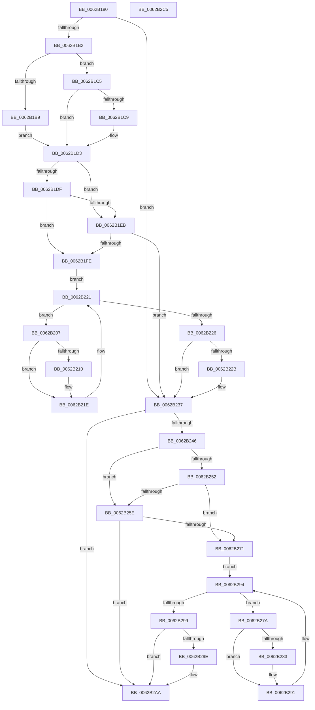

# DifIoGetInitialStackWrapper

- RVA: `0x0062B180`–`0x0062B2C6` (길이 `326` bytes)
- VA: `0x000000014062B180`
- 실행 섹션: `.text`
- PDB 이름 있음: `예`; PDB Function 태그: `아니요`
- unwind 정보 RVA: `0x0009B270`
- 디코드: `87`개 명령, `326/326` bytes 표시
- 미해석 바이트: `0` (있으면 어셈블리에 `.byte`로 보존)

> 이 문서는 커널 이미지의 기계어와 PDB 기호를 분석해 생성했습니다. 4번과 5번은 함수 원형과 자료형을 바이너리 사용 방식에서 추정한 C 해석이며 원본 소스 복구 결과는 아닙니다.

## 1. Dependencies

- 직접 호출 지점: **9**; 고유 호출 대상: **6**
- 직접 호출자로 확인된 함수: **0**
- RIP 상대 이미지 참조: **3**

### Outgoing calls
- `0x0062B1A1` → [DifGetAPIThunkContextById](../49/DifGetAPIThunkContextById_function_00495A34.md) (function, `0x00495A34`)
- `0x0062B1C9` → [DifGetReturnAddressForWrappers](../4D/DifGetReturnAddressForWrappers_function_004D3C08.md) (function, `0x004D3C08`)
- `0x0062B1F2` → [ExAcquireRundownProtection](../21/ExAcquireRundownProtection_function_00216620.md) (function, `0x00216620`)
- `0x0062B219` → [guard_dispatch_icall](../6B/guard_dispatch_icall_function_006BAAD0.md) (function, `0x006BAAD0`)
- `0x0062B232` → [ExReleaseRundownProtection](../34/ExReleaseRundownProtection_function_00349E80.md) (function, `0x00349E80`)
- `0x0062B237` → [IoGetInitialStack](../../page/A8/IoGetInitialStack_function_00A84340.md) (function, `0x00A84340`)
- `0x0062B265` → [ExAcquireRundownProtection](../21/ExAcquireRundownProtection_function_00216620.md) (function, `0x00216620`)
- `0x0062B28C` → [guard_dispatch_icall](../6B/guard_dispatch_icall_function_006BAAD0.md) (function, `0x006BAAD0`)
- `0x0062B2A5` → [ExReleaseRundownProtection](../34/ExReleaseRundownProtection_function_00349E80.md) (function, `0x00349E80`)

### Direct callers
- 이 함수 시작 RVA로 연결되는 직접 call은 확인되지 않았습니다. 간접 호출은 완전히 역산할 수 없습니다.

### Static image references
- `0x0062B1D6` → RVA `0x00F048B8` (`.data`; read)
- `0x0062B1DF` → RVA `0x00F04980` (`.data`; read)
- `0x0062B1EB` → RVA `0x00F03E80` (`.data`; read)

## 2. Other-region calls and transfers

- 다른 실행 섹션으로 향하는 call: **1**
  - `0x0062B237` → [IoGetInitialStack](../../page/A8/IoGetInitialStack_function_00A84340.md) (`.text` → `PAGE`)
- 별도 외부 분기/꼬리 이동을 확인하지 못했습니다.

## 3. Assembly (complete function range)

```asm
0062B180  48 8B C4                        mov rax, rsp
0062B183  48 89 58 08                     mov qword ptr [rax + 8], rbx
0062B187  48 89 70 10                     mov qword ptr [rax + 0x10], rsi
0062B18B  48 89 78 18                     mov qword ptr [rax + 0x18], rdi
0062B18F  41 56                           push r14
0062B191  48 83 EC 30                     sub rsp, 0x30
0062B195  0F 57 C0                        xorps xmm0, xmm0
0062B198  B9 4B 01 00 00                  mov ecx, 0x14b
0062B19D  0F 11 40 E8                     movups xmmword ptr [rax - 0x18], xmm0
0062B1A1  E8 8E A8 E6 FF                  call 0x140495a34
0062B1A6  48 8B F8                        mov rdi, rax
0062B1A9  48 85 C0                        test rax, rax
0062B1AC  0F 84 85 00 00 00               je 0x14062b237
0062B1B2  8B 40 0C                        mov eax, dword ptr [rax + 0xc]
0062B1B5  A8 18                           test al, 0x18
0062B1B7  74 0C                           je 0x14062b1c5
0062B1B9  48 8B 4C 24 38                  mov rcx, qword ptr [rsp + 0x38]
0062B1BE  48 89 4C 24 20                  mov qword ptr [rsp + 0x20], rcx
0062B1C3  EB 0E                           jmp 0x14062b1d3
0062B1C5  A8 04                           test al, 4
0062B1C7  74 0A                           je 0x14062b1d3
0062B1C9  E8 3A 8A EA FF                  call 0x1404d3c08
0062B1CE  48 89 44 24 20                  mov qword ptr [rsp + 0x20], rax
0062B1D3  40 32 F6                        xor sil, sil
0062B1D6  40 38 35 DB 96 8D 00            cmp byte ptr [rip + 0x8d96db], sil
0062B1DD  75 0C                           jne 0x14062b1eb
0062B1DF  F7 05 97 97 8D 00 00 08 00 00   test dword ptr [rip + 0x8d9797], 0x800
0062B1E9  74 13                           je 0x14062b1fe
0062B1EB  48 8D 0D 8E 8C 8D 00            lea rcx, [rip + 0x8d8c8e]
0062B1F2  E8 29 B4 BE FF                  call 0x140216620
0062B1F7  40 8A F0                        mov sil, al
0062B1FA  84 C0                           test al, al
0062B1FC  74 39                           je 0x14062b237
0062B1FE  4C 8D 77 20                     lea r14, [rdi + 0x20]
0062B202  49 8B 1E                        mov rbx, qword ptr [r14]
0062B205  EB 1A                           jmp 0x14062b221
0062B207  48 8D 43 F0                     lea rax, [rbx - 0x10]
0062B20B  48 85 C0                        test rax, rax
0062B20E  74 0E                           je 0x14062b21e
0062B210  48 8B 40 08                     mov rax, qword ptr [rax + 8]
0062B214  48 8D 4C 24 20                  lea rcx, [rsp + 0x20]
0062B219  E8 B2 F8 08 00                  call 0x1406baad0
0062B21E  48 8B 1B                        mov rbx, qword ptr [rbx]
0062B221  49 3B DE                        cmp rbx, r14
0062B224  75 E1                           jne 0x14062b207
0062B226  40 84 F6                        test sil, sil
0062B229  74 0C                           je 0x14062b237
0062B22B  48 8D 0D 4E 8C 8D 00            lea rcx, [rip + 0x8d8c4e]
0062B232  E8 49 EC D1 FF                  call 0x140349e80
0062B237  E8 04 91 45 00                  call 0x140a84340
0062B23C  48 89 44 24 28                  mov qword ptr [rsp + 0x28], rax
0062B241  48 85 FF                        test rdi, rdi
0062B244  74 64                           je 0x14062b2aa
0062B246  40 32 F6                        xor sil, sil
0062B249  40 38 35 68 96 8D 00            cmp byte ptr [rip + 0x8d9668], sil
0062B250  75 0C                           jne 0x14062b25e
0062B252  F7 05 24 97 8D 00 00 08 00 00   test dword ptr [rip + 0x8d9724], 0x800
0062B25C  74 13                           je 0x14062b271
0062B25E  48 8D 0D 1B 8C 8D 00            lea rcx, [rip + 0x8d8c1b]
0062B265  E8 B6 B3 BE FF                  call 0x140216620
0062B26A  40 8A F0                        mov sil, al
0062B26D  84 C0                           test al, al
0062B26F  74 39                           je 0x14062b2aa
0062B271  48 83 C7 30                     add rdi, 0x30
0062B275  48 8B 1F                        mov rbx, qword ptr [rdi]
0062B278  EB 1A                           jmp 0x14062b294
0062B27A  48 8D 43 F0                     lea rax, [rbx - 0x10]
0062B27E  48 85 C0                        test rax, rax
0062B281  74 0E                           je 0x14062b291
0062B283  48 8B 40 08                     mov rax, qword ptr [rax + 8]
0062B287  48 8D 4C 24 20                  lea rcx, [rsp + 0x20]
0062B28C  E8 3F F8 08 00                  call 0x1406baad0
0062B291  48 8B 1B                        mov rbx, qword ptr [rbx]
0062B294  48 3B DF                        cmp rbx, rdi
0062B297  75 E1                           jne 0x14062b27a
0062B299  40 84 F6                        test sil, sil
0062B29C  74 0C                           je 0x14062b2aa
0062B29E  48 8D 0D DB 8B 8D 00            lea rcx, [rip + 0x8d8bdb]
0062B2A5  E8 D6 EB D1 FF                  call 0x140349e80
0062B2AA  48 8B 44 24 28                  mov rax, qword ptr [rsp + 0x28]
0062B2AF  48 8B 5C 24 40                  mov rbx, qword ptr [rsp + 0x40]
0062B2B4  48 8B 74 24 48                  mov rsi, qword ptr [rsp + 0x48]
0062B2B9  48 8B 7C 24 50                  mov rdi, qword ptr [rsp + 0x50]
0062B2BE  48 83 C4 30                     add rsp, 0x30
0062B2C2  41 5E                           pop r14
0062B2C4  C3                              ret
0062B2C5  CC                              int3
```

## 4. C-style interpretation (structured pseudocode)

```c
__int64 __fastcall DifIoGetInitialStackWrapper(void)
{
    __int64 result;
    __int64 v_rdi;
    __int64 v_rsi;
    __int64 v_rsp;
    unsigned __int64 v_stack_m10;
    unsigned __int64 v_stack_m18;
    unsigned __int64 v_stack_p0;
    unsigned __int64 v_stack_p10;
    unsigned __int64 v_stack_p18;
    unsigned __int64 v_stack_p8;

    *(unsigned __int64 *)(v_rsp + 8) = v_rbx;
    *(unsigned __int64 *)(v_rsp + 16) = v_rsi;
    *(unsigned __int64 *)(v_rsp + 24) = v_rdi;
    v_rsp = (v_rsp) - (48);
    *(unsigned __int64 *)(v_rsp - 24) = v_xmm0;
    result = DifGetAPIThunkContextById(331, a2, a3, a4);
    if (result == 0) goto loc_0062B237;
    if ((((unsigned __int8)((unsigned int)(*(unsigned int *)(result + 12)))) & (24)) == 0) goto loc_0062B1C5;
    v_stack_m18 = v_stack_p0;
    goto loc_0062B1D3;
loc_0062B1C5:
    result = (unsigned int)(*(unsigned int *)(result + 12));
    if ((((unsigned __int8)((unsigned int)(*(unsigned int *)(result + 12)))) & (4)) != 0) {
        result = DifGetReturnAddressForWrappers(v_stack_p0, a2, a3, a4);
        v_stack_m18 = result;
    }
    v_rsi = 0;
    if ((*(unsigned __int8 *)(v_rip + 9279195)) != 0) goto loc_0062B1EB;
    if (((*(unsigned int *)(v_rip + 9279383)) & (0x800ULL)) == 0) goto loc_0062B1FE;
loc_0062B1EB:
    result = ExAcquireRundownProtection(v_rip + 9276558, a2, a3, a4);
    if ((unsigned __int8)(result) == 0) goto loc_0062B237;
loc_0062B1FE:
    goto loc_0062B221;
loc_0062B207:
    result = *(unsigned __int64 *)(result + 32) - 16;
    if (*(unsigned __int64 *)(result + 32) - 16 != 0) {
        result = *(unsigned __int64 *)(*(unsigned __int64 *)(result + 32) - 16 + 8);
        a1 = v_stack_m18;
        result = guard_dispatch_icall(a1, a2, a3, a4);
    }
loc_0062B221:
    if ((*(unsigned __int64 *)(*(unsigned __int64 *)(result + 32))) != (result + 32)) goto loc_0062B207;
    if ((unsigned __int8)((unsigned __int8)(result)) != 0) {
        a1 = v_rip + 9276494;
        result = ExReleaseRundownProtection(a1, a2, a3, a4);
    }
    result = IoGetInitialStack(a1, a2, a3, a4);
    v_stack_m10 = result;
    if (result == 0) goto loc_0062B2AA;
    v_rsi = 0;
    if ((*(unsigned __int8 *)(v_rip + 9279080)) != 0) goto loc_0062B25E;
    if (((*(unsigned int *)(v_rip + 9279268)) & (0x800ULL)) == 0) goto loc_0062B271;
loc_0062B25E:
    result = ExAcquireRundownProtection(v_rip + 9276443, a2, a3, a4);
    if ((unsigned __int8)(result) == 0) goto loc_0062B2AA;
loc_0062B271:
    v_rdi = (result) + (48);
    goto loc_0062B294;
loc_0062B27A:
    result = *(unsigned __int64 *)(v_rdi) - 16;
    if (*(unsigned __int64 *)(v_rdi) - 16 != 0) {
        result = *(unsigned __int64 *)(*(unsigned __int64 *)(v_rdi) - 16 + 8);
        a1 = v_stack_m18;
        result = guard_dispatch_icall(a1, a2, a3, a4);
    }
loc_0062B294:
    if ((*(unsigned __int64 *)(*(unsigned __int64 *)(v_rdi))) != v_rdi) goto loc_0062B27A;
    if ((unsigned __int8)((unsigned __int8)(result)) != 0) {
        a1 = v_rip + 9276379;
        result = ExReleaseRundownProtection(a1, a2, a3, a4);
    }
    v_rsp = (v_rsp) + (48);
    return v_stack_m10;
}
```

## 5. (Beta) C Style

```c
void DifIoGetInitialStackWrapper(void)
{
    int64_t result;
    int64_t local_rdi;
    int64_t local_rsi;
    int64_t local_rsp;
    uint64_t v_stack_m10;
    uint64_t v_stack_m18;
    uint64_t v_stack_p0;
    uint64_t v_stack_p10;
    uint64_t v_stack_p18;
    uint64_t v_stack_p8;

    *(uint64_t *)(local_rsp + 0x8) = local_rbx;
    *(uint64_t *)(local_rsp + 0x10) = local_rsi;
    *(uint64_t *)(local_rsp + 0x18) = local_rdi;
    local_rsp = (local_rsp) - (48);
    *(uint64_t *)(local_rsp - 0x18) = v_xmm0;
    result = DifGetAPIThunkContextById(331, a2, a3, a4);
    if (result == 0) goto loc_0062B237;
    if ((((uint8_t)((uint32_t)(*(uint32_t *)(result + 0xC)))) & (24)) == 0) goto loc_0062B1C5;
    v_stack_m18 = v_stack_p0;
    goto loc_0062B1D3;
loc_0062B1C5:
    result = (uint32_t)(*(uint32_t *)(result + 0xC));
    if ((((uint8_t)((uint32_t)(*(uint32_t *)(result + 0xC)))) & (4)) != 0) {
        result = DifGetReturnAddressForWrappers(v_stack_p0, a2, a3, a4);
        v_stack_m18 = result;
    }
    local_rsi = 0;
    if ((*(uint8_t *)(v_rip + 0x8D96DB)) != 0) goto loc_0062B1EB;
    if (((*(uint32_t *)(v_rip + 0x8D9797)) & (0x800ULL)) == 0) goto loc_0062B1FE;
loc_0062B1EB:
    result = ExAcquireRundownProtection(v_rip + 9276558, a2, a3, a4);
    if ((uint8_t)(result) == 0) goto loc_0062B237;
loc_0062B1FE:
    goto loc_0062B221;
loc_0062B207:
    result = *(uint64_t *)(result + 0x20) - 16;
    if (*(uint64_t *)(result + 0x20) - 16 != 0) {
        result = *(uint64_t *)(*(uint64_t *)(result + 0x20) - 0x10 + 0x8);
        a1 = v_stack_m18;
        result = guard_dispatch_icall(a1, a2, a3, a4);
    }
loc_0062B221:
    if ((*(uint64_t *)(*(uint64_t *)(result + 0x20))) != (result + 32)) goto loc_0062B207;
    if ((uint8_t)((uint8_t)(result)) != 0) {
        a1 = v_rip + 9276494;
        result = ExReleaseRundownProtection(a1, a2, a3, a4);
    }
    result = IoGetInitialStack(a1, a2, a3, a4);
    v_stack_m10 = result;
    if (result == 0) goto loc_0062B2AA;
    local_rsi = 0;
    if ((*(uint8_t *)(v_rip + 0x8D9668)) != 0) goto loc_0062B25E;
    if (((*(uint32_t *)(v_rip + 0x8D9724)) & (0x800ULL)) == 0) goto loc_0062B271;
loc_0062B25E:
    result = ExAcquireRundownProtection(v_rip + 9276443, a2, a3, a4);
    if ((uint8_t)(result) == 0) goto loc_0062B2AA;
loc_0062B271:
    local_rdi = (result) + (48);
    goto loc_0062B294;
loc_0062B27A:
    result = *(uint64_t *)(local_rdi) - 16;
    if (*(uint64_t *)(local_rdi) - 16 != 0) {
        result = *(uint64_t *)(*(uint64_t *)(local_rdi) - 0x10 + 0x8);
        a1 = v_stack_m18;
        result = guard_dispatch_icall(a1, a2, a3, a4);
    }
loc_0062B294:
    if ((*(uint64_t *)(*(uint64_t *)(local_rdi))) != local_rdi) goto loc_0062B27A;
    if ((uint8_t)((uint8_t)(result)) != 0) {
        a1 = v_rip + 9276379;
        result = ExReleaseRundownProtection(a1, a2, a3, a4);
    }
    local_rsp = (local_rsp) + (48);
    return v_stack_m10;
}
```

## 6. Execution-region graph

[열기: 2D/3D 그래프와 함수 탐색 컨트롤 패널](../../../control-panel.html?section=text&rva=0x0062B180&view=graph)

- 2D 그래프는 위에서 아래로 흐르고, 3D 그래프는 빈 공간을 드래그해 회전합니다. Shift+드래그는 이동, 휠은 확대·축소, 함수 노드 선택은 대상 보고서 이동입니다.

### Static fallback


