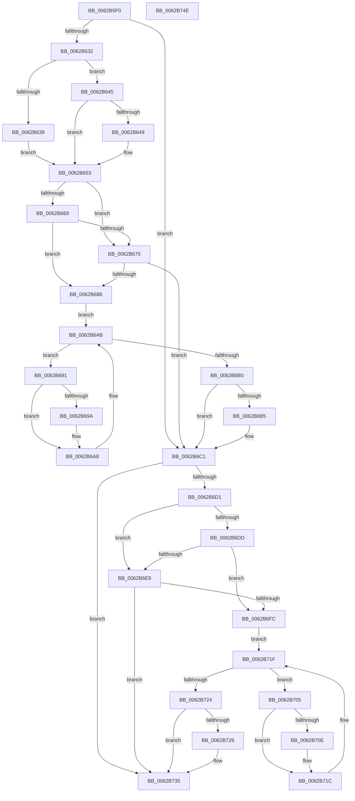

# DifIoInitializeWorkItemWrapper

- RVA: `0x0062B5F0`–`0x0062B74F` (길이 `351` bytes)
- VA: `0x000000014062B5F0`
- 실행 섹션: `.text`
- PDB 이름 있음: `예`; PDB Function 태그: `아니요`
- unwind 정보 RVA: `0x00093E28`
- 디코드: `97`개 명령, `351/351` bytes 표시
- 미해석 바이트: `0` (있으면 어셈블리에 `.byte`로 보존)

> 이 문서는 커널 이미지의 기계어와 PDB 기호를 분석해 생성했습니다. 4번과 5번은 함수 원형과 자료형을 바이너리 사용 방식에서 추정한 C 해석이며 원본 소스 복구 결과는 아닙니다.

## 1. Dependencies

- 직접 호출 지점: **9**; 고유 호출 대상: **6**
- 직접 호출자로 확인된 함수: **0**
- RIP 상대 이미지 참조: **3**

### Outgoing calls
- `0x0062B621` → [DifGetAPIThunkContextById](../49/DifGetAPIThunkContextById_function_00495A34.md) (function, `0x00495A34`)
- `0x0062B649` → [DifGetReturnAddressForWrappers](../4D/DifGetReturnAddressForWrappers_function_004D3C08.md) (function, `0x004D3C08`)
- `0x0062B67C` → [ExAcquireRundownProtection](../21/ExAcquireRundownProtection_function_00216620.md) (function, `0x00216620`)
- `0x0062B6A3` → [guard_dispatch_icall](../6B/guard_dispatch_icall_function_006BAAD0.md) (function, `0x006BAAD0`)
- `0x0062B6BC` → [ExReleaseRundownProtection](../34/ExReleaseRundownProtection_function_00349E80.md) (function, `0x00349E80`)
- `0x0062B6C7` → [IoInitializeWorkItem](../45/IoInitializeWorkItem_function_0045D380.md) (function, `0x0045D380`)
- `0x0062B6F0` → [ExAcquireRundownProtection](../21/ExAcquireRundownProtection_function_00216620.md) (function, `0x00216620`)
- `0x0062B717` → [guard_dispatch_icall](../6B/guard_dispatch_icall_function_006BAAD0.md) (function, `0x006BAAD0`)
- `0x0062B730` → [ExReleaseRundownProtection](../34/ExReleaseRundownProtection_function_00349E80.md) (function, `0x00349E80`)

### Direct callers
- 이 함수 시작 RVA로 연결되는 직접 call은 확인되지 않았습니다. 간접 호출은 완전히 역산할 수 없습니다.

### Static image references
- `0x0062B65B` → RVA `0x00F048B8` (`.data`; read)
- `0x0062B669` → RVA `0x00F04980` (`.data`; read)
- `0x0062B675` → RVA `0x00F03E80` (`.data`; read)

## 2. Other-region calls and transfers

- 다른 실행 섹션으로 향하는 call: **0**
- 별도 외부 분기/꼬리 이동을 확인하지 못했습니다.

## 3. Assembly (complete function range)

```asm
0062B5F0  4C 8B DC                        mov r11, rsp
0062B5F3  49 89 5B 08                     mov qword ptr [r11 + 8], rbx
0062B5F7  49 89 6B 10                     mov qword ptr [r11 + 0x10], rbp
0062B5FB  49 89 73 18                     mov qword ptr [r11 + 0x18], rsi
0062B5FF  57                              push rdi
0062B600  41 56                           push r14
0062B602  41 57                           push r15
0062B604  48 83 EC 40                     sub rsp, 0x40
0062B608  33 C0                           xor eax, eax
0062B60A  0F 57 C0                        xorps xmm0, xmm0
0062B60D  0F 11 44 24 20                  movups xmmword ptr [rsp + 0x20], xmm0
0062B612  4C 8B F9                        mov r15, rcx
0062B615  49 89 43 D8                     mov qword ptr [r11 - 0x28], rax
0062B619  B9 48 01 00 00                  mov ecx, 0x148
0062B61E  4C 8B F2                        mov r14, rdx
0062B621  E8 0E A4 E6 FF                  call 0x140495a34
0062B626  48 8B F0                        mov rsi, rax
0062B629  48 85 C0                        test rax, rax
0062B62C  0F 84 8F 00 00 00               je 0x14062b6c1
0062B632  8B 40 0C                        mov eax, dword ptr [rax + 0xc]
0062B635  A8 18                           test al, 0x18
0062B637  74 0C                           je 0x14062b645
0062B639  48 8B 4C 24 58                  mov rcx, qword ptr [rsp + 0x58]
0062B63E  48 89 4C 24 20                  mov qword ptr [rsp + 0x20], rcx
0062B643  EB 0E                           jmp 0x14062b653
0062B645  A8 04                           test al, 4
0062B647  74 0A                           je 0x14062b653
0062B649  E8 BA 85 EA FF                  call 0x1404d3c08
0062B64E  48 89 44 24 20                  mov qword ptr [rsp + 0x20], rax
0062B653  40 32 ED                        xor bpl, bpl
0062B656  4C 89 7C 24 30                  mov qword ptr [rsp + 0x30], r15
0062B65B  40 38 2D 56 92 8D 00            cmp byte ptr [rip + 0x8d9256], bpl
0062B662  4C 89 74 24 28                  mov qword ptr [rsp + 0x28], r14
0062B667  75 0C                           jne 0x14062b675
0062B669  F7 05 0D 93 8D 00 00 08 00 00   test dword ptr [rip + 0x8d930d], 0x800
0062B673  74 13                           je 0x14062b688
0062B675  48 8D 0D 04 88 8D 00            lea rcx, [rip + 0x8d8804]
0062B67C  E8 9F AF BE FF                  call 0x140216620
0062B681  40 8A E8                        mov bpl, al
0062B684  84 C0                           test al, al
0062B686  74 39                           je 0x14062b6c1
0062B688  48 8D 7E 20                     lea rdi, [rsi + 0x20]
0062B68C  48 8B 1F                        mov rbx, qword ptr [rdi]
0062B68F  EB 1A                           jmp 0x14062b6ab
0062B691  48 8D 43 F0                     lea rax, [rbx - 0x10]
0062B695  48 85 C0                        test rax, rax
0062B698  74 0E                           je 0x14062b6a8
0062B69A  48 8B 40 08                     mov rax, qword ptr [rax + 8]
0062B69E  48 8D 4C 24 20                  lea rcx, [rsp + 0x20]
0062B6A3  E8 28 F4 08 00                  call 0x1406baad0
0062B6A8  48 8B 1B                        mov rbx, qword ptr [rbx]
0062B6AB  48 3B DF                        cmp rbx, rdi
0062B6AE  75 E1                           jne 0x14062b691
0062B6B0  40 84 ED                        test bpl, bpl
0062B6B3  74 0C                           je 0x14062b6c1
0062B6B5  48 8D 0D C4 87 8D 00            lea rcx, [rip + 0x8d87c4]
0062B6BC  E8 BF E7 D1 FF                  call 0x140349e80
0062B6C1  49 8B D6                        mov rdx, r14
0062B6C4  49 8B CF                        mov rcx, r15
0062B6C7  E8 B4 1C E3 FF                  call 0x14045d380
0062B6CC  48 85 F6                        test rsi, rsi
0062B6CF  74 64                           je 0x14062b735
0062B6D1  40 32 FF                        xor dil, dil
0062B6D4  40 38 3D DD 91 8D 00            cmp byte ptr [rip + 0x8d91dd], dil
0062B6DB  75 0C                           jne 0x14062b6e9
0062B6DD  F7 05 99 92 8D 00 00 08 00 00   test dword ptr [rip + 0x8d9299], 0x800
0062B6E7  74 13                           je 0x14062b6fc
0062B6E9  48 8D 0D 90 87 8D 00            lea rcx, [rip + 0x8d8790]
0062B6F0  E8 2B AF BE FF                  call 0x140216620
0062B6F5  40 8A F8                        mov dil, al
0062B6F8  84 C0                           test al, al
0062B6FA  74 39                           je 0x14062b735
0062B6FC  48 83 C6 30                     add rsi, 0x30
0062B700  48 8B 1E                        mov rbx, qword ptr [rsi]
0062B703  EB 1A                           jmp 0x14062b71f
0062B705  48 8D 43 F0                     lea rax, [rbx - 0x10]
0062B709  48 85 C0                        test rax, rax
0062B70C  74 0E                           je 0x14062b71c
0062B70E  48 8B 40 08                     mov rax, qword ptr [rax + 8]
0062B712  48 8D 4C 24 20                  lea rcx, [rsp + 0x20]
0062B717  E8 B4 F3 08 00                  call 0x1406baad0
0062B71C  48 8B 1B                        mov rbx, qword ptr [rbx]
0062B71F  48 3B DE                        cmp rbx, rsi
0062B722  75 E1                           jne 0x14062b705
0062B724  40 84 FF                        test dil, dil
0062B727  74 0C                           je 0x14062b735
0062B729  48 8D 0D 50 87 8D 00            lea rcx, [rip + 0x8d8750]
0062B730  E8 4B E7 D1 FF                  call 0x140349e80
0062B735  48 8B 5C 24 60                  mov rbx, qword ptr [rsp + 0x60]
0062B73A  48 8B 6C 24 68                  mov rbp, qword ptr [rsp + 0x68]
0062B73F  48 8B 74 24 70                  mov rsi, qword ptr [rsp + 0x70]
0062B744  48 83 C4 40                     add rsp, 0x40
0062B748  41 5F                           pop r15
0062B74A  41 5E                           pop r14
0062B74C  5F                              pop rdi
0062B74D  C3                              ret
0062B74E  CC                              int3
```

## 4. C-style interpretation (structured pseudocode)

```c
__int64 __fastcall DifIoInitializeWorkItemWrapper(__int64 a1, __int64 a2)
{
    __int64 result;
    __int64 v_rbp;
    __int64 v_rdi;
    __int64 v_rsi;
    __int64 v_rsp;
    unsigned __int64 v_stack_m28;
    unsigned __int64 v_stack_m30;
    unsigned __int64 v_stack_m38;
    unsigned __int64 v_stack_p0;
    unsigned __int64 v_stack_p10;
    unsigned __int64 v_stack_p18;
    unsigned __int64 v_stack_p8;

    *(unsigned __int64 *)(v_rsp + 8) = v_rbx;
    *(unsigned __int64 *)(v_rsp + 16) = v_rbp;
    *(unsigned __int64 *)(v_rsp + 24) = v_rsi;
    v_rsp = (v_rsp) - (64);
    result = 0;
    v_stack_m38 = v_xmm0;
    *(unsigned __int64 *)(v_rsp - 40) = 0;
    result = DifGetAPIThunkContextById(328, a2, a3, a4);
    if (result == 0) goto loc_0062B6C1;
    if ((((unsigned __int8)((unsigned int)(*(unsigned int *)(result + 12)))) & (24)) == 0) goto loc_0062B645;
    v_stack_m38 = v_stack_p0;
    goto loc_0062B653;
loc_0062B645:
    result = (unsigned int)(*(unsigned int *)(result + 12));
    if ((((unsigned __int8)((unsigned int)(*(unsigned int *)(result + 12)))) & (4)) != 0) {
        result = DifGetReturnAddressForWrappers(v_stack_p0, a2, a3, a4);
        v_stack_m38 = result;
    }
    v_rbp = 0;
    v_stack_m28 = a1;
    v_stack_m30 = a2;
    if ((*(unsigned __int8 *)(v_rip + 9278038)) != 0) goto loc_0062B675;
    if (((*(unsigned int *)(v_rip + 9278221)) & (0x800ULL)) == 0) goto loc_0062B688;
loc_0062B675:
    result = ExAcquireRundownProtection(v_rip + 9275396, a2, a3, a4);
    if ((unsigned __int8)(result) == 0) goto loc_0062B6C1;
loc_0062B688:
    goto loc_0062B6AB;
loc_0062B691:
    result = *(unsigned __int64 *)(result + 32) - 16;
    if (*(unsigned __int64 *)(result + 32) - 16 != 0) {
        result = *(unsigned __int64 *)(*(unsigned __int64 *)(result + 32) - 16 + 8);
        a1 = v_stack_m38;
        result = guard_dispatch_icall(a1, a2, a3, a4);
    }
loc_0062B6AB:
    if ((*(unsigned __int64 *)(*(unsigned __int64 *)(result + 32))) != (result + 32)) goto loc_0062B691;
    if ((unsigned __int8)((unsigned __int8)(result)) != 0) {
        a1 = v_rip + 9275332;
        result = ExReleaseRundownProtection(a1, a2, a3, a4);
    }
    result = IoInitializeWorkItem(a1, a2, a3, a4);
    if (result == 0) goto loc_0062B735;
    v_rdi = 0;
    if ((*(unsigned __int8 *)(v_rip + 9277917)) != 0) goto loc_0062B6E9;
    if (((*(unsigned int *)(v_rip + 9278105)) & (0x800ULL)) == 0) goto loc_0062B6FC;
loc_0062B6E9:
    result = ExAcquireRundownProtection(v_rip + 9275280, a2, a3, a4);
    if ((unsigned __int8)(result) == 0) goto loc_0062B735;
loc_0062B6FC:
    v_rsi = (result) + (48);
    goto loc_0062B71F;
loc_0062B705:
    result = *(unsigned __int64 *)(v_rsi) - 16;
    if (*(unsigned __int64 *)(v_rsi) - 16 != 0) {
        result = *(unsigned __int64 *)(*(unsigned __int64 *)(v_rsi) - 16 + 8);
        a1 = v_stack_m38;
        result = guard_dispatch_icall(a1, a2, a3, a4);
    }
loc_0062B71F:
    if ((*(unsigned __int64 *)(*(unsigned __int64 *)(v_rsi))) != v_rsi) goto loc_0062B705;
    if ((unsigned __int8)((unsigned __int8)(result)) != 0) {
        a1 = v_rip + 9275216;
        result = ExReleaseRundownProtection(a1, a2, a3, a4);
    }
    v_rsp = (v_rsp) + (64);
    return result;
}
```

## 5. (Beta) C Style

```c
int64_t DifIoInitializeWorkItemWrapper(int64_t Arg1, int64_t Arg2)
{
    int64_t result;
    int64_t local_rbp;
    int64_t local_rdi;
    int64_t local_rsi;
    int64_t local_rsp;
    uint64_t v_stack_m28;
    uint64_t v_stack_m30;
    uint64_t v_stack_m38;
    uint64_t v_stack_p0;
    uint64_t v_stack_p10;
    uint64_t v_stack_p18;
    uint64_t v_stack_p8;

    *(uint64_t *)(local_rsp + 0x8) = local_rbx;
    *(uint64_t *)(local_rsp + 0x10) = local_rbp;
    *(uint64_t *)(local_rsp + 0x18) = local_rsi;
    local_rsp = (local_rsp) - (64);
    result = 0;
    v_stack_m38 = v_xmm0;
    *(uint64_t *)(local_rsp - 0x28) = 0;
    result = DifGetAPIThunkContextById(328, Arg2, a3, a4);
    if (result == 0) goto loc_0062B6C1;
    if ((((uint8_t)((uint32_t)(*(uint32_t *)(result + 0xC)))) & (24)) == 0) goto loc_0062B645;
    v_stack_m38 = v_stack_p0;
    goto loc_0062B653;
loc_0062B645:
    result = (uint32_t)(*(uint32_t *)(result + 0xC));
    if ((((uint8_t)((uint32_t)(*(uint32_t *)(result + 0xC)))) & (4)) != 0) {
        result = DifGetReturnAddressForWrappers(v_stack_p0, Arg2, a3, a4);
        v_stack_m38 = result;
    }
    local_rbp = 0;
    v_stack_m28 = Arg1;
    v_stack_m30 = Arg2;
    if ((*(uint8_t *)(v_rip + 0x8D9256)) != 0) goto loc_0062B675;
    if (((*(uint32_t *)(v_rip + 0x8D930D)) & (0x800ULL)) == 0) goto loc_0062B688;
loc_0062B675:
    result = ExAcquireRundownProtection(v_rip + 9275396, Arg2, a3, a4);
    if ((uint8_t)(result) == 0) goto loc_0062B6C1;
loc_0062B688:
    goto loc_0062B6AB;
loc_0062B691:
    result = *(uint64_t *)(result + 0x20) - 16;
    if (*(uint64_t *)(result + 0x20) - 16 != 0) {
        result = *(uint64_t *)(*(uint64_t *)(result + 0x20) - 0x10 + 0x8);
        Arg1 = v_stack_m38;
        result = guard_dispatch_icall(Arg1, Arg2, a3, a4);
    }
loc_0062B6AB:
    if ((*(uint64_t *)(*(uint64_t *)(result + 0x20))) != (result + 32)) goto loc_0062B691;
    if ((uint8_t)((uint8_t)(result)) != 0) {
        Arg1 = v_rip + 9275332;
        result = ExReleaseRundownProtection(Arg1, Arg2, a3, a4);
    }
    result = IoInitializeWorkItem(Arg1, Arg2, a3, a4);
    if (result == 0) goto loc_0062B735;
    local_rdi = 0;
    if ((*(uint8_t *)(v_rip + 0x8D91DD)) != 0) goto loc_0062B6E9;
    if (((*(uint32_t *)(v_rip + 0x8D9299)) & (0x800ULL)) == 0) goto loc_0062B6FC;
loc_0062B6E9:
    result = ExAcquireRundownProtection(v_rip + 9275280, Arg2, a3, a4);
    if ((uint8_t)(result) == 0) goto loc_0062B735;
loc_0062B6FC:
    local_rsi = (result) + (48);
    goto loc_0062B71F;
loc_0062B705:
    result = *(uint64_t *)(local_rsi) - 16;
    if (*(uint64_t *)(local_rsi) - 16 != 0) {
        result = *(uint64_t *)(*(uint64_t *)(local_rsi) - 0x10 + 0x8);
        Arg1 = v_stack_m38;
        result = guard_dispatch_icall(Arg1, Arg2, a3, a4);
    }
loc_0062B71F:
    if ((*(uint64_t *)(*(uint64_t *)(local_rsi))) != local_rsi) goto loc_0062B705;
    if ((uint8_t)((uint8_t)(result)) != 0) {
        Arg1 = v_rip + 9275216;
        result = ExReleaseRundownProtection(Arg1, Arg2, a3, a4);
    }
    local_rsp = (local_rsp) + (64);
    return result;
}
```

## 6. Execution-region graph

[열기: 2D/3D 그래프와 함수 탐색 컨트롤 패널](../../../control-panel.html?section=text&rva=0x0062B5F0&view=graph)

- 2D 그래프는 위에서 아래로 흐르고, 3D 그래프는 빈 공간을 드래그해 회전합니다. Shift+드래그는 이동, 휠은 확대·축소, 함수 노드 선택은 대상 보고서 이동입니다.

### Static fallback


