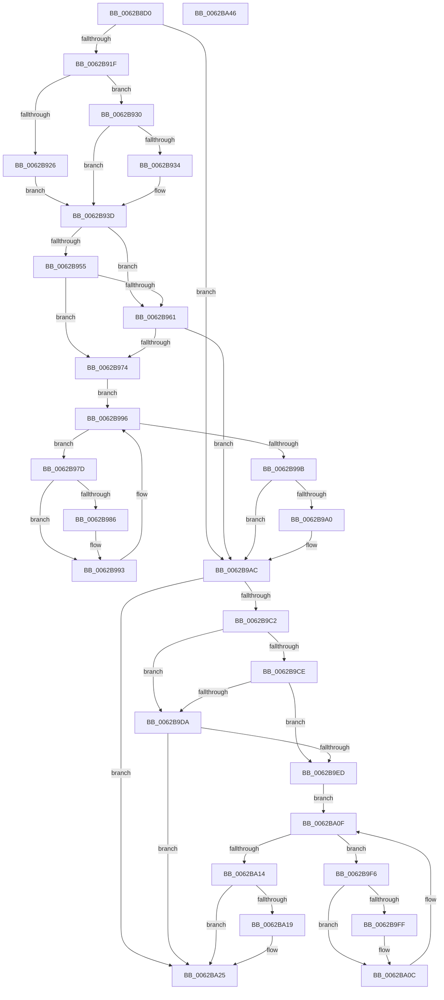

# DifIoOpenDeviceInterfaceRegistryKeyWrapper

- RVA: `0x0062B8D0`–`0x0062BA47` (길이 `375` bytes)
- VA: `0x000000014062B8D0`
- 실행 섹션: `.text`
- PDB 이름 있음: `예`; PDB Function 태그: `아니요`
- unwind 정보 RVA: `0x000A9A64`
- 디코드: `108`개 명령, `375/375` bytes 표시
- 미해석 바이트: `0` (있으면 어셈블리에 `.byte`로 보존)

> 이 문서는 커널 이미지의 기계어와 PDB 기호를 분석해 생성했습니다. 4번과 5번은 함수 원형과 자료형을 바이너리 사용 방식에서 추정한 C 해석이며 원본 소스 복구 결과는 아닙니다.

## 1. Dependencies

- 직접 호출 지점: **9**; 고유 호출 대상: **6**
- 직접 호출자로 확인된 함수: **0**
- RIP 상대 이미지 참조: **3**

### Outgoing calls
- `0x0062B90E` → [DifGetAPIThunkContextById](../49/DifGetAPIThunkContextById_function_00495A34.md) (function, `0x00495A34`)
- `0x0062B934` → [DifGetReturnAddressForWrappers](../4D/DifGetReturnAddressForWrappers_function_004D3C08.md) (function, `0x004D3C08`)
- `0x0062B968` → [ExAcquireRundownProtection](../21/ExAcquireRundownProtection_function_00216620.md) (function, `0x00216620`)
- `0x0062B98E` → [guard_dispatch_icall](../6B/guard_dispatch_icall_function_006BAAD0.md) (function, `0x006BAAD0`)
- `0x0062B9A7` → [ExReleaseRundownProtection](../34/ExReleaseRundownProtection_function_00349E80.md) (function, `0x00349E80`)
- `0x0062B9B5` → [IoOpenDeviceInterfaceRegistryKey](../../page/AC/IoOpenDeviceInterfaceRegistryKey_function_00AC5C60.md) (function, `0x00AC5C60`)
- `0x0062B9E1` → [ExAcquireRundownProtection](../21/ExAcquireRundownProtection_function_00216620.md) (function, `0x00216620`)
- `0x0062BA07` → [guard_dispatch_icall](../6B/guard_dispatch_icall_function_006BAAD0.md) (function, `0x006BAAD0`)
- `0x0062BA20` → [ExReleaseRundownProtection](../34/ExReleaseRundownProtection_function_00349E80.md) (function, `0x00349E80`)

### Direct callers
- 이 함수 시작 RVA로 연결되는 직접 call은 확인되지 않았습니다. 간접 호출은 완전히 역산할 수 없습니다.

### Static image references
- `0x0062B944` → RVA `0x00F048B8` (`.data`; read)
- `0x0062B955` → RVA `0x00F04980` (`.data`; read)
- `0x0062B961` → RVA `0x00F03E80` (`.data`; read)

## 2. Other-region calls and transfers

- 다른 실행 섹션으로 향하는 call: **1**
  - `0x0062B9B5` → [IoOpenDeviceInterfaceRegistryKey](../../page/AC/IoOpenDeviceInterfaceRegistryKey_function_00AC5C60.md) (`.text` → `PAGE`)
- 별도 외부 분기/꼬리 이동을 확인하지 못했습니다.

## 3. Assembly (complete function range)

```asm
0062B8D0  48 89 5C 24 08                  mov qword ptr [rsp + 8], rbx
0062B8D5  48 89 74 24 10                  mov qword ptr [rsp + 0x10], rsi
0062B8DA  48 89 7C 24 18                  mov qword ptr [rsp + 0x18], rdi
0062B8DF  55                              push rbp
0062B8E0  41 54                           push r12
0062B8E2  41 55                           push r13
0062B8E4  41 56                           push r14
0062B8E6  41 57                           push r15
0062B8E8  48 8B EC                        mov rbp, rsp
0062B8EB  48 83 EC 50                     sub rsp, 0x50
0062B8EF  0F 57 C0                        xorps xmm0, xmm0
0062B8F2  33 C0                           xor eax, eax
0062B8F4  4C 8B E9                        mov r13, rcx
0062B8F7  48 89 45 F0                     mov qword ptr [rbp - 0x10], rax
0062B8FB  B9 46 01 00 00                  mov ecx, 0x146
0062B900  4D 8B F8                        mov r15, r8
0062B903  0F 11 45 D0                     movups xmmword ptr [rbp - 0x30], xmm0
0062B907  44 8B E2                        mov r12d, edx
0062B90A  0F 11 45 E0                     movups xmmword ptr [rbp - 0x20], xmm0
0062B90E  E8 21 A1 E6 FF                  call 0x140495a34
0062B913  48 8B F0                        mov rsi, rax
0062B916  48 85 C0                        test rax, rax
0062B919  0F 84 8D 00 00 00               je 0x14062b9ac
0062B91F  8B 40 0C                        mov eax, dword ptr [rax + 0xc]
0062B922  A8 18                           test al, 0x18
0062B924  74 0A                           je 0x14062b930
0062B926  48 8B 4D 28                     mov rcx, qword ptr [rbp + 0x28]
0062B92A  48 89 4D D0                     mov qword ptr [rbp - 0x30], rcx
0062B92E  EB 0D                           jmp 0x14062b93d
0062B930  A8 04                           test al, 4
0062B932  74 09                           je 0x14062b93d
0062B934  E8 CF 82 EA FF                  call 0x1404d3c08
0062B939  48 89 45 D0                     mov qword ptr [rbp - 0x30], rax
0062B93D  45 32 F6                        xor r14b, r14b
0062B940  4C 89 6D E8                     mov qword ptr [rbp - 0x18], r13
0062B944  44 38 35 6D 8F 8D 00            cmp byte ptr [rip + 0x8d8f6d], r14b
0062B94B  44 89 65 E0                     mov dword ptr [rbp - 0x20], r12d
0062B94F  4C 89 7D D8                     mov qword ptr [rbp - 0x28], r15
0062B953  75 0C                           jne 0x14062b961
0062B955  F7 05 21 90 8D 00 00 08 00 00   test dword ptr [rip + 0x8d9021], 0x800
0062B95F  74 13                           je 0x14062b974
0062B961  48 8D 0D 18 85 8D 00            lea rcx, [rip + 0x8d8518]
0062B968  E8 B3 AC BE FF                  call 0x140216620
0062B96D  44 8A F0                        mov r14b, al
0062B970  84 C0                           test al, al
0062B972  74 38                           je 0x14062b9ac
0062B974  48 8D 7E 20                     lea rdi, [rsi + 0x20]
0062B978  48 8B 1F                        mov rbx, qword ptr [rdi]
0062B97B  EB 19                           jmp 0x14062b996
0062B97D  48 8D 43 F0                     lea rax, [rbx - 0x10]
0062B981  48 85 C0                        test rax, rax
0062B984  74 0D                           je 0x14062b993
0062B986  48 8B 40 08                     mov rax, qword ptr [rax + 8]
0062B98A  48 8D 4D D0                     lea rcx, [rbp - 0x30]
0062B98E  E8 3D F1 08 00                  call 0x1406baad0
0062B993  48 8B 1B                        mov rbx, qword ptr [rbx]
0062B996  48 3B DF                        cmp rbx, rdi
0062B999  75 E2                           jne 0x14062b97d
0062B99B  45 84 F6                        test r14b, r14b
0062B99E  74 0C                           je 0x14062b9ac
0062B9A0  48 8D 0D D9 84 8D 00            lea rcx, [rip + 0x8d84d9]
0062B9A7  E8 D4 E4 D1 FF                  call 0x140349e80
0062B9AC  4D 8B C7                        mov r8, r15
0062B9AF  41 8B D4                        mov edx, r12d
0062B9B2  49 8B CD                        mov rcx, r13
0062B9B5  E8 A6 A2 49 00                  call 0x140ac5c60
0062B9BA  89 45 F0                        mov dword ptr [rbp - 0x10], eax
0062B9BD  48 85 F6                        test rsi, rsi
0062B9C0  74 63                           je 0x14062ba25
0062B9C2  40 32 FF                        xor dil, dil
0062B9C5  40 38 3D EC 8E 8D 00            cmp byte ptr [rip + 0x8d8eec], dil
0062B9CC  75 0C                           jne 0x14062b9da
0062B9CE  F7 05 A8 8F 8D 00 00 08 00 00   test dword ptr [rip + 0x8d8fa8], 0x800
0062B9D8  74 13                           je 0x14062b9ed
0062B9DA  48 8D 0D 9F 84 8D 00            lea rcx, [rip + 0x8d849f]
0062B9E1  E8 3A AC BE FF                  call 0x140216620
0062B9E6  40 8A F8                        mov dil, al
0062B9E9  84 C0                           test al, al
0062B9EB  74 38                           je 0x14062ba25
0062B9ED  48 83 C6 30                     add rsi, 0x30
0062B9F1  48 8B 1E                        mov rbx, qword ptr [rsi]
0062B9F4  EB 19                           jmp 0x14062ba0f
0062B9F6  48 8D 43 F0                     lea rax, [rbx - 0x10]
0062B9FA  48 85 C0                        test rax, rax
0062B9FD  74 0D                           je 0x14062ba0c
0062B9FF  48 8B 40 08                     mov rax, qword ptr [rax + 8]
0062BA03  48 8D 4D D0                     lea rcx, [rbp - 0x30]
0062BA07  E8 C4 F0 08 00                  call 0x1406baad0
0062BA0C  48 8B 1B                        mov rbx, qword ptr [rbx]
0062BA0F  48 3B DE                        cmp rbx, rsi
0062BA12  75 E2                           jne 0x14062b9f6
0062BA14  40 84 FF                        test dil, dil
0062BA17  74 0C                           je 0x14062ba25
0062BA19  48 8D 0D 60 84 8D 00            lea rcx, [rip + 0x8d8460]
0062BA20  E8 5B E4 D1 FF                  call 0x140349e80
0062BA25  8B 45 F0                        mov eax, dword ptr [rbp - 0x10]
0062BA28  4C 8D 5C 24 50                  lea r11, [rsp + 0x50]
0062BA2D  49 8B 5B 30                     mov rbx, qword ptr [r11 + 0x30]
0062BA31  49 8B 73 38                     mov rsi, qword ptr [r11 + 0x38]
0062BA35  49 8B 7B 40                     mov rdi, qword ptr [r11 + 0x40]
0062BA39  49 8B E3                        mov rsp, r11
0062BA3C  41 5F                           pop r15
0062BA3E  41 5E                           pop r14
0062BA40  41 5D                           pop r13
0062BA42  41 5C                           pop r12
0062BA44  5D                              pop rbp
0062BA45  C3                              ret
0062BA46  CC                              int3
```

## 4. C-style interpretation (structured pseudocode)

```c
__int64 __fastcall DifIoOpenDeviceInterfaceRegistryKeyWrapper(__int64 a1, int a2, __int64 a3)
{
    __int64 result;
    __int64 v_r14;
    __int64 v_rdi;
    __int64 v_rsi;
    __int64 v_rsp;
    unsigned __int64 v_stack_m28;
    unsigned __int64 v_stack_m38;
    unsigned __int64 v_stack_m40;
    unsigned __int64 v_stack_m48;
    unsigned __int64 v_stack_m50;
    unsigned __int64 v_stack_m58;
    unsigned __int64 v_stack_p0;
    unsigned __int64 v_stack_p10;
    unsigned __int64 v_stack_p18;
    unsigned __int64 v_stack_p8;

    v_stack_p8 = v_rbx;
    v_stack_p10 = v_rsi;
    v_stack_p18 = v_rdi;
    v_rsp = (v_rsp) - (80);
    result = 0;
    v_stack_m38 = 0;
    v_stack_m58 = v_xmm0;
    v_stack_m48 = v_xmm0;
    result = DifGetAPIThunkContextById(326, a2, a3, a4);
    if (result == 0) goto loc_0062B9AC;
    if ((((unsigned __int8)((unsigned int)(*(unsigned int *)(result + 12)))) & (24)) == 0) goto loc_0062B930;
    v_stack_m58 = v_stack_p0;
    goto loc_0062B93D;
loc_0062B930:
    result = (unsigned int)(*(unsigned int *)(result + 12));
    if ((((unsigned __int8)((unsigned int)(*(unsigned int *)(result + 12)))) & (4)) != 0) {
        result = DifGetReturnAddressForWrappers(v_stack_p0, a2, a3, a4);
        v_stack_m58 = result;
    }
    v_r14 = 0;
    v_stack_m40 = a1;
    v_stack_m48 = (unsigned int)((unsigned int)(a2));
    v_stack_m50 = a3;
    if ((*(unsigned __int8 *)(v_rip + 9277293)) != 0) goto loc_0062B961;
    if (((*(unsigned int *)(v_rip + 9277473)) & (0x800ULL)) == 0) goto loc_0062B974;
loc_0062B961:
    result = ExAcquireRundownProtection(v_rip + 9274648, a2, a3, a4);
    if ((unsigned __int8)(result) == 0) goto loc_0062B9AC;
loc_0062B974:
    goto loc_0062B996;
loc_0062B97D:
    result = *(unsigned __int64 *)(result + 32) - 16;
    if (*(unsigned __int64 *)(result + 32) - 16 != 0) {
        result = *(unsigned __int64 *)(*(unsigned __int64 *)(result + 32) - 16 + 8);
        a1 = v_stack_m58;
        result = guard_dispatch_icall(a1, a2, a3, a4);
    }
loc_0062B996:
    if ((*(unsigned __int64 *)(*(unsigned __int64 *)(result + 32))) != (result + 32)) goto loc_0062B97D;
    if ((unsigned __int8)((unsigned __int8)(result)) != 0) {
        a1 = v_rip + 9274585;
        result = ExReleaseRundownProtection(a1, a2, a3, a4);
    }
    result = IoOpenDeviceInterfaceRegistryKey(a1, (unsigned int)((unsigned int)((unsigned int)(a2))), a3, a4);
    v_stack_m38 = (unsigned int)(result);
    if (result == 0) goto loc_0062BA25;
    v_rdi = 0;
    if ((*(unsigned __int8 *)(v_rip + 9277164)) != 0) goto loc_0062B9DA;
    if (((*(unsigned int *)(v_rip + 9277352)) & (0x800ULL)) == 0) goto loc_0062B9ED;
loc_0062B9DA:
    result = ExAcquireRundownProtection(v_rip + 9274527, (unsigned int)((unsigned int)((unsigned int)(a2))), a3, a4);
    if ((unsigned __int8)(result) == 0) goto loc_0062BA25;
loc_0062B9ED:
    v_rsi = (result) + (48);
    goto loc_0062BA0F;
loc_0062B9F6:
    result = *(unsigned __int64 *)(v_rsi) - 16;
    if (*(unsigned __int64 *)(v_rsi) - 16 != 0) {
        result = *(unsigned __int64 *)(*(unsigned __int64 *)(v_rsi) - 16 + 8);
        a1 = v_stack_m58;
        result = guard_dispatch_icall(a1, (unsigned int)((unsigned int)((unsigned int)(a2))), a3, a4);
    }
loc_0062BA0F:
    if ((*(unsigned __int64 *)(*(unsigned __int64 *)(v_rsi))) != v_rsi) goto loc_0062B9F6;
    if ((unsigned __int8)((unsigned __int8)(result)) != 0) {
        a1 = v_rip + 9274464;
        result = ExReleaseRundownProtection(a1, (unsigned int)((unsigned int)((unsigned int)(a2))), a3, a4);
    }
    return (unsigned int)(v_stack_m38);
}
```

## 5. (Beta) C Style

```c
int64_t DifIoOpenDeviceInterfaceRegistryKeyWrapper(int64_t Arg1, int32_t Arg2, int64_t Arg3)
{
    int64_t result;
    int64_t local_r14;
    int64_t local_rdi;
    int64_t local_rsi;
    int64_t local_rsp;
    uint64_t v_stack_m28;
    uint64_t v_stack_m38;
    uint64_t v_stack_m40;
    uint64_t v_stack_m48;
    uint64_t v_stack_m50;
    uint64_t v_stack_m58;
    uint64_t v_stack_p0;
    uint64_t v_stack_p10;
    uint64_t v_stack_p18;
    uint64_t v_stack_p8;

    v_stack_p8 = local_rbx;
    v_stack_p10 = local_rsi;
    v_stack_p18 = local_rdi;
    local_rsp = (local_rsp) - (80);
    result = 0;
    v_stack_m38 = 0;
    v_stack_m58 = v_xmm0;
    v_stack_m48 = v_xmm0;
    result = DifGetAPIThunkContextById(326, Arg2, Arg3, a4);
    if (result == 0) goto loc_0062B9AC;
    if ((((uint8_t)((uint32_t)(*(uint32_t *)(result + 0xC)))) & (24)) == 0) goto loc_0062B930;
    v_stack_m58 = v_stack_p0;
    goto loc_0062B93D;
loc_0062B930:
    result = (uint32_t)(*(uint32_t *)(result + 0xC));
    if ((((uint8_t)((uint32_t)(*(uint32_t *)(result + 0xC)))) & (4)) != 0) {
        result = DifGetReturnAddressForWrappers(v_stack_p0, Arg2, Arg3, a4);
        v_stack_m58 = result;
    }
    local_r14 = 0;
    v_stack_m40 = Arg1;
    v_stack_m48 = (uint32_t)((uint32_t)(Arg2));
    v_stack_m50 = Arg3;
    if ((*(uint8_t *)(v_rip + 0x8D8F6D)) != 0) goto loc_0062B961;
    if (((*(uint32_t *)(v_rip + 0x8D9021)) & (0x800ULL)) == 0) goto loc_0062B974;
loc_0062B961:
    result = ExAcquireRundownProtection(v_rip + 9274648, Arg2, Arg3, a4);
    if ((uint8_t)(result) == 0) goto loc_0062B9AC;
loc_0062B974:
    goto loc_0062B996;
loc_0062B97D:
    result = *(uint64_t *)(result + 0x20) - 16;
    if (*(uint64_t *)(result + 0x20) - 16 != 0) {
        result = *(uint64_t *)(*(uint64_t *)(result + 0x20) - 0x10 + 0x8);
        Arg1 = v_stack_m58;
        result = guard_dispatch_icall(Arg1, Arg2, Arg3, a4);
    }
loc_0062B996:
    if ((*(uint64_t *)(*(uint64_t *)(result + 0x20))) != (result + 32)) goto loc_0062B97D;
    if ((uint8_t)((uint8_t)(result)) != 0) {
        Arg1 = v_rip + 9274585;
        result = ExReleaseRundownProtection(Arg1, Arg2, Arg3, a4);
    }
    result = IoOpenDeviceInterfaceRegistryKey(Arg1, (uint32_t)((uint32_t)((uint32_t)(Arg2))), Arg3, a4);
    v_stack_m38 = (uint32_t)(result);
    if (result == 0) goto loc_0062BA25;
    local_rdi = 0;
    if ((*(uint8_t *)(v_rip + 0x8D8EEC)) != 0) goto loc_0062B9DA;
    if (((*(uint32_t *)(v_rip + 0x8D8FA8)) & (0x800ULL)) == 0) goto loc_0062B9ED;
loc_0062B9DA:
    result = ExAcquireRundownProtection(v_rip + 9274527, (uint32_t)((uint32_t)((uint32_t)(Arg2))), Arg3, a4);
    if ((uint8_t)(result) == 0) goto loc_0062BA25;
loc_0062B9ED:
    local_rsi = (result) + (48);
    goto loc_0062BA0F;
loc_0062B9F6:
    result = *(uint64_t *)(local_rsi) - 16;
    if (*(uint64_t *)(local_rsi) - 16 != 0) {
        result = *(uint64_t *)(*(uint64_t *)(local_rsi) - 0x10 + 0x8);
        Arg1 = v_stack_m58;
        result = guard_dispatch_icall(Arg1, (uint32_t)((uint32_t)((uint32_t)(Arg2))), Arg3, a4);
    }
loc_0062BA0F:
    if ((*(uint64_t *)(*(uint64_t *)(local_rsi))) != local_rsi) goto loc_0062B9F6;
    if ((uint8_t)((uint8_t)(result)) != 0) {
        Arg1 = v_rip + 9274464;
        result = ExReleaseRundownProtection(Arg1, (uint32_t)((uint32_t)((uint32_t)(Arg2))), Arg3, a4);
    }
    return (uint32_t)(v_stack_m38);
}
```

## 6. Execution-region graph

[열기: 2D/3D 그래프와 함수 탐색 컨트롤 패널](../../../control-panel.html?section=text&rva=0x0062B8D0&view=graph)

- 2D 그래프는 위에서 아래로 흐르고, 3D 그래프는 빈 공간을 드래그해 회전합니다. Shift+드래그는 이동, 휠은 확대·축소, 함수 노드 선택은 대상 보고서 이동입니다.

### Static fallback


