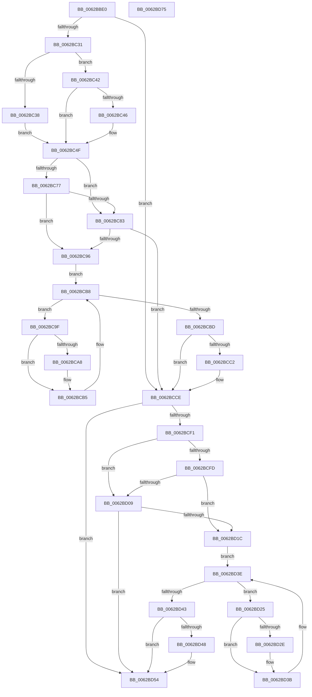

# DifIoOpenDriverRegistryKeyWrapper

- RVA: `0x0062BBE0`–`0x0062BD76` (길이 `406` bytes)
- VA: `0x000000014062BBE0`
- 실행 섹션: `.text`
- PDB 이름 있음: `예`; PDB Function 태그: `아니요`
- unwind 정보 RVA: `0x000D2BBC`
- 디코드: `116`개 명령, `406/406` bytes 표시
- 미해석 바이트: `0` (있으면 어셈블리에 `.byte`로 보존)

> 이 문서는 커널 이미지의 기계어와 PDB 기호를 분석해 생성했습니다. 4번과 5번은 함수 원형과 자료형을 바이너리 사용 방식에서 추정한 C 해석이며 원본 소스 복구 결과는 아닙니다.

## 1. Dependencies

- 직접 호출 지점: **9**; 고유 호출 대상: **6**
- 직접 호출자로 확인된 함수: **0**
- RIP 상대 이미지 참조: **3**

### Outgoing calls
- `0x0062BC20` → [DifGetAPIThunkContextById](../49/DifGetAPIThunkContextById_function_00495A34.md) (function, `0x00495A34`)
- `0x0062BC46` → [DifGetReturnAddressForWrappers](../4D/DifGetReturnAddressForWrappers_function_004D3C08.md) (function, `0x004D3C08`)
- `0x0062BC8A` → [ExAcquireRundownProtection](../21/ExAcquireRundownProtection_function_00216620.md) (function, `0x00216620`)
- `0x0062BCB0` → [guard_dispatch_icall](../6B/guard_dispatch_icall_function_006BAAD0.md) (function, `0x006BAAD0`)
- `0x0062BCC9` → [ExReleaseRundownProtection](../34/ExReleaseRundownProtection_function_00349E80.md) (function, `0x00349E80`)
- `0x0062BCE4` → [IoOpenDriverRegistryKey](../../page/99/IoOpenDriverRegistryKey_function_00998BB0.md) (function, `0x00998BB0`)
- `0x0062BD10` → [ExAcquireRundownProtection](../21/ExAcquireRundownProtection_function_00216620.md) (function, `0x00216620`)
- `0x0062BD36` → [guard_dispatch_icall](../6B/guard_dispatch_icall_function_006BAAD0.md) (function, `0x006BAAD0`)
- `0x0062BD4F` → [ExReleaseRundownProtection](../34/ExReleaseRundownProtection_function_00349E80.md) (function, `0x00349E80`)

### Direct callers
- 이 함수 시작 RVA로 연결되는 직접 call은 확인되지 않았습니다. 간접 호출은 완전히 역산할 수 없습니다.

### Static image references
- `0x0062BC56` → RVA `0x00F048B8` (`.data`; read)
- `0x0062BC77` → RVA `0x00F04980` (`.data`; read)
- `0x0062BC83` → RVA `0x00F03E80` (`.data`; read)

## 2. Other-region calls and transfers

- 다른 실행 섹션으로 향하는 call: **1**
  - `0x0062BCE4` → [IoOpenDriverRegistryKey](../../page/99/IoOpenDriverRegistryKey_function_00998BB0.md) (`.text` → `PAGE`)
- 별도 외부 분기/꼬리 이동을 확인하지 못했습니다.

## 3. Assembly (complete function range)

```asm
0062BBE0  48 8B C4                        mov rax, rsp
0062BBE3  48 89 58 10                     mov qword ptr [rax + 0x10], rbx
0062BBE7  48 89 70 18                     mov qword ptr [rax + 0x18], rsi
0062BBEB  48 89 78 20                     mov qword ptr [rax + 0x20], rdi
0062BBEF  48 89 48 08                     mov qword ptr [rax + 8], rcx
0062BBF3  55                              push rbp
0062BBF4  41 54                           push r12
0062BBF6  41 55                           push r13
0062BBF8  41 56                           push r14
0062BBFA  41 57                           push r15
0062BBFC  48 8B EC                        mov rbp, rsp
0062BBFF  48 83 EC 60                     sub rsp, 0x60
0062BC03  0F 57 C0                        xorps xmm0, xmm0
0062BC06  B9 44 01 00 00                  mov ecx, 0x144
0062BC0B  0F 11 45 D0                     movups xmmword ptr [rbp - 0x30], xmm0
0062BC0F  45 8B F9                        mov r15d, r9d
0062BC12  45 8B E0                        mov r12d, r8d
0062BC15  0F 11 45 E0                     movups xmmword ptr [rbp - 0x20], xmm0
0062BC19  44 8B EA                        mov r13d, edx
0062BC1C  0F 11 45 F0                     movups xmmword ptr [rbp - 0x10], xmm0
0062BC20  E8 0F 9E E6 FF                  call 0x140495a34
0062BC25  48 8B F0                        mov rsi, rax
0062BC28  48 85 C0                        test rax, rax
0062BC2B  0F 84 9D 00 00 00               je 0x14062bcce
0062BC31  8B 40 0C                        mov eax, dword ptr [rax + 0xc]
0062BC34  A8 18                           test al, 0x18
0062BC36  74 0A                           je 0x14062bc42
0062BC38  48 8B 4D 28                     mov rcx, qword ptr [rbp + 0x28]
0062BC3C  48 89 4D D0                     mov qword ptr [rbp - 0x30], rcx
0062BC40  EB 0D                           jmp 0x14062bc4f
0062BC42  A8 04                           test al, 4
0062BC44  74 09                           je 0x14062bc4f
0062BC46  E8 BD 7F EA FF                  call 0x1404d3c08
0062BC4B  48 89 45 D0                     mov qword ptr [rbp - 0x30], rax
0062BC4F  48 8B 45 30                     mov rax, qword ptr [rbp + 0x30]
0062BC53  45 32 F6                        xor r14b, r14b
0062BC56  44 38 35 5B 8C 8D 00            cmp byte ptr [rip + 0x8d8c5b], r14b
0062BC5D  48 89 45 F0                     mov qword ptr [rbp - 0x10], rax
0062BC61  48 8B 45 50                     mov rax, qword ptr [rbp + 0x50]
0062BC65  48 89 45 D8                     mov qword ptr [rbp - 0x28], rax
0062BC69  44 89 6D E8                     mov dword ptr [rbp - 0x18], r13d
0062BC6D  44 89 65 E4                     mov dword ptr [rbp - 0x1c], r12d
0062BC71  44 89 7D E0                     mov dword ptr [rbp - 0x20], r15d
0062BC75  75 0C                           jne 0x14062bc83
0062BC77  F7 05 FF 8C 8D 00 00 08 00 00   test dword ptr [rip + 0x8d8cff], 0x800
0062BC81  74 13                           je 0x14062bc96
0062BC83  48 8D 0D F6 81 8D 00            lea rcx, [rip + 0x8d81f6]
0062BC8A  E8 91 A9 BE FF                  call 0x140216620
0062BC8F  44 8A F0                        mov r14b, al
0062BC92  84 C0                           test al, al
0062BC94  74 38                           je 0x14062bcce
0062BC96  48 8D 7E 20                     lea rdi, [rsi + 0x20]
0062BC9A  48 8B 1F                        mov rbx, qword ptr [rdi]
0062BC9D  EB 19                           jmp 0x14062bcb8
0062BC9F  48 8D 43 F0                     lea rax, [rbx - 0x10]
0062BCA3  48 85 C0                        test rax, rax
0062BCA6  74 0D                           je 0x14062bcb5
0062BCA8  48 8B 40 08                     mov rax, qword ptr [rax + 8]
0062BCAC  48 8D 4D D0                     lea rcx, [rbp - 0x30]
0062BCB0  E8 1B EE 08 00                  call 0x1406baad0
0062BCB5  48 8B 1B                        mov rbx, qword ptr [rbx]
0062BCB8  48 3B DF                        cmp rbx, rdi
0062BCBB  75 E2                           jne 0x14062bc9f
0062BCBD  45 84 F6                        test r14b, r14b
0062BCC0  74 0C                           je 0x14062bcce
0062BCC2  48 8D 0D B7 81 8D 00            lea rcx, [rip + 0x8d81b7]
0062BCC9  E8 B2 E1 D1 FF                  call 0x140349e80
0062BCCE  48 8B 45 50                     mov rax, qword ptr [rbp + 0x50]
0062BCD2  45 8B CF                        mov r9d, r15d
0062BCD5  48 8B 4D 30                     mov rcx, qword ptr [rbp + 0x30]
0062BCD9  45 8B C4                        mov r8d, r12d
0062BCDC  41 8B D5                        mov edx, r13d
0062BCDF  48 89 44 24 20                  mov qword ptr [rsp + 0x20], rax
0062BCE4  E8 C7 CE 36 00                  call 0x140998bb0
0062BCE9  89 45 F8                        mov dword ptr [rbp - 8], eax
0062BCEC  48 85 F6                        test rsi, rsi
0062BCEF  74 63                           je 0x14062bd54
0062BCF1  40 32 FF                        xor dil, dil
0062BCF4  40 38 3D BD 8B 8D 00            cmp byte ptr [rip + 0x8d8bbd], dil
0062BCFB  75 0C                           jne 0x14062bd09
0062BCFD  F7 05 79 8C 8D 00 00 08 00 00   test dword ptr [rip + 0x8d8c79], 0x800
0062BD07  74 13                           je 0x14062bd1c
0062BD09  48 8D 0D 70 81 8D 00            lea rcx, [rip + 0x8d8170]
0062BD10  E8 0B A9 BE FF                  call 0x140216620
0062BD15  40 8A F8                        mov dil, al
0062BD18  84 C0                           test al, al
0062BD1A  74 38                           je 0x14062bd54
0062BD1C  48 83 C6 30                     add rsi, 0x30
0062BD20  48 8B 1E                        mov rbx, qword ptr [rsi]
0062BD23  EB 19                           jmp 0x14062bd3e
0062BD25  48 8D 43 F0                     lea rax, [rbx - 0x10]
0062BD29  48 85 C0                        test rax, rax
0062BD2C  74 0D                           je 0x14062bd3b
0062BD2E  48 8B 40 08                     mov rax, qword ptr [rax + 8]
0062BD32  48 8D 4D D0                     lea rcx, [rbp - 0x30]
0062BD36  E8 95 ED 08 00                  call 0x1406baad0
0062BD3B  48 8B 1B                        mov rbx, qword ptr [rbx]
0062BD3E  48 3B DE                        cmp rbx, rsi
0062BD41  75 E2                           jne 0x14062bd25
0062BD43  40 84 FF                        test dil, dil
0062BD46  74 0C                           je 0x14062bd54
0062BD48  48 8D 0D 31 81 8D 00            lea rcx, [rip + 0x8d8131]
0062BD4F  E8 2C E1 D1 FF                  call 0x140349e80
0062BD54  8B 45 F8                        mov eax, dword ptr [rbp - 8]
0062BD57  4C 8D 5C 24 60                  lea r11, [rsp + 0x60]
0062BD5C  49 8B 5B 38                     mov rbx, qword ptr [r11 + 0x38]
0062BD60  49 8B 73 40                     mov rsi, qword ptr [r11 + 0x40]
0062BD64  49 8B 7B 48                     mov rdi, qword ptr [r11 + 0x48]
0062BD68  49 8B E3                        mov rsp, r11
0062BD6B  41 5F                           pop r15
0062BD6D  41 5E                           pop r14
0062BD6F  41 5D                           pop r13
0062BD71  41 5C                           pop r12
0062BD73  5D                              pop rbp
0062BD74  C3                              ret
0062BD75  CC                              int3
```

## 4. C-style interpretation (structured pseudocode)

```c
__int64 __fastcall DifIoOpenDriverRegistryKeyWrapper(__int64 a1, int a2, int a3, int a4, __int64 a5)
{
    __int64 result;
    __int64 v_r14;
    __int64 v_rdi;
    __int64 v_rsi;
    __int64 v_rsp;
    unsigned __int64 v_stack_m28;
    unsigned int v_stack_m30;
    unsigned __int64 v_stack_m38;
    unsigned int v_stack_m40;
    unsigned int v_stack_m44;
    unsigned __int64 v_stack_m48;
    unsigned __int64 v_stack_m50;
    unsigned __int64 v_stack_m58;
    unsigned __int64 v_stack_m68;
    unsigned __int64 v_stack_p0;
    unsigned __int64 v_stack_p8;

    *(unsigned __int64 *)(v_rsp + 16) = v_rbx;
    *(unsigned __int64 *)(v_rsp + 24) = v_rsi;
    *(unsigned __int64 *)(v_rsp + 32) = v_rdi;
    *(unsigned __int64 *)(v_rsp + 8) = a1;
    v_rsp = (v_rsp) - (96);
    v_stack_m58 = v_xmm0;
    v_stack_m48 = v_xmm0;
    v_stack_m38 = v_xmm0;
    result = DifGetAPIThunkContextById(324, a2, a3, a4);
    if (result == 0) goto loc_0062BCCE;
    if ((((unsigned __int8)((unsigned int)(*(unsigned int *)(result + 12)))) & (24)) == 0) goto loc_0062BC42;
    v_stack_m58 = v_stack_p0;
    goto loc_0062BC4F;
loc_0062BC42:
    result = (unsigned int)(*(unsigned int *)(result + 12));
    if ((((unsigned __int8)((unsigned int)(*(unsigned int *)(result + 12)))) & (4)) != 0) {
        result = DifGetReturnAddressForWrappers(v_stack_p0, a2, a3, a4);
        v_stack_m58 = result;
    }
    v_r14 = 0;
    v_stack_m38 = v_stack_p8;
    v_stack_m50 = a5;
    v_stack_m40 = (unsigned int)((unsigned int)(a2));
    v_stack_m44 = (unsigned int)((unsigned int)(a3));
    v_stack_m48 = (unsigned int)((unsigned int)(a4));
    if ((*(unsigned __int8 *)(v_rip + 9276507)) != 0) goto loc_0062BC83;
    if (((*(unsigned int *)(v_rip + 9276671)) & (0x800ULL)) == 0) goto loc_0062BC96;
loc_0062BC83:
    result = ExAcquireRundownProtection(v_rip + 9273846, a2, a3, a4);
    if ((unsigned __int8)(result) == 0) goto loc_0062BCCE;
loc_0062BC96:
    goto loc_0062BCB8;
loc_0062BC9F:
    result = *(unsigned __int64 *)(result + 32) - 16;
    if (*(unsigned __int64 *)(result + 32) - 16 != 0) {
        result = *(unsigned __int64 *)(*(unsigned __int64 *)(result + 32) - 16 + 8);
        a1 = v_stack_m58;
        result = guard_dispatch_icall(a1, a2, a3, a4);
    }
loc_0062BCB8:
    if ((*(unsigned __int64 *)(*(unsigned __int64 *)(result + 32))) != (result + 32)) goto loc_0062BC9F;
    if ((unsigned __int8)((unsigned __int8)(result)) != 0) {
        a1 = v_rip + 9273783;
        result = ExReleaseRundownProtection(a1, a2, a3, a4);
    }
    v_stack_m68 = a5;
    result = IoOpenDriverRegistryKey(v_stack_p8, (unsigned int)((unsigned int)((unsigned int)(a2))), (unsigned int)((unsigned int)((unsigned int)(a3))), (unsigned int)((unsigned int)((unsigned int)(a4))));
    v_stack_m30 = (unsigned int)(result);
    if (result == 0) goto loc_0062BD54;
    v_rdi = 0;
    if ((*(unsigned __int8 *)(v_rip + 9276349)) != 0) goto loc_0062BD09;
    if (((*(unsigned int *)(v_rip + 9276537)) & (0x800ULL)) == 0) goto loc_0062BD1C;
loc_0062BD09:
    result = ExAcquireRundownProtection(v_rip + 9273712, (unsigned int)((unsigned int)((unsigned int)(a2))), (unsigned int)((unsigned int)((unsigned int)(a3))), (unsigned int)((unsigned int)((unsigned int)(a4))));
    if ((unsigned __int8)(result) == 0) goto loc_0062BD54;
loc_0062BD1C:
    v_rsi = (result) + (48);
    goto loc_0062BD3E;
loc_0062BD25:
    result = *(unsigned __int64 *)(v_rsi) - 16;
    if (*(unsigned __int64 *)(v_rsi) - 16 != 0) {
        result = *(unsigned __int64 *)(*(unsigned __int64 *)(v_rsi) - 16 + 8);
        a1 = v_stack_m58;
        result = guard_dispatch_icall(a1, (unsigned int)((unsigned int)((unsigned int)(a2))), (unsigned int)((unsigned int)((unsigned int)(a3))), (unsigned int)((unsigned int)((unsigned int)(a4))));
    }
loc_0062BD3E:
    if ((*(unsigned __int64 *)(*(unsigned __int64 *)(v_rsi))) != v_rsi) goto loc_0062BD25;
    if ((unsigned __int8)((unsigned __int8)(result)) != 0) {
        a1 = v_rip + 9273649;
        result = ExReleaseRundownProtection(a1, (unsigned int)((unsigned int)((unsigned int)(a2))), (unsigned int)((unsigned int)((unsigned int)(a3))), (unsigned int)((unsigned int)((unsigned int)(a4))));
    }
    return (unsigned int)(v_stack_m30);
}
```

## 5. (Beta) C Style

```c
int64_t DifIoOpenDriverRegistryKeyWrapper(int64_t Arg1, int32_t Arg2, int32_t Arg3, int32_t Arg4, int64_t Arg5)
{
    int64_t result;
    int64_t local_r14;
    int64_t local_rdi;
    int64_t local_rsi;
    int64_t local_rsp;
    uint64_t v_stack_m28;
    uint32_t v_stack_m30;
    uint64_t v_stack_m38;
    uint32_t v_stack_m40;
    uint32_t v_stack_m44;
    uint64_t v_stack_m48;
    uint64_t v_stack_m50;
    uint64_t v_stack_m58;
    uint64_t v_stack_m68;
    uint64_t v_stack_p0;
    uint64_t v_stack_p8;

    *(uint64_t *)(local_rsp + 0x10) = local_rbx;
    *(uint64_t *)(local_rsp + 0x18) = local_rsi;
    *(uint64_t *)(local_rsp + 0x20) = local_rdi;
    *(uint64_t *)(local_rsp + 0x8) = Arg1;
    local_rsp = (local_rsp) - (96);
    v_stack_m58 = v_xmm0;
    v_stack_m48 = v_xmm0;
    v_stack_m38 = v_xmm0;
    result = DifGetAPIThunkContextById(324, Arg2, Arg3, Arg4);
    if (result == 0) goto loc_0062BCCE;
    if ((((uint8_t)((uint32_t)(*(uint32_t *)(result + 0xC)))) & (24)) == 0) goto loc_0062BC42;
    v_stack_m58 = v_stack_p0;
    goto loc_0062BC4F;
loc_0062BC42:
    result = (uint32_t)(*(uint32_t *)(result + 0xC));
    if ((((uint8_t)((uint32_t)(*(uint32_t *)(result + 0xC)))) & (4)) != 0) {
        result = DifGetReturnAddressForWrappers(v_stack_p0, Arg2, Arg3, Arg4);
        v_stack_m58 = result;
    }
    local_r14 = 0;
    v_stack_m38 = v_stack_p8;
    v_stack_m50 = Arg5;
    v_stack_m40 = (uint32_t)((uint32_t)(Arg2));
    v_stack_m44 = (uint32_t)((uint32_t)(Arg3));
    v_stack_m48 = (uint32_t)((uint32_t)(Arg4));
    if ((*(uint8_t *)(v_rip + 0x8D8C5B)) != 0) goto loc_0062BC83;
    if (((*(uint32_t *)(v_rip + 0x8D8CFF)) & (0x800ULL)) == 0) goto loc_0062BC96;
loc_0062BC83:
    result = ExAcquireRundownProtection(v_rip + 9273846, Arg2, Arg3, Arg4);
    if ((uint8_t)(result) == 0) goto loc_0062BCCE;
loc_0062BC96:
    goto loc_0062BCB8;
loc_0062BC9F:
    result = *(uint64_t *)(result + 0x20) - 16;
    if (*(uint64_t *)(result + 0x20) - 16 != 0) {
        result = *(uint64_t *)(*(uint64_t *)(result + 0x20) - 0x10 + 0x8);
        Arg1 = v_stack_m58;
        result = guard_dispatch_icall(Arg1, Arg2, Arg3, Arg4);
    }
loc_0062BCB8:
    if ((*(uint64_t *)(*(uint64_t *)(result + 0x20))) != (result + 32)) goto loc_0062BC9F;
    if ((uint8_t)((uint8_t)(result)) != 0) {
        Arg1 = v_rip + 9273783;
        result = ExReleaseRundownProtection(Arg1, Arg2, Arg3, Arg4);
    }
    v_stack_m68 = Arg5;
    result = IoOpenDriverRegistryKey(v_stack_p8, (uint32_t)((uint32_t)((uint32_t)(Arg2))), (uint32_t)((uint32_t)((uint32_t)(Arg3))), (uint32_t)((uint32_t)((uint32_t)(Arg4))));
    v_stack_m30 = (uint32_t)(result);
    if (result == 0) goto loc_0062BD54;
    local_rdi = 0;
    if ((*(uint8_t *)(v_rip + 0x8D8BBD)) != 0) goto loc_0062BD09;
    if (((*(uint32_t *)(v_rip + 0x8D8C79)) & (0x800ULL)) == 0) goto loc_0062BD1C;
loc_0062BD09:
    result = ExAcquireRundownProtection(v_rip + 9273712, (uint32_t)((uint32_t)((uint32_t)(Arg2))), (uint32_t)((uint32_t)((uint32_t)(Arg3))), (uint32_t)((uint32_t)((uint32_t)(Arg4))));
    if ((uint8_t)(result) == 0) goto loc_0062BD54;
loc_0062BD1C:
    local_rsi = (result) + (48);
    goto loc_0062BD3E;
loc_0062BD25:
    result = *(uint64_t *)(local_rsi) - 16;
    if (*(uint64_t *)(local_rsi) - 16 != 0) {
        result = *(uint64_t *)(*(uint64_t *)(local_rsi) - 0x10 + 0x8);
        Arg1 = v_stack_m58;
        result = guard_dispatch_icall(Arg1, (uint32_t)((uint32_t)((uint32_t)(Arg2))), (uint32_t)((uint32_t)((uint32_t)(Arg3))), (uint32_t)((uint32_t)((uint32_t)(Arg4))));
    }
loc_0062BD3E:
    if ((*(uint64_t *)(*(uint64_t *)(local_rsi))) != local_rsi) goto loc_0062BD25;
    if ((uint8_t)((uint8_t)(result)) != 0) {
        Arg1 = v_rip + 9273649;
        result = ExReleaseRundownProtection(Arg1, (uint32_t)((uint32_t)((uint32_t)(Arg2))), (uint32_t)((uint32_t)((uint32_t)(Arg3))), (uint32_t)((uint32_t)((uint32_t)(Arg4))));
    }
    return (uint32_t)(v_stack_m30);
}
```

## 6. Execution-region graph

[열기: 2D/3D 그래프와 함수 탐색 컨트롤 패널](../../../control-panel.html?section=text&rva=0x0062BBE0&view=graph)

- 2D 그래프는 위에서 아래로 흐르고, 3D 그래프는 빈 공간을 드래그해 회전합니다. Shift+드래그는 이동, 휠은 확대·축소, 함수 노드 선택은 대상 보고서 이동입니다.

### Static fallback


