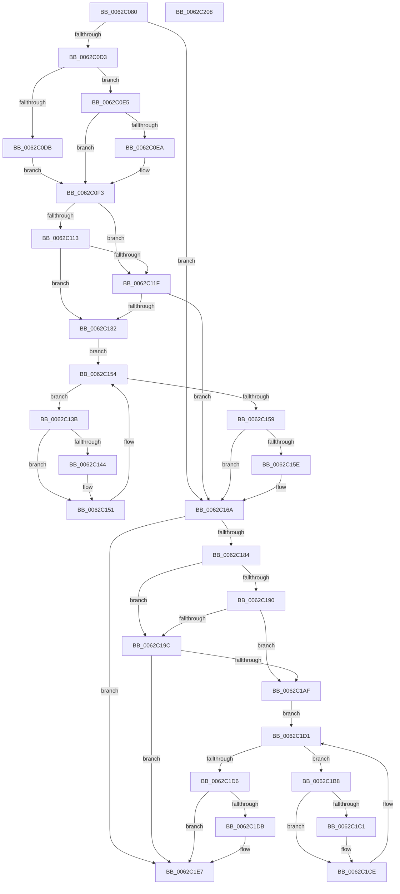

# DifIoReadPartitionTableWrapper

- RVA: `0x0062C080`–`0x0062C209` (길이 `393` bytes)
- VA: `0x000000014062C080`
- 실행 섹션: `.text`
- PDB 이름 있음: `예`; PDB Function 태그: `아니요`
- unwind 정보 RVA: `0x000D2B7C`
- 디코드: `113`개 명령, `393/393` bytes 표시
- 미해석 바이트: `0` (있으면 어셈블리에 `.byte`로 보존)

> 이 문서는 커널 이미지의 기계어와 PDB 기호를 분석해 생성했습니다. 4번과 5번은 함수 원형과 자료형을 바이너리 사용 방식에서 추정한 C 해석이며 원본 소스 복구 결과는 아닙니다.

## 1. Dependencies

- 직접 호출 지점: **9**; 고유 호출 대상: **6**
- 직접 호출자로 확인된 함수: **0**
- RIP 상대 이미지 참조: **3**

### Outgoing calls
- `0x0062C0C2` → [DifGetAPIThunkContextById](../49/DifGetAPIThunkContextById_function_00495A34.md) (function, `0x00495A34`)
- `0x0062C0EA` → [DifGetReturnAddressForWrappers](../4D/DifGetReturnAddressForWrappers_function_004D3C08.md) (function, `0x004D3C08`)
- `0x0062C126` → [ExAcquireRundownProtection](../21/ExAcquireRundownProtection_function_00216620.md) (function, `0x00216620`)
- `0x0062C14C` → [guard_dispatch_icall](../6B/guard_dispatch_icall_function_006BAAD0.md) (function, `0x006BAAD0`)
- `0x0062C165` → [ExReleaseRundownProtection](../34/ExReleaseRundownProtection_function_00349E80.md) (function, `0x00349E80`)
- `0x0062C177` → [IoReadPartitionTable](../../page/71/IoReadPartitionTable_function_00717400.md) (function, `0x00717400`)
- `0x0062C1A3` → [ExAcquireRundownProtection](../21/ExAcquireRundownProtection_function_00216620.md) (function, `0x00216620`)
- `0x0062C1C9` → [guard_dispatch_icall](../6B/guard_dispatch_icall_function_006BAAD0.md) (function, `0x006BAAD0`)
- `0x0062C1E2` → [ExReleaseRundownProtection](../34/ExReleaseRundownProtection_function_00349E80.md) (function, `0x00349E80`)

### Direct callers
- 이 함수 시작 RVA로 연결되는 직접 call은 확인되지 않았습니다. 간접 호출은 완전히 역산할 수 없습니다.

### Static image references
- `0x0062C0FA` → RVA `0x00F048B8` (`.data`; read)
- `0x0062C113` → RVA `0x00F04980` (`.data`; read)
- `0x0062C11F` → RVA `0x00F03E80` (`.data`; read)

## 2. Other-region calls and transfers

- 다른 실행 섹션으로 향하는 call: **1**
  - `0x0062C177` → [IoReadPartitionTable](../../page/71/IoReadPartitionTable_function_00717400.md) (`.text` → `PAGE`)
- 별도 외부 분기/꼬리 이동을 확인하지 못했습니다.

## 3. Assembly (complete function range)

```asm
0062C080  48 8B C4                        mov rax, rsp
0062C083  48 89 58 10                     mov qword ptr [rax + 0x10], rbx
0062C087  48 89 70 18                     mov qword ptr [rax + 0x18], rsi
0062C08B  48 89 78 20                     mov qword ptr [rax + 0x20], rdi
0062C08F  48 89 48 08                     mov qword ptr [rax + 8], rcx
0062C093  55                              push rbp
0062C094  41 54                           push r12
0062C096  41 55                           push r13
0062C098  41 56                           push r14
0062C09A  41 57                           push r15
0062C09C  48 8B EC                        mov rbp, rsp
0062C09F  48 83 EC 50                     sub rsp, 0x50
0062C0A3  0F 57 C0                        xorps xmm0, xmm0
0062C0A6  33 C0                           xor eax, eax
0062C0A8  B9 41 01 00 00                  mov ecx, 0x141
0062C0AD  48 89 45 F0                     mov qword ptr [rbp - 0x10], rax
0062C0B1  0F 11 45 D0                     movups xmmword ptr [rbp - 0x30], xmm0
0062C0B5  4D 8B F9                        mov r15, r9
0062C0B8  45 8A E0                        mov r12b, r8b
0062C0BB  0F 11 45 E0                     movups xmmword ptr [rbp - 0x20], xmm0
0062C0BF  44 8B EA                        mov r13d, edx
0062C0C2  E8 6D 99 E6 FF                  call 0x140495a34
0062C0C7  4C 8B F0                        mov r14, rax
0062C0CA  48 85 C0                        test rax, rax
0062C0CD  0F 84 97 00 00 00               je 0x14062c16a
0062C0D3  8B 48 0C                        mov ecx, dword ptr [rax + 0xc]
0062C0D6  F6 C1 18                        test cl, 0x18
0062C0D9  74 0A                           je 0x14062c0e5
0062C0DB  48 8B 4D 28                     mov rcx, qword ptr [rbp + 0x28]
0062C0DF  48 89 4D D0                     mov qword ptr [rbp - 0x30], rcx
0062C0E3  EB 0E                           jmp 0x14062c0f3
0062C0E5  F6 C1 04                        test cl, 4
0062C0E8  74 09                           je 0x14062c0f3
0062C0EA  E8 19 7B EA FF                  call 0x1404d3c08
0062C0EF  48 89 45 D0                     mov qword ptr [rbp - 0x30], rax
0062C0F3  48 8B 45 30                     mov rax, qword ptr [rbp + 0x30]
0062C0F7  40 32 F6                        xor sil, sil
0062C0FA  40 38 35 B7 87 8D 00            cmp byte ptr [rip + 0x8d87b7], sil
0062C101  48 89 45 E8                     mov qword ptr [rbp - 0x18], rax
0062C105  44 89 6D E4                     mov dword ptr [rbp - 0x1c], r13d
0062C109  44 88 65 E0                     mov byte ptr [rbp - 0x20], r12b
0062C10D  4C 89 7D D8                     mov qword ptr [rbp - 0x28], r15
0062C111  75 0C                           jne 0x14062c11f
0062C113  F7 05 63 88 8D 00 00 08 00 00   test dword ptr [rip + 0x8d8863], 0x800
0062C11D  74 13                           je 0x14062c132
0062C11F  48 8D 0D 5A 7D 8D 00            lea rcx, [rip + 0x8d7d5a]
0062C126  E8 F5 A4 BE FF                  call 0x140216620
0062C12B  40 8A F0                        mov sil, al
0062C12E  84 C0                           test al, al
0062C130  74 38                           je 0x14062c16a
0062C132  49 8D 7E 20                     lea rdi, [r14 + 0x20]
0062C136  48 8B 1F                        mov rbx, qword ptr [rdi]
0062C139  EB 19                           jmp 0x14062c154
0062C13B  48 8D 43 F0                     lea rax, [rbx - 0x10]
0062C13F  48 85 C0                        test rax, rax
0062C142  74 0D                           je 0x14062c151
0062C144  48 8B 40 08                     mov rax, qword ptr [rax + 8]
0062C148  48 8D 4D D0                     lea rcx, [rbp - 0x30]
0062C14C  E8 7F E9 08 00                  call 0x1406baad0
0062C151  48 8B 1B                        mov rbx, qword ptr [rbx]
0062C154  48 3B DF                        cmp rbx, rdi
0062C157  75 E2                           jne 0x14062c13b
0062C159  40 84 F6                        test sil, sil
0062C15C  74 0C                           je 0x14062c16a
0062C15E  48 8D 0D 1B 7D 8D 00            lea rcx, [rip + 0x8d7d1b]
0062C165  E8 16 DD D1 FF                  call 0x140349e80
0062C16A  48 8B 4D 30                     mov rcx, qword ptr [rbp + 0x30]
0062C16E  4D 8B CF                        mov r9, r15
0062C171  45 8A C4                        mov r8b, r12b
0062C174  41 8B D5                        mov edx, r13d
0062C177  E8 84 B2 0E 00                  call 0x140717400
0062C17C  89 45 F0                        mov dword ptr [rbp - 0x10], eax
0062C17F  4D 85 F6                        test r14, r14
0062C182  74 63                           je 0x14062c1e7
0062C184  40 32 FF                        xor dil, dil
0062C187  40 38 3D 2A 87 8D 00            cmp byte ptr [rip + 0x8d872a], dil
0062C18E  75 0C                           jne 0x14062c19c
0062C190  F7 05 E6 87 8D 00 00 08 00 00   test dword ptr [rip + 0x8d87e6], 0x800
0062C19A  74 13                           je 0x14062c1af
0062C19C  48 8D 0D DD 7C 8D 00            lea rcx, [rip + 0x8d7cdd]
0062C1A3  E8 78 A4 BE FF                  call 0x140216620
0062C1A8  40 8A F8                        mov dil, al
0062C1AB  84 C0                           test al, al
0062C1AD  74 38                           je 0x14062c1e7
0062C1AF  49 8D 76 30                     lea rsi, [r14 + 0x30]
0062C1B3  48 8B 1E                        mov rbx, qword ptr [rsi]
0062C1B6  EB 19                           jmp 0x14062c1d1
0062C1B8  48 8D 43 F0                     lea rax, [rbx - 0x10]
0062C1BC  48 85 C0                        test rax, rax
0062C1BF  74 0D                           je 0x14062c1ce
0062C1C1  48 8B 40 08                     mov rax, qword ptr [rax + 8]
0062C1C5  48 8D 4D D0                     lea rcx, [rbp - 0x30]
0062C1C9  E8 02 E9 08 00                  call 0x1406baad0
0062C1CE  48 8B 1B                        mov rbx, qword ptr [rbx]
0062C1D1  48 3B DE                        cmp rbx, rsi
0062C1D4  75 E2                           jne 0x14062c1b8
0062C1D6  40 84 FF                        test dil, dil
0062C1D9  74 0C                           je 0x14062c1e7
0062C1DB  48 8D 0D 9E 7C 8D 00            lea rcx, [rip + 0x8d7c9e]
0062C1E2  E8 99 DC D1 FF                  call 0x140349e80
0062C1E7  8B 45 F0                        mov eax, dword ptr [rbp - 0x10]
0062C1EA  4C 8D 5C 24 50                  lea r11, [rsp + 0x50]
0062C1EF  49 8B 5B 38                     mov rbx, qword ptr [r11 + 0x38]
0062C1F3  49 8B 73 40                     mov rsi, qword ptr [r11 + 0x40]
0062C1F7  49 8B 7B 48                     mov rdi, qword ptr [r11 + 0x48]
0062C1FB  49 8B E3                        mov rsp, r11
0062C1FE  41 5F                           pop r15
0062C200  41 5E                           pop r14
0062C202  41 5D                           pop r13
0062C204  41 5C                           pop r12
0062C206  5D                              pop rbp
0062C207  C3                              ret
0062C208  CC                              int3
```

## 4. C-style interpretation (structured pseudocode)

```c
__int64 __fastcall DifIoReadPartitionTableWrapper(__int64 a1, int a2, unsigned __int8 a3, __int64 a4)
{
    __int64 result;
    __int64 v_rdi;
    __int64 v_rsi;
    __int64 v_rsp;
    unsigned __int64 v_stack_m28;
    unsigned __int64 v_stack_m38;
    unsigned __int64 v_stack_m40;
    unsigned int v_stack_m44;
    unsigned __int64 v_stack_m48;
    unsigned __int64 v_stack_m50;
    unsigned __int64 v_stack_m58;
    unsigned __int64 v_stack_p0;
    unsigned __int64 v_stack_p8;

    *(unsigned __int64 *)(v_rsp + 16) = v_rbx;
    *(unsigned __int64 *)(v_rsp + 24) = v_rsi;
    *(unsigned __int64 *)(v_rsp + 32) = v_rdi;
    *(unsigned __int64 *)(v_rsp + 8) = a1;
    v_rsp = (v_rsp) - (80);
    result = 0;
    v_stack_m38 = 0;
    v_stack_m58 = v_xmm0;
    v_stack_m48 = v_xmm0;
    result = DifGetAPIThunkContextById(321, a2, a3, a4);
    if (result == 0) goto loc_0062C16A;
    if ((((unsigned __int8)((unsigned int)(*(unsigned int *)(result + 12)))) & (24)) == 0) goto loc_0062C0E5;
    v_stack_m58 = v_stack_p0;
    goto loc_0062C0F3;
loc_0062C0E5:
    if ((((unsigned __int8)(v_stack_p0)) & (4)) != 0) {
        result = DifGetReturnAddressForWrappers(v_stack_p0, a2, a3, a4);
        v_stack_m58 = result;
    }
    v_rsi = 0;
    v_stack_m40 = v_stack_p8;
    v_stack_m44 = (unsigned int)((unsigned int)(a2));
    v_stack_m48 = a3;
    v_stack_m50 = a4;
    if ((*(unsigned __int8 *)(v_rip + 9275319)) != 0) goto loc_0062C11F;
    if (((*(unsigned int *)(v_rip + 9275491)) & (0x800ULL)) == 0) goto loc_0062C132;
loc_0062C11F:
    result = ExAcquireRundownProtection(v_rip + 9272666, a2, a3, a4);
    if ((unsigned __int8)(result) == 0) goto loc_0062C16A;
loc_0062C132:
    goto loc_0062C154;
loc_0062C13B:
    result = *(unsigned __int64 *)(result + 32) - 16;
    if (*(unsigned __int64 *)(result + 32) - 16 != 0) {
        result = *(unsigned __int64 *)(*(unsigned __int64 *)(result + 32) - 16 + 8);
        a1 = v_stack_m58;
        result = guard_dispatch_icall(a1, a2, a3, a4);
    }
loc_0062C154:
    if ((*(unsigned __int64 *)(*(unsigned __int64 *)(result + 32))) != (result + 32)) goto loc_0062C13B;
    if ((unsigned __int8)((unsigned __int8)(result)) != 0) {
        a1 = v_rip + 9272603;
        result = ExReleaseRundownProtection(a1, a2, a3, a4);
    }
    result = IoReadPartitionTable(v_stack_p8, (unsigned int)((unsigned int)((unsigned int)(a2))), a3, a4);
    v_stack_m38 = (unsigned int)(result);
    if (result == 0) goto loc_0062C1E7;
    v_rdi = 0;
    if ((*(unsigned __int8 *)(v_rip + 9275178)) != 0) goto loc_0062C19C;
    if (((*(unsigned int *)(v_rip + 9275366)) & (0x800ULL)) == 0) goto loc_0062C1AF;
loc_0062C19C:
    result = ExAcquireRundownProtection(v_rip + 9272541, (unsigned int)((unsigned int)((unsigned int)(a2))), a3, a4);
    if ((unsigned __int8)(result) == 0) goto loc_0062C1E7;
loc_0062C1AF:
    goto loc_0062C1D1;
loc_0062C1B8:
    result = *(unsigned __int64 *)(result + 48) - 16;
    if (*(unsigned __int64 *)(result + 48) - 16 != 0) {
        result = *(unsigned __int64 *)(*(unsigned __int64 *)(result + 48) - 16 + 8);
        a1 = v_stack_m58;
        result = guard_dispatch_icall(a1, (unsigned int)((unsigned int)((unsigned int)(a2))), a3, a4);
    }
loc_0062C1D1:
    if ((*(unsigned __int64 *)(*(unsigned __int64 *)(result + 48))) != (result + 48)) goto loc_0062C1B8;
    if ((unsigned __int8)((unsigned __int8)(result)) != 0) {
        a1 = v_rip + 9272478;
        result = ExReleaseRundownProtection(a1, (unsigned int)((unsigned int)((unsigned int)(a2))), a3, a4);
    }
    return (unsigned int)(v_stack_m38);
}
```

## 5. (Beta) C Style

```c
int64_t DifIoReadPartitionTableWrapper(int64_t Arg1, int32_t Arg2, uint8_t Arg3, int64_t Arg4)
{
    int64_t result;
    int64_t local_rdi;
    int64_t local_rsi;
    int64_t local_rsp;
    uint64_t v_stack_m28;
    uint64_t v_stack_m38;
    uint64_t v_stack_m40;
    uint32_t v_stack_m44;
    uint64_t v_stack_m48;
    uint64_t v_stack_m50;
    uint64_t v_stack_m58;
    uint64_t v_stack_p0;
    uint64_t v_stack_p8;

    *(uint64_t *)(local_rsp + 0x10) = local_rbx;
    *(uint64_t *)(local_rsp + 0x18) = local_rsi;
    *(uint64_t *)(local_rsp + 0x20) = local_rdi;
    *(uint64_t *)(local_rsp + 0x8) = Arg1;
    local_rsp = (local_rsp) - (80);
    result = 0;
    v_stack_m38 = 0;
    v_stack_m58 = v_xmm0;
    v_stack_m48 = v_xmm0;
    result = DifGetAPIThunkContextById(321, Arg2, Arg3, Arg4);
    if (result == 0) goto loc_0062C16A;
    if ((((uint8_t)((uint32_t)(*(uint32_t *)(result + 0xC)))) & (24)) == 0) goto loc_0062C0E5;
    v_stack_m58 = v_stack_p0;
    goto loc_0062C0F3;
loc_0062C0E5:
    if ((((uint8_t)(v_stack_p0)) & (4)) != 0) {
        result = DifGetReturnAddressForWrappers(v_stack_p0, Arg2, Arg3, Arg4);
        v_stack_m58 = result;
    }
    local_rsi = 0;
    v_stack_m40 = v_stack_p8;
    v_stack_m44 = (uint32_t)((uint32_t)(Arg2));
    v_stack_m48 = Arg3;
    v_stack_m50 = Arg4;
    if ((*(uint8_t *)(v_rip + 0x8D87B7)) != 0) goto loc_0062C11F;
    if (((*(uint32_t *)(v_rip + 0x8D8863)) & (0x800ULL)) == 0) goto loc_0062C132;
loc_0062C11F:
    result = ExAcquireRundownProtection(v_rip + 9272666, Arg2, Arg3, Arg4);
    if ((uint8_t)(result) == 0) goto loc_0062C16A;
loc_0062C132:
    goto loc_0062C154;
loc_0062C13B:
    result = *(uint64_t *)(result + 0x20) - 16;
    if (*(uint64_t *)(result + 0x20) - 16 != 0) {
        result = *(uint64_t *)(*(uint64_t *)(result + 0x20) - 0x10 + 0x8);
        Arg1 = v_stack_m58;
        result = guard_dispatch_icall(Arg1, Arg2, Arg3, Arg4);
    }
loc_0062C154:
    if ((*(uint64_t *)(*(uint64_t *)(result + 0x20))) != (result + 32)) goto loc_0062C13B;
    if ((uint8_t)((uint8_t)(result)) != 0) {
        Arg1 = v_rip + 9272603;
        result = ExReleaseRundownProtection(Arg1, Arg2, Arg3, Arg4);
    }
    result = IoReadPartitionTable(v_stack_p8, (uint32_t)((uint32_t)((uint32_t)(Arg2))), Arg3, Arg4);
    v_stack_m38 = (uint32_t)(result);
    if (result == 0) goto loc_0062C1E7;
    local_rdi = 0;
    if ((*(uint8_t *)(v_rip + 0x8D872A)) != 0) goto loc_0062C19C;
    if (((*(uint32_t *)(v_rip + 0x8D87E6)) & (0x800ULL)) == 0) goto loc_0062C1AF;
loc_0062C19C:
    result = ExAcquireRundownProtection(v_rip + 9272541, (uint32_t)((uint32_t)((uint32_t)(Arg2))), Arg3, Arg4);
    if ((uint8_t)(result) == 0) goto loc_0062C1E7;
loc_0062C1AF:
    goto loc_0062C1D1;
loc_0062C1B8:
    result = *(uint64_t *)(result + 0x30) - 16;
    if (*(uint64_t *)(result + 0x30) - 16 != 0) {
        result = *(uint64_t *)(*(uint64_t *)(result + 0x30) - 0x10 + 0x8);
        Arg1 = v_stack_m58;
        result = guard_dispatch_icall(Arg1, (uint32_t)((uint32_t)((uint32_t)(Arg2))), Arg3, Arg4);
    }
loc_0062C1D1:
    if ((*(uint64_t *)(*(uint64_t *)(result + 0x30))) != (result + 48)) goto loc_0062C1B8;
    if ((uint8_t)((uint8_t)(result)) != 0) {
        Arg1 = v_rip + 9272478;
        result = ExReleaseRundownProtection(Arg1, (uint32_t)((uint32_t)((uint32_t)(Arg2))), Arg3, Arg4);
    }
    return (uint32_t)(v_stack_m38);
}
```

## 6. Execution-region graph

[열기: 2D/3D 그래프와 함수 탐색 컨트롤 패널](../../../control-panel.html?section=text&rva=0x0062C080&view=graph)

- 2D 그래프는 위에서 아래로 흐르고, 3D 그래프는 빈 공간을 드래그해 회전합니다. Shift+드래그는 이동, 휠은 확대·축소, 함수 노드 선택은 대상 보고서 이동입니다.

### Static fallback


