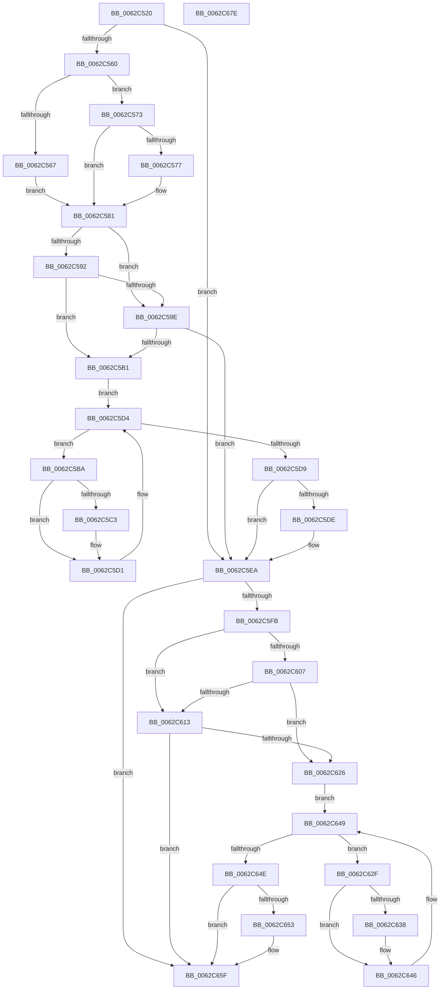

# DifIoRegisterShutdownNotificationWrapper

- RVA: `0x0062C520`–`0x0062C67F` (길이 `351` bytes)
- VA: `0x000000014062C520`
- 실행 섹션: `.text`
- PDB 이름 있음: `예`; PDB Function 태그: `아니요`
- unwind 정보 RVA: `0x00060130`
- 디코드: `94`개 명령, `351/351` bytes 표시
- 미해석 바이트: `0` (있으면 어셈블리에 `.byte`로 보존)

> 이 문서는 커널 이미지의 기계어와 PDB 기호를 분석해 생성했습니다. 4번과 5번은 함수 원형과 자료형을 바이너리 사용 방식에서 추정한 C 해석이며 원본 소스 복구 결과는 아닙니다.

## 1. Dependencies

- 직접 호출 지점: **9**; 고유 호출 대상: **6**
- 직접 호출자로 확인된 함수: **0**
- RIP 상대 이미지 참조: **3**

### Outgoing calls
- `0x0062C54F` → [DifGetAPIThunkContextById](../49/DifGetAPIThunkContextById_function_00495A34.md) (function, `0x00495A34`)
- `0x0062C577` → [DifGetReturnAddressForWrappers](../4D/DifGetReturnAddressForWrappers_function_004D3C08.md) (function, `0x004D3C08`)
- `0x0062C5A5` → [ExAcquireRundownProtection](../21/ExAcquireRundownProtection_function_00216620.md) (function, `0x00216620`)
- `0x0062C5CC` → [guard_dispatch_icall](../6B/guard_dispatch_icall_function_006BAAD0.md) (function, `0x006BAAD0`)
- `0x0062C5E5` → [ExReleaseRundownProtection](../34/ExReleaseRundownProtection_function_00349E80.md) (function, `0x00349E80`)
- `0x0062C5ED` → [IoRegisterShutdownNotification](../../page/71/IoRegisterShutdownNotification_function_0071DB50.md) (function, `0x0071DB50`)
- `0x0062C61A` → [ExAcquireRundownProtection](../21/ExAcquireRundownProtection_function_00216620.md) (function, `0x00216620`)
- `0x0062C641` → [guard_dispatch_icall](../6B/guard_dispatch_icall_function_006BAAD0.md) (function, `0x006BAAD0`)
- `0x0062C65A` → [ExReleaseRundownProtection](../34/ExReleaseRundownProtection_function_00349E80.md) (function, `0x00349E80`)

### Direct callers
- 이 함수 시작 RVA로 연결되는 직접 call은 확인되지 않았습니다. 간접 호출은 완전히 역산할 수 없습니다.

### Static image references
- `0x0062C589` → RVA `0x00F048B8` (`.data`; read)
- `0x0062C592` → RVA `0x00F04980` (`.data`; read)
- `0x0062C59E` → RVA `0x00F03E80` (`.data`; read)

## 2. Other-region calls and transfers

- 다른 실행 섹션으로 향하는 call: **1**
  - `0x0062C5ED` → [IoRegisterShutdownNotification](../../page/71/IoRegisterShutdownNotification_function_0071DB50.md) (`.text` → `PAGE`)
- 별도 외부 분기/꼬리 이동을 확인하지 못했습니다.

## 3. Assembly (complete function range)

```asm
0062C520  4C 8B DC                        mov r11, rsp
0062C523  49 89 5B 08                     mov qword ptr [r11 + 8], rbx
0062C527  49 89 6B 10                     mov qword ptr [r11 + 0x10], rbp
0062C52B  49 89 73 18                     mov qword ptr [r11 + 0x18], rsi
0062C52F  49 89 7B 20                     mov qword ptr [r11 + 0x20], rdi
0062C533  41 56                           push r14
0062C535  48 83 EC 40                     sub rsp, 0x40
0062C539  33 C0                           xor eax, eax
0062C53B  0F 57 C0                        xorps xmm0, xmm0
0062C53E  0F 11 44 24 20                  movups xmmword ptr [rsp + 0x20], xmm0
0062C543  48 8B E9                        mov rbp, rcx
0062C546  49 89 43 E8                     mov qword ptr [r11 - 0x18], rax
0062C54A  B9 3E 01 00 00                  mov ecx, 0x13e
0062C54F  E8 E0 94 E6 FF                  call 0x140495a34
0062C554  48 8B F0                        mov rsi, rax
0062C557  48 85 C0                        test rax, rax
0062C55A  0F 84 8A 00 00 00               je 0x14062c5ea
0062C560  8B 40 0C                        mov eax, dword ptr [rax + 0xc]
0062C563  A8 18                           test al, 0x18
0062C565  74 0C                           je 0x14062c573
0062C567  48 8B 4C 24 48                  mov rcx, qword ptr [rsp + 0x48]
0062C56C  48 89 4C 24 20                  mov qword ptr [rsp + 0x20], rcx
0062C571  EB 0E                           jmp 0x14062c581
0062C573  A8 04                           test al, 4
0062C575  74 0A                           je 0x14062c581
0062C577  E8 8C 76 EA FF                  call 0x1404d3c08
0062C57C  48 89 44 24 20                  mov qword ptr [rsp + 0x20], rax
0062C581  40 32 FF                        xor dil, dil
0062C584  48 89 6C 24 28                  mov qword ptr [rsp + 0x28], rbp
0062C589  40 38 3D 28 83 8D 00            cmp byte ptr [rip + 0x8d8328], dil
0062C590  75 0C                           jne 0x14062c59e
0062C592  F7 05 E4 83 8D 00 00 08 00 00   test dword ptr [rip + 0x8d83e4], 0x800
0062C59C  74 13                           je 0x14062c5b1
0062C59E  48 8D 0D DB 78 8D 00            lea rcx, [rip + 0x8d78db]
0062C5A5  E8 76 A0 BE FF                  call 0x140216620
0062C5AA  40 8A F8                        mov dil, al
0062C5AD  84 C0                           test al, al
0062C5AF  74 39                           je 0x14062c5ea
0062C5B1  4C 8D 76 20                     lea r14, [rsi + 0x20]
0062C5B5  49 8B 1E                        mov rbx, qword ptr [r14]
0062C5B8  EB 1A                           jmp 0x14062c5d4
0062C5BA  48 8D 43 F0                     lea rax, [rbx - 0x10]
0062C5BE  48 85 C0                        test rax, rax
0062C5C1  74 0E                           je 0x14062c5d1
0062C5C3  48 8B 40 08                     mov rax, qword ptr [rax + 8]
0062C5C7  48 8D 4C 24 20                  lea rcx, [rsp + 0x20]
0062C5CC  E8 FF E4 08 00                  call 0x1406baad0
0062C5D1  48 8B 1B                        mov rbx, qword ptr [rbx]
0062C5D4  49 3B DE                        cmp rbx, r14
0062C5D7  75 E1                           jne 0x14062c5ba
0062C5D9  40 84 FF                        test dil, dil
0062C5DC  74 0C                           je 0x14062c5ea
0062C5DE  48 8D 0D 9B 78 8D 00            lea rcx, [rip + 0x8d789b]
0062C5E5  E8 96 D8 D1 FF                  call 0x140349e80
0062C5EA  48 8B CD                        mov rcx, rbp
0062C5ED  E8 5E 15 0F 00                  call 0x14071db50
0062C5F2  89 44 24 30                     mov dword ptr [rsp + 0x30], eax
0062C5F6  48 85 F6                        test rsi, rsi
0062C5F9  74 64                           je 0x14062c65f
0062C5FB  40 32 FF                        xor dil, dil
0062C5FE  40 38 3D B3 82 8D 00            cmp byte ptr [rip + 0x8d82b3], dil
0062C605  75 0C                           jne 0x14062c613
0062C607  F7 05 6F 83 8D 00 00 08 00 00   test dword ptr [rip + 0x8d836f], 0x800
0062C611  74 13                           je 0x14062c626
0062C613  48 8D 0D 66 78 8D 00            lea rcx, [rip + 0x8d7866]
0062C61A  E8 01 A0 BE FF                  call 0x140216620
0062C61F  40 8A F8                        mov dil, al
0062C622  84 C0                           test al, al
0062C624  74 39                           je 0x14062c65f
0062C626  48 83 C6 30                     add rsi, 0x30
0062C62A  48 8B 1E                        mov rbx, qword ptr [rsi]
0062C62D  EB 1A                           jmp 0x14062c649
0062C62F  48 8D 43 F0                     lea rax, [rbx - 0x10]
0062C633  48 85 C0                        test rax, rax
0062C636  74 0E                           je 0x14062c646
0062C638  48 8B 40 08                     mov rax, qword ptr [rax + 8]
0062C63C  48 8D 4C 24 20                  lea rcx, [rsp + 0x20]
0062C641  E8 8A E4 08 00                  call 0x1406baad0
0062C646  48 8B 1B                        mov rbx, qword ptr [rbx]
0062C649  48 3B DE                        cmp rbx, rsi
0062C64C  75 E1                           jne 0x14062c62f
0062C64E  40 84 FF                        test dil, dil
0062C651  74 0C                           je 0x14062c65f
0062C653  48 8D 0D 26 78 8D 00            lea rcx, [rip + 0x8d7826]
0062C65A  E8 21 D8 D1 FF                  call 0x140349e80
0062C65F  8B 44 24 30                     mov eax, dword ptr [rsp + 0x30]
0062C663  48 8B 5C 24 50                  mov rbx, qword ptr [rsp + 0x50]
0062C668  48 8B 6C 24 58                  mov rbp, qword ptr [rsp + 0x58]
0062C66D  48 8B 74 24 60                  mov rsi, qword ptr [rsp + 0x60]
0062C672  48 8B 7C 24 68                  mov rdi, qword ptr [rsp + 0x68]
0062C677  48 83 C4 40                     add rsp, 0x40
0062C67B  41 5E                           pop r14
0062C67D  C3                              ret
0062C67E  CC                              int3
```

## 4. C-style interpretation (structured pseudocode)

```c
__int64 __fastcall DifIoRegisterShutdownNotificationWrapper(__int64 a1)
{
    __int64 result;
    __int64 v_rdi;
    __int64 v_rsi;
    __int64 v_rsp;
    unsigned int v_stack_m18;
    unsigned __int64 v_stack_m20;
    unsigned __int64 v_stack_m28;
    unsigned __int64 v_stack_p0;
    unsigned __int64 v_stack_p10;
    unsigned __int64 v_stack_p18;
    unsigned __int64 v_stack_p20;
    unsigned __int64 v_stack_p8;

    *(unsigned __int64 *)(v_rsp + 8) = v_rbx;
    *(unsigned __int64 *)(v_rsp + 16) = v_rbp;
    *(unsigned __int64 *)(v_rsp + 24) = v_rsi;
    *(unsigned __int64 *)(v_rsp + 32) = v_rdi;
    v_rsp = (v_rsp) - (64);
    result = 0;
    v_stack_m28 = v_xmm0;
    *(unsigned __int64 *)(v_rsp - 24) = 0;
    result = DifGetAPIThunkContextById(318, a2, a3, a4);
    if (result == 0) goto loc_0062C5EA;
    if ((((unsigned __int8)((unsigned int)(*(unsigned int *)(result + 12)))) & (24)) == 0) goto loc_0062C573;
    v_stack_m28 = v_stack_p0;
    goto loc_0062C581;
loc_0062C573:
    result = (unsigned int)(*(unsigned int *)(result + 12));
    if ((((unsigned __int8)((unsigned int)(*(unsigned int *)(result + 12)))) & (4)) != 0) {
        result = DifGetReturnAddressForWrappers(v_stack_p0, a2, a3, a4);
        v_stack_m28 = result;
    }
    v_rdi = 0;
    v_stack_m20 = a1;
    if ((*(unsigned __int8 *)(v_rip + 9274152)) != 0) goto loc_0062C59E;
    if (((*(unsigned int *)(v_rip + 9274340)) & (0x800ULL)) == 0) goto loc_0062C5B1;
loc_0062C59E:
    result = ExAcquireRundownProtection(v_rip + 9271515, a2, a3, a4);
    if ((unsigned __int8)(result) == 0) goto loc_0062C5EA;
loc_0062C5B1:
    goto loc_0062C5D4;
loc_0062C5BA:
    result = *(unsigned __int64 *)(result + 32) - 16;
    if (*(unsigned __int64 *)(result + 32) - 16 != 0) {
        result = *(unsigned __int64 *)(*(unsigned __int64 *)(result + 32) - 16 + 8);
        a1 = v_stack_m28;
        result = guard_dispatch_icall(a1, a2, a3, a4);
    }
loc_0062C5D4:
    if ((*(unsigned __int64 *)(*(unsigned __int64 *)(result + 32))) != (result + 32)) goto loc_0062C5BA;
    if ((unsigned __int8)((unsigned __int8)(result)) != 0) {
        a1 = v_rip + 9271451;
        result = ExReleaseRundownProtection(a1, a2, a3, a4);
    }
    result = IoRegisterShutdownNotification(a1, a2, a3, a4);
    v_stack_m18 = (unsigned int)(result);
    if (result == 0) goto loc_0062C65F;
    v_rdi = 0;
    if ((*(unsigned __int8 *)(v_rip + 9274035)) != 0) goto loc_0062C613;
    if (((*(unsigned int *)(v_rip + 9274223)) & (0x800ULL)) == 0) goto loc_0062C626;
loc_0062C613:
    result = ExAcquireRundownProtection(v_rip + 9271398, a2, a3, a4);
    if ((unsigned __int8)(result) == 0) goto loc_0062C65F;
loc_0062C626:
    v_rsi = (result) + (48);
    goto loc_0062C649;
loc_0062C62F:
    result = *(unsigned __int64 *)(v_rsi) - 16;
    if (*(unsigned __int64 *)(v_rsi) - 16 != 0) {
        result = *(unsigned __int64 *)(*(unsigned __int64 *)(v_rsi) - 16 + 8);
        a1 = v_stack_m28;
        result = guard_dispatch_icall(a1, a2, a3, a4);
    }
loc_0062C649:
    if ((*(unsigned __int64 *)(*(unsigned __int64 *)(v_rsi))) != v_rsi) goto loc_0062C62F;
    if ((unsigned __int8)((unsigned __int8)(result)) != 0) {
        a1 = v_rip + 9271334;
        result = ExReleaseRundownProtection(a1, a2, a3, a4);
    }
    v_rsp = (v_rsp) + (64);
    return (unsigned int)(v_stack_m18);
}
```

## 5. (Beta) C Style

```c
int64_t DifIoRegisterShutdownNotificationWrapper(int64_t Arg1)
{
    int64_t result;
    int64_t local_rdi;
    int64_t local_rsi;
    int64_t local_rsp;
    uint32_t v_stack_m18;
    uint64_t v_stack_m20;
    uint64_t v_stack_m28;
    uint64_t v_stack_p0;
    uint64_t v_stack_p10;
    uint64_t v_stack_p18;
    uint64_t v_stack_p20;
    uint64_t v_stack_p8;

    *(uint64_t *)(local_rsp + 0x8) = local_rbx;
    *(uint64_t *)(local_rsp + 0x10) = local_rbp;
    *(uint64_t *)(local_rsp + 0x18) = local_rsi;
    *(uint64_t *)(local_rsp + 0x20) = local_rdi;
    local_rsp = (local_rsp) - (64);
    result = 0;
    v_stack_m28 = v_xmm0;
    *(uint64_t *)(local_rsp - 0x18) = 0;
    result = DifGetAPIThunkContextById(318, a2, a3, a4);
    if (result == 0) goto loc_0062C5EA;
    if ((((uint8_t)((uint32_t)(*(uint32_t *)(result + 0xC)))) & (24)) == 0) goto loc_0062C573;
    v_stack_m28 = v_stack_p0;
    goto loc_0062C581;
loc_0062C573:
    result = (uint32_t)(*(uint32_t *)(result + 0xC));
    if ((((uint8_t)((uint32_t)(*(uint32_t *)(result + 0xC)))) & (4)) != 0) {
        result = DifGetReturnAddressForWrappers(v_stack_p0, a2, a3, a4);
        v_stack_m28 = result;
    }
    local_rdi = 0;
    v_stack_m20 = Arg1;
    if ((*(uint8_t *)(v_rip + 0x8D8328)) != 0) goto loc_0062C59E;
    if (((*(uint32_t *)(v_rip + 0x8D83E4)) & (0x800ULL)) == 0) goto loc_0062C5B1;
loc_0062C59E:
    result = ExAcquireRundownProtection(v_rip + 9271515, a2, a3, a4);
    if ((uint8_t)(result) == 0) goto loc_0062C5EA;
loc_0062C5B1:
    goto loc_0062C5D4;
loc_0062C5BA:
    result = *(uint64_t *)(result + 0x20) - 16;
    if (*(uint64_t *)(result + 0x20) - 16 != 0) {
        result = *(uint64_t *)(*(uint64_t *)(result + 0x20) - 0x10 + 0x8);
        Arg1 = v_stack_m28;
        result = guard_dispatch_icall(Arg1, a2, a3, a4);
    }
loc_0062C5D4:
    if ((*(uint64_t *)(*(uint64_t *)(result + 0x20))) != (result + 32)) goto loc_0062C5BA;
    if ((uint8_t)((uint8_t)(result)) != 0) {
        Arg1 = v_rip + 9271451;
        result = ExReleaseRundownProtection(Arg1, a2, a3, a4);
    }
    result = IoRegisterShutdownNotification(Arg1, a2, a3, a4);
    v_stack_m18 = (uint32_t)(result);
    if (result == 0) goto loc_0062C65F;
    local_rdi = 0;
    if ((*(uint8_t *)(v_rip + 0x8D82B3)) != 0) goto loc_0062C613;
    if (((*(uint32_t *)(v_rip + 0x8D836F)) & (0x800ULL)) == 0) goto loc_0062C626;
loc_0062C613:
    result = ExAcquireRundownProtection(v_rip + 9271398, a2, a3, a4);
    if ((uint8_t)(result) == 0) goto loc_0062C65F;
loc_0062C626:
    local_rsi = (result) + (48);
    goto loc_0062C649;
loc_0062C62F:
    result = *(uint64_t *)(local_rsi) - 16;
    if (*(uint64_t *)(local_rsi) - 16 != 0) {
        result = *(uint64_t *)(*(uint64_t *)(local_rsi) - 0x10 + 0x8);
        Arg1 = v_stack_m28;
        result = guard_dispatch_icall(Arg1, a2, a3, a4);
    }
loc_0062C649:
    if ((*(uint64_t *)(*(uint64_t *)(local_rsi))) != local_rsi) goto loc_0062C62F;
    if ((uint8_t)((uint8_t)(result)) != 0) {
        Arg1 = v_rip + 9271334;
        result = ExReleaseRundownProtection(Arg1, a2, a3, a4);
    }
    local_rsp = (local_rsp) + (64);
    return (uint32_t)(v_stack_m18);
}
```

## 6. Execution-region graph

[열기: 2D/3D 그래프와 함수 탐색 컨트롤 패널](../../../control-panel.html?section=text&rva=0x0062C520&view=graph)

- 2D 그래프는 위에서 아래로 흐르고, 3D 그래프는 빈 공간을 드래그해 회전합니다. Shift+드래그는 이동, 휠은 확대·축소, 함수 노드 선택은 대상 보고서 이동입니다.

### Static fallback


