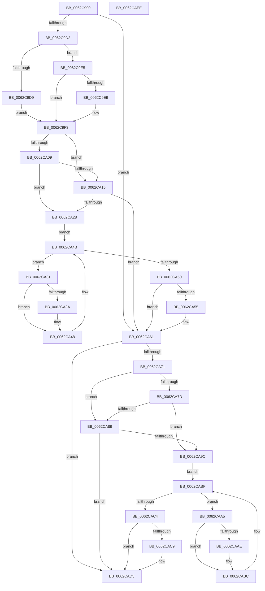

# DifIoRemoveShareAccessWrapper

- RVA: `0x0062C990`–`0x0062CAEF` (길이 `351` bytes)
- VA: `0x000000014062C990`
- 실행 섹션: `.text`
- PDB 이름 있음: `예`; PDB Function 태그: `아니요`
- unwind 정보 RVA: `0x00093E28`
- 디코드: `97`개 명령, `351/351` bytes 표시
- 미해석 바이트: `0` (있으면 어셈블리에 `.byte`로 보존)

> 이 문서는 커널 이미지의 기계어와 PDB 기호를 분석해 생성했습니다. 4번과 5번은 함수 원형과 자료형을 바이너리 사용 방식에서 추정한 C 해석이며 원본 소스 복구 결과는 아닙니다.

## 1. Dependencies

- 직접 호출 지점: **9**; 고유 호출 대상: **6**
- 직접 호출자로 확인된 함수: **0**
- RIP 상대 이미지 참조: **3**

### Outgoing calls
- `0x0062C9C1` → [DifGetAPIThunkContextById](../49/DifGetAPIThunkContextById_function_00495A34.md) (function, `0x00495A34`)
- `0x0062C9E9` → [DifGetReturnAddressForWrappers](../4D/DifGetReturnAddressForWrappers_function_004D3C08.md) (function, `0x004D3C08`)
- `0x0062CA1C` → [ExAcquireRundownProtection](../21/ExAcquireRundownProtection_function_00216620.md) (function, `0x00216620`)
- `0x0062CA43` → [guard_dispatch_icall](../6B/guard_dispatch_icall_function_006BAAD0.md) (function, `0x006BAAD0`)
- `0x0062CA5C` → [ExReleaseRundownProtection](../34/ExReleaseRundownProtection_function_00349E80.md) (function, `0x00349E80`)
- `0x0062CA67` → [IoRemoveShareAccess](../../page/9A/IoRemoveShareAccess_function_009A3C20.md) (function, `0x009A3C20`)
- `0x0062CA90` → [ExAcquireRundownProtection](../21/ExAcquireRundownProtection_function_00216620.md) (function, `0x00216620`)
- `0x0062CAB7` → [guard_dispatch_icall](../6B/guard_dispatch_icall_function_006BAAD0.md) (function, `0x006BAAD0`)
- `0x0062CAD0` → [ExReleaseRundownProtection](../34/ExReleaseRundownProtection_function_00349E80.md) (function, `0x00349E80`)

### Direct callers
- 이 함수 시작 RVA로 연결되는 직접 call은 확인되지 않았습니다. 간접 호출은 완전히 역산할 수 없습니다.

### Static image references
- `0x0062C9FB` → RVA `0x00F048B8` (`.data`; read)
- `0x0062CA09` → RVA `0x00F04980` (`.data`; read)
- `0x0062CA15` → RVA `0x00F03E80` (`.data`; read)

## 2. Other-region calls and transfers

- 다른 실행 섹션으로 향하는 call: **1**
  - `0x0062CA67` → [IoRemoveShareAccess](../../page/9A/IoRemoveShareAccess_function_009A3C20.md) (`.text` → `PAGE`)
- 별도 외부 분기/꼬리 이동을 확인하지 못했습니다.

## 3. Assembly (complete function range)

```asm
0062C990  4C 8B DC                        mov r11, rsp
0062C993  49 89 5B 08                     mov qword ptr [r11 + 8], rbx
0062C997  49 89 6B 10                     mov qword ptr [r11 + 0x10], rbp
0062C99B  49 89 73 18                     mov qword ptr [r11 + 0x18], rsi
0062C99F  57                              push rdi
0062C9A0  41 56                           push r14
0062C9A2  41 57                           push r15
0062C9A4  48 83 EC 40                     sub rsp, 0x40
0062C9A8  33 C0                           xor eax, eax
0062C9AA  0F 57 C0                        xorps xmm0, xmm0
0062C9AD  0F 11 44 24 20                  movups xmmword ptr [rsp + 0x20], xmm0
0062C9B2  4C 8B F9                        mov r15, rcx
0062C9B5  49 89 43 D8                     mov qword ptr [r11 - 0x28], rax
0062C9B9  B9 3B 01 00 00                  mov ecx, 0x13b
0062C9BE  4C 8B F2                        mov r14, rdx
0062C9C1  E8 6E 90 E6 FF                  call 0x140495a34
0062C9C6  48 8B F0                        mov rsi, rax
0062C9C9  48 85 C0                        test rax, rax
0062C9CC  0F 84 8F 00 00 00               je 0x14062ca61
0062C9D2  8B 40 0C                        mov eax, dword ptr [rax + 0xc]
0062C9D5  A8 18                           test al, 0x18
0062C9D7  74 0C                           je 0x14062c9e5
0062C9D9  48 8B 4C 24 58                  mov rcx, qword ptr [rsp + 0x58]
0062C9DE  48 89 4C 24 20                  mov qword ptr [rsp + 0x20], rcx
0062C9E3  EB 0E                           jmp 0x14062c9f3
0062C9E5  A8 04                           test al, 4
0062C9E7  74 0A                           je 0x14062c9f3
0062C9E9  E8 1A 72 EA FF                  call 0x1404d3c08
0062C9EE  48 89 44 24 20                  mov qword ptr [rsp + 0x20], rax
0062C9F3  40 32 ED                        xor bpl, bpl
0062C9F6  4C 89 7C 24 30                  mov qword ptr [rsp + 0x30], r15
0062C9FB  40 38 2D B6 7E 8D 00            cmp byte ptr [rip + 0x8d7eb6], bpl
0062CA02  4C 89 74 24 28                  mov qword ptr [rsp + 0x28], r14
0062CA07  75 0C                           jne 0x14062ca15
0062CA09  F7 05 6D 7F 8D 00 00 08 00 00   test dword ptr [rip + 0x8d7f6d], 0x800
0062CA13  74 13                           je 0x14062ca28
0062CA15  48 8D 0D 64 74 8D 00            lea rcx, [rip + 0x8d7464]
0062CA1C  E8 FF 9B BE FF                  call 0x140216620
0062CA21  40 8A E8                        mov bpl, al
0062CA24  84 C0                           test al, al
0062CA26  74 39                           je 0x14062ca61
0062CA28  48 8D 7E 20                     lea rdi, [rsi + 0x20]
0062CA2C  48 8B 1F                        mov rbx, qword ptr [rdi]
0062CA2F  EB 1A                           jmp 0x14062ca4b
0062CA31  48 8D 43 F0                     lea rax, [rbx - 0x10]
0062CA35  48 85 C0                        test rax, rax
0062CA38  74 0E                           je 0x14062ca48
0062CA3A  48 8B 40 08                     mov rax, qword ptr [rax + 8]
0062CA3E  48 8D 4C 24 20                  lea rcx, [rsp + 0x20]
0062CA43  E8 88 E0 08 00                  call 0x1406baad0
0062CA48  48 8B 1B                        mov rbx, qword ptr [rbx]
0062CA4B  48 3B DF                        cmp rbx, rdi
0062CA4E  75 E1                           jne 0x14062ca31
0062CA50  40 84 ED                        test bpl, bpl
0062CA53  74 0C                           je 0x14062ca61
0062CA55  48 8D 0D 24 74 8D 00            lea rcx, [rip + 0x8d7424]
0062CA5C  E8 1F D4 D1 FF                  call 0x140349e80
0062CA61  49 8B D6                        mov rdx, r14
0062CA64  49 8B CF                        mov rcx, r15
0062CA67  E8 B4 71 37 00                  call 0x1409a3c20
0062CA6C  48 85 F6                        test rsi, rsi
0062CA6F  74 64                           je 0x14062cad5
0062CA71  40 32 FF                        xor dil, dil
0062CA74  40 38 3D 3D 7E 8D 00            cmp byte ptr [rip + 0x8d7e3d], dil
0062CA7B  75 0C                           jne 0x14062ca89
0062CA7D  F7 05 F9 7E 8D 00 00 08 00 00   test dword ptr [rip + 0x8d7ef9], 0x800
0062CA87  74 13                           je 0x14062ca9c
0062CA89  48 8D 0D F0 73 8D 00            lea rcx, [rip + 0x8d73f0]
0062CA90  E8 8B 9B BE FF                  call 0x140216620
0062CA95  40 8A F8                        mov dil, al
0062CA98  84 C0                           test al, al
0062CA9A  74 39                           je 0x14062cad5
0062CA9C  48 83 C6 30                     add rsi, 0x30
0062CAA0  48 8B 1E                        mov rbx, qword ptr [rsi]
0062CAA3  EB 1A                           jmp 0x14062cabf
0062CAA5  48 8D 43 F0                     lea rax, [rbx - 0x10]
0062CAA9  48 85 C0                        test rax, rax
0062CAAC  74 0E                           je 0x14062cabc
0062CAAE  48 8B 40 08                     mov rax, qword ptr [rax + 8]
0062CAB2  48 8D 4C 24 20                  lea rcx, [rsp + 0x20]
0062CAB7  E8 14 E0 08 00                  call 0x1406baad0
0062CABC  48 8B 1B                        mov rbx, qword ptr [rbx]
0062CABF  48 3B DE                        cmp rbx, rsi
0062CAC2  75 E1                           jne 0x14062caa5
0062CAC4  40 84 FF                        test dil, dil
0062CAC7  74 0C                           je 0x14062cad5
0062CAC9  48 8D 0D B0 73 8D 00            lea rcx, [rip + 0x8d73b0]
0062CAD0  E8 AB D3 D1 FF                  call 0x140349e80
0062CAD5  48 8B 5C 24 60                  mov rbx, qword ptr [rsp + 0x60]
0062CADA  48 8B 6C 24 68                  mov rbp, qword ptr [rsp + 0x68]
0062CADF  48 8B 74 24 70                  mov rsi, qword ptr [rsp + 0x70]
0062CAE4  48 83 C4 40                     add rsp, 0x40
0062CAE8  41 5F                           pop r15
0062CAEA  41 5E                           pop r14
0062CAEC  5F                              pop rdi
0062CAED  C3                              ret
0062CAEE  CC                              int3
```

## 4. C-style interpretation (structured pseudocode)

```c
__int64 __fastcall DifIoRemoveShareAccessWrapper(__int64 a1, __int64 a2)
{
    __int64 result;
    __int64 v_rbp;
    __int64 v_rdi;
    __int64 v_rsi;
    __int64 v_rsp;
    unsigned __int64 v_stack_m28;
    unsigned __int64 v_stack_m30;
    unsigned __int64 v_stack_m38;
    unsigned __int64 v_stack_p0;
    unsigned __int64 v_stack_p10;
    unsigned __int64 v_stack_p18;
    unsigned __int64 v_stack_p8;

    *(unsigned __int64 *)(v_rsp + 8) = v_rbx;
    *(unsigned __int64 *)(v_rsp + 16) = v_rbp;
    *(unsigned __int64 *)(v_rsp + 24) = v_rsi;
    v_rsp = (v_rsp) - (64);
    result = 0;
    v_stack_m38 = v_xmm0;
    *(unsigned __int64 *)(v_rsp - 40) = 0;
    result = DifGetAPIThunkContextById(315, a2, a3, a4);
    if (result == 0) goto loc_0062CA61;
    if ((((unsigned __int8)((unsigned int)(*(unsigned int *)(result + 12)))) & (24)) == 0) goto loc_0062C9E5;
    v_stack_m38 = v_stack_p0;
    goto loc_0062C9F3;
loc_0062C9E5:
    result = (unsigned int)(*(unsigned int *)(result + 12));
    if ((((unsigned __int8)((unsigned int)(*(unsigned int *)(result + 12)))) & (4)) != 0) {
        result = DifGetReturnAddressForWrappers(v_stack_p0, a2, a3, a4);
        v_stack_m38 = result;
    }
    v_rbp = 0;
    v_stack_m28 = a1;
    v_stack_m30 = a2;
    if ((*(unsigned __int8 *)(v_rip + 9273014)) != 0) goto loc_0062CA15;
    if (((*(unsigned int *)(v_rip + 9273197)) & (0x800ULL)) == 0) goto loc_0062CA28;
loc_0062CA15:
    result = ExAcquireRundownProtection(v_rip + 9270372, a2, a3, a4);
    if ((unsigned __int8)(result) == 0) goto loc_0062CA61;
loc_0062CA28:
    goto loc_0062CA4B;
loc_0062CA31:
    result = *(unsigned __int64 *)(result + 32) - 16;
    if (*(unsigned __int64 *)(result + 32) - 16 != 0) {
        result = *(unsigned __int64 *)(*(unsigned __int64 *)(result + 32) - 16 + 8);
        a1 = v_stack_m38;
        result = guard_dispatch_icall(a1, a2, a3, a4);
    }
loc_0062CA4B:
    if ((*(unsigned __int64 *)(*(unsigned __int64 *)(result + 32))) != (result + 32)) goto loc_0062CA31;
    if ((unsigned __int8)((unsigned __int8)(result)) != 0) {
        a1 = v_rip + 9270308;
        result = ExReleaseRundownProtection(a1, a2, a3, a4);
    }
    result = IoRemoveShareAccess(a1, a2, a3, a4);
    if (result == 0) goto loc_0062CAD5;
    v_rdi = 0;
    if ((*(unsigned __int8 *)(v_rip + 9272893)) != 0) goto loc_0062CA89;
    if (((*(unsigned int *)(v_rip + 9273081)) & (0x800ULL)) == 0) goto loc_0062CA9C;
loc_0062CA89:
    result = ExAcquireRundownProtection(v_rip + 9270256, a2, a3, a4);
    if ((unsigned __int8)(result) == 0) goto loc_0062CAD5;
loc_0062CA9C:
    v_rsi = (result) + (48);
    goto loc_0062CABF;
loc_0062CAA5:
    result = *(unsigned __int64 *)(v_rsi) - 16;
    if (*(unsigned __int64 *)(v_rsi) - 16 != 0) {
        result = *(unsigned __int64 *)(*(unsigned __int64 *)(v_rsi) - 16 + 8);
        a1 = v_stack_m38;
        result = guard_dispatch_icall(a1, a2, a3, a4);
    }
loc_0062CABF:
    if ((*(unsigned __int64 *)(*(unsigned __int64 *)(v_rsi))) != v_rsi) goto loc_0062CAA5;
    if ((unsigned __int8)((unsigned __int8)(result)) != 0) {
        a1 = v_rip + 9270192;
        result = ExReleaseRundownProtection(a1, a2, a3, a4);
    }
    v_rsp = (v_rsp) + (64);
    return result;
}
```

## 5. (Beta) C Style

```c
int64_t DifIoRemoveShareAccessWrapper(int64_t Arg1, int64_t Arg2)
{
    int64_t result;
    int64_t local_rbp;
    int64_t local_rdi;
    int64_t local_rsi;
    int64_t local_rsp;
    uint64_t v_stack_m28;
    uint64_t v_stack_m30;
    uint64_t v_stack_m38;
    uint64_t v_stack_p0;
    uint64_t v_stack_p10;
    uint64_t v_stack_p18;
    uint64_t v_stack_p8;

    *(uint64_t *)(local_rsp + 0x8) = local_rbx;
    *(uint64_t *)(local_rsp + 0x10) = local_rbp;
    *(uint64_t *)(local_rsp + 0x18) = local_rsi;
    local_rsp = (local_rsp) - (64);
    result = 0;
    v_stack_m38 = v_xmm0;
    *(uint64_t *)(local_rsp - 0x28) = 0;
    result = DifGetAPIThunkContextById(315, Arg2, a3, a4);
    if (result == 0) goto loc_0062CA61;
    if ((((uint8_t)((uint32_t)(*(uint32_t *)(result + 0xC)))) & (24)) == 0) goto loc_0062C9E5;
    v_stack_m38 = v_stack_p0;
    goto loc_0062C9F3;
loc_0062C9E5:
    result = (uint32_t)(*(uint32_t *)(result + 0xC));
    if ((((uint8_t)((uint32_t)(*(uint32_t *)(result + 0xC)))) & (4)) != 0) {
        result = DifGetReturnAddressForWrappers(v_stack_p0, Arg2, a3, a4);
        v_stack_m38 = result;
    }
    local_rbp = 0;
    v_stack_m28 = Arg1;
    v_stack_m30 = Arg2;
    if ((*(uint8_t *)(v_rip + 0x8D7EB6)) != 0) goto loc_0062CA15;
    if (((*(uint32_t *)(v_rip + 0x8D7F6D)) & (0x800ULL)) == 0) goto loc_0062CA28;
loc_0062CA15:
    result = ExAcquireRundownProtection(v_rip + 9270372, Arg2, a3, a4);
    if ((uint8_t)(result) == 0) goto loc_0062CA61;
loc_0062CA28:
    goto loc_0062CA4B;
loc_0062CA31:
    result = *(uint64_t *)(result + 0x20) - 16;
    if (*(uint64_t *)(result + 0x20) - 16 != 0) {
        result = *(uint64_t *)(*(uint64_t *)(result + 0x20) - 0x10 + 0x8);
        Arg1 = v_stack_m38;
        result = guard_dispatch_icall(Arg1, Arg2, a3, a4);
    }
loc_0062CA4B:
    if ((*(uint64_t *)(*(uint64_t *)(result + 0x20))) != (result + 32)) goto loc_0062CA31;
    if ((uint8_t)((uint8_t)(result)) != 0) {
        Arg1 = v_rip + 9270308;
        result = ExReleaseRundownProtection(Arg1, Arg2, a3, a4);
    }
    result = IoRemoveShareAccess(Arg1, Arg2, a3, a4);
    if (result == 0) goto loc_0062CAD5;
    local_rdi = 0;
    if ((*(uint8_t *)(v_rip + 0x8D7E3D)) != 0) goto loc_0062CA89;
    if (((*(uint32_t *)(v_rip + 0x8D7EF9)) & (0x800ULL)) == 0) goto loc_0062CA9C;
loc_0062CA89:
    result = ExAcquireRundownProtection(v_rip + 9270256, Arg2, a3, a4);
    if ((uint8_t)(result) == 0) goto loc_0062CAD5;
loc_0062CA9C:
    local_rsi = (result) + (48);
    goto loc_0062CABF;
loc_0062CAA5:
    result = *(uint64_t *)(local_rsi) - 16;
    if (*(uint64_t *)(local_rsi) - 16 != 0) {
        result = *(uint64_t *)(*(uint64_t *)(local_rsi) - 0x10 + 0x8);
        Arg1 = v_stack_m38;
        result = guard_dispatch_icall(Arg1, Arg2, a3, a4);
    }
loc_0062CABF:
    if ((*(uint64_t *)(*(uint64_t *)(local_rsi))) != local_rsi) goto loc_0062CAA5;
    if ((uint8_t)((uint8_t)(result)) != 0) {
        Arg1 = v_rip + 9270192;
        result = ExReleaseRundownProtection(Arg1, Arg2, a3, a4);
    }
    local_rsp = (local_rsp) + (64);
    return result;
}
```

## 6. Execution-region graph

[열기: 2D/3D 그래프와 함수 탐색 컨트롤 패널](../../../control-panel.html?section=text&rva=0x0062C990&view=graph)

- 2D 그래프는 위에서 아래로 흐르고, 3D 그래프는 빈 공간을 드래그해 회전합니다. Shift+드래그는 이동, 휠은 확대·축소, 함수 노드 선택은 대상 보고서 이동입니다.

### Static fallback


