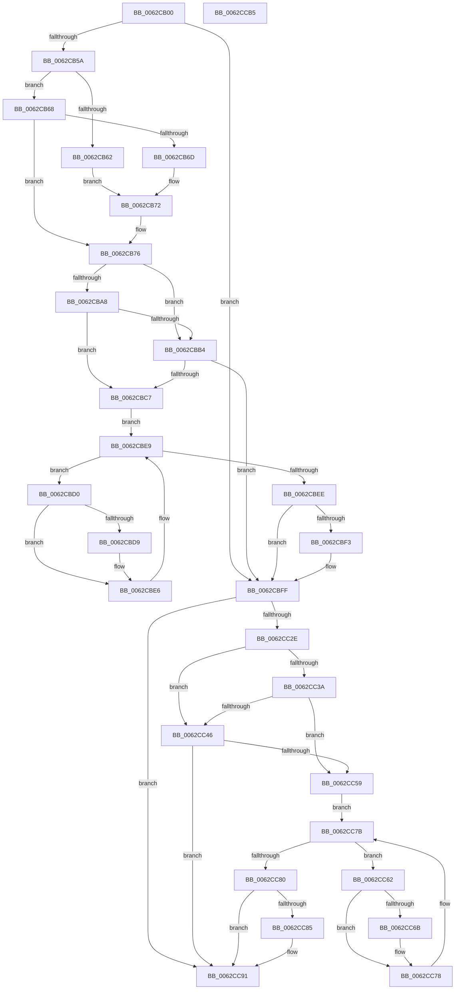

# DifIoSetCompletionRoutineExWrapper

- RVA: `0x0062CB00`–`0x0062CCB6` (길이 `438` bytes)
- VA: `0x000000014062CB00`
- 실행 섹션: `.text`
- PDB 이름 있음: `예`; PDB Function 태그: `아니요`
- unwind 정보 RVA: `0x000BC530`
- 디코드: `125`개 명령, `438/438` bytes 표시
- 미해석 바이트: `0` (있으면 어셈블리에 `.byte`로 보존)

> 이 문서는 커널 이미지의 기계어와 PDB 기호를 분석해 생성했습니다. 4번과 5번은 함수 원형과 자료형을 바이너리 사용 방식에서 추정한 C 해석이며 원본 소스 복구 결과는 아닙니다.

## 1. Dependencies

- 직접 호출 지점: **9**; 고유 호출 대상: **6**
- 직접 호출자로 확인된 함수: **0**
- RIP 상대 이미지 참조: **3**

### Outgoing calls
- `0x0062CB49` → [DifGetAPIThunkContextById](../49/DifGetAPIThunkContextById_function_00495A34.md) (function, `0x00495A34`)
- `0x0062CB6D` → [DifGetReturnAddressForWrappers](../4D/DifGetReturnAddressForWrappers_function_004D3C08.md) (function, `0x004D3C08`)
- `0x0062CBBB` → [ExAcquireRundownProtection](../21/ExAcquireRundownProtection_function_00216620.md) (function, `0x00216620`)
- `0x0062CBE1` → [guard_dispatch_icall](../6B/guard_dispatch_icall_function_006BAAD0.md) (function, `0x006BAAD0`)
- `0x0062CBFA` → [ExReleaseRundownProtection](../34/ExReleaseRundownProtection_function_00349E80.md) (function, `0x00349E80`)
- `0x0062CC21` → [IoSetCompletionRoutineEx](../44/IoSetCompletionRoutineEx_function_004405F0.md) (function, `0x004405F0`)
- `0x0062CC4D` → [ExAcquireRundownProtection](../21/ExAcquireRundownProtection_function_00216620.md) (function, `0x00216620`)
- `0x0062CC73` → [guard_dispatch_icall](../6B/guard_dispatch_icall_function_006BAAD0.md) (function, `0x006BAAD0`)
- `0x0062CC8C` → [ExReleaseRundownProtection](../34/ExReleaseRundownProtection_function_00349E80.md) (function, `0x00349E80`)

### Direct callers
- 이 함수 시작 RVA로 연결되는 직접 call은 확인되지 않았습니다. 간접 호출은 완전히 역산할 수 없습니다.

### Static image references
- `0x0062CB7D` → RVA `0x00F048B8` (`.data`; read)
- `0x0062CBA8` → RVA `0x00F04980` (`.data`; read)
- `0x0062CBB4` → RVA `0x00F03E80` (`.data`; read)

## 2. Other-region calls and transfers

- 다른 실행 섹션으로 향하는 call: **0**
- 별도 외부 분기/꼬리 이동을 확인하지 못했습니다.

## 3. Assembly (complete function range)

```asm
0062CB00  48 8B C4                        mov rax, rsp
0062CB03  48 89 58 10                     mov qword ptr [rax + 0x10], rbx
0062CB07  48 89 70 18                     mov qword ptr [rax + 0x18], rsi
0062CB0B  48 89 78 20                     mov qword ptr [rax + 0x20], rdi
0062CB0F  48 89 48 08                     mov qword ptr [rax + 8], rcx
0062CB13  55                              push rbp
0062CB14  41 54                           push r12
0062CB16  41 55                           push r13
0062CB18  41 56                           push r14
0062CB1A  41 57                           push r15
0062CB1C  48 8B EC                        mov rbp, rsp
0062CB1F  48 81 EC 80 00 00 00            sub rsp, 0x80
0062CB26  0F 57 C0                        xorps xmm0, xmm0
0062CB29  33 C0                           xor eax, eax
0062CB2B  B9 3A 01 00 00                  mov ecx, 0x13a
0062CB30  48 89 45 F0                     mov qword ptr [rbp - 0x10], rax
0062CB34  0F 11 45 C0                     movups xmmword ptr [rbp - 0x40], xmm0
0062CB38  4D 8B F9                        mov r15, r9
0062CB3B  4D 8B E0                        mov r12, r8
0062CB3E  0F 11 45 D0                     movups xmmword ptr [rbp - 0x30], xmm0
0062CB42  4C 8B EA                        mov r13, rdx
0062CB45  0F 11 45 E0                     movups xmmword ptr [rbp - 0x20], xmm0
0062CB49  E8 E6 8E E6 FF                  call 0x140495a34
0062CB4E  4C 8B F0                        mov r14, rax
0062CB51  48 85 C0                        test rax, rax
0062CB54  0F 84 A5 00 00 00               je 0x14062cbff
0062CB5A  8B 48 0C                        mov ecx, dword ptr [rax + 0xc]
0062CB5D  F6 C1 18                        test cl, 0x18
0062CB60  74 06                           je 0x14062cb68
0062CB62  48 8B 45 28                     mov rax, qword ptr [rbp + 0x28]
0062CB66  EB 0A                           jmp 0x14062cb72
0062CB68  F6 C1 04                        test cl, 4
0062CB6B  74 09                           je 0x14062cb76
0062CB6D  E8 96 70 EA FF                  call 0x1404d3c08
0062CB72  48 89 45 C0                     mov qword ptr [rbp - 0x40], rax
0062CB76  48 8B 45 30                     mov rax, qword ptr [rbp + 0x30]
0062CB7A  40 32 F6                        xor sil, sil
0062CB7D  40 38 35 34 7D 8D 00            cmp byte ptr [rip + 0x8d7d34], sil
0062CB84  48 89 45 E8                     mov qword ptr [rbp - 0x18], rax
0062CB88  8A 45 50                        mov al, byte ptr [rbp + 0x50]
0062CB8B  88 45 CA                        mov byte ptr [rbp - 0x36], al
0062CB8E  8A 45 58                        mov al, byte ptr [rbp + 0x58]
0062CB91  88 45 C9                        mov byte ptr [rbp - 0x37], al
0062CB94  8A 45 60                        mov al, byte ptr [rbp + 0x60]
0062CB97  88 45 C8                        mov byte ptr [rbp - 0x38], al
0062CB9A  4C 89 6D E0                     mov qword ptr [rbp - 0x20], r13
0062CB9E  4C 89 65 D8                     mov qword ptr [rbp - 0x28], r12
0062CBA2  4C 89 7D D0                     mov qword ptr [rbp - 0x30], r15
0062CBA6  75 0C                           jne 0x14062cbb4
0062CBA8  F7 05 CE 7D 8D 00 00 08 00 00   test dword ptr [rip + 0x8d7dce], 0x800
0062CBB2  74 13                           je 0x14062cbc7
0062CBB4  48 8D 0D C5 72 8D 00            lea rcx, [rip + 0x8d72c5]
0062CBBB  E8 60 9A BE FF                  call 0x140216620
0062CBC0  40 8A F0                        mov sil, al
0062CBC3  84 C0                           test al, al
0062CBC5  74 38                           je 0x14062cbff
0062CBC7  49 8D 7E 20                     lea rdi, [r14 + 0x20]
0062CBCB  48 8B 1F                        mov rbx, qword ptr [rdi]
0062CBCE  EB 19                           jmp 0x14062cbe9
0062CBD0  48 8D 43 F0                     lea rax, [rbx - 0x10]
0062CBD4  48 85 C0                        test rax, rax
0062CBD7  74 0D                           je 0x14062cbe6
0062CBD9  48 8B 40 08                     mov rax, qword ptr [rax + 8]
0062CBDD  48 8D 4D C0                     lea rcx, [rbp - 0x40]
0062CBE1  E8 EA DE 08 00                  call 0x1406baad0
0062CBE6  48 8B 1B                        mov rbx, qword ptr [rbx]
0062CBE9  48 3B DF                        cmp rbx, rdi
0062CBEC  75 E2                           jne 0x14062cbd0
0062CBEE  40 84 F6                        test sil, sil
0062CBF1  74 0C                           je 0x14062cbff
0062CBF3  48 8D 0D 86 72 8D 00            lea rcx, [rip + 0x8d7286]
0062CBFA  E8 81 D2 D1 FF                  call 0x140349e80
0062CBFF  8A 45 60                        mov al, byte ptr [rbp + 0x60]
0062CC02  4D 8B CF                        mov r9, r15
0062CC05  48 8B 4D 30                     mov rcx, qword ptr [rbp + 0x30]
0062CC09  4D 8B C4                        mov r8, r12
0062CC0C  88 44 24 30                     mov byte ptr [rsp + 0x30], al
0062CC10  49 8B D5                        mov rdx, r13
0062CC13  8A 45 58                        mov al, byte ptr [rbp + 0x58]
0062CC16  88 44 24 28                     mov byte ptr [rsp + 0x28], al
0062CC1A  8A 45 50                        mov al, byte ptr [rbp + 0x50]
0062CC1D  88 44 24 20                     mov byte ptr [rsp + 0x20], al
0062CC21  E8 CA 39 E1 FF                  call 0x1404405f0
0062CC26  89 45 F0                        mov dword ptr [rbp - 0x10], eax
0062CC29  4D 85 F6                        test r14, r14
0062CC2C  74 63                           je 0x14062cc91
0062CC2E  40 32 FF                        xor dil, dil
0062CC31  40 38 3D 80 7C 8D 00            cmp byte ptr [rip + 0x8d7c80], dil
0062CC38  75 0C                           jne 0x14062cc46
0062CC3A  F7 05 3C 7D 8D 00 00 08 00 00   test dword ptr [rip + 0x8d7d3c], 0x800
0062CC44  74 13                           je 0x14062cc59
0062CC46  48 8D 0D 33 72 8D 00            lea rcx, [rip + 0x8d7233]
0062CC4D  E8 CE 99 BE FF                  call 0x140216620
0062CC52  40 8A F8                        mov dil, al
0062CC55  84 C0                           test al, al
0062CC57  74 38                           je 0x14062cc91
0062CC59  49 8D 76 30                     lea rsi, [r14 + 0x30]
0062CC5D  48 8B 1E                        mov rbx, qword ptr [rsi]
0062CC60  EB 19                           jmp 0x14062cc7b
0062CC62  48 8D 43 F0                     lea rax, [rbx - 0x10]
0062CC66  48 85 C0                        test rax, rax
0062CC69  74 0D                           je 0x14062cc78
0062CC6B  48 8B 40 08                     mov rax, qword ptr [rax + 8]
0062CC6F  48 8D 4D C0                     lea rcx, [rbp - 0x40]
0062CC73  E8 58 DE 08 00                  call 0x1406baad0
0062CC78  48 8B 1B                        mov rbx, qword ptr [rbx]
0062CC7B  48 3B DE                        cmp rbx, rsi
0062CC7E  75 E2                           jne 0x14062cc62
0062CC80  40 84 FF                        test dil, dil
0062CC83  74 0C                           je 0x14062cc91
0062CC85  48 8D 0D F4 71 8D 00            lea rcx, [rip + 0x8d71f4]
0062CC8C  E8 EF D1 D1 FF                  call 0x140349e80
0062CC91  8B 45 F0                        mov eax, dword ptr [rbp - 0x10]
0062CC94  4C 8D 9C 24 80 00 00 00         lea r11, [rsp + 0x80]
0062CC9C  49 8B 5B 38                     mov rbx, qword ptr [r11 + 0x38]
0062CCA0  49 8B 73 40                     mov rsi, qword ptr [r11 + 0x40]
0062CCA4  49 8B 7B 48                     mov rdi, qword ptr [r11 + 0x48]
0062CCA8  49 8B E3                        mov rsp, r11
0062CCAB  41 5F                           pop r15
0062CCAD  41 5E                           pop r14
0062CCAF  41 5D                           pop r13
0062CCB1  41 5C                           pop r12
0062CCB3  5D                              pop rbp
0062CCB4  C3                              ret
0062CCB5  CC                              int3
```

## 4. C-style interpretation (structured pseudocode)

```c
__int64 __fastcall DifIoSetCompletionRoutineExWrapper(__int64 a1, __int64 a2, __int64 a3, __int64 a4, unsigned __int8 a5, unsigned __int8 a6, unsigned __int8 a7)
{
    __int64 result;
    __int64 v_rdi;
    __int64 v_rsi;
    __int64 v_rsp;
    unsigned __int64 v_stack_m28;
    unsigned __int64 v_stack_m38;
    unsigned __int64 v_stack_m40;
    unsigned __int64 v_stack_m48;
    unsigned __int64 v_stack_m50;
    unsigned __int64 v_stack_m58;
    unsigned __int8 v_stack_m5E;
    unsigned __int8 v_stack_m5F;
    unsigned __int8 v_stack_m60;
    unsigned __int64 v_stack_m68;
    unsigned __int8 v_stack_m78;
    unsigned __int8 v_stack_m80;
    unsigned __int8 v_stack_m88;
    unsigned __int64 v_stack_p0;
    unsigned __int64 v_stack_p8;

    *(unsigned __int64 *)(v_rsp + 16) = v_rbx;
    *(unsigned __int64 *)(v_rsp + 24) = v_rsi;
    *(unsigned __int64 *)(v_rsp + 32) = v_rdi;
    *(unsigned __int64 *)(v_rsp + 8) = a1;
    v_rsp = (v_rsp) - (128);
    result = 0;
    v_stack_m38 = 0;
    v_stack_m68 = v_xmm0;
    v_stack_m58 = v_xmm0;
    v_stack_m48 = v_xmm0;
    result = DifGetAPIThunkContextById(314, a2, a3, a4);
    if (result == 0) goto loc_0062CBFF;
    if ((((unsigned __int8)((unsigned int)(*(unsigned int *)(result + 12)))) & (24)) == 0) goto loc_0062CB68;
    goto loc_0062CB72;
loc_0062CB68:
    if ((((unsigned __int8)((unsigned int)(*(unsigned int *)(result + 12)))) & (4)) == 0) goto loc_0062CB76;
    result = DifGetReturnAddressForWrappers((unsigned int)(*(unsigned int *)(result + 12)), a2, a3, a4);
loc_0062CB72:
    v_stack_m68 = result;
loc_0062CB76:
    v_rsi = 0;
    v_stack_m40 = v_stack_p8;
    v_stack_m5E = a5;
    v_stack_m5F = a6;
    v_stack_m60 = a7;
    v_stack_m48 = a2;
    v_stack_m50 = a3;
    v_stack_m58 = a4;
    if ((*(unsigned __int8 *)(v_rip + 9272628)) != 0) goto loc_0062CBB4;
    if (((*(unsigned int *)(v_rip + 9272782)) & (0x800ULL)) == 0) goto loc_0062CBC7;
loc_0062CBB4:
    result = ExAcquireRundownProtection(v_rip + 9269957, a2, a3, a4);
    if ((unsigned __int8)(result) == 0) goto loc_0062CBFF;
loc_0062CBC7:
    goto loc_0062CBE9;
loc_0062CBD0:
    result = *(unsigned __int64 *)(result + 32) - 16;
    if (*(unsigned __int64 *)(result + 32) - 16 != 0) {
        result = *(unsigned __int64 *)(*(unsigned __int64 *)(result + 32) - 16 + 8);
        a1 = v_stack_m68;
        result = guard_dispatch_icall(a1, a2, a3, a4);
    }
loc_0062CBE9:
    if ((*(unsigned __int64 *)(*(unsigned __int64 *)(result + 32))) != (result + 32)) goto loc_0062CBD0;
    if ((unsigned __int8)((unsigned __int8)(result)) != 0) {
        a1 = v_rip + 9269894;
        result = ExReleaseRundownProtection(a1, a2, a3, a4);
    }
    v_stack_m78 = a7;
    v_stack_m80 = a6;
    v_stack_m88 = a5;
    result = IoSetCompletionRoutineEx(v_stack_p8, a2, a3, a4);
    v_stack_m38 = (unsigned int)(result);
    if (result == 0) goto loc_0062CC91;
    v_rdi = 0;
    if ((*(unsigned __int8 *)(v_rip + 9272448)) != 0) goto loc_0062CC46;
    if (((*(unsigned int *)(v_rip + 9272636)) & (0x800ULL)) == 0) goto loc_0062CC59;
loc_0062CC46:
    result = ExAcquireRundownProtection(v_rip + 9269811, a2, a3, a4);
    if ((unsigned __int8)(result) == 0) goto loc_0062CC91;
loc_0062CC59:
    goto loc_0062CC7B;
loc_0062CC62:
    result = *(unsigned __int64 *)(result + 48) - 16;
    if (*(unsigned __int64 *)(result + 48) - 16 != 0) {
        result = *(unsigned __int64 *)(*(unsigned __int64 *)(result + 48) - 16 + 8);
        a1 = v_stack_m68;
        result = guard_dispatch_icall(a1, a2, a3, a4);
    }
loc_0062CC7B:
    if ((*(unsigned __int64 *)(*(unsigned __int64 *)(result + 48))) != (result + 48)) goto loc_0062CC62;
    if ((unsigned __int8)((unsigned __int8)(result)) != 0) {
        a1 = v_rip + 9269748;
        result = ExReleaseRundownProtection(a1, a2, a3, a4);
    }
    return (unsigned int)(v_stack_m38);
}
```

## 5. (Beta) C Style

```c
int64_t DifIoSetCompletionRoutineExWrapper(int64_t Arg1, int64_t Arg2, int64_t Arg3, int64_t Arg4, uint8_t Arg5, uint8_t Arg6, uint8_t Arg7)
{
    int64_t result;
    int64_t local_rdi;
    int64_t local_rsi;
    int64_t local_rsp;
    uint64_t v_stack_m28;
    uint64_t v_stack_m38;
    uint64_t v_stack_m40;
    uint64_t v_stack_m48;
    uint64_t v_stack_m50;
    uint64_t v_stack_m58;
    uint8_t v_stack_m5E;
    uint8_t v_stack_m5F;
    uint8_t v_stack_m60;
    uint64_t v_stack_m68;
    uint8_t v_stack_m78;
    uint8_t v_stack_m80;
    uint8_t v_stack_m88;
    uint64_t v_stack_p0;
    uint64_t v_stack_p8;

    *(uint64_t *)(local_rsp + 0x10) = local_rbx;
    *(uint64_t *)(local_rsp + 0x18) = local_rsi;
    *(uint64_t *)(local_rsp + 0x20) = local_rdi;
    *(uint64_t *)(local_rsp + 0x8) = Arg1;
    local_rsp = (local_rsp) - (128);
    result = 0;
    v_stack_m38 = 0;
    v_stack_m68 = v_xmm0;
    v_stack_m58 = v_xmm0;
    v_stack_m48 = v_xmm0;
    result = DifGetAPIThunkContextById(314, Arg2, Arg3, Arg4);
    if (result == 0) goto loc_0062CBFF;
    if ((((uint8_t)((uint32_t)(*(uint32_t *)(result + 0xC)))) & (24)) == 0) goto loc_0062CB68;
    goto loc_0062CB72;
loc_0062CB68:
    if ((((uint8_t)((uint32_t)(*(uint32_t *)(result + 0xC)))) & (4)) == 0) goto loc_0062CB76;
    result = DifGetReturnAddressForWrappers((uint32_t)(*(uint32_t *)(result + 0xC)), Arg2, Arg3, Arg4);
loc_0062CB72:
    v_stack_m68 = result;
loc_0062CB76:
    local_rsi = 0;
    v_stack_m40 = v_stack_p8;
    v_stack_m5E = Arg5;
    v_stack_m5F = Arg6;
    v_stack_m60 = Arg7;
    v_stack_m48 = Arg2;
    v_stack_m50 = Arg3;
    v_stack_m58 = Arg4;
    if ((*(uint8_t *)(v_rip + 0x8D7D34)) != 0) goto loc_0062CBB4;
    if (((*(uint32_t *)(v_rip + 0x8D7DCE)) & (0x800ULL)) == 0) goto loc_0062CBC7;
loc_0062CBB4:
    result = ExAcquireRundownProtection(v_rip + 9269957, Arg2, Arg3, Arg4);
    if ((uint8_t)(result) == 0) goto loc_0062CBFF;
loc_0062CBC7:
    goto loc_0062CBE9;
loc_0062CBD0:
    result = *(uint64_t *)(result + 0x20) - 16;
    if (*(uint64_t *)(result + 0x20) - 16 != 0) {
        result = *(uint64_t *)(*(uint64_t *)(result + 0x20) - 0x10 + 0x8);
        Arg1 = v_stack_m68;
        result = guard_dispatch_icall(Arg1, Arg2, Arg3, Arg4);
    }
loc_0062CBE9:
    if ((*(uint64_t *)(*(uint64_t *)(result + 0x20))) != (result + 32)) goto loc_0062CBD0;
    if ((uint8_t)((uint8_t)(result)) != 0) {
        Arg1 = v_rip + 9269894;
        result = ExReleaseRundownProtection(Arg1, Arg2, Arg3, Arg4);
    }
    v_stack_m78 = Arg7;
    v_stack_m80 = Arg6;
    v_stack_m88 = Arg5;
    result = IoSetCompletionRoutineEx(v_stack_p8, Arg2, Arg3, Arg4);
    v_stack_m38 = (uint32_t)(result);
    if (result == 0) goto loc_0062CC91;
    local_rdi = 0;
    if ((*(uint8_t *)(v_rip + 0x8D7C80)) != 0) goto loc_0062CC46;
    if (((*(uint32_t *)(v_rip + 0x8D7D3C)) & (0x800ULL)) == 0) goto loc_0062CC59;
loc_0062CC46:
    result = ExAcquireRundownProtection(v_rip + 9269811, Arg2, Arg3, Arg4);
    if ((uint8_t)(result) == 0) goto loc_0062CC91;
loc_0062CC59:
    goto loc_0062CC7B;
loc_0062CC62:
    result = *(uint64_t *)(result + 0x30) - 16;
    if (*(uint64_t *)(result + 0x30) - 16 != 0) {
        result = *(uint64_t *)(*(uint64_t *)(result + 0x30) - 0x10 + 0x8);
        Arg1 = v_stack_m68;
        result = guard_dispatch_icall(Arg1, Arg2, Arg3, Arg4);
    }
loc_0062CC7B:
    if ((*(uint64_t *)(*(uint64_t *)(result + 0x30))) != (result + 48)) goto loc_0062CC62;
    if ((uint8_t)((uint8_t)(result)) != 0) {
        Arg1 = v_rip + 9269748;
        result = ExReleaseRundownProtection(Arg1, Arg2, Arg3, Arg4);
    }
    return (uint32_t)(v_stack_m38);
}
```

## 6. Execution-region graph

[열기: 2D/3D 그래프와 함수 탐색 컨트롤 패널](../../../control-panel.html?section=text&rva=0x0062CB00&view=graph)

- 2D 그래프는 위에서 아래로 흐르고, 3D 그래프는 빈 공간을 드래그해 회전합니다. Shift+드래그는 이동, 휠은 확대·축소, 함수 노드 선택은 대상 보고서 이동입니다.

### Static fallback


