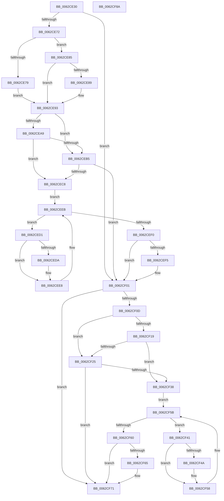

# DifIoSetDeviceToVerifyWrapper

- RVA: `0x0062CE30`–`0x0062CF8B` (길이 `347` bytes)
- VA: `0x000000014062CE30`
- 실행 섹션: `.text`
- PDB 이름 있음: `예`; PDB Function 태그: `아니요`
- unwind 정보 RVA: `0x00093E28`
- 디코드: `95`개 명령, `347/347` bytes 표시
- 미해석 바이트: `0` (있으면 어셈블리에 `.byte`로 보존)

> 이 문서는 커널 이미지의 기계어와 PDB 기호를 분석해 생성했습니다. 4번과 5번은 함수 원형과 자료형을 바이너리 사용 방식에서 추정한 C 해석이며 원본 소스 복구 결과는 아닙니다.

## 1. Dependencies

- 직접 호출 지점: **8**; 고유 호출 대상: **5**
- 직접 호출자로 확인된 함수: **0**
- RIP 상대 이미지 참조: **3**

### Outgoing calls
- `0x0062CE61` → [DifGetAPIThunkContextById](../49/DifGetAPIThunkContextById_function_00495A34.md) (function, `0x00495A34`)
- `0x0062CE89` → [DifGetReturnAddressForWrappers](../4D/DifGetReturnAddressForWrappers_function_004D3C08.md) (function, `0x004D3C08`)
- `0x0062CEBC` → [ExAcquireRundownProtection](../21/ExAcquireRundownProtection_function_00216620.md) (function, `0x00216620`)
- `0x0062CEE3` → [guard_dispatch_icall](../6B/guard_dispatch_icall_function_006BAAD0.md) (function, `0x006BAAD0`)
- `0x0062CEFC` → [ExReleaseRundownProtection](../34/ExReleaseRundownProtection_function_00349E80.md) (function, `0x00349E80`)
- `0x0062CF2C` → [ExAcquireRundownProtection](../21/ExAcquireRundownProtection_function_00216620.md) (function, `0x00216620`)
- `0x0062CF53` → [guard_dispatch_icall](../6B/guard_dispatch_icall_function_006BAAD0.md) (function, `0x006BAAD0`)
- `0x0062CF6C` → [ExReleaseRundownProtection](../34/ExReleaseRundownProtection_function_00349E80.md) (function, `0x00349E80`)

### Direct callers
- 이 함수 시작 RVA로 연결되는 직접 call은 확인되지 않았습니다. 간접 호출은 완전히 역산할 수 없습니다.

### Static image references
- `0x0062CE9B` → RVA `0x00F048B8` (`.data`; read)
- `0x0062CEA9` → RVA `0x00F04980` (`.data`; read)
- `0x0062CEB5` → RVA `0x00F03E80` (`.data`; read)

## 2. Other-region calls and transfers

- 다른 실행 섹션으로 향하는 call: **0**
- 별도 외부 분기/꼬리 이동을 확인하지 못했습니다.

## 3. Assembly (complete function range)

```asm
0062CE30  4C 8B DC                        mov r11, rsp
0062CE33  49 89 5B 08                     mov qword ptr [r11 + 8], rbx
0062CE37  49 89 6B 10                     mov qword ptr [r11 + 0x10], rbp
0062CE3B  49 89 73 18                     mov qword ptr [r11 + 0x18], rsi
0062CE3F  57                              push rdi
0062CE40  41 56                           push r14
0062CE42  41 57                           push r15
0062CE44  48 83 EC 40                     sub rsp, 0x40
0062CE48  33 C0                           xor eax, eax
0062CE4A  0F 57 C0                        xorps xmm0, xmm0
0062CE4D  0F 11 44 24 20                  movups xmmword ptr [rsp + 0x20], xmm0
0062CE52  4C 8B F9                        mov r15, rcx
0062CE55  49 89 43 D8                     mov qword ptr [r11 - 0x28], rax
0062CE59  B9 38 01 00 00                  mov ecx, 0x138
0062CE5E  4C 8B F2                        mov r14, rdx
0062CE61  E8 CE 8B E6 FF                  call 0x140495a34
0062CE66  48 8B F0                        mov rsi, rax
0062CE69  48 85 C0                        test rax, rax
0062CE6C  0F 84 8F 00 00 00               je 0x14062cf01
0062CE72  8B 40 0C                        mov eax, dword ptr [rax + 0xc]
0062CE75  A8 18                           test al, 0x18
0062CE77  74 0C                           je 0x14062ce85
0062CE79  48 8B 4C 24 58                  mov rcx, qword ptr [rsp + 0x58]
0062CE7E  48 89 4C 24 20                  mov qword ptr [rsp + 0x20], rcx
0062CE83  EB 0E                           jmp 0x14062ce93
0062CE85  A8 04                           test al, 4
0062CE87  74 0A                           je 0x14062ce93
0062CE89  E8 7A 6D EA FF                  call 0x1404d3c08
0062CE8E  48 89 44 24 20                  mov qword ptr [rsp + 0x20], rax
0062CE93  40 32 ED                        xor bpl, bpl
0062CE96  4C 89 7C 24 30                  mov qword ptr [rsp + 0x30], r15
0062CE9B  40 38 2D 16 7A 8D 00            cmp byte ptr [rip + 0x8d7a16], bpl
0062CEA2  4C 89 74 24 28                  mov qword ptr [rsp + 0x28], r14
0062CEA7  75 0C                           jne 0x14062ceb5
0062CEA9  F7 05 CD 7A 8D 00 00 08 00 00   test dword ptr [rip + 0x8d7acd], 0x800
0062CEB3  74 13                           je 0x14062cec8
0062CEB5  48 8D 0D C4 6F 8D 00            lea rcx, [rip + 0x8d6fc4]
0062CEBC  E8 5F 97 BE FF                  call 0x140216620
0062CEC1  40 8A E8                        mov bpl, al
0062CEC4  84 C0                           test al, al
0062CEC6  74 39                           je 0x14062cf01
0062CEC8  48 8D 7E 20                     lea rdi, [rsi + 0x20]
0062CECC  48 8B 1F                        mov rbx, qword ptr [rdi]
0062CECF  EB 1A                           jmp 0x14062ceeb
0062CED1  48 8D 43 F0                     lea rax, [rbx - 0x10]
0062CED5  48 85 C0                        test rax, rax
0062CED8  74 0E                           je 0x14062cee8
0062CEDA  48 8B 40 08                     mov rax, qword ptr [rax + 8]
0062CEDE  48 8D 4C 24 20                  lea rcx, [rsp + 0x20]
0062CEE3  E8 E8 DB 08 00                  call 0x1406baad0
0062CEE8  48 8B 1B                        mov rbx, qword ptr [rbx]
0062CEEB  48 3B DF                        cmp rbx, rdi
0062CEEE  75 E1                           jne 0x14062ced1
0062CEF0  40 84 ED                        test bpl, bpl
0062CEF3  74 0C                           je 0x14062cf01
0062CEF5  48 8D 0D 84 6F 8D 00            lea rcx, [rip + 0x8d6f84]
0062CEFC  E8 7F CF D1 FF                  call 0x140349e80
0062CF01  4D 89 B7 58 05 00 00            mov qword ptr [r15 + 0x558], r14
0062CF08  48 85 F6                        test rsi, rsi
0062CF0B  74 64                           je 0x14062cf71
0062CF0D  40 32 FF                        xor dil, dil
0062CF10  40 38 3D A1 79 8D 00            cmp byte ptr [rip + 0x8d79a1], dil
0062CF17  75 0C                           jne 0x14062cf25
0062CF19  F7 05 5D 7A 8D 00 00 08 00 00   test dword ptr [rip + 0x8d7a5d], 0x800
0062CF23  74 13                           je 0x14062cf38
0062CF25  48 8D 0D 54 6F 8D 00            lea rcx, [rip + 0x8d6f54]
0062CF2C  E8 EF 96 BE FF                  call 0x140216620
0062CF31  40 8A F8                        mov dil, al
0062CF34  84 C0                           test al, al
0062CF36  74 39                           je 0x14062cf71
0062CF38  48 83 C6 30                     add rsi, 0x30
0062CF3C  48 8B 1E                        mov rbx, qword ptr [rsi]
0062CF3F  EB 1A                           jmp 0x14062cf5b
0062CF41  48 8D 43 F0                     lea rax, [rbx - 0x10]
0062CF45  48 85 C0                        test rax, rax
0062CF48  74 0E                           je 0x14062cf58
0062CF4A  48 8B 40 08                     mov rax, qword ptr [rax + 8]
0062CF4E  48 8D 4C 24 20                  lea rcx, [rsp + 0x20]
0062CF53  E8 78 DB 08 00                  call 0x1406baad0
0062CF58  48 8B 1B                        mov rbx, qword ptr [rbx]
0062CF5B  48 3B DE                        cmp rbx, rsi
0062CF5E  75 E1                           jne 0x14062cf41
0062CF60  40 84 FF                        test dil, dil
0062CF63  74 0C                           je 0x14062cf71
0062CF65  48 8D 0D 14 6F 8D 00            lea rcx, [rip + 0x8d6f14]
0062CF6C  E8 0F CF D1 FF                  call 0x140349e80
0062CF71  48 8B 5C 24 60                  mov rbx, qword ptr [rsp + 0x60]
0062CF76  48 8B 6C 24 68                  mov rbp, qword ptr [rsp + 0x68]
0062CF7B  48 8B 74 24 70                  mov rsi, qword ptr [rsp + 0x70]
0062CF80  48 83 C4 40                     add rsp, 0x40
0062CF84  41 5F                           pop r15
0062CF86  41 5E                           pop r14
0062CF88  5F                              pop rdi
0062CF89  C3                              ret
0062CF8A  CC                              int3
```

## 4. C-style interpretation (structured pseudocode)

```c
__int64 __fastcall DifIoSetDeviceToVerifyWrapper(__int64 a1, __int64 a2)
{
    __int64 result;
    __int64 v_rbp;
    __int64 v_rdi;
    __int64 v_rsi;
    __int64 v_rsp;
    unsigned __int64 v_stack_m28;
    unsigned __int64 v_stack_m30;
    unsigned __int64 v_stack_m38;
    unsigned __int64 v_stack_p0;
    unsigned __int64 v_stack_p10;
    unsigned __int64 v_stack_p18;
    unsigned __int64 v_stack_p8;

    *(unsigned __int64 *)(v_rsp + 8) = v_rbx;
    *(unsigned __int64 *)(v_rsp + 16) = v_rbp;
    *(unsigned __int64 *)(v_rsp + 24) = v_rsi;
    v_rsp = (v_rsp) - (64);
    result = 0;
    v_stack_m38 = v_xmm0;
    *(unsigned __int64 *)(v_rsp - 40) = 0;
    result = DifGetAPIThunkContextById(312, a2, a3, a4);
    if (result == 0) goto loc_0062CF01;
    if ((((unsigned __int8)((unsigned int)(*(unsigned int *)(result + 12)))) & (24)) == 0) goto loc_0062CE85;
    v_stack_m38 = v_stack_p0;
    goto loc_0062CE93;
loc_0062CE85:
    result = (unsigned int)(*(unsigned int *)(result + 12));
    if ((((unsigned __int8)((unsigned int)(*(unsigned int *)(result + 12)))) & (4)) != 0) {
        result = DifGetReturnAddressForWrappers(v_stack_p0, a2, a3, a4);
        v_stack_m38 = result;
    }
    v_rbp = 0;
    v_stack_m28 = a1;
    v_stack_m30 = a2;
    if ((*(unsigned __int8 *)(v_rip + 9271830)) != 0) goto loc_0062CEB5;
    if (((*(unsigned int *)(v_rip + 9272013)) & (0x800ULL)) == 0) goto loc_0062CEC8;
loc_0062CEB5:
    result = ExAcquireRundownProtection(v_rip + 9269188, a2, a3, a4);
    if ((unsigned __int8)(result) == 0) goto loc_0062CF01;
loc_0062CEC8:
    goto loc_0062CEEB;
loc_0062CED1:
    result = *(unsigned __int64 *)(result + 32) - 16;
    if (*(unsigned __int64 *)(result + 32) - 16 != 0) {
        result = *(unsigned __int64 *)(*(unsigned __int64 *)(result + 32) - 16 + 8);
        a1 = v_stack_m38;
        result = guard_dispatch_icall(a1, a2, a3, a4);
    }
loc_0062CEEB:
    if ((*(unsigned __int64 *)(*(unsigned __int64 *)(result + 32))) != (result + 32)) goto loc_0062CED1;
    if ((unsigned __int8)((unsigned __int8)(result)) != 0) {
        a1 = v_rip + 9269124;
        result = ExReleaseRundownProtection(a1, a2, a3, a4);
    }
    *(unsigned __int64 *)(a1 + 1368) = a2;
    if (result == 0) goto loc_0062CF71;
    v_rdi = 0;
    if ((*(unsigned __int8 *)(v_rip + 9271713)) != 0) goto loc_0062CF25;
    if (((*(unsigned int *)(v_rip + 9271901)) & (0x800ULL)) == 0) goto loc_0062CF38;
loc_0062CF25:
    result = ExAcquireRundownProtection(v_rip + 9269076, a2, a3, a4);
    if ((unsigned __int8)(result) == 0) goto loc_0062CF71;
loc_0062CF38:
    v_rsi = (result) + (48);
    goto loc_0062CF5B;
loc_0062CF41:
    result = *(unsigned __int64 *)(v_rsi) - 16;
    if (*(unsigned __int64 *)(v_rsi) - 16 != 0) {
        result = *(unsigned __int64 *)(*(unsigned __int64 *)(v_rsi) - 16 + 8);
        a1 = v_stack_m38;
        result = guard_dispatch_icall(a1, a2, a3, a4);
    }
loc_0062CF5B:
    if ((*(unsigned __int64 *)(*(unsigned __int64 *)(v_rsi))) != v_rsi) goto loc_0062CF41;
    if ((unsigned __int8)((unsigned __int8)(result)) != 0) {
        a1 = v_rip + 9269012;
        result = ExReleaseRundownProtection(a1, a2, a3, a4);
    }
    v_rsp = (v_rsp) + (64);
    return result;
}
```

## 5. (Beta) C Style

```c
int64_t DifIoSetDeviceToVerifyWrapper(void *Arg1, int64_t Arg2)
{
    uint8_t *arg1 = (uint8_t *)Arg1;

    int64_t result;
    int64_t local_rbp;
    int64_t local_rdi;
    int64_t local_rsi;
    int64_t local_rsp;
    uint64_t v_stack_m28;
    uint64_t v_stack_m30;
    uint64_t v_stack_m38;
    uint64_t v_stack_p0;
    uint64_t v_stack_p10;
    uint64_t v_stack_p18;
    uint64_t v_stack_p8;

    *(uint64_t *)(local_rsp + 0x8) = local_rbx;
    *(uint64_t *)(local_rsp + 0x10) = local_rbp;
    *(uint64_t *)(local_rsp + 0x18) = local_rsi;
    local_rsp = (local_rsp) - (64);
    result = 0;
    v_stack_m38 = v_xmm0;
    *(uint64_t *)(local_rsp - 0x28) = 0;
    result = DifGetAPIThunkContextById(312, Arg2, a3, a4);
    if (result == 0) goto loc_0062CF01;
    if ((((uint8_t)((uint32_t)(*(uint32_t *)(result + 0xC)))) & (24)) == 0) goto loc_0062CE85;
    v_stack_m38 = v_stack_p0;
    goto loc_0062CE93;
loc_0062CE85:
    result = (uint32_t)(*(uint32_t *)(result + 0xC));
    if ((((uint8_t)((uint32_t)(*(uint32_t *)(result + 0xC)))) & (4)) != 0) {
        result = DifGetReturnAddressForWrappers(v_stack_p0, Arg2, a3, a4);
        v_stack_m38 = result;
    }
    local_rbp = 0;
    v_stack_m28 = Arg1;
    v_stack_m30 = Arg2;
    if ((*(uint8_t *)(v_rip + 0x8D7A16)) != 0) goto loc_0062CEB5;
    if (((*(uint32_t *)(v_rip + 0x8D7ACD)) & (0x800ULL)) == 0) goto loc_0062CEC8;
loc_0062CEB5:
    result = ExAcquireRundownProtection(v_rip + 9269188, Arg2, a3, a4);
    if ((uint8_t)(result) == 0) goto loc_0062CF01;
loc_0062CEC8:
    goto loc_0062CEEB;
loc_0062CED1:
    result = *(uint64_t *)(result + 0x20) - 16;
    if (*(uint64_t *)(result + 0x20) - 16 != 0) {
        result = *(uint64_t *)(*(uint64_t *)(result + 0x20) - 0x10 + 0x8);
        Arg1 = v_stack_m38;
        result = guard_dispatch_icall(Arg1, Arg2, a3, a4);
    }
loc_0062CEEB:
    if ((*(uint64_t *)(*(uint64_t *)(result + 0x20))) != (result + 32)) goto loc_0062CED1;
    if ((uint8_t)((uint8_t)(result)) != 0) {
        Arg1 = v_rip + 9269124;
        result = ExReleaseRundownProtection(Arg1, Arg2, a3, a4);
    }
    *(uint64_t *)(arg1 + 0x558) = Arg2;
    if (result == 0) goto loc_0062CF71;
    local_rdi = 0;
    if ((*(uint8_t *)(v_rip + 0x8D79A1)) != 0) goto loc_0062CF25;
    if (((*(uint32_t *)(v_rip + 0x8D7A5D)) & (0x800ULL)) == 0) goto loc_0062CF38;
loc_0062CF25:
    result = ExAcquireRundownProtection(v_rip + 9269076, Arg2, a3, a4);
    if ((uint8_t)(result) == 0) goto loc_0062CF71;
loc_0062CF38:
    local_rsi = (result) + (48);
    goto loc_0062CF5B;
loc_0062CF41:
    result = *(uint64_t *)(local_rsi) - 16;
    if (*(uint64_t *)(local_rsi) - 16 != 0) {
        result = *(uint64_t *)(*(uint64_t *)(local_rsi) - 0x10 + 0x8);
        Arg1 = v_stack_m38;
        result = guard_dispatch_icall(Arg1, Arg2, a3, a4);
    }
loc_0062CF5B:
    if ((*(uint64_t *)(*(uint64_t *)(local_rsi))) != local_rsi) goto loc_0062CF41;
    if ((uint8_t)((uint8_t)(result)) != 0) {
        Arg1 = v_rip + 9269012;
        result = ExReleaseRundownProtection(Arg1, Arg2, a3, a4);
    }
    local_rsp = (local_rsp) + (64);
    return result;
}
```

### 관측된 메모리 오프셋

구조체 형식이 확인되지 않은 접근은 인자 기준의 오프셋으로만 기록했습니다.

| 기준 인자 | 오프셋 표현 | 폭 (bit) | 접근 |
|---|---:|---:|---|
| `Arg1` | `+ 0x558` | `64` | `W` |

## 6. Execution-region graph

[열기: 2D/3D 그래프와 함수 탐색 컨트롤 패널](../../../control-panel.html?section=text&rva=0x0062CE30&view=graph)

- 2D 그래프는 위에서 아래로 흐르고, 3D 그래프는 빈 공간을 드래그해 회전합니다. Shift+드래그는 이동, 휠은 확대·축소, 함수 노드 선택은 대상 보고서 이동입니다.

### Static fallback


