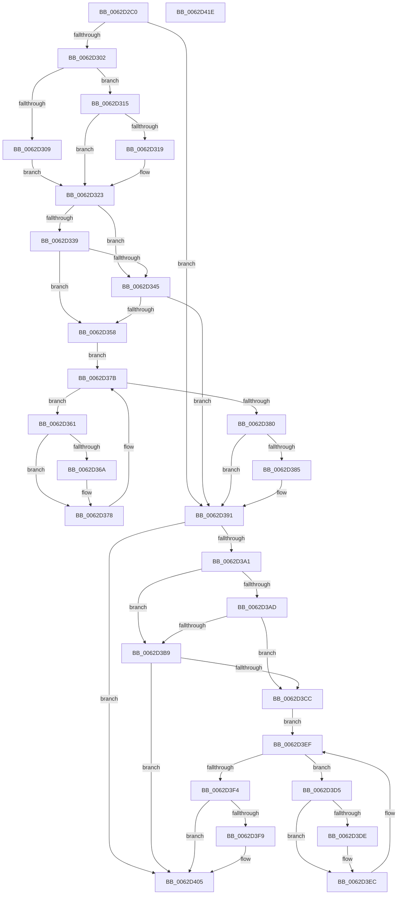

# DifIoStartNextPacketWrapper

- RVA: `0x0062D2C0`–`0x0062D41F` (길이 `351` bytes)
- VA: `0x000000014062D2C0`
- 실행 섹션: `.text`
- PDB 이름 있음: `예`; PDB Function 태그: `아니요`
- unwind 정보 RVA: `0x00093E28`
- 디코드: `97`개 명령, `351/351` bytes 표시
- 미해석 바이트: `0` (있으면 어셈블리에 `.byte`로 보존)

> 이 문서는 커널 이미지의 기계어와 PDB 기호를 분석해 생성했습니다. 4번과 5번은 함수 원형과 자료형을 바이너리 사용 방식에서 추정한 C 해석이며 원본 소스 복구 결과는 아닙니다.

## 1. Dependencies

- 직접 호출 지점: **9**; 고유 호출 대상: **6**
- 직접 호출자로 확인된 함수: **0**
- RIP 상대 이미지 참조: **3**

### Outgoing calls
- `0x0062D2F1` → [DifGetAPIThunkContextById](../49/DifGetAPIThunkContextById_function_00495A34.md) (function, `0x00495A34`)
- `0x0062D319` → [DifGetReturnAddressForWrappers](../4D/DifGetReturnAddressForWrappers_function_004D3C08.md) (function, `0x004D3C08`)
- `0x0062D34C` → [ExAcquireRundownProtection](../21/ExAcquireRundownProtection_function_00216620.md) (function, `0x00216620`)
- `0x0062D373` → [guard_dispatch_icall](../6B/guard_dispatch_icall_function_006BAAD0.md) (function, `0x006BAAD0`)
- `0x0062D38C` → [ExReleaseRundownProtection](../34/ExReleaseRundownProtection_function_00349E80.md) (function, `0x00349E80`)
- `0x0062D397` → [IoStartNextPacket](../45/IoStartNextPacket_function_0045F8A0.md) (function, `0x0045F8A0`)
- `0x0062D3C0` → [ExAcquireRundownProtection](../21/ExAcquireRundownProtection_function_00216620.md) (function, `0x00216620`)
- `0x0062D3E7` → [guard_dispatch_icall](../6B/guard_dispatch_icall_function_006BAAD0.md) (function, `0x006BAAD0`)
- `0x0062D400` → [ExReleaseRundownProtection](../34/ExReleaseRundownProtection_function_00349E80.md) (function, `0x00349E80`)

### Direct callers
- 이 함수 시작 RVA로 연결되는 직접 call은 확인되지 않았습니다. 간접 호출은 완전히 역산할 수 없습니다.

### Static image references
- `0x0062D32B` → RVA `0x00F048B8` (`.data`; read)
- `0x0062D339` → RVA `0x00F04980` (`.data`; read)
- `0x0062D345` → RVA `0x00F03E80` (`.data`; read)

## 2. Other-region calls and transfers

- 다른 실행 섹션으로 향하는 call: **0**
- 별도 외부 분기/꼬리 이동을 확인하지 못했습니다.

## 3. Assembly (complete function range)

```asm
0062D2C0  4C 8B DC                        mov r11, rsp
0062D2C3  49 89 5B 08                     mov qword ptr [r11 + 8], rbx
0062D2C7  49 89 6B 10                     mov qword ptr [r11 + 0x10], rbp
0062D2CB  49 89 73 18                     mov qword ptr [r11 + 0x18], rsi
0062D2CF  57                              push rdi
0062D2D0  41 56                           push r14
0062D2D2  41 57                           push r15
0062D2D4  48 83 EC 40                     sub rsp, 0x40
0062D2D8  33 C0                           xor eax, eax
0062D2DA  0F 57 C0                        xorps xmm0, xmm0
0062D2DD  0F 11 44 24 20                  movups xmmword ptr [rsp + 0x20], xmm0
0062D2E2  4C 8B F9                        mov r15, rcx
0062D2E5  49 89 43 D8                     mov qword ptr [r11 - 0x28], rax
0062D2E9  B9 35 01 00 00                  mov ecx, 0x135
0062D2EE  44 8A F2                        mov r14b, dl
0062D2F1  E8 3E 87 E6 FF                  call 0x140495a34
0062D2F6  48 8B F0                        mov rsi, rax
0062D2F9  48 85 C0                        test rax, rax
0062D2FC  0F 84 8F 00 00 00               je 0x14062d391
0062D302  8B 40 0C                        mov eax, dword ptr [rax + 0xc]
0062D305  A8 18                           test al, 0x18
0062D307  74 0C                           je 0x14062d315
0062D309  48 8B 4C 24 58                  mov rcx, qword ptr [rsp + 0x58]
0062D30E  48 89 4C 24 20                  mov qword ptr [rsp + 0x20], rcx
0062D313  EB 0E                           jmp 0x14062d323
0062D315  A8 04                           test al, 4
0062D317  74 0A                           je 0x14062d323
0062D319  E8 EA 68 EA FF                  call 0x1404d3c08
0062D31E  48 89 44 24 20                  mov qword ptr [rsp + 0x20], rax
0062D323  40 32 ED                        xor bpl, bpl
0062D326  4C 89 7C 24 30                  mov qword ptr [rsp + 0x30], r15
0062D32B  40 38 2D 86 75 8D 00            cmp byte ptr [rip + 0x8d7586], bpl
0062D332  44 88 74 24 28                  mov byte ptr [rsp + 0x28], r14b
0062D337  75 0C                           jne 0x14062d345
0062D339  F7 05 3D 76 8D 00 00 08 00 00   test dword ptr [rip + 0x8d763d], 0x800
0062D343  74 13                           je 0x14062d358
0062D345  48 8D 0D 34 6B 8D 00            lea rcx, [rip + 0x8d6b34]
0062D34C  E8 CF 92 BE FF                  call 0x140216620
0062D351  40 8A E8                        mov bpl, al
0062D354  84 C0                           test al, al
0062D356  74 39                           je 0x14062d391
0062D358  48 8D 7E 20                     lea rdi, [rsi + 0x20]
0062D35C  48 8B 1F                        mov rbx, qword ptr [rdi]
0062D35F  EB 1A                           jmp 0x14062d37b
0062D361  48 8D 43 F0                     lea rax, [rbx - 0x10]
0062D365  48 85 C0                        test rax, rax
0062D368  74 0E                           je 0x14062d378
0062D36A  48 8B 40 08                     mov rax, qword ptr [rax + 8]
0062D36E  48 8D 4C 24 20                  lea rcx, [rsp + 0x20]
0062D373  E8 58 D7 08 00                  call 0x1406baad0
0062D378  48 8B 1B                        mov rbx, qword ptr [rbx]
0062D37B  48 3B DF                        cmp rbx, rdi
0062D37E  75 E1                           jne 0x14062d361
0062D380  40 84 ED                        test bpl, bpl
0062D383  74 0C                           je 0x14062d391
0062D385  48 8D 0D F4 6A 8D 00            lea rcx, [rip + 0x8d6af4]
0062D38C  E8 EF CA D1 FF                  call 0x140349e80
0062D391  41 8A D6                        mov dl, r14b
0062D394  49 8B CF                        mov rcx, r15
0062D397  E8 04 25 E3 FF                  call 0x14045f8a0
0062D39C  48 85 F6                        test rsi, rsi
0062D39F  74 64                           je 0x14062d405
0062D3A1  40 32 FF                        xor dil, dil
0062D3A4  40 38 3D 0D 75 8D 00            cmp byte ptr [rip + 0x8d750d], dil
0062D3AB  75 0C                           jne 0x14062d3b9
0062D3AD  F7 05 C9 75 8D 00 00 08 00 00   test dword ptr [rip + 0x8d75c9], 0x800
0062D3B7  74 13                           je 0x14062d3cc
0062D3B9  48 8D 0D C0 6A 8D 00            lea rcx, [rip + 0x8d6ac0]
0062D3C0  E8 5B 92 BE FF                  call 0x140216620
0062D3C5  40 8A F8                        mov dil, al
0062D3C8  84 C0                           test al, al
0062D3CA  74 39                           je 0x14062d405
0062D3CC  48 83 C6 30                     add rsi, 0x30
0062D3D0  48 8B 1E                        mov rbx, qword ptr [rsi]
0062D3D3  EB 1A                           jmp 0x14062d3ef
0062D3D5  48 8D 43 F0                     lea rax, [rbx - 0x10]
0062D3D9  48 85 C0                        test rax, rax
0062D3DC  74 0E                           je 0x14062d3ec
0062D3DE  48 8B 40 08                     mov rax, qword ptr [rax + 8]
0062D3E2  48 8D 4C 24 20                  lea rcx, [rsp + 0x20]
0062D3E7  E8 E4 D6 08 00                  call 0x1406baad0
0062D3EC  48 8B 1B                        mov rbx, qword ptr [rbx]
0062D3EF  48 3B DE                        cmp rbx, rsi
0062D3F2  75 E1                           jne 0x14062d3d5
0062D3F4  40 84 FF                        test dil, dil
0062D3F7  74 0C                           je 0x14062d405
0062D3F9  48 8D 0D 80 6A 8D 00            lea rcx, [rip + 0x8d6a80]
0062D400  E8 7B CA D1 FF                  call 0x140349e80
0062D405  48 8B 5C 24 60                  mov rbx, qword ptr [rsp + 0x60]
0062D40A  48 8B 6C 24 68                  mov rbp, qword ptr [rsp + 0x68]
0062D40F  48 8B 74 24 70                  mov rsi, qword ptr [rsp + 0x70]
0062D414  48 83 C4 40                     add rsp, 0x40
0062D418  41 5F                           pop r15
0062D41A  41 5E                           pop r14
0062D41C  5F                              pop rdi
0062D41D  C3                              ret
0062D41E  CC                              int3
```

## 4. C-style interpretation (structured pseudocode)

```c
__int64 __fastcall DifIoStartNextPacketWrapper(__int64 a1, unsigned __int8 a2)
{
    __int64 result;
    __int64 v_rbp;
    __int64 v_rdi;
    __int64 v_rsi;
    __int64 v_rsp;
    unsigned __int64 v_stack_m28;
    unsigned __int8 v_stack_m30;
    unsigned __int64 v_stack_m38;
    unsigned __int64 v_stack_p0;
    unsigned __int64 v_stack_p10;
    unsigned __int64 v_stack_p18;
    unsigned __int64 v_stack_p8;

    *(unsigned __int64 *)(v_rsp + 8) = v_rbx;
    *(unsigned __int64 *)(v_rsp + 16) = v_rbp;
    *(unsigned __int64 *)(v_rsp + 24) = v_rsi;
    v_rsp = (v_rsp) - (64);
    result = 0;
    v_stack_m38 = v_xmm0;
    *(unsigned __int64 *)(v_rsp - 40) = 0;
    result = DifGetAPIThunkContextById(309, a2, a3, a4);
    if (result == 0) goto loc_0062D391;
    if ((((unsigned __int8)((unsigned int)(*(unsigned int *)(result + 12)))) & (24)) == 0) goto loc_0062D315;
    v_stack_m38 = v_stack_p0;
    goto loc_0062D323;
loc_0062D315:
    result = (unsigned int)(*(unsigned int *)(result + 12));
    if ((((unsigned __int8)((unsigned int)(*(unsigned int *)(result + 12)))) & (4)) != 0) {
        result = DifGetReturnAddressForWrappers(v_stack_p0, a2, a3, a4);
        v_stack_m38 = result;
    }
    v_rbp = 0;
    v_stack_m28 = a1;
    v_stack_m30 = a2;
    if ((*(unsigned __int8 *)(v_rip + 9270662)) != 0) goto loc_0062D345;
    if (((*(unsigned int *)(v_rip + 9270845)) & (0x800ULL)) == 0) goto loc_0062D358;
loc_0062D345:
    result = ExAcquireRundownProtection(v_rip + 9268020, a2, a3, a4);
    if ((unsigned __int8)(result) == 0) goto loc_0062D391;
loc_0062D358:
    goto loc_0062D37B;
loc_0062D361:
    result = *(unsigned __int64 *)(result + 32) - 16;
    if (*(unsigned __int64 *)(result + 32) - 16 != 0) {
        result = *(unsigned __int64 *)(*(unsigned __int64 *)(result + 32) - 16 + 8);
        a1 = v_stack_m38;
        result = guard_dispatch_icall(a1, a2, a3, a4);
    }
loc_0062D37B:
    if ((*(unsigned __int64 *)(*(unsigned __int64 *)(result + 32))) != (result + 32)) goto loc_0062D361;
    if ((unsigned __int8)((unsigned __int8)(result)) != 0) {
        a1 = v_rip + 9267956;
        result = ExReleaseRundownProtection(a1, a2, a3, a4);
    }
    result = IoStartNextPacket(a1, a2, a3, a4);
    if (result == 0) goto loc_0062D405;
    v_rdi = 0;
    if ((*(unsigned __int8 *)(v_rip + 9270541)) != 0) goto loc_0062D3B9;
    if (((*(unsigned int *)(v_rip + 9270729)) & (0x800ULL)) == 0) goto loc_0062D3CC;
loc_0062D3B9:
    result = ExAcquireRundownProtection(v_rip + 9267904, a2, a3, a4);
    if ((unsigned __int8)(result) == 0) goto loc_0062D405;
loc_0062D3CC:
    v_rsi = (result) + (48);
    goto loc_0062D3EF;
loc_0062D3D5:
    result = *(unsigned __int64 *)(v_rsi) - 16;
    if (*(unsigned __int64 *)(v_rsi) - 16 != 0) {
        result = *(unsigned __int64 *)(*(unsigned __int64 *)(v_rsi) - 16 + 8);
        a1 = v_stack_m38;
        result = guard_dispatch_icall(a1, a2, a3, a4);
    }
loc_0062D3EF:
    if ((*(unsigned __int64 *)(*(unsigned __int64 *)(v_rsi))) != v_rsi) goto loc_0062D3D5;
    if ((unsigned __int8)((unsigned __int8)(result)) != 0) {
        a1 = v_rip + 9267840;
        result = ExReleaseRundownProtection(a1, a2, a3, a4);
    }
    v_rsp = (v_rsp) + (64);
    return result;
}
```

## 5. (Beta) C Style

```c
int64_t DifIoStartNextPacketWrapper(int64_t Arg1, uint8_t Arg2)
{
    int64_t result;
    int64_t local_rbp;
    int64_t local_rdi;
    int64_t local_rsi;
    int64_t local_rsp;
    uint64_t v_stack_m28;
    uint8_t v_stack_m30;
    uint64_t v_stack_m38;
    uint64_t v_stack_p0;
    uint64_t v_stack_p10;
    uint64_t v_stack_p18;
    uint64_t v_stack_p8;

    *(uint64_t *)(local_rsp + 0x8) = local_rbx;
    *(uint64_t *)(local_rsp + 0x10) = local_rbp;
    *(uint64_t *)(local_rsp + 0x18) = local_rsi;
    local_rsp = (local_rsp) - (64);
    result = 0;
    v_stack_m38 = v_xmm0;
    *(uint64_t *)(local_rsp - 0x28) = 0;
    result = DifGetAPIThunkContextById(309, Arg2, a3, a4);
    if (result == 0) goto loc_0062D391;
    if ((((uint8_t)((uint32_t)(*(uint32_t *)(result + 0xC)))) & (24)) == 0) goto loc_0062D315;
    v_stack_m38 = v_stack_p0;
    goto loc_0062D323;
loc_0062D315:
    result = (uint32_t)(*(uint32_t *)(result + 0xC));
    if ((((uint8_t)((uint32_t)(*(uint32_t *)(result + 0xC)))) & (4)) != 0) {
        result = DifGetReturnAddressForWrappers(v_stack_p0, Arg2, a3, a4);
        v_stack_m38 = result;
    }
    local_rbp = 0;
    v_stack_m28 = Arg1;
    v_stack_m30 = Arg2;
    if ((*(uint8_t *)(v_rip + 0x8D7586)) != 0) goto loc_0062D345;
    if (((*(uint32_t *)(v_rip + 0x8D763D)) & (0x800ULL)) == 0) goto loc_0062D358;
loc_0062D345:
    result = ExAcquireRundownProtection(v_rip + 9268020, Arg2, a3, a4);
    if ((uint8_t)(result) == 0) goto loc_0062D391;
loc_0062D358:
    goto loc_0062D37B;
loc_0062D361:
    result = *(uint64_t *)(result + 0x20) - 16;
    if (*(uint64_t *)(result + 0x20) - 16 != 0) {
        result = *(uint64_t *)(*(uint64_t *)(result + 0x20) - 0x10 + 0x8);
        Arg1 = v_stack_m38;
        result = guard_dispatch_icall(Arg1, Arg2, a3, a4);
    }
loc_0062D37B:
    if ((*(uint64_t *)(*(uint64_t *)(result + 0x20))) != (result + 32)) goto loc_0062D361;
    if ((uint8_t)((uint8_t)(result)) != 0) {
        Arg1 = v_rip + 9267956;
        result = ExReleaseRundownProtection(Arg1, Arg2, a3, a4);
    }
    result = IoStartNextPacket(Arg1, Arg2, a3, a4);
    if (result == 0) goto loc_0062D405;
    local_rdi = 0;
    if ((*(uint8_t *)(v_rip + 0x8D750D)) != 0) goto loc_0062D3B9;
    if (((*(uint32_t *)(v_rip + 0x8D75C9)) & (0x800ULL)) == 0) goto loc_0062D3CC;
loc_0062D3B9:
    result = ExAcquireRundownProtection(v_rip + 9267904, Arg2, a3, a4);
    if ((uint8_t)(result) == 0) goto loc_0062D405;
loc_0062D3CC:
    local_rsi = (result) + (48);
    goto loc_0062D3EF;
loc_0062D3D5:
    result = *(uint64_t *)(local_rsi) - 16;
    if (*(uint64_t *)(local_rsi) - 16 != 0) {
        result = *(uint64_t *)(*(uint64_t *)(local_rsi) - 0x10 + 0x8);
        Arg1 = v_stack_m38;
        result = guard_dispatch_icall(Arg1, Arg2, a3, a4);
    }
loc_0062D3EF:
    if ((*(uint64_t *)(*(uint64_t *)(local_rsi))) != local_rsi) goto loc_0062D3D5;
    if ((uint8_t)((uint8_t)(result)) != 0) {
        Arg1 = v_rip + 9267840;
        result = ExReleaseRundownProtection(Arg1, Arg2, a3, a4);
    }
    local_rsp = (local_rsp) + (64);
    return result;
}
```

## 6. Execution-region graph

[열기: 2D/3D 그래프와 함수 탐색 컨트롤 패널](../../../control-panel.html?section=text&rva=0x0062D2C0&view=graph)

- 2D 그래프는 위에서 아래로 흐르고, 3D 그래프는 빈 공간을 드래그해 회전합니다. Shift+드래그는 이동, 휠은 확대·축소, 함수 노드 선택은 대상 보고서 이동입니다.

### Static fallback


