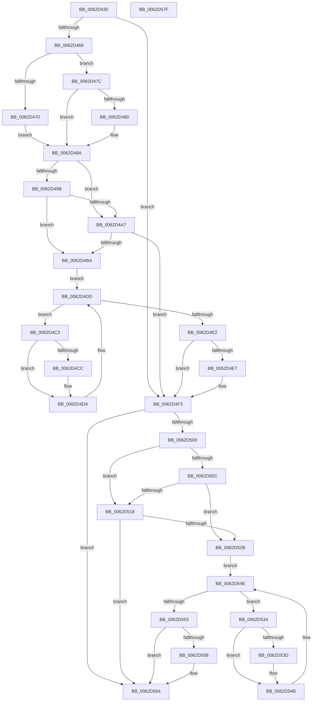

# DifIoUnregisterShutdownNotificationWrapper

- RVA: `0x0062D430`–`0x0062D580` (길이 `336` bytes)
- VA: `0x000000014062D430`
- 실행 섹션: `.text`
- PDB 이름 있음: `예`; PDB Function 태그: `아니요`
- unwind 정보 RVA: `0x0005D7BC`
- 디코드: `90`개 명령, `336/336` bytes 표시
- 미해석 바이트: `0` (있으면 어셈블리에 `.byte`로 보존)

> 이 문서는 커널 이미지의 기계어와 PDB 기호를 분석해 생성했습니다. 4번과 5번은 함수 원형과 자료형을 바이너리 사용 방식에서 추정한 C 해석이며 원본 소스 복구 결과는 아닙니다.

## 1. Dependencies

- 직접 호출 지점: **9**; 고유 호출 대상: **6**
- 직접 호출자로 확인된 함수: **0**
- RIP 상대 이미지 참조: **3**

### Outgoing calls
- `0x0062D458` → [DifGetAPIThunkContextById](../49/DifGetAPIThunkContextById_function_00495A34.md) (function, `0x00495A34`)
- `0x0062D480` → [DifGetReturnAddressForWrappers](../4D/DifGetReturnAddressForWrappers_function_004D3C08.md) (function, `0x004D3C08`)
- `0x0062D4AE` → [ExAcquireRundownProtection](../21/ExAcquireRundownProtection_function_00216620.md) (function, `0x00216620`)
- `0x0062D4D5` → [guard_dispatch_icall](../6B/guard_dispatch_icall_function_006BAAD0.md) (function, `0x006BAAD0`)
- `0x0062D4EE` → [ExReleaseRundownProtection](../34/ExReleaseRundownProtection_function_00349E80.md) (function, `0x00349E80`)
- `0x0062D4F6` → [IoUnregisterShutdownNotification](../../pagelk/B7/IoUnregisterShutdownNotification_function_00B7CCC0.md) (function, `0x00B7CCC0`)
- `0x0062D51F` → [ExAcquireRundownProtection](../21/ExAcquireRundownProtection_function_00216620.md) (function, `0x00216620`)
- `0x0062D546` → [guard_dispatch_icall](../6B/guard_dispatch_icall_function_006BAAD0.md) (function, `0x006BAAD0`)
- `0x0062D55F` → [ExReleaseRundownProtection](../34/ExReleaseRundownProtection_function_00349E80.md) (function, `0x00349E80`)

### Direct callers
- 이 함수 시작 RVA로 연결되는 직접 call은 확인되지 않았습니다. 간접 호출은 완전히 역산할 수 없습니다.

### Static image references
- `0x0062D492` → RVA `0x00F048B8` (`.data`; read)
- `0x0062D49B` → RVA `0x00F04980` (`.data`; read)
- `0x0062D4A7` → RVA `0x00F03E80` (`.data`; read)

## 2. Other-region calls and transfers

- 다른 실행 섹션으로 향하는 call: **1**
  - `0x0062D4F6` → [IoUnregisterShutdownNotification](../../pagelk/B7/IoUnregisterShutdownNotification_function_00B7CCC0.md) (`.text` → `PAGELK`)
- 별도 외부 분기/꼬리 이동을 확인하지 못했습니다.

## 3. Assembly (complete function range)

```asm
0062D430  48 8B C4                        mov rax, rsp
0062D433  48 89 58 08                     mov qword ptr [rax + 8], rbx
0062D437  48 89 68 10                     mov qword ptr [rax + 0x10], rbp
0062D43B  48 89 70 18                     mov qword ptr [rax + 0x18], rsi
0062D43F  48 89 78 20                     mov qword ptr [rax + 0x20], rdi
0062D443  41 56                           push r14
0062D445  48 83 EC 30                     sub rsp, 0x30
0062D449  48 8B E9                        mov rbp, rcx
0062D44C  0F 57 C0                        xorps xmm0, xmm0
0062D44F  B9 34 01 00 00                  mov ecx, 0x134
0062D454  0F 11 40 E8                     movups xmmword ptr [rax - 0x18], xmm0
0062D458  E8 D7 85 E6 FF                  call 0x140495a34
0062D45D  48 8B F8                        mov rdi, rax
0062D460  48 85 C0                        test rax, rax
0062D463  0F 84 8A 00 00 00               je 0x14062d4f3
0062D469  8B 40 0C                        mov eax, dword ptr [rax + 0xc]
0062D46C  A8 18                           test al, 0x18
0062D46E  74 0C                           je 0x14062d47c
0062D470  48 8B 4C 24 38                  mov rcx, qword ptr [rsp + 0x38]
0062D475  48 89 4C 24 20                  mov qword ptr [rsp + 0x20], rcx
0062D47A  EB 0E                           jmp 0x14062d48a
0062D47C  A8 04                           test al, 4
0062D47E  74 0A                           je 0x14062d48a
0062D480  E8 83 67 EA FF                  call 0x1404d3c08
0062D485  48 89 44 24 20                  mov qword ptr [rsp + 0x20], rax
0062D48A  40 32 F6                        xor sil, sil
0062D48D  48 89 6C 24 28                  mov qword ptr [rsp + 0x28], rbp
0062D492  40 38 35 1F 74 8D 00            cmp byte ptr [rip + 0x8d741f], sil
0062D499  75 0C                           jne 0x14062d4a7
0062D49B  F7 05 DB 74 8D 00 00 08 00 00   test dword ptr [rip + 0x8d74db], 0x800
0062D4A5  74 13                           je 0x14062d4ba
0062D4A7  48 8D 0D D2 69 8D 00            lea rcx, [rip + 0x8d69d2]
0062D4AE  E8 6D 91 BE FF                  call 0x140216620
0062D4B3  40 8A F0                        mov sil, al
0062D4B6  84 C0                           test al, al
0062D4B8  74 39                           je 0x14062d4f3
0062D4BA  4C 8D 77 20                     lea r14, [rdi + 0x20]
0062D4BE  49 8B 1E                        mov rbx, qword ptr [r14]
0062D4C1  EB 1A                           jmp 0x14062d4dd
0062D4C3  48 8D 43 F0                     lea rax, [rbx - 0x10]
0062D4C7  48 85 C0                        test rax, rax
0062D4CA  74 0E                           je 0x14062d4da
0062D4CC  48 8B 40 08                     mov rax, qword ptr [rax + 8]
0062D4D0  48 8D 4C 24 20                  lea rcx, [rsp + 0x20]
0062D4D5  E8 F6 D5 08 00                  call 0x1406baad0
0062D4DA  48 8B 1B                        mov rbx, qword ptr [rbx]
0062D4DD  49 3B DE                        cmp rbx, r14
0062D4E0  75 E1                           jne 0x14062d4c3
0062D4E2  40 84 F6                        test sil, sil
0062D4E5  74 0C                           je 0x14062d4f3
0062D4E7  48 8D 0D 92 69 8D 00            lea rcx, [rip + 0x8d6992]
0062D4EE  E8 8D C9 D1 FF                  call 0x140349e80
0062D4F3  48 8B CD                        mov rcx, rbp
0062D4F6  E8 C5 F7 54 00                  call 0x140b7ccc0
0062D4FB  48 85 FF                        test rdi, rdi
0062D4FE  74 64                           je 0x14062d564
0062D500  40 32 F6                        xor sil, sil
0062D503  40 38 35 AE 73 8D 00            cmp byte ptr [rip + 0x8d73ae], sil
0062D50A  75 0C                           jne 0x14062d518
0062D50C  F7 05 6A 74 8D 00 00 08 00 00   test dword ptr [rip + 0x8d746a], 0x800
0062D516  74 13                           je 0x14062d52b
0062D518  48 8D 0D 61 69 8D 00            lea rcx, [rip + 0x8d6961]
0062D51F  E8 FC 90 BE FF                  call 0x140216620
0062D524  40 8A F0                        mov sil, al
0062D527  84 C0                           test al, al
0062D529  74 39                           je 0x14062d564
0062D52B  48 83 C7 30                     add rdi, 0x30
0062D52F  48 8B 1F                        mov rbx, qword ptr [rdi]
0062D532  EB 1A                           jmp 0x14062d54e
0062D534  48 8D 43 F0                     lea rax, [rbx - 0x10]
0062D538  48 85 C0                        test rax, rax
0062D53B  74 0E                           je 0x14062d54b
0062D53D  48 8B 40 08                     mov rax, qword ptr [rax + 8]
0062D541  48 8D 4C 24 20                  lea rcx, [rsp + 0x20]
0062D546  E8 85 D5 08 00                  call 0x1406baad0
0062D54B  48 8B 1B                        mov rbx, qword ptr [rbx]
0062D54E  48 3B DF                        cmp rbx, rdi
0062D551  75 E1                           jne 0x14062d534
0062D553  40 84 F6                        test sil, sil
0062D556  74 0C                           je 0x14062d564
0062D558  48 8D 0D 21 69 8D 00            lea rcx, [rip + 0x8d6921]
0062D55F  E8 1C C9 D1 FF                  call 0x140349e80
0062D564  48 8B 5C 24 40                  mov rbx, qword ptr [rsp + 0x40]
0062D569  48 8B 6C 24 48                  mov rbp, qword ptr [rsp + 0x48]
0062D56E  48 8B 74 24 50                  mov rsi, qword ptr [rsp + 0x50]
0062D573  48 8B 7C 24 58                  mov rdi, qword ptr [rsp + 0x58]
0062D578  48 83 C4 30                     add rsp, 0x30
0062D57C  41 5E                           pop r14
0062D57E  C3                              ret
0062D57F  CC                              int3
```

## 4. C-style interpretation (structured pseudocode)

```c
__int64 __fastcall DifIoUnregisterShutdownNotificationWrapper(__int64 a1)
{
    __int64 result;
    __int64 v_rdi;
    __int64 v_rsi;
    __int64 v_rsp;
    unsigned __int64 v_stack_m10;
    unsigned __int64 v_stack_m18;
    unsigned __int64 v_stack_p0;
    unsigned __int64 v_stack_p10;
    unsigned __int64 v_stack_p18;
    unsigned __int64 v_stack_p20;
    unsigned __int64 v_stack_p8;

    *(unsigned __int64 *)(v_rsp + 8) = v_rbx;
    *(unsigned __int64 *)(v_rsp + 16) = v_rbp;
    *(unsigned __int64 *)(v_rsp + 24) = v_rsi;
    *(unsigned __int64 *)(v_rsp + 32) = v_rdi;
    v_rsp = (v_rsp) - (48);
    *(unsigned __int64 *)(v_rsp - 24) = v_xmm0;
    result = DifGetAPIThunkContextById(308, a2, a3, a4);
    if (result == 0) goto loc_0062D4F3;
    if ((((unsigned __int8)((unsigned int)(*(unsigned int *)(result + 12)))) & (24)) == 0) goto loc_0062D47C;
    v_stack_m18 = v_stack_p0;
    goto loc_0062D48A;
loc_0062D47C:
    result = (unsigned int)(*(unsigned int *)(result + 12));
    if ((((unsigned __int8)((unsigned int)(*(unsigned int *)(result + 12)))) & (4)) != 0) {
        result = DifGetReturnAddressForWrappers(v_stack_p0, a2, a3, a4);
        v_stack_m18 = result;
    }
    v_rsi = 0;
    v_stack_m10 = a1;
    if ((*(unsigned __int8 *)(v_rip + 9270303)) != 0) goto loc_0062D4A7;
    if (((*(unsigned int *)(v_rip + 9270491)) & (0x800ULL)) == 0) goto loc_0062D4BA;
loc_0062D4A7:
    result = ExAcquireRundownProtection(v_rip + 9267666, a2, a3, a4);
    if ((unsigned __int8)(result) == 0) goto loc_0062D4F3;
loc_0062D4BA:
    goto loc_0062D4DD;
loc_0062D4C3:
    result = *(unsigned __int64 *)(result + 32) - 16;
    if (*(unsigned __int64 *)(result + 32) - 16 != 0) {
        result = *(unsigned __int64 *)(*(unsigned __int64 *)(result + 32) - 16 + 8);
        a1 = v_stack_m18;
        result = guard_dispatch_icall(a1, a2, a3, a4);
    }
loc_0062D4DD:
    if ((*(unsigned __int64 *)(*(unsigned __int64 *)(result + 32))) != (result + 32)) goto loc_0062D4C3;
    if ((unsigned __int8)((unsigned __int8)(result)) != 0) {
        a1 = v_rip + 9267602;
        result = ExReleaseRundownProtection(a1, a2, a3, a4);
    }
    result = IoUnregisterShutdownNotification(a1, a2, a3, a4);
    if (result == 0) goto loc_0062D564;
    v_rsi = 0;
    if ((*(unsigned __int8 *)(v_rip + 9270190)) != 0) goto loc_0062D518;
    if (((*(unsigned int *)(v_rip + 9270378)) & (0x800ULL)) == 0) goto loc_0062D52B;
loc_0062D518:
    result = ExAcquireRundownProtection(v_rip + 9267553, a2, a3, a4);
    if ((unsigned __int8)(result) == 0) goto loc_0062D564;
loc_0062D52B:
    v_rdi = (result) + (48);
    goto loc_0062D54E;
loc_0062D534:
    result = *(unsigned __int64 *)(v_rdi) - 16;
    if (*(unsigned __int64 *)(v_rdi) - 16 != 0) {
        result = *(unsigned __int64 *)(*(unsigned __int64 *)(v_rdi) - 16 + 8);
        a1 = v_stack_m18;
        result = guard_dispatch_icall(a1, a2, a3, a4);
    }
loc_0062D54E:
    if ((*(unsigned __int64 *)(*(unsigned __int64 *)(v_rdi))) != v_rdi) goto loc_0062D534;
    if ((unsigned __int8)((unsigned __int8)(result)) != 0) {
        a1 = v_rip + 9267489;
        result = ExReleaseRundownProtection(a1, a2, a3, a4);
    }
    v_rsp = (v_rsp) + (48);
    return result;
}
```

## 5. (Beta) C Style

```c
int64_t DifIoUnregisterShutdownNotificationWrapper(int64_t Arg1)
{
    int64_t result;
    int64_t local_rdi;
    int64_t local_rsi;
    int64_t local_rsp;
    uint64_t v_stack_m10;
    uint64_t v_stack_m18;
    uint64_t v_stack_p0;
    uint64_t v_stack_p10;
    uint64_t v_stack_p18;
    uint64_t v_stack_p20;
    uint64_t v_stack_p8;

    *(uint64_t *)(local_rsp + 0x8) = local_rbx;
    *(uint64_t *)(local_rsp + 0x10) = local_rbp;
    *(uint64_t *)(local_rsp + 0x18) = local_rsi;
    *(uint64_t *)(local_rsp + 0x20) = local_rdi;
    local_rsp = (local_rsp) - (48);
    *(uint64_t *)(local_rsp - 0x18) = v_xmm0;
    result = DifGetAPIThunkContextById(308, a2, a3, a4);
    if (result == 0) goto loc_0062D4F3;
    if ((((uint8_t)((uint32_t)(*(uint32_t *)(result + 0xC)))) & (24)) == 0) goto loc_0062D47C;
    v_stack_m18 = v_stack_p0;
    goto loc_0062D48A;
loc_0062D47C:
    result = (uint32_t)(*(uint32_t *)(result + 0xC));
    if ((((uint8_t)((uint32_t)(*(uint32_t *)(result + 0xC)))) & (4)) != 0) {
        result = DifGetReturnAddressForWrappers(v_stack_p0, a2, a3, a4);
        v_stack_m18 = result;
    }
    local_rsi = 0;
    v_stack_m10 = Arg1;
    if ((*(uint8_t *)(v_rip + 0x8D741F)) != 0) goto loc_0062D4A7;
    if (((*(uint32_t *)(v_rip + 0x8D74DB)) & (0x800ULL)) == 0) goto loc_0062D4BA;
loc_0062D4A7:
    result = ExAcquireRundownProtection(v_rip + 9267666, a2, a3, a4);
    if ((uint8_t)(result) == 0) goto loc_0062D4F3;
loc_0062D4BA:
    goto loc_0062D4DD;
loc_0062D4C3:
    result = *(uint64_t *)(result + 0x20) - 16;
    if (*(uint64_t *)(result + 0x20) - 16 != 0) {
        result = *(uint64_t *)(*(uint64_t *)(result + 0x20) - 0x10 + 0x8);
        Arg1 = v_stack_m18;
        result = guard_dispatch_icall(Arg1, a2, a3, a4);
    }
loc_0062D4DD:
    if ((*(uint64_t *)(*(uint64_t *)(result + 0x20))) != (result + 32)) goto loc_0062D4C3;
    if ((uint8_t)((uint8_t)(result)) != 0) {
        Arg1 = v_rip + 9267602;
        result = ExReleaseRundownProtection(Arg1, a2, a3, a4);
    }
    result = IoUnregisterShutdownNotification(Arg1, a2, a3, a4);
    if (result == 0) goto loc_0062D564;
    local_rsi = 0;
    if ((*(uint8_t *)(v_rip + 0x8D73AE)) != 0) goto loc_0062D518;
    if (((*(uint32_t *)(v_rip + 0x8D746A)) & (0x800ULL)) == 0) goto loc_0062D52B;
loc_0062D518:
    result = ExAcquireRundownProtection(v_rip + 9267553, a2, a3, a4);
    if ((uint8_t)(result) == 0) goto loc_0062D564;
loc_0062D52B:
    local_rdi = (result) + (48);
    goto loc_0062D54E;
loc_0062D534:
    result = *(uint64_t *)(local_rdi) - 16;
    if (*(uint64_t *)(local_rdi) - 16 != 0) {
        result = *(uint64_t *)(*(uint64_t *)(local_rdi) - 0x10 + 0x8);
        Arg1 = v_stack_m18;
        result = guard_dispatch_icall(Arg1, a2, a3, a4);
    }
loc_0062D54E:
    if ((*(uint64_t *)(*(uint64_t *)(local_rdi))) != local_rdi) goto loc_0062D534;
    if ((uint8_t)((uint8_t)(result)) != 0) {
        Arg1 = v_rip + 9267489;
        result = ExReleaseRundownProtection(Arg1, a2, a3, a4);
    }
    local_rsp = (local_rsp) + (48);
    return result;
}
```

## 6. Execution-region graph

[열기: 2D/3D 그래프와 함수 탐색 컨트롤 패널](../../../control-panel.html?section=text&rva=0x0062D430&view=graph)

- 2D 그래프는 위에서 아래로 흐르고, 3D 그래프는 빈 공간을 드래그해 회전합니다. Shift+드래그는 이동, 휠은 확대·축소, 함수 노드 선택은 대상 보고서 이동입니다.

### Static fallback


