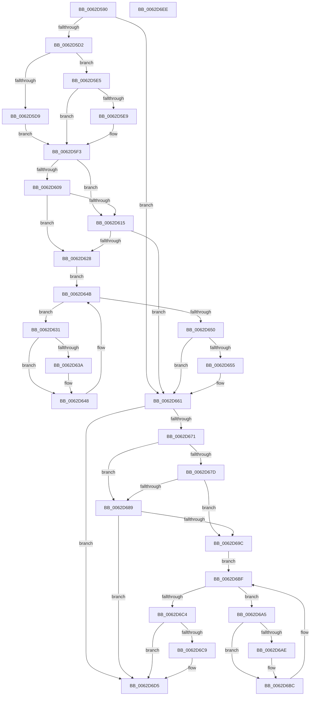

# DifIoUpdateShareAccessWrapper

- RVA: `0x0062D590`–`0x0062D6EF` (길이 `351` bytes)
- VA: `0x000000014062D590`
- 실행 섹션: `.text`
- PDB 이름 있음: `예`; PDB Function 태그: `아니요`
- unwind 정보 RVA: `0x00093E28`
- 디코드: `97`개 명령, `351/351` bytes 표시
- 미해석 바이트: `0` (있으면 어셈블리에 `.byte`로 보존)

> 이 문서는 커널 이미지의 기계어와 PDB 기호를 분석해 생성했습니다. 4번과 5번은 함수 원형과 자료형을 바이너리 사용 방식에서 추정한 C 해석이며 원본 소스 복구 결과는 아닙니다.

## 1. Dependencies

- 직접 호출 지점: **9**; 고유 호출 대상: **6**
- 직접 호출자로 확인된 함수: **0**
- RIP 상대 이미지 참조: **3**

### Outgoing calls
- `0x0062D5C1` → [DifGetAPIThunkContextById](../49/DifGetAPIThunkContextById_function_00495A34.md) (function, `0x00495A34`)
- `0x0062D5E9` → [DifGetReturnAddressForWrappers](../4D/DifGetReturnAddressForWrappers_function_004D3C08.md) (function, `0x004D3C08`)
- `0x0062D61C` → [ExAcquireRundownProtection](../21/ExAcquireRundownProtection_function_00216620.md) (function, `0x00216620`)
- `0x0062D643` → [guard_dispatch_icall](../6B/guard_dispatch_icall_function_006BAAD0.md) (function, `0x006BAAD0`)
- `0x0062D65C` → [ExReleaseRundownProtection](../34/ExReleaseRundownProtection_function_00349E80.md) (function, `0x00349E80`)
- `0x0062D667` → [IoUpdateShareAccess](../../page/9F/IoUpdateShareAccess_function_009FFD40.md) (function, `0x009FFD40`)
- `0x0062D690` → [ExAcquireRundownProtection](../21/ExAcquireRundownProtection_function_00216620.md) (function, `0x00216620`)
- `0x0062D6B7` → [guard_dispatch_icall](../6B/guard_dispatch_icall_function_006BAAD0.md) (function, `0x006BAAD0`)
- `0x0062D6D0` → [ExReleaseRundownProtection](../34/ExReleaseRundownProtection_function_00349E80.md) (function, `0x00349E80`)

### Direct callers
- 이 함수 시작 RVA로 연결되는 직접 call은 확인되지 않았습니다. 간접 호출은 완전히 역산할 수 없습니다.

### Static image references
- `0x0062D5FB` → RVA `0x00F048B8` (`.data`; read)
- `0x0062D609` → RVA `0x00F04980` (`.data`; read)
- `0x0062D615` → RVA `0x00F03E80` (`.data`; read)

## 2. Other-region calls and transfers

- 다른 실행 섹션으로 향하는 call: **1**
  - `0x0062D667` → [IoUpdateShareAccess](../../page/9F/IoUpdateShareAccess_function_009FFD40.md) (`.text` → `PAGE`)
- 별도 외부 분기/꼬리 이동을 확인하지 못했습니다.

## 3. Assembly (complete function range)

```asm
0062D590  4C 8B DC                        mov r11, rsp
0062D593  49 89 5B 08                     mov qword ptr [r11 + 8], rbx
0062D597  49 89 6B 10                     mov qword ptr [r11 + 0x10], rbp
0062D59B  49 89 73 18                     mov qword ptr [r11 + 0x18], rsi
0062D59F  57                              push rdi
0062D5A0  41 56                           push r14
0062D5A2  41 57                           push r15
0062D5A4  48 83 EC 40                     sub rsp, 0x40
0062D5A8  33 C0                           xor eax, eax
0062D5AA  0F 57 C0                        xorps xmm0, xmm0
0062D5AD  0F 11 44 24 20                  movups xmmword ptr [rsp + 0x20], xmm0
0062D5B2  4C 8B F9                        mov r15, rcx
0062D5B5  49 89 43 D8                     mov qword ptr [r11 - 0x28], rax
0062D5B9  B9 33 01 00 00                  mov ecx, 0x133
0062D5BE  4C 8B F2                        mov r14, rdx
0062D5C1  E8 6E 84 E6 FF                  call 0x140495a34
0062D5C6  48 8B F0                        mov rsi, rax
0062D5C9  48 85 C0                        test rax, rax
0062D5CC  0F 84 8F 00 00 00               je 0x14062d661
0062D5D2  8B 40 0C                        mov eax, dword ptr [rax + 0xc]
0062D5D5  A8 18                           test al, 0x18
0062D5D7  74 0C                           je 0x14062d5e5
0062D5D9  48 8B 4C 24 58                  mov rcx, qword ptr [rsp + 0x58]
0062D5DE  48 89 4C 24 20                  mov qword ptr [rsp + 0x20], rcx
0062D5E3  EB 0E                           jmp 0x14062d5f3
0062D5E5  A8 04                           test al, 4
0062D5E7  74 0A                           je 0x14062d5f3
0062D5E9  E8 1A 66 EA FF                  call 0x1404d3c08
0062D5EE  48 89 44 24 20                  mov qword ptr [rsp + 0x20], rax
0062D5F3  40 32 ED                        xor bpl, bpl
0062D5F6  4C 89 7C 24 30                  mov qword ptr [rsp + 0x30], r15
0062D5FB  40 38 2D B6 72 8D 00            cmp byte ptr [rip + 0x8d72b6], bpl
0062D602  4C 89 74 24 28                  mov qword ptr [rsp + 0x28], r14
0062D607  75 0C                           jne 0x14062d615
0062D609  F7 05 6D 73 8D 00 00 08 00 00   test dword ptr [rip + 0x8d736d], 0x800
0062D613  74 13                           je 0x14062d628
0062D615  48 8D 0D 64 68 8D 00            lea rcx, [rip + 0x8d6864]
0062D61C  E8 FF 8F BE FF                  call 0x140216620
0062D621  40 8A E8                        mov bpl, al
0062D624  84 C0                           test al, al
0062D626  74 39                           je 0x14062d661
0062D628  48 8D 7E 20                     lea rdi, [rsi + 0x20]
0062D62C  48 8B 1F                        mov rbx, qword ptr [rdi]
0062D62F  EB 1A                           jmp 0x14062d64b
0062D631  48 8D 43 F0                     lea rax, [rbx - 0x10]
0062D635  48 85 C0                        test rax, rax
0062D638  74 0E                           je 0x14062d648
0062D63A  48 8B 40 08                     mov rax, qword ptr [rax + 8]
0062D63E  48 8D 4C 24 20                  lea rcx, [rsp + 0x20]
0062D643  E8 88 D4 08 00                  call 0x1406baad0
0062D648  48 8B 1B                        mov rbx, qword ptr [rbx]
0062D64B  48 3B DF                        cmp rbx, rdi
0062D64E  75 E1                           jne 0x14062d631
0062D650  40 84 ED                        test bpl, bpl
0062D653  74 0C                           je 0x14062d661
0062D655  48 8D 0D 24 68 8D 00            lea rcx, [rip + 0x8d6824]
0062D65C  E8 1F C8 D1 FF                  call 0x140349e80
0062D661  49 8B D6                        mov rdx, r14
0062D664  49 8B CF                        mov rcx, r15
0062D667  E8 D4 26 3D 00                  call 0x1409ffd40
0062D66C  48 85 F6                        test rsi, rsi
0062D66F  74 64                           je 0x14062d6d5
0062D671  40 32 FF                        xor dil, dil
0062D674  40 38 3D 3D 72 8D 00            cmp byte ptr [rip + 0x8d723d], dil
0062D67B  75 0C                           jne 0x14062d689
0062D67D  F7 05 F9 72 8D 00 00 08 00 00   test dword ptr [rip + 0x8d72f9], 0x800
0062D687  74 13                           je 0x14062d69c
0062D689  48 8D 0D F0 67 8D 00            lea rcx, [rip + 0x8d67f0]
0062D690  E8 8B 8F BE FF                  call 0x140216620
0062D695  40 8A F8                        mov dil, al
0062D698  84 C0                           test al, al
0062D69A  74 39                           je 0x14062d6d5
0062D69C  48 83 C6 30                     add rsi, 0x30
0062D6A0  48 8B 1E                        mov rbx, qword ptr [rsi]
0062D6A3  EB 1A                           jmp 0x14062d6bf
0062D6A5  48 8D 43 F0                     lea rax, [rbx - 0x10]
0062D6A9  48 85 C0                        test rax, rax
0062D6AC  74 0E                           je 0x14062d6bc
0062D6AE  48 8B 40 08                     mov rax, qword ptr [rax + 8]
0062D6B2  48 8D 4C 24 20                  lea rcx, [rsp + 0x20]
0062D6B7  E8 14 D4 08 00                  call 0x1406baad0
0062D6BC  48 8B 1B                        mov rbx, qword ptr [rbx]
0062D6BF  48 3B DE                        cmp rbx, rsi
0062D6C2  75 E1                           jne 0x14062d6a5
0062D6C4  40 84 FF                        test dil, dil
0062D6C7  74 0C                           je 0x14062d6d5
0062D6C9  48 8D 0D B0 67 8D 00            lea rcx, [rip + 0x8d67b0]
0062D6D0  E8 AB C7 D1 FF                  call 0x140349e80
0062D6D5  48 8B 5C 24 60                  mov rbx, qword ptr [rsp + 0x60]
0062D6DA  48 8B 6C 24 68                  mov rbp, qword ptr [rsp + 0x68]
0062D6DF  48 8B 74 24 70                  mov rsi, qword ptr [rsp + 0x70]
0062D6E4  48 83 C4 40                     add rsp, 0x40
0062D6E8  41 5F                           pop r15
0062D6EA  41 5E                           pop r14
0062D6EC  5F                              pop rdi
0062D6ED  C3                              ret
0062D6EE  CC                              int3
```

## 4. C-style interpretation (structured pseudocode)

```c
__int64 __fastcall DifIoUpdateShareAccessWrapper(__int64 a1, __int64 a2)
{
    __int64 result;
    __int64 v_rbp;
    __int64 v_rdi;
    __int64 v_rsi;
    __int64 v_rsp;
    unsigned __int64 v_stack_m28;
    unsigned __int64 v_stack_m30;
    unsigned __int64 v_stack_m38;
    unsigned __int64 v_stack_p0;
    unsigned __int64 v_stack_p10;
    unsigned __int64 v_stack_p18;
    unsigned __int64 v_stack_p8;

    *(unsigned __int64 *)(v_rsp + 8) = v_rbx;
    *(unsigned __int64 *)(v_rsp + 16) = v_rbp;
    *(unsigned __int64 *)(v_rsp + 24) = v_rsi;
    v_rsp = (v_rsp) - (64);
    result = 0;
    v_stack_m38 = v_xmm0;
    *(unsigned __int64 *)(v_rsp - 40) = 0;
    result = DifGetAPIThunkContextById(307, a2, a3, a4);
    if (result == 0) goto loc_0062D661;
    if ((((unsigned __int8)((unsigned int)(*(unsigned int *)(result + 12)))) & (24)) == 0) goto loc_0062D5E5;
    v_stack_m38 = v_stack_p0;
    goto loc_0062D5F3;
loc_0062D5E5:
    result = (unsigned int)(*(unsigned int *)(result + 12));
    if ((((unsigned __int8)((unsigned int)(*(unsigned int *)(result + 12)))) & (4)) != 0) {
        result = DifGetReturnAddressForWrappers(v_stack_p0, a2, a3, a4);
        v_stack_m38 = result;
    }
    v_rbp = 0;
    v_stack_m28 = a1;
    v_stack_m30 = a2;
    if ((*(unsigned __int8 *)(v_rip + 9269942)) != 0) goto loc_0062D615;
    if (((*(unsigned int *)(v_rip + 9270125)) & (0x800ULL)) == 0) goto loc_0062D628;
loc_0062D615:
    result = ExAcquireRundownProtection(v_rip + 9267300, a2, a3, a4);
    if ((unsigned __int8)(result) == 0) goto loc_0062D661;
loc_0062D628:
    goto loc_0062D64B;
loc_0062D631:
    result = *(unsigned __int64 *)(result + 32) - 16;
    if (*(unsigned __int64 *)(result + 32) - 16 != 0) {
        result = *(unsigned __int64 *)(*(unsigned __int64 *)(result + 32) - 16 + 8);
        a1 = v_stack_m38;
        result = guard_dispatch_icall(a1, a2, a3, a4);
    }
loc_0062D64B:
    if ((*(unsigned __int64 *)(*(unsigned __int64 *)(result + 32))) != (result + 32)) goto loc_0062D631;
    if ((unsigned __int8)((unsigned __int8)(result)) != 0) {
        a1 = v_rip + 9267236;
        result = ExReleaseRundownProtection(a1, a2, a3, a4);
    }
    result = IoUpdateShareAccess(a1, a2, a3, a4);
    if (result == 0) goto loc_0062D6D5;
    v_rdi = 0;
    if ((*(unsigned __int8 *)(v_rip + 9269821)) != 0) goto loc_0062D689;
    if (((*(unsigned int *)(v_rip + 9270009)) & (0x800ULL)) == 0) goto loc_0062D69C;
loc_0062D689:
    result = ExAcquireRundownProtection(v_rip + 9267184, a2, a3, a4);
    if ((unsigned __int8)(result) == 0) goto loc_0062D6D5;
loc_0062D69C:
    v_rsi = (result) + (48);
    goto loc_0062D6BF;
loc_0062D6A5:
    result = *(unsigned __int64 *)(v_rsi) - 16;
    if (*(unsigned __int64 *)(v_rsi) - 16 != 0) {
        result = *(unsigned __int64 *)(*(unsigned __int64 *)(v_rsi) - 16 + 8);
        a1 = v_stack_m38;
        result = guard_dispatch_icall(a1, a2, a3, a4);
    }
loc_0062D6BF:
    if ((*(unsigned __int64 *)(*(unsigned __int64 *)(v_rsi))) != v_rsi) goto loc_0062D6A5;
    if ((unsigned __int8)((unsigned __int8)(result)) != 0) {
        a1 = v_rip + 9267120;
        result = ExReleaseRundownProtection(a1, a2, a3, a4);
    }
    v_rsp = (v_rsp) + (64);
    return result;
}
```

## 5. (Beta) C Style

```c
int64_t DifIoUpdateShareAccessWrapper(int64_t Arg1, int64_t Arg2)
{
    int64_t result;
    int64_t local_rbp;
    int64_t local_rdi;
    int64_t local_rsi;
    int64_t local_rsp;
    uint64_t v_stack_m28;
    uint64_t v_stack_m30;
    uint64_t v_stack_m38;
    uint64_t v_stack_p0;
    uint64_t v_stack_p10;
    uint64_t v_stack_p18;
    uint64_t v_stack_p8;

    *(uint64_t *)(local_rsp + 0x8) = local_rbx;
    *(uint64_t *)(local_rsp + 0x10) = local_rbp;
    *(uint64_t *)(local_rsp + 0x18) = local_rsi;
    local_rsp = (local_rsp) - (64);
    result = 0;
    v_stack_m38 = v_xmm0;
    *(uint64_t *)(local_rsp - 0x28) = 0;
    result = DifGetAPIThunkContextById(307, Arg2, a3, a4);
    if (result == 0) goto loc_0062D661;
    if ((((uint8_t)((uint32_t)(*(uint32_t *)(result + 0xC)))) & (24)) == 0) goto loc_0062D5E5;
    v_stack_m38 = v_stack_p0;
    goto loc_0062D5F3;
loc_0062D5E5:
    result = (uint32_t)(*(uint32_t *)(result + 0xC));
    if ((((uint8_t)((uint32_t)(*(uint32_t *)(result + 0xC)))) & (4)) != 0) {
        result = DifGetReturnAddressForWrappers(v_stack_p0, Arg2, a3, a4);
        v_stack_m38 = result;
    }
    local_rbp = 0;
    v_stack_m28 = Arg1;
    v_stack_m30 = Arg2;
    if ((*(uint8_t *)(v_rip + 0x8D72B6)) != 0) goto loc_0062D615;
    if (((*(uint32_t *)(v_rip + 0x8D736D)) & (0x800ULL)) == 0) goto loc_0062D628;
loc_0062D615:
    result = ExAcquireRundownProtection(v_rip + 9267300, Arg2, a3, a4);
    if ((uint8_t)(result) == 0) goto loc_0062D661;
loc_0062D628:
    goto loc_0062D64B;
loc_0062D631:
    result = *(uint64_t *)(result + 0x20) - 16;
    if (*(uint64_t *)(result + 0x20) - 16 != 0) {
        result = *(uint64_t *)(*(uint64_t *)(result + 0x20) - 0x10 + 0x8);
        Arg1 = v_stack_m38;
        result = guard_dispatch_icall(Arg1, Arg2, a3, a4);
    }
loc_0062D64B:
    if ((*(uint64_t *)(*(uint64_t *)(result + 0x20))) != (result + 32)) goto loc_0062D631;
    if ((uint8_t)((uint8_t)(result)) != 0) {
        Arg1 = v_rip + 9267236;
        result = ExReleaseRundownProtection(Arg1, Arg2, a3, a4);
    }
    result = IoUpdateShareAccess(Arg1, Arg2, a3, a4);
    if (result == 0) goto loc_0062D6D5;
    local_rdi = 0;
    if ((*(uint8_t *)(v_rip + 0x8D723D)) != 0) goto loc_0062D689;
    if (((*(uint32_t *)(v_rip + 0x8D72F9)) & (0x800ULL)) == 0) goto loc_0062D69C;
loc_0062D689:
    result = ExAcquireRundownProtection(v_rip + 9267184, Arg2, a3, a4);
    if ((uint8_t)(result) == 0) goto loc_0062D6D5;
loc_0062D69C:
    local_rsi = (result) + (48);
    goto loc_0062D6BF;
loc_0062D6A5:
    result = *(uint64_t *)(local_rsi) - 16;
    if (*(uint64_t *)(local_rsi) - 16 != 0) {
        result = *(uint64_t *)(*(uint64_t *)(local_rsi) - 0x10 + 0x8);
        Arg1 = v_stack_m38;
        result = guard_dispatch_icall(Arg1, Arg2, a3, a4);
    }
loc_0062D6BF:
    if ((*(uint64_t *)(*(uint64_t *)(local_rsi))) != local_rsi) goto loc_0062D6A5;
    if ((uint8_t)((uint8_t)(result)) != 0) {
        Arg1 = v_rip + 9267120;
        result = ExReleaseRundownProtection(Arg1, Arg2, a3, a4);
    }
    local_rsp = (local_rsp) + (64);
    return result;
}
```

## 6. Execution-region graph

[열기: 2D/3D 그래프와 함수 탐색 컨트롤 패널](../../../control-panel.html?section=text&rva=0x0062D590&view=graph)

- 2D 그래프는 위에서 아래로 흐르고, 3D 그래프는 빈 공간을 드래그해 회전합니다. Shift+드래그는 이동, 휠은 확대·축소, 함수 노드 선택은 대상 보고서 이동입니다.

### Static fallback


