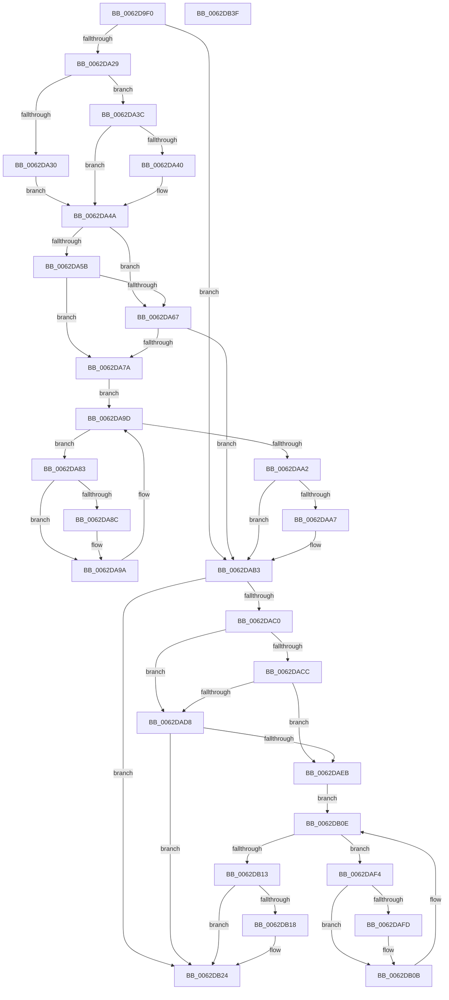

# DifIoWriteErrorLogEntryWrapper

- RVA: `0x0062D9F0`–`0x0062DB40` (길이 `336` bytes)
- VA: `0x000000014062D9F0`
- 실행 섹션: `.text`
- PDB 이름 있음: `예`; PDB Function 태그: `아니요`
- unwind 정보 RVA: `0x0005D7BC`
- 디코드: `90`개 명령, `336/336` bytes 표시
- 미해석 바이트: `0` (있으면 어셈블리에 `.byte`로 보존)

> 이 문서는 커널 이미지의 기계어와 PDB 기호를 분석해 생성했습니다. 4번과 5번은 함수 원형과 자료형을 바이너리 사용 방식에서 추정한 C 해석이며 원본 소스 복구 결과는 아닙니다.

## 1. Dependencies

- 직접 호출 지점: **9**; 고유 호출 대상: **6**
- 직접 호출자로 확인된 함수: **0**
- RIP 상대 이미지 참조: **3**

### Outgoing calls
- `0x0062DA18` → [DifGetAPIThunkContextById](../49/DifGetAPIThunkContextById_function_00495A34.md) (function, `0x00495A34`)
- `0x0062DA40` → [DifGetReturnAddressForWrappers](../4D/DifGetReturnAddressForWrappers_function_004D3C08.md) (function, `0x004D3C08`)
- `0x0062DA6E` → [ExAcquireRundownProtection](../21/ExAcquireRundownProtection_function_00216620.md) (function, `0x00216620`)
- `0x0062DA95` → [guard_dispatch_icall](../6B/guard_dispatch_icall_function_006BAAD0.md) (function, `0x006BAAD0`)
- `0x0062DAAE` → [ExReleaseRundownProtection](../34/ExReleaseRundownProtection_function_00349E80.md) (function, `0x00349E80`)
- `0x0062DAB6` → [IoWriteErrorLogEntry](../4B/IoWriteErrorLogEntry_function_004B5B30.md) (function, `0x004B5B30`)
- `0x0062DADF` → [ExAcquireRundownProtection](../21/ExAcquireRundownProtection_function_00216620.md) (function, `0x00216620`)
- `0x0062DB06` → [guard_dispatch_icall](../6B/guard_dispatch_icall_function_006BAAD0.md) (function, `0x006BAAD0`)
- `0x0062DB1F` → [ExReleaseRundownProtection](../34/ExReleaseRundownProtection_function_00349E80.md) (function, `0x00349E80`)

### Direct callers
- 이 함수 시작 RVA로 연결되는 직접 call은 확인되지 않았습니다. 간접 호출은 완전히 역산할 수 없습니다.

### Static image references
- `0x0062DA52` → RVA `0x00F048B8` (`.data`; read)
- `0x0062DA5B` → RVA `0x00F04980` (`.data`; read)
- `0x0062DA67` → RVA `0x00F03E80` (`.data`; read)

## 2. Other-region calls and transfers

- 다른 실행 섹션으로 향하는 call: **0**
- 별도 외부 분기/꼬리 이동을 확인하지 못했습니다.

## 3. Assembly (complete function range)

```asm
0062D9F0  48 8B C4                        mov rax, rsp
0062D9F3  48 89 58 08                     mov qword ptr [rax + 8], rbx
0062D9F7  48 89 68 10                     mov qword ptr [rax + 0x10], rbp
0062D9FB  48 89 70 18                     mov qword ptr [rax + 0x18], rsi
0062D9FF  48 89 78 20                     mov qword ptr [rax + 0x20], rdi
0062DA03  41 56                           push r14
0062DA05  48 83 EC 30                     sub rsp, 0x30
0062DA09  48 8B E9                        mov rbp, rcx
0062DA0C  0F 57 C0                        xorps xmm0, xmm0
0062DA0F  B9 30 01 00 00                  mov ecx, 0x130
0062DA14  0F 11 40 E8                     movups xmmword ptr [rax - 0x18], xmm0
0062DA18  E8 17 80 E6 FF                  call 0x140495a34
0062DA1D  48 8B F8                        mov rdi, rax
0062DA20  48 85 C0                        test rax, rax
0062DA23  0F 84 8A 00 00 00               je 0x14062dab3
0062DA29  8B 40 0C                        mov eax, dword ptr [rax + 0xc]
0062DA2C  A8 18                           test al, 0x18
0062DA2E  74 0C                           je 0x14062da3c
0062DA30  48 8B 4C 24 38                  mov rcx, qword ptr [rsp + 0x38]
0062DA35  48 89 4C 24 20                  mov qword ptr [rsp + 0x20], rcx
0062DA3A  EB 0E                           jmp 0x14062da4a
0062DA3C  A8 04                           test al, 4
0062DA3E  74 0A                           je 0x14062da4a
0062DA40  E8 C3 61 EA FF                  call 0x1404d3c08
0062DA45  48 89 44 24 20                  mov qword ptr [rsp + 0x20], rax
0062DA4A  40 32 F6                        xor sil, sil
0062DA4D  48 89 6C 24 28                  mov qword ptr [rsp + 0x28], rbp
0062DA52  40 38 35 5F 6E 8D 00            cmp byte ptr [rip + 0x8d6e5f], sil
0062DA59  75 0C                           jne 0x14062da67
0062DA5B  F7 05 1B 6F 8D 00 00 08 00 00   test dword ptr [rip + 0x8d6f1b], 0x800
0062DA65  74 13                           je 0x14062da7a
0062DA67  48 8D 0D 12 64 8D 00            lea rcx, [rip + 0x8d6412]
0062DA6E  E8 AD 8B BE FF                  call 0x140216620
0062DA73  40 8A F0                        mov sil, al
0062DA76  84 C0                           test al, al
0062DA78  74 39                           je 0x14062dab3
0062DA7A  4C 8D 77 20                     lea r14, [rdi + 0x20]
0062DA7E  49 8B 1E                        mov rbx, qword ptr [r14]
0062DA81  EB 1A                           jmp 0x14062da9d
0062DA83  48 8D 43 F0                     lea rax, [rbx - 0x10]
0062DA87  48 85 C0                        test rax, rax
0062DA8A  74 0E                           je 0x14062da9a
0062DA8C  48 8B 40 08                     mov rax, qword ptr [rax + 8]
0062DA90  48 8D 4C 24 20                  lea rcx, [rsp + 0x20]
0062DA95  E8 36 D0 08 00                  call 0x1406baad0
0062DA9A  48 8B 1B                        mov rbx, qword ptr [rbx]
0062DA9D  49 3B DE                        cmp rbx, r14
0062DAA0  75 E1                           jne 0x14062da83
0062DAA2  40 84 F6                        test sil, sil
0062DAA5  74 0C                           je 0x14062dab3
0062DAA7  48 8D 0D D2 63 8D 00            lea rcx, [rip + 0x8d63d2]
0062DAAE  E8 CD C3 D1 FF                  call 0x140349e80
0062DAB3  48 8B CD                        mov rcx, rbp
0062DAB6  E8 75 80 E8 FF                  call 0x1404b5b30
0062DABB  48 85 FF                        test rdi, rdi
0062DABE  74 64                           je 0x14062db24
0062DAC0  40 32 F6                        xor sil, sil
0062DAC3  40 38 35 EE 6D 8D 00            cmp byte ptr [rip + 0x8d6dee], sil
0062DACA  75 0C                           jne 0x14062dad8
0062DACC  F7 05 AA 6E 8D 00 00 08 00 00   test dword ptr [rip + 0x8d6eaa], 0x800
0062DAD6  74 13                           je 0x14062daeb
0062DAD8  48 8D 0D A1 63 8D 00            lea rcx, [rip + 0x8d63a1]
0062DADF  E8 3C 8B BE FF                  call 0x140216620
0062DAE4  40 8A F0                        mov sil, al
0062DAE7  84 C0                           test al, al
0062DAE9  74 39                           je 0x14062db24
0062DAEB  48 83 C7 30                     add rdi, 0x30
0062DAEF  48 8B 1F                        mov rbx, qword ptr [rdi]
0062DAF2  EB 1A                           jmp 0x14062db0e
0062DAF4  48 8D 43 F0                     lea rax, [rbx - 0x10]
0062DAF8  48 85 C0                        test rax, rax
0062DAFB  74 0E                           je 0x14062db0b
0062DAFD  48 8B 40 08                     mov rax, qword ptr [rax + 8]
0062DB01  48 8D 4C 24 20                  lea rcx, [rsp + 0x20]
0062DB06  E8 C5 CF 08 00                  call 0x1406baad0
0062DB0B  48 8B 1B                        mov rbx, qword ptr [rbx]
0062DB0E  48 3B DF                        cmp rbx, rdi
0062DB11  75 E1                           jne 0x14062daf4
0062DB13  40 84 F6                        test sil, sil
0062DB16  74 0C                           je 0x14062db24
0062DB18  48 8D 0D 61 63 8D 00            lea rcx, [rip + 0x8d6361]
0062DB1F  E8 5C C3 D1 FF                  call 0x140349e80
0062DB24  48 8B 5C 24 40                  mov rbx, qword ptr [rsp + 0x40]
0062DB29  48 8B 6C 24 48                  mov rbp, qword ptr [rsp + 0x48]
0062DB2E  48 8B 74 24 50                  mov rsi, qword ptr [rsp + 0x50]
0062DB33  48 8B 7C 24 58                  mov rdi, qword ptr [rsp + 0x58]
0062DB38  48 83 C4 30                     add rsp, 0x30
0062DB3C  41 5E                           pop r14
0062DB3E  C3                              ret
0062DB3F  CC                              int3
```

## 4. C-style interpretation (structured pseudocode)

```c
__int64 __fastcall DifIoWriteErrorLogEntryWrapper(__int64 a1)
{
    __int64 result;
    __int64 v_rdi;
    __int64 v_rsi;
    __int64 v_rsp;
    unsigned __int64 v_stack_m10;
    unsigned __int64 v_stack_m18;
    unsigned __int64 v_stack_p0;
    unsigned __int64 v_stack_p10;
    unsigned __int64 v_stack_p18;
    unsigned __int64 v_stack_p20;
    unsigned __int64 v_stack_p8;

    *(unsigned __int64 *)(v_rsp + 8) = v_rbx;
    *(unsigned __int64 *)(v_rsp + 16) = v_rbp;
    *(unsigned __int64 *)(v_rsp + 24) = v_rsi;
    *(unsigned __int64 *)(v_rsp + 32) = v_rdi;
    v_rsp = (v_rsp) - (48);
    *(unsigned __int64 *)(v_rsp - 24) = v_xmm0;
    result = DifGetAPIThunkContextById(304, a2, a3, a4);
    if (result == 0) goto loc_0062DAB3;
    if ((((unsigned __int8)((unsigned int)(*(unsigned int *)(result + 12)))) & (24)) == 0) goto loc_0062DA3C;
    v_stack_m18 = v_stack_p0;
    goto loc_0062DA4A;
loc_0062DA3C:
    result = (unsigned int)(*(unsigned int *)(result + 12));
    if ((((unsigned __int8)((unsigned int)(*(unsigned int *)(result + 12)))) & (4)) != 0) {
        result = DifGetReturnAddressForWrappers(v_stack_p0, a2, a3, a4);
        v_stack_m18 = result;
    }
    v_rsi = 0;
    v_stack_m10 = a1;
    if ((*(unsigned __int8 *)(v_rip + 9268831)) != 0) goto loc_0062DA67;
    if (((*(unsigned int *)(v_rip + 9269019)) & (0x800ULL)) == 0) goto loc_0062DA7A;
loc_0062DA67:
    result = ExAcquireRundownProtection(v_rip + 9266194, a2, a3, a4);
    if ((unsigned __int8)(result) == 0) goto loc_0062DAB3;
loc_0062DA7A:
    goto loc_0062DA9D;
loc_0062DA83:
    result = *(unsigned __int64 *)(result + 32) - 16;
    if (*(unsigned __int64 *)(result + 32) - 16 != 0) {
        result = *(unsigned __int64 *)(*(unsigned __int64 *)(result + 32) - 16 + 8);
        a1 = v_stack_m18;
        result = guard_dispatch_icall(a1, a2, a3, a4);
    }
loc_0062DA9D:
    if ((*(unsigned __int64 *)(*(unsigned __int64 *)(result + 32))) != (result + 32)) goto loc_0062DA83;
    if ((unsigned __int8)((unsigned __int8)(result)) != 0) {
        a1 = v_rip + 9266130;
        result = ExReleaseRundownProtection(a1, a2, a3, a4);
    }
    result = IoWriteErrorLogEntry(a1, a2, a3, a4);
    if (result == 0) goto loc_0062DB24;
    v_rsi = 0;
    if ((*(unsigned __int8 *)(v_rip + 9268718)) != 0) goto loc_0062DAD8;
    if (((*(unsigned int *)(v_rip + 9268906)) & (0x800ULL)) == 0) goto loc_0062DAEB;
loc_0062DAD8:
    result = ExAcquireRundownProtection(v_rip + 9266081, a2, a3, a4);
    if ((unsigned __int8)(result) == 0) goto loc_0062DB24;
loc_0062DAEB:
    v_rdi = (result) + (48);
    goto loc_0062DB0E;
loc_0062DAF4:
    result = *(unsigned __int64 *)(v_rdi) - 16;
    if (*(unsigned __int64 *)(v_rdi) - 16 != 0) {
        result = *(unsigned __int64 *)(*(unsigned __int64 *)(v_rdi) - 16 + 8);
        a1 = v_stack_m18;
        result = guard_dispatch_icall(a1, a2, a3, a4);
    }
loc_0062DB0E:
    if ((*(unsigned __int64 *)(*(unsigned __int64 *)(v_rdi))) != v_rdi) goto loc_0062DAF4;
    if ((unsigned __int8)((unsigned __int8)(result)) != 0) {
        a1 = v_rip + 9266017;
        result = ExReleaseRundownProtection(a1, a2, a3, a4);
    }
    v_rsp = (v_rsp) + (48);
    return result;
}
```

## 5. (Beta) C Style

```c
int64_t DifIoWriteErrorLogEntryWrapper(int64_t Arg1)
{
    int64_t result;
    int64_t local_rdi;
    int64_t local_rsi;
    int64_t local_rsp;
    uint64_t v_stack_m10;
    uint64_t v_stack_m18;
    uint64_t v_stack_p0;
    uint64_t v_stack_p10;
    uint64_t v_stack_p18;
    uint64_t v_stack_p20;
    uint64_t v_stack_p8;

    *(uint64_t *)(local_rsp + 0x8) = local_rbx;
    *(uint64_t *)(local_rsp + 0x10) = local_rbp;
    *(uint64_t *)(local_rsp + 0x18) = local_rsi;
    *(uint64_t *)(local_rsp + 0x20) = local_rdi;
    local_rsp = (local_rsp) - (48);
    *(uint64_t *)(local_rsp - 0x18) = v_xmm0;
    result = DifGetAPIThunkContextById(304, a2, a3, a4);
    if (result == 0) goto loc_0062DAB3;
    if ((((uint8_t)((uint32_t)(*(uint32_t *)(result + 0xC)))) & (24)) == 0) goto loc_0062DA3C;
    v_stack_m18 = v_stack_p0;
    goto loc_0062DA4A;
loc_0062DA3C:
    result = (uint32_t)(*(uint32_t *)(result + 0xC));
    if ((((uint8_t)((uint32_t)(*(uint32_t *)(result + 0xC)))) & (4)) != 0) {
        result = DifGetReturnAddressForWrappers(v_stack_p0, a2, a3, a4);
        v_stack_m18 = result;
    }
    local_rsi = 0;
    v_stack_m10 = Arg1;
    if ((*(uint8_t *)(v_rip + 0x8D6E5F)) != 0) goto loc_0062DA67;
    if (((*(uint32_t *)(v_rip + 0x8D6F1B)) & (0x800ULL)) == 0) goto loc_0062DA7A;
loc_0062DA67:
    result = ExAcquireRundownProtection(v_rip + 9266194, a2, a3, a4);
    if ((uint8_t)(result) == 0) goto loc_0062DAB3;
loc_0062DA7A:
    goto loc_0062DA9D;
loc_0062DA83:
    result = *(uint64_t *)(result + 0x20) - 16;
    if (*(uint64_t *)(result + 0x20) - 16 != 0) {
        result = *(uint64_t *)(*(uint64_t *)(result + 0x20) - 0x10 + 0x8);
        Arg1 = v_stack_m18;
        result = guard_dispatch_icall(Arg1, a2, a3, a4);
    }
loc_0062DA9D:
    if ((*(uint64_t *)(*(uint64_t *)(result + 0x20))) != (result + 32)) goto loc_0062DA83;
    if ((uint8_t)((uint8_t)(result)) != 0) {
        Arg1 = v_rip + 9266130;
        result = ExReleaseRundownProtection(Arg1, a2, a3, a4);
    }
    result = IoWriteErrorLogEntry(Arg1, a2, a3, a4);
    if (result == 0) goto loc_0062DB24;
    local_rsi = 0;
    if ((*(uint8_t *)(v_rip + 0x8D6DEE)) != 0) goto loc_0062DAD8;
    if (((*(uint32_t *)(v_rip + 0x8D6EAA)) & (0x800ULL)) == 0) goto loc_0062DAEB;
loc_0062DAD8:
    result = ExAcquireRundownProtection(v_rip + 9266081, a2, a3, a4);
    if ((uint8_t)(result) == 0) goto loc_0062DB24;
loc_0062DAEB:
    local_rdi = (result) + (48);
    goto loc_0062DB0E;
loc_0062DAF4:
    result = *(uint64_t *)(local_rdi) - 16;
    if (*(uint64_t *)(local_rdi) - 16 != 0) {
        result = *(uint64_t *)(*(uint64_t *)(local_rdi) - 0x10 + 0x8);
        Arg1 = v_stack_m18;
        result = guard_dispatch_icall(Arg1, a2, a3, a4);
    }
loc_0062DB0E:
    if ((*(uint64_t *)(*(uint64_t *)(local_rdi))) != local_rdi) goto loc_0062DAF4;
    if ((uint8_t)((uint8_t)(result)) != 0) {
        Arg1 = v_rip + 9266017;
        result = ExReleaseRundownProtection(Arg1, a2, a3, a4);
    }
    local_rsp = (local_rsp) + (48);
    return result;
}
```

## 6. Execution-region graph

[열기: 2D/3D 그래프와 함수 탐색 컨트롤 패널](../../../control-panel.html?section=text&rva=0x0062D9F0&view=graph)

- 2D 그래프는 위에서 아래로 흐르고, 3D 그래프는 빈 공간을 드래그해 회전합니다. Shift+드래그는 이동, 휠은 확대·축소, 함수 노드 선택은 대상 보고서 이동입니다.

### Static fallback


