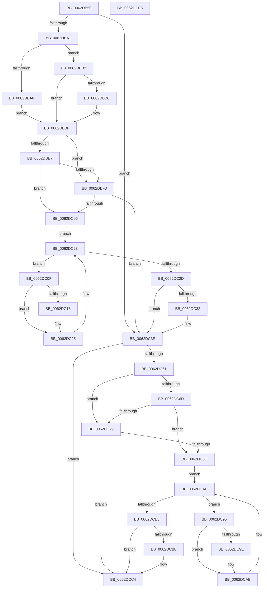

# DifIoWritePartitionTableWrapper

- RVA: `0x0062DB50`–`0x0062DCE6` (길이 `406` bytes)
- VA: `0x000000014062DB50`
- 실행 섹션: `.text`
- PDB 이름 있음: `예`; PDB Function 태그: `아니요`
- unwind 정보 RVA: `0x000D2BBC`
- 디코드: `116`개 명령, `406/406` bytes 표시
- 미해석 바이트: `0` (있으면 어셈블리에 `.byte`로 보존)

> 이 문서는 커널 이미지의 기계어와 PDB 기호를 분석해 생성했습니다. 4번과 5번은 함수 원형과 자료형을 바이너리 사용 방식에서 추정한 C 해석이며 원본 소스 복구 결과는 아닙니다.

## 1. Dependencies

- 직접 호출 지점: **9**; 고유 호출 대상: **6**
- 직접 호출자로 확인된 함수: **0**
- RIP 상대 이미지 참조: **3**

### Outgoing calls
- `0x0062DB90` → [DifGetAPIThunkContextById](../49/DifGetAPIThunkContextById_function_00495A34.md) (function, `0x00495A34`)
- `0x0062DBB6` → [DifGetReturnAddressForWrappers](../4D/DifGetReturnAddressForWrappers_function_004D3C08.md) (function, `0x004D3C08`)
- `0x0062DBFA` → [ExAcquireRundownProtection](../21/ExAcquireRundownProtection_function_00216620.md) (function, `0x00216620`)
- `0x0062DC20` → [guard_dispatch_icall](../6B/guard_dispatch_icall_function_006BAAD0.md) (function, `0x006BAAD0`)
- `0x0062DC39` → [ExReleaseRundownProtection](../34/ExReleaseRundownProtection_function_00349E80.md) (function, `0x00349E80`)
- `0x0062DC54` → [IoWritePartitionTable](../../page/71/IoWritePartitionTable_function_007178C0.md) (function, `0x007178C0`)
- `0x0062DC80` → [ExAcquireRundownProtection](../21/ExAcquireRundownProtection_function_00216620.md) (function, `0x00216620`)
- `0x0062DCA6` → [guard_dispatch_icall](../6B/guard_dispatch_icall_function_006BAAD0.md) (function, `0x006BAAD0`)
- `0x0062DCBF` → [ExReleaseRundownProtection](../34/ExReleaseRundownProtection_function_00349E80.md) (function, `0x00349E80`)

### Direct callers
- 이 함수 시작 RVA로 연결되는 직접 call은 확인되지 않았습니다. 간접 호출은 완전히 역산할 수 없습니다.

### Static image references
- `0x0062DBC6` → RVA `0x00F048B8` (`.data`; read)
- `0x0062DBE7` → RVA `0x00F04980` (`.data`; read)
- `0x0062DBF3` → RVA `0x00F03E80` (`.data`; read)

## 2. Other-region calls and transfers

- 다른 실행 섹션으로 향하는 call: **1**
  - `0x0062DC54` → [IoWritePartitionTable](../../page/71/IoWritePartitionTable_function_007178C0.md) (`.text` → `PAGE`)
- 별도 외부 분기/꼬리 이동을 확인하지 못했습니다.

## 3. Assembly (complete function range)

```asm
0062DB50  48 8B C4                        mov rax, rsp
0062DB53  48 89 58 10                     mov qword ptr [rax + 0x10], rbx
0062DB57  48 89 70 18                     mov qword ptr [rax + 0x18], rsi
0062DB5B  48 89 78 20                     mov qword ptr [rax + 0x20], rdi
0062DB5F  48 89 48 08                     mov qword ptr [rax + 8], rcx
0062DB63  55                              push rbp
0062DB64  41 54                           push r12
0062DB66  41 55                           push r13
0062DB68  41 56                           push r14
0062DB6A  41 57                           push r15
0062DB6C  48 8B EC                        mov rbp, rsp
0062DB6F  48 83 EC 60                     sub rsp, 0x60
0062DB73  0F 57 C0                        xorps xmm0, xmm0
0062DB76  B9 2F 01 00 00                  mov ecx, 0x12f
0062DB7B  0F 11 45 D0                     movups xmmword ptr [rbp - 0x30], xmm0
0062DB7F  45 8B F9                        mov r15d, r9d
0062DB82  45 8B E0                        mov r12d, r8d
0062DB85  0F 11 45 E0                     movups xmmword ptr [rbp - 0x20], xmm0
0062DB89  44 8B EA                        mov r13d, edx
0062DB8C  0F 11 45 F0                     movups xmmword ptr [rbp - 0x10], xmm0
0062DB90  E8 9F 7E E6 FF                  call 0x140495a34
0062DB95  48 8B F0                        mov rsi, rax
0062DB98  48 85 C0                        test rax, rax
0062DB9B  0F 84 9D 00 00 00               je 0x14062dc3e
0062DBA1  8B 40 0C                        mov eax, dword ptr [rax + 0xc]
0062DBA4  A8 18                           test al, 0x18
0062DBA6  74 0A                           je 0x14062dbb2
0062DBA8  48 8B 4D 28                     mov rcx, qword ptr [rbp + 0x28]
0062DBAC  48 89 4D D0                     mov qword ptr [rbp - 0x30], rcx
0062DBB0  EB 0D                           jmp 0x14062dbbf
0062DBB2  A8 04                           test al, 4
0062DBB4  74 09                           je 0x14062dbbf
0062DBB6  E8 4D 60 EA FF                  call 0x1404d3c08
0062DBBB  48 89 45 D0                     mov qword ptr [rbp - 0x30], rax
0062DBBF  48 8B 45 30                     mov rax, qword ptr [rbp + 0x30]
0062DBC3  45 32 F6                        xor r14b, r14b
0062DBC6  44 38 35 EB 6C 8D 00            cmp byte ptr [rip + 0x8d6ceb], r14b
0062DBCD  48 89 45 F0                     mov qword ptr [rbp - 0x10], rax
0062DBD1  48 8B 45 50                     mov rax, qword ptr [rbp + 0x50]
0062DBD5  48 89 45 D8                     mov qword ptr [rbp - 0x28], rax
0062DBD9  44 89 6D E8                     mov dword ptr [rbp - 0x18], r13d
0062DBDD  44 89 65 E4                     mov dword ptr [rbp - 0x1c], r12d
0062DBE1  44 89 7D E0                     mov dword ptr [rbp - 0x20], r15d
0062DBE5  75 0C                           jne 0x14062dbf3
0062DBE7  F7 05 8F 6D 8D 00 00 08 00 00   test dword ptr [rip + 0x8d6d8f], 0x800
0062DBF1  74 13                           je 0x14062dc06
0062DBF3  48 8D 0D 86 62 8D 00            lea rcx, [rip + 0x8d6286]
0062DBFA  E8 21 8A BE FF                  call 0x140216620
0062DBFF  44 8A F0                        mov r14b, al
0062DC02  84 C0                           test al, al
0062DC04  74 38                           je 0x14062dc3e
0062DC06  48 8D 7E 20                     lea rdi, [rsi + 0x20]
0062DC0A  48 8B 1F                        mov rbx, qword ptr [rdi]
0062DC0D  EB 19                           jmp 0x14062dc28
0062DC0F  48 8D 43 F0                     lea rax, [rbx - 0x10]
0062DC13  48 85 C0                        test rax, rax
0062DC16  74 0D                           je 0x14062dc25
0062DC18  48 8B 40 08                     mov rax, qword ptr [rax + 8]
0062DC1C  48 8D 4D D0                     lea rcx, [rbp - 0x30]
0062DC20  E8 AB CE 08 00                  call 0x1406baad0
0062DC25  48 8B 1B                        mov rbx, qword ptr [rbx]
0062DC28  48 3B DF                        cmp rbx, rdi
0062DC2B  75 E2                           jne 0x14062dc0f
0062DC2D  45 84 F6                        test r14b, r14b
0062DC30  74 0C                           je 0x14062dc3e
0062DC32  48 8D 0D 47 62 8D 00            lea rcx, [rip + 0x8d6247]
0062DC39  E8 42 C2 D1 FF                  call 0x140349e80
0062DC3E  48 8B 45 50                     mov rax, qword ptr [rbp + 0x50]
0062DC42  45 8B CF                        mov r9d, r15d
0062DC45  48 8B 4D 30                     mov rcx, qword ptr [rbp + 0x30]
0062DC49  45 8B C4                        mov r8d, r12d
0062DC4C  41 8B D5                        mov edx, r13d
0062DC4F  48 89 44 24 20                  mov qword ptr [rsp + 0x20], rax
0062DC54  E8 67 9C 0E 00                  call 0x1407178c0
0062DC59  89 45 F8                        mov dword ptr [rbp - 8], eax
0062DC5C  48 85 F6                        test rsi, rsi
0062DC5F  74 63                           je 0x14062dcc4
0062DC61  40 32 FF                        xor dil, dil
0062DC64  40 38 3D 4D 6C 8D 00            cmp byte ptr [rip + 0x8d6c4d], dil
0062DC6B  75 0C                           jne 0x14062dc79
0062DC6D  F7 05 09 6D 8D 00 00 08 00 00   test dword ptr [rip + 0x8d6d09], 0x800
0062DC77  74 13                           je 0x14062dc8c
0062DC79  48 8D 0D 00 62 8D 00            lea rcx, [rip + 0x8d6200]
0062DC80  E8 9B 89 BE FF                  call 0x140216620
0062DC85  40 8A F8                        mov dil, al
0062DC88  84 C0                           test al, al
0062DC8A  74 38                           je 0x14062dcc4
0062DC8C  48 83 C6 30                     add rsi, 0x30
0062DC90  48 8B 1E                        mov rbx, qword ptr [rsi]
0062DC93  EB 19                           jmp 0x14062dcae
0062DC95  48 8D 43 F0                     lea rax, [rbx - 0x10]
0062DC99  48 85 C0                        test rax, rax
0062DC9C  74 0D                           je 0x14062dcab
0062DC9E  48 8B 40 08                     mov rax, qword ptr [rax + 8]
0062DCA2  48 8D 4D D0                     lea rcx, [rbp - 0x30]
0062DCA6  E8 25 CE 08 00                  call 0x1406baad0
0062DCAB  48 8B 1B                        mov rbx, qword ptr [rbx]
0062DCAE  48 3B DE                        cmp rbx, rsi
0062DCB1  75 E2                           jne 0x14062dc95
0062DCB3  40 84 FF                        test dil, dil
0062DCB6  74 0C                           je 0x14062dcc4
0062DCB8  48 8D 0D C1 61 8D 00            lea rcx, [rip + 0x8d61c1]
0062DCBF  E8 BC C1 D1 FF                  call 0x140349e80
0062DCC4  8B 45 F8                        mov eax, dword ptr [rbp - 8]
0062DCC7  4C 8D 5C 24 60                  lea r11, [rsp + 0x60]
0062DCCC  49 8B 5B 38                     mov rbx, qword ptr [r11 + 0x38]
0062DCD0  49 8B 73 40                     mov rsi, qword ptr [r11 + 0x40]
0062DCD4  49 8B 7B 48                     mov rdi, qword ptr [r11 + 0x48]
0062DCD8  49 8B E3                        mov rsp, r11
0062DCDB  41 5F                           pop r15
0062DCDD  41 5E                           pop r14
0062DCDF  41 5D                           pop r13
0062DCE1  41 5C                           pop r12
0062DCE3  5D                              pop rbp
0062DCE4  C3                              ret
0062DCE5  CC                              int3
```

## 4. C-style interpretation (structured pseudocode)

```c
__int64 __fastcall DifIoWritePartitionTableWrapper(__int64 a1, int a2, int a3, int a4, __int64 a5)
{
    __int64 result;
    __int64 v_r14;
    __int64 v_rdi;
    __int64 v_rsi;
    __int64 v_rsp;
    unsigned __int64 v_stack_m28;
    unsigned int v_stack_m30;
    unsigned __int64 v_stack_m38;
    unsigned int v_stack_m40;
    unsigned int v_stack_m44;
    unsigned __int64 v_stack_m48;
    unsigned __int64 v_stack_m50;
    unsigned __int64 v_stack_m58;
    unsigned __int64 v_stack_m68;
    unsigned __int64 v_stack_p0;
    unsigned __int64 v_stack_p8;

    *(unsigned __int64 *)(v_rsp + 16) = v_rbx;
    *(unsigned __int64 *)(v_rsp + 24) = v_rsi;
    *(unsigned __int64 *)(v_rsp + 32) = v_rdi;
    *(unsigned __int64 *)(v_rsp + 8) = a1;
    v_rsp = (v_rsp) - (96);
    v_stack_m58 = v_xmm0;
    v_stack_m48 = v_xmm0;
    v_stack_m38 = v_xmm0;
    result = DifGetAPIThunkContextById(303, a2, a3, a4);
    if (result == 0) goto loc_0062DC3E;
    if ((((unsigned __int8)((unsigned int)(*(unsigned int *)(result + 12)))) & (24)) == 0) goto loc_0062DBB2;
    v_stack_m58 = v_stack_p0;
    goto loc_0062DBBF;
loc_0062DBB2:
    result = (unsigned int)(*(unsigned int *)(result + 12));
    if ((((unsigned __int8)((unsigned int)(*(unsigned int *)(result + 12)))) & (4)) != 0) {
        result = DifGetReturnAddressForWrappers(v_stack_p0, a2, a3, a4);
        v_stack_m58 = result;
    }
    v_r14 = 0;
    v_stack_m38 = v_stack_p8;
    v_stack_m50 = a5;
    v_stack_m40 = (unsigned int)((unsigned int)(a2));
    v_stack_m44 = (unsigned int)((unsigned int)(a3));
    v_stack_m48 = (unsigned int)((unsigned int)(a4));
    if ((*(unsigned __int8 *)(v_rip + 9268459)) != 0) goto loc_0062DBF3;
    if (((*(unsigned int *)(v_rip + 9268623)) & (0x800ULL)) == 0) goto loc_0062DC06;
loc_0062DBF3:
    result = ExAcquireRundownProtection(v_rip + 9265798, a2, a3, a4);
    if ((unsigned __int8)(result) == 0) goto loc_0062DC3E;
loc_0062DC06:
    goto loc_0062DC28;
loc_0062DC0F:
    result = *(unsigned __int64 *)(result + 32) - 16;
    if (*(unsigned __int64 *)(result + 32) - 16 != 0) {
        result = *(unsigned __int64 *)(*(unsigned __int64 *)(result + 32) - 16 + 8);
        a1 = v_stack_m58;
        result = guard_dispatch_icall(a1, a2, a3, a4);
    }
loc_0062DC28:
    if ((*(unsigned __int64 *)(*(unsigned __int64 *)(result + 32))) != (result + 32)) goto loc_0062DC0F;
    if ((unsigned __int8)((unsigned __int8)(result)) != 0) {
        a1 = v_rip + 9265735;
        result = ExReleaseRundownProtection(a1, a2, a3, a4);
    }
    v_stack_m68 = a5;
    result = IoWritePartitionTable(v_stack_p8, (unsigned int)((unsigned int)((unsigned int)(a2))), (unsigned int)((unsigned int)((unsigned int)(a3))), (unsigned int)((unsigned int)((unsigned int)(a4))));
    v_stack_m30 = (unsigned int)(result);
    if (result == 0) goto loc_0062DCC4;
    v_rdi = 0;
    if ((*(unsigned __int8 *)(v_rip + 9268301)) != 0) goto loc_0062DC79;
    if (((*(unsigned int *)(v_rip + 9268489)) & (0x800ULL)) == 0) goto loc_0062DC8C;
loc_0062DC79:
    result = ExAcquireRundownProtection(v_rip + 9265664, (unsigned int)((unsigned int)((unsigned int)(a2))), (unsigned int)((unsigned int)((unsigned int)(a3))), (unsigned int)((unsigned int)((unsigned int)(a4))));
    if ((unsigned __int8)(result) == 0) goto loc_0062DCC4;
loc_0062DC8C:
    v_rsi = (result) + (48);
    goto loc_0062DCAE;
loc_0062DC95:
    result = *(unsigned __int64 *)(v_rsi) - 16;
    if (*(unsigned __int64 *)(v_rsi) - 16 != 0) {
        result = *(unsigned __int64 *)(*(unsigned __int64 *)(v_rsi) - 16 + 8);
        a1 = v_stack_m58;
        result = guard_dispatch_icall(a1, (unsigned int)((unsigned int)((unsigned int)(a2))), (unsigned int)((unsigned int)((unsigned int)(a3))), (unsigned int)((unsigned int)((unsigned int)(a4))));
    }
loc_0062DCAE:
    if ((*(unsigned __int64 *)(*(unsigned __int64 *)(v_rsi))) != v_rsi) goto loc_0062DC95;
    if ((unsigned __int8)((unsigned __int8)(result)) != 0) {
        a1 = v_rip + 9265601;
        result = ExReleaseRundownProtection(a1, (unsigned int)((unsigned int)((unsigned int)(a2))), (unsigned int)((unsigned int)((unsigned int)(a3))), (unsigned int)((unsigned int)((unsigned int)(a4))));
    }
    return (unsigned int)(v_stack_m30);
}
```

## 5. (Beta) C Style

```c
int64_t DifIoWritePartitionTableWrapper(int64_t Arg1, int32_t Arg2, int32_t Arg3, int32_t Arg4, int64_t Arg5)
{
    int64_t result;
    int64_t local_r14;
    int64_t local_rdi;
    int64_t local_rsi;
    int64_t local_rsp;
    uint64_t v_stack_m28;
    uint32_t v_stack_m30;
    uint64_t v_stack_m38;
    uint32_t v_stack_m40;
    uint32_t v_stack_m44;
    uint64_t v_stack_m48;
    uint64_t v_stack_m50;
    uint64_t v_stack_m58;
    uint64_t v_stack_m68;
    uint64_t v_stack_p0;
    uint64_t v_stack_p8;

    *(uint64_t *)(local_rsp + 0x10) = local_rbx;
    *(uint64_t *)(local_rsp + 0x18) = local_rsi;
    *(uint64_t *)(local_rsp + 0x20) = local_rdi;
    *(uint64_t *)(local_rsp + 0x8) = Arg1;
    local_rsp = (local_rsp) - (96);
    v_stack_m58 = v_xmm0;
    v_stack_m48 = v_xmm0;
    v_stack_m38 = v_xmm0;
    result = DifGetAPIThunkContextById(303, Arg2, Arg3, Arg4);
    if (result == 0) goto loc_0062DC3E;
    if ((((uint8_t)((uint32_t)(*(uint32_t *)(result + 0xC)))) & (24)) == 0) goto loc_0062DBB2;
    v_stack_m58 = v_stack_p0;
    goto loc_0062DBBF;
loc_0062DBB2:
    result = (uint32_t)(*(uint32_t *)(result + 0xC));
    if ((((uint8_t)((uint32_t)(*(uint32_t *)(result + 0xC)))) & (4)) != 0) {
        result = DifGetReturnAddressForWrappers(v_stack_p0, Arg2, Arg3, Arg4);
        v_stack_m58 = result;
    }
    local_r14 = 0;
    v_stack_m38 = v_stack_p8;
    v_stack_m50 = Arg5;
    v_stack_m40 = (uint32_t)((uint32_t)(Arg2));
    v_stack_m44 = (uint32_t)((uint32_t)(Arg3));
    v_stack_m48 = (uint32_t)((uint32_t)(Arg4));
    if ((*(uint8_t *)(v_rip + 0x8D6CEB)) != 0) goto loc_0062DBF3;
    if (((*(uint32_t *)(v_rip + 0x8D6D8F)) & (0x800ULL)) == 0) goto loc_0062DC06;
loc_0062DBF3:
    result = ExAcquireRundownProtection(v_rip + 9265798, Arg2, Arg3, Arg4);
    if ((uint8_t)(result) == 0) goto loc_0062DC3E;
loc_0062DC06:
    goto loc_0062DC28;
loc_0062DC0F:
    result = *(uint64_t *)(result + 0x20) - 16;
    if (*(uint64_t *)(result + 0x20) - 16 != 0) {
        result = *(uint64_t *)(*(uint64_t *)(result + 0x20) - 0x10 + 0x8);
        Arg1 = v_stack_m58;
        result = guard_dispatch_icall(Arg1, Arg2, Arg3, Arg4);
    }
loc_0062DC28:
    if ((*(uint64_t *)(*(uint64_t *)(result + 0x20))) != (result + 32)) goto loc_0062DC0F;
    if ((uint8_t)((uint8_t)(result)) != 0) {
        Arg1 = v_rip + 9265735;
        result = ExReleaseRundownProtection(Arg1, Arg2, Arg3, Arg4);
    }
    v_stack_m68 = Arg5;
    result = IoWritePartitionTable(v_stack_p8, (uint32_t)((uint32_t)((uint32_t)(Arg2))), (uint32_t)((uint32_t)((uint32_t)(Arg3))), (uint32_t)((uint32_t)((uint32_t)(Arg4))));
    v_stack_m30 = (uint32_t)(result);
    if (result == 0) goto loc_0062DCC4;
    local_rdi = 0;
    if ((*(uint8_t *)(v_rip + 0x8D6C4D)) != 0) goto loc_0062DC79;
    if (((*(uint32_t *)(v_rip + 0x8D6D09)) & (0x800ULL)) == 0) goto loc_0062DC8C;
loc_0062DC79:
    result = ExAcquireRundownProtection(v_rip + 9265664, (uint32_t)((uint32_t)((uint32_t)(Arg2))), (uint32_t)((uint32_t)((uint32_t)(Arg3))), (uint32_t)((uint32_t)((uint32_t)(Arg4))));
    if ((uint8_t)(result) == 0) goto loc_0062DCC4;
loc_0062DC8C:
    local_rsi = (result) + (48);
    goto loc_0062DCAE;
loc_0062DC95:
    result = *(uint64_t *)(local_rsi) - 16;
    if (*(uint64_t *)(local_rsi) - 16 != 0) {
        result = *(uint64_t *)(*(uint64_t *)(local_rsi) - 0x10 + 0x8);
        Arg1 = v_stack_m58;
        result = guard_dispatch_icall(Arg1, (uint32_t)((uint32_t)((uint32_t)(Arg2))), (uint32_t)((uint32_t)((uint32_t)(Arg3))), (uint32_t)((uint32_t)((uint32_t)(Arg4))));
    }
loc_0062DCAE:
    if ((*(uint64_t *)(*(uint64_t *)(local_rsi))) != local_rsi) goto loc_0062DC95;
    if ((uint8_t)((uint8_t)(result)) != 0) {
        Arg1 = v_rip + 9265601;
        result = ExReleaseRundownProtection(Arg1, (uint32_t)((uint32_t)((uint32_t)(Arg2))), (uint32_t)((uint32_t)((uint32_t)(Arg3))), (uint32_t)((uint32_t)((uint32_t)(Arg4))));
    }
    return (uint32_t)(v_stack_m30);
}
```

## 6. Execution-region graph

[열기: 2D/3D 그래프와 함수 탐색 컨트롤 패널](../../../control-panel.html?section=text&rva=0x0062DB50&view=graph)

- 2D 그래프는 위에서 아래로 흐르고, 3D 그래프는 빈 공간을 드래그해 회전합니다. Shift+드래그는 이동, 휠은 확대·축소, 함수 노드 선택은 대상 보고서 이동입니다.

### Static fallback


