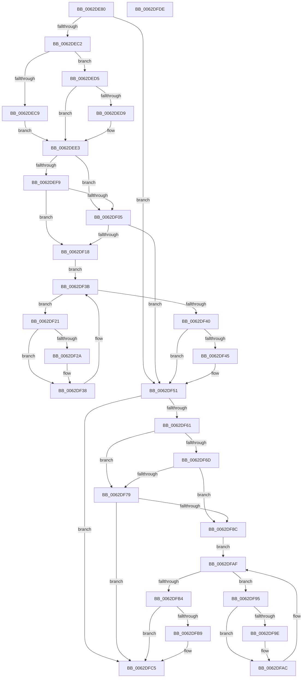

# DifIofCompleteRequestWrapper

- RVA: `0x0062DE80`–`0x0062DFDF` (길이 `351` bytes)
- VA: `0x000000014062DE80`
- 실행 섹션: `.text`
- PDB 이름 있음: `예`; PDB Function 태그: `아니요`
- unwind 정보 RVA: `0x00093E28`
- 디코드: `97`개 명령, `351/351` bytes 표시
- 미해석 바이트: `0` (있으면 어셈블리에 `.byte`로 보존)

> 이 문서는 커널 이미지의 기계어와 PDB 기호를 분석해 생성했습니다. 4번과 5번은 함수 원형과 자료형을 바이너리 사용 방식에서 추정한 C 해석이며 원본 소스 복구 결과는 아닙니다.

## 1. Dependencies

- 직접 호출 지점: **9**; 고유 호출 대상: **6**
- 직접 호출자로 확인된 함수: **0**
- RIP 상대 이미지 참조: **3**

### Outgoing calls
- `0x0062DEB1` → [DifGetAPIThunkContextById](../49/DifGetAPIThunkContextById_function_00495A34.md) (function, `0x00495A34`)
- `0x0062DED9` → [DifGetReturnAddressForWrappers](../4D/DifGetReturnAddressForWrappers_function_004D3C08.md) (function, `0x004D3C08`)
- `0x0062DF0C` → [ExAcquireRundownProtection](../21/ExAcquireRundownProtection_function_00216620.md) (function, `0x00216620`)
- `0x0062DF33` → [guard_dispatch_icall](../6B/guard_dispatch_icall_function_006BAAD0.md) (function, `0x006BAAD0`)
- `0x0062DF4C` → [ExReleaseRundownProtection](../34/ExReleaseRundownProtection_function_00349E80.md) (function, `0x00349E80`)
- `0x0062DF57` → [IofCompleteRequest](../29/IofCompleteRequest_function_0029B5C0.md) (function, `0x0029B5C0`)
- `0x0062DF80` → [ExAcquireRundownProtection](../21/ExAcquireRundownProtection_function_00216620.md) (function, `0x00216620`)
- `0x0062DFA7` → [guard_dispatch_icall](../6B/guard_dispatch_icall_function_006BAAD0.md) (function, `0x006BAAD0`)
- `0x0062DFC0` → [ExReleaseRundownProtection](../34/ExReleaseRundownProtection_function_00349E80.md) (function, `0x00349E80`)

### Direct callers
- 이 함수 시작 RVA로 연결되는 직접 call은 확인되지 않았습니다. 간접 호출은 완전히 역산할 수 없습니다.

### Static image references
- `0x0062DEEB` → RVA `0x00F048B8` (`.data`; read)
- `0x0062DEF9` → RVA `0x00F04980` (`.data`; read)
- `0x0062DF05` → RVA `0x00F03E80` (`.data`; read)

## 2. Other-region calls and transfers

- 다른 실행 섹션으로 향하는 call: **0**
- 별도 외부 분기/꼬리 이동을 확인하지 못했습니다.

## 3. Assembly (complete function range)

```asm
0062DE80  4C 8B DC                        mov r11, rsp
0062DE83  49 89 5B 08                     mov qword ptr [r11 + 8], rbx
0062DE87  49 89 6B 10                     mov qword ptr [r11 + 0x10], rbp
0062DE8B  49 89 73 18                     mov qword ptr [r11 + 0x18], rsi
0062DE8F  57                              push rdi
0062DE90  41 56                           push r14
0062DE92  41 57                           push r15
0062DE94  48 83 EC 40                     sub rsp, 0x40
0062DE98  33 C0                           xor eax, eax
0062DE9A  0F 57 C0                        xorps xmm0, xmm0
0062DE9D  0F 11 44 24 20                  movups xmmword ptr [rsp + 0x20], xmm0
0062DEA2  4C 8B F9                        mov r15, rcx
0062DEA5  49 89 43 D8                     mov qword ptr [r11 - 0x28], rax
0062DEA9  B9 2D 01 00 00                  mov ecx, 0x12d
0062DEAE  44 8A F2                        mov r14b, dl
0062DEB1  E8 7E 7B E6 FF                  call 0x140495a34
0062DEB6  48 8B F0                        mov rsi, rax
0062DEB9  48 85 C0                        test rax, rax
0062DEBC  0F 84 8F 00 00 00               je 0x14062df51
0062DEC2  8B 40 0C                        mov eax, dword ptr [rax + 0xc]
0062DEC5  A8 18                           test al, 0x18
0062DEC7  74 0C                           je 0x14062ded5
0062DEC9  48 8B 4C 24 58                  mov rcx, qword ptr [rsp + 0x58]
0062DECE  48 89 4C 24 20                  mov qword ptr [rsp + 0x20], rcx
0062DED3  EB 0E                           jmp 0x14062dee3
0062DED5  A8 04                           test al, 4
0062DED7  74 0A                           je 0x14062dee3
0062DED9  E8 2A 5D EA FF                  call 0x1404d3c08
0062DEDE  48 89 44 24 20                  mov qword ptr [rsp + 0x20], rax
0062DEE3  40 32 ED                        xor bpl, bpl
0062DEE6  4C 89 7C 24 30                  mov qword ptr [rsp + 0x30], r15
0062DEEB  40 38 2D C6 69 8D 00            cmp byte ptr [rip + 0x8d69c6], bpl
0062DEF2  44 88 74 24 28                  mov byte ptr [rsp + 0x28], r14b
0062DEF7  75 0C                           jne 0x14062df05
0062DEF9  F7 05 7D 6A 8D 00 00 08 00 00   test dword ptr [rip + 0x8d6a7d], 0x800
0062DF03  74 13                           je 0x14062df18
0062DF05  48 8D 0D 74 5F 8D 00            lea rcx, [rip + 0x8d5f74]
0062DF0C  E8 0F 87 BE FF                  call 0x140216620
0062DF11  40 8A E8                        mov bpl, al
0062DF14  84 C0                           test al, al
0062DF16  74 39                           je 0x14062df51
0062DF18  48 8D 7E 20                     lea rdi, [rsi + 0x20]
0062DF1C  48 8B 1F                        mov rbx, qword ptr [rdi]
0062DF1F  EB 1A                           jmp 0x14062df3b
0062DF21  48 8D 43 F0                     lea rax, [rbx - 0x10]
0062DF25  48 85 C0                        test rax, rax
0062DF28  74 0E                           je 0x14062df38
0062DF2A  48 8B 40 08                     mov rax, qword ptr [rax + 8]
0062DF2E  48 8D 4C 24 20                  lea rcx, [rsp + 0x20]
0062DF33  E8 98 CB 08 00                  call 0x1406baad0
0062DF38  48 8B 1B                        mov rbx, qword ptr [rbx]
0062DF3B  48 3B DF                        cmp rbx, rdi
0062DF3E  75 E1                           jne 0x14062df21
0062DF40  40 84 ED                        test bpl, bpl
0062DF43  74 0C                           je 0x14062df51
0062DF45  48 8D 0D 34 5F 8D 00            lea rcx, [rip + 0x8d5f34]
0062DF4C  E8 2F BF D1 FF                  call 0x140349e80
0062DF51  41 8A D6                        mov dl, r14b
0062DF54  49 8B CF                        mov rcx, r15
0062DF57  E8 64 D6 C6 FF                  call 0x14029b5c0
0062DF5C  48 85 F6                        test rsi, rsi
0062DF5F  74 64                           je 0x14062dfc5
0062DF61  40 32 FF                        xor dil, dil
0062DF64  40 38 3D 4D 69 8D 00            cmp byte ptr [rip + 0x8d694d], dil
0062DF6B  75 0C                           jne 0x14062df79
0062DF6D  F7 05 09 6A 8D 00 00 08 00 00   test dword ptr [rip + 0x8d6a09], 0x800
0062DF77  74 13                           je 0x14062df8c
0062DF79  48 8D 0D 00 5F 8D 00            lea rcx, [rip + 0x8d5f00]
0062DF80  E8 9B 86 BE FF                  call 0x140216620
0062DF85  40 8A F8                        mov dil, al
0062DF88  84 C0                           test al, al
0062DF8A  74 39                           je 0x14062dfc5
0062DF8C  48 83 C6 30                     add rsi, 0x30
0062DF90  48 8B 1E                        mov rbx, qword ptr [rsi]
0062DF93  EB 1A                           jmp 0x14062dfaf
0062DF95  48 8D 43 F0                     lea rax, [rbx - 0x10]
0062DF99  48 85 C0                        test rax, rax
0062DF9C  74 0E                           je 0x14062dfac
0062DF9E  48 8B 40 08                     mov rax, qword ptr [rax + 8]
0062DFA2  48 8D 4C 24 20                  lea rcx, [rsp + 0x20]
0062DFA7  E8 24 CB 08 00                  call 0x1406baad0
0062DFAC  48 8B 1B                        mov rbx, qword ptr [rbx]
0062DFAF  48 3B DE                        cmp rbx, rsi
0062DFB2  75 E1                           jne 0x14062df95
0062DFB4  40 84 FF                        test dil, dil
0062DFB7  74 0C                           je 0x14062dfc5
0062DFB9  48 8D 0D C0 5E 8D 00            lea rcx, [rip + 0x8d5ec0]
0062DFC0  E8 BB BE D1 FF                  call 0x140349e80
0062DFC5  48 8B 5C 24 60                  mov rbx, qword ptr [rsp + 0x60]
0062DFCA  48 8B 6C 24 68                  mov rbp, qword ptr [rsp + 0x68]
0062DFCF  48 8B 74 24 70                  mov rsi, qword ptr [rsp + 0x70]
0062DFD4  48 83 C4 40                     add rsp, 0x40
0062DFD8  41 5F                           pop r15
0062DFDA  41 5E                           pop r14
0062DFDC  5F                              pop rdi
0062DFDD  C3                              ret
0062DFDE  CC                              int3
```

## 4. C-style interpretation (structured pseudocode)

```c
__int64 __fastcall DifIofCompleteRequestWrapper(__int64 a1, unsigned __int8 a2)
{
    __int64 result;
    __int64 v_rbp;
    __int64 v_rdi;
    __int64 v_rsi;
    __int64 v_rsp;
    unsigned __int64 v_stack_m28;
    unsigned __int8 v_stack_m30;
    unsigned __int64 v_stack_m38;
    unsigned __int64 v_stack_p0;
    unsigned __int64 v_stack_p10;
    unsigned __int64 v_stack_p18;
    unsigned __int64 v_stack_p8;

    *(unsigned __int64 *)(v_rsp + 8) = v_rbx;
    *(unsigned __int64 *)(v_rsp + 16) = v_rbp;
    *(unsigned __int64 *)(v_rsp + 24) = v_rsi;
    v_rsp = (v_rsp) - (64);
    result = 0;
    v_stack_m38 = v_xmm0;
    *(unsigned __int64 *)(v_rsp - 40) = 0;
    result = DifGetAPIThunkContextById(301, a2, a3, a4);
    if (result == 0) goto loc_0062DF51;
    if ((((unsigned __int8)((unsigned int)(*(unsigned int *)(result + 12)))) & (24)) == 0) goto loc_0062DED5;
    v_stack_m38 = v_stack_p0;
    goto loc_0062DEE3;
loc_0062DED5:
    result = (unsigned int)(*(unsigned int *)(result + 12));
    if ((((unsigned __int8)((unsigned int)(*(unsigned int *)(result + 12)))) & (4)) != 0) {
        result = DifGetReturnAddressForWrappers(v_stack_p0, a2, a3, a4);
        v_stack_m38 = result;
    }
    v_rbp = 0;
    v_stack_m28 = a1;
    v_stack_m30 = a2;
    if ((*(unsigned __int8 *)(v_rip + 9267654)) != 0) goto loc_0062DF05;
    if (((*(unsigned int *)(v_rip + 9267837)) & (0x800ULL)) == 0) goto loc_0062DF18;
loc_0062DF05:
    result = ExAcquireRundownProtection(v_rip + 9265012, a2, a3, a4);
    if ((unsigned __int8)(result) == 0) goto loc_0062DF51;
loc_0062DF18:
    goto loc_0062DF3B;
loc_0062DF21:
    result = *(unsigned __int64 *)(result + 32) - 16;
    if (*(unsigned __int64 *)(result + 32) - 16 != 0) {
        result = *(unsigned __int64 *)(*(unsigned __int64 *)(result + 32) - 16 + 8);
        a1 = v_stack_m38;
        result = guard_dispatch_icall(a1, a2, a3, a4);
    }
loc_0062DF3B:
    if ((*(unsigned __int64 *)(*(unsigned __int64 *)(result + 32))) != (result + 32)) goto loc_0062DF21;
    if ((unsigned __int8)((unsigned __int8)(result)) != 0) {
        a1 = v_rip + 9264948;
        result = ExReleaseRundownProtection(a1, a2, a3, a4);
    }
    result = IofCompleteRequest(a1, a2, a3, a4);
    if (result == 0) goto loc_0062DFC5;
    v_rdi = 0;
    if ((*(unsigned __int8 *)(v_rip + 9267533)) != 0) goto loc_0062DF79;
    if (((*(unsigned int *)(v_rip + 9267721)) & (0x800ULL)) == 0) goto loc_0062DF8C;
loc_0062DF79:
    result = ExAcquireRundownProtection(v_rip + 9264896, a2, a3, a4);
    if ((unsigned __int8)(result) == 0) goto loc_0062DFC5;
loc_0062DF8C:
    v_rsi = (result) + (48);
    goto loc_0062DFAF;
loc_0062DF95:
    result = *(unsigned __int64 *)(v_rsi) - 16;
    if (*(unsigned __int64 *)(v_rsi) - 16 != 0) {
        result = *(unsigned __int64 *)(*(unsigned __int64 *)(v_rsi) - 16 + 8);
        a1 = v_stack_m38;
        result = guard_dispatch_icall(a1, a2, a3, a4);
    }
loc_0062DFAF:
    if ((*(unsigned __int64 *)(*(unsigned __int64 *)(v_rsi))) != v_rsi) goto loc_0062DF95;
    if ((unsigned __int8)((unsigned __int8)(result)) != 0) {
        a1 = v_rip + 9264832;
        result = ExReleaseRundownProtection(a1, a2, a3, a4);
    }
    v_rsp = (v_rsp) + (64);
    return result;
}
```

## 5. (Beta) C Style

```c
int64_t DifIofCompleteRequestWrapper(int64_t Arg1, uint8_t Arg2)
{
    int64_t result;
    int64_t local_rbp;
    int64_t local_rdi;
    int64_t local_rsi;
    int64_t local_rsp;
    uint64_t v_stack_m28;
    uint8_t v_stack_m30;
    uint64_t v_stack_m38;
    uint64_t v_stack_p0;
    uint64_t v_stack_p10;
    uint64_t v_stack_p18;
    uint64_t v_stack_p8;

    *(uint64_t *)(local_rsp + 0x8) = local_rbx;
    *(uint64_t *)(local_rsp + 0x10) = local_rbp;
    *(uint64_t *)(local_rsp + 0x18) = local_rsi;
    local_rsp = (local_rsp) - (64);
    result = 0;
    v_stack_m38 = v_xmm0;
    *(uint64_t *)(local_rsp - 0x28) = 0;
    result = DifGetAPIThunkContextById(301, Arg2, a3, a4);
    if (result == 0) goto loc_0062DF51;
    if ((((uint8_t)((uint32_t)(*(uint32_t *)(result + 0xC)))) & (24)) == 0) goto loc_0062DED5;
    v_stack_m38 = v_stack_p0;
    goto loc_0062DEE3;
loc_0062DED5:
    result = (uint32_t)(*(uint32_t *)(result + 0xC));
    if ((((uint8_t)((uint32_t)(*(uint32_t *)(result + 0xC)))) & (4)) != 0) {
        result = DifGetReturnAddressForWrappers(v_stack_p0, Arg2, a3, a4);
        v_stack_m38 = result;
    }
    local_rbp = 0;
    v_stack_m28 = Arg1;
    v_stack_m30 = Arg2;
    if ((*(uint8_t *)(v_rip + 0x8D69C6)) != 0) goto loc_0062DF05;
    if (((*(uint32_t *)(v_rip + 0x8D6A7D)) & (0x800ULL)) == 0) goto loc_0062DF18;
loc_0062DF05:
    result = ExAcquireRundownProtection(v_rip + 9265012, Arg2, a3, a4);
    if ((uint8_t)(result) == 0) goto loc_0062DF51;
loc_0062DF18:
    goto loc_0062DF3B;
loc_0062DF21:
    result = *(uint64_t *)(result + 0x20) - 16;
    if (*(uint64_t *)(result + 0x20) - 16 != 0) {
        result = *(uint64_t *)(*(uint64_t *)(result + 0x20) - 0x10 + 0x8);
        Arg1 = v_stack_m38;
        result = guard_dispatch_icall(Arg1, Arg2, a3, a4);
    }
loc_0062DF3B:
    if ((*(uint64_t *)(*(uint64_t *)(result + 0x20))) != (result + 32)) goto loc_0062DF21;
    if ((uint8_t)((uint8_t)(result)) != 0) {
        Arg1 = v_rip + 9264948;
        result = ExReleaseRundownProtection(Arg1, Arg2, a3, a4);
    }
    result = IofCompleteRequest(Arg1, Arg2, a3, a4);
    if (result == 0) goto loc_0062DFC5;
    local_rdi = 0;
    if ((*(uint8_t *)(v_rip + 0x8D694D)) != 0) goto loc_0062DF79;
    if (((*(uint32_t *)(v_rip + 0x8D6A09)) & (0x800ULL)) == 0) goto loc_0062DF8C;
loc_0062DF79:
    result = ExAcquireRundownProtection(v_rip + 9264896, Arg2, a3, a4);
    if ((uint8_t)(result) == 0) goto loc_0062DFC5;
loc_0062DF8C:
    local_rsi = (result) + (48);
    goto loc_0062DFAF;
loc_0062DF95:
    result = *(uint64_t *)(local_rsi) - 16;
    if (*(uint64_t *)(local_rsi) - 16 != 0) {
        result = *(uint64_t *)(*(uint64_t *)(local_rsi) - 0x10 + 0x8);
        Arg1 = v_stack_m38;
        result = guard_dispatch_icall(Arg1, Arg2, a3, a4);
    }
loc_0062DFAF:
    if ((*(uint64_t *)(*(uint64_t *)(local_rsi))) != local_rsi) goto loc_0062DF95;
    if ((uint8_t)((uint8_t)(result)) != 0) {
        Arg1 = v_rip + 9264832;
        result = ExReleaseRundownProtection(Arg1, Arg2, a3, a4);
    }
    local_rsp = (local_rsp) + (64);
    return result;
}
```

## 6. Execution-region graph

[열기: 2D/3D 그래프와 함수 탐색 컨트롤 패널](../../../control-panel.html?section=text&rva=0x0062DE80&view=graph)

- 2D 그래프는 위에서 아래로 흐르고, 3D 그래프는 빈 공간을 드래그해 회전합니다. Shift+드래그는 이동, 휠은 확대·축소, 함수 노드 선택은 대상 보고서 이동입니다.

### Static fallback


